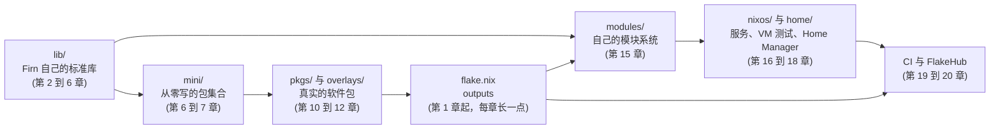

我用 NixOS 有一阵子了，这台机器的配置有相当一部分是 AI 帮我写的。它们能用，我也一直让它们保持能用，但你随便指一行问我“这一行在求值什么，最后会构建出什么”，我答不上来。下面这两条命令，就是这个系列开始之前我对自己系统的全部了解：

```text
$ nix path-info -Sh /run/current-system
/nix/store/h3q7fvkv2hr55av2jkdbgd6na0yr79na-nixos-system-thinkpad-t14s-26.05.20261029.6f06d20	  57.3 GiB
$ nix-store -qR /run/current-system | wc -l
8747
```

> [!NOTE] 本篇检查点
> 这一篇结束时你会有：一个叫 `firn` 的 git 仓库，里面有 `flake.nix`、`flake.lock`、`.envrc`、`.gitignore`、`Makefile`、`README.md`、实验运行器 `scripts/chapter.sh`、两个让所有实验共用同一份 nixpkgs 的文件 `nix/pins.nix` 和 `nix/pkgs.nix`，以及 `lab/ch01/` 下的 10 个实验。`.envrc`、`.gitignore`、`scripts/chapter.sh`、`nix/pins.nix` 和 10 个实验是最终版；`flake.nix`、`flake.lock`、`Makefile`、`README.md`、`nix/pkgs.nix` 以后还会变，文末的检查点逐个说明。`make ch01` 通过：10 个实验各打印一行 `ok`，其中两个只能在本机运行的实验（文件名以 `_host` 结尾）在 `CI=true` 时被跳过。
> 涉及的 Nix 内容：`nix repl` 的命令、`nix eval` 与 `nix-instantiate --eval`、`nix config show`、`nix path-info`、`builtins.nixVersion`、`builtins.fetchTarball`、`/etc/nix/nix.conf` 由 NixOS 生成的过程。
> 这是第 1 篇，没有前置章节。

## 这个系列怎么读

仓库叫 Firn（粒雪）。粒雪是积雪熬过一个夏天、还没压成冰的那一层：一层压着一层，下面的不再动，只往上加。这个仓库就这样长：每一章一个 git 标签，`ch01` 到 `ch20`，标签推送之后不再移动。我定了几条规矩，因为“看懂了但写不出来”这个坑，我在学 Nix 的头几个月里踩得很结实。

**边写边建。** 每一章你会在自己的 `~/firn` 里写一部分代码，从一个最小版本开始，逐步长成我的仓库里的样子。重复、冗长、和本章主题无关的部分，我会指名道姓让你从仓库里复制，并告诉你为什么现在可以不读。

**参考仓库。** 我的参考实现是 [`bfmhno3/firn`](https://github.com/bfmhno3/firn) 的各个标签。把它克隆到 `~/firn-ref`，需要看某一章的样子时检出对应标签：

```bash
git clone https://github.com/bfmhno3/firn ~/firn-ref
git -C ~/firn-ref checkout -q ch01
```

你自己的 `~/firn` 从 `ch01` 复制几个文件起步：`flake.nix`、`flake.lock`、`.envrc`、`.gitignore`、`Makefile`、`scripts/chapter.sh` 和整个 `nix/` 目录。这一篇的 `lab/ch01/` 也可以整个复制过来，不必一个文件一个文件地敲（我还是建议你至少手敲 `arith.nix` 和 `hello.nix`，求值器的报错是自己撞出来才记得住的）：

```bash
mkdir -p ~/firn/scripts ~/firn/nix ~/firn/lab
cd ~/firn || exit 1
git init -q -b main
for f in flake.nix flake.lock .envrc .gitignore Makefile; do
  cp ~/firn-ref/"${f}" .
done
cp ~/firn-ref/scripts/chapter.sh scripts/
cp ~/firn-ref/nix/*.nix nix/
cp -r ~/firn-ref/lab/ch01 lab/
git add -A
nix develop
```

`git add -A` 不是仪式，是规则：flake 只看得到被 git 跟踪的文件，第 8 篇我会让它在你面前失败一次。第一次 `nix develop` 在提交之前会打印一行 `warning: Git tree '...' is dirty`，不用管它。

**实验场。** 每次我说“这段代码会报错”，你都应该自己试一遍。实验文件在 `lab/chNN/` 里，约定如下，全部由 `scripts/chapter.sh` 执行（下一节会逐段讲它）：

- 每个顶层的 `*.sh` 或 `*.nix` 文件在一个全新的沙箱目录里运行，沙箱路径在环境变量 `LAB_TMP` 里，仓库根目录在 `FIRN_ROOT` 里。`*.nix` 文件用 `nix eval --file` 运行。
- 标准输出、标准错误和退出码被保存到 `out/chNN/<文件名>.{stdout,stderr,status}`。文章里的“实验输出”都是从这些文件里取的。
- 文件名以 `_fail` 结尾的实验必须以非零状态退出（它们是故意失败的演示），其他实验必须退出 0。
- 文件名以 `_host` 结尾的实验读的是你这台机器本身的状态（系统闭包、`nix.conf`），在 `CI=true` 时跳过。它们的输出是我这台机器的，你的会不同。
- 凡是基于 flake 的实验，运行前先 `git add -A`。

**真实输出。** 本系列所有的命令输出，都是我在这台机器上用 Nix 2.34.9 实际跑出来的：NixOS 26.05，x86_64，16 个逻辑核，30 GiB 内存。输出偶尔会被截断（用 `...` 标出），但每一行都不会被我改写。报错里的 `/home/bfmhno3/Projects/firn` 是我机器上的路径，你的会是 `~/firn`。在 x86_64-linux 上，来自钉死的 nixpkgs 的存储路径哈希应当和你的一致；来自我这台机器自己的系统的（比如上面那个 `nixos-system-thinkpad-t14s`），当然不会。

**固定的快照。** 每章末尾有一个检查点，列出“到这里为止哪些文件必须和标签完全一致”（可以用 `diff` 验证），以及哪些文件是还会继续变的中间版本。

这个系列从一个空目录开始，一章一章长出一个叫 Firn 的 flake：先是一个小小的库，然后是一套从零写的包集合，然后是真正的软件包、模块、一个 NixOS 服务、Home Manager、CI。写完第 20 章，你能说清楚上面那 8747 个路径是怎么来的，也能自己写出生成它们的那几类东西。下面是整个系列的地图：

| 章 | 标题 | 主要的 Nix 内容 |
| --- | --- | --- |
| 1 | [第一次求值：nix repl、三副面孔与一段历史](/posts/nix-by-firn-01-first-eval/) | `nix repl`、`nix eval`、Nix 的三层结构、`nix.conf`、历史 |
| 2 | [值与类型：attrset、list、字符串与路径](/posts/nix-by-firn-02-values-and-types/) | 值类型、attrset、字符串插值、路径、`//`、`with` |
| 3 | [函数与惰性求值：thunk、seq 与不动点](/posts/nix-by-firn-03-functions-and-laziness/) | 函数、pattern 参数、thunk、`seq`、`fix`、`extends` |
| 4 | [builtins 深挖：import、文件、JSON、正则与字符串上下文](/posts/nix-by-firn-04-builtins/) | `import`、文件与 JSON/TOML、正则、字符串上下文、IFD |
| 5 | [自己写一个 lib：递归、错误处理与测试](/posts/nix-by-firn-05-own-lib/) | 递归与栈、`foldl'`、`runTests`、`--show-trace`、`--debugger` |
| 6 | [derivation 与 /nix/store：.drv、哈希与沙箱](/posts/nix-by-firn-06-derivations-and-store/) | `.drv`、store 路径、固定输出、沙箱、闭包、GC 根 |
| 7 | [从零写 stdenv，再拆开 nixpkgs 的 stdenv](/posts/nix-by-firn-07-stdenv-from-scratch/) | builder、phases、`callPackage`、setup hook、bootstrap |
| 8 | [flake：inputs、outputs、flake.lock 与纯求值](/posts/nix-by-firn-08-flakes/) | flake 结构、锁文件、`follows`、纯求值、registry |
| 9 | [两代 CLI：nix-env、nix-build、nix-shell 与 nix profile](/posts/nix-by-firn-09-cli-generations/) | 新旧命令对照、channel、profile、GC |
| 10 | [nixpkgs：callPackage、override、overlay 与 fetcher](/posts/nix-by-firn-10-callpackage-overrides-overlays/) | `callPackage`、`override`、overlay、fetcher、`lib.fileset` |
| 11 | [打包真项目：Cairn、Sift 与 Pebble](/posts/nix-by-firn-11-packaging-real-projects/) | `makeWrapper`、`buildPythonApplication`、`buildRustPackage` |
| 12 | [交叉编译与静态链接：pkgsCross、pkgsStatic 与 splicing](/posts/nix-by-firn-12-cross-and-static/) | build/host/target、`pkgsCross`、`pkgsStatic` |
| 13 | [开发环境：devShell、direnv 与 templates](/posts/nix-by-firn-13-devshells-direnv-templates/) | `mkShell`、direnv、flake 模板 |
| 14 | 给 nixpkgs 提 PR：by-name、nixpkgs-review 与 channel | `pkgs/by-name`、review 工具、channel 的生命周期 |
| 15 | 模块系统：从零写一个，再读懂 lib.evalModules | `options`/`config`、类型、优先级、`mkIf` |
| 16 | NixOS：services.cairn、VM 测试与一次 switch | NixOS 服务模块、systemd、VM 测试 |
| 17 | secrets：为什么不能进 store，以及 sops-nix | store 的可读性、sops-nix、age |
| 18 | Home Manager：programs.cairn 与用户级配置 | `programs.*`、activation、DAG |
| 19 | Determinate、FlakeHub 与 Nix 的分叉们 | 安装器、Determinate Nix、FlakeHub、分叉 |
| 20 | 工程化：CI、Cachix、lint 与可复现性 | CI、二进制缓存、lint、可复现性 |

没有哪一章是“选读”。顺序就是依赖顺序：每一章只会用到前面讲过的东西，偶尔需要提前露个脸的概念，我会写明“先当成 X，第 N 篇细讲”。

如果你写 C、C++、Rust 或 Python，下面会不时出现一行对照，指向这个博客里的另外几个系列：[Pebble 的第 1 篇](/posts/rust-by-pebble-01-first-crate/)（Rust）、[Sift 的第 1 篇](/posts/python-by-sift-01-first-search/)（Python）和 [Cairn 的第 1 篇](/posts/shell-by-cairn-01-first-script/)（Shell）。Cairn、Sift 和 Pebble 三个项目会在第 11 篇变成 Nix 包。

## 没有 NixOS 的话

我这台机器是 NixOS，Nix 本身是系统的一部分。其他 Linux 或 macOS 要先装 Nix，我知道的有三条路，都是一条命令。第一条是 Nix 自带的安装脚本，手册推荐 Linux 和 macOS 都用多用户模式：

```bash
curl -L https://nixos.org/nix/install | sh -s -- --daemon
```

这是 [Nix 2.34 手册“Installation”一章](https://nix.dev/manual/nix/2.34/installation/)里的原文。第二条是 Determinate Systems 的安装器，默认装的是它自己的 Nix 发行版 Determinate Nix，也能装上游 Nix（README 说这不是受支持的配置），[README](https://github.com/DeterminateSystems/nix-installer) 里写了命令和支持的平台。第三条是 [`NixOS/nix-installer`](https://github.com/NixOS/nix-installer)，它的 README 自称“the official Nix installer maintained by the NixOS community”，并且在标题下标着 `Status: Beta`。三者装出来的东西有什么区别，我在第 19 篇逐项量；现在只需要知道，无论哪条路，装完之后都要确认 `nix-command` 和 `flakes` 这两个实验特性是打开的。怎么确认，下面读我自己的 `nix.conf` 时就会看到。

## 先坐一趟时间机器：2004 年的论文，2026 年的机器

要读懂一个系统，我的第一反应是去找它最早的那几篇文章，看作者当时到底想解决什么，再拿它们的断言去对眼前这台机器。这一趟旅行的路线是：

| 日期 | 事件 | 一手来源 |
| --- | --- | --- |
| 2004 年 11 月 | Dolstra 和 de Jonge 在第 18 届 LISA（Atlanta）发表《Nix: A Safe and Policy-Free System for Software Deployment》 | [USENIX 页面](https://www.usenix.org/conference/lisa-04/nix-safe-and-policy-free-system-software-deployment)，BibTeX 里 `month = nov` |
| 2006-01-18 | Dolstra 的博士论文《The Purely Functional Software Deployment Model》，乌得勒支大学 | [UU 研究门户](https://research-portal.uu.nl/en/publications/the-purely-functional-software-deployment-model)，`Award date 18 Jan 2006`；[论文全文](https://edolstra.github.io/pubs/phd-thesis.pdf) |
| 2008-09-22 至 24 | Dolstra 和 Löh 在 ICFP 2008（Victoria）发表《NixOS: A Purely Functional Linux Distribution》 | [论文全文](https://edolstra.github.io/pubs/nixos-icfp2008-final.pdf)，首页版权脚注写着这一日期 |
| 2021-11-01 | Nix 2.4 发布，同时带来新的 `nix` 命令和 flakes，二者都标为实验性 | [Nix 手册里的 2.4 发布说明](https://nix.dev/manual/nix/2.34/release-notes/rl-2.4) |
| 2024-07-10 | Lix 发布第一个版本 2.90，从 CppNix 2.18 分叉 | [Lix 的发布公告](https://lix.systems/blog/2024-07-10-lix-2.90-release) |

下面三个对照，是我从这几篇文章里挑出来的，每一个都能在这台机器上用一条命令验证。

**对照一：一个路径的形状。** 2008 年那篇讲持续集成的论文（[《The Nix Build Farm: A Declarative Approach to Continuous Integration》](https://edolstra.github.io/pubs/buildfarm-wasdett2008-final.pdf)；同一批作者还有一篇副标题完全相同的论文，只是把名字换成了 Hydra：[《Hydra: A Declarative Approach to Continuous Integration》](https://edolstra.github.io/pubs/hydra-scp-submitted.pdf)，它的摘要把 Hydra 称为“a continuous build tool based on Nix”，也就是建立在 Nix 之上的持续构建工具）里给过一个例子：Firefox 构建出来放在 `/nix/store/1wxsnm40dvlfcb4cqff0kjb1dqllrr3v-firefox-2.0.0.14/`，并且说前面那一串是“a 160-bit cryptographic hash”。今天我在钉死的 nixpkgs 里取 `hello` 的输出路径，然后数两个哈希的长度：

```text
$ nix eval --raw --file nix/pkgs.nix hello.outPath
/nix/store/lcxc2z1h2g8wq8dxfpizy1di85kyxnqx-hello-2.12.3
$ echo -n 1wxsnm40dvlfcb4cqff0kjb1dqllrr3v | wc -c
32
$ echo -n lcxc2z1h2g8wq8dxfpizy1di85kyxnqx | wc -c
32
```

两个都是 32 个字符。这不是巧合：160 位，每个字符 5 位（Nix 用的是自己的 base-32 编码，叫 Nix32，见 [store path 规范](https://nix.dev/manual/nix/2.34/protocols/store-path)），正好 32 个字符。字母表里是哪 32 个，我拿自己 store 里 20000 个路径的前 32 个字符数了一遍：

```text
$ ls /nix/store | grep -E '^[0-9a-z]{32}-' | cut -c1-32 | head -20000 | fold -w1 | sort -u | tr -d '\n'
0123456789abcdfghijklmnpqrsvwxyz
```

十个数字加二十二个小写字母，缺 `e`、`o`、`u`、`t`（我猜是为了避免哈希里拼出不雅的单词，没有查证）。第 6 篇我会把这 160 位是怎么算出来的亲手算一遍。现在值得记住的是：这个格式从 2008 年到 2026 年没有变过，我今天拿来比对的还是同一个概念。

**对照二：规模。** 博士论文的摘要里说，这个部署模型“has been validated by applying it to the deployment of more than 278 existing Unix packages”。我钉死的 nixpkgs 的顶层属性数是 27959（这个数字怎么数出来的，下面“为什么整个系列只钉一份 nixpkgs”一节有命令）。属性不等于包，里面有别名，也有 `python3Packages` 这样的子集合，所以 27959 除以 278 约等于 100 只是个数量级，不是精确的倍数。但数量级本身已经说明了一件事：2006 年的人在手工维护几百个表达式，而 450 万行的 nixpkgs（后面有数字），我不相信有谁通读过。

**对照三：根目录。** NixOS 那篇论文的引言里写：“There is no /usr, /lib or /opt, and only a very minimal /bin and /etc.”我去看了一眼自己的根目录：

```text
$ ls /bin /usr/bin
/bin:
sh

/usr/bin:
env
$ ls /lib
ls: cannot access '/lib': No such file or directory
$ ls -ld /opt /usr/libexec /usr/share
drwx--x--x 3 root root 4096 Aug 14 02:53 /opt
drwxr-xr-x 2 root root 4096 Oct 31 07:18 /usr/libexec
drwxr-xr-x 3 root root 4096 Oct 12 09:18 /usr/share
```

2008 年的说法大体还成立：`/bin` 里只有 `sh`，`/usr/bin` 里只有 `env`，`/lib` 不存在。有几处和论文不一样：`/usr`、`/usr/libexec`、`/usr/share` 和 `/opt` 现在都存在，我猜是因为有大量脚本写着 `#!/usr/bin/env bash`，NixOS 为了它们让步了（`/usr/bin/env` 是一个指向 coreutils 的符号链接）。其中 `/opt` 的权限是 `drwx--x--x`，我这个普通用户进不去，里面是什么我没有看。

还有一个对照，不是我从论文里挑的，是手册自己给的。上面那篇 2008 年的论文说 Nix 有一门“lazy purely functional language”，而今天 Nix 2.34 手册的[语言一章](https://nix.dev/manual/nix/2.34/language/)用一个列表介绍语言：domain-specific、declarative、pure、functional、lazy、dynamically typed。十八年过去，形容词几乎没换。这给本篇定了调子：Nix 的新东西不在底层的想法里，底层的想法在 2004 年到 2008 年之间基本定型了。变化的是外面那层壳：

```text
$ nix --option experimental-features '' eval --expr 1
error: experimental Nix feature 'nix-command' is disabled; add '--extra-experimental-features nix-command' to enable it
$ nix --option experimental-features 'nix-command' flake metadata .
error: experimental Nix feature 'flakes' is disabled; add '--extra-experimental-features flakes' to enable it
```

Nix 2.4 的发布说明里写得很清楚：新的 `nix` 命令“is still marked as experimental but its interface should not change much anymore”，flakes“are currently marked as experimental”。那是 2021-11-01。到我写这篇的时候，我用的上游 Nix 2.34.9，`nix` 命令和 flakes 在默认配置下仍然需要手动打开。五年了，我日常写的每一行都建立在两个“实验性”的东西上，这个状态我觉得值得每个新人知道。

最后一站是 2024 年。2024-07-10，Lix 团队发布第一个版本 2.90，公告里说它“forks from CppNix version 2.18”，开发从 2024 年 2 月下旬开始。分叉本身和那一年前后社区里发生的事，我留到第 19 篇，每一件都链接一手来源再讲，因为讲清楚需要先有安装器、FlakeHub 和 Determinate 的背景。这里只需要记住一件事：上游 Nix 之外现在有别的实现，本系列所有的输出来自上游的 Nix 2.34.9。

## 一个名字，三副面孔，再加一个仓库

“Nix”这个词在不同的对话里指不同的东西。我花了很久才意识到，当别人说“Nix 很难”和“NixOS 很难”的时候，他们说的常常是不同层面的东西。我现在把它拆成三层，再加上一个不属于任何一层、但你每天都在读的东西：

| 层 | 是什么 | 这台机器上的证据 | 在哪几篇 |
| --- | --- | --- | --- |
| 语言 | 一门惰性的、纯的、动态类型的函数式语言，主要工作是描述 derivation | `nix eval --expr '1 + 1'` | 2 到 5 |
| 包管理器与 store | `/nix/store`、derivation 的构建与沙箱、命令行工具、守护进程 | `nix path-info -Sh /run/current-system` | 6、8、9 |
| 操作系统 | NixOS：整个系统是 Nix 求值出来的一个 store 路径 | `nixos-version`、`/run/current-system` | 15 到 18 |
| nixpkgs | 用 Nix 语言写的软件包与 NixOS 模块的集合 | `lib.version`、27959 个顶层属性 | 7、10 到 14 |

`three_faces_host.sh` 把前三层在我这台机器上各量一次。它是第一个 `_host` 实验：量的是这台机器，不是 Firn。

```bash
echo '== language'
nix eval --expr '1 + 1'
echo '== store'
nix path-info -Sh /run/current-system
printf 'paths in closure: '
nix-store -qR /run/current-system | wc -l
echo '== operating system'
readlink /run/current-system
nixos-version
```

```text
$ cat out/ch01/three_faces_host.stdout
== language
2
== store
/nix/store/h3q7fvkv2hr55av2jkdbgd6na0yr79na-nixos-system-thinkpad-t14s-26.05.20261029.6f06d20	  57.3 GiB
paths in closure: 8747
== operating system
/nix/store/h3q7fvkv2hr55av2jkdbgd6na0yr79na-nixos-system-thinkpad-t14s-26.05.20261029.6f06d20
26.05.20261029.6f06d20 (Yarara)
```

三段输出里指向的是同一个东西，这是整件事最值得停下来看的地方。`/run/current-system` 是一个符号链接，指向 `/nix/store` 里一个叫 `nixos-system-...` 的目录。这个目录是 NixOS 的整个系统：内核、`/etc` 里的配置文件、systemd 单元、激活脚本，都在它里面或者被它引用。所谓“NixOS 是一个 Nix 表达式求值出来的结果”不是比喻，是 `readlink` 一条命令能验证的事实。这个目录里有这些东西：

```text
$ ls /run/current-system
activate
bin
boot.json
configuration-name
dry-activate
etc
extra-dependencies
firmware
init
init-interface-version
initrd
kernel
kernel-modules
kernel-params
nixos-version
prepare-root
specialisation
sw
switch-inhibitors
system
systemd
```

`activate` 是切换到这个系统时执行的脚本，`init` 是内核启动后跑的第一个程序，`etc` 是会被链接到 `/etc` 的那棵树，`sw` 是装进系统环境的所有包拼在一起的目录。第 16 篇我会拆开其中的几个。

store 这一层，我想用一个小得多的东西来演示。`hello` 是 GNU 的示例程序，打印一句问候。它在钉死的 nixpkgs 里的闭包（它自己加上它运行时依赖的一切）：

```text
$ nix path-info -rsSh "$(nix eval --raw --file nix/pkgs.nix hello.outPath)"
/nix/store/h5yzhyi8j6iq4r26giryd0rh9ynsayan-libunistring-1.4.2	   2.0 MiB	   2.0 MiB
/nix/store/kpcd405yxfc3pfv8x4mv5j3fj54v946p-libidn2-2.3.8     	 359.5 KiB	   2.3 MiB
/nix/store/v4zcvckzr9hqpg1f6bmkbf2q7fmszzvk-xgcc-15.3.0-libgcc	 193.0 KiB	 193.0 KiB
/nix/store/0d8g8n0a11v6f5m2h416ajyxmnkwc3md-glibc-2.42-67     	  33.4 MiB	  36.0 MiB
/nix/store/lcxc2z1h2g8wq8dxfpizy1di85kyxnqx-hello-2.12.3      	 273.1 KiB	  36.2 MiB
```

五个路径。第二列是路径自己的大小，第三列是它的闭包大小：`hello` 本身 273.1 KiB，它的闭包 36.2 MiB，大约是自己的 136 倍，其中 glibc 一个就占 33.4 MiB。这个数字同时说明两件事：Nix 的闭包是完整的（程序引用的 libc 就在 store 里，不是系统里恰好装着的那一份），而完整的代价是每个程序都带着它的全部依赖。`/run/current-system` 的 57.3 GiB 和 8747 个路径，就是同样的计算做在整个系统上。

> 一个用来记忆的类比我只用这一次：store 像一个只增不改的堆，路径是指针，哈希是地址的一部分，垃圾回收是真的垃圾回收。这不是我的发明，NixOS 那篇论文的作者原话是 “stored in a way analogously to a heap in a purely function language”，博士论文的摘要里还说运行时依赖是靠“scanning for cryptographic hashes in the binary contents of components”找出来的，作者自己管它叫“a technique analogous to conservative garbage collection”。第 6 篇我会把它做给你看。

我这台机器的 `/nix/store` 里一共有多少个条目，也值得看一眼：

```text
$ ls /nix/store | wc -l
119917
$ ls -ld /nix/store
drwxrwxr-t 17407 root nixbld 14675968 Nov  3 00:15 /nix/store
```

119917 个条目，当前系统只引用其中的 8747 个，约 7.3%。剩下的我猜是旧的系统代、`.drv` 文件和各个项目的开发环境（没有逐类数过，这是推断）。`/nix/store` 的属主是 `root`，属组是 `nixbld`，目录带着 sticky 位：构建是由一组叫 `nixbld*` 的用户做的，不是由你做的。这件事第 6 篇再展开。

第四层是 nixpkgs，它根本不在 Nix 里。它是一个 git 仓库，里面大部分是 Nix 语言写的文件：

```text
$ P="$(nix eval --raw --file nix/pins.nix nixpkgs)"
$ du -sh "${P}"
480M	/nix/store/z4wkdlk69gck09s64a8ghpn6h7bxhkyy-source
$ find "${P}" -name '*.nix' | wc -l
44341
$ find "${P}" -name '*.nix' -print0 | xargs -0 cat | wc -l
4498753
$ ls "${P}"
CONTRIBUTING.md
COPYING
README.md
ci
default.nix
doc
flake.nix
lib
maintainers
modules
nixos
pkgs
shell.nix
```

480 MiB，44341 个 `.nix` 文件，450 万行。注意这个仓库里有 `pkgs/`（软件包）也有 `nixos/`（NixOS 的模块）和 `lib/`（标准库）：包集合和操作系统住在同一个仓库里，同一个提交里的 `pkgs/` 和 `nixos/` 一定是互相配套的。`nix/pins.nix` 这条路径是什么意思，下面“为什么整个系列只钉一份 nixpkgs”一节讲。

所以，当你问“我该学 Nix 吗”的时候，实际上要先问：我要学哪一层。这个系列走的顺序是由里向外：先是语言（第 2 到 5 篇），因为 nixpkgs 和 NixOS 的每一行都是用它写的；然后是 store 和 derivation（第 6 篇），因为语言存在的全部理由是描述它们；然后才是 flake、nixpkgs、模块和 NixOS。如果你已经能熟练写 `{ pkgs, ... }:` 开头的配置，可以跳读，但我建议至少读第 3 篇（惰性求值），因为 NixOS 的模块系统是一个建立在惰性之上的不动点，不理解惰性就不可能理解模块系统的报错。

## 语言：一句话，几个形容词，一个任务

Nix 手册对这门语言的介绍开头是这样的：它被设计用来方便地创建和组合 derivation，也就是“precise descriptions of how contents of existing files are used to derive new files”。然后是一串形容词。我把其中最要紧的几个组成一句话，贯穿整个系列：

> Nix 是一门惰性的、纯的、动态类型的函数式语言，它的主要工作是产出 derivation。

“产出 derivation”是这句话里最不像编程语言的部分，所以我先不展开，只留一个预告：Nix 表达式求值的终点通常不是一个数或者一个字符串，而是一个描述“怎么构建某个东西”的 attrset，叫 derivation。求值和构建是两个分开的步骤，这是第 6 篇的主题。其他几个形容词，我拿最小的实验各演示一次，这样你能看见它们长什么样。

**最小的程序。** `lab/ch01/hello.nix` 是整个系列里最小的 Nix 文件：

```nix
# 最小的 Nix 文件：一个字符串。`nix eval --file` 把它的值打印出来。
"hello from lab/ch01/hello.nix"
```

```text
$ nix eval --file lab/ch01/hello.nix
"hello from lab/ch01/hello.nix"
```

一个 Nix 文件就是一个表达式，没有 `main`，没有语句，没有 `return`。`nix eval --file` 对它求值，然后把结果按 Nix 自己的语法打印出来，所以字符串带着引号。要拿到不带引号的原文，用 `--raw`，下面马上会用到。（对照：[Cairn 第 1 篇](/posts/shell-by-cairn-01-first-script/)里的第一个脚本是一串命令，执行就是“按顺序做事”；这里的第一个“程序”是一个值，执行就是“算出它是什么”。）

**数字。** `lab/ch01/arith.nix` 的整个文件：

```nix
# 整数除法截断，浮点除法不截断；`/` 两边只要有一个浮点数，结果就是浮点数。
{
  add = 1 + 2;
  intDiv = 7 / 2;
  floatDiv = 7.0 / 2;
  builtinDiv = builtins.div 7 2;
  negDiv = -7 / 2;
  mixedMul = 2 * 3.0;
  ceil = builtins.ceil 2.5;
}
```

```text
$ nix eval --file lab/ch01/arith.nix
{ add = 3; builtinDiv = 3; ceil = 3; floatDiv = 3.5; intDiv = 3; mixedMul = 6; negDiv = -3; }
```

逐个看。`7 / 2` 是 3：两个整数相除得整数，小数部分直接丢掉。`7.0 / 2` 是 3.5，只要有一边是浮点数就按浮点数算。`builtins.div 7 2` 和 `7 / 2` 是同一个东西，`/` 是它的语法糖。`-7 / 2` 是 -3 而不是 -4：丢掉小数部分是向零取整，不是向下取整（要向下取整，得用 `builtins.floor`）。`builtins.ceil 2.5` 是 3。

两件值得注意的小事。第一，输出里属性是按字母顺序排的（`add`、`builtinDiv`、`ceil`……），和源文件里的顺序无关：attrset 在 Nix 里没有顺序，打印时按名字排序（我猜内部存放时就是排好序的，没有去读求值器的代码）。第二，`mixedMul = 2 * 3.0` 打印出来是 `6`，而不是 `6.0`。它真的是浮点数，我确认过：

```text
$ nix eval --expr 'builtins.typeOf (2 * 3.0)'
"float"
$ nix eval --expr '[ 6.0 6.5 ]'
[ 6 6.5 ]
```

所以不能靠打印出来的样子判断一个数是整数还是浮点数，要用 `builtins.typeOf`。这个坑我估计会让某个人在第 2 篇的 `toString 1.0` 那里再摔一次。

**错误。** 整数除以零是求值错误。`lab/ch01/div_by_zero_fail.nix`：

```nix
# 整数除以零是求值错误，不是 inf 也不是崩溃。本文件必须失败。
1 / 0
```

文件名以 `_fail` 结尾，所以运行器期望它以非零状态退出。它的退出码和标准错误：

```text
$ cat out/ch01/div_by_zero_fail.status
1
$ cat out/ch01/div_by_zero_fail.stderr
error:
       … while evaluating the file '/home/bfmhno3/Projects/firn/lab/ch01/div_by_zero_fail.nix':

       … while calling the 'div' builtin
         at /home/bfmhno3/Projects/firn/lab/ch01/div_by_zero_fail.nix:2:3:
            1| # 整数除以零是求值错误，不是 inf 也不是崩溃。本文件必须失败。
            2| 1 / 0
             |   ^
            3|

       error: division by zero
```

这是 Nix 报错的标准形状，值得一次读熟：最下面一行 `error: ...` 是真正的错误；往上每一行以 `…` 开头的是调用栈（“求值文件时”“调用 `div` 这个内建函数时”），最里面一层带着出错位置和三行上下文，`^` 指向出错的那个运算符。注意第二行的 `div`：`/` 在求值器里就是对内建函数 `builtins.div` 的调用。第 5 篇讲 `--show-trace` 和调试器时，我们会把这套栈读到一个三层深的真实错误里去。

**惰性。** 求值器只算用得到的东西。这三条命令都是我在终端里敲的：

```text
$ nix eval --expr 'let x = throw "boom"; in 1'
1
$ nix eval --expr 'builtins.length [ (throw "a") (throw "b") ]'
2
$ nix eval --expr 'if true then "yes" else (throw "never")'
"yes"
```

`throw` 是主动抛错的内建函数。第一行里 `x` 被定义成一个必然报错的表达式，但没有人用到它，所以它从来没被求值。第二行更有意思：一个有两个元素的列表，两个元素都是炸弹，但 `length` 只数元素个数，不看元素。这就是惰性：值被包装成一个“还没算”的小对象（thunk），等有人真的需要才计算。第 3 篇我会把 thunk 的数量量出来。

**纯。** “纯”的意思是：同样的输入永远得到同样的输出，求值过程不能偷偷读环境。我在 `nix eval --expr` 里要当前系统类型，它直接拒绝了：

```text
$ nix eval --expr builtins.currentSystem
error: attribute 'currentSystem' missing
       at «string»:1:1:
            1| builtins.currentSystem
             | ^
$ nix eval --impure --expr builtins.currentSystem
"x86_64-linux"
```

`builtins.currentSystem` 是一个“不纯”的常量：它的值取决于你在哪台机器上跑。纯求值模式下它不存在。`--impure` 是显式地放弃纯度。这个行为在下一节还会再出现，因为它揭示了一个我之前不知道的区别。

**动态类型。** 类型错误要等到求值到那一步才会发现，没有编译期的检查：

```text
$ nix eval --expr '1 + "a"'
error: cannot add a string to an integer
       at «string»:1:5:
            1| 1 + "a"
             |     ^
```

这和 Python 是同一类行为（[Sift 第 1 篇](/posts/python-by-sift-01-first-search/)里的 Python 在运行到那一行才报 `TypeError`），和 Rust 不同（[Pebble 第 1 篇](/posts/rust-by-pebble-01-first-crate/)里 `rustc` 在编译期就拒绝）。第 2 篇会把 Nix 的所有值类型过一遍，`lab/ch01/ex_type_table.nix`（本篇练习 1 的答案）是它的预告。

**产出 derivation。** 最后是那个“主要工作”。钉死的 nixpkgs 里的 `hello` 是一个 attrset，我可以问它的类型，也可以问它会被构建到哪里，都不需要构建：

```text
$ nix eval --file nix/pkgs.nix hello.type
"derivation"
$ nix eval --raw --file nix/pkgs.nix hello.drvPath
/nix/store/gx2drhxsvkh7xr490rg7dpqyn53iw3z0-hello-2.12.3.drv
$ nix eval --raw --file nix/pkgs.nix hello.outPath
/nix/store/lcxc2z1h2g8wq8dxfpizy1di85kyxnqx-hello-2.12.3
$ ls -l /nix/store/gx2drhxsvkh7xr490rg7dpqyn53iw3z0-hello-2.12.3.drv
-r--r--r-- 1 root root 1861 Dec 31  1969 /nix/store/gx2drhxsvkh7xr490rg7dpqyn53iw3z0-hello-2.12.3.drv
```

`hello.type` 是字符串 `"derivation"`，这就是“derivation 是一个带 `type = "derivation"` 的 attrset”的全部含义。`drvPath` 是描述文件的位置，求值的副作用是把这个 1861 字节的 `.drv` 写进 store：我拿一个从没出现过的新 derivation 试过，求值之后 `.drv` 立刻就在那里。它是只读的，修改时间戳是 1（`stat -c %Y` 打印 1，`ls` 按本地时区显示成 Dec 31 1969），store 里的路径都这样，原因第 6 篇讲；`outPath` 是构建之后产物将在的位置，求值的时候就已经确定了，哪怕还没人构建它。这两个路径的哈希是怎么算出来的，是第 6 篇我最想亲手做的实验。

## nix repl：最短的反馈回路

学一门语言，最快的办法是找到一个你可以每秒敲一次回车的地方。Nix 的这个地方是 `nix repl`，见[手册](https://nix.dev/manual/nix/2.34/command-ref/new-cli/nix3-repl)。先看它自己怎么介绍自己：

```text
$ nix repl
Nix 2.34.9
Type :? for help.
nix-repl> :?
The following commands are available:

  <expr>                       Evaluate and print expression
  <x> = <expr>                 Bind expression to variable
  :a, :add <expr>              Add attributes from resulting set to scope
  :b <expr>                    Build a derivation
  :bl <expr>                   Build a derivation, creating GC roots in the
                               working directory
  :e, :edit <expr>             Open package or function in $EDITOR
  :i <expr>                    Build derivation, then install result into
                               current profile
  :l, :load <path>             Load Nix expression and add it to scope
  :lf, :load-flake <ref>       Load Nix flake and add it to scope
  :ll, :last-loaded            Show most recently loaded variables added to scope
  :p, :print <expr>            Evaluate and print expression recursively
                               Strings are printed directly, without escaping.
  :q, :quit                    Exit nix-repl
  :r, :reload                  Reload all files
  :sh <expr>                   Build dependencies of derivation, then start
                               nix-shell
  :t <expr>                    Describe result of evaluation
  :u <expr>                    Build derivation, then start nix-shell
  :doc <expr>                  Show documentation of a builtin function
  :log <expr>                  Show logs for a derivation
  :te, :trace-enable [bool]    Enable, disable or toggle showing traces for
                               errors
  :?, :help                    Brings up this help menu
```

这 18 个命令里，今天要用的是 `:t`、`:p`、`:l`、`:lf`、`:r`、`:doc` 和 `:q`。`:b`、`:sh`、`:u`、`:i` 会真的去构建、进 shell 或者装进你的 profile，我在这一篇里一个也不碰。下面是我用 `script` 驱动一个真终端会话录下来的转录（命令后面的内容就是你在终端里看到的）：

```text
$ nix repl
Nix 2.34.9
Type :? for help.
nix-repl> 1 + 2
3

nix-repl> :t "a" + "b"
a string

nix-repl> { a = 1 + 1; b = [ 1 2 ]; }
{
  a = 2;
  b = [ ... ];
}

nix-repl> :p { a = 1 + 1; b = [ 1 2 ]; }
{
  a = 2;
  b = [
    1
    2
  ];
}

nix-repl> x = { a = 1 + 1; }

nix-repl> x.a
2

nix-repl> :l lab/ch01/arith.nix
Added 7 variables.
add, builtinDiv, ceil, floatDiv, intDiv, mixedMul, negDiv

nix-repl> intDiv
3

nix-repl> :r
Loading "lab/ch01/arith.nix"...
Added 7 variables.
add, builtinDiv, ceil, floatDiv, intDiv, mixedMul, negDiv

nix-repl> :q
```

按顺序说。`1 + 2` 直接求值并打印。`:t` 不打印值，只说它的类型，注意它连 `"a" + "b"` 都会先求值（所以它必须能算出来才知道是字符串）。第三个表达式里，`b = [ ... ]`：repl 默认只展开一层，更深的内容用 `...` 代替；`:p` 递归地打印所有东西，同一个值现在把列表也展开了。`x = { a = 1 + 1; }` 是在 repl 里绑定变量，之后 `x.a` 就是 2。

`:l` 加载一个 Nix 文件，并且把它求值出来的 attrset 的每个属性放进当前作用域：`arith.nix` 有 7 个属性，所以“Added 7 variables”，之后 `intDiv` 单独就是一个变量，不需要写 `x.intDiv`。改了文件之后 `:r` 重新加载。这个“把 attrset 的属性倒进作用域”的动作，在语言里有一个对应的关键字 `with`，第 2 篇讲它，并且告诉你为什么我的代码风格规则禁止在整个文件范围内使用它。

`:lf` 是 `:l` 的 flake 版。在 Firn 的根目录里，`:lf .` 加载我们现在的 `flake.nix`：

```text
$ nix repl
nix-repl> :lf .
Added 14 variables.
_type, checks, devShells, inputs, lastModified, lastModifiedDate, narHash, outPath, outputs, rev, revCount, shortRev, sourceInfo, submodules

nix-repl> devShells.x86_64-linux.default.name
"nix-shell"

nix-repl> checks.x86_64-linux.dev-shell.type
"derivation"
```

14 个变量里，`checks` 和 `devShells` 是 `flake.nix` 的输出，其余的（`rev`、`narHash`、`lastModified`、`inputs`……）是 flake 自己的元信息，第 8 篇会逐个解释。`devShells.x86_64-linux.default` 是一个 derivation，它的 `name` 叫 `nix-shell`。

最后是最有用的一个用法：把 nixpkgs 加载进来。`nix/pkgs.nix` 的返回值就是钉死的 nixpkgs 的包集合，所以 `nix repl --file nix/pkgs.nix` 之后，`hello` 就是一个变量：

```text
$ nix repl --file nix/pkgs.nix
Nix 2.34.9
Type :? for help.
Loading installable ''...
Added 27959 variables.
AAAAAASomeThingsFailToEvaluate, AMB-plugins, ArchiSteamFarm, AusweisApp2, CHOWTapeModel, ChowCentaur, ChowKick, ChowPhaser, CoinMP, CuboCore, DisnixWebService, EBTKS, EmptyEpsilon, FIL-plugins, Fabric, LAStools, LASzip, LASzip2, LPCNet, LibreArp
... and 27939 more; view with :ll
nix-repl> :t hello
a set

nix-repl> hello.name
"hello-2.12.3"

nix-repl> hello.type
"derivation"

nix-repl> hello.meta.description
"Program that produces a familiar, friendly greeting"

nix-repl> hello.drvPath
"/nix/store/gx2drhxsvkh7xr490rg7dpqyn53iw3z0-hello-2.12.3.drv"

nix-repl> :doc builtins.map
Synopsis: builtins.map f list

Apply the function f to each element in the list list. For
example,

  │ map (x: "foo" + x) [ "bar" "bla" "abc" ]

evaluates to [ "foobar" "foobla" "fooabc" ].

nix-repl> :q
```

27959 个变量，也就是钉死的 nixpkgs 的 27959 个顶层属性，其中第一个按字母排序（大写在前）居然叫 `AAAAAASomeThingsFailToEvaluate`，我猜这是故意取的名字，用来保证某一类遍历在最前面就撞到它，我没有去查它的用途。`:t hello` 说 `hello` 是 `a set`：repl 的 `:t` 只报告值的基本类型，derivation 也是 attrset，要用 `hello.type` 才能区分。`:doc` 打印内建函数的手册，文本就取自 [builtins 参考](https://nix.dev/manual/nix/2.34/language/builtins)，所以你在离线时也能查到它。

这些在 Nix 2.4 里就有了：发布说明的列表里有一条，“`nix repl` has a new `:doc` command to show documentation about builtin functions (e.g. `:doc builtins.map`)”。

不用终端也能驱动 repl，这就是实验 `repl_session.sh`。它把命令写在一个 here-document 里，通过管道喂给 `nix repl`：

```bash
#######################################
# Strip ANSI escapes and carriage returns from stdin.
#######################################
clean() {
  sed -e 's/\x1b\[[0-9;?]*[A-Za-z]//g' -e 's/\r$//'
}

nix repl --file "${FIRN_ROOT}/nix/pkgs.nix" 2>&1 <<'REPL' | clean
:t 1
:t hello
hello.name
:doc builtins.map
:q
REPL
```

输出（运行器保存的 `out/ch01/repl_session.stdout`，一共 21 行）和上面那一段对应的部分一致，只是没有 `nix-repl>` 提示符：标准输入不是终端，repl 就不打印它（我没有去查这是不是有意的设计）。`clean` 函数去掉可能混进输出里的终端控制序列。我用 `cat -v` 看过，这一次的原始输出里并没有任何控制序列，我还是留着它，是因为别的终端环境里不一定如此，实验的输出要保证是稳定的纯文本。

```text
$ cat out/ch01/repl_session.stdout
Nix 2.34.9
Type :? for help.
Loading installable ''...
Added 27959 variables.
AAAAAASomeThingsFailToEvaluate, AMB-plugins, ArchiSteamFarm, AusweisApp2, CHOWTapeModel, ChowCentaur, ChowKick, ChowPhaser, CoinMP, CuboCore, DisnixWebService, EBTKS, EmptyEpsilon, FIL-plugins, Fabric, LAStools, LASzip, LASzip2, LPCNet, LibreArp
... and 27939 more; view with :ll
an integer

a set

"hello-2.12.3"

Synopsis: builtins.map f list

Apply the function f to each element in the list list. For
example,

  │ map (x: "foo" + x) [ "bar" "bla" "abc" ]

evaluates to [ "foobar" "foobla" "fooabc" ].

```

repl 是这个系列的白板。接下来每一篇，只要我说“你可以自己试试”，意思就是“在 repl 里”。

## 两个命令行入口：nix eval 与 nix-instantiate --eval

Nix 有两套命令行。老的一套是 `nix-` 开头的一堆独立命令：`nix-instantiate`、`nix-build`、`nix-shell`、`nix-env`、`nix-store`……新的一套是一个叫 `nix` 的命令加子命令：`nix eval`、`nix build`、`nix develop`……2.4 的发布说明说新的命令行“aims to be more modern, consistent and pleasant to use”。两套并存，网上的教程混着用，而同一个功能在两套里的行为并不总是一样。完整的对照表是第 9 篇的内容；这一篇我只看“求值”这一项，因为它是你会天天敲的。

`lab/ch01/eval_vs_instantiate.sh` 把同样的表达式喂给两套命令。脚本里有一个小函数，把命令行打印出来再执行，这样输出里就带着命令：

```bash
#######################################
# Print a command with its last argument single-quoted, then run it.
#######################################
show() {
  printf '$ %s '"'%s'"'\n' "${*:1:$#-1}" "${!#}"
  "$@"
}

attrs='{ a = 1 + 1; b = "x"; }'
list='[ (1 + 1) "x" ]'

show nix eval --expr "${attrs}"
show nix-instantiate --eval --expr "${attrs}"
show nix-instantiate --eval --strict --expr "${attrs}"
show nix-instantiate --eval --strict --json --expr "${attrs}"
# ...
```

`"${*:1:$#-1}"` 是“除最后一个参数以外的所有参数”，`"${!#}"` 是最后一个参数（间接展开 `$#` 号位置参数），这样表达式作为最后一个参数被单独加上引号打印。它们是 Bash 的参数展开，不起新进程，符合 Shell 风格规则里“能用内建就不起进程”的那一条。输出一共 22 行（最后一行 `no quotes` 后面没有换行符，所以 `wc -l` 数出来是 21）：

```text
$ cat out/ch01/eval_vs_instantiate.stdout
$ nix eval --expr '{ a = 1 + 1; b = "x"; }'
{ a = 2; b = "x"; }
$ nix-instantiate --eval --expr '{ a = 1 + 1; b = "x"; }'
{ a = <CODE>; b = "x"; }
$ nix-instantiate --eval --strict --expr '{ a = 1 + 1; b = "x"; }'
{ a = 2; b = "x"; }
$ nix-instantiate --eval --strict --json --expr '{ a = 1 + 1; b = "x"; }'
{"a":2,"b":"x"}
$ nix eval --json --expr '{ a = 1 + 1; b = "x"; }'
{"a":2,"b":"x"}
$ nix eval --expr '[ (1 + 1) "x" ]'
[ 2 "x" ]
$ nix-instantiate --eval --expr '[ (1 + 1) "x" ]'
[ <CODE> "x" ]
$ nix-instantiate --eval --strict --expr '[ (1 + 1) "x" ]'
[ 2 "x" ]
$ nix eval --expr '1 + 1'
2
$ nix-instantiate --eval --expr '1 + 1'
2
$ nix eval --raw --expr '"no quotes"'
no quotes
```

第二行是整个实验的看点：`nix-instantiate --eval` 对同一个 attrset 打印出 `{ a = <CODE>; b = "x"; }`。`b` 是个字符串字面量，已经是值了，所以直接显示；`a = 1 + 1` 是一个还没算的表达式，`<CODE>` 就是它的 thunk，老命令只求值到最外层的 attrset 就停了，不去碰里面的东西。这是惰性的一个直接可见的后果，而且老命令的默认就是这样。加上 `--strict`，`nix-instantiate` 才会把所有东西递归地算完。新命令 `nix eval` 没有这个开关，同样的表达式它直接打印 `{ a = 2; b = "x"; }`，递归地全算完。

另外几点：`--json` 在两套命令里都能把结果按 JSON 打印（`{"a":2,"b":"x"}`，注意没有空格），这使得 `nix eval --json ... | jq` 成为从 Nix 数据里取值的标准办法，后面的实验会大量使用。`--raw` 只有新命令有，用于字符串，不带引号也不带换行（所以输出最后一行 `no quotes` 后面直接是文件结尾）。老命令里的对应物是 `nix-instantiate --eval --raw`，没有量过，不展开。

这里有一个我完全没料到的区别。回头看纯求值那一节：`nix eval --expr builtins.currentSystem` 失败了。再比较老命令和 `--file`：

```text
$ nix-instantiate --eval --expr builtins.currentSystem
"x86_64-linux"
$ echo 'builtins.currentSystem' > /tmp/cs.nix
$ nix eval --file /tmp/cs.nix
"x86_64-linux"
$ nix eval --pure-eval --file /tmp/cs.nix
error: '--file' is not compatible with '--pure-eval'
Try 'nix --help' for more information.
$ nix-instantiate --eval --pure-eval --expr builtins.currentSystem
error: attribute 'currentSystem' missing
       at «string»:1:1:
            1| builtins.currentSystem
             | ^
```

结论是：在这个 2.34.9 里，`nix eval --expr` 默认就是纯求值，`nix-instantiate --eval` 和 `nix eval --file` 默认不是。证据之一是配置项本身：

```text
$ nix config show pure-eval
true
$ nix --option pure-eval false eval --expr builtins.currentSystem
"x86_64-linux"
```

`/etc/nix/nix.conf` 里没有 `pure-eval` 这一行（我 grep 过），我的用户配置里也没有这个设置，所以 `true` 是 `nix` 命令自己的默认。而手册的[配置参考](https://nix.dev/manual/nix/2.34/command-ref/conf-file)里 `pure-eval` 一节写的是 `Default: false`。我没有读源码，不知道这是新命令的专门行为，还是这个版本有意把默认值改了，我猜是前者；在下面“为什么整个系列只钉一份 nixpkgs”一节，你会看到这个区别怎么影响 Firn 的实验：Firn 的 `.nix` 实验都通过 `nix eval --file` 运行，所以它们可以读 `builtins.currentSystem`，而需要 `--expr` 的地方，我写了 `--impure`。第 8 篇会专门讲纯求值：它禁止什么，为什么 flake 要求它。

纯求值还会拒绝另一类东西：绝对路径。在 Firn 的仓库里让 `--expr` 去插值当前目录：

```text
$ nix eval --expr '"${./.}"'
error: access to absolute path '/home/bfmhno3/Projects/firn' is forbidden in pure evaluation mode (use '--impure' to override)
```

`./.` 要被拷进 store 才能插值，而纯求值不允许读这个求值之外的目录。第 2 篇会讲路径怎样被拷进 store。

还有一个小对照，是我给自己出的：函数怎么打印？

```text
$ nix eval --expr 'x: x'
«lambda @ «string»:1:1»
$ nix-instantiate --eval --expr 'x: x'
<LAMBDA>
$ nix eval --expr 'builtins.add'
«primop add»
$ nix eval --expr 'builtins.typeOf builtins.add'
"lambda"
```

两个命令对同一个函数用了两种不同的占位。最后两行是我这篇里最喜欢的一个小发现：`builtins.add` 是用 C++ 写的内建函数，打印出来是 `«primop add»`，但 `builtins.typeOf` 说它是 `"lambda"`。对 Nix 语言来说，函数就是函数，不区分是用 Nix 写的还是内建的。（练习 1 把这个放进了一张十行的类型表里。）

### 你正在用的是哪个 Nix

脚本 `lab/ch01/which_nix.sh` 回答这个问题：

```bash
nix --version
readlink -f "$(command -v nix)"
nix eval --expr 'builtins.nixVersion'
nix eval --expr 'builtins.langVersion'
```

```text
$ cat out/ch01/which_nix.stdout
nix (Nix) 2.34.9
/nix/store/wh4dksj5jz315f46g5rrn65mfyhjm23h-nix-2.34.9/bin/nix
"2.34.9"
6
```

四行。`nix` 这个可执行文件本身是 store 里的一个路径：`nix-2.34.9` 和 `hello-2.12.3` 一样，是一个被哈希命名的目录。`builtins.nixVersion` 是求值器自己报告的版本，`"2.34.9"`，是个字符串；`builtins.langVersion` 是语言自己的版本号，这里是整数 `6`，它和 Nix 的版本号是两回事。第二行的 `readlink -f` 值得养成习惯：`PATH` 上可能有不止一个 Nix（系统的、profile 里的、开发环境里的），报 bug 或者对比输出之前，先确认是哪一个在求值。

我之所以在第 1 篇就把这件事摆出来，是因为这个系列里“同一条命令在你那里输出不同”的最大来源就是 Nix 的版本。第 19 篇我会专门比较：安装器、Determinate Nix 的发行版、还有 Lix，在这一行上各自打印什么。

## 这台机器上的 Nix

上面所有的命令都靠 `/etc/nix/nix.conf` 里的几行设置才能运行：`nix-command` 和 `flakes` 在那里被打开。我之前从来没有认真读过这个文件。`nix_conf_host.sh` 是读它的实验：

```bash
for key in experimental-features substituters sandbox max-jobs cores \
  trusted-users; do
  printf '%s = ' "${key}"
  nix config show "${key}"
done
printf 'trusted-public-keys count = '
nix config show trusted-public-keys | wc -w
echo '== head -3 /etc/nix/nix.conf'
head -3 /etc/nix/nix.conf
```

```text
$ cat out/ch01/nix_conf_host.stdout
experimental-features = fetch-tree flakes nix-command
substituters = https://mirror.sjtu.edu.cn/nix-channels/store https://mirrors.tuna.tsinghua.edu.cn/nix-channels/store https://mirrors.ustc.edu.cn/nix-channels/store https://cache.nixos.org https://cache.nixos.org/ https://nix-community.cachix.org
sandbox = true
max-jobs = 16
cores = 0
trusted-users = root bfmhno3
trusted-public-keys count = 2
== head -3 /etc/nix/nix.conf
# WARNING: this file is generated from the nix.* options in
# your NixOS configuration, typically
# /etc/nixos/configuration.nix.  Do not edit it!
```

`nix config show <名字>` 打印的是“生效的”设置，也就是 Nix 把所有配置来源合并之后的结果。文件本身是这样的（我只挑了和上面对应的行）：

```text
$ grep -E '^(experimental-features|substituters|trusted-users|extra-|system-features|trusted-public-keys)' /etc/nix/nix.conf
experimental-features = nix-command flakes
substituters = https://mirror.sjtu.edu.cn/nix-channels/store https://mirrors.tuna.tsinghua.edu.cn/nix-channels/store https://mirrors.ustc.edu.cn/nix-channels/store https://cache.nixos.org https://cache.nixos.org/
system-features = nixos-test benchmark big-parallel kvm
trusted-public-keys = cache.nixos.org-1:6NCHdD59X431o0gWypbMrAURkbJ16ZPMQFGspcDShjY=
trusted-users = root bfmhno3
extra-sandbox-paths = 
extra-substituters = https://nix-community.cachix.org
extra-trusted-public-keys = nix-community.cachix.org-1:mB9FSh9qf2dCimDSUo8Zy7bkq5CX+/rkCWyvRCYg3Fs=
```

对比两份，有三件事我之前不知道。

**第一，`extra-` 前缀是“追加”，`nix config show` 把它合并进了基础名字。** 文件里 `substituters` 有 5 个地址，另有一行 `extra-substituters` 追加了 `https://nix-community.cachix.org`；`nix config show substituters` 打印的是 6 个。同理 `trusted-public-keys` 文件里是 1 把，`extra-trusted-public-keys` 追加 1 把，所以实验里数出来是 2。试图直接读 `extra-substituters` 会失败：

```text
$ nix config show extra-substituters
error: could not find setting 'extra-substituters'
```

**第二，`experimental-features` 在文件里是 `nix-command flakes`，生效的却是三个：`fetch-tree flakes nix-command`。** 多出来的 `fetch-tree` 我没有设过。我猜它是被 `flakes` 带出来的（`builtins.fetchTree` 是 2.4 发布说明里列出的新内建函数，flakes 的输入都靠它取），但这只是猜测，没有读源码证实。

**第三，`cache.nixos.org` 出现了两次**，一次没有结尾的斜杠，一次有：`https://cache.nixos.org` 和 `https://cache.nixos.org/`。这个重复是怎么来的，我追到了 nixpkgs 的源码。

### 这个文件是谁生成的

文件开头三行已经说了：“this file is generated from the nix.* options in your NixOS configuration”。再往前追一步，`/etc/nix/nix.conf` 本身只是一个符号链接：

```text
$ ls -l /etc/nix/nix.conf /etc/static/nix/nix.conf
lrwxrwxrwx 1 root root 24 Oct 31 19:38 /etc/nix/nix.conf -> /etc/static/nix/nix.conf
lrwxrwxrwx 3 root root 52 Dec 31  1969 /etc/static/nix/nix.conf -> /nix/store/nnrxcb8fv4j79npn1gz1rz3wjphs1nqp-nix.conf
```

链子是：`/etc/nix/nix.conf` → `/etc/static/nix/nix.conf` → `/nix/store/...-nix.conf`。最后这个 store 路径是 NixOS 求值出来的，是一个只读文件，所以文件头才会说“Do not edit it”：你改不了，也不该改，要改的是生成它的那个 NixOS 选项 `nix.settings`。生成的代码在 nixpkgs 的 `nixos/modules/config/nix.nix`，我引用钉死的版本[第 430 到 436 行](https://github.com/NixOS/nixpkgs/blob/56c02bc00adcf003215cc4bd996d6efaf4cff188/nixos/modules/config/nix.nix#L430-L436)：

```nix
    environment.etc."nix/nix.conf".source = nixConf;
    nix.settings = {
      trusted-public-keys = [ "cache.nixos.org-1:6NCHdD59X431o0gWypbMrAURkbJ16ZPMQFGspcDShjY=" ];
      trusted-users = [ "root" ];
      substituters = mkAfter [ "https://cache.nixos.org/" ];
      system-features = defaultSystemFeatures;
    };
```

第一行把 `nixConf` 放到 `/etc/nix/nix.conf`；后面是 NixOS 自己为 `nix.settings` 设的默认值。`substituters = mkAfter [ "https://cache.nixos.org/" ]` 就是第二个 `cache.nixos.org` 的来源：不管你的配置怎么写，NixOS 都会在列表最后追加一个带斜杠的 `cache.nixos.org`。而我的配置里已经写了一个不带斜杠的，所以两个都在，Nix 把它们当成两个不同的字符串，`nix config show` 逐个列出。两个指向同一个缓存，它会不会多发一次请求，我没有量过。`mkAfter` 是模块系统的东西，第 15 篇讲。头三行那段 `WARNING` 文本的出处是[`pkgs/pkgs-lib/formats.nix` 第 907 行](https://github.com/NixOS/nixpkgs/blob/56c02bc00adcf003215cc4bd996d6efaf4cff188/pkgs/pkgs-lib/formats.nix#L907)。（这是钉死的 nixpkgs，而这台机器当前的系统是 `26.05.20261029`，比钉死的版本晚；我没有逐行比较两个版本之间 `nix.nix` 有没有变化，但生成出来的文件开头和结构与这份源码一致。）

所以 NixOS 上“改 Nix 的设置”的完整路径是：在配置里写 `nix.settings.xxx = ...`，`nixos-rebuild switch`，`/etc/static` 的链接被指向新的 store 路径，`/etc/nix/nix.conf` 就变了。没有任何一步是“编辑一个文件”，每一步都是产出一个新的 store 路径再切换链接。这是第 16 篇的主线，我先在这里埋个头。

### 几个值得读的设置

这台机器的设置里，我现在能解释的有这些，其余的留到用到它们的那一篇：

- `substituters`：Nix 在本地没有某个路径的时候，去哪里问有没有现成的二进制。前三个是上海交大、清华、中科大的镜像，地址的形状都是 `.../nix-channels/store`；第 4、5 个是官方缓存 `cache.nixos.org`；第 6 个是 nix-community 的 Cachix 缓存。我之前在这篇里构建 `hello` 的时候，Nix 打印的是 `copying path '/nix/store/lcxc2z1h2g8wq8dxfpizy1di85kyxnqx-hello-2.12.3' from 'https://mirror.sjtu.edu.cn/nix-channels/store'...`，所以第一个镜像确实被用到了。这三个镜像各有多快，第 20 篇我会用 `curl` 量出来。
- `trusted-public-keys`：从缓存拿到的路径要有签名，签名的公钥必须在这里。只信 `cache.nixos.org` 和 nix-community 两把。
- `trusted-users = root bfmhno3`：手册说这些用户连接守护进程时有额外的权限，比如指定额外的 substituter、导入没有签名的 store 对象（[`trusted-users`](https://nix.dev/manual/nix/2.34/command-ref/conf-file)）。为什么这个权限需要被小心地给出去，第 20 篇讲。
- `sandbox = true`：构建在沙箱里进行。第 6 篇会从里面看一眼沙箱。
- `max-jobs = 16`、`cores = 0`：文件里 `max-jobs = auto`，`nix config show` 把它解析成了具体的 16（这台机器的逻辑核数），它控制同时跑几个构建。`cores = 0` 管另一件事，手册说得很清楚（[`cores`](https://nix.dev/manual/nix/2.34/command-ref/conf-file)）：设成 0 时，Nix 自己检测核数，通过环境变量 `NIX_BUILD_CORES` 告诉构建器，每个构建内部最多并行多少由它自己定，两者互相独立。
- `system-features = nixos-test benchmark big-parallel kvm`：这台机器声称自己能构建需要这些特性的东西，其中 `kvm` 和 `nixos-test` 是第 16 篇的 VM 测试要用的。

## 为什么整个系列只钉一份 nixpkgs

到这里，该看 Firn 自己的第一个文件了。整个系列有一个原则：**所有实验用同一份 nixpkgs**。我先给这条规矩一个理由，再看实现。

理由是这样的。上面所有 `nix eval --file nix/pkgs.nix ...` 命令，如果换成你在网上常见的写法 `import <nixpkgs> {}`，在我这台机器上是什么结果？

```text
$ echo "${NIX_PATH}"
nixpkgs=flake:nixpkgs:/nix/var/nix/profiles/per-user/root/channels
$ nix eval --raw --file nix/pkgs.nix lib.version
26.11pre-git
$ nix eval --impure --raw --expr '(import <nixpkgs> {}).lib.version'
26.05pre-git
```

同一台机器，同一个用户，两个 nixpkgs：钉死的是 `26.11pre-git`，`<nixpkgs>` 这个“查找路径”解析到的是 `26.05pre-git`。`<nixpkgs>` 的意思是“去环境变量 `NIX_PATH` 里找一个叫 nixpkgs 的东西”，它指向哪里取决于你的 channel 配置和你的 registry，所以你机器上的 `<nixpkgs>` 和我的几乎肯定不是同一个版本。这就是为什么 Nix 的老教程里的命令，你照着敲经常得到和作者不同的结果：同样的字符 `<nixpkgs>`，在两台机器上是两份不同的代码。这个问题的完整解法是第 8 篇的 flake 和锁文件；Firn 的实验要在没有 flake 的 `nix eval --file` 里工作，所以需要一个更小的东西：一个能让不走 flake 的代码拿到“和 flake 里完全一样”的 nixpkgs 的文件。这就是 `nix/pins.nix`，11 行：

```nix
# 从 flake.lock 读出 nixpkgs 的版本，让不用 flake 的代码拿到同一份 nixpkgs。
let
  lock = builtins.fromJSON (builtins.readFile ../flake.lock);
  inherit (lock.nodes.nixpkgs) locked;
in
{
  nixpkgs = builtins.fetchTarball {
    url = "https://github.com/NixOS/nixpkgs/archive/${locked.rev}.tar.gz";
    sha256 = locked.narHash;
  };
}
```

这是整个系列第一段“真的 Nix 代码”，我逐行读：

- `let ... in` 引入局部变量。`lock` 是读 `flake.lock` 这个 JSON 文件（`builtins.readFile`，路径 `../flake.lock` 相对于 `pins.nix` 自己所在的目录，不是相对于你的当前目录）再用 `builtins.fromJSON` 解析出来的 attrset。
- `inherit (lock.nodes.nixpkgs) locked;` 是 `locked = lock.nodes.nixpkgs.locked;` 的缩写。`flake.lock` 里 `nodes.nixpkgs.locked` 记录了锁定的版本：
  ```text
  $ jq -c .nodes.nixpkgs.locked flake.lock
  {"lastModified":1787498568,"narHash":"sha256-9i/VTdusq/+NM/tz+J1Re+ojkMB8MBf0QshnYfzHz30=","owner":"NixOS","repo":"nixpkgs","rev":"56c02bc00adcf003215cc4bd996d6efaf4cff188","type":"github"}
  ```
- 最后的 attrset 只有一个属性，`nixpkgs`，值是 `builtins.fetchTarball` 的结果：一个在求值时就下载并解压 GitHub 上那个 commit 的压缩包的内建函数，返回解压后的 store 路径。`url` 里的 `${locked.rev}` 是字符串插值。`sha256 = locked.narHash;` 是关键：给了哈希，`fetchTarball` 就知道“我要的内容是什么”，下载回来校验，而不是信任 URL。`narHash` 是 SRI 格式（`sha256-` 加 base64），这种格式 `fetchTarball` 的 `sha256` 参数直接接受。

`builtins.fetchTarball` 是“求值时取”（eval-time fetcher），它和以后会见到的构建时取（`pkgs.fetchurl`）的区别是第 4 篇和第 10 篇的内容。这里我只验证一件事：用这个办法拿到的 nixpkgs，是不是和 flake 本身锁定的那一份是同一个 store 路径？

```text
$ nix eval --raw --file nix/pins.nix nixpkgs
/nix/store/z4wkdlk69gck09s64a8ghpn6h7bxhkyy-source
$ nix eval --raw --impure --expr '(builtins.getFlake (toString ./.)).inputs.nixpkgs.outPath'
/nix/store/z4wkdlk69gck09s64a8ghpn6h7bxhkyy-source
```

同一个路径，`z4wkdlk6...-source`。这个等式成立的原因是 store 路径由内容决定：同样的 NAR 哈希，同样的名字 `source`，同样的位置。（`builtins.getFlake` 是 flake 在求值器里的接口，这里临时借来取出 flake 的输入，第 8 篇讲。）

再看 `nix/pkgs.nix`，9 行：

```nix
# 不经过 flake 导入锁定版本的 nixpkgs。
{
  system ? builtins.currentSystem,
  overlays ? [ ],
}:
import (import ./pins.nix).nixpkgs {
  inherit system overlays;
  config = { };
}
```

它是一个函数，参数是一个 attrset，两个参数都有默认值（`?`）：`system` 默认是当前系统，`overlays` 默认是空列表。`import (import ./pins.nix).nixpkgs { ... }` 做的是：先导入 `pins.nix` 取出 `nixpkgs` 属性（一个 store 路径，指向 nixpkgs 的源码树），再对这个路径做 `import`（导入一个目录等于导入它里面的 `default.nix`），得到 nixpkgs 的主函数，最后用 `{ system; overlays; config; }` 调用它。`config = { }` 是一个重要的细节：不传 `config`，nixpkgs 会去读你家目录里的 `~/.config/nixpkgs/config.nix`，又是一个把机器状态漏进求值的地方；传空的 `{ }` 就把这个口子堵死。`overlays` 在第 10 篇才会有内容。

因为默认的 `system` 用到了 `builtins.currentSystem`，`nix/pkgs.nix` 只能在不纯的求值里用：`nix eval --file` 可以（所以实验里的 `.nix` 文件能 `import ../../nix/pkgs.nix { }`），`nix eval --expr` 则必须带 `--impure`。这条规矩在上一节的小实验里已经遇到过了，现在你看到了它的代价。

最后是一个实验，`pkgs_size.sh`。它回答“钉死的 nixpkgs 有多大”：

```bash
expr="builtins.length (builtins.attrNames (import ${FIRN_ROOT}/nix/pkgs.nix { }))"
start="${EPOCHREALTIME/./}"
count="$(nix eval --impure --expr "${expr}")"
end="${EPOCHREALTIME/./}"
echo "top-level attributes: ${count}"
echo "eval time: $(((end - start) / 1000)) ms"
echo "== line counts"
cd "${FIRN_ROOT}"
wc -l flake.nix scripts/chapter.sh nix/*.nix
```

`EPOCHREALTIME` 是 Bash 5 的内建变量，值是带微秒的 Unix 时间，形如 `1787498568.123456`；`${EPOCHREALTIME/./}` 去掉小数点得到微秒整数，两个相减除以 1000 是毫秒。这样计时不起任何外部进程，符合 Shell 风格规则里“优先用内建，不为了一个时间戳去调 `date`”那一条。`builtins.attrNames` 返回一个 attrset 所有属性名的列表，`builtins.length` 数它。

```text
$ cat out/ch01/pkgs_size.stdout
top-level attributes: 27959
eval time: 182 ms
== line counts
  68 flake.nix
 121 scripts/chapter.sh
  11 nix/pins.nix
   9 nix/pkgs.nix
 209 total
```

27959 个顶层属性，求值用时 182 ms。实验只跑了一次，为了确认这个数字不是偶然，我又用 `hyperfine` 跑了五次同一个表达式：平均 179.4 ms，范围 175.7 到 183.7 ms。nixpkgs 有 450 万行 Nix（上面数过），一个 attrset 里有近三万个名字，而我只花了不到 200 ms 就拿到了所有名字，这不可能是“把所有包都算了一遍”。它没有：`attrNames` 只需要知道有哪些名字，名字对应的值（每一个都是一个包，背后是几百行表达式）一个都没算。这是惰性的又一次演示，也是第 3 篇会拿来量的数字：`hello.name` 要算多少个 thunk，`hello.outPath` 要算多少个，占整个 nixpkgs 的几分之几。

注意最后的行数：整个 Firn 的基础设施，`flake.nix`、运行器 `scripts/chapter.sh`、`nix/` 下两个文件，合计 209 行。后面所有的章节都建在这 209 行之上。

## Firn 的地图

写之前，我先把整个 Firn 要长成什么样画出来。每个方框是一类东西，箭头是依赖方向，括号里是它们在哪几章出现：



从左到右读：`lib/` 是一个不依赖 nixpkgs 的小标准库，用来练语言本身；`mini/` 是用它从零搭出来的一个微型包集合，用来理解 nixpkgs 的结构；`pkgs/` 是真正放进 nixpkgs 风格的包；`flake.nix` 把它们都导出；`modules/` 是模块系统；`nixos/` 和 `home/` 是建在它上面的 NixOS 服务和 Home Manager 配置；最后是 CI。`flake.nix` 不是一个中间步骤，它从这一章就存在，每一章往里添一点，所以图里它被画成一个节点，同时既被依赖也依赖别人。

今天的 Firn 还没有任何这些。它只有一个开发环境和一个实验运行器。README 里记下了现在的布局：

```text
flake.nix, flake.lock   the flake; nixpkgs is pinned in the lock file
nix/pins.nix            reads flake.lock, fetches the same nixpkgs without flakes
nix/pkgs.nix            `import` of that nixpkgs, for labs
scripts/chapter.sh      lab runner
lab/chNN/               small experiments, one directory per chapter
Makefile                entry points: chNN, chapters, lint, check, ci, clean
```

## 实验运行器和 Makefile

每个系列的底层都需要一个“跑实验”的设施。Firn 的设施是 `scripts/chapter.sh`，从 [Cairn 的运行器](https://github.com/bfmhno3/cairn/blob/ch10/scripts/chapter.sh)改过来，所以如果你读过 Cairn 系列会觉得眼熟：121 行 Bash，按 Google Shell 风格写的（`#!/usr/bin/env bash`、文件头注释、函数头注释、一个 `err` 帮助函数、最后一行 `main "$@"`）。

先看它怎样跑一个实验。核心是 `run_lab` 里的这一段：

```bash
  local status
  (
    cd "${lab_tmp}" || exit 1
    export FIRN_ROOT
    export LAB_TMP="${lab_tmp}"
    if [[ "${rel}" == *.nix ]]; then
      timeout 1800 nix eval --file "${FIRN_ROOT}/${rel}"
    elif [[ -x "${FIRN_ROOT}/${rel}" ]]; then
      timeout 1800 "${FIRN_ROOT}/${rel}"
    else
      timeout 1800 bash "${FIRN_ROOT}/${rel}"
    fi
  ) >"${out_dir}/${stem}.stdout" 2>"${out_dir}/${stem}.stderr"
  status=$?
  printf '%d\n' "${status}" >"${out_dir}/${stem}.status"

  chmod -R u+w "${lab_tmp}"
  rm -rf "${lab_tmp}"
  return "${status}"
```

整段放在一对圆括号里，也就是一个子 shell：`cd` 和两个 `export` 只影响子 shell，不会污染运行器本身。`cd "${lab_tmp}"` 让每个实验在自己的沙箱目录里运行，沙箱是上面几行 `mktemp -d` 建的临时目录。三种文件：`.nix` 走 `nix eval --file`，有可执行位的脚本直接运行，其他 `.sh` 用 `bash`。每一条外面都套了 `timeout 1800`，所以一个卡住的实验最多占 30 分钟。子 shell 的标准输出和标准错误被重定向到 `out/chNN/<名字>.stdout` 和 `.stderr`，退出码写进 `.status`。

最后两行的 `chmod -R u+w` 是个不起眼但绝不能省的细节：后面的实验会把 store 里的文件拷到沙箱里，而 store 里的东西是只读的（目录是 `dr-xr-xr-x`），`rm -rf` 删不掉只读目录里的文件。我拿 `hello` 的输出目录试过：

```text
$ cp -r /nix/store/lcxc2z1h2g8wq8dxfpizy1di85kyxnqx-hello-2.12.3 /tmp/cpt
$ rm -rf /tmp/cpt
rm: cannot remove '/tmp/cpt/bin/hello': Permission denied (os error 13)
...
```

先 `chmod -R u+w`，再删，就干净了。

再看 `main` 里的循环，它决定哪些文件跑、怎么判断成败：

```bash
  while IFS= read -r file; do
    rel="lab/${chapter}/${file}"
    stem="${file%.*}"
    if [[ "${stem}" == *_host && "${CI:-}" == true ]]; then
      printf 'skip %s (host only)\n' "${rel}"
      continue
    fi
    expected=ok
    [[ "${stem}" == *_fail ]] && expected=fail
    run_lab "${chapter}" "${rel}"
    status=$?
    if [[ "${expected}" == ok && "${status}" -eq 0 ]] \
      || [[ "${expected}" == fail && "${status}" -ne 0 ]]; then
      printf 'ok   %s\n' "${rel}"
    else
      printf 'FAIL %s (exit %d)\n' "${rel}" "${status}"
      tail -n 20 "${FIRN_ROOT}/out/${chapter}/${stem}.stderr"
      failed=1
    fi
  done < <(cd "${lab_dir}" && LC_ALL=C find . -maxdepth 1 -type f \
    \( -name '*.sh' -o -name '*.nix' \) -printf '%f\n' | LC_ALL=C sort)
```

`${file%.*}` 去掉扩展名，得到 `stem`；`_host` 和 `_fail` 就是对 `stem` 的后缀判断，`[[ ... == *_host ]]` 是 Bash 的模式匹配。`done < <(...)` 是进程替换：循环从一个子进程的输出里读文件名，而不是把 `find` 用管道接进 `while`（管道会让循环体跑在子 shell 里，`failed=1` 的赋值就丢了，这条规则在 Google 指南里是明文写着的）。`find` 加 `-maxdepth 1` 只看 `lab/chNN/` 的顶层文件，所以子目录（比如以后的 `fixtures/`）里的辅助文件不会被当成实验跑；`LC_ALL=C sort` 保证排序和语言环境无关，在任何机器上顺序一样。

运行器带着两个守门的检查，在 `main` 开头：参数必须匹配 `^ch[0-9]{2}$`，对应的目录必须存在，否则退出码 2：

```text
$ bash scripts/chapter.sh
chapter.sh: usage: scripts/chapter.sh chNN
$ echo $?
2
$ bash scripts/chapter.sh ch99
chapter.sh: no such chapter: ch99
$ echo $?
2
```

退出码 2 的约定和 Cairn 一样：用法错误是 2，实验失败是 1。

`Makefile` 一共 31 行，是运行器的入口。从头看，前九行是一个守卫和几个变量：

```make
ifndef FIRN_DEVSHELL
$(error run inside nix develop)
endif

CHAPTERS := $(notdir $(wildcard lab/ch*))
NIX_FILES = $(shell git ls-files '*.nix')
NIX_STRICT = $(filter-out lab/% templates/%,$(NIX_FILES))
SHELL_FILES = $(shell git ls-files '*.sh')
```

`FIRN_DEVSHELL` 是开发环境的 `shellHook` 设置的环境变量，不在 `nix develop` 里就没有它，`make` 直接拒绝：

```text
$ env -u FIRN_DEVSHELL make ch01
Makefile:2: *** run inside nix develop.  Stop.
$ echo $?
2
```

这条守卫防的是一个很实际的问题：不在开发环境里，`nixfmt`、`statix`、`shellcheck` 的版本都是你系统里恰好装着的那一个，输出就和我的不同了。`CHAPTERS` 是 `lab/` 下所有 `ch*` 目录的名字，下面这条规则把它们都变成 make 目标，所以 `make ch01` 就是 `bash scripts/chapter.sh ch01`：

```make
$(CHAPTERS):
	bash scripts/chapter.sh $@

chapters:
	@set -e; for c in $(CHAPTERS); do bash scripts/chapter.sh $$c; done
```

`NIX_FILES` 和 `SHELL_FILES` 用 `git ls-files` 取文件列表，所以只有被 git 跟踪的文件才会被检查（和 flake 的规则一个脾气）。`NIX_STRICT` 排除了 `lab/` 和 `templates/`：实验里故意有写得不规范的代码，不该被 `statix` 和 `deadnix` 的严格检查绊倒；但格式检查 `nixfmt` 对它们照样适用，下面的 `lint` 可以看出区别：

```make
lint:
	nixfmt --check $(NIX_FILES)
	@set -e; for f in $(NIX_STRICT); do statix check $$f; done
	deadnix --fail $(NIX_STRICT)
	shellcheck $(SHELL_FILES)
	shfmt -i 2 -bn -ci -d $(SHELL_FILES)
```

`make lint` 在这一章结束时的输出是下面四行：

```text
$ make lint
nixfmt --check flake.nix lab/ch01/arith.nix lab/ch01/div_by_zero_fail.nix lab/ch01/ex_type_table.nix lab/ch01/hello.nix nix/pins.nix nix/pkgs.nix
deadnix --fail flake.nix nix/pins.nix nix/pkgs.nix
shellcheck lab/ch01/eval_vs_instantiate.sh lab/ch01/nix_conf_host.sh lab/ch01/pkgs_size.sh lab/ch01/repl_session.sh lab/ch01/three_faces_host.sh lab/ch01/which_nix.sh scripts/chapter.sh
shfmt -i 2 -bn -ci -d lab/ch01/eval_vs_instantiate.sh lab/ch01/nix_conf_host.sh lab/ch01/pkgs_size.sh lab/ch01/repl_session.sh lab/ch01/three_faces_host.sh lab/ch01/which_nix.sh scripts/chapter.sh
```

打印出来的是四条命令的回显，工具本身什么都没说，这就是通过（`statix` 那一行以 `@` 开头，make 不回显它，所以不出现）。`statix check` 的用法行是 `Usage: statix check [OPTIONS] [TARGET]`，只接受一个目标，所以 Makefile 对每个文件各跑一次，这就是它被写成一个循环的原因。工具和版本是：`nixfmt 1.4.0`、`statix 0.5.8-unstable-2026-07-17`、`deadnix 1.3.2`。我这个博客的代码风格文档（`docs/code-style.md`）里 Nix 一节的第一条就是：`nixfmt` 打印什么，我就写什么，不手工对齐。

最后是 `check`、`ci` 和 `clean`：

```make
check:
	nix flake check -L

ci: lint chapters

clean:
	rm -rf out
```

`ci` 现在是 `lint` 加 `chapters`；第 5 篇会加上 `check`（也就是 `nix flake check -L`），因为那时 flake 才有可以检查的东西。

`make ch01` 在 `CI=true` 的环境里是这样的，两个 `_host` 实验被跳过：

```text
$ CI=true make ch01
bash scripts/chapter.sh ch01
ok   lab/ch01/arith.nix
ok   lab/ch01/div_by_zero_fail.nix
ok   lab/ch01/eval_vs_instantiate.sh
ok   lab/ch01/ex_type_table.nix
ok   lab/ch01/hello.nix
skip lab/ch01/nix_conf_host.sh (host only)
ok   lab/ch01/pkgs_size.sh
ok   lab/ch01/repl_session.sh
skip lab/ch01/three_faces_host.sh (host only)
ok   lab/ch01/which_nix.sh
```

### flake.nix：开发环境

最后是 `flake.nix`，68 行。我们的第一个 flake 只有两件事，一个开发环境和一个检查，本篇只读它的骨架，flake 的完整语法是第 8 篇的内容。文件开头：

```nix
{
  description = "firn: companion code for the series 用 Firn 从零学 Nix";

  inputs.nixpkgs.url = "github:NixOS/nixpkgs/nixos-unstable";

  outputs =
    { nixpkgs, ... }:
    let
      systems = [
        "x86_64-linux"
        "aarch64-linux"
      ];
      forAllSystems = nixpkgs.lib.genAttrs systems;
      devShellFor =
        system:
        let
          pkgs = nixpkgs.legacyPackages.${system};
        in
        pkgs.mkShell {
          packages = with pkgs; [
            nixfmt
            nixfmt-tree
            statix
            # ...
```

一个 flake 就是一个 attrset，三个关键属性：`description`、`inputs`（依赖）、`outputs`（一个函数，参数是解析好的输入，返回这个 flake 对外提供的东西）。这里唯一的输入是 nixpkgs 的 `nixos-unstable` 分支，而真正被使用的版本由 `flake.lock` 钉死在 `56c02bc00adcf003215cc4bd996d6efaf4cff188`（2026-08-23 的那个提交）。这就是上一节 `pins.nix` 读的那个文件。

`systems` 列出两个平台，`forAllSystems = nixpkgs.lib.genAttrs systems` 是一个函数：给它一个“从系统名到值”的函数，它为每个系统生成一个条目。`devShellFor` 就是这样的函数。`pkgs = nixpkgs.legacyPackages.${system}` 取出这个系统的 nixpkgs。

`packages = with pkgs; [ ... ]` 是这个文件里唯一一处 `with`。我的代码风格规则的第一条原则是“不用 `with pkgs;` 包整个文件或一大段表达式”，唯一允许的位置，是直接放在一个软件包列表前面，这里就是。开发环境里一共 34 个包，是整个系列要用到的工具的总和：格式化器 `nixfmt`，静态检查 `statix` 和 `deadnix`，语言服务器 `nixd` 和 `nil`，依赖可视化 `nix-tree`，构建输出美化 `nix-output-monitor`，对比工具 `nvd` 和 `nix-diff`，测试 `nix-unit`，nixpkgs 贡献用的 `nixpkgs-review`、`nixpkgs-vet`、`nixpkgs-hammering`，密钥工具 `sops`、`age`、`ssh-to-age`，缓存 `cachix`，FlakeHub 的 `fh`，`direnv`……后面每一章用到其中某一个的时候，我才会讲它做什么。这里要注意的是**没有 `nix` 本身**：开发环境里的 `nix` 用的是你系统里已经装着的那个，实验的输出才是同一个版本的（2.34.9）。

文件的后半是：

```nix
          shellHook = ''
            export FIRN_DEVSHELL=1
            export FIRN_NIX_DIRENV="${pkgs.nix-direnv}/share/nix-direnv/direnvrc"
            echo "firn dev shell: $(nix --version), nixfmt $(nixfmt --version), statix ${pkgs.statix.version}, $(deadnix --version)"
          '';
        };
      devShells = forAllSystems devShellFor;
    in
    {
      devShells = nixpkgs.lib.mapAttrs (_: devShell: { default = devShell; }) devShells;
      checks = nixpkgs.lib.mapAttrs (_: devShell: { dev-shell = devShell; }) devShells;
    };
}
```

`shellHook` 是进入开发环境时执行的 shell 脚本，放在 `''...''` 这种缩进字符串里。它设了两个环境变量：`FIRN_DEVSHELL`（Makefile 的守卫查它）和 `FIRN_NIX_DIRENV`（指向 nix-direnv 的配置文件，第 13 篇用），然后打印一行横幅。`${pkgs.nix-direnv}` 是字符串插值：把一个包（一个 derivation）放进字符串里，会展开成它的输出路径，并且让这个字符串带上“依赖这个包”的信息。这是第 4 篇的“字符串上下文”，它是 Nix 里把两个世界缝在一起的最关键的一针。末尾，`outputs` 返回 `devShells` 和 `checks`，`checks.<system>.dev-shell` 指向同一个开发环境，意思是“这个开发环境能不能构建出来”是一个可以被 `nix flake check` 检查的事实。

进入开发环境：

```text
$ nix develop
firn dev shell: nix (Nix) 2.34.9, nixfmt nixfmt 1.4.0, statix 0.5.8-unstable-2026-07-17, deadnix 1.3.2
```

这行横幅出现在你的屏幕上，说明开发环境好了。我在已经有缓存的情况下量了进入时间：`nix develop --command true` 五次平均 449.1 ms。开发环境本身是一个叫 `nix-shell` 的 derivation，我把它构建出来看了一眼闭包：

```text
$ nix path-info -Sh "$(nix build .#devShells.x86_64-linux.default --no-link --print-out-paths)"
/nix/store/9sl63xaj48mygk665a42z9rbd8adnwa3-nix-shell	   1.4 GiB
```

1.4 GiB，281 个路径，这是 34 个工具加上它们全部依赖的总和。第 13 篇的实验会对比 `mkShell` 和 `mkShellNoCC` 的区别，到时候能看到这 1.4 GiB 里有多少是 C 编译器。

另外三个小文件：`.envrc` 只有一行 `use flake`，是给 direnv 的，进入目录时自动 `nix develop`（第 13 篇）；`.gitignore` 忽略 `out/`（实验输出）、`.direnv/`、`result` 和 `result-*`（Nix 构建结果的符号链接）等 5 项；`README.md` 是章节表、布局和实验约定。

## 让我意外的事

写这一篇之前，我对 Nix 的印象是“一个难读的配置语言，外加一个很大的软件仓库”。写完之后，下面四件事改变了这个印象，其中三件和我一开始想讲的东西毫无关系。

**打印出来的样子不是类型。** `2 * 3.0` 打印 `6`，`typeOf` 说它是 `"float"`；`builtins.add` 打印 `«primop add»`，`typeOf` 说它是 `"lambda"`。我原来以为 Nix 的值和它的显示是一一对应的，就像 Python 里 `repr` 的承诺。不是的：显示是给人看的，`typeOf` 才是语言的答案。后面写任何依赖类型的代码（第 2 篇的 `toString`，第 15 篇的模块类型检查），我都会先问 `typeOf`，不信眼睛。

**默认值不在手册里。** 手册的配置页写 `pure-eval` 的 `Default: false`，我这台机器上 `nix config show pure-eval` 却是 `true`，并且 `nix.conf` 里没有设它。手册是 2.34 的，二进制也是 2.34.9，两者对不上（我没有去读源码找原因）。这件事给我留下一个习惯：手册里的默认值，我都用 `nix config show` 当场核对一次。所以这个系列里凡涉及默认行为的地方，都是我跑出来的，不是翻出来的。

**`/etc/nix/nix.conf` 不是文件，`cache.nixos.org` 在里面出现了两次。** 前一半是预期之内的，NixOS 把所有东西都做成 store 路径。后一半我是真的没想到：我的配置写了一个，NixOS 的模块用 `mkAfter` 又追加了一个，两个差一个斜杠，`nix config show` 照单全收。我在 nixpkgs 的源码里找到了那一行（`nix.nix` 的第 434 行），顺着符号链接再加一次 `grep`，几步就到了。这是我第一次觉得“去读 nixpkgs 的源码”是一件日常的事，而不是一件吓人的事。

**十八年前的描述今天还成立。** 我原以为读 2004 年和 2008 年的论文是一件考古的事。结果 2008 年那篇讲 NixOS 的论文说的“lazy purely functional language”，2026 年的手册还在说，手册只是多列了 domain-specific、declarative 和 dynamically typed；160 位哈希、`/nix/store/<hash>-<name>`、几乎空着的 `/bin` 和 `/usr`，今天我敲一条命令就能看到。如果这个系统在 2048 年还在，我猜它的底层想法还会是这些，变的是命令行的名字，说不定 `nix-command` 和 `flakes` 到那时还标着“实验性”（这句纯属猜测）。

## 检查点

在 `~/firn` 里，`nix develop` 之内：

```bash
make ch01
make lint
```

`make ch01` 应当打印这 11 行（`CI` 没有设置的情况，第一行是 make 回显的命令，后面 10 行是实验）：

```text
bash scripts/chapter.sh ch01
ok   lab/ch01/arith.nix
ok   lab/ch01/div_by_zero_fail.nix
ok   lab/ch01/eval_vs_instantiate.sh
ok   lab/ch01/ex_type_table.nix
ok   lab/ch01/hello.nix
ok   lab/ch01/nix_conf_host.sh
ok   lab/ch01/pkgs_size.sh
ok   lab/ch01/repl_session.sh
ok   lab/ch01/three_faces_host.sh
ok   lab/ch01/which_nix.sh
```

`CI=true make ch01` 时，`nix_conf_host.sh` 和 `three_faces_host.sh` 两行变成 `skip ... (host only)`，其余相同（上一节有完整输出）。`make lint` 打印上一节那四行命令回显，没有任何工具的输出，退出码 0。

**必须和标签一致的文件：** `.envrc`、`.gitignore`、`scripts/chapter.sh`、`nix/pins.nix`，以及 `lab/ch01/` 下全部 10 个实验。它们已经是最终版本，以后不会再变。一次验证它们：

```bash
for f in .envrc .gitignore scripts/chapter.sh nix/pins.nix lab/ch01/*; do
  diff <(git -C ~/firn-ref show ch01:"${f}") "${f}" && echo "same ${f}"
done
```

每个文件应当打印一行 `same ...`（共 14 行），不打印 diff：

```text
same .envrc
same .gitignore
same scripts/chapter.sh
same nix/pins.nix
same lab/ch01/arith.nix
same lab/ch01/div_by_zero_fail.nix
same lab/ch01/eval_vs_instantiate.sh
same lab/ch01/ex_type_table.nix
same lab/ch01/hello.nix
same lab/ch01/nix_conf_host.sh
same lab/ch01/pkgs_size.sh
same lab/ch01/repl_session.sh
same lab/ch01/three_faces_host.sh
same lab/ch01/which_nix.sh
```

`diff` 只比内容，不比权限位。标签里只有 `scripts/chapter.sh` 带可执行位，你的副本如果是复制来的，要确认一下（运行器本身是通过 `bash scripts/chapter.sh` 调用的，所以没有可执行位也能工作）：

```text
$ git -C ~/firn-ref ls-tree -r ch01 | grep '^100755' | cut -f2
scripts/chapter.sh
```

**中间版本（后面的章节会继续改）：**

- [`flake.nix`](https://github.com/bfmhno3/firn/blob/ch01/flake.nix)：现在只有 `devShells` 和 `checks.dev-shell`。第 5 篇加 `lib` 和两个 check，第 7 篇加 `legacyPackages.<system>.mini`，第 8 篇整理结构并加 `apps` 和 `formatter`，第 10 篇开始导出 overlay 和软件包。
- [`flake.lock`](https://github.com/bfmhno3/firn/blob/ch01/flake.lock)：现在只有 nixpkgs 一个输入，锁在 `56c02bc00adcf003215cc4bd996d6efaf4cff188`，这一项整个系列都不会动。第 17 篇和第 18 篇各加一个输入（`sops-nix`、`home-manager`）。
- [`Makefile`](https://github.com/bfmhno3/firn/blob/ch01/Makefile)：现在的 `ci` 是 `lint` 加 `chapters`。第 5 篇起加上 `check`。
- [`README.md`](https://github.com/bfmhno3/firn/blob/ch01/README.md)：每当仓库多出一个顶层目录，“Layout”一节就会更新（第 2 篇是第一次）；第 4 篇起章节表由程序生成，不再手写。
- [`nix/pkgs.nix`](https://github.com/bfmhno3/firn/blob/ch01/nix/pkgs.nix)：第 10 篇把 `overlays` 的默认值从 `[ ]` 改成 Firn 自己的 overlay，这个文件的接口不变。

### 文件清单

这一篇的所有文件都在仓库里，链接指向标签 `ch01` 上的那一份。实验需要沙箱目录和 `FIRN_ROOT`，所以它们的命令都是 `make ch01`；`.nix` 实验也可以直接用 `nix eval --file` 运行。`LICENSE-MIT` 和 `LICENSE-APACHE` 是许可证文本，不在表里。结果列是我在 Nix 2.34.9 下实际跑出来的。

| 文件 | 命令 | 结果 |
| --- | --- | --- |
| [`.envrc`](https://github.com/bfmhno3/firn/blob/ch01/.envrc) | `cat .envrc` | 一行：`use flake` |
| [`.gitignore`](https://github.com/bfmhno3/firn/blob/ch01/.gitignore) | `cat .gitignore` | 忽略 `out/`、`.direnv/`、`result`、`result-*` 等 5 项 |
| [`Makefile`](https://github.com/bfmhno3/firn/blob/ch01/Makefile) | `make ch01` | 退出码 0，11 行输出（命令回显加 10 行 `ok`）；不在开发环境里：`Makefile:2: *** run inside nix develop.  Stop.`，退出码 2 |
| [`README.md`](https://github.com/bfmhno3/firn/blob/ch01/README.md) | `-` | 章节表、布局、实验约定；不是脚本 |
| [`flake.lock`](https://github.com/bfmhno3/firn/blob/ch01/flake.lock) | `jq -r .nodes.nixpkgs.locked.rev flake.lock` | `56c02bc00adcf003215cc4bd996d6efaf4cff188` |
| [`flake.nix`](https://github.com/bfmhno3/firn/blob/ch01/flake.nix) | `nix develop` | 退出码 0，打印 `firn dev shell: nix (Nix) 2.34.9, nixfmt nixfmt 1.4.0, statix 0.5.8-unstable-2026-07-17, deadnix 1.3.2` |
| [`nix/pins.nix`](https://github.com/bfmhno3/firn/blob/ch01/nix/pins.nix) | `nix eval --raw --file nix/pins.nix nixpkgs` | `/nix/store/z4wkdlk69gck09s64a8ghpn6h7bxhkyy-source` |
| [`nix/pkgs.nix`](https://github.com/bfmhno3/firn/blob/ch01/nix/pkgs.nix) | `nix eval --impure --expr 'builtins.length (builtins.attrNames (import ./nix/pkgs.nix { }))'` | `27959` |
| [`scripts/chapter.sh`](https://github.com/bfmhno3/firn/blob/ch01/scripts/chapter.sh) | `bash scripts/chapter.sh ch01` | 退出码 0；不带参数退出码 2，stderr `chapter.sh: usage: scripts/chapter.sh chNN` |
| [`lab/ch01/arith.nix`](https://github.com/bfmhno3/firn/blob/ch01/lab/ch01/arith.nix) | `nix eval --file lab/ch01/arith.nix` | 退出码 0，`{ add = 3; builtinDiv = 3; ceil = 3; floatDiv = 3.5; intDiv = 3; mixedMul = 6; negDiv = -3; }` |
| [`lab/ch01/div_by_zero_fail.nix`](https://github.com/bfmhno3/firn/blob/ch01/lab/ch01/div_by_zero_fail.nix) | `make ch01` | 退出码 1（按设计失败）；stderr 最后一行 `error: division by zero` |
| [`lab/ch01/eval_vs_instantiate.sh`](https://github.com/bfmhno3/firn/blob/ch01/lab/ch01/eval_vs_instantiate.sh) | `make ch01` | 退出码 0；stdout 22 行，第 4 行 `{ a = <CODE>; b = "x"; }` |
| [`lab/ch01/ex_type_table.nix`](https://github.com/bfmhno3/firn/blob/ch01/lab/ch01/ex_type_table.nix) | `nix eval --file lab/ch01/ex_type_table.nix` | 退出码 0，`[ "int" "float" "bool" "string" "path" "null" "list" "set" "lambda" "lambda" ]`，练习 1 |
| [`lab/ch01/hello.nix`](https://github.com/bfmhno3/firn/blob/ch01/lab/ch01/hello.nix) | `nix eval --file lab/ch01/hello.nix` | 退出码 0，`"hello from lab/ch01/hello.nix"` |
| [`lab/ch01/nix_conf_host.sh`](https://github.com/bfmhno3/firn/blob/ch01/lab/ch01/nix_conf_host.sh) | `make ch01` | 退出码 0；`CI=true` 时跳过；第 1 行 `experimental-features = fetch-tree flakes nix-command`，`trusted-public-keys count = 2` |
| [`lab/ch01/pkgs_size.sh`](https://github.com/bfmhno3/firn/blob/ch01/lab/ch01/pkgs_size.sh) | `make ch01` | 退出码 0；`top-level attributes: 27959`，`eval time: 182 ms`（每次不同，`hyperfine` 五次是 175.7 到 183.7 ms），`209 total` |
| [`lab/ch01/repl_session.sh`](https://github.com/bfmhno3/firn/blob/ch01/lab/ch01/repl_session.sh) | `make ch01` | 退出码 0；21 行，含 `Added 27959 variables.` 和 `"hello-2.12.3"` |
| [`lab/ch01/three_faces_host.sh`](https://github.com/bfmhno3/firn/blob/ch01/lab/ch01/three_faces_host.sh) | `make ch01` | 退出码 0；`CI=true` 时跳过；`57.3 GiB`，`paths in closure: 8747` |
| [`lab/ch01/which_nix.sh`](https://github.com/bfmhno3/firn/blob/ch01/lab/ch01/which_nix.sh) | `make ch01` | 退出码 0；4 行，第 1 行 `nix (Nix) 2.34.9`，最后一行 `6` |

## 练习

**1.** 写一个 Nix 文件，用 `builtins.typeOf` 给十个值各打印一个类型：一个整数、一个浮点数、一个布尔值、一个字符串、一个路径、`null`、一个空列表、一个空 attrset、一个 lambda，以及 `builtins.add`。动手之前先预测每一项，尤其是最后两项。

<details>
<summary>参考答案</summary>

这就是 `lab/ch01/ex_type_table.nix`：

```nix
# 练习：十个值的 builtins.typeOf。
map builtins.typeOf [
  1
  1.5
  true
  "s"
  ./.
  null
  [ ]
  { }
  (x: x)
  builtins.add
]
```

```text
$ cat out/ch01/ex_type_table.stdout
[ "int" "float" "bool" "string" "path" "null" "list" "set" "lambda" "lambda" ]
```

`map` 是内建函数，第一个参数是函数，第二个参数是列表，所以整个文件是“对列表里的每个值调用 `builtins.typeOf`”，结果也是一个列表。路径字面量 `./.` 是 `path` 类型，不是字符串（把它放进字符串插值才会被拷进 store，第 2 篇）；最后两项都是 `"lambda"`：Nix 语言里只有一种函数类型，用 Nix 写的和 C++ 内建的没有区别，虽然两者打印出来的样子不同（`«lambda @ ...»` 和 `«primop add»`）。

</details>

**2.** 不运行，预测 `-7 / 2`、`7.0 / 2`、`builtins.ceil 2.5` 的输出，以及 `builtins.typeOf (2 * 3.0)` 会不会打印 `"int"`。

<details>
<summary>参考答案</summary>

分别是 `-3`、`3.5`、`3`，最后一个是 `"float"`，不是 `"int"`。`arith.nix` 里这三项都有：

```text
$ cat out/ch01/arith.stdout
{ add = 3; builtinDiv = 3; ceil = 3; floatDiv = 3.5; intDiv = 3; mixedMul = 6; negDiv = -3; }
```

`-7 / 2` 是 `-3`：整数除法向零取整。`builtins.ceil 2.5` 返回整数 3（它的结果是整数，不是 `3.0`）。至于 `2 * 3.0`，值是浮点数 6，打印成 `6`；用 `typeOf` 验证：

```text
$ nix eval --expr 'builtins.typeOf (2 * 3.0)'
"float"
```

如果你预测 `"int"`，那就是被显示骗了。

</details>

**3.** 给 `nix-instantiate --eval` 一个带函数的 attrset `{ f = x: x; }`，分别加不加 `--strict`、加不加 `--json`，再和 `nix eval` 比较。哪些会报错，错误说了什么？

<details>
<summary>参考答案</summary>

```text
$ nix-instantiate --eval --expr '{ f = x: x; }'
{ f = <CODE>; }
$ nix-instantiate --eval --strict --expr '{ f = x: x; }'
{ f = <LAMBDA>; }
$ nix-instantiate --eval --strict --json --expr '{ f = x: x; }'
error:
       … while evaluating attribute 'f'
         at «string»:1:3:
            1| { f = x: x; }
             |   ^

       error: cannot convert a function to JSON
       at «string»:1:7:
            1| { f = x: x; }
             |       ^
$ nix eval --expr '{ f = x: x; }'
{ f = «lambda f @ «string»:1:7»; }
```

不加 `--strict`，`f` 还没求值，显示 `<CODE>`；加了之后，求值器看到它是一个函数，显示 `<LAMBDA>`。`--json` 无法表示函数，所以报 `cannot convert a function to JSON`，错误的调用栈指出出问题的属性是 `f`。`nix eval` 对函数打印 `«lambda f @ «string»:1:7»`，带着它被定义的位置。这是练习 1 里“函数就是函数”的又一个侧面：函数是合法的值，只是不能序列化。

</details>

**4.** 在你自己的机器上运行 `lab/ch01/nix_conf_host.sh`（或者直接用里面的命令）。你的 `experimental-features` 里有没有 `flakes`？有没有重复的 substituter？`nix config show` 的结果和 `/etc/nix/nix.conf` 里的文本有哪些不同？

<details>
<summary>参考答案</summary>

答案取决于你的机器，所以我给出我这台的，并说明怎么解读。我这台：`nix.conf` 里 `experimental-features` 是 `nix-command flakes`，`nix config show` 报告的是 `fetch-tree flakes nix-command`，多了 `fetch-tree`；`substituters` 在文件里是 5 个地址，另有一行 `extra-substituters` 追加了 nix-community 的缓存，`nix config show substituters` 报告 6 个；`cache.nixos.org` 出现两次，一次带斜杠，一次不带，后一个来自 NixOS 模块里 `substituters = mkAfter [ "https://cache.nixos.org/" ]`。

读你自己的结果时，抓住这三条：一，`extra-` 开头的设置是“追加”，`nix config show` 会把它们合并进基础名字，读不到 `extra-` 本身；二，生效的值可以比文件里多（隐含的特性、解析后的 `auto`）；三，如果文件开头写着 `generated from ... NixOS configuration`，改它的地方是 NixOS 的配置，不是这个文件。我只在 NixOS 上验证过这些，其他系统上文件的位置和内容我没有查过。

</details>

**5.** 我这台机器上，`import <nixpkgs> {}` 和 `import ./nix/pkgs.nix { }` 的 `lib.version` 不一样。写出一条命令，让 `<nixpkgs>` 这个查找路径解析到钉死的版本，并且证明它真的变了。

<details>
<summary>参考答案</summary>

用 `-I` 给 `nixpkgs` 这个查找路径一个显式的值，值取自 `nix/pins.nix`：

```text
$ nix eval --impure --raw -I nixpkgs="$(nix eval --raw --file nix/pins.nix nixpkgs)" --expr '(import <nixpkgs> {}).lib.version'
26.11pre-git
$ nix eval --impure --raw --expr '(import <nixpkgs> {}).lib.version'
26.05pre-git
```

加了 `-I` 之后得到 `26.11pre-git`，和钉死的版本一致；没加的结果还是 `26.05pre-git`。`--impure` 不能省，否则查找路径整个被禁用：

```text
$ nix eval --raw --expr '(import <nixpkgs> {}).lib.version'
error:
       … while calling the 'import' builtin
         at «string»:1:2:
            1| (import <nixpkgs> {}).lib.version
             |  ^

       … while realising the context of a path

       … while calling the 'findFile' builtin
         at «string»:1:9:
            1| (import <nixpkgs> {}).lib.version
             |         ^

       error: cannot look up '<nixpkgs>' in pure evaluation mode (use '--impure' to override)
```

这就是我说“`<nixpkgs>` 是不纯的”的全部含义：它的值来自求值之外。`-I` 能把它补上，但每条命令都得记得补，flake 的做法是把这个值写进锁文件，第 8 篇讲。

</details>

## 下一篇

今天的实验里，`{ a = 2; b = [ ... ]; }` 的 `...`、`"${./.}"` 被纯求值模式拒绝、`1.0` 打印成 `1`，都是“一个值到底是什么”的零碎问题，我一直在绕着走。下一篇，第 2 篇《[值与类型：attrset、list、字符串与路径](/posts/nix-by-firn-02-values-and-types/)》，我们坐下来把 Nix 的每一种值过一遍：`rec { a = a; }` 会怎样，`//` 为什么会丢掉嵌套的属性，`"${./note.txt}"` 怎样悄悄地把一个文件拷进 store，改一个字节之后那个路径的哈希怎样变。Firn 的第一个模块 `lib/` 也在那一篇出生，从 `attrByPath` 和 `recursiveUpdate` 开始。
