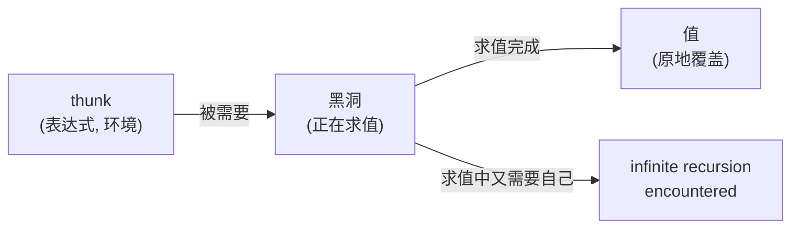

[上一篇](/posts/nix-by-firn-02-values-and-types/)结尾我留了一个洞：`lib.const "x" (throw "never forced")` 没有炸。一个必然会炸的表达式被传进了函数，函数没有看它，于是什么也没发生。这在 Nix 里不是优化，是语言的定义，而且它的收益和代价都可以数出来。nixpkgs 的顶层有 27959 个属性，我只想知道 `hello` 叫什么名字。下面是求值器给我开的账单：

```text
$ cat out/ch03/thunk_stats.stdout
hello.name: nrThunks=83906 nrFunctionCalls=17542 nrExprs=63705 cpuTime=0.15786999464035034
hello.outPath: nrThunks=140277 nrFunctionCalls=48507 nrExprs=85014 cpuTime=0.2668690085411072
top-level attributes: 27959
attributes forced: 1 of 27959 (0.0036%)
== only the attribute names (no package forced)
names only: nrThunks=83707 nrFunctionCalls=17493 cpuTime=0.12310799956321716
```

只要名字，求值器造了 83906 个 thunk，调用了 17542 次函数，花了 0.158 秒；要 `outPath`，是 140277 个和 0.267 秒。27959 个属性里真正被求值的只有 1 个，占 0.0036%。这一篇的任务就是把这几个数字讲明白：thunk 是什么，谁决定它何时被算，以及 nixpkgs 为什么可以把两万多个互相引用的包写成一个属性集，而不在加载的时候把它们全算一遍。

> [!NOTE] 本篇检查点
> 这一篇结束时，`~/firn` 里会有这些文件：`lib/fixed-points.nix`（`fix`、`extends`、`composeExtensions`、`composeManyExtensions`、`makeExtensible`，最终版本），`lib/trivial.nix`（多了 `pipe`，最终版本），`lib/default.nix`（多导入了 `fixed-points`，以后还会继续变多），`tests/lib.nix`（现在 31 个用例，第 5 篇会重写），`lab/ch03/` 下 17 个实验（最终版本），还有改了一行的 `README.md`。`make ch03` 全部通过。
> 涉及的 Nix 特性：lambda、柯里化、部分应用、pattern 参数（默认值、`...`、`@`）、`builtins.functionArgs`、惰性求值、thunk、WHNF、`seq`、`deepSeq`、`throw`、`abort`、`assert`、`tryEval`、`trace`、`--show-trace`、`rec`、不动点。
> 前置：[第 2 篇：值与类型](/posts/nix-by-firn-02-values-and-types/)。

## 函数只有一个参数

Nix 里的函数写成 `参数: 函数体`。没有括号，没有 `return`，没有 `function` 关键字。调用就是把参数并排写在函数后面：`f x`。函数是值（第 2 篇的 `typeOf` 说它叫 `"lambda"`），可以放进列表、放进属性集，也可以当参数传来传去。手册对语法的描述在 [Functions](https://nix.dev/manual/nix/2.34/language/syntax.html#functions) 一节。

最容易被忽略的一点是：**每个函数恰好有一个参数**。写 `a: b: a + b` 的时候，并没有“两个参数的函数”，它是 `a: (b: a + b)`，一个返回函数的函数。我用最直接的办法验证，把三层 lambda 一次喂三个参数，再把它喂一个参数看看返回什么：

```text
$ nix eval --expr '(x: y: z: x + y + z) 1 2 3'
6
$ nix eval --expr '(x: y: z: x + y + z)'
«lambda @ «string»:1:2»
$ nix eval --expr 'let f = a: b: a + b; in (f 1) 2 == f 1 2'
true
```

`f 1 2` 就是 `(f 1) 2`：函数调用向左结合，`:` 向右结合，两者合起来正好让多参数的写法看起来像 C。`f 1` 的结果也是一个完整的函数，它记住了 `a = 1`，这就是**部分应用**，不需要任何额外的语法。内建函数也一样，`builtins.add 1` 是“加一”的函数：

```text
$ nix eval --expr 'builtins.typeOf (builtins.add 1)'
"lambda"
$ nix eval --expr '(builtins.add 1) 2'
3
```

（对照一下：Rust 的闭包要由编译器推断它按什么方式捕获变量，[Pebble 第 9 篇](/posts/rust-by-pebble-09-interpreter-closures/)花了一节讲这个；Nix 的 lambda 只有一种捕获方式，整个环境，没有别的选择。）

`lab/ch03/currying.nix` 把这几件事放在一个属性集里。下面是它的主要部分：

```nix
let
  add = a: b: a + b;
  addOne = add 1;
  compose =
    f: g: x:
    f (g x);
in
{
  full = add 1 2;
  partial = addOne 41;
  mapped = map (add 10) [
    1
    2
    3
  ];
  composed = (compose (x: x * 2) addOne) 5;
  # ...
}
```

```text
$ nix eval --file lab/ch03/currying.nix
{ composed = 12; full = 3; isFunction = true; mapped = [ 11 12 13 ]; partial = 42; threeLayers = 7; }
```

`map (add 10) [ 1 2 3 ]` 得到 `[ 11 12 13 ]`，因为 `add 10` 本身就是一个“加十”的函数，`map` 不需要知道它从哪来。`composed` 先加一再乘二，`(5 + 1) * 2 = 12`。

初学者最常撞上的坑是列表。列表元素用空格分隔，所以函数调用放进列表必须加括号：

```text
$ nix eval --expr 'let f = x: x; in [ f 1 ]'
[ «lambda f @ «string»:1:9» 1 ]
```

我想要的是 `[ (f 1) ]`，得到的却是两个元素：函数 `f` 和数字 `1`。`nixfmt` 不会替你发现这种错误，因为它是合法的 Nix。

还有一个例外值得知道：属性集可以被当函数调用，只要它有一个 `__functor` 属性（[手册](https://nix.dev/manual/nix/2.34/language/syntax.html#attr-__functor)）。但它仍然是属性集，不是函数：

```text
$ nix eval --expr 'let s = { n = 5; __functor = self: x: x + self.n; }; in [ (s 1) (builtins.isFunction s) (builtins.typeOf s) ]'
[ 6 false "set" ]
```

`s 1` 是 6，`isFunction s` 却是 `false`，`typeOf s` 是 `"set"`。这个特性在 nixpkgs 里不常见，我就不展开了，只是记住“能调用”和“是函数”不是一回事。

## pattern 参数：名字、默认值和 `...`

单个参数的另一种写法，是把它写成一个属性集的**模式**：`{ a, b }: a + b`。调用的时候传一个有 `a` 和 `b` 的属性集。这是 nixpkgs 里几乎所有函数的写法，原因马上就讲，先看它能做什么。`lab/ch03/pattern_args.nix` 里有这个函数：

```nix
  f =
    {
      a,
      b ? 2,
      ...
    }@args:
    {
      sum = a + b;
      received = builtins.attrNames args;
    };
```

三个要素：`b ? 2` 是默认值，调用者可以不传 `b`；`...` 表示接受多余的属性；`@args` 把整个传入的属性集绑定到 `args`，不管模式里解构了哪些名字。`@` 写在模式前后都行（`args@{ a, ... }` 和 `{ a, ... }@args` 等价；`nixfmt` 1.4 输出后一种）。

```text
$ nix eval --file lab/ch03/pattern_args.nix
{ extraAllowed = { received = [ "a" "extra" ]; sum = 3; }; functionArgs = { a = false; b = true; }; overrideDefault = { received = [ "a" "b" ]; sum = 11; }; plainLambdaArgs = { }; strictArgs = { a = false; b = false; }; withDefault = { received = [ "a" ]; sum = 3; }; }
```

逐个看。`withDefault = f { a = 1; }` 没传 `b`，`sum = 3`，`received` 里只有 `a`：默认值参与了计算，但**没有出现在 `args` 里**，`@` 绑定的是调用者传的那个集合，不是补全默认值之后的。`overrideDefault` 传了 `b = 10`，`sum = 11`。`extraAllowed` 多传了一个 `extra`，因为有 `...` 才被接受，`args` 里能看到它。

默认值可以引用同一个模式里的其他参数，求值顺序不是书写顺序（这是惰性的又一个后果，后面会再碰到）：

```text
$ nix eval --expr '({ a, b ? a * 2 }: a + b) { a = 5; }'
15
```

两种错误值得认识。缺少没有默认值的参数，和传了模式里没有的参数（没有 `...` 的话）：

```text
$ nix eval --file lab/ch03/missing_arg_fail.nix 2>&1 | grep -E 'error: |Did you mean'
       error: function 'anonymous lambda' called without required argument 'b'
$ nix eval --file lab/ch03/unexpected_arg_fail.nix 2>&1 | grep -E 'error: |Did you mean'
       error: function 'anonymous lambda' called with unexpected argument 'c'
       Did you mean a?
```

第二个错误的最后一行 `Did you mean a?` 是求值器给的建议。我传的是 `c`，它建议 `a`（我猜它是按名字的相似度挑的，所以这个建议是错的，但在 `{ pkgs, lib, stdenv }` 这样的长列表里，拼写错误是能被它抓到的）。两个错误里函数的名字都是 `anonymous lambda`，因为 Nix 的函数没有名字，只有被绑定到变量时才有一个可以显示的名字。

## `functionArgs`：callPackage 的伏笔

为什么 nixpkgs 的函数几乎都是 pattern 参数？因为 pattern 参数在运行时**可以被看见**。`builtins.functionArgs` 返回一个属性集，键是形式参数的名字，值是“它有没有默认值”（[手册](https://nix.dev/manual/nix/2.34/language/builtins.html#builtins-functionArgs)）：

```text
$ nix eval --expr 'builtins.functionArgs ({ a, b ? 1 }: a)'
{ a = false; b = true; }
$ nix eval --expr 'builtins.functionArgs (x: x)'
{ }
```

注意最后一个：普通的 `x: x` 没有形式参数，所以是空集。要让它有用，函数必须用 pattern 声明依赖。拿一个真实的 nixpkgs 包来看，`hello` 的 `package.nix` 在我们钉住的版本里要这些参数：

```text
$ nix eval --impure --expr 'builtins.functionArgs (import ((import ./nix/pins.nix).nixpkgs + "/pkgs/by-name/he/hello/package.nix"))'
{ callPackage = false; fetchurl = false; gettext = false; gnulib = false; hello = false; lib = false; nixos = false; stdenv = false; testers = false; versionCheckHook = false; }
```

十个名字，都没有默认值。**包本身不去找它的依赖，它只声明名字**；谁来调用它，谁来负责给这十个名字找到值。这就是 `callPackage`。把 `functionArgs` 的结果和整个 nixpkgs 的属性集做一次交集，就得到了 `callPackage` 会自动补的参数：

```text
$ nix eval --impure --expr 'let pkgs = import ./nix/pkgs.nix { }; f = import ((import ./nix/pins.nix).nixpkgs + "/pkgs/by-name/he/hello/package.nix"); in builtins.attrNames (builtins.intersectAttrs (builtins.functionArgs f) pkgs)'
[ "callPackage" "fetchurl" "gettext" "gnulib" "hello" "lib" "nixos" "stdenv" "testers" "versionCheckHook" ]
$ nix eval --impure --expr 'let pkgs = import ./nix/pkgs.nix { }; f = import ((import ./nix/pins.nix).nixpkgs + "/pkgs/by-name/he/hello/package.nix"); in (pkgs.callPackage f { }).name'
"hello-2.12.3"
```

交集的结果和 `functionArgs` 的键一一对应：十个依赖，`pkgs` 里都有。这个机制可以缩到一个能跑的最小版本。把下面的内容存成 `call_package.nix`，`pkgs` 是一个只有三项的“包集合”：

```nix
let
  pkgs = {
    a = 1;
    b = 2;
    c = 3;
  };
  callPackage = f: args: f (builtins.intersectAttrs (builtins.functionArgs f) pkgs // args);
in
{
  sum = callPackage ({ a, b }: a + b) { };
  override = callPackage (
    {
      a,
      c ? 10,
    }:
    a + c
  ) { c = 100; };
  ignoresExtra = callPackage ({ a, ... }: a) { };
}
```

```text
$ nix eval --file call_package.nix
{ ignoresExtra = 1; override = 101; sum = 3; }
```

三个函数声明了不同的依赖，没有一个需要被告知“该用 `pkgs` 的哪几项”。`sum` 取到了 `a` 和 `b`；`override` 用显式的 `{ c = 100; }` 压过了从 `pkgs` 里取的 `c = 3`，也压过了默认值 `10`，结果是 `1 + 100`；`ignoresExtra` 的 `...` 吞掉了 `pkgs` 里多余的名字。如果函数要的名字 `pkgs` 里没有，错误来自求值器，不是来自我的代码：

```text
$ nix eval --expr 'let pkgs = { a = 1; }; callPackage = f: args: f (builtins.intersectAttrs (builtins.functionArgs f) pkgs // args); in callPackage ({ a, zzz }: a) { }' 2>&1 | grep 'error: '
       error: function 'anonymous lambda' called without required argument 'zzz'
```

nixpkgs 里真正的实现比这个多了错误提示和 `override` 的支持，但核心就是这几行，[`lib/customisation.nix` 的第 310 到 315 行](https://github.com/NixOS/nixpkgs/blob/56c02bc00adcf003215cc4bd996d6efaf4cff188/lib/customisation.nix#L310-L315)：

```nix
      f = if isFunction fn then fn else import fn;
      fargs = functionArgs f;

      # All arguments that will be passed to the function
      # This includes automatic ones and ones passed explicitly
      allArgs = intersectAttrs fargs autoArgs // args;
```

`intersectAttrs fargs autoArgs` 取 `autoArgs`（整个包集合）里名字出现在 `fargs` 里的那些项，再用显式给的 `args` 覆盖。第 7 篇我们会在 mini 包集合里亲手写一个，第 10 篇再回来读完整的 `callPackageWith`。现在只需要记住一件事：**`{ lib, stdenv, zlib }:` 这一行既是参数列表，也是依赖声明**。

（关于这个设计的取舍：用位置参数的话，调用者必须记住顺序，加一个依赖要改所有调用点；用属性集的话，加一个依赖只改包自己，调用点由 `callPackage` 按名字统一处理。代价是名字成了全局约定，`zlib` 必须永远叫 `zlib`。）

## 惰性：没人要的东西不会被算

回到第 2 篇的那个洞。`lab/ch03/lazy_never_evaluated.nix` 把能想到的“不会被算”的场合排了一遍：

```nix
let
  x = throw "boom";
in
{
  unusedLet = 1;
  listLength = builtins.length [
    (throw "a")
    (throw "b")
  ];
  # ...
  # 函数参数也是惰性的。
  ignoresArg = (_: "done") (throw "arg");
  # && 短路，右边不求值。
  shortCircuit = false && throw "rhs";
  # if 只求值被选中的分支。
  branch = if true then "then" else throw "else";
}
```

```text
$ nix eval --file lab/ch03/lazy_never_evaluated.nix
{ branch = "then"; ignoresArg = "done"; listLength = 2; shortCircuit = false; unusedAttr = 2; unusedLet = 1; }
```

六个值，没有一个报错，但文件里有七个 `throw` 或 `abort`。手册对语言特性的概括里，这一条只有一句话：“[lazy](https://nix.dev/manual/nix/2.34/language/)：Values are only computed when they are needed.”`x = throw "boom"` 在 `let` 里绑定了，没人用，就没人算。`length [ (throw "a") (throw "b") ]` 是 2：`length` 只数列表有几个元素，不看元素是什么。`(_: "done") (throw "arg")`：参数被传进了函数，而函数体里没有用它。`false && throw "rhs"` 和 `if` 的两个分支，在 C 里也是这样短路的，区别在于 Nix 里**所有的东西**都是这样，不只是运算符。

对应的，一个值要被算，必须有人**需要**它。什么叫“需要”？我用一个小实验把它量出来，而不是背规则。把 `p` 定义成 `builtins.trace "forced" 1`，`p` 一旦被求值，stderr 上就会出现一行 `trace: forced`。然后对每个表达式问一句：它让 `p` 被求值了吗？

```bash
#!/usr/bin/env bash
# Which expressions force `p`? p prints "trace: forced" when evaluated.
# shellcheck disable=SC2016
exprs=(
  'builtins.length [ p ]'
  'builtins.attrNames { a = p; }'
  '(x: 1) p'
  'builtins.seq [ p ] 1'
  'builtins.length (map (x: x + 1) [ p ])'
  'builtins.length (builtins.filter (x: x == 1) [ p ])'
  '{ a = p; } ? a'
  'builtins.deepSeq [ p ] 1'
  'builtins.typeOf p'
  'p + 1'
  '[ p ] == [ 1 ]'
  'if p == 1 then 2 else 3'
  '"${toString p}"'
)
for e in "${exprs[@]}"; do
  out="$(nix eval --expr "let p = builtins.trace \"forced\" 1; in ${e}" 2>&1 >/dev/null)"
  if [[ -n "${out}" ]]; then verdict=forced; else verdict="not forced"; fi
  printf '%-54s %s\n' "${e}" "${verdict}"
done
```

（这个脚本我没有放进仓库，它只是这一节的实验，存成 `probe.sh` 在 `nix develop` 里运行即可。）

```text
$ bash probe.sh
builtins.length [ p ]                                  not forced
builtins.attrNames { a = p; }                          not forced
(x: 1) p                                               not forced
builtins.seq [ p ] 1                                   not forced
builtins.length (map (x: x + 1) [ p ])                 not forced
builtins.length (builtins.filter (x: x == 1) [ p ])    forced
{ a = p; } ? a                                         not forced
builtins.deepSeq [ p ] 1                               forced
builtins.typeOf p                                      forced
p + 1                                                  forced
[ p ] == [ 1 ]                                         forced
if p == 1 then 2 else 3                                forced
"${toString p}"                                        forced
```

读这张表有一条线索：**是谁在“看” `p`，而不是 `p` 在哪里**。`length`、`attrNames`、`?` 只看容器的骨架，不看元素，所以 `p` 躲过了。`map` 返回一个新列表，每个元素是“把函数应用到原元素上”的未求值结果，列表建好了，函数一次都没调。`filter` 就不同了，它必须调用谓词来决定去留，谓词看了 `x`，`p` 被求值。`seq` 的情形最微妙，下一节单独讲。`==` 要比较两个列表，所以必须看里面的内容；`typeOf` 要知道类型，必须求值到至少能判断类型。`if` 的条件、`+` 的两个操作数、`${}` 的插值，都是显然的。

最后一个“需要”是你自己：**打印**。`nix eval` 要把结果显示给你，它就得把结果求出来。有意思的是 2.34.9 对待错误值的方式：

```text
$ nix eval --expr '{ a = throw "x"; b = 1; }'
{ a = «error: x»; b = 1; }
$ nix eval --json --expr '{ a = throw "x"; b = 1; }' 2>&1 | grep 'error: '
       error: x
$ nix-instantiate --eval --expr '{ a = 1 + 1; b = throw "x"; }'
{ a = <CODE>; b = <CODE>; }
```

默认格式把出错的属性打印成 `«error: x»` 然后继续，`--json` 没有这个宽容，直接报错；`nix-instantiate --eval` 不加 `--strict` 的时候干脆不求值，打印 `<CODE>`。（这一点第 1 篇的对照实验里已经出现过；那里没有解释的是为什么，现在答案是：因为属性值是 thunk，`--strict` 的意思就是“把每一个都逼出来”。）所以“错误没有出现”经常不是“没有错误”，而是“没有人去看”。

## 无穷的东西可以存在

惰性有一个直接的后果：数据结构可以是无穷的，只要你只取有限的一部分。`lab/ch03/lazy_stream.nix` 用嵌套的属性集造了一个自然数流：

```nix
let
  from = n: {
    head = n;
    tail = from (n + 1);
  };
  take = n: s: if n == 0 then [ ] else [ s.head ] ++ take (n - 1) s.tail;
in
take 10 (from 0)
```

```text
$ nix eval --file lab/ch03/lazy_stream.nix
[ 0 1 2 3 4 5 6 7 8 9 ]
```

`from 0` 立刻返回一个有两个属性的集合，`head` 是 `0`，`tail` 是一个还没算的 `from 1`。`take 10` 沿着 `tail` 走十步，每走一步才真的调用一次 `from`。这个流如果是严格求值，`from 0` 永远不会返回。惰性在这里是一个能力，而不是一个优化：没有它，这个程序写不出来。

（Python 的[生成器](/posts/python-by-sift-05-iterators-generators/)是同一个想法的另一种形状，不过生成器是一次性的迭代器；Nix 这里是普通的数据，已经算出来的部分可以随时回头再读。）

## thunk：一个还没算的表达式，带着它的环境

求值器怎么做到“不算”？它把每一个暂时不需要的子表达式装进一个小包里，叫 **thunk**：一对 `(表达式, 环境)`，环境告诉它表达式里的变量各是什么。需要这个值的时候，才把表达式拿出来，在环境里求值，**把结果就地写回这个位置**。之后再有人要，直接拿到值，不会再算。

Nix 2.34.9 的源码把这个流程写得很直接。[`eval-inline.hh` 的第 111 到 126 行](https://github.com/NixOS/nix/blob/2.34.9/src/libexpr/include/nix/expr/eval-inline.hh#L111-L126)：

```cpp
void EvalState::forceValue(Value & v, const PosIdx pos)
{
    if (v.isThunk()) {
        Env * env = v.thunk().env;
        assert(env || v.isBlackhole());
        Expr * expr = v.thunk().expr;
        try {
            v.mkBlackhole();
            if (env) [[likely]]
                expr->eval(*this, *env, v);
            else
                ExprBlackHole::throwInfiniteRecursionError(*this, v);
        } catch (...) {
            handleEvalExceptionForThunk(env, expr, v, pos);
            throw;
        }
```

这就是整个“强迫”的机制。三件事，按顺序：取出 thunk 里的环境和表达式；把这个位置**先改成黑洞**（`mkBlackhole`）；然后求值，结果直接写进 `v`（`expr->eval(*this, *env, v)` 的最后一个参数是输出位置）。黑洞是一个 `expr` 指向特殊对象 `eBlackHole` 的 thunk（[`value.hh` 第 1444 到 1452 行](https://github.com/NixOS/nix/blob/2.34.9/src/libexpr/include/nix/expr/value.hh#L1444-L1452)），**如果求值的过程中又有人要这个位置的值，他们拿到的是黑洞，黑洞被求值就报错**。这就是 `infinite recursion encountered` 的来源，下面单独演示。一个 thunk 在它的一生里要经过三个状态：



这个图里藏着一个实现细节，我是读源码才发现的：出错也会被缓存。`catch (...)` 之后调用的 `handleEvalExceptionForThunk`，会把这个位置标记成“失败”，并把异常存起来（[`eval.cc` 第 2187 到 2206 行](https://github.com/NixOS/nix/blob/2.34.9/src/libexpr/eval.cc#L2187-L2206)），除非它是 `Interrupted` 或 `RecoverableEvalError` 这类应当重试的错误。所以再次需要同一个失败的 thunk，不会重算，直接重新抛出同一个错误。我试了一下，用 `trace` 记录每次真正的求值：

```text
$ nix eval --expr 'let x = builtins.trace "eval" (throw "e"); in [ (builtins.tryEval x).success (builtins.tryEval x).success ]'
trace: eval
[ false false ]
```

`x` 被 `tryEval` 了两次，`trace: eval` 只出现一次。两次的 `success` 都是 `false`，第二次是缓存的失败。

## 共享：thunk 算一次，函数调用不记忆

thunk 被求值一次之后，结果被所有人共享。这是性能上最重要的性质，也是最容易被误解的：**共享的是 thunk，不是函数调用**。`lab/ch03/trace_order.nix` 是最小的演示：

```nix
let
  a = builtins.trace "forcing a" 1;
  b = builtins.trace "forcing b" 2;
  unused = builtins.trace "forcing unused" 3;
in
# 先用 b，再用 a；unused 永远不出现。重复使用 a 不会重复打印（共享）。
(b + a) + a
```

```text
$ nix eval --file lab/ch03/trace_order.nix
trace: forcing b
trace: forcing a
4
```

三个现象。`a` 在表达式里出现了两次，只打印了一次，第二次拿的是第一次的结果。`unused` 从没出现。还有，先出现的是 `forcing b`，尽管源码里 `a` 写在前面：**求值顺序由依赖决定，不是书写顺序**。`let` 里的绑定不是语句，是一组互相可以引用的名字，没有“先后”：

```text
$ nix eval --expr 'let a = b + 1; b = 2; in a'
3
```

`a` 写在 `b` 前面，用到了后面才定义的 `b`，这在任何按语句顺序执行的语言里都是错误。

对比函数调用，每次调用都会重新执行函数体：

```text
$ nix eval --expr 'let f = _: builtins.trace "call f" 1; in f 0 + f 0 + f 0'
trace: call f
trace: call f
trace: call f
3
$ nix eval --expr 'let f = _: builtins.trace "call f" 1; v = f 0; in v + v + v'
trace: call f
3
```

同样的 `f 0` 写三次，函数体执行三次；先 `v = f 0` 绑定一次，再用三次 `v`，只执行一次。`let v = f 0` 把调用变成了一个 thunk，thunk 才是共享的单位。（所以 Nix 没有自动的记忆化，你在函数里重复计算的东西，要自己用 `let` 绑定。）

这个区别能产生数量级的差异。经典的斐波那契，朴素写法每次调用都分成两次递归调用，同一个子问题被反复算：

```text
$ NIX_SHOW_STATS=1 nix eval --expr 'let fib = n: if n < 2 then n else fib (n - 1) + fib (n - 2); in fib 25' 2>&1 | jq -c 'objects | {nrThunks, nrFunctionCalls, cpuTime}'
{"nrThunks":242785,"nrFunctionCalls":242785,"cpuTime":0.042642999440431595}
```

`fib 25` 调用了 242785 次函数。如果把前 81 项放进一个列表，每一项由前两项的 thunk 算出，每个 thunk 只会被求值一次：

```nix
let
  memo = builtins.genList (
    n: if n < 2 then n else builtins.elemAt memo (n - 1) + builtins.elemAt memo (n - 2)
  ) 81;
  naive = n: if n < 2 then n else naive (n - 1) + naive (n - 2);
in
{
  # 第 80 项：瞬间完成。
  fib80 = builtins.elemAt memo 80;
  # ...
}
```

这是[练习 1](#练习)的答案 `lab/ch03/ex_memo_fib.nix` 的核心：`memo` 是一个**引用自己的列表**，它能存在正是因为元素是 thunk，要到有人取的时候才去读 `memo` 的前两项。

```text
$ nix eval --file lab/ch03/ex_memo_fib.nix
{ fib25Memo = 75025; fib25Naive = 75025; fib80 = 23416728348467685; }
```

同一个 `fib 25`，共享版的统计：

```text
$ NIX_SHOW_STATS=1 nix eval --expr 'let memo = builtins.genList (n: if n < 2 then n else builtins.elemAt memo (n - 1) + builtins.elemAt memo (n - 2)) 81; in builtins.elemAt memo 25' 2>&1 | jq -c 'objects | {nrThunks, nrFunctionCalls, cpuTime}'
{"nrThunks":50,"nrFunctionCalls":26,"cpuTime":0.011241000145673752}
```

26 次函数调用对 242785 次，约 9338 倍。再往上推一格，朴素的 `fib 32` 要 7049155 次调用，用掉了约 0.9 秒（`cpuTime` 0.88）；而 `fib 80` 的朴素版本我没有跑，我算了一下：调用次数是 `2 * fib(81) - 1 = 75778124746287811`，按 `fib 32` 测出的每秒约 798 万次调用，大概要 300 年。共享版的 `fib 80` 是 27 毫秒（整条命令的墙钟时间，见下面的表）。

那为什么 `lab/ch03/fib_timing.sh` 测出来的是下面这样？

```text
$ cat out/ch03/fib_timing.stdout
naive fib 25:  65 ms
shared fib 25: 27 ms
shared fib 80: 27 ms
ratio naive/shared fib 25: 2.4
```

中位数 65 对 27 毫秒，只有 2.4 倍，不是 9338 倍。因为每次 `nix eval` 光是启动、解析、退出就要 25 毫秒上下（共享版的整条命令也只要 27 毫秒），而 `fib 25` 朴素版的求值本身只比共享版多出 31 毫秒左右（上面 `cpuTime` 的 0.043 秒对 0.011 秒）。这个脚本测的是“一次命令行调用”的墙钟时间，启动成本把比值压扁了。要看算法的差别得看 `nrFunctionCalls`，或者像上面那样往 `fib 32` 推。`shared fib 80` 和 `shared fib 25` 一样快（27 毫秒对 27 毫秒）这件事才是脚本真正想说明的：共享版的耗时和 n 几乎无关。

## WHNF：`seq` 到底求值到哪

“求值”不是一个二值的概念。一个值可以被求到不同的深度。Nix 的 `builtins.seq a b` 先求值 `a`，再返回 `b`（[手册](https://nix.dev/manual/nix/2.34/language/builtins.html#builtins-seq)）。关键是求值到哪一层：**弱头范式（WHNF）**，也就是最外面那一层构造器。对数字和字符串，WHNF 就是值本身；对列表，是“知道有几个元素”；对属性集，是“知道有哪些键”；对函数，是“知道它是个函数”。元素、属性的值、函数体，都还是 thunk。

`lab/ch03/seq_vs_deepseq.nix` 用毒药验证：

```nix
let
  s = {
    a = throw "x";
  };
in
{
  seqOnSet = builtins.seq s "set is already in WHNF";
  seqOnList = builtins.seq [ (throw "y") ] "list too";
  seqOnLambda = builtins.seq (x: throw "z") "lambda too";
  # ...
  # builtins.length 只看列表的骨架，不看元素。
  length = builtins.length [ (throw "w") ];
}
```

```text
$ nix eval --file lab/ch03/seq_vs_deepseq.nix
{ deepOk = "fully forced"; length = 1; seqOnLambda = "lambda too"; seqOnList = "list too"; seqOnSet = "set is already in WHNF"; }
```

四个毒药一个都没触发。`seq s ...` 把 `s` 逼成一个属性集，仅此而已，`a` 仍然是没人动的 thunk。所以 `seq` 常常不是你想的那样：`seq` 不会“把整个东西算完”。如果你真的要把整个结构算完，用 `builtins.deepSeq`（[手册](https://nix.dev/manual/nix/2.34/language/builtins.html#builtins-deepSeq)），它递归地对每个元素和每个属性值做 `seq`：

```text
$ nix eval --file lab/ch03/deepseq_fail.nix 2>&1 | tail -3
       (stack trace truncated; use '--show-trace' to show the full, detailed trace)

       error: x
```

`deepseq_fail.nix` 只有一行：`builtins.deepSeq { a = throw "x"; } "unreachable"`。`seq` 放过的毒药，`deepSeq` 逼了出来。你会在真实代码里在这些地方遇到它们：想让一个 `trace` 在返回前触发的时候，想让某个值的错误尽早暴露而不是在被用到时才暴露的时候，还有测试里想知道“这个值到底能不能被完整算出来”的时候（下一节）。

## 出错的几种方式，和 `tryEval` 拦得住哪一种

求值会失败，而失败也是惰性的：错误值只有被需要时才会触发。Nix 里有四个主动制造或检查错误的东西。

**`throw "msg"`**：抛出一个错误，可以被 `tryEval` 捕获。nixpkgs 用它来标记“这个东西已经不存在了”，比如[别名文件](https://github.com/NixOS/nixpkgs/blob/56c02bc00adcf003215cc4bd996d6efaf4cff188/pkgs/top-level/aliases.nix#L2969)里 `overrideScope = throw "The xorg package set has been moved to the top level.";`：只要你不引用这个名字，没事；一引用，就得到一句迁移说明。

**`abort "msg"`**：也是抛错，但不可被捕获，`tryEval` 拦不住它。`lab/ch03/abort_uncatchable_fail.nix` 只有一行 `builtins.tryEval (abort "fatal")`：

```text
$ nix eval --file lab/ch03/abort_uncatchable_fail.nix 2>&1 | grep 'error: '
       error: evaluation aborted with the following error message: 'fatal'
```

**`assert 条件; 表达式`**（[手册](https://nix.dev/manual/nix/2.34/language/syntax.html#assertions)）：条件为真就求值表达式，否则报错。它也是惰性的，它只在这个值被需要时才检查：

```text
$ nix eval --expr '{ a = assert false; 1; b = 2; }.b'
2
$ nix eval --file lab/ch03/assert_fail.nix 2>&1 | grep 'error: '
       error: an integer with value '2' is not equal to an integer with value '3'
```

第一条里断言就在 `a` 的定义里，必然失败，但没人取 `a`，所以它从没执行。第二条 `assert 1 + 1 == 3;` 的报错不只是“断言失败”，还告诉你两边的值：2 和 3。

**`builtins.tryEval e`**：这是唯一的“捕获”。它求值 `e`，返回 `{ success; value; }`。lab 里的 `tryeval.nix`：

```nix
{
  throwCaught = builtins.tryEval (throw "x");
  assertCaught = builtins.tryEval (
    assert false;
    1
  );
  ok = builtins.tryEval 42;
  # 只求值到 WHNF：内部的毒药不被发现，tryEval 照样成功返回；nix eval 默认格式会把它打印成 «error: inner»，只有 --json 这类要求完整求值的输出才会报错，这里只取 success。
  shallow = (builtins.tryEval { a = throw "inner"; }).success;
  # 要捕获内部错误，必须 deepSeq。
  deep = (builtins.tryEval (builtins.deepSeq { a = throw "inner"; } 1)).success;
}
```

```text
$ nix eval --file lab/ch03/tryeval.nix
{ assertCaught = { success = false; value = false; }; deep = false; ok = { success = true; value = 42; }; shallow = true; throwCaught = { success = false; value = false; }; }
```

`throw` 和失败的 `assert` 被拦住了，`success = false`，而且失败时 `value` 是 `false`，不是错误信息，错误信息拿不到。（[源码里的注释](https://github.com/NixOS/nix/blob/2.34.9/src/libexpr/primops.cc#L1177)说 `value = false;` 是 “unfortunate”，但去掉它是破坏性变更。）`shallow = true` 才是陷阱：`{ a = throw "inner"; }` 的 WHNF 是一个属性集，没有任何东西失败，所以 `tryEval` 报告成功；毒药在你下次碰 `a` 的时候才炸（`nix eval` 的默认格式只会把它打印成 `«error: inner»`，`--json` 才会报错）。要拦住内部的错误，得先 `deepSeq`，让毒药在 `tryEval` 的保护范围内被逼出来（`deep = false`）。

那么它拦得住哪些错误？手册只说“`throw` 或 `assert`”。我把这句话拿八种错误验证了一遍（这个脚本同样不进仓库，存成 `catch.sh`）：

```bash
#!/usr/bin/env bash
exprs=(
  'throw "x"'
  'assert false; 1'
  'abort "x"'
  '1 / 0'
  '"a" + 1'
  '{ a = 1; }.b'
  'builtins.head [ ]'
  'builtins.elemAt [ 1 ] 5'
)
for e in "${exprs[@]}"; do
  if out="$(nix eval --expr "(builtins.tryEval (${e})).success" 2>&1)"; then
    verdict="caught, success = ${out}"
  else
    verdict="escaped: $(grep -m1 -E '^ *error: .' <<<"${out}" | sed 's/^ *//')"
  fi
  printf '%-26s %s\n' "${e}" "${verdict}"
done
```

```text
$ bash catch.sh
throw "x"                  caught, success = false
assert false; 1            caught, success = false
abort "x"                  escaped: error: evaluation aborted with the following error message: 'x'
1 / 0                      escaped: error: division by zero
"a" + 1                    escaped: error: cannot coerce an integer to a string: 1
{ a = 1; }.b               escaped: error: attribute 'b' missing
builtins.head [ ]          escaped: error: 'builtins.head' called on an empty list
builtins.elemAt [ 1 ] 5    escaped: error: 'builtins.elemAt' called with index 5 on a list of size 1
```

八行里只有头两行被拦住。除以零、类型错误、缺失的属性、越界，都穿过了 `tryEval`，整个求值照样终止。源码里能看到原因，[`prim_tryEval` 的第 1172 到 1180 行](https://github.com/NixOS/nix/blob/2.34.9/src/libexpr/primops.cc#L1172-L1180)只写了一个 `catch (AssertionError & e)`，而[错误类型的继承关系](https://github.com/NixOS/nix/blob/2.34.9/src/libexpr/include/nix/expr/eval-error.hh#L51-L57)是：

```cpp
MakeError(AssertionError, EvalError);
MakeError(ThrownError, AssertionError);
MakeError(Abort, EvalError);
MakeError(TypeError, EvalError);
MakeError(UndefinedVarError, EvalError);
MakeError(MissingArgumentError, EvalError);
MakeError(InfiniteRecursionError, EvalError);
```

`ThrownError`（`throw` 抛的）是 `AssertionError` 的子类，所以一个 `catch` 能同时拦住 `throw` 和 `assert`；`Abort`、`TypeError` 和 `InfiniteRecursionError` 都挂在 `EvalError` 下面，和 `AssertionError` 同级，漏网。这是 `tryEval` 的设计意图：**只拦“作者有意抛出的错误”，不拦“代码有 bug”**。

现在可以回头收第 2 篇的那个账了。`tests/lib.nix` 的现状是遇到 `throw` 就整个垮掉：一个用例的 `expr` 里有 `throw`，其余用例的结果都得不到。用 `tryEval` 加 `deepSeq` 可以让每个用例各自失败：

```text
$ nix eval --impure --expr 'let l = import ./lib; cases = { ok = { expr = l.id 3; expected = 3; }; boom = { expr = throw "boom"; expected = 1; }; bad = { expr = 2; expected = 3; }; }; run = t: let r = builtins.tryEval (builtins.deepSeq t.expr t.expr); in if !r.success then "error" else if r.value == t.expected then "pass" else "fail"; in builtins.mapAttrs (_: run) cases'
{ bad = "fail"; boom = "error"; ok = "pass"; }
```

三个用例三种结局，`boom` 的 `throw` 被转成了一个 `"error"` 的结果，没有拖垮别的用例。代价是它抓不到类型错误（比如 `expr = "a" + 1`），这个测试照样会整个中断。第 5 篇把测试重写成 `runTests` 的时候，我们会回到这个问题。这一章的 `tests/lib.nix` 只是添了用例，运行器仍然是第 2 篇的那个简单版本。

## 无限递归：黑洞

回到那张状态图的第三条边。`lab/ch03/infinite_recursion_fail.nix`：

```nix
(rec {
  a = b;
  b = a;
}).a
```

```text
$ cat out/ch03/infinite_recursion_fail.stderr
error:
       … while evaluating the file '/home/bfmhno3/Projects/firn/lab/ch03/infinite_recursion_fail.nix':

       … while evaluating the attribute 'a'
         at /home/bfmhno3/Projects/firn/lab/ch03/infinite_recursion_fail.nix:3:3:
            2| (rec {
            3|   a = b;
             |   ^
            4|   b = a;

       error: infinite recursion encountered
       at /home/bfmhno3/Projects/firn/lab/ch03/infinite_recursion_fail.nix:3:7:
            2| (rec {
            3|   a = b;
             |       ^
            4|   b = a;
```

（这个目录路径是我机器上的，你的会是你自己的。）按上面的状态图走一遍：取 `a` 的值，`a` 的 thunk 变成黑洞，开始求值 `b`；`b` 的 thunk 变成黑洞，开始求值 `a`；`a` 现在是黑洞，**被需要时它不求值，而是报错**。这个检测几乎是免费的：不需要额外的数据结构，状态就存在 thunk 自己身上。最小的环更短：

```text
$ nix eval --expr 'rec { a = a; }.a' 2>&1 | grep 'error: '
       error: infinite recursion encountered
$ nix eval --expr 'let x = x + 1; in x' 2>&1 | grep 'error: '
error: infinite recursion encountered
```

注意，这条规则管的是**同一个 thunk 在求值自己的过程中被再次需要**，不是“程序没有终止”。所以有两件事它管不到。第一，不终止但每一步都创建新 thunk 的递归：

```text
$ nix eval --expr 'let f = n: f (n + 1); in f 0' 2>&1 | grep 'error: '
error: stack overflow; max-call-depth exceeded
```

每次调用 `f` 的参数都是新的，`n + 1` 是一个新的 thunk，没有任何一个 thunk 需要自己，黑洞没机会触发；最后是调用栈用完。这类错误和 C 里的无限递归是同一族，第 5 篇再讲 Nix 的栈和 `foldl'`。第二，**环本身不是错误**：

```text
$ nix eval --expr 'let xs = [ 1 xs ]; in [ (builtins.length xs) (builtins.elemAt (builtins.elemAt xs 1) 0) ]'
[ 2 1 ]
```

`xs` 是一个包含自己的列表，长度 2，沿着第二项再进去又是同一个列表。没问题：构造 `xs` 这个列表，并不需要先求出 `xs` 里面是什么。这个区别，“构造一个值需要自己的值”和“值里面引用自己”，是理解下面不动点的钥匙。

## `trace` 和 `--show-trace`

没有调试器的年代，主要工具是 `builtins.trace e1 e2`：求值 `e1`，把它打印到 stderr，然后返回 `e2`（[手册](https://nix.dev/manual/nix/2.34/language/builtins.html#builtins-trace)）。我们已经用它做了好几次实验，它自己也是惰性的：**只有当 `trace` 表达式的结果被需要时，它才会打印**，所以 `trace_order.nix` 里的 `unused` 没有输出。同时，`trace` 对待要打印的值也是惰性的，它不会替你逼出里面的东西：

```text
$ nix eval --expr 'builtins.trace { a = 1; b = [ 2 ]; } 7'
trace: { a = 1; b = «thunk»; }
7
```

`b` 里的列表还没被求值，所以显示 `«thunk»`：这是我第一次直接“看到”一个 thunk。想看到整个值，要自己先把它逼出来：

```text
$ nix eval --expr 'let x = { a = 1; b = [ 2 ]; }; in builtins.trace (builtins.deepSeq x x) 7'
trace: { a = 1; b = [ 2 ]; }
7
```

`builtins.traceVerbose` 是同样的东西，只在命令行带 `--trace-verbose` 时才打印，适合放在库代码里常驻：

```text
$ nix eval --expr 'builtins.traceVerbose "v" 1'
1
$ nix eval --trace-verbose --expr 'builtins.traceVerbose "v" 1'
trace: v
1
```

另一个调试工具是 `--show-trace`。默认情况下，错误的调用栈被截断到最外层几项，末尾有一行提示 `(stack trace truncated; use '--show-trace' to show the full, detailed trace)`。加上这个开关，每一层 thunk 求值和函数调用都会被列出来：

```text
$ nix eval --file lab/ch03/deepseq_fail.nix 2>&1 | grep -E '… while|error: '
       … while evaluating the file '/home/bfmhno3/Projects/firn/lab/ch03/deepseq_fail.nix':
       … while calling the 'deepSeq' builtin
       … while evaluating the attribute 'a'
       error: x
$ nix eval --show-trace --file lab/ch03/deepseq_fail.nix 2>&1 | grep -E '… while|error: '
       … while evaluating the file '/home/bfmhno3/Projects/firn/lab/ch03/deepseq_fail.nix':
       … while calling the 'deepSeq' builtin
       … while evaluating the attribute 'a'
       … while calling the 'throw' builtin
       error: x
```

差别只有一行，在这个五行的程序里。在 nixpkgs 里，这一行会变成几十行，而且它们是读懂“这个错误是怎么被一路逼出来的”的唯一线索：别忘了惰性求值意味着**出错的位置和出错的原因往往不在一起**。第 5 篇我们用一个三层深的 Firn 库错误来读它。

## 不动点：`fix`

现在可以回答开头的问题了：nixpkgs 是怎么把互相引用的包写成一个属性集的？答案是一个很小的函数，也是这一篇的核心。数学里，`f` 的**不动点**是满足 `x = f(x)` 的 `x`。`lib/fixed-points.nix` 里的第一个定义：

```nix
  # fix f = f (fix f)，但让结果指向自己，这样 self 只求值一次。
  fix =
    f:
    let
      x = f x;
    in
    x;
```

`fix` 接受一个函数 `f`，返回它的不动点：`x` 是 `f` 应用到 `x` 自己上的结果。这看起来像循环定义，而它能工作，靠的就是上面的 thunk。`x` 是一个 thunk，表达式是 `f x`，环境里有 `x` 自己。求值它：先变成黑洞，然后调用 `f x`，**`f` 返回了一个属性集（WHNF），它没有逼出 `x` 的值**，只是把 `x` 作为 `self` 参数闭包在属性的 thunk 里。调用返回，`x` 被覆盖成这个属性集。之后某个属性被读取，属性里的 `self.a` 去读 `x`，`x` 已经是值了，没有黑洞。

用一个习惯的例子来说，`f` 是一个**以最终结果为参数的函数**，它通常叫 `self`。（这里我只用一次类比：它像一张电子表格，`self` 是整张表，`b = self.a + 1` 是 `b` 这个格子里写的公式，引用了别的格子。公式不需要关心别的格子是怎么算出来的，表格在每个格子被读的时候去算。）`lab/ch03/fix_by_hand.nix` 把三种写法并排放：

```nix
let
  lib = import ../../lib;
  base = self: {
    a = 1;
    b = self.a + 1;
  };
  # 同一件事的手写版，等价于 rec。
  myFix =
    f:
    let
      x = f x;
    in
    x;
  ext = lib.makeExtensible base;
in
{
  fixed = lib.fix base;
  handWritten = myFix base;
  recVersion = rec {
    a = 1;
    b = a + 1;
  };
  # ...
}
```

```text
$ nix eval --file lab/ch03/fix_by_hand.nix --apply 'x: { inherit (x) fixed handWritten recVersion; }'
{ fixed = { a = 1; b = 2; }; handWritten = { a = 1; b = 2; }; recVersion = { a = 1; b = 2; }; }
```

三个结果一样。这说明 **`rec` 就是 `fix` 的语法糖**：`rec { a = 1; b = a + 1; }` 的效果等价于 `fix (self: { a = 1; b = self.a + 1; })`，`rec` 只是让你省掉了 `self.`。`fix` 的好处是 `self` 是一个显式的参数，你可以把这个函数 `base` 保存起来，以后换一个 `self` 来用它：下一节的 `extends` 就建立在这上面。

我在第 2 篇说过 `rec` 会出现无限递归，现在能解释它在什么条件下出现了。构造函数**在返回属性集之前**读了 `self`，就等于要求一个还没有值的 thunk，必然碰到黑洞：

```text
$ nix eval --impure --expr '(import ./lib).fix (self: self)' 2>&1 | grep 'error: '
error: infinite recursion encountered
$ nix eval --impure --expr '(import ./lib).fix (self: if self ? a then { } else { a = 1; })' 2>&1 | grep 'error: '
       error: infinite recursion encountered
$ nix eval --impure --expr '(import ./lib).fix (self: { a = self.a; }) ? a'
true
$ nix eval --impure --expr '((import ./lib).fix (self: { a = self.a; })).a' 2>&1 | grep 'error: '
       error: infinite recursion encountered
```

第二条里 `self ? a` 要先知道 `self` 有没有属性 `a`，也就要先求出 `self`，死循环。第三条里 `a = self.a` 没问题：集合造出来了，里面有一个属性叫 `a`；第四条才真的去读 `a`，`a` 需要 `self.a`，也就是它自己。所以不动点里的规则是：**构造器不能看 `self`；属性可以看，但不能绕成环**。

还有一件事要说明，为什么 `fix` 要写成 `let x = f x; in x` 而不是 `f (fix f)`。后者数学上等价，但每一次对 `self` 的引用都会展开成一次新的 `fix f`，把 `f` 重新调用一遍，共享就丢了。我用一个五层依赖链数了数 `f` 被调用了几次：

```bash
#!/usr/bin/env bash
chain='
  self: builtins.trace "f called" {
    a = 1;
    b = self.a + 1;
    c = self.b + 1;
    d = self.c + 1;
    e = self.d + 1;
  }'
for fixer in 'f: f (naiveFix f)' '(import ./lib).fix'; do
  printf '%s\n' "fix = ${fixer}"
  nix eval --impure --expr "
    let
      naiveFix = f: f (naiveFix f);
      fix = ${fixer};
    in (fix (${chain})).e" 2>&1 | sort | uniq -c
done
```

（也是一次性的实验，存成 `fixcount.sh`，在 `~/firn` 下运行。）

```text
$ bash fixcount.sh
fix = f: f (naiveFix f)
      1 5
      5 trace: f called
fix = (import ./lib).fix
      1 5
      1 trace: f called
```

结果都是 `5`，但朴素版把构造函数调用了 5 次，共享版 1 次。依赖链再长，朴素版的调用次数就跟着涨；nixpkgs 的包集合有 27959 个属性、十几层 overlay，如果每一层引用都重新构造一遍，`nix-env -qa` 大概一辈子也跑不完（这是推测，我没有试过去实现它）。

## `extends`：改一个值，让依赖它的东西跟着变

`fix` 单独看只是个小把戏。真正的用处是：**既然 `base` 是以 `self` 为参数的函数，我可以拿它的结果做一次增量修改，再把修改后的版本拿去求不动点**。比如，我想让上面的 `a` 变成 10，`b` 应该变成 11，因为 `b = self.a + 1`。如果我直接改 `base` 的源码，当然可以；如果 `base` 是别人的，我不想改，该怎么办？这就是 `extends`：

```nix
  # 把 overlay `f`（final: prev: 增量）套到 `rattrs`（self: 属性集）上。
  extends =
    f: rattrs: self:
    let
      super = rattrs self;
    in
    super // f self super;
```

`extends f rattrs` 返回一个新的“以 `self` 为参数的函数”：先用 `self` 调用原来的 `rattrs`，得到 `super`（也就是 overlay 里常说的 `prev`），再用 `//` 把 `f self super` 返回的增量覆盖上去。`f` 有两个参数：`final`（就是 `self`，最终的不动点）和 `prev`（扩展之前的结果），这是 overlay 的约定。比较一下 nixpkgs 的写法（[`lib/fixed-points.nix` 第 325 到 334 行](https://github.com/NixOS/nixpkgs/blob/56c02bc00adcf003215cc4bd996d6efaf4cff188/lib/fixed-points.nix#L325-L334)）：

```nix
  extends =
    overlay: f:
    # The result should be thought of as a function, the argument of that function is not an argument to `extends` itself
    (
      final:
      let
        prev = f final;
      in
      prev // overlay final prev
    );
```

名字不同，结构完全一样。我们的实验：

```text
$ nix eval --file lab/ch03/fix_by_hand.nix --apply 'x: { inherit (x) extended usesPrev; }'
{ extended = { a = 10; b = 11; }; usesPrev = 102; }
```

`extended = lib.fix (lib.extends (_: _: { a = 10; }) base)`。overlay 只说了 `a = 10`，没提 `b`，而 `b` 是 11：`b` 的公式 `self.a + 1` 里的 `self` 是**扩展之后的**不动点，不是 `base` 自己的。这是整件事的重点：**覆盖一个值，所有依赖它的值自动跟着变**，不需要传递，不需要重新装配。如果你是用 `//` 手工合并，`b` 会停在 2：

```text
$ nix eval --impure --expr 'let l = import ./lib; in (l.fix (self: { a = 1; b = self.a + 1; })) // { a = 10; }'
{ a = 10; b = 2; }
```

`usesPrev` 展示 `prev` 的作用：overlay `_: prev: { a = prev.a + 100; }` 读取扩展前的 `a`（1），加 100，`a = 101`，`b = 102`。如果它写成 `final.a + 100`，`a` 就在读自己：

```text
$ nix eval --impure --expr 'let l = import ./lib; in l.fix (l.extends (final: _: { a = final.a + 100; }) (_: { a = 1; }))'
{ a = «error: infinite recursion encountered»; }
```

**所以 overlay 的约定是：要“在旧值上改”读 `prev`，要“用最终值做判断”读 `final`**。这条规则到第 10 篇会反复出现。（名字有两套：`final`/`prev` 和 `self`/`super`，意思相同，nixpkgs 里两套并存。Firn 的 `extends` 内部的变量叫 `super`；nixpkgs 的 [`stage.nix` 第 203 行](https://github.com/NixOS/nixpkgs/blob/56c02bc00adcf003215cc4bd996d6efaf4cff188/pkgs/top-level/stage.nix#L203)还写着 `otherPackageSets = self: super: {`。读 nixpkgs 的时候两种都会遇到。）

多个 overlay 怎么组合？`composeExtensions f g` 返回一个 overlay，`g` 看到的 `prev` 已经包含了 `f` 的结果：

```nix
  # 组合两个 overlay：g 看到的 prev 已经包含 f 的结果。
  composeExtensions =
    f: g: final: prev:
    let
      fApplied = f final prev;
      prev' = prev // fApplied;
    in
    fApplied // g final prev';

  # 从左到右组合一串 overlay；空列表是什么都不改的 overlay。
  composeManyExtensions = builtins.foldl' composeExtensions (_: _: { });
```

`composeManyExtensions` 用 `builtins.foldl'` 从左到右折叠，初始值是什么都不改的 overlay `(_: _: { })`。三个依次加一、乘十、减三的 overlay，应用到 `a = 1` 上，按顺序是 `((1 + 1) * 10) - 3 = 17`：

```text
$ nix eval --impure --expr 'let l = import ./lib; in l.fix (l.extends (l.composeManyExtensions [ (_: prev: { a = prev.a + 1; }) (_: prev: { a = prev.a * 10; }) (_: prev: { a = prev.a - 3; }) ]) (_: { a = 1; }))'
{ a = 17; }
```

nixpkgs 的写法不同，用的是 `foldr`（[第 412 行](https://github.com/NixOS/nixpkgs/blob/56c02bc00adcf003215cc4bd996d6efaf4cff188/lib/fixed-points.nix#L412)）：`composeManyExtensions = lib.foldr (x: y: composeExtensions x y) (final: prev: { });`。两种折叠方向给出同一个结果，因为 `composeExtensions` 是结合的；我们选 `foldl'` 只是因为它不需要依赖 `lib.foldr`，而 `foldl'` 是内建函数。第 5 篇会讲 `foldl'` 为什么也是更省栈的那一个。

## `makeExtensible`：带着 `.extend` 的属性集

每次扩展都要写 `fix (extends overlay base)` 很繁琐。`makeExtensible` 把它包装成一个属性集，自带一个 `.extend`：

```nix
  # 返回的属性集带 `.extend overlay`，得到一个新的可扩展属性集。
  makeExtensible =
    rattrs:
    fix (
      self:
      rattrs self
      // {
        extend = f: makeExtensible (extends f rattrs);
      }
    );
```

结果的每个属性来自 `rattrs self`，外加一个 `extend`。`extend f` 用 `extends f rattrs` 造出一个新的构造函数，再 `makeExtensible` 一次，所以返回值还能继续 `.extend`。`fix_by_hand.nix` 里它这么用：

```text
$ nix eval --file lab/ch03/fix_by_hand.nix --apply 'x: { inherit (x) makeExtensibleB makeExtensibleExtendB originalUntouched; }'
{ makeExtensibleB = 2; makeExtensibleExtendB = 11; originalUntouched = 2; }
```

`ext.b` 是 2；`(ext.extend (_: _: { a = 10; })).b` 是 11；扩展完之后原来的 `ext.b` 仍然是 2，**扩展是函数式的，不是就地修改**。nixpkgs 的版本是 `makeExtensibleWithCustomName`（[第 450 到 459 行](https://github.com/NixOS/nixpkgs/blob/56c02bc00adcf003215cc4bd996d6efaf4cff188/lib/fixed-points.nix#L450-L459)），多了一个自定义方法名，并用 `fix'` 代替 `fix`（[`fix'`](https://github.com/NixOS/nixpkgs/blob/56c02bc00adcf003215cc4bd996d6efaf4cff188/lib/fixed-points.nix#L118-L125) 在结果里多记一个 `__unfix__` 属性，保存原来的函数），骨架是一样的。

这一章给 `tests/lib.nix` 添了 11 个用例，现在是 31 个：`pipe` 两个（顺序、空列表），`fix` 两个，`extends` 两个，`composeExtensions` 一个，`composeManyExtensions` 两个，`makeExtensible` 两个。其中一个我特别喜欢：

```nix
    fixLazyUnused = {
      expr =
        (lib.fix (_: {
          a = 1;
          bad = throw "never forced";
        })).a;
      expected = 1;
    };
```

不动点里放了一颗没人碰的 `throw`，读 `a` 时它没有炸。一个测试同时验证了 `fix` 的结果正确、也验证了它保持惰性（如果有人把 `fix` “优化”成对所有属性做 `deepSeq`，这个用例会失败）。

```text
$ nix eval --file tests/lib.nix
[ ]
$ grep -c '^    [a-zA-Z0-9]* = {$' tests/lib.nix
31
```

另外，`lib/trivial.nix` 多了一个 `pipe`：

```nix
  # 把值依次送过一串函数：pipe 1 [ f g ] == g (f 1)。
  pipe = builtins.foldl' (x: f: f x);
```

```text
$ nix eval --impure --expr '(import ./lib).pipe 3 [ (x: x + 1) (x: x * 10) toString ]'
"40"
```

这些函数是怎么接进 Firn 的 `lib` 的？`lib/default.nix` 在这一章只多了一行 `import` 和一个 `//`，全文 13 行：

```nix
# Firn 自己的库入口，不依赖 nixpkgs。导出子集和扁平的常用函数。
let
  trivial = import ./trivial.nix;
  attrsets = import ./attrsets.nix;
  fixed-points = import ./fixed-points.nix;
in
{
  version = "0.1.0";
  inherit trivial attrsets fixed-points;
}
// trivial
// attrsets
// fixed-points
```

每个文件返回一个属性集。入口把它们同时放在两个位置：作为子集（`lib.fixed-points.fix`）和展平后的顶层（`lib.fix`）。两个写法指向同一份东西，因为 `import ./fixed-points.nix` 只写了一次，绑定在 `let` 里，被引用两次也只求值一次，这又是共享。`fixed-points` 带连字符，在 Nix 里是合法的标识符，下面的输出就是证据。

```text
$ nix eval --impure --expr 'builtins.attrNames (import ./lib).fixed-points'
[ "composeExtensions" "composeManyExtensions" "extends" "fix" "makeExtensible" ]
```

展平用的是 `//`，右边赢。现在三个文件的名字互不重叠，所以顺序无关紧要；如果以后两个文件定义了同一个名字，后导入的会悄悄盖掉先导入的，没有任何提示，这是用 `//` 展平的代价。

`pipe 3 [ f g h ]` 就是 `h (g (f 3))`，只是从左往右读。它的实现只有一行，因为 `foldl'` 本来就是“把累积值依次送过一个二元函数”，而这里的累积值是被处理的那个值，二元函数是“把值喂给下一个函数”。（注意它也是部分应用的：`builtins.foldl' (x: f: f x)` 缺了最后两个参数，就是一个接受初值和列表的函数。）

## nixpkgs 是一个巨大的不动点

现在回头看 nixpkgs。包集合的总装配在 [`pkgs/top-level/stage.nix` 的第 335 到 360 行](https://github.com/NixOS/nixpkgs/blob/56c02bc00adcf003215cc4bd996d6efaf4cff188/pkgs/top-level/stage.nix#L335-L360)：

```nix
  # The complete chain of package set builders, applied from top to bottom.
  # stdenvOverlays must be last as it brings package forward from the
  # previous bootstrapping phases which have already been overlaid.
  toFix = lib.foldl' (lib.flip lib.extends) (self: { }) (
    [
      stdenvBootstappingAndPlatforms
      stdenvAdapters
      trivialBuilders
      splice
      autoCalledPackages
      allPackages
      otherPackageSets
      aliases
      variants
      configOverrides
      internallyDisallowedAttrPathsOverlay
    ]
    ++ overlays
    ++ [
      stdenvOverrides
    ]
  );

in
# Return the complete set of packages.
lib.fix toFix
```

一模一样的结构。`toFix` 是从空集合 `self: { }` 出发，用 `extends` 把一串 overlay 依次套上去：十一个内建层（从 `stdenvBootstappingAndPlatforms` 到 `internallyDisallowedAttrPathsOverlay`，中间的 `allPackages` 就是 `all-packages.nix`）、你传进去的 `overlays`、最后一层 `stdenvOverrides`。最后一行 `lib.fix toFix`，整个 nixpkgs 就是它的不动点。`lib.flip lib.extends` 的作用是把 `extends overlay f` 的参数顺序换成 `foldl'` 要的 `acc: x:`。

所以包的依赖（前面 `hello` 要的那十个名字）不是从某个全局变量里取的：`callPackage` 按名字去找的那个集合，是**最终的、包含了所有 overlay 的包集合**，也就是这个不动点本身。这解释了一件我在 `functionArgs` 一节埋下的伏笔：你想让所有东西都用你改过的 `zlib`，只要在一个 overlay 里换掉 `zlib`，所有按名字取 `zlib` 的包就都变了，nixpkgs 自己不用做任何事。我拿 `pkgs.extend`（它就是“追加一个 overlay 重新求一次不动点”）验证：

```bash
#!/usr/bin/env bash
# shellcheck disable=SC2016
nix eval --impure --expr '
let
  pkgs = import ./nix/pkgs.nix { };
  patched = pkgs.extend (final: prev: {
    zlib = prev.zlib.overrideAttrs (_: { pname = "zlib-patched"; });
  });
  same = name: pkgs.${name}.drvPath == patched.${name}.drvPath;
in
builtins.listToAttrs (map (n: { name = n; value = same n; }) [ "zlib" "libpng" "hello" "figlet" "which" "busybox" "nyancat" "bash" ])
'
```

```text
$ bash extend_zlib.sh
{ bash = false; busybox = false; figlet = false; hello = false; libpng = false; nyancat = false; which = false; zlib = false; }
```

我选了八个包，`drvPath` 无一例外都变了，连只有一个二进制的 `which` 也一样。overlay 里我只改了 `zlib` 一个名字。为什么连 `which` 也变？我用 `nix why-depends --derivation` 找它依赖改过的 `zlib` 的路径（`.drv` 和 store 路径是第 6 篇的内容，这里只看这条链）：

```bash
#!/usr/bin/env bash
drv="$(nix eval --impure --raw --expr '
  let
    pkgs = import ./nix/pkgs.nix { };
    p = pkgs.extend (final: prev: {
      zlib = prev.zlib.overrideAttrs (_: { pname = "zlib-patched"; });
    });
  in p.which.drvPath')"
zlib="$(nix-store -qR "${drv}" | grep -m1 zlib-patched)"
nix-store -qR "${drv}" | wc -l
nix why-depends --derivation "${drv}" "${zlib}"
```

```text
$ bash why_zlib.sh
775
/nix/store/0xp5gmhp45l7qmybsi0rway71a9n02fw-which-2.25.drv
└───/nix/store/ijrn129z9jhkv08n0r4j13i4baprrw0s-stdenv-linux.drv
    └───/nix/store/sf75c5nkf7g5ng44zgcyxks460nb5p17-xgcc-15.3.0.drv
        └───/nix/store/dznw9rklmbqhf2yqi3fy1y2v41zf3rbi-zlib-patched-1.3.2.drv
```

`which` 的 `.drv` 闭包有 775 个路径，其中 615 个是 `.drv`；链条是 `which`、`stdenv-linux`、编译器 `xgcc-15.3.0`、最后是改过的 `zlib`。编译器依赖 `zlib`，所以它变了，用这个编译器造出来的每一个包都跟着变。一行改动、整个 nixpkgs 重新求值、整个 `.drv` 图变化，这就是“包集合是不动点”的字面含义。它的代价写在源码注释里（[`stage.nix` 第 274 到 281 行](https://github.com/NixOS/nixpkgs/blob/56c02bc00adcf003215cc4bd996d6efaf4cff188/pkgs/top-level/stage.nix#L274-L281)）：

```nix
    # NOTE: each call to extend causes a full nixpkgs rebuild, adding ~130MB
    #       of allocations. DO NOT USE THIS IN NIXPKGS.
    #
    # Extend the package set with a single overlay. This preserves
    # preexisting overlays. Prefer to initialize with the right overlays
    # in one go when calling Nixpkgs, for performance and simplicity.
    # Prefer appendOverlays if used repeatedly.
    extend = f: self.appendOverlays [ f ];
```

“rebuild”在这里指的是**重新求值**，不是重新编译：`extend` 把新 overlay 追加到列表末尾，再把整个 nixpkgs 从头求一遍不动点。第 10 篇我们会把这件事和 `overrideAttrs`、`callPackage` 放在一起，现在只需要记住：这是代价，也是 nixpkgs 的“一切可覆盖”这个性质的来源。

## 回到开头：那些 thunk 是怎么来的

现在可以把开头的数字读成故事了。用 `NIX_SHOW_STATS=1` 分三步量：

```text
$ NIX_SHOW_STATS=1 nix eval --expr '1 + 1' 2>&1 >/dev/null | jq -c '{nrThunks,nrFunctionCalls,nrExprs,cpuTime}'
{"nrThunks":0,"nrFunctionCalls":0,"nrExprs":51,"cpuTime":0.015636000782251358}
```

这是一个什么都没有的求值：0 个 thunk，0 次函数调用，十几毫秒的启动成本。接着只要 `import nix/pkgs.nix { }` 的 WHNF，什么包都不碰：

```text
$ NIX_SHOW_STATS=1 nix eval --impure --raw --expr 'builtins.typeOf (import ./nix/pkgs.nix { })' 2>&1 >/dev/null | jq -c '{nrThunks,nrOpUpdates,nrOpUpdateValuesCopied}'
{"nrThunks":83706,"nrOpUpdates":5284,"nrOpUpdateValuesCopied":1152106}
```

只“拿到”这个包集合，没有求值任何包，已经造了 83706 个 thunk（和开头的 83707 差 1，因为外面的表达式不同），执行了 5284 次 `//`，复制了 1152106 个值。27959 个属性，83706 个 thunk，平均每个属性 2.99 个，约等于 3。我猜这主要是上一节那条 overlay 链的代价：每一层 `extends` 都做一次 `super // f self super`，要把整张属性表拷一遍；不过我只测了总数，没有逐层拆开，所以“主要”这个词是推测。这也解释了为什么“只看名字”已经要 0.12 秒：开头那一行 `names only: nrThunks=83707`，和 `typeOf` 几乎一样，因为属性集一旦造出来，列出键几乎是免费的（`attrNames` 多出来的只有 1 个 thunk）。

开头那两行现在可以对着基线（`names only` 的 83707 个 thunk、17493 次函数调用）读了：`hello.name` 是 83906，只多出 199 个 thunk、49 次函数调用，这是读 `pname` 和 `version` 再拼个名字的成本；`hello.outPath` 是 140277，多出 56570 个 thunk、31014 次函数调用。多出来的部分是什么，我猜是 `outPath` 要把 `stdenv`、全部构建输入和 derivation 的所有属性都装配出来，第 6 篇会正面拆开 derivation。

共享又一次起作用。把 `hello` 和 `jq` 的 `outPath` 放在同一次求值里：

```bash
#!/usr/bin/env bash
for e in 'p.hello.outPath' 'p.jq.outPath' 'p.hello.outPath + p.jq.outPath'; do
  NIX_SHOW_STATS=1 nix eval --impure --raw \
    --expr "let p = import ./nix/pkgs.nix { }; in ${e}" 2>&1 >/dev/null \
    | jq -r --arg e "${e}" '"\($e): nrThunks=\(.nrThunks) nrFunctionCalls=\(.nrFunctionCalls)"'
done
```

```text
$ bash share.sh
p.hello.outPath: nrThunks=140279 nrFunctionCalls=48507
p.jq.outPath: nrThunks=144470 nrFunctionCalls=50881
p.hello.outPath + p.jq.outPath: nrThunks=144831 nrFunctionCalls=51083
```

（这里 `hello.outPath` 是 140279 而不是开头的 140277，同样是外层表达式的差别。）单独求 `jq.outPath` 比基线多出 60764 个 thunk；在 `hello` 之后再求，只多出 4552 个。`hello` 已经把 `stdenv`、`gcc`、`bash` 这些公共的东西逼成了值，`jq` 再需要它们的时候，拿到的是现成的。同一个 thunk，不管有多少个包引用，只被求值一次。这就是前面“共享”一节的规模放大版，也是 nixpkgs 能用一个 27959 项的属性集支撑所有人的原因。

## 让我意外的事

开始写这一篇之前，我以为惰性求值是一个“更省”的求值顺序，一个性能话题。写完之后我发现它更像一份合同，条款比我想象的多，也比我想象的细。四件事我没有料到：

**`tryEval` 拦不住 `1 / 0`。** 我一直以为 `tryEval` 是 Nix 的 `try/catch`，把它放在可疑的表达式外面就能得到 `success = false`。八种错误里它只拦住了 `throw` 和 `assert`；除以零、类型错误、缺属性、越界都直接穿过去。读了源码才明白这是设计：整个 `prim_tryEval` 只有一个 `catch (AssertionError & e)`，`ThrownError` 恰好是它的子类。这给了我一个新的习惯：**`throw` 是写给使用者看的错误，类型错误是写给作者看的错误，两者走的是两条路**。想用 `tryEval` 做防御性编程的人，需要先清楚自己要防的是哪一类。

**拿到 nixpkgs 这个集合本身就要 83706 个 thunk，其中没有一个属于任何一个包。** 我原来的画面是：包集合是一个大字典，查一个键，求一个值，成本和这个键对应的东西成正比。实测不是：`hello.name` 只比空的基线多 199 个 thunk，但基线本身已经是 8 万多，我猜是 overlay 链把 27959 个属性一层层 `//` 上去的结果（我没有按层测过，这只是推测）。惰性在这里没有让“集合”变便宜，它只是让“集合里的每一个包”变便宜了。前者是固定的入场费，每次 `nix eval` 都付（约 0.12 秒），后者才按需付。

**一个脚本里的 2.4 倍，和一个计数器里的 9338 倍，是同一件事。** 我先写了 `fib_timing.sh`，量了 `nix eval` 的墙钟时间，得到 65 对 27 毫秒，差 2.4 倍；然后才去看 `nrFunctionCalls`，242785 对 26。两个数都是真的，只是前者量的是“一次命令行调用”，里面有 25 毫秒的启动成本，后者量的是算法。我原来相信“能用计时就别去数操作”，这次我觉得顺序应该反过来：先数，计时只用来确认数出来的东西是不是真的花时间。

**改一个 `zlib`，`which` 的 `.drv` 也变了。** 我选 `which` 是因为它小，小到我以为它够独立。`nix why-depends` 给出的链条是 `which`、`stdenv-linux`、`xgcc`、`zlib`，编译器链接了 `zlib`。这不是 nixpkgs 的缺陷，是不动点这个设计的字面推论：**你换掉的是“`zlib` 这个名字指向的东西”，不是“某一个包的一个依赖”**。想要后者，要用 `override`，第 10 篇会讲它和 overlay 的区别。

## 检查点

在 `~/firn` 里，`nix develop` 之内：

```bash
make ch03
make lint
for f in lib/default.nix lib/fixed-points.nix lib/trivial.nix lib/attrsets.nix \
  tests/lib.nix lab/ch03/*.nix lab/ch03/*.sh; do
  diff <(git -C ~/firn-ref show ch03:"${f}") "${f}" && echo "same ${f}"
done
```

`make ch03` 应当打印这 18 行（命令回显加 17 行 `ok`；这一章没有 `_host` 实验，所以设不设 `CI` 都一样）：

```text
bash scripts/chapter.sh ch03
ok   lab/ch03/abort_uncatchable_fail.nix
ok   lab/ch03/assert_fail.nix
ok   lab/ch03/currying.nix
ok   lab/ch03/deepseq_fail.nix
ok   lab/ch03/ex_memo_fib.nix
ok   lab/ch03/fib_timing.sh
ok   lab/ch03/fix_by_hand.nix
ok   lab/ch03/infinite_recursion_fail.nix
ok   lab/ch03/lazy_never_evaluated.nix
ok   lab/ch03/lazy_stream.nix
ok   lab/ch03/missing_arg_fail.nix
ok   lab/ch03/pattern_args.nix
ok   lab/ch03/seq_vs_deepseq.nix
ok   lab/ch03/thunk_stats.sh
ok   lab/ch03/trace_order.nix
ok   lab/ch03/tryeval.nix
ok   lab/ch03/unexpected_arg_fail.nix
```

`abort_uncatchable_fail`、`assert_fail`、`deepseq_fail`、`infinite_recursion_fail`、`missing_arg_fail`、`unexpected_arg_fail` 这六个文件名以 `_fail` 结尾，运行器要求它们以非零状态退出，所以也是 `ok`。`make lint` 只回显它跑的几条命令（`nixfmt --check`、`deadnix --fail`、`shellcheck`、`shfmt`；`statix` 那一行以 `@` 开头，`make` 不回显它），没有任何诊断，退出码 0。

`diff` 循环应当打印 22 行 `same ...`，不打印 diff：

```text
same lib/default.nix
same lib/fixed-points.nix
same lib/trivial.nix
same lib/attrsets.nix
same tests/lib.nix
same lab/ch03/abort_uncatchable_fail.nix
same lab/ch03/assert_fail.nix
same lab/ch03/currying.nix
same lab/ch03/deepseq_fail.nix
same lab/ch03/ex_memo_fib.nix
same lab/ch03/fix_by_hand.nix
same lab/ch03/infinite_recursion_fail.nix
same lab/ch03/lazy_never_evaluated.nix
same lab/ch03/lazy_stream.nix
same lab/ch03/missing_arg_fail.nix
same lab/ch03/pattern_args.nix
same lab/ch03/seq_vs_deepseq.nix
same lab/ch03/trace_order.nix
same lab/ch03/tryeval.nix
same lab/ch03/unexpected_arg_fail.nix
same lab/ch03/fib_timing.sh
same lab/ch03/thunk_stats.sh
```

**必须和标签一致的文件：** `lib/fixed-points.nix`、`lib/trivial.nix`，以及 `lab/ch03/` 下全部 17 个实验。它们已经是最终版本，我不打算再改，后面的章节只会使用它们。第 1、2 篇的文件仍然要和 `ch01`、`ch02` 一致，这一章没有改动它们，`lab/ch03/*.sh` 在标签里没有可执行位（运行器用 `bash` 调用），你的副本不用 `chmod`。

**中间版本（后面的章节会继续改）：**

- [`lib/default.nix`](https://github.com/bfmhno3/firn/blob/ch03/lib/default.nix)：现在导入 `trivial`、`attrsets` 和 `fixed-points`，导出 17 个名字。第 4 篇加 `strings`、`importers`、`sources`、`readme`，第 5 篇加 `lists`、`generators`、`debug`，第 6 篇加 `store-path`。
- [`lib/attrsets.nix`](https://github.com/bfmhno3/firn/blob/ch03/lib/attrsets.nix)：这一章没有改，还是四个函数。第 5 篇加 `genAttrs`、`mapAttrsToList`、`filterAttrs`、`mapAttrs'` 和 `nameValuePair`。
- [`tests/lib.nix`](https://github.com/bfmhno3/firn/blob/ch03/tests/lib.nix)：现在是 31 个用例，运行器仍是自己写的“失败列表”。第 5 篇整个改用 `runTests`，用例增加到 40 个以上，并接入 `nix flake check`。
- [`README.md`](https://github.com/bfmhno3/firn/blob/ch03/README.md)：Layout 里 `lib/` 那一行多了 `fixed-points`；第 4 篇起章节表由程序生成。

### 文件清单

这一篇的所有文件都在仓库里，链接指向标签 `ch03` 上的那一份。实验需要沙箱目录和 `FIRN_ROOT`，所以带 `make ch03` 的行是通过运行器跑的；`.nix` 实验也可以直接用 `nix eval --file` 运行。许可证文本不在表里。结果列是我在 Nix 2.34.9 上的真实输出，路径里的用户名和目录是我机器上的。

| 文件 | 命令 | 结果 |
| --- | --- | --- |
| [`README.md`](https://github.com/bfmhno3/firn/blob/ch03/README.md) | `-` | Layout 里 `lib/` 一行多了 `fixed-points`；不是脚本 |
| [`lib/default.nix`](https://github.com/bfmhno3/firn/blob/ch03/lib/default.nix) | `nix eval --impure --expr 'builtins.attrNames (import ./lib)'` | 17 个名字，从 `"attrByPath"` 到 `"version"`，其中有 `"fix"`、`"extends"`、`"makeExtensible"`、`"pipe"` |
| [`lib/fixed-points.nix`](https://github.com/bfmhno3/firn/blob/ch03/lib/fixed-points.nix) | `nix eval --impure --expr '(import ./lib).fix (self: { a = 1; b = self.a + 1; })'` | `{ a = 1; b = 2; }` |
| [`lib/trivial.nix`](https://github.com/bfmhno3/firn/blob/ch03/lib/trivial.nix) | `nix eval --impure --expr '(import ./lib).pipe 3 [ (x: x + 1) (x: x * 10) toString ]'` | `"40"` |
| [`tests/lib.nix`](https://github.com/bfmhno3/firn/blob/ch03/tests/lib.nix) | `nix eval --file tests/lib.nix` | `[ ]`；31 个用例 |
| [`lab/ch03/abort_uncatchable_fail.nix`](https://github.com/bfmhno3/firn/blob/ch03/lab/ch03/abort_uncatchable_fail.nix) | `make ch03` | 退出码 1（按设计失败）；stderr 里是 `error: evaluation aborted with the following error message: 'fatal'` |
| [`lab/ch03/assert_fail.nix`](https://github.com/bfmhno3/firn/blob/ch03/lab/ch03/assert_fail.nix) | `make ch03` | 退出码 1（按设计失败）；stderr 里是 `error: an integer with value '2' is not equal to an integer with value '3'` |
| [`lab/ch03/currying.nix`](https://github.com/bfmhno3/firn/blob/ch03/lab/ch03/currying.nix) | `nix eval --file lab/ch03/currying.nix` | 退出码 0；`composed = 12`，`partial = 42`，`mapped = [ 11 12 13 ]`，`threeLayers = 7` |
| [`lab/ch03/deepseq_fail.nix`](https://github.com/bfmhno3/firn/blob/ch03/lab/ch03/deepseq_fail.nix) | `make ch03` | 退出码 1（按设计失败）；stderr 里是 `error: x`；加 `--show-trace` 多出一行 `while calling the 'throw' builtin` |
| [`lab/ch03/ex_memo_fib.nix`](https://github.com/bfmhno3/firn/blob/ch03/lab/ch03/ex_memo_fib.nix) | `nix eval --file lab/ch03/ex_memo_fib.nix` | 退出码 0；`{ fib25Memo = 75025; fib25Naive = 75025; fib80 = 23416728348467685; }`，练习 1 |
| [`lab/ch03/fib_timing.sh`](https://github.com/bfmhno3/firn/blob/ch03/lab/ch03/fib_timing.sh) | `make ch03` | 退出码 0；4 行输出，`naive fib 25:  65 ms`、`shared fib 25: 27 ms`、`shared fib 80: 27 ms`、比值 `2.4`（每次不同，我跑了三次，朴素版在 60 到 65 毫秒之间，共享版在 25 到 27 毫秒之间） |
| [`lab/ch03/fix_by_hand.nix`](https://github.com/bfmhno3/firn/blob/ch03/lab/ch03/fix_by_hand.nix) | `nix eval --file lab/ch03/fix_by_hand.nix` | 退出码 0；`extended = { a = 10; b = 11; }`，`makeExtensibleExtendB = 11`，`usesPrev = 102`，`originalUntouched = 2` |
| [`lab/ch03/infinite_recursion_fail.nix`](https://github.com/bfmhno3/firn/blob/ch03/lab/ch03/infinite_recursion_fail.nix) | `make ch03` | 退出码 1（按设计失败）；stderr 里是 `error: infinite recursion encountered` |
| [`lab/ch03/lazy_never_evaluated.nix`](https://github.com/bfmhno3/firn/blob/ch03/lab/ch03/lazy_never_evaluated.nix) | `nix eval --file lab/ch03/lazy_never_evaluated.nix` | 退出码 0；`{ branch = "then"; ignoresArg = "done"; listLength = 2; shortCircuit = false; unusedAttr = 2; unusedLet = 1; }` |
| [`lab/ch03/lazy_stream.nix`](https://github.com/bfmhno3/firn/blob/ch03/lab/ch03/lazy_stream.nix) | `nix eval --file lab/ch03/lazy_stream.nix` | 退出码 0；`[ 0 1 2 3 4 5 6 7 8 9 ]` |
| [`lab/ch03/missing_arg_fail.nix`](https://github.com/bfmhno3/firn/blob/ch03/lab/ch03/missing_arg_fail.nix) | `make ch03` | 退出码 1（按设计失败）；stderr 里是 `error: function 'anonymous lambda' called without required argument 'b'` |
| [`lab/ch03/pattern_args.nix`](https://github.com/bfmhno3/firn/blob/ch03/lab/ch03/pattern_args.nix) | `nix eval --file lab/ch03/pattern_args.nix` | 退出码 0；`functionArgs = { a = false; b = true; }`，`withDefault = { received = [ "a" ]; sum = 3; }`，`plainLambdaArgs = { }` |
| [`lab/ch03/seq_vs_deepseq.nix`](https://github.com/bfmhno3/firn/blob/ch03/lab/ch03/seq_vs_deepseq.nix) | `nix eval --file lab/ch03/seq_vs_deepseq.nix` | 退出码 0；`seqOnSet = "set is already in WHNF"`，`length = 1`，`deepOk = "fully forced"` |
| [`lab/ch03/thunk_stats.sh`](https://github.com/bfmhno3/firn/blob/ch03/lab/ch03/thunk_stats.sh) | `make ch03` | 退出码 0；6 行输出，第一行 `hello.name: nrThunks=83906 nrFunctionCalls=17542 nrExprs=63705 cpuTime=0.15...`，`attributes forced: 1 of 27959 (0.0036%)` |
| [`lab/ch03/trace_order.nix`](https://github.com/bfmhno3/firn/blob/ch03/lab/ch03/trace_order.nix) | `nix eval --file lab/ch03/trace_order.nix` | 退出码 0；stdout `4`，stderr `trace: forcing b` 然后 `trace: forcing a` |
| [`lab/ch03/tryeval.nix`](https://github.com/bfmhno3/firn/blob/ch03/lab/ch03/tryeval.nix) | `nix eval --file lab/ch03/tryeval.nix` | 退出码 0；`shallow = true`，`deep = false`，`ok = { success = true; value = 42; }` |
| [`lab/ch03/unexpected_arg_fail.nix`](https://github.com/bfmhno3/firn/blob/ch03/lab/ch03/unexpected_arg_fail.nix) | `make ch03` | 退出码 1（按设计失败）；stderr 里是 `error: function 'anonymous lambda' called with unexpected argument 'c'`，末行 `Did you mean a?` |

## 练习

**1.** 不用递归函数，让 `fib 80` 在毫秒内算出来。提示：让一个列表的每一项引用它前面的项。

<details>
<summary>参考答案</summary>

这就是 [`lab/ch03/ex_memo_fib.nix`](https://github.com/bfmhno3/firn/blob/ch03/lab/ch03/ex_memo_fib.nix)，全文 16 行：

```nix
# 练习答案：用惰性列表做记忆化的斐波那契。
# memo 是一个自己引用自己的列表，每个元素只算一次（共享的 thunk）。
let
  memo = builtins.genList (
    n: if n < 2 then n else builtins.elemAt memo (n - 1) + builtins.elemAt memo (n - 2)
  ) 81;
  naive = n: if n < 2 then n else naive (n - 1) + naive (n - 2);
in
{
  # 第 80 项：瞬间完成。
  fib80 = builtins.elemAt memo 80;
  # 朴素递归 fib 25 要调用 24 万多次；时间对比见 fib_timing.sh，
  # 这里只验证两种写法结果一致。
  fib25Naive = naive 25;
  fib25Memo = builtins.elemAt memo 25;
}
```

```text
$ nix eval --file lab/ch03/ex_memo_fib.nix
{ fib25Memo = 75025; fib25Naive = 75025; fib80 = 23416728348467685; }
```

`genList f 81` 造出 81 个元素，每个元素是一个 thunk“调用 `f i`”。`f 10` 要读 `memo` 的第 9 和第 8 项，那两项是已经造好的 thunk，被求值一次之后就是数字。所以每一项只算一次，一共 26 次函数调用就够得到第 25 项（正文里量过：26 次，对朴素版的 242785 次）。`memo` 引用自己能成立，是因为 `genList` 返回列表的时候，一个元素也没有被求值（第 2 篇的 `rec { a = { b = a; }; }` 是同一个道理）。`builtins.elemAt` 对列表是按下标直接取，不用遍历。

</details>

**2.** 仿照 `lazy_stream.nix`，写一个无穷的斐波那契流，并取前 10 项。

<details>
<summary>参考答案</summary>

流的每个节点携带“当前的数”和“下一项的两个种子”：

```nix
let
  fibs = a: b: {
    head = a;
    tail = fibs b (a + b);
  };
  take = n: s: if n == 0 then [ ] else [ s.head ] ++ take (n - 1) s.tail;
in
take 10 (fibs 0 1)
```

```text
$ nix eval --file fibs.nix
[ 0 1 1 2 3 5 8 13 21 34 ]
```

`fibs b (a + b)` 的第二个参数 `a + b` 是一个 thunk，它引用着前两个节点的 thunk。每个 thunk 只被求值一次，所以这个流不会像朴素递归那样重复计算，取前 10 项只做 10 次加法。

</details>

**3.** 预测 `composeManyExtensions [ (_: prev: { a = prev.a + 1; }) (final: _: { c = final.a * 2; }) ]` 应用到 `_: { a = 1; }` 上的结果。如果把两个 overlay 的顺序调换，结果变吗？

<details>
<summary>参考答案</summary>

不变，都是 `{ a = 2; c = 4; }`：

```text
$ nix eval --impure --expr 'let l = import ./lib; in l.fix (l.extends (l.composeManyExtensions [ (_: prev: { a = prev.a + 1; }) (final: _: { c = final.a * 2; }) ]) (_: { a = 1; }))'
{ a = 2; c = 4; }
$ nix eval --impure --expr 'let l = import ./lib; in l.fix (l.extends (l.composeManyExtensions [ (final: _: { c = final.a * 2; }) (_: prev: { a = prev.a + 1; }) ]) (_: { a = 1; }))'
{ a = 2; c = 4; }
```

第二个 overlay 读的是 `final.a`，`final` 是整个不动点，包含**所有** overlay 的结果，和 overlay 的先后无关。所以 `c` 总是 `final.a * 2 = 4`。换成 `prev.a`，顺序就有关系了：`prev` 只包含它前面的 overlay 的结果。这就是上一节说的规则：读 `prev` 的行为依赖顺序，读 `final` 的不依赖。

</details>

**4.** 不跑 `nix eval` 打印结果，只用 `NIX_SHOW_STATS=1` 的 `nrFunctionCalls` 比较：对 `genList (i: i) 100000` 先 `map (x: x * 2)` 再取 `length`，和先 `filter (x: x >= 0)` 再取 `length`。预测哪个调用次数多，差多少。

<details>
<summary>参考答案</summary>

`map` 那个是 0 次，`filter` 那个是 200000 次：

```text
$ NIX_SHOW_STATS=1 nix eval --expr 'builtins.length (map (x: x * 2) (builtins.genList (i: i) 100000))' 2>&1 | jq -c 'objects | {nrFunctionCalls}'
{"nrFunctionCalls":0}
$ NIX_SHOW_STATS=1 nix eval --expr 'builtins.length (builtins.filter (x: x >= 0) (builtins.genList (i: i) 100000))' 2>&1 | jq -c 'objects | {nrFunctionCalls}'
{"nrFunctionCalls":200000}
```

`map` 只造 10 万个“待调用”的项，`length` 又不看它们，所以什么函数也没调，连 `genList` 的生成函数都没有调用。`filter` 要决定每个元素去留，必须调用谓词 10 万次；谓词 `x >= 0` 还要看 `x` 的值，把 `genList` 里那个 `i: i` 也逼出来 10 万次，合起来 20 万。验证这个拆分：把谓词换成不看参数的 `x: true`，数字应该只有 10 万，我试了：

```text
$ NIX_SHOW_STATS=1 nix eval --expr 'builtins.length (builtins.filter (x: true) (builtins.genList (i: i) 100000))' 2>&1 | jq -c 'objects | {nrFunctionCalls}'
{"nrFunctionCalls":100000}
```

这样，“函数调用发生在被需要的时候”可以被直接数出来。

</details>

## 下一篇

这一篇里有一个我没有展开的东西：我一直在写 `import ./lib`，它每次都会重新读文件、解析、求值吗？还是和 thunk 一样，只算一次？答案和 `import` 的缓存有关，也和更大的一族 `builtins` 有关：读文件、解析 JSON 和 TOML、做正则匹配、拉取源码，以及每个字符串背后看不见的那个“上下文”，它决定了 `"${pkgs.hello}"` 为什么不只是一段文字。下一篇，第 4 篇《builtins 深挖：import、文件、JSON、正则与字符串上下文》，Firn 的 `lib` 会多出 `strings`、`importers`、`sources` 和 `readme`，我们还会用一个故意造出来的“导入时求值”（IFD），去看 Nix 的求值和构建在什么情况下会撞在一起。
