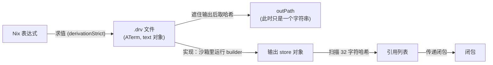

第 5 篇里 `lib-tests` 和 `readme-table` 都是 `pkgs.runCommand` 写的，我一直把它当成“一个会跑脚本的东西”，从没问过它的输出为什么在 `/nix/store/hm91ddl7gz...-firn-lib-tests` 这种路径里，那串哈希又是谁算的。这一篇我把盒子拆开：不用 nixpkgs 的 `stdenv`，只借一个静态链接的 busybox，手写一个 `derivation`，然后让 Nix 把它的一切摊在桌面上。

```text
$ cat out/ch06/build_raw.stdout
drvPath: /nix/store/7myk835gqyb2p0v615cg16s2cklpl33v-raw-hello.drv
outPath: /nix/store/2wnxgscwm9bz32gbzy96q48987h6la0y-raw-hello
built:   /nix/store/2wnxgscwm9bz32gbzy96q48987h6la0y-raw-hello
content: hello from a raw derivation
```

`outPath` 在构建之前就已经知道了，而 `drvPath` 指向的文件只有 692 字节。这一篇要回答的就是：这 692 字节里写了什么，`2wnxgscw...` 这 32 个字符是怎么从里面算出来的（我会用 Firn 自己的 `lib` 把它算一遍，只借用 `builtins.hashString` 和 `builtins.convertHash` 这类通用的函数，不借用 Nix 里专门算 store 路径的那部分），构建的时候这个路径外面的世界是什么样的，以及 Nix 事后又是怎么知道 `hello` 依赖哪几个路径的。

> [!NOTE] 本篇检查点
> 这一篇结束时，Firn 仓库的标签 `ch06` 里新增：`lib/store-path.nix`（`textStorePath`，77 行）、`mini/seed.nix` 和 `mini/raw.nix`（mini 包集的种子和最原始的 derivation 构造器，第 7 篇继续长）、`tests/lib.nix` 里 4 个新用例（总数从 73 变成 77），`lib/default.nix` 多导出一个子集 `storePath`（导出的名字从 48 个变成 50 个）；`lab/ch06/` 下有 14 个实验和 1 个 fixture。`make ch06` 通过。`lib/store-path.nix` 和 `lab/ch06/` 在这一章写完之后就是最终版本；`mini/seed.nix` 和 `mini/raw.nix` 第 7 篇会直接使用，之后的章节如果要改它们，会在对应那一篇里说明；`lib/default.nix` 和 `tests/lib.nix` 之后每一章还会继续增补。
> 涉及的 Nix 特性：`derivation` 内建函数、`.drv` 的 ATerm 格式、store 路径的指纹与 nix32、input-addressed 与 fixed-output 输出、构建沙箱、引用扫描、闭包、GC 根、`builtins.toFile`、`builtins.convertHash`、`builtins.bitXor`。
> 前置：[第 5 篇：自己写一个 lib](/posts/nix-by-firn-05-own-lib/)；字符串上下文的概念见[第 4 篇](/posts/nix-by-firn-04-builtins/)，这一篇的“为什么 `"${drv}"` 会带来依赖”在引用扫描一节有对照。

环境照旧：NixOS 26.05，Nix 2.34.9，锁定的 nixpkgs 是 `56c02bc00adcf003215cc4bd996d6efaf4cff188`。引用 Nix 源码时我用的是 2.34.9 标签的行号，引用 nixpkgs 时用的是锁定的这个提交。

## 一个 derivation 其实是个 attrset

先看最小的那个。[`lab/ch06/raw_hello.nix`](https://github.com/bfmhno3/firn/blob/ch06/lab/ch06/raw_hello.nix)：

```nix
let
  inherit (import ./fixtures/prelude.nix) raw;
in
raw {
  name = "raw-hello";
  script = "echo 'hello from a raw derivation' > $out";
}
```

`raw` 来自 [`mini/raw.nix`](https://github.com/bfmhno3/firn/blob/ch06/mini/raw.nix)，它背后的“种子”是 [`mini/seed.nix`](https://github.com/bfmhno3/firn/blob/ch06/mini/seed.nix)。这两个文件加起来不到 20 行，我一起贴出来：

```nix
# 种子：锁定版 nixpkgs 里静态链接的 busybox，是 mini 包集唯一从外面借来的东西。
{
  system ? builtins.currentSystem,
}:
(import ../nix/pkgs.nix { inherit system; }).pkgsStatic.busybox
```

```nix
# 最原始的 derivation：一个名字加一段 sh 脚本，只用 busybox，没有 stdenv。
{ busybox, system }:
{ name, script }:
derivation {
  inherit name system;
  builder = "${busybox}/bin/sh";
  args = [
    "-c"
    script
  ];
  PATH = "${busybox}/bin";
}
```

静态链接的 busybox 是个很好的种子：它不需要动态链接库，沙箱里要放进去的东西少（后面的 `ls /nix/store` 能看到）。`derivation` 是第 1 篇说过的那个“这门语言的主要工作”：它接一个 attrset，里面至少要有 `name`、`system`、`builder` 三项，其余随便。我们给了 `args` 和 `PATH`。`${busybox}` 是第 4 篇讲过的带上下文的字符串插值：它展开成 busybox 的输出路径，并且让这个字符串带上“我依赖 busybox 的 `.drv`”这条信息。

求值它：

```text
$ cat out/ch06/raw_hello.stdout
«derivation /nix/store/7myk835gqyb2p0v615cg16s2cklpl33v-raw-hello.drv»
```

我原来以为 `derivation` 是个特殊语法，其实不是。内建函数 `derivation` 是用 Nix 写的一个薄壳，在 [`src/libexpr/primops/derivation.nix`](https://github.com/NixOS/nix/blob/2.34.9/src/libexpr/primops/derivation.nix#L36) 里：真正干活的是 C++ 实现的 `derivationStrict`（第 36 行），壳只负责把结果包装成你拿到的这个 attrset。包装的那几行（第 46 到 54 行，原样引用）：

```nix
  outputToAttrListElement = outputName: {
    name = outputName;
    value = commonAttrs // {
      outPath = builtins.getAttr outputName strict;
      drvPath = strict.drvPath;
      type = "derivation";
      inherit outputName;
    };
  };
```

所以“derivation”在 Nix 语言里没有自己的类型：它是一个 attrset，`type` 属性恰好等于字符串 `"derivation"`，外加 `outPath` 和 `drvPath`。求值器判断“这是不是一个 derivation”就是看这个 `type`（[`EvalState::isDerivation`](https://github.com/NixOS/nix/blob/2.34.9/src/libexpr/eval.cc#L2432)，第 2432 到 2443 行），我猜上面那个 `«derivation ...»` 的打印形式也是由此而来的，不过我没有去读打印代码的分支。后面凡是我说“插值一个 derivation”，机制都是第 2 篇的 `outPath`：带 `outPath` 的 attrset 插值时取 `outPath`，字符串上下文里再记下它来自哪个 `.drv`。

nixpkgs 里所有的包最终都要经过这扇门。`stdenv.mkDerivation` 把一大堆参数整理成一个 attrset，最后一步就是 [`derivation (derivationArg // checkedEnv)`](https://github.com/NixOS/nixpkgs/blob/56c02bc00adcf003215cc4bd996d6efaf4cff188/pkgs/stdenv/generic/make-derivation.nix#L1071)；第 5 篇里的 `runCommand` 是 [`pkgs/build-support/trivial-builders/default.nix` 第 29 行](https://github.com/NixOS/nixpkgs/blob/56c02bc00adcf003215cc4bd996d6efaf4cff188/pkgs/build-support/trivial-builders/default.nix#L29)起的一个 `stdenvNoCC` 上的薄封装。我们这篇的 `raw` 只是把这些封装全剥掉。

## 实例化和实现：两个动作

`raw_hello.nix` 求值完，`.drv` 就在 store 里了。这是“实例化” (instantiate)：把 Nix 表达式变成一个 store derivation，一个描述“怎么构建”的文件。还没有任何构建发生。第二个动作是“实现” (realise)：真的去跑 builder，产生输出路径。[Nix 手册的“Building”一章](https://nix.dev/manual/nix/2.34/store/building)描述了后者，命令行上 `nix-instantiate` 做前者，`nix-store --realise` 做后者，`nix build` 两个都做。

[`lab/ch06/build_raw.sh`](https://github.com/bfmhno3/firn/blob/ch06/lab/ch06/build_raw.sh) 把这两步分开：

```bash
echo "drvPath: $(nix eval --raw --file "${file}" drvPath)"
echo "outPath: $(nix eval --raw --file "${file}" outPath)"
out="$(nix build --no-link --print-out-paths -f "${file}")"
echo "built:   ${out}"
echo "content: $(cat "${out}")"
```

前两行只求值，后一行才构建。输出开头已经贴过了：`drvPath` 和 `outPath` 在求值阶段都已经是确定的字符串，`built:` 打印的路径和 `outPath` 一字不差。这是 Nix 的核心性质之一：输出路径在构建之前就确定了，因为它是 `.drv` 的函数，不是输出内容的函数。这个性质能不能成立，取决于下面这个问题：`.drv` 里到底有什么。

把到目前为止的流水线画出来，后面每一节都是其中一个箭头：



左半边（到 `outPath` 为止）只需要求值器，不需要构建；右半边需要守护进程去起沙箱。`outPath` 和输出 store 对象是两回事：前者是一个字符串，后者要等构建完才存在。

## .drv 里写了什么

[`lab/ch06/drv_show.sh`](https://github.com/bfmhno3/firn/blob/ch06/lab/ch06/drv_show.sh) 先量大小，再让 `nix derivation show` 把它渲染成 JSON，最后直接 `cat` 原始文件：

```text
$ cat out/ch06/drv_show.stdout
drv: /nix/store/7myk835gqyb2p0v615cg16s2cklpl33v-raw-hello.drv
size: 692 bytes

== nix derivation show (top-level fields)
[
  "derivations",
  "version"
]

== nix derivation show (derivation fields)
{
  "name": "raw-hello",
  "system": "x86_64-linux",
  "builder": "/nix/store/8mid8wh1kxb0gl4g6s9l3bwawd9xzfkj-busybox-static-x86_64-unknown-linux-musl-1.37.0/bin/sh",
  "args": [
    "-c",
    "echo 'hello from a raw derivation' > $out"
  ],
  "outputs": {
    "out": {
      "path": "2wnxgscwm9bz32gbzy96q48987h6la0y-raw-hello"
    }
  },
  "env": [
    "PATH",
    "builder",
    "name",
    "out",
    "system"
  ],
  "inputs": {
    "drvs": {
      "h1a80q83m99ys215a31b5s1q4ml3m2qf-busybox-static-x86_64-unknown-linux-musl-1.37.0.drv": {
        "dynamicOutputs": {},
        "outputs": [
          "out"
        ]
      }
    },
    "srcs": []
  }
}
```

（我只贴了前两段，第三段是下面单独贴的原始文件。）JSON 视图读起来很舒服，但那不是磁盘上的东西。磁盘上的 `.drv` 是 [ATerm 格式](https://nix.dev/manual/nix/2.34/protocols/derivation-aterm)（手册里写着这是“出于历史原因”）。脚本最后一段 `cat` 出来是这样的，一整行，我没有改动：

```text
Derive([("out","/nix/store/2wnxgscwm9bz32gbzy96q48987h6la0y-raw-hello","","")],[("/nix/store/h1a80q83m99ys215a31b5s1q4ml3m2qf-busybox-static-x86_64-unknown-linux-musl-1.37.0.drv",["out"])],[],"x86_64-linux","/nix/store/8mid8wh1kxb0gl4g6s9l3bwawd9xzfkj-busybox-static-x86_64-unknown-linux-musl-1.37.0/bin/sh",["-c","echo 'hello from a raw derivation' > $out"],[("PATH","/nix/store/8mid8wh1kxb0gl4g6s9l3bwawd9xzfkj-busybox-static-x86_64-unknown-linux-musl-1.37.0/bin"),("builder","/nix/store/8mid8wh1kxb0gl4g6s9l3bwawd9xzfkj-busybox-static-x86_64-unknown-linux-musl-1.37.0/bin/sh"),("name","raw-hello"),("out","/nix/store/2wnxgscwm9bz32gbzy96q48987h6la0y-raw-hello"),("system","x86_64-linux")])
```

一行 692 字节，没有缩进，没有换行。为了读它，我把它的七个字段按顺序拆开（下面是我手工排版的示意，把 busybox 的路径缩写成 `<busybox>`，不是 Nix 的原样输出）：

```text
Derive(
  outputs    [("out", "/nix/store/2wnxgscw...-raw-hello", "", "")],
  inputDrvs  [("/nix/store/h1a80q83...-busybox-....drv", ["out"])],
  inputSrcs  [],
  system     "x86_64-linux",
  builder    "<busybox>/bin/sh",
  args       ["-c", "echo 'hello from a raw derivation' > $out"],
  env        [("PATH", "<busybox>/bin"), ("builder", "<busybox>/bin/sh"),
              ("name", "raw-hello"), ("out", "/nix/store/2wnxgscw...-raw-hello"),
              ("system", "x86_64-linux")]
)
```

逐个看：

- **outputs**：每个输出一个四元组：名字、路径、哈希算法、哈希。后两个是空串，表示这是 input-addressed 的输出（路径由输入决定）。固定输出 derivation 的这两个槽位会填上，下面“固定输出”一节讲的就是它们，不过这一章的实验没有打印固定输出的 ATerm。
- **inputDrvs**：依赖的其他 `.drv`，以及要用它们的哪些输出。我们只依赖 busybox 的 `.drv` 的 `out`。注意这里依赖的是 `.drv`，不是输出路径：构建之前，Nix 要先把 busybox 的输出实现出来，然后才能进入沙箱。
- **inputSrcs**：依赖的、不由 derivation 产生的 store 路径，比如被拷进 store 的源码文件。我们的脚本是内联的字符串，所以是空列表 `[]`。第 2 篇说的“路径插值会把文件拷进 store”拷出来的东西，按手册的分类应该就在这一栏里（这一章的实验没有用到路径插值，我没有展示它）。
- **system**、**builder**、**args**：在哪种平台上，用谁，带什么参数来运行。`builder` 必须是一个会被执行的文件，我们给的是 busybox 的 `sh`。
- **env**：传给 builder 的环境变量，按名字排序（大写的 `PATH` 排在小写字母之前）。你写进 `derivation` 的每个属性都在这里：`PATH`、`builder`、`name`、`system`，加上 Nix 自己补的 `out`，它的值就是输出路径。属性值全部被转成字符串：整数、布尔、列表都有各自的规则（第 2 篇的 `toString`）。

没有一个字段是“名字”：`.drv` 文件的名字是 `raw-hello.drv`，名字在路径里，不在内容里。手册说得很明确：[“ATerm 格式本身不含 derivation 的名字，假定 store 路径会在带外提供”](https://nix.dev/manual/nix/2.34/protocols/derivation-aterm)。

两件事我之前没想到。第一，`.drv` 完全自足：给我这 692 字节，加上它输入 derivation 的整个 `.drv` 闭包（或者能从缓存拿到 busybox 的输出），我就能在任何有 Nix 的机器上把输出构建出来，不需要原来的 Nix 表达式、`nixpkgs`、`lib`，什么都不需要。这也是第 20 篇回到二进制缓存时的出发点之一：路径由 `.drv` 决定，所以不管在哪台机器上，“这个路径有没有”都是同一个问题。第二，`out` 既出现在 `outputs` 里，又出现在 `env` 里，所以 `.drv` 里写着它自己输出的路径。一个文件里包含着自己哈希的一部分输入，这怎么算？这是下一节的事，但答案的雏形可以先说：算哈希的时候这些位置是空串。

## 一个 store 路径的解剖

`/nix/store/2wnxgscwm9bz32gbzy96q48987h6la0y-raw-hello` 由三部分组成：

- `/nix/store`：store 目录。
- `2wnxgscwm9bz32gbzy96q48987h6la0y`：32 个字符的摘要。
- `raw-hello`：名字，纯粹给人看的，但它也进了哈希。

名字这一段有字符限制。2006 年的论文（[第 5.2.2 节，第 93 页](https://edolstra.github.io/pubs/phd-thesis.pdf)）写的是：由一个或多个字符组成，取自大小写字母、数字，以及 `+-._?=` 这几个符号。这是论文当时的规则，Nix 2.34.9 现在的检查在 `src/libstore/include/nix/store/path.hh` 里的 `checkName`，我没有对照读，所以不敢说两者一字不差。`.drv` 的名字则按手册的约定是 derivation 的名字后面加 `.drv`，所以 `raw-hello` 的 derivation 文件叫 `...-raw-hello.drv`，上面的输出里看得到。名字不是装饰：它进了指纹，改名字就改路径，所以 `store_path_by_hand.nix` 里每一组输入都给了不同的名字，`firn-empty`、`firn-hello.txt`、`firn-with-ref`。

回到摘要：那 32 个字符用的是 Nix 自己的 base-32，叫 [nix32](https://nix.dev/manual/nix/2.34/protocols/nix32)，字母表是 `0123456789abcdfghijklmnpqrsvwxyz`：去掉了 `e`、`o`、`u`、`t`。去掉它们的理由，我在 Dolstra 的博士论文里找到了：[第 5.1 节（论文第 89 页）](https://edolstra.github.io/pubs/phd-thesis.pdf)说是为了减少哈希里出现某些用户可能觉得冒犯的字符序列。每个字符承载 5 位，所以 32 个字符就是 $32 \times 5 = 160$ 位，正好是 20 字节，[论文第 5.2.2 节（第 92 页）](https://edolstra.github.io/pubs/phd-thesis.pdf)把它叫“160 位的密码学哈希的 base-32 表示”。

nix32 还有一个和 base-16 不一样的地方，[手册](https://nix.dev/manual/nix/2.34/protocols/nix32)的 “Byte Order” 一节写着：它从哈希的最后一个字节开始处理。所以按字符串排序时，决定顺序的主要是哈希的最后几个字节，而 base-16 是前几个字节。我手算时没有自己写这一步：转换交给了 `builtins.convertHash`，这一步的字节顺序对不对，由后面三组 `equal = true` 来背书。

这 20 字节不是 SHA-256 的全部 32 字节，而是它压缩得来的。[Nix 手册的 store 路径规范](https://nix.dev/manual/nix/2.34/protocols/store-path)把整个计算写成两步：

```text
store-path  = store-dir "/" digest "-" name
digest      = nix32( compressTo160( sha256( fingerprint ) ) )
fingerprint = type ":sha256:" inner-digest ":" store ":" name
```

`type` 决定了这是哪一类对象：

- `text` 加上引用列表：文本文件，比如 `builtins.toFile`、`writeText` 产生的，也包括 `.drv` 文件自己。
- `source` 加上引用：用 SHA-256 加 NAR 序列化做内容寻址的目录或文件，比如第 2 篇里路径插值拷进 store 的那些。
- `output:<id>`：derivation 的输出，`id` 通常是 `out`。

这三类之间有一段值得知道的历史，手册在规范末尾的“Historical Note”里写了：`source` 和 `output:out` 两种写法在用途上重叠，都能表示“按 SHA-256 加 NAR 序列化做内容寻址”的数据。最初把它们分开，是为了防止碰撞（一个 derivation 的输出路径不该有可能碰上一个被拷进 store 的源码路径）；但自提交 `64519cfd657d024ae6e2bb74cb21ad21b886fd2a`（2008 年）起，决定这种区分没有用，现在凡是 SHA-256 加 NAR 的内容寻址一律用 `source:`，不管数据是手工放进去的还是 derivation 产出的。这样“用固定输出 derivation 去下载”和“在带外下载好再手工加进 store”可以随意互换，同一份内容得到同一个路径。[原文在规范页的末尾](https://nix.dev/manual/nix/2.34/protocols/store-path)，我没有去查那个提交本身。

`inner-digest` 是 `inner-fingerprint` 的 SHA-256，用小写十六进制写出来。对 `text` 类型，`inner-fingerprint` 就是写进 store 路径里的那段字节，所以 `text` 是三种里最容易手算的。`output` 类型的 `inner-fingerprint` 对 input-addressed 的输出，手册的说法是“derivation modulo fixed output derivations 的 ATerm 序列化”，也就是后面要讲的 quotient hashing。

压缩那一步，规范只写“请参考论文 5.1 节”。论文给的公式在第 90 页：把 32 字节的哈希循环地异或进一个长度为 $n$ 的零数组里，

$$\text{truncate}(n, c)[i] = \bigoplus_{0 \le j < |c|,\ j \bmod n = i} c[j]$$

对应的 Nix 源码就是 [`compressHash`](https://github.com/NixOS/nix/blob/2.34.9/src/libutil/hash.cc#L416)（`src/libutil/hash.cc` 第 416 到 423 行）：

```cpp
Hash compressHash(const Hash & hash, unsigned int newSize)
{
    Hash h(hash.algo);
    h.hashSize = newSize;
    for (unsigned int i = 0; i < hash.hashSize; ++i)
        h.hash[i % newSize] ^= hash.hash[i];
    return h;
}
```

调用它的地方是 [`makeStorePath`](https://github.com/NixOS/nix/blob/2.34.9/src/libstore/store-dir-config.cc#L72)（`src/libstore/store-dir-config.cc` 第 72 到 78 行）：

```cpp
StorePath StoreDirConfig::makeStorePath(std::string_view type, std::string_view hash, std::string_view name) const
{
    /* e.g., "source:sha256:1abc...:/nix/store:foo.tar.gz" */
    auto s = std::string(type) + ":" + std::string(hash) + ":" + storeDir + ":" + std::string(name);
    auto h = compressHash(hashString(HashAlgorithm::SHA256, s), 20);
    return StorePath(h, name);
}
```

指纹里有 store 目录和名字，所以把同一份内容放进 `/gnu/store`，或者换一个名字，得到的哈希部分都不一样。（手册里这么解释的：它要避免出现“`<digest>-name1` 和 `<digest>-name2` 哈希部分相同”这种情况。）

## 手算一个 store 路径

规范说清楚了，剩下的就是动手算。Firn 的 [`lib/store-path.nix`](https://github.com/bfmhno3/firn/blob/ch06/lib/store-path.nix) 只做 `text` 这一类，因为它的输入最简单：一段内容加上一个名字和引用列表。总共 77 行，核心是三个小函数。

在这三个之前还要有两个小的辅助：Nix 语言没有字节类型，所以我把哈希当成 0 到 255 的整数列表来处理。`builtins.hashString` 返回十六进制字符串，要先拆成字节：

```nix
  # "0".."f" 到 0..15 的查找表。
  hexValue = builtins.listToAttrs (
    builtins.genList (i: {
      name = builtins.substring i 1 hexDigits;
      value = i;
    }) 16
  );

  # 把 64 个十六进制字符拆成 32 个字节 (0..255)。
  hexToBytes =
    hex:
    builtins.genList (
      i:
      hexValue.${builtins.substring (2 * i) 1 hex} * 16 + hexValue.${builtins.substring (2 * i + 1) 1 hex}
    ) (builtins.stringLength hex / 2);
```

`hexValue` 用一个 attrset 当 16 项的查找表（键是字符，值是数）。`hexToBytes` 一次取两个字符，高位乘 16 加低位。反方向的 `byteToHex` 用 `builtins.bitAnd byte 15` 取低四位，整除 16 取高四位。文件里用到的位运算只有 `bitXor` 和 `bitAnd` 两个。

第一个是异或折叠。32 个字节折成 20 个：第 `i` 个字节异或进第 `i % 20` 个槽。槽 0 到 11 各收两个字节（$12 \times 2 + 8 \times 1 = 32$，槽 12 到 19 各收一个）：

```nix
  # 对应 Nix 的 compressHash：第 i 个字节异或进第 i % 20 个槽。
  # 32 字节折成 20 字节，所以槽 0..11 各收两个字节，其余各收一个。
  compress20 =
    bytes:
    builtins.genList (
      j:
      if j + 20 < builtins.length bytes then
        builtins.bitXor (builtins.elemAt bytes j) (builtins.elemAt bytes (j + 20))
      else
        builtins.elemAt bytes j
    ) 20;
```

第二个是从 20 个字节到 nix32。Nix 语言里没有直接把字节序列写成 nix32 的函数，但有 `builtins.convertHash`，它能在哈希格式之间转换。20 个字节恰好和 SHA-1 一样长，所以我把这 20 字节写成 40 个十六进制字符，装成“SHA-1 哈希”，让 `convertHash` 转成 `nix32`：

```nix
  nix32Of20Bytes =
    bytes:
    builtins.convertHash {
      hash = builtins.concatStringsSep "" (map byteToHex bytes);
      hashAlgo = "sha1";
      toHashFormat = "nix32";
    };
```

这是个取巧：我在借用一个字节宽度刚好对得上的格式转换器，并不是说 store 路径用了 SHA-1。（这个取巧管不管用，由测试说了算，下面马上看。）

第三个是把它们串起来，对应规范里的三层：

```nix
  textStorePath =
    {
      name,
      content,
      references ? [ ],
    }:
    let
      refs = builtins.sort builtins.lessThan (map builtins.unsafeDiscardStringContext references);
      innerDigest = builtins.hashString "sha256" (builtins.unsafeDiscardStringContext content);
      fingerprint = builtins.concatStringsSep ":" (
        [ "text" ]
        ++ refs
        ++ [
          "sha256"
          innerDigest
          "/nix/store"
          name
        ]
      );
      digest = nix32Of20Bytes (compress20 (hexToBytes (builtins.hashString "sha256" fingerprint)));
    in
    "/nix/store/${digest}-${name}";
```

我把 Firn 的实现对着 Nix 的 [`makeType`](https://github.com/NixOS/nix/blob/2.34.9/src/libstore/store-dir-config.cc#L93)（第 93 到 102 行）和它对 `text` 的调用（[`makeFixedOutputPathFromCA`](https://github.com/NixOS/nix/blob/2.34.9/src/libstore/store-dir-config.cc#L134) 里第 134 到 146 行）读了一遍：类型串从 `"text"` 开始，每个引用前面加一个冒号接在后面，`text` 没有 `:self` 后缀（那个只有 `source` 才有）。后面的 `:sha256:<hex>:/nix/store:<name>` 来自 `makeStorePath`。引用的顺序：Nix 那边的 `references.others` 是 [`std::set<StorePath>`](https://github.com/NixOS/nix/blob/2.34.9/src/libstore/include/nix/store/path.hh#L83)，而 `StorePath` 只有一个成员 `baseName`，比较运算符是 [默认生成的](https://github.com/NixOS/nix/blob/2.34.9/src/libstore/include/nix/store/path.hh#L56)，也就是按 base name 的字符串顺序；所有路径的 `/nix/store/` 前缀相同，所以 Firn 里直接对完整路径字符串排序，顺序是一样的。练习 1 的实验用两个引用的两种传入顺序验证了这一点。

`textStorePath` 在 `lib/default.nix` 里是这样接进去的（[`lib/default.nix`](https://github.com/bfmhno3/firn/blob/ch06/lib/default.nix) 在 ch06 的改动，三处）：`let` 里多 `storePath = import ./store-path.nix;`，子集列表里多 `storePath`，`//` 链末尾多 `// storePath`。所以 `lib.textStorePath` 和 `lib.storePath.textStorePath` 都能用，导出的名字从 48 个变成 50 个（一个子集 `storePath`，一个函数 `textStorePath`）。

对拍的实验是 [`lab/ch06/store_path_by_hand.nix`](https://github.com/bfmhno3/firn/blob/ch06/lab/ch06/store_path_by_hand.nix)：三组输入，空内容、一段普通文本、一段里面插值了另一个 store 路径的文本，分别交给 `textStorePath` 和 `builtins.toFile`，只要有一个不相等就 `throw`：

```nix
  check =
    case:
    let
      computed = lib.textStorePath case;
      real = builtins.toFile case.name case.content;
    in
    {
      inherit (case) name;
      references = builtins.length case.references;
      inherit computed real;
      equal = computed == real;
    };
```

输出（`nix eval` 把整个列表打印成一行，下面是原样的一行）：

```text
$ cat out/ch06/store_path_by_hand.stdout
[ { computed = "/nix/store/y8jwn6m8wwcic4nw2i7liq0ia1dqcbh5-firn-empty"; equal = true; name = "firn-empty"; real = "/nix/store/y8jwn6m8wwcic4nw2i7liq0ia1dqcbh5-firn-empty"; references = 0; } { computed = "/nix/store/lqqf5cb0b9kliyzw4gh4v0li7cimgvl8-firn-hello.txt"; equal = true; name = "firn-hello.txt"; real = "/nix/store/lqqf5cb0b9kliyzw4gh4v0li7cimgvl8-firn-hello.txt"; references = 0; } { computed = "/nix/store/lvxd62bv5kd2b7d10d8mf6pdn4ia2dqw-firn-with-ref"; equal = true; name = "firn-with-ref"; real = "/nix/store/lvxd62bv5kd2b7d10d8mf6pdn4ia2dqw-firn-with-ref"; references = 1; } ]
```

三个 `equal = true`，包括带一个引用的那个。从 Dolstra 的论文读到 Nix 的 C++，再用不到八十行 Nix 把它重写一遍，最后和 `builtins.toFile` 对上，我没想到这条链这么短。

`tests/lib.nix` 里新增的 4 个用例接在 `cases` 的末尾。三个是对拍（`testTextStorePathEmpty`、`testTextStorePathPlain`、`testTextStorePathWithReference`，期望值都是 `builtins.toFile` 的结果），第四个是反例 `testTextStorePathReferenceMatters`：内容里有引用，但调用 `textStorePath` 时不传 `references`，得到的路径必须和 `toFile` 的不同，也就是说引用确实进了哈希：

```nix
    testTextStorePathReferenceMatters =
      let
        dep = builtins.toFile "dep" "dependency";
        content = "needs ${dep}\n";
      in
      {
        expr =
          lib.textStorePath {
            name = "user";
            inherit content;
          } == builtins.toFile "user" content;
        expected = false;
      };
```

用例总数从第 5 篇的 73 个变成 77 个。

### 连 .drv 自己也是一个 text 对象

手册那页关于 ATerm 的说明里有一句我当时没留意：把 derivation 编码成 store 对象的时候，“derivation 用 `Text` 方法做内容寻址”，名字是 derivation 名字加 `.drv`。那么 `raw-hello.drv` 的路径就应该能用 `textStorePath` 算出来：内容是 692 字节的 ATerm，引用是它依赖的 busybox 的 `.drv`。[`lab/ch06/drv_path_by_hand.nix`](https://github.com/bfmhno3/firn/blob/ch06/lab/ch06/drv_path_by_hand.nix) 试了一下：

```nix
  computed = lib.textStorePath {
    name = "raw-hello.drv";
    content = builtins.readFile drv;
    references = [ busyboxDrv ];
  };
```

```text
$ cat out/ch06/drv_path_by_hand.stdout
{ computed = "/nix/store/7myk835gqyb2p0v615cg16s2cklpl33v-raw-hello.drv"; equal = true; real = "/nix/store/7myk835gqyb2p0v615cg16s2cklpl33v-raw-hello.drv"; }
```

`equal = true`。于是整条链现在是闭合的：`.drv` 是一个 `text` 对象，它的路径只取决于它的内容 (ATerm) 和引用（输入 derivation）；而 ATerm 里的输入 derivation 又是由它们自己的 `.drv` 路径指明的，一层套一层。后面讲输入寻址的时候我们会看到，输出路径不是直接由 `.drv` 路径算的，而是由“抹掉输出之后的 `.drv`”算的，两者是两个哈希。

## 输入寻址：输出路径是 .drv 的哈希

现在回到那个“`.drv` 里有自己输出路径”的问题。输出路径是怎么算的？Nix 做了一个小把戏，在 [`derivationStrict` 里](https://github.com/NixOS/nix/blob/2.34.9/src/libexpr/primops.cc#L1806)（`src/libexpr/primops.cc` 第 1806 到 1817 行）有一段注释说得很直白：先算一个“被遮住的” (masked) derivation 的哈希，也就是输出路径是空串、对应的环境变量也是空值的那一份。这样输出名字集合的变化会反映进哈希，而哈希本身不依赖自己。然后 [`processDerivationOutputPaths`](https://github.com/NixOS/nix/blob/2.34.9/src/libstore/derivations.cc#L1308)（`src/libstore/derivations.cc` 第 1308 行调用 `hashDerivationModulo(..., true)`，第 1315 行用 `makeOutputPath` 算出路径）把结果填回去。填回去之后才写出 `.drv`。

规范（Inner fingerprint 一节）对 input-addressed 的输出写的是“the ATerm serialization of the derivation modulo fixed output derivations”。对着源码读，我的理解是：指纹类型是 `output:out`，内部哈希是遮住输出的 `.drv` 文本的 SHA-256，其中还有一层细节：这个 ATerm 里的输入 derivation，不是用 `.drv` 路径，而是用“它们自己的哈希”（`hashDerivationModulo` 递归算出来）替换的（[`derivations.cc` 第 897 到 957 行](https://github.com/NixOS/nix/blob/2.34.9/src/libstore/derivations.cc#L897)），手册把这叫“quotient hashing”，[Input-addressing 那一页](https://nix.dev/manual/nix/2.34/store/derivation/outputs/input-address)有伪代码。下一节会解释为什么需要这一层。

这个设计的直接后果，是路径只取决于“怎么造”，不取决于“造出了什么”。[`lab/ch06/input_addressed.sh`](https://github.com/bfmhno3/firn/blob/ch06/lab/ch06/input_addressed.sh) 造两个 derivation，只有一个 builder 从来不会读的属性 `unused` 不同（`one` 和 `two`），脚本一模一样，都是 `echo 'same bytes' > $out`：

```text
$ cat out/ch06/input_addressed.stdout
unused = one
  drvPath: /nix/store/1rpd34xh1klv4f7p7sirjd6k1nsy0pvh-same-bytes.drv
  outPath: /nix/store/vdhd9jl82wikhsq3czm85rx5qg4ky885-same-bytes
unused = two
  drvPath: /nix/store/81lrfvm0bhrpqgdgyi1474k5hjxiiwni-same-bytes.drv
  outPath: /nix/store/ph20p0v8l0rlaynf1h9qs9lcc4j7a6z8-same-bytes
sha256 of the outputs:
abb7f0ae43ba52cc56233a5ecb4dfa11765f26b1282a18346d811b6a85af19c1  /nix/store/vdhd9jl82wikhsq3czm85rx5qg4ky885-same-bytes
abb7f0ae43ba52cc56233a5ecb4dfa11765f26b1282a18346d811b6a85af19c1  /nix/store/ph20p0v8l0rlaynf1h9qs9lcc4j7a6z8-same-bytes
outputs are byte-identical
```

两个 `.drv`，两个输出路径，两个输出的内容完全一样（同一个 SHA-256 `abb7f0ae...`，脚本最后用 `cmp` 又确认了一遍）。属性 `unused` 进了 `env`，`env` 进了 ATerm，ATerm 进了哈希，仅此而已。Nix 没有办法知道 builder 不读它，也不尝试去知道。

这听起来像是个缺陷，其实是它的代价和保证。代价：你改了 nixpkgs 里 glibc 的一个构建参数，哪怕输出的每一个字节都没变，所有间接依赖它的包路径都会变，都要重新构建。保证：只要路径相同，输入就相同（密码学意义上的“相同”），所以路径可以被当作“这个构建”的名字；一个路径在你机器上存在，意味着它是由这份 `.drv` 构建出来的，不是别的东西。第 20 篇里二进制缓存正是靠这一点工作的，这里先放着。

## 固定输出：路径由内容决定

上面的代价对一类 derivation 特别疼：下载。`fetchurl` 下载一个 tarball，如果它的输出路径取决于 URL 和下载脚本，那么换一个镜像地址（内容完全一样）就会让所有依赖这个 tarball 的东西全部重新构建。Dolstra 在论文 [5.4.1 节（第 106 页）](https://edolstra.github.io/pubs/phd-thesis.pdf)里正是用这个例子引出了“固定输出 derivation”：换一个 `fetchurl` 的 URL，“glibc 源码包的 URL 一换，几乎所有组件都要大规模重建”，而这个改动实际上不应该有任何影响。

解决办法是让 derivation 提前声明输出的哈希：`outputHash`，加上 `outputHashAlgo` 和 `outputHashMode`。声明了之后，输出路径就由这个哈希决定，和 builder 无关，Nix 在构建结束后检查输出确实匹配。[`lab/ch06/fixed_output.sh`](https://github.com/bfmhno3/firn/blob/ch06/lab/ch06/fixed_output.sh) 用两个不同的脚本，都产生字节串 `firn`，都声明同一个 `outputHash`：

```bash
readonly script_a="printf '%s' firn > \$out"
readonly script_b="echo firn | tr -d '\\n' > \$out"
```

```text
$ cat out/ch06/fixed_output.stdout
outputHash: sha256-n68DEe0DjlPchxYlRRHS1bQSJd2cs6ico2rmd2pAaOI=
script: printf '%s' firn > $out
  drvPath: /nix/store/6rz3yg2zxiln4v2cnfbl9zhj5wisyb1j-firn-fod.drv
  outPath: /nix/store/ka3q91ppkgcwpn2vp43xzv5panz7ld1b-firn-fod
  built:   /nix/store/ka3q91ppkgcwpn2vp43xzv5panz7ld1b-firn-fod
script: echo firn | tr -d '\n' > $out
  drvPath: /nix/store/nvps79hx3kwgbciix7drasjyvigpvfr0-firn-fod.drv
  outPath: /nix/store/ka3q91ppkgcwpn2vp43xzv5panz7ld1b-firn-fod
  built:   /nix/store/ka3q91ppkgcwpn2vp43xzv5panz7ld1b-firn-fod
```

两个 `.drv` 不同（`6rz3yg2z...` 和 `nvps79hx...`），两个 `outPath` 一样 (`ka3q91pp...`)：这和上一节的实验是镜像。上一节是“输入不同，输出一样，路径不同”，这一节是“输入不同，输出一样，路径相同”。`outputHash` 里那个 `sha256-n68DEe...` 是 SRI 格式，是脚本里对 `firn` 这个字符串做 `sha256sum` 再用 `nix hash convert --to sri` 转出来的。

机制在 Nix 的源码里有两处。输出路径本身由 [`makeFixedOutputPath`](https://github.com/NixOS/nix/blob/2.34.9/src/libstore/store-dir-config.cc#L104)（`store-dir-config.cc` 第 104 到 125 行）算，对非 NAR-SHA256 的模式，它构造的负载是

```cpp
        auto payload =
            "fixed:out:" + makeFileIngestionPrefix(info.method) + info.hash.to_string(HashFormat::Base16, true) + ":";
```

也就是规范里写的 `fixed:out:<rec><algo>:<hash>:`，再交给 `makeStorePath("output:out", ...)`。这里面没有 builder，没有 `args`，没有 `env`。另一处是上面那个递归的 `hashDerivationModulo`：它遇到固定输出 derivation 就[直接返回一个只由 `fixed:out:...` 算出来的哈希](https://github.com/NixOS/nix/blob/2.34.9/src/libstore/derivations.cc#L902)（第 902 到 914 行），不再看它的 ATerm。所以哪怕依赖它的 derivation 的输入里换了一个不同的下载脚本，只要声明的哈希相同，依赖者算出来的路径就不变。这就是 quotient hashing 里“quotient”的含义：把所有“输出相同”的固定输出 derivation 压成同一个等价类。

固定输出还有一条限制：它不许有引用。[`makeFixedOutputPath` 里](https://github.com/NixOS/nix/blob/2.34.9/src/libstore/store-dir-config.cc#L115)（第 115 到 121 行）如果声明的输出带了引用，就直接报 “fixed output derivation '%s' is not allowed to refer to other store paths”；构建完的检查里（[`derivation-check.cc` 第 46 到 54 行](https://github.com/NixOS/nix/blob/2.34.9/src/libstore/build/derivation-check.cc#L46)，消息在第 50 行）也有一条“fixed-output derivations must not reference store paths”。理由从路径公式里就看得出来：`fixed:out:...` 的负载只有方法、算法和哈希，没有任何地方放引用，所以带了引用的输出会让“路径只由内容决定”这句话不成立。（这是我对源码的解读，手册设计说明里有相近的说法：[“所有固定输出的内容寻址都被要求没有引用”](https://nix.dev/manual/nix/2.34/store/derivation/outputs/content-address)。）

nixpkgs 的 `fetchurl` 就是这么用的。[`pkgs/build-support/fetchurl/default.nix` 第 254 到 255 行](https://github.com/NixOS/nixpkgs/blob/56c02bc00adcf003215cc4bd996d6efaf4cff188/pkgs/build-support/fetchurl/default.nix#L254)把你传的 `hash` 变成 `outputHash`，[第 348 行](https://github.com/NixOS/nixpkgs/blob/56c02bc00adcf003215cc4bd996d6efaf4cff188/pkgs/build-support/fetchurl/default.nix#L348)决定 `outputHashMode` 是 `"recursive"` 还是 `"flat"`。我这里用的是 `flat`：把输出这个单个文件的字节直接哈希。`recursive` 是对整个目录树做 NAR 序列化之后再哈希。

### 哈希错了会怎么样

固定输出的承诺是“我事先就知道输出是什么哈希”，Nix 要在构建之后兑现检查。[`lab/ch06/fod_mismatch_fail.sh`](https://github.com/bfmhno3/firn/blob/ch06/lab/ch06/fod_mismatch_fail.sh) 故意声明 `not-firn` 的哈希，而脚本写出的是 `firn`：

```text
$ cat out/ch06/fod_mismatch_fail.stderr
this derivation will be built:
  /nix/store/6gl67c4kv1m4cy3xv97gfi57nwgd9zxf-firn-fod-wrong.drv
building '/nix/store/6gl67c4kv1m4cy3xv97gfi57nwgd9zxf-firn-fod-wrong.drv'...
error: hash mismatch in fixed-output derivation '/nix/store/6gl67c4kv1m4cy3xv97gfi57nwgd9zxf-firn-fod-wrong.drv':
         specified: sha256-c6YfIS9ScDLuqcOI10W7zAHY0d01n4GsMJqS4w0uGs0=
            got:    sha256-n68DEe0DjlPchxYlRRHS1bQSJd2cs6ico2rmd2pAaOI=
```

`out/ch06/fod_mismatch_fail.status` 是 `1`（脚本按设计失败）。这条错误是 [`derivation-check.cc` 第 41 行](https://github.com/NixOS/nix/blob/2.34.9/src/libstore/build/derivation-check.cc#L41)打印的，`specified:` 是你写的，`got:` 是 Nix 量到的。仔细看 `got:`：`sha256-n68DEe0D...`，和上面 `fixed_output.sh` 里正确的 `outputHash` 一字不差。这是 Nix 世界里一个几乎人人都会用的工作流：不知道哈希，先填个错的，让构建失败，再把 `got:` 抄回去。nixpkgs 的 `fetchurl` 在没有传任何哈希、但带了 `cacert` 的那个分支里也用了一个占位的 `fakeHash`（[第 277 到 281 行](https://github.com/NixOS/nixpkgs/blob/56c02bc00adcf003215cc4bd996d6efaf4cff188/pkgs/build-support/fetchurl/default.nix#L277)），让构建以哈希不匹配的方式失败，我猜用意和上面的工作流是一回事（没有读它的提交历史）；没有 `cacert` 的话，会走到[第 283 行](https://github.com/NixOS/nixpkgs/blob/56c02bc00adcf003215cc4bd996d6efaf4cff188/pkgs/build-support/fetchurl/default.nix#L283)的 `throw`，直接报“fetchurl requires a hash”。

## 第三种：内容寻址，一段话

固定输出是“你告诉 Nix 内容的哈希”。还有一种是“Nix 在构建完之后自己量出内容的哈希，然后用它给路径命名”，叫 content-addressed derivation，也叫 floating CA。Nix 把它放在实验特性 [`ca-derivations`](https://nix.dev/manual/nix/2.34/development/experimental-features#xp-feature-ca-derivations) 后面：源码里[遇到 `__contentAddressed = true` 就要求这个特性开着](https://github.com/NixOS/nix/blob/2.34.9/src/libexpr/primops.cc#L1555)（`primops.cc` 第 1555 到 1558 行）。它的好处是，两次构建只要产生字节相同的输出，路径就相同，上一节那种“改了一个没人读的属性就全体重建”的连锁反应可以在输出没变的地方被截断。Dolstra 论文的第 6 章（《The Intensional Model》，[第 135 页起](https://edolstra.github.io/pubs/phd-thesis.pdf)）就是讲这件事的。这台机器没有开：第 1 篇的 `nix_conf_host.sh` 输出里 `experimental-features = fetch-tree flakes nix-command`，没有 `ca-derivations`，所以这一篇不演示它，也没有在这台机器上验证过它的行为；上面这些我只是读手册和源码得来的。

## 沙箱里面是什么样

前面所有构建都发生在沙箱里。到现在我一直说“在构建的时候”，现在进去看看。[`lab/ch06/sandbox_fs.sh`](https://github.com/bfmhno3/firn/blob/ch06/lab/ch06/sandbox_fs.sh) 写一个 derivation，它的脚本把 `ls /`、`ls /nix/store`、`id`、`$HOME`、`pwd`、`env | sort` 全写进 `$out`，构建完把这个文件 `cat` 出来：

```text
$ cat out/ch06/sandbox_fs.stdout
out: /nix/store/3094dpkgqxwsb54rxrn8rqarxr84f77w-sandbox-fs
== ls /
bin
build
dev
etc
nix
proc
tmp
== ls /nix/store
3094dpkgqxwsb54rxrn8rqarxr84f77w-sandbox-fs
8mid8wh1kxb0gl4g6s9l3bwawd9xzfkj-busybox-static-x86_64-unknown-linux-musl-1.37.0
9k2rlqf5mwsnx1p25nvw1ranl8dz05b7-busybox-1.37.0
== id
uid=1000(nixbld) gid=100(nixbld)
== HOME
/homeless-shelter
== pwd
/build
== env | sort
HOME=/homeless-shelter
NIX_BUILD_CORES=16
NIX_BUILD_TOP=/build
NIX_LOG_FD=2
NIX_STORE=/nix/store
PATH=/nix/store/8mid8wh1kxb0gl4g6s9l3bwawd9xzfkj-busybox-static-x86_64-unknown-linux-musl-1.37.0/bin
PWD=/build
SHLVL=1
TEMP=/build
TEMPDIR=/build
TERM=xterm-256color
TMP=/build
TMPDIR=/build
builder=/nix/store/8mid8wh1kxb0gl4g6s9l3bwawd9xzfkj-busybox-static-x86_64-unknown-linux-musl-1.37.0/bin/sh
name=sandbox-fs
out=/nix/store/3094dpkgqxwsb54rxrn8rqarxr84f77w-sandbox-fs
system=x86_64-linux
== env count
17
```

一项一项看。

**文件系统。** 根目录下只有七项，没有 `/home`、`/usr`、`/var`，也没有你的 `~/Projects`。`/nix/store` 里只有三项：这个构建自己的输出目录 (`3094dpkg...`)，它声明的输入 busybox(`8mid8wh1...`)，以及一个我没有声明的 `9k2rlqf5...-busybox-1.37.0`。最后那个来自这台机器的 `sandbox-paths` 设置：

```text
$ nix config show | grep sandbox-paths
sandbox-paths = /bin/sh=/nix/store/9k2rlqf5mwsnx1p25nvw1ranl8dz05b7-busybox-1.37.0/bin/busybox
```

它把 busybox 放进沙箱当 `/bin/sh`，这就是 `ls /` 里那个 `bin`。[`globals.cc` 第 108 行](https://github.com/NixOS/nix/blob/2.34.9/src/libstore/globals.cc#L108)(`sandboxPaths = {{"/bin/sh", {.source = SANDBOX_SHELL}}};`) 只是 Nix 编译时的默认值，这台机器上生效的是上面这个配置。输入的挑选在[源码里](https://github.com/NixOS/nix/blob/2.34.9/src/libstore/unix/build/chroot-derivation-builder.cc#L123)（第 123 行起的循环）是：沙箱的 `/nix/store` 里只放 derivation 声明的输入的闭包，加上 `sandbox-paths` 配置的那些，再加输出本身。手册 [`sandbox` 一项](https://nix.dev/manual/nix/2.34/command-ref/conf-file#conf-sandbox)描述的就是这个：builds 只看得见“它们的依赖、临时构建目录、私有的 `/proc`、`/dev`、`/dev/shm`、`/dev/pts`，以及 `sandbox-paths` 配置的路径”。

**用户。** `uid=1000(nixbld) gid=100(nixbld)`。这个 1000 和宿主机上任何真实账号都没有关系，也不是 `nixbld` 用户的真实 uid。源码里 [`sandboxUid()`](https://github.com/NixOS/nix/blob/2.34.9/src/libstore/unix/build/linux-derivation-builder.cc#L313)（`linux-derivation-builder.cc` 第 313 到 316 行）：

```cpp
    uid_t sandboxUid()
    {
        return usingUserNamespace ? (!buildUser || buildUser->getUIDCount() == 1 ? 1000 : 0) : buildUser->getUID();
    }
```

用了用户命名空间时，如果没有构建用户，或者构建用户只分到一个 uid，沙箱里的 uid 就固定是 1000；`nixbld` 这个名字是 Nix 自己写进沙箱里 `/etc/passwd` 的（[第 528 到 545 行](https://github.com/NixOS/nix/blob/2.34.9/src/libstore/unix/build/linux-derivation-builder.cc#L528)有 `"nixbld:x:%1%:%2%:Nix build user:%3%:/noshell\n"` 这一行）。多用户安装里，宿主机上真有一组叫 `nixbld1` 到 `nixbldN` 的系统账号，它们属于 [`build-users-group`](https://nix.dev/manual/nix/2.34/command-ref/conf-file#conf-build-users-group) 指定的组（手册里的例子和习惯用的名字都是 `nixbld`），守护进程用其中一个账号来跑构建。手册给的理由是：构建不能由 Nix 自己的账号来跑，那样恶意的 builder 就能随意改 store 和数据库；也不能由调用者来跑，那样调用者就能影响构建结果；并且“Nix never runs two builds under the same user account at the same time”，免得两个构建互相改对方的东西。沙箱里面看到的是映射之后的 1000。我没有在这台机器上去数过 `nixbld` 账号，也就没有拿宿主机的 uid 去对照这个映射。

**目录。** `HOME` 是 `/homeless-shelter`（[`derivation-builder.cc` 第 514 行](https://github.com/NixOS/nix/blob/2.34.9/src/libstore/unix/build/derivation-builder.cc#L514)），这个路径故意不存在：源码注释说是为了防止某些程序因为 `HOME` 没设就去 `/etc/passwd` 里查家目录，而一旦 `HOME` 指向一个不存在的路径，它们找配置文件找不到，就当没配置。`pwd` 是 `/build`，手册里 [`sandbox-build-dir`](https://nix.dev/manual/nix/2.34/command-ref/conf-file#conf-sandbox-build-dir) 在 Linux 上的默认值就是它。

**环境变量。** 17 个，我按来源分了三堆，对着 [`initEnv`](https://github.com/NixOS/nix/blob/2.34.9/src/libstore/unix/build/derivation-builder.cc#L1060)（`derivation-builder.cc` 第 1060 到 1152 行）数的：

- 5 个来自你写的 derivation（`.drv` 的 `env` 字段，上面那五个键）：`PATH`、`builder`、`name`、`out`、`system`。
- 11 个是 Nix 在 `initEnv` 里设的：`HOME`、`NIX_STORE`、`NIX_BUILD_CORES`、`NIX_BUILD_TOP`、`TMPDIR`、`TEMPDIR`、`TMP`、`TEMP`、`PWD`、`NIX_LOG_FD`、`TERM`。
- 1 个是 `SHLVL=1`：`initEnv` 里没有这个名字，我猜是 busybox 的 `sh` 启动时自己加的。

$5 + 11 + 1 = 17$，对上了 `env count` 的 17。`initEnv` 里 `PATH` 先被设成占位值 `/path-not-set`，后面被你声明的 `PATH` 覆盖了；你声明的 `PATH` 不存在的话，它就会留在 `/path-not-set`，意在让那些“没设 `PATH` 就去 `/bin:/usr/bin` 里找”的 shell 默认行为落空。`NIX_BUILD_CORES=16` 是这台机器的值，换一台机器会变；另外 16 个不会。

这个环境小得值得注意。我自己的终端里有几十个环境变量，`LANG`、`USER`、`SHELL`、一堆 `XDG_*`，这里一个都没有。一个构建如果依赖其中任何一个，它在沙箱里就会失败，而在我的终端里手动试一遍永远不会发现问题。我的理解是，这是沙箱存在的第一个理由：让“在我机器上能构建”和“在你机器上能构建”变成同一件事。

### 没有网

沙箱的第二个理由是没有网。[`lab/ch06/sandbox_network_fail.sh`](https://github.com/bfmhno3/firn/blob/ch06/lab/ch06/sandbox_network_fail.sh) 让一个普通 derivation 用 busybox 的 `wget` 去取 `http://example.com/`：

```text
$ cat out/ch06/sandbox_network_fail.stderr
this derivation will be built:
  /nix/store/1f5afsq303kwhgd3lgjjwvq6kfd6kgrb-wget-in-sandbox.drv
building '/nix/store/1f5afsq303kwhgd3lgjjwvq6kfd6kgrb-wget-in-sandbox.drv'...
wget-in-sandbox> wget: bad address 'example.com'
error: Cannot build '/nix/store/1f5afsq303kwhgd3lgjjwvq6kfd6kgrb-wget-in-sandbox.drv'.
       Reason: builder failed with exit code 1.
       Output paths:
         /nix/store/kd18k7j29vkppk12f25rmxxy5pnacdlb-wget-in-sandbox
       Last 1 log lines:
       > wget: bad address 'example.com'
       For full logs, run:
         nix log /nix/store/1f5afsq303kwhgd3lgjjwvq6kfd6kgrb-wget-in-sandbox.drv
```

`status` 是 1。`wget` 连 `example.com` 都解析不出来。这个错误停在 DNS 这一步，我没法只凭它区分是没有网络接口、还是没有 `/etc/resolv.conf` 造成的，两者在源码里都成立：Linux 的构建用 [`CLONE_NEWNET`](https://github.com/NixOS/nix/blob/2.34.9/src/libstore/unix/build/linux-derivation-builder.cc#L458)（第 458 到 462 行）把进程放进一个新的网络命名空间，里面只有一个回环接口（[第 576 行](https://github.com/NixOS/nix/blob/2.34.9/src/libstore/unix/build/linux-derivation-builder.cc#L576)起把 `lo` 拉起来），而沙箱里 `/etc` 的内容，对非固定输出的 derivation 来说只有 `passwd`、`group` 和只含 `localhost` 的 `hosts`（[`chroot-derivation-builder.cc` 第 103 到 105 行](https://github.com/NixOS/nix/blob/2.34.9/src/libstore/unix/build/chroot-derivation-builder.cc#L103)）。

判断“要不要新网络命名空间”的就是 [`isSandboxed()`](https://github.com/NixOS/nix/blob/2.34.9/src/libstore/derivations.cc#L82)（`derivations.cc` 第 82 到 90 行）：input-addressed 的 derivation 一律是 `true`，固定输出的 derivation 是 `false`。后者不新建网络命名空间，而且[第 661 行起](https://github.com/NixOS/nix/blob/2.34.9/src/libstore/unix/build/linux-derivation-builder.cc#L661)还会把宿主机的 `/etc/resolv.conf`、`/etc/services`、`/etc/hosts` 放进沙箱（如果这些文件存在），再写一份只做 `hosts: files dns` 的 `nsswitch.conf`。这就是为什么只有固定输出可以下载东西：它的结果被哈希锁住了，下载来的字节只要哪怕有一位不同，构建就失败，网络带进来的不确定性不可能漏出去。手册 [`sandbox` 一项](https://nix.dev/manual/nix/2.34/command-ref/conf-file#conf-sandbox)里的括号说的是同一件事。我没有在这一章里演示“固定输出的下载能成功”，那需要网络，我不想让实验依赖外部站点。

除了网络，沙箱还隔离了别的东西。[同一处源码](https://github.com/NixOS/nix/blob/2.34.9/src/libstore/unix/build/linux-derivation-builder.cc#L458)里的克隆标志是 `CLONE_NEWPID | CLONE_NEWNS | CLONE_NEWIPC | CLONE_NEWUTS`，也就是私有的进程号、挂载、IPC 和主机名命名空间，再按条件加上 `CLONE_NEWNET` 和 `CLONE_NEWUSER`。手册的 [`sandbox` 一项](https://nix.dev/manual/nix/2.34/command-ref/conf-file#conf-sandbox)用文字把这几个命名空间列了出来。按手册的说法，这是为了把构建和系统里的其他进程隔开。`sandbox_fs.sh` 的输出没有直接演示 PID 隔离，这一点是读手册和源码得来的，我没有在沙箱里去列过进程。

## 引用扫描：Nix 怎么知道依赖了什么

构建之后，Nix 要给每个输出登记一个“引用”列表：这个输出里提到了哪些 store 路径。`nix-store --query --references` 能查到它，后面的闭包、GC、`nix copy` 全靠这个列表。依赖关系为什么不是由你声明的，而是事后找出来的？

因为你声明的是“构建依赖”，而 Nix 想要的是“运行依赖”：一个 C 程序编译时用到了 gcc，运行时只需要 glibc，所以 gcc 不该出现在它的闭包里。能精确回答“运行时到底需要什么”的唯一办法，就是看输出本身，找里面有没有 store 路径。找的方法是[每个输出构建完，把输出的每个文件的字节流过一个扫描器](https://github.com/NixOS/nix/blob/2.34.9/src/libstore/unix/build/derivation-builder.cc#L1535)（`derivation-builder.cc` 第 1535 行 `scanForReferences(blank, actualPath, referenceablePaths)`），候选集合是[这个构建的输入闭包，加上它自己的各个输出路径](https://github.com/NixOS/nix/blob/2.34.9/src/libstore/unix/build/derivation-builder.cc#L1426)（第 1426 到 1435 行）。扫描器不找完整路径，只找路径里那 32 个字符的哈希部分：[`search`](https://github.com/NixOS/nix/blob/2.34.9/src/libstore/references.cc#L15)（`references.cc` 第 15 到 35 行）在字节流上滑窗，窗口长度是哈希长度，窗口里只要有不属于 nix32 字母表的字符，就整体向后跳过这个字符，命中候选集合就记一个引用。

这是我第一次真正理解 Dolstra 在论文第 3 章里那个类比的地方。论文第 3 章的标题是“Deployment as Memory Management”：把文件系统当作内存，把路径当作指针。[第 3.4 节（第 56 页起）](https://edolstra.github.io/pubs/phd-thesis.pdf)写道：对于文件，我们既不知道指针存放在哪里，也无法禁止任意的指针运算，所以只能照搬“保守式垃圾回收” (conservative garbage collection) 的办法，“看起来像指针的，就当指针”：扫描文件内容，遇到看起来像文件名的字符串，就假定这个文件指向了那个名字所指的文件。这个类比我只用这一次：store 是堆，store 路径是指针，引用扫描是保守式 GC 的“检测阶段”。后面讲 GC 的时候这个对应就是字面上的了。

[`lab/ch06/references_scan.sh`](https://github.com/bfmhno3/firn/blob/ch06/lab/ch06/references_scan.sh) 构造三个输出：一个文本里写了 busybox 的完整路径，一个只写了 busybox 路径里那 32 个字符，一个什么都没写：

```text
$ cat out/ch06/references_scan.stdout
== mentions-path
content: uses /nix/store/8mid8wh1kxb0gl4g6s9l3bwawd9xzfkj-busybox-static-x86_64-unknown-linux-musl-1.37.0/bin/sh
references:
  /nix/store/8mid8wh1kxb0gl4g6s9l3bwawd9xzfkj-busybox-static-x86_64-unknown-linux-musl-1.37.0
  (1 total)
== mentions-hash-only
content: hash 8mid8wh1kxb0gl4g6s9l3bwawd9xzfkj
references:
  /nix/store/8mid8wh1kxb0gl4g6s9l3bwawd9xzfkj-busybox-static-x86_64-unknown-linux-musl-1.37.0
  (1 total)
== mentions-nothing
content: no store paths here
references:
  (0 total)
```

第一个有一个引用，不意外。第二个也有一个，而它的内容里连 `/nix/store` 都没有，只有 32 个看起来像哈希的字符，扫描器照样认了。第三个没有引用，虽然它的 builder 是 busybox 的 `sh`，也就是说它在“构建依赖”里是有 busybox 的，但这不会变成运行依赖。这第三条是引用扫描的核心：构建依赖和运行依赖是两个集合，后者是前者的子集，由输出的字节说了算。

这也回答了第 4 篇的一个遗留问题：字符串上下文里的“依赖”是构建依赖，是求值阶段 Nix 追踪的；引用扫描里的“依赖”是运行依赖，是构建阶段才能知道的。`builtins.unsafeDiscardStringContext` 丢掉的是前者，丢了之后构建可能连输入都进不了沙箱；引用扫描不管这个，输出里有哈希就算引用。

扫描的局限也在论文里：[论文第 58 到 59 页](https://edolstra.github.io/pubs/phd-thesis.pdf)提到，如果路径用 UTF-16 之类的编码存放，扫描器找不到，压缩过的可执行文件同样会藏住引用，论文给的建议是“最好的办法是不要用这类机制”。论文的结论是“扫描在实践中效果很好”，到那时为止 Nixpkgs 里没有出现过一个“隐藏指针”的例子，同时也承认这取决于被部署的组件是 Unix 组件（路径几乎都是纯 ASCII，很少有压缩的可执行文件）。源码里[也留了一个逃生口](https://github.com/NixOS/nix/blob/2.34.9/src/libstore/unix/build/derivation-builder.cc#L1522)：derivation 的 `unsafeDiscardReferences` 选项可以让某个输出整个跳过扫描（第 1522 到 1537 行附近的 `discardReferences`）。我没有在实验里用它。

## 闭包

有了引用，就有了闭包：从一个路径出发，沿着引用一直走能到达的所有路径。这是 Nix 里“依赖”的完整含义，也是论文第 3.3 节的主题。[`lab/ch06/closure.sh`](https://github.com/bfmhno3/firn/blob/ch06/lab/ch06/closure.sh) 对锁定版 nixpkgs 里的 `hello` 做了四种查询。先是 `nix-store -qR` 列出所有路径，再用 `nix path-info -rsSh` 量大小：

```text
$ cat out/ch06/closure.stdout
hello: /nix/store/lcxc2z1h2g8wq8dxfpizy1di85kyxnqx-hello-2.12.3

== nix-store -qR (closure, paths)
/nix/store/h5yzhyi8j6iq4r26giryd0rh9ynsayan-libunistring-1.4.2
/nix/store/kpcd405yxfc3pfv8x4mv5j3fj54v946p-libidn2-2.3.8
/nix/store/v4zcvckzr9hqpg1f6bmkbf2q7fmszzvk-xgcc-15.3.0-libgcc
/nix/store/0d8g8n0a11v6f5m2h416ajyxmnkwc3md-glibc-2.42-67
/nix/store/lcxc2z1h2g8wq8dxfpizy1di85kyxnqx-hello-2.12.3
path count: 5

== nix path-info -rsSh (closure size, self size)
/nix/store/h5yzhyi8j6iq4r26giryd0rh9ynsayan-libunistring-1.4.2	   2.0 MiB	   2.0 MiB
/nix/store/kpcd405yxfc3pfv8x4mv5j3fj54v946p-libidn2-2.3.8     	 359.5 KiB	   2.3 MiB
/nix/store/v4zcvckzr9hqpg1f6bmkbf2q7fmszzvk-xgcc-15.3.0-libgcc	 193.0 KiB	 193.0 KiB
/nix/store/0d8g8n0a11v6f5m2h416ajyxmnkwc3md-glibc-2.42-67     	  33.4 MiB	  36.0 MiB
/nix/store/lcxc2z1h2g8wq8dxfpizy1di85kyxnqx-hello-2.12.3      	 273.1 KiB	  36.2 MiB
closure size: 37997512 bytes
```

5 个路径，37,997,512 字节，约 36.2 MiB。`hello` 这个程序本身只有 273.1 KiB，占整个闭包的不到 1%（37,997,512 字节除以 273.1 KiB，闭包大约是它自己的 136 倍，273.1 是四舍五入的值，所以这个倍数也只是个大概）；glibc 一个就是 33.4 MiB，闭包里 glibc 加上它引用的三个路径合起来是 36.0 MiB，占整个闭包的 99% 左右。这是一个很具体的体感：你以为你在部署一个 273 KiB 的程序，其实在部署 36 MiB，而 Nix 能告诉你多出来的这些是什么，一个都不漏。（`nix path-info -rsSh` 每一行的两个数，前一个是路径自己的大小，后一个是它的闭包大小。）

顺序也有信息：这次 `nix-store -qR` 的输出里，每个路径都排在引用它的路径之前，`hello` 在最后。我没有去读 `-qR` 的实现，所以不敢说这个顺序有保证。

脚本的第三部分用 `nix-store -q --tree` 画依赖树（只取前 12 行），第四部分用 `nix why-depends` 回答“为什么 hello 依赖 glibc”：

```text
== nix-store -q --tree (first 12 lines)
/nix/store/lcxc2z1h2g8wq8dxfpizy1di85kyxnqx-hello-2.12.3
├───/nix/store/0d8g8n0a11v6f5m2h416ajyxmnkwc3md-glibc-2.42-67
│   ├───/nix/store/kpcd405yxfc3pfv8x4mv5j3fj54v946p-libidn2-2.3.8
│   │   ├───/nix/store/h5yzhyi8j6iq4r26giryd0rh9ynsayan-libunistring-1.4.2
│   │   │   └───/nix/store/h5yzhyi8j6iq4r26giryd0rh9ynsayan-libunistring-1.4.2 [...]
│   │   └───/nix/store/kpcd405yxfc3pfv8x4mv5j3fj54v946p-libidn2-2.3.8 [...]
│   ├───/nix/store/v4zcvckzr9hqpg1f6bmkbf2q7fmszzvk-xgcc-15.3.0-libgcc
│   └───/nix/store/0d8g8n0a11v6f5m2h416ajyxmnkwc3md-glibc-2.42-67 [...]
└───/nix/store/lcxc2z1h2g8wq8dxfpizy1di85kyxnqx-hello-2.12.3 [...]

== nix why-depends hello glibc
/nix/store/lcxc2z1h2g8wq8dxfpizy1di85kyxnqx-hello-2.12.3
└───/nix/store/0d8g8n0a11v6f5m2h416ajyxmnkwc3md-glibc-2.42-67
```

树里的 `[...]` 表示这个路径之前已经展开过（[`printTree`](https://github.com/NixOS/nix/blob/2.34.9/src/nix/nix-store/nix-store.cc#L279) 里靠一个 `done` 集合判断，第 282 到 283 行）。有意思的是，`libunistring` 的子节点里有它自己，`libidn2`、`glibc` 和 `hello` 也是：这四个路径都引用了自己，只有 `xgcc-libgcc` 没有。这并不奇怪，因为上面看到的候选集合里就包含这个构建自己的输出路径：一个程序的二进制里常有自己安装目录的路径（比如找数据文件用的），扫描器找到了，就记成自引用。我没有去核对这五个路径各自是哪个文件里藏着自己的路径。

所以闭包不是别的，就是引用图的传递闭包。论文里[第 5.2.3 节（第 95 页）](https://edolstra.github.io/pubs/phd-thesis.pdf)叫它“闭包不变式”：一个 store 路径要想是“有效的”，它的所有引用也都必须是有效的。Nix 的拷贝、删除、传输（`nix copy`、GC）都要守这条不变式，否则就有悬空指针，这个词也正是 Dolstra 的原话。

## GC 根：谁让路径活着

store 里的东西不会自己消失，也不会自己被保留。垃圾回收和任何 GC 一样，从根出发，找到所有可达的路径，其余的才能删。[`lab/ch06/gc_roots_host.sh`](https://github.com/bfmhno3/firn/blob/ch06/lab/ch06/gc_roots_host.sh)（`_host`：只在没设 `CI` 的环境里跑）用 `nix-store --gc --print-roots` 把根打印出来，**不会**删除任何东西，然后数一数、挑几行：

```text
$ cat out/ch06/gc_roots_host.stdout
roots: 6588
by source:
  ^"?/proc/            6526
  ^"?/nix/var/nix/     6
  ^"?/home/            40
samples:
"/proc/1/environ" -> /nix/store/jpp5v4z6b9bc7f22frhnww7migvqa7yl-initrd-fstab
"/nix/var/nix/profiles/per-user/root/channels-1-link" -> /nix/store/4xf9xs2lwp81pmqdjy7lb25066apig57-nixos-26.05.7526.9f78f44a8794
```

这一次跑出 6588 个根；我在写这一篇的过程中跑过两次，另一次是 6569，每次运行都不一样（进程在起停），所以别把这个数当常数。分布的形状倒是稳定的：6526 个，也就是 99%，来自 `/proc`，也就是正在运行的进程；`/nix/var/nix/` 下面只有 6 个；`/home` 下面 40 个，我猜多半是各个项目目录里的 `result` 符号链接（我没有逐条确认）。三类加起来是 6572，剩下的 16 行不属于我数的这三个前缀。样本里的第三行本该是 `gcroots/` 下的一个根，脚本没找到，所以只打印了两行。

这就是 Nix 的根的三种来源，[`findRootsNoTemp`](https://github.com/NixOS/nix/blob/2.34.9/src/libstore/gc.cc#L289)（`gc.cc` 第 289 到 299 行）里一目了然：`/nix/var/nix/gcroots` 目录和 `/nix/var/nix/profiles` 目录下面的符号链接，加上“运行时根”。运行时根是[`findRuntimeRootsUnchecked`](https://github.com/NixOS/nix/blob/2.34.9/src/libstore/local-gc.cc#L62)（`local-gc.cc` 第 62 行起）扫 `/proc` 找到的：每个进程的 `exe`、`cwd`、`fd`、`maps`（第 76 到 103 行）和 `environ`（第 106 行）。样本里第一行 `/proc/1/environ -> ...-initrd-fstab` 就是这样来的：1 号进程的环境变量里出现了这个 store 路径，Nix 用同样的“看起来像就当是”的办法认出了它。还有一类“临时根”，是正在构建的东西自己登记的，没有出现在 `findRootsNoTemp` 里，我没有在这一章的实验里展示。

`nix build` 在当前目录下放的 `result` 符号链接，是论文 [5.6.1 节（第 126 页）](https://edolstra.github.io/pubs/phd-thesis.pdf)讲的那种间接根：`result` 本身是指向 store 路径的直接符号链接，`/nix/var/nix/gcroots/auto/<哈希>` 则是指回 `result` 的链接（名字是 `result` 所在位置的哈希）。我看了这台机器上的 `gcroots/auto`：

```text
$ ls -l /nix/var/nix/gcroots/auto | head -4
total 124
lrwxrwxrwx 1 root root  59 Aug 19 10:11 2iwhq0x6swpz6rahnvsppqqsyfx3wfcl -> /home/.../result
lrwxrwxrwx 1 root root  36 Aug 29 03:02 2m8wm8j83xbdp2b6wmrgd0bgy8qd4r75 -> /root/.cache/nix/flake-registry.json
lrwxrwxrwx 1 root root 109 Aug 21 05:03 36r2szkv093aqjxylqc68bcn9ax4pldi -> /home/.../result
```

（我把家目录下的路径缩写成了 `...`；这条命令不在 lab 里，输出是我手动跑的。）所以你删掉 `result`，`auto` 里的链接就悬空了，下次扫描时被 Nix 自己清理（[`gc.cc` 第 248 到 250 行](https://github.com/NixOS/nix/blob/2.34.9/src/libstore/gc.cc#L248)，`removing stale link`）。脚本头部的注释说的“nix-store 扫描时会顺手删掉过期的自动根链接”就是这一点，所以这个实验对“什么都不删”的承诺要加一个注脚：它不会删 store 里的路径，但可能清理死掉的 `gcroots/auto` 符号链接。

另外两个设置会改变“可达”的含义：`keep-outputs` 让活着的 `.drv` 保住它的输出，`keep-derivations` 让活着的输出保住它的 `.drv`，见[手册](https://nix.dev/manual/nix/2.34/command-ref/conf-file#conf-keep-outputs)。我没有在这一章里改它们。

## 替换：先放一放

整个设计还剩一块没说：你在本地算出来的 `/nix/store/<hash>-hello-2.12.3` 这个路径，如果某个缓存服务器上恰好已经有人构建过同一个 `.drv`，你就不用自己构建，直接下载就行。这叫“替换” (substitution)，论文里是[第 5.5.3 节（第 118 页）](https://edolstra.github.io/pubs/phd-thesis.pdf)的“Substitutes”，配置项是 [`substituters`](https://nix.dev/manual/nix/2.34/command-ref/conf-file#conf-substituters)。它之所以能成立，全靠这一篇讲的性质：输出路径是 `.drv` 的函数，不是机器的函数，所以“有没有这个路径”可以在构建之前就问。这一篇没有演示它，第 20 篇再回到它。

## 让我意外的事

写这一篇之前，我对 `.drv` 的印象是“某种编译产物”。现在我觉得它更像一份合同：它的每个字节都是路径的一部分，而路径是别人愿意信任你的依据。几件让我停下来的事：

**我改的是一个没人读的属性，Nix 却认为我造了另一个东西；而在固定输出里，我换掉整个 builder，它反而不在乎。** 前者是 `input_addressed.sh`：属性 `unused` 从 `one` 改成 `two`，`.drv` 变了，输出路径变了，两个输出的 SHA-256 都是 `abb7f0ae...`。后者是 `fixed_output.sh`：两个完全不同的脚本，输出路径都是 `ka3q91pp...`。我原来以为“内容寻址”是一种更高级的、需要实验特性的东西，其实论文的 5.4.1 节就已经为 `fetchurl` 做了这件事。它只是被限定在一个很窄的地方：你得提前知道哈希。

**不用写出完整路径，32 个字符就够当引用。** `mentions-hash-only` 的内容是 `hash 8mid8wh1kxb0gl4g6s9l3bwawd9xzfkj`，没有 `/nix/store`，没有名字，扫描器照样记下了 busybox 这个引用。这件事对做 Nix 打包的人是个提醒：你随手把一个 store 路径的哈希部分写进一个日志文件、一段配置，输出就多了一个运行依赖。

**连 `.drv` 自己的路径，也是我那个 77 行函数能算出来的。** 我原本想着 `textStorePath` 是为了对付 `builtins.toFile` 才写的，一个“教学玩具”，直到 `drv_path_by_hand.nix` 的 `equal = true` 出来：`raw-hello.drv` 的路径和我手算的一致，内容是它那 692 字节的 ATerm，引用是 busybox 的 `.drv`。整个 store 里最核心的那个文件格式，用的是我在这一篇里最先学会算的那一种路径。

**沙箱里的 17 个环境变量，有 11 个是 Nix 设的，1 个大概是 busybox `sh` 加的，剩下 5 个来自 `.drv` 的 `env`。** 这 5 个里我在 `raw.nix` 里当属性写的只有 `PATH`，`builder`、`name`、`system` 是 `derivation` 要求必填的，`out` 是 Nix 加的；`TERM=xterm-256color` 和 `HOME=/homeless-shelter` 是 Nix 替我加的。而 `hello` 这个 273.1 KiB 的程序背后，是一个 36.2 MiB 的闭包，其中 glibc 一个就是 33.4 MiB；这个数字之前我从没有主动去看过，尽管我每天都在用。

## 检查点

在 `~/firn` 里，`nix develop` 之内：

```bash
make ch06
make lint
make check
for f in lib/store-path.nix mini/raw.nix mini/seed.nix lab/ch06/*.nix lab/ch06/*.sh lab/ch06/fixtures/*.nix; do
  diff <(git -C ~/firn-ref show ch06:"${f}") "${f}" && echo "same ${f}"
done
```

我的环境里设了 `CI=true`，所以下面的输出是 `env -u CI make ch06`（`gc_roots_host.sh` 是 `_host`，设了 `CI` 时运行器会打印 `skip lab/ch06/gc_roots_host.sh (host only)`）。`make ch06` 应当打印这 15 行：

```text
bash scripts/chapter.sh ch06
ok   lab/ch06/build_raw.sh
ok   lab/ch06/closure.sh
ok   lab/ch06/drv_path_by_hand.nix
ok   lab/ch06/drv_show.sh
ok   lab/ch06/ex_two_refs.nix
ok   lab/ch06/fixed_output.sh
ok   lab/ch06/fod_mismatch_fail.sh
ok   lab/ch06/gc_roots_host.sh
ok   lab/ch06/input_addressed.sh
ok   lab/ch06/raw_hello.nix
ok   lab/ch06/references_scan.sh
ok   lab/ch06/sandbox_fs.sh
ok   lab/ch06/sandbox_network_fail.sh
ok   lab/ch06/store_path_by_hand.nix
```

`fod_mismatch_fail.sh` 和 `sandbox_network_fail.sh` 这两个名字以 `_fail` 结尾：运行器要求它们以非零状态退出（实际都是 1），所以它们的 `ok` 恰恰说明它们失败了。第一次跑 `make ch06` 时，`closure.sh`、`sandbox_fs.sh` 和各个 `nix build` 要去构建或下载东西（锁定版的 `hello` 和 busybox），会慢一些；再跑就走缓存，我这里整个 `make ch06` 在二三十秒之间。`gc_roots_host.sh` 打印的根的数量每次都不同。

`make lint` 只回显它跑的那几条命令（`nixfmt --check`、`deadnix --fail`、`shellcheck`、`shfmt`；`statix` 那一行以 `@` 开头，`make` 不回显它），没有任何诊断，退出码 0。`make check` 以 `all checks passed!` 结束，退出码 0；`flake.nix` 在这一章没有改动，所以检查项和第 5 篇一样（`dev-shell`、`lib-tests`、`readme-table`）。

`diff` 循环应当打印 18 行 `same ...`，不打印 diff：3 个仓库文件（`lib/store-path.nix`、`mini/raw.nix`、`mini/seed.nix`），4 个 `.nix` 实验，10 个 `.sh` 实验，1 个 fixture。`lib/default.nix` 和 `tests/lib.nix` 不在循环里，它们是下面的“中间版本”。

**必须和标签一致的文件：** `lib/store-path.nix`、`mini/raw.nix`、`mini/seed.nix`，以及 `lab/ch06/` 下全部 14 个实验和 1 个 fixture。其中 `mini/seed.nix` 和 `mini/raw.nix` 第 7 篇会直接使用；之后的章节如果要改它们，会在那一篇里说明。

**中间版本（后面的章节会继续改）：**

- [`lib/default.nix`](https://github.com/bfmhno3/firn/blob/ch06/lib/default.nix)：现在导出 50 个名字，第 6 篇加了 `storePath` 和 `textStorePath`。之后每次加函数都会再加。
- [`tests/lib.nix`](https://github.com/bfmhno3/firn/blob/ch06/tests/lib.nix)：现在是 77 个用例，这一篇加了 4 个。之后每次加函数都会加。

### 文件清单

这一篇的所有文件都在仓库里，链接指向标签 `ch06` 上的那一份：前五行是这一章新增或改动的仓库文件，后面是 `lab/ch06/` 下的 14 个实验和 1 个 fixture。带 `make ch06` 的行是通过运行器跑的（`gc_roots_host.sh` 要在没设 `CI` 的环境里：`env -u CI make ch06`）；`.nix` 实验也可以直接用 `nix eval --file` 运行，在仓库根目录下。结果列是我在 Nix 2.34.9 上的真实输出，路径里的用户名和目录是我机器上的。

| 文件 | 命令 | 结果 |
| --- | --- | --- |
| [`lib/default.nix`](https://github.com/bfmhno3/firn/blob/ch06/lib/default.nix) | `nix eval --impure --expr 'builtins.length (builtins.attrNames (import ./lib))'` | `50` |
| [`lib/store-path.nix`](https://github.com/bfmhno3/firn/blob/ch06/lib/store-path.nix) | `nix eval --impure --expr '(import ./lib).textStorePath { name = "x"; content = "a"; }'` | `"/nix/store/dfzal6hzfzacnix6m7s1vx9aapiq7x86-x"`；77 行 |
| [`mini/raw.nix`](https://github.com/bfmhno3/firn/blob/ch06/mini/raw.nix) | `nix eval --file lab/ch06/raw_hello.nix` | `«derivation /nix/store/7myk835gqyb2p0v615cg16s2cklpl33v-raw-hello.drv»`；12 行 |
| [`mini/seed.nix`](https://github.com/bfmhno3/firn/blob/ch06/mini/seed.nix) | `nix build --impure --no-link --print-out-paths --expr 'import ./mini/seed.nix { }'` | `/nix/store/8mid8wh1kxb0gl4g6s9l3bwawd9xzfkj-busybox-static-x86_64-unknown-linux-musl-1.37.0`；5 行 |
| [`tests/lib.nix`](https://github.com/bfmhno3/firn/blob/ch06/tests/lib.nix) | `nix eval --file tests/lib.nix` | `[ ]`；77 个用例，583 行 |
| [`lab/ch06/build_raw.sh`](https://github.com/bfmhno3/firn/blob/ch06/lab/ch06/build_raw.sh) | `make ch06` | 退出码 0；`outPath` 和 `built:` 都是 `/nix/store/2wnxgscw...-raw-hello`，`content: hello from a raw derivation`；17 行 |
| [`lab/ch06/closure.sh`](https://github.com/bfmhno3/firn/blob/ch06/lab/ch06/closure.sh) | `make ch06` | 退出码 0；`path count: 5`，`closure size: 37997512 bytes`；`why-depends` 给出 `hello` 到 `glibc-2.42-67` 的一条边；35 行 |
| [`lab/ch06/drv_path_by_hand.nix`](https://github.com/bfmhno3/firn/blob/ch06/lab/ch06/drv_path_by_hand.nix) | `nix eval --file lab/ch06/drv_path_by_hand.nix` | 退出码 0；`equal = true`，两边都是 `/nix/store/7myk835gqyb2p0v615cg16s2cklpl33v-raw-hello.drv`；31 行 |
| [`lab/ch06/drv_show.sh`](https://github.com/bfmhno3/firn/blob/ch06/lab/ch06/drv_show.sh) | `make ch06` | 退出码 0；`size: 692 bytes`；顶层键 `derivations`、`version`；`env` 的键是 `PATH`、`builder`、`name`、`out`、`system`；25 行 |
| [`lab/ch06/ex_two_refs.nix`](https://github.com/bfmhno3/firn/blob/ch06/lab/ch06/ex_two_refs.nix) | `nix eval --file lab/ch06/ex_two_refs.nix` | 退出码 0；`equal = true`，两种引用顺序都得到 `/nix/store/yhhrcy70x9n1ylj02nvim73rkrfmlnai-firn-two-refs`，练习 1；38 行 |
| [`lab/ch06/fixed_output.sh`](https://github.com/bfmhno3/firn/blob/ch06/lab/ch06/fixed_output.sh) | `make ch06` | 退出码 0；两个 `drvPath`（`6rz3yg2z...`、`nvps79hx...`），一个 `outPath`(`ka3q91pp...`)；49 行 |
| [`lab/ch06/fod_mismatch_fail.sh`](https://github.com/bfmhno3/firn/blob/ch06/lab/ch06/fod_mismatch_fail.sh) | `make ch06` | 退出码 1（按设计失败）；`specified: sha256-c6YfIS9S...`，`got:    sha256-n68DEe0D...`；27 行 |
| [`lab/ch06/gc_roots_host.sh`](https://github.com/bfmhno3/firn/blob/ch06/lab/ch06/gc_roots_host.sh) | `env -u CI make ch06` | 退出码 0；根的数量每次不同（我这里的两次是 6569 和 6588），99% 来自 `/proc`；23 行 |
| [`lab/ch06/input_addressed.sh`](https://github.com/bfmhno3/firn/blob/ch06/lab/ch06/input_addressed.sh) | `make ch06` | 退出码 0；两个 `drvPath`、两个 `outPath`，输出的 SHA-256 都是 `abb7f0ae...`，`outputs are byte-identical`；51 行 |
| [`lab/ch06/raw_hello.nix`](https://github.com/bfmhno3/firn/blob/ch06/lab/ch06/raw_hello.nix) | `nix eval --file lab/ch06/raw_hello.nix` | 退出码 0；`«derivation /nix/store/7myk835gqyb2p0v615cg16s2cklpl33v-raw-hello.drv»`；11 行 |
| [`lab/ch06/references_scan.sh`](https://github.com/bfmhno3/firn/blob/ch06/lab/ch06/references_scan.sh) | `make ch06` | 退出码 0；三个输出的引用数是 1、1、0（`mentions-path`、`mentions-hash-only`、`mentions-nothing`）；41 行 |
| [`lab/ch06/sandbox_fs.sh`](https://github.com/bfmhno3/firn/blob/ch06/lab/ch06/sandbox_fs.sh) | `make ch06` | 退出码 0；`uid=1000(nixbld) gid=100(nixbld)`，`HOME=/homeless-shelter`，`pwd` 是 `/build`，`env count` 是 17；29 行 |
| [`lab/ch06/sandbox_network_fail.sh`](https://github.com/bfmhno3/firn/blob/ch06/lab/ch06/sandbox_network_fail.sh) | `make ch06` | 退出码 1（按设计失败）；`wget: bad address 'example.com'`，`builder failed with exit code 1`；19 行 |
| [`lab/ch06/store_path_by_hand.nix`](https://github.com/bfmhno3/firn/blob/ch06/lab/ch06/store_path_by_hand.nix) | `nix eval --file lab/ch06/store_path_by_hand.nix` | 退出码 0；三项都是 `equal = true`（`firn-empty`、`firn-hello.txt`、`firn-with-ref`）；48 行 |
| [`lab/ch06/fixtures/prelude.nix`](https://github.com/bfmhno3/firn/blob/ch06/lab/ch06/fixtures/prelude.nix) | `nix eval --impure --expr '(import ./lab/ch06/fixtures/prelude.nix).system'` | `"x86_64-linux"`；被除 `ex_two_refs.nix`、`store_path_by_hand.nix` 之外的实验导入，提供种子 busybox 和 `raw`；9 行 |

## 练习

**1.** `textStorePath` 的 `references` 是一个列表。传两个引用，传入的顺序会影响结果吗？写一个实验，验证两种顺序都和 `builtins.toFile` 的路径一致。

<details>
<summary>参考答案</summary>

这就是 [`lab/ch06/ex_two_refs.nix`](https://github.com/bfmhno3/firn/blob/ch06/lab/ch06/ex_two_refs.nix)：两个用 `toFile` 造出来的依赖 `a` 和 `b`，一段内容同时插值了两者，然后用 `[ a b ]` 和 `[ b a ]` 各算一遍：

```nix
  by =
    references:
    lib.textStorePath {
      name = "firn-two-refs";
      inherit content references;
    };
```

答案是不影响，因为 `textStorePath` 在进指纹之前先按路径字符串排了序 (`refs = builtins.sort builtins.lessThan ...`)，Nix 那边的引用集合也是有序的。运行器的输出：

```text
$ cat out/ch06/ex_two_refs.stdout
{ computedAB = "/nix/store/yhhrcy70x9n1ylj02nvim73rkrfmlnai-firn-two-refs"; computedBA = "/nix/store/yhhrcy70x9n1ylj02nvim73rkrfmlnai-firn-two-refs"; equal = true; real = "/nix/store/yhhrcy70x9n1ylj02nvim73rkrfmlnai-firn-two-refs"; }
```

三个路径一样。把排序那一行去掉再跑一次，我预期 `computedBA` 会和 `real` 不同，但我没有去验证这个“去掉之后”的版本。

</details>

**2.** 你要给一个新下载的文件写 `outputHash`，但还不知道它的哈希。用这一篇的实验，说明一个不用先在别处算哈希的办法。

<details>
<summary>参考答案</summary>

先填一个错的哈希，让构建失败，再把错误里的 `got:` 抄回去。`fod_mismatch_fail.sh` 里声明的是 `not-firn` 的哈希，错误里 `got:` 那一行是 `sha256-n68DEe0DjlPchxYlRRHS1bQSJd2cs6ico2rmd2pAaOI=`，和 `fixed_output.sh` 里 `outputHash` 的值一字不差，而后者是 `printf '%s' firn | sha256sum` 转出来的。所以 `got:` 就是输出真实内容的哈希。（真正下载文件的时候要在可以联网的情况下做，固定输出 derivation 才有网络；这一点我没有在实验里演示。）

</details>

**3.** 在 `references_scan.sh` 的 `mentions-hash-only` 里，哈希是连续写的 32 个字符。如果把它从中间拆成两半，中间插一个空格，引用会有几个？

<details>
<summary>参考答案</summary>

按 `references.cc` 的 [`search`](https://github.com/NixOS/nix/blob/2.34.9/src/libstore/references.cc#L15) 读，应当是 0 个：它在字节流上找长度恰好是哈希长度的、全部由 nix32 字母组成的窗口，一个空格会打断窗口。这是我读源码得来的推断，我没有为它写实验，也没有运行。

</details>

**4.** 用 `closure.sh` 的输出回答：`libunistring` 是 `hello` 的直接引用吗？如果 glibc 换了一个版本，`hello` 的 store 路径会变吗？

<details>
<summary>参考答案</summary>

不是直接引用。树的第一层只有 `glibc` 和 `hello` 自己，`libunistring` 在 `glibc` → `libidn2` → `libunistring` 这条链的最下面。会变，大概率如此：输入寻址的输出路径是 `.drv` 的哈希，而 glibc 的 `.drv` 会出现在 `hello` 的输入闭包里（见“输入寻址”一节），所以它一变，`hello` 的路径跟着变。这是照 `input_addressed.sh` 的结果和 `hashDerivationModulo` 的逻辑推出来的，我没有去读 `hello` 的 `.drv` 确认 glibc 在里面，也没有对 `hello` 本身做实验。

</details>

**5.** `fixed_output.sh` 里的 `outputHashMode` 是 `"flat"`。如果改成 `"recursive"`（对输出做 NAR 序列化再哈希），哈希值本身也要重算。不看实验，按 Nix 的源码说说输出路径的计算方式会有什么不同。

<details>
<summary>参考答案</summary>

按 [`makeFixedOutputPath`](https://github.com/NixOS/nix/blob/2.34.9/src/libstore/store-dir-config.cc#L104) 的分支：`recursive` 对应 NAR 序列化，如果哈希算法是 SHA-256，走的是第一个分支，类型串是 `source`（带引用的话后面接引用），按 `source:sha256:<hash>:/nix/store:<name>` 直接算，也就是手册规范里 `source` 那一类；`flat` 走的是 `fixed:out:` 那个分支，先把 `fixed:out:<method>:<hash>:` 这一串再哈希一次，才交给 `output:out`。所以同一份字节，用 `flat` 和 `recursive` 声明会得到不同的路径。这是我读源码得来的推论，我没有写实验去跑它。

</details>

## 下一篇

这一篇我们造的 `raw` 只有一个 busybox 加一行 `sh`，每个包都要自己写 `mkdir -p $out/bin`、自己 `cp`，写第三个的时候你就会烦。下一篇，第 7 篇《[从零写 stdenv，再拆开 nixpkgs 的 stdenv](/posts/nix-by-firn-07-stdenv-from-scratch/)》，我们把这种重复抽成一个通用的 builder：`setup.sh` 里的几个阶段、`callPackage` 的参数注入、一个可以被 overlay 改写的小包集，然后再回头看 nixpkgs 真正的 `stdenv`，它的阶段列表在哪个文件的哪几行，以及它是怎么从一个 `hex0` 的种子一路引导出来的。到那时，这一篇里那 692 字节的 `.drv` 会变成我们每天写的“包”，而 `/nix/store` 里路径的哈希，你已经能自己算了。
