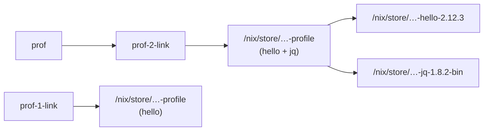

我机器上的 Nix 有两套命令，而我一直在混着用：网上的老教程让我敲 `nix-env -iA nixpkgs.hello`，新教程让我敲 `nix profile add nixpkgs#hello`，我的 shell 历史里两种都有（说明我复制命令的时候，从来没看过它们是哪一代的），我也说不清它们到底有什么不同。这一篇我把 Firn 补上不用 flake 的入口，然后用 14 个实验把两套命令并排跑一遍。先看最小的一个：同一个包，用旧命令 `nix-build` 和新命令 `nix build` 各构建一次，得到的是不是同一个东西：

```text
$ head -8 out/ch09/build_two_ways.stdout
== nix-build -A mini.hello
/nix/store/idksigadaj3inqj8kyl5gajvyxmlzbi5-hello

== nix build .#legacyPackages.x86_64-linux.mini.hello --print-out-paths
/nix/store/idksigadaj3inqj8kyl5gajvyxmlzbi5-hello

same out path
```

同一个 `.drv`，同一个输出路径。两套命令是同一个 store 和同一个求值器上的两层皮，它们的差别不在“能构建什么”，而在“从哪里找到要构建的东西”：旧的靠 `NIX_PATH` 和 `-A` 属性路径，新的靠 flake 引用和输出 schema。这一篇的主线就是这条差别带来的所有后果：环境、profile、世代、垃圾回收的根。

> [!NOTE] 本篇检查点
> 这一篇结束时，Firn 仓库的标签 `ch09` 里：新增 `default.nix`（14 行，不用 flake 的入口，`nix-build -A mini.hello`）和 `shell.nix`（12 行，`nix-shell` 的开发环境）；`README.md` 多了 “Without flakes” 一节和目录表里的一行；`lab/ch09/` 下有 14 个实验（9 个在沙箱里跑，5 个是 `_host` 实验，只读这台机器的状态），没有 fixture。`make ch09` 通过，`make lint` 和 `make check` 干净。`default.nix` 以后每个加包的章节都会往里加东西；
> 涉及的 Nix 特性：`nix-build`、`nix-shell`、`nix-env`、`nix-store`、`nix-instantiate`、`nix-channel`、`nix-collect-garbage` 与它们在 `nix` 命令下的对应者，`nix run`、`nix shell`、`nix develop`、`nix profile` (`add`、`list`、`history`、`rollback`、`diff-closures`、`upgrade`)、`NIX_PATH` 与 channel、profile 世代、GC 根、`nix store gc`、`nix copy`、`nix store optimise`、`nix why-depends`，以及 `nom`、`nvd`、`nh`、`comma`、`nix-index`。
> 前置：[第 8 篇：flake：inputs、outputs、flake.lock 与纯求值](/posts/nix-by-firn-08-flakes/)。上一篇结尾留下的问题，“同一台机器上的 `<nixpkgs>` 和钉死的 nixpkgs 是两个版本”，这一篇会解释它为什么不纯。

我在 Nix 2.34.9、NixOS 26.05 上跑的所有东西，nixpkgs 是锁在 `56c02bc00adcf003215cc4bd996d6efaf4cff188` 的那一份。实验的输出来自 `env -u CI make ch09`（我的 shell 里设了 `CI=true`，不取消的话 5 个 `_host` 实验会被跳过）。下面凡是我在实验之外手敲的命令，我都会写明“手敲”，它们不在 `lab/ch09/` 里，输出是我当场跑出来的。

## 两代命令的对照

先摆一张表。左边是 `nix-` 开头的老命令（`nix` 子命令出现之前的那一代，今天仍然随 Nix 2.34.9 发行，源码里它们是注册成 `RegisterLegacyCommand` 的，例如 [`nix-build` 和 `nix-shell` 共用一个入口](https://github.com/NixOS/nix/blob/2.34.9/src/nix/nix-build/nix-build.cc#L750-L751)），右边是 `nix` 命令的子命令：

| 旧命令 | 新命令 | 找东西的方式 | 这一篇的实验 |
| --- | --- | --- | --- |
| `nix-build -A mini.hello` | `nix build .#mini.hello` | `-A` 属性路径 + `default.nix`，对 flake 引用 + 输出 schema | `build_two_ways.sh` |
| `nix-shell`、`nix-shell -p hello` | `nix develop`、`nix shell` | `shell.nix` 或 `-p` + `<nixpkgs>`，对 flake 的 `devShells` 或任意 installable | `shells_compared.sh` |
| `nix-env -iA`、`-i`、`-q`、`--rollback` | `nix profile add`、`list`、`history`、`rollback` | 按属性路径或按名字，对 installable 并记下来源 | `nix_env_sandbox.sh`、`profile_sandbox.sh` |
| `nix-store -qR`、`--gc`、`--add-root` | `nix path-info -r`、`nix store gc`、`nix why-depends` | 直接给 store 路径 | `why_depends.sh`、`gc_sandbox.sh` |
| `nix-instantiate`、`nix-instantiate --eval` | `nix eval`、`nix derivation show` | 同上 | 前几篇的实验，这一篇的 `channels_host.sh` 用到 `--find-file` |
| `nix-channel` | flake 的 `inputs` 与 `nix registry` | `NIX_PATH` 里的 channel 目录，对 `flake.lock` | `channels_host.sh` |
| `nix-collect-garbage` | `nix store gc` | 同样是 GC，旧的多一个 `-d` 顺便删旧世代 | `gc_dry_run_host.sh`、`gc_sandbox.sh` |

这张表要小心读，因为“对应”只是说它们解决同一类问题，不是说行为一样。`nix-env` 和 `nix profile` 就是最典型的反例：下面我会看到它们的 profile 格式互不兼容。

“新”命令也不是已经稳定了。`nix` 这套子命令本身在上游仍然是一个[实验性特性](https://github.com/NixOS/nix/blob/2.34.9/src/libutil/experimental-features.cc#L98-L104)(`nix-command`)，flake 是另一个 (`flakes`)。我这台机器上的 `nix config show experimental-features` 是 `fetch-tree flakes nix-command`，是 NixOS 配置里打开的。这个状态从 [Nix 2.4 的发行说明](https://nix.dev/manual/nix/2.34/release-notes/rl-2.4.html)起就没变，那篇说明里同时写着：`nix profile` 的目标是取代 `nix-env`。它也写了一条后面我会手敲验证的警告：用 `nix profile` 更新过的 profile，不能再用 `nix-env`。

还有一个小插曲，说明新命令仍在改名字：我在这一篇的实验里写 `nix profile add`，但你在网上看到的更多是 `nix profile install`。[Nix 2.30 的发行说明](https://nix.dev/manual/nix/2.34/release-notes/rl-2.30.html)把 `install` 改名成了 `add`，理由写的是 “add” 是 “remove” 更好的反义词，而且 Nix 并没有“安装钩子”之类通常和 install 联系在一起的行为。旧名字还留着，在 2.34.9 的源码里[是一个标成 `Deprecated` 的别名](https://github.com/NixOS/nix/blob/2.34.9/src/nix/profile.cc#L991-L993)：

```cpp
        aliases = {
            {"install", {AliasStatus::Deprecated, {"add"}}},
        };
```

## default.nix 和 shell.nix：不用 flake 的两个入口

旧命令不认 flake，它们要的是目录里的 `default.nix` 和 `shell.nix`。这一章 Firn 加的就是这两个文件。`default.nix` 把第 7 章的 `mini` 包集暴露给 `nix-build -A`：

```nix
# 不用 flake 的入口：`nix-build -A mini.hello`。
# 之后的章节会继续往这里加包。
{
  system ? builtins.currentSystem,
}:
let
  pkgs = import ./nix/pkgs.nix { inherit system; };
in
{
  mini = import ./mini {
    busybox = pkgs.pkgsStatic.busybox;
    inherit system;
  };
}
```

两处值得停一下。`system ? builtins.currentSystem` 是一个默认参数，它读的是 `builtins.currentSystem`，第 4 篇里我们见过它在纯求值模式下不存在；这正是 flake 版本要用 `forAllSystems` 把每个 `system` 列出来的原因，旧入口只能在“当前这台机器”上求值，所以只有 `nix-build` 这种非纯的命令能用它。第二处是 `./nix/pkgs.nix`：它就是第 1 篇里那个从 `flake.lock` 读出 nixpkgs 版本的小东西。所以 `default.nix` 虽然不走 flake，它用的 nixpkgs 和 flake 版本是同一份，这是开头那两条命令能得到同一个 out path 的前提。

`shell.nix` 更短：

```nix
# 不用 flake 的开发环境：`nix-shell`。
let
  pkgs = import ./nix/pkgs.nix { };
in
pkgs.mkShellNoCC {
  packages = with pkgs; [
    nixfmt
    statix
    deadnix
    jq
  ];
}
```

`with pkgs;` 只出现在紧挨着一个包列表的位置，这是 `docs/code-style.md` 允许的唯一一种用法。`mkShellNoCC` 在锁定的 nixpkgs 里[只有一行](https://github.com/NixOS/nixpkgs/blob/56c02bc00adcf003215cc4bd996d6efaf4cff188/pkgs/top-level/all-packages.nix#L760)：

```nix
  mkShellNoCC = mkShell.override { stdenv = stdenvNoCC; };
```

也就是普通的 `mkShell`，只是把 `stdenv` 换成没有 C 编译器的那个。`mkShell` 本身[是一个 `stdenv.mkDerivation` 的包装](https://github.com/NixOS/nixpkgs/blob/56c02bc00adcf003215cc4bd996d6efaf4cff188/pkgs/build-support/mkshell/default.nix#L7-L8)，它的 `packages` 参数被[放进 `nativeBuildInputs`](https://github.com/NixOS/nixpkgs/blob/56c02bc00adcf003215cc4bd996d6efaf4cff188/pkgs/build-support/mkshell/default.nix#L40)，默认的构建阶段只做一件事：把环境导出到 `$out`，让这些输入成为运行时依赖，文件里的注释说得很直白，“存在这个路径是没有保证的，它是 `mkShell` 的内部实现细节”。我们要的不是它的输出，是它的环境，后面 `shells_compared.sh` 一节会看到两种取环境的办法差别很大。

README 里这一章加的一节，是仓库对这两个文件的全部说明：

````text
$ sed -n '75,83p' README.md
## Without flakes

`default.nix` and `shell.nix` give the same packages and tools to the legacy CLI. `nix/pins.nix` reads the nixpkgs revision
from `flake.lock`, so both paths use one nixpkgs.

```bash
nix-build -A mini.hello    # same store path as: nix build .#legacyPackages.<sys>.mini.hello
nix-shell                  # nixfmt, statix, deadnix, jq (no flake needed)
```
````

## build_two_ways.sh：同一个 out path，和一个 GC 根

回到开头那个输出，这一节看它是怎么来的。`lab/ch09/build_two_ways.sh` 在沙箱目录里做三件事：用 `nix-build -A mini.hello` 构建，用 `nix build .#legacyPackages.<sys>.mini.hello --print-out-paths --out-link flake-result` 构建，然后比较两个路径。关键的两行：

```bash
legacy="$(nix-build "${FIRN_ROOT}" -A mini.hello)"
...
flake="$(nix build "${FIRN_ROOT}#legacyPackages.${system}.mini.hello" \
  --print-out-paths --out-link flake-result)"
```

注意 `nix-build "${FIRN_ROOT}"`：给一个目录，它就去找里面的 `default.nix`；`-A mini.hello` 是在 `default.nix` 求值出来的属性集里取 `mini.hello`。新命令里同一个东西叫 `.#legacyPackages.x86_64-linux.mini.hello`，前面多了输出名和系统。第 8 篇说过 `legacyPackages` 是一个不检查 schema 的出口，mini 包集就放在里面。

两个命令都留下了一个符号链接，输出的后半段是这样：

```text
$ tail -n +9 out/ch09/build_two_ways.stdout
== ls -l result flake-result
flake-result -> /nix/store/idksigadaj3inqj8kyl5gajvyxmlzbi5-hello
result -> /nix/store/idksigadaj3inqj8kyl5gajvyxmlzbi5-hello

== roots under this directory (nix-store --gc --print-roots)
"<LAB_TMP>/flake-result" -> /nix/store/idksigadaj3inqj8kyl5gajvyxmlzbi5-hello
"<LAB_TMP>/result" -> /nix/store/idksigadaj3inqj8kyl5gajvyxmlzbi5-hello

== why the store path stays alive (nix-store -q --roots)
<LAB_TMP>/flake-result -> /nix/store/idksigadaj3inqj8kyl5gajvyxmlzbi5-hello
<LAB_TMP>/result -> /nix/store/idksigadaj3inqj8kyl5gajvyxmlzbi5-hello
```

这两个 `result` 不是普通的符号链接，它们是 GC 根。`nix-store --gc --print-roots` 把垃圾回收器眼里的所有根列出来，我用 `grep` 只留下沙箱目录里的两个。`nix-build` 在[建完之后调用 `addPermRoot`](https://github.com/NixOS/nix/blob/2.34.9/src/nix/nix-build/nix-build.cc#L737)创建这个链接，`addPermRoot` [先建 `result -> /nix/store/...`，再调用 `addIndirectRoot`](https://github.com/NixOS/nix/blob/2.34.9/src/libstore/indirect-root-store.cc#L39-L40)，后者在 `/nix/var/nix/gcroots/auto/` 里放一个指回 `result` 的符号链接，名字是 `result` 路径的 SHA-1。所以一条“根”其实是两跳：`gcroots/auto/<sha1> -> <你的目录>/result -> /nix/store/...-hello`。[`addIndirectRoot` 的实现](https://github.com/NixOS/nix/blob/2.34.9/src/libstore/gc.cc#L41-L46)只有三条语句。这种设计的好处是你可以 `rm result`，不需要任何特权；代价是 `gcroots/auto/` 里会留下指向不存在文件的悬空链接，回收器扫到它们时会清理。这件事我在实验的 stderr 里亲眼见到了（整个文件有 11 行，这里只取和 profile 世代有关的两行）：

```text
$ grep 'prof-' out/ch09/build_two_ways.stderr
removing stale link from "/nix/var/nix/gcroots/auto/gij18n98rdmzwh8aric6n8q4ics7p547" to "/tmp/nix-shell.F1UGP5/firn-lab.tGBYaM/prof-1-link"
removing stale link from "/nix/var/nix/gcroots/auto/0nmg9mvhqvxz1zp1gg0pqwz42ghhja0i" to "/tmp/nix-shell.F1UGP5/firn-lab.tGBYaM/prof-2-link"
```

这是 `--print-roots` 扫根时做的：目标已经不存在，而且这个链接位于 `gcroots/auto` 之下，就[删掉它](https://github.com/NixOS/nix/blob/2.34.9/src/libstore/gc.cc#L247-L251)。被删的是前面几次跑实验留下的沙箱目录：这两行的 `prof-1-link`、`prof-2-link` 是下面 `profile_sandbox.sh` 的世代链接，其余 9 行是别的实验留下的链接，沙箱在实验结束后都已经被清掉了。换句话说，我每次跑 `make ch09`，都会让这个只读风格的命令顺手收拾上一次的残局；`gc_dry_run_host.sh` 的头注释里我也记了这个副作用。

## shells_compared.sh：三种“进入环境”，三种环境

`nix-shell`、`nix shell` 和 `nix develop` 名字太像了，我一直以为它们只是同一件事的三种拼写。`lab/ch09/shells_compared.sh` 让它们各自启动一个子进程，子进程里跑同一段探针，探针只回答三个问题：环境变量有几个，`$stdenv` 有没有设，`hello` 在不在 `PATH` 上。每条命令前都加 `env -i HOME=... PATH=...`，这样计数不依赖我当前 shell 里有什么。三条命令是：

```bash
echo "== nix-shell -p hello -I nixpkgs=<pin> --run"
clean nix-shell -p hello -I "nixpkgs=${nixpkgs}" --run

echo
echo "== nix shell -f nix/pkgs.nix hello -c bash -c"
clean nix shell -f "${FIRN_ROOT}/nix/pkgs.nix" hello -c bash -c

echo
echo "== nix develop -f nix/pkgs.nix hello -c bash -c"
clean nix develop -f "${FIRN_ROOT}/nix/pkgs.nix" hello -c bash -c
```

第一条里的 `-I "nixpkgs=${nixpkgs}"` 是必要的：`nix-shell -p` 要靠 `<nixpkgs>`，不加 `-I` 它就去 `NIX_PATH` 里找，找到的是我机器上的那份而不是 Firn 钉死的那份。`${nixpkgs}` 来自 `nix eval --raw --file nix/pins.nix nixpkgs`。输出是：

```text
$ cat out/ch09/shells_compared.stdout
== nix-shell -p hello -I nixpkgs=<pin> --run
env vars: 71
stdenv:   set
hello:    on PATH

== nix shell -f nix/pkgs.nix hello -c bash -c
env vars: 5
stdenv:   unset
hello:    on PATH

== nix develop -f nix/pkgs.nix hello -c bash -c
env vars: 46
stdenv:   unset
hello:    not on PATH
```

71、5、46，三个数字，三种设计。我一个一个拆。

**`nix shell`：5 个。** 它几乎什么也没做，只是把 `hello` 所在的 `bin` 目录加到 `PATH` 前面，然后启动命令。我传进去的只有 `HOME` 和 `PATH` 两个变量，剩下的三个是 `bash` 自己加的。这一步我手敲验证了，不在实验里：

```text
$ env -i HOME="$HOME" PATH="$PATH" nix shell -f nix/pkgs.nix hello -c bash -c 'env | cut -d= -f1 | sort | tr "\n" " "'
HOME PATH PWD SHLVL _
```

`PWD`、`SHLVL`、`_` 是 bash 启动时设的。所以 `nix shell` 的语义是“在 `PATH` 里多一个包”，不多也不少，和 `nix-shell` 完全不是一回事，只是名字像。

**`nix-shell -p hello`：71 个，`$stdenv` 已设，`hello` 在 `PATH` 上。** 这是三者里最重的，原因在 Nix 把 `-p` 翻译成什么表达式。`nix-shell` 的源码里[有一行字符串](https://github.com/NixOS/nix/blob/2.34.9/src/nix/nix-build/nix-build.cc#L345)：

```cpp
            << "{...}@args: with import <nixpkgs> args; (pkgs.runCommandCC or pkgs.runCommand) \"shell\" { buildInputs = [ ";
```

`nix-shell -p hello` 其实是构造了一个 `runCommandCC "shell" { buildInputs = [ (hello) ]; } ""` 并进入它的构建环境，所以它带着 `cc` 包装器、binutils 的一整套变量。这也解释了 `-I nixpkgs=` 的必要性：表达式里写死了 `import <nixpkgs>`。这个 shell 里的变量，是把这个 derivation 的所有属性（`buildInputs`、`builder`、`cmakeFlags`、`stdenv` 等）导出成环境变量，我手敲看了一下名字（输出很长，只截头尾）：

```text
$ env -i HOME="$HOME" PATH="$PATH" nix-shell -p hello -I nixpkgs="$(nix eval --raw --file nix/pins.nix nixpkgs)" --run 'env | cut -d= -f1 | sort | tr "\n" " "'
AR AS CC CONFIG_SHELL CXX HOME HOST_PATH IN_NIX_SHELL LD NIX_BINTOOLS ... __structuredAttrs buildCommandPath buildInputs builder cmakeFlags configureFlags depsBuildBuild ... doCheck doInstallCheck enableParallelBuilding ...
```

**`nix develop`：46 个，`$stdenv` 未设，`hello` 不在 `PATH` 上。** 这一行有两个让我意外的地方。第一，`hello` 不在 `PATH` 上：`nix develop` 进入的是 `hello` 这个包的**构建环境**（编译 `hello` 需要什么），不是装了 `hello` 的环境。你要它的 `buildInputs`，它给你，要 `hello` 本身，得用 `nix shell`。第二，`$stdenv` 明明是构建环境的核心变量，`nix-shell` 里是设了的，`nix develop` 里却读不到。

这不是漏掉了，是它们取环境的办法不同。`nix develop` 不直接导出 derivation 的属性，它[先建一个“只把环境写进文件然后退出”的修改版 derivation](https://github.com/NixOS/nix/blob/2.34.9/src/nix/develop.cc#L226-L233)，把 stdenv 的 `setup` 脚本初始化出来的完整 bash 环境记录下来，再[把它转成 bash 脚本](https://github.com/NixOS/nix/blob/2.34.9/src/nix/develop.cc#L151-L158)：对每个变量先写 `name=value`，只有当它在构建时是**导出的**，才再写一行 `export name`：

```cpp
                    out << fmt("%s=%s\n", name, escapeShellArgAlways(str->value));
                    if (str->exported)
                        out << fmt("export %s\n", name);
```

所以 `nix develop` 的 shell 里，所有变量都在，但只有当初被 `export` 过的才会传给子进程。`$stdenv` 是一个普通 shell 变量，不导出；子进程 `bash -c` 看不到它，而你在交互式的 `nix develop` 里直接敲 `echo $stdenv` 是看得到的，因为那是同一个 shell。我用 `nix print-dev-env --json` 手敲确认了这一点，不过没有跑到实验里：

```text
$ nix print-dev-env --json -f nix/pkgs.nix hello | jq -r '.variables | to_entries | map(select(.key=="stdenv" or .key=="out" or .key=="PATH")) | .[] | "\(.key) \(.value.type)"'
PATH exported
out exported
stdenv var
$ nix print-dev-env --json -f nix/pkgs.nix hello | jq '(.variables|[.[]|select(.type=="exported")]|length), (.variables|length)'
47
125
```

125 个变量里 47 个是导出的，而实验里子进程里数出来 46 个。差的这一个我没有去追，大概是 `bash` 起来之后会覆盖或增减一两个（`SHLVL`、`_` 这一类），我没有逐个核对，所以这里就不下结论。

这三个数字加起来，我对三个命令的理解变成了这样：

| 命令 | 变量数 | 做了什么 | 适合什么时候用 |
| --- | --- | --- | --- |
| `nix shell` | 5 | 只改 `PATH` | 临时拿几个程序来用 |
| `nix-shell -p` | 71 | 进入 `runCommandCC` 的构建环境，属性全部导出 | 老教程里常见的写法 |
| `nix develop` | 46 | 进入某个包的构建环境，只导出当初导出的变量 | 开发某个包 |

## nix_run.sh：不进环境，只运行

还有第四个“入口”：`nix run`。它既不改 `PATH` 也不进 shell，只是构建一个东西然后 `exec` 它的程序。`lab/ch09/nix_run.sh` 有两条：

```text
$ cat out/ch09/nix_run.stdout
== nix run .#mini-hello
Hello from mini

== nix run -f nix/pkgs.nix hello
Hello, world!
```

第一条用第 8 篇加的 `apps.<system>.mini-hello`，程序路径是 flake 里写好的 `program`。第二条没有 flake：`-f nix/pkgs.nix` 把 `hello` 当成一个普通的 derivation，`nix run` 要自己猜程序是谁。[手册里的规则](https://nix.dev/manual/nix/2.34/command-ref/new-cli/nix3-run.html)是：如果 installable 是 derivation，就执行 `<out>/bin/<name>`，其中 `name` 依次取 `meta.mainProgram`、`pname`，最后是 `name` 属性里去掉版本号的部分（手册的例子是 `hello-1.10` 对应 `hello`）。`hello` 的 `meta.mainProgram` 是 `hello`（手敲 `nix eval --raw -f nix/pkgs.nix hello.meta.mainProgram` 得到的），所以这里没有歧义。

## nix-instantiate 与 nix-store：旧命令的另一半

[手册](https://nix.dev/manual/nix/2.34/command-ref/nix-build.html)说 `nix-build` 本质上 (essentially) 是 `nix-instantiate` 加 `nix-store --realise` 的包装，也就是两个动作的合体：先**实例化**（把表达式求值成 `.drv`），再**实现**（构建 `.drv`）。旧一代把这两个动作拆成两个命令：`nix-instantiate` 只做前一半，`nix-store --realise` 做后一半；新一代把前一半叫 `nix eval` 和 `nix derivation show`。这一段是手敲的，不在 `lab/ch09/` 里，在 `~/firn` 里跑：

```text
$ nix-instantiate -A mini.hello
warning: you did not specify '--add-root'; the result might be removed by the garbage collector
/nix/store/brh23j7c786imrj41c40adxshzd5l2yc-hello.drv
$ nix eval --raw ".#legacyPackages.x86_64-linux.mini.hello.drvPath"
/nix/store/brh23j7c786imrj41c40adxshzd5l2yc-hello.drv
$ nix-instantiate --eval -A mini.hello.name
"hello"
$ nix eval ".#legacyPackages.x86_64-linux.mini.hello.name"
"hello"
```

旧的和新的给出同一个 `.drv`，同一个字符串。`nix-instantiate` 多打印了一行警告：没指定 `--add-root`，结果可能被垃圾回收器删掉。这一行就是前面“GC 根”的另一面：`nix-build` 默认给你的 `result` 是一个根，而 `nix-instantiate` 默认不给任何根，所以它刚打印的 `.drv` 路径是没有根的，下一次 `nix-store --gc` 就可能收走它。[源码](https://github.com/NixOS/nix/blob/2.34.9/src/nix/nix-instantiate/nix-instantiate.cc#L86-L94)里是这样的：`gcRoot` 为空就调 `printGCWarning()`，否则调用 `addPermRoot`，和 `nix-build` 的 `result` 走同一个函数。

`.drv` 里装了什么，新命令 `nix derivation show` 直接以 JSON 给出（手敲，不在 `lab/ch09/` 里）：

```text
$ nix derivation show -f default.nix mini.hello | jq -c 'keys, (.derivations|keys), (.derivations|to_entries[0].value|keys)'
["derivations","version"]
["brh23j7c786imrj41c40adxshzd5l2yc-hello.drv"]
["args","builder","env","inputs","name","outputs","system","version"]
```

注意 `-f default.nix mini.hello`：新命令也能吃旧入口，`-f` 就是“这个文件求值出来的东西”，后面跟属性路径。`.drv` 的名字在 JSON 里不带 `/nix/store/` 前缀。第 6 篇的 `drv_show.sh` 已经逐字段拆过一次，这里不重复。

另一半是 `nix-store`。它是一个多合一的命令，靠 `-q` (`--query`)、`-r` (`--realise`)、`--gc` 之类的开关选功能。对应关系很直接（手敲，不在 `lab/ch09/` 里）：

```text
$ nix-store -q --outputs $(nix-instantiate -A mini.hello 2>/dev/null)
/nix/store/idksigadaj3inqj8kyl5gajvyxmlzbi5-hello
$ nix-store -qR "$(nix-build -A mini.hello --no-out-link)" | wc -l
3
$ nix path-info -r "$(nix-build -A mini.hello --no-out-link)" | wc -l
3
```

`nix-store -qR` 和 `nix path-info -r` (`--recursive`) 都列出闭包，这里都是 3 个路径。新命令的好处是分得开：`nix path-info` 管查询（还有 `--json`，以及 `--size` 和 `--closure-size` 给大小），`nix store gc` 管回收，`nix why-depends` 管依赖链，不用记 `nix-store` 那几个字母开关。

## channel 与 NIX_PATH：`<nixpkgs>` 从哪里来

第 1 篇我留了一个问题：同一台机器上，`import <nixpkgs> {}` 和钉死的 nixpkgs 是两个版本（`26.05pre-git` 对 `26.11pre-git`）。现在可以回答 `<nixpkgs>` 到底是什么了。`lab/ch09/channels_host.sh` 是个只读的 `_host` 实验，它做三件事：列出 channel，打印 `NIX_PATH`，再让 `nix-instantiate --find-file nixpkgs` 说出 `<nixpkgs>` 解析到哪里：

```text
$ cat out/ch09/channels_host.stdout
volatile: == nix-channel --list
(end of list)

volatile: == NIX_PATH
nixpkgs=flake:nixpkgs:/nix/var/nix/profiles/per-user/root/channels

volatile: == nix-instantiate --find-file nixpkgs
/nix/store/2xl4y8v0mpkqbvxdra2c0ci02w8mczyy-source
```

这三行都是这台机器的状态（所以实验把每一段都标成 `volatile`），你的会不一样，这正是要讲的。拆开看：

**channel 是什么。** `nix-channel` 的[手册](https://nix.dev/manual/nix/2.34/command-ref/nix-channel.html)说：channel 是“引用远程 Nix 表达式并方便地取得它们最新版本的机制”。你 `nix-channel --add <url> nixpkgs` 订阅，URL 要指向一个含有 `nixexprs.tar.gz` 的目录；`nix-channel --update` 下载订阅的表达式并**创建一个新世代**。这个世代说的是 channel 自己的 profile：手册里 `--list-generations` 的说明就是“和 `nix-env --profile /nix/var/nix/profiles/per-user/$USER/channels --list-generations` 一样”。也就是说，channel 的更新和回滚 (`nix-channel --rollback`) 用的就是下面要讲的 profile 世代机制。我这个用户一个 channel 也没订（`(end of list)` 之前是空的），所以 `<nixpkgs>` 不来自 channel。

**`<nixpkgs>` 是什么。** 它是一个[查找路径表达式](https://nix.dev/manual/nix/2.34/language/constructs/lookup-path.html)：尖括号里的名字去 `builtins.nixPath` 里按前缀匹配，找到的第一项给你一个路径。我手敲看一眼这个列表：

```text
$ nix eval --impure --json --expr 'builtins.nixPath'
[{"path":"flake:nixpkgs","prefix":"nixpkgs"},{"path":"/nix/var/nix/profiles/per-user/root/channels","prefix":""},{"path":"/nix/var/nix/profiles/per-user/root/channels","prefix":""}]
```

第一项把前缀 `nixpkgs` 映射到 `flake:nixpkgs`。`flake:` 是 `nix` 命令给搜索路径加的一种特殊写法：求值器遇到它就[解析成 flake 引用，经过 registry 解析、取到 store 里，再把那个 store 路径当结果](https://github.com/NixOS/nix/blob/2.34.9/src/libcmd/common-eval-args.cc#L30-L47)，并且要求 `flakes` 这个实验性特性打开。这就是 `--find-file nixpkgs` 给出一个 `/nix/store/...-source` 的原因：`<nixpkgs>` 在我机器上等于“我的 flake registry 里叫 `nixpkgs` 的那个条目”，大概是 NixOS 的配置放进环境变量的（我没有去查这一项的来源）。列表里 channel 目录出现了两次，我没有去追为什么，大概是环境变量一次、`nix-path` 设置的默认值一次，我没有读那部分代码，所以这只是猜测。

默认值本身也在源码里，[`getDefaultNixPath`](https://github.com/NixOS/nix/blob/2.34.9/src/libexpr/eval-settings.cc#L81-L97)：依次是 `~/.nix-defexpr/channels`、根用户 channel 目录下的 `nixpkgs`（前缀 `nixpkgs`）、根用户 channel 目录本身，每一项只在路径真的存在时才加入。

**为什么这不纯。** 因为 `<nixpkgs>` 的值取决于调用者的环境变量、调用者订阅了什么 channel、调用者的 registry 指向哪里，而这些都不在你的代码里。`nix-channel` 的手册自己就写着这一点：订阅的 channel 的状态在 Nix 表达式之外，这可能限制可复现性；它给的解药是 `fetchurl`、`fetchTarball`、`fetchGit`，或者命令行上的 `-I`。第 1 篇里我用 `-I nixpkgs=$(nix eval --raw --file nix/pins.nix nixpkgs)` 把它补上过，`shells_compared.sh` 的第一条命令也是这样做的。`-I` 的[优先级高于](https://nix.dev/manual/nix/2.34/command-ref/opt-common.html) `nix-path` 设置和 `NIX_PATH` 环境变量，所以它能压过机器上的一切配置，代价是每一条命令都得记得写。flake 的做法是把这个值写进 `flake.lock`，让它跟着仓库走，这是第 8 篇讲的；纯求值模式下 `<nixpkgs>` 干脆报错，第 4 篇里我们见过那条信息。

所以“两代命令”里最本质的差别不是命令的拼写，是**依赖从哪里来**：旧一代从调用者的环境里来，新一代从锁文件里来。

## profile：一条符号链接链

`nix-env` 和 `nix profile` 都把“我装了什么”存在 profile 里，而 profile 本身只是 store 里一个目录加一串符号链接。我想亲眼看看它长什么样，所以 `lab/ch09/profile_sandbox.sh` 在沙箱里建一个，不碰我自己的 profile。命令的核心是这样：

```bash
echo "== nix profile add (the old name was install) hello, then jq"
nix profile add --profile "${prof}" -f "${pkgs}" hello 2>/dev/null
nix profile add --profile "${prof}" -f "${pkgs}" jq 2>/dev/null
```

`--profile` 指定 profile 的位置，`-f nix/pkgs.nix` 把 `hello` 当成这个文件里的属性来装。这里没有 flake，所以这是“新命令加旧入口”的混合用法，`nix profile` 并不要求 flake。输出的第一段是两个世代的符号链接：

```text
$ sed -n '3,6p' out/ch09/profile_sandbox.stdout
== generation symlinks
prof -> prof-2-link
prof-1-link -> /nix/store/<hash>-profile
prof-2-link -> /nix/store/<hash>-profile
```

`<hash>` 是实验里为了稳定输出遮掉的。结构是这样的：`prof` 指向当前世代 `prof-2-link`，每个 `prof-N-link` 指向 store 里一个名叫 `profile` 的目录。把它画出来：



世代链接的名字是[这样拼出来的](https://github.com/NixOS/nix/blob/2.34.9/src/libstore/profiles.cc#L57-L62)：`<profile>-<N>-link`。创建新世代的 [`createGeneration`](https://github.com/NixOS/nix/blob/2.34.9/src/libstore/profiles.cc#L64-L97)找出现有最大的 N，用 N+1 命名新链接，并且用 `addPermRoot` 把它登记成 GC 根（`build_two_ways.sh` 一节里那条“两跳”的根）。这一点很重要：**profile 的每个世代都是一个 GC 根**，所以旧世代指向的所有包都不会被回收，直到你删掉旧世代。

这个结构好比一本相册：每次改动都是新的一页，回滚就是翻回前一页，页本身不会被撕掉，直到你主动清理相册。

store 里那个 `profile` 目录里装的是什么，我手敲在一个新的临时 profile 里看了（不在实验里，因为实验的沙箱已经被清掉了）：

```text
$ nix profile add --profile ./prof -f nix/pkgs.nix hello
$ ls -l prof prof-1-link | awk '{print $9, $10, $11}'
prof -> prof-1-link
prof-1-link -> /nix/store/qwkdrx1aq828l673nwkqm6ks8idf6qsa-profile
$ ls -l "$(readlink -f prof)"
total 12
lrwxrwxrwx 1 root root  60 Dec 31  1969 bin -> /nix/store/lcxc2z1h2g8wq8dxfpizy1di85kyxnqx-hello-2.12.3/bin
-r--r--r-- 1 root root 137 Dec 31  1969 manifest.json
lrwxrwxrwx 1 root root  62 Dec 31  1969 share -> /nix/store/lcxc2z1h2g8wq8dxfpizy1di85kyxnqx-hello-2.12.3/share
$ jq . "$(readlink -f prof)/manifest.json"
{
  "elements": {
    "hello": {
      "active": true,
      "priority": 5,
      "storePaths": [
        "/nix/store/lcxc2z1h2g8wq8dxfpizy1di85kyxnqx-hello-2.12.3"
      ]
    }
  },
  "version": 3
}
```

（`Dec 31  1969` 是 store 里这些文件统一的修改时间，在我这台机器的时区下显示成这样，第 1 篇的输出里也出现过。）

`bin`、`share` 是指向包的符号链接，`manifest.json` 是 `nix profile` 自己的账本。装了不止一个包的时候，`bin` 就不能再是指向某一个包的链接了，我在后面那个装了 `hello` 和 `jq` 的 profile 里看了一眼（手敲）：

```text
$ ls -l "$(readlink -f prof-2-link)/bin" | awk '{print $9,$10,$11}'
hello -> /nix/store/lcxc2z1h2g8wq8dxfpizy1di85kyxnqx-hello-2.12.3/bin/hello
jq -> /nix/store/25pcd19xk5ff8ybjslsips4g7yv06fxl-jq-1.8.2-bin/bin/jq
```

它变成了一个目录，里面每个程序一个符号链接，由 `buildProfile` 生成。[`ProfileManifest::build`](https://github.com/NixOS/nix/blob/2.34.9/src/nix/profile.cc#L235-L277)先建符号链接树，再把 `manifest.json` 写进去，最后把整个目录作为一个 store 路径（名字叫 `profile`）加进 store。账本的格式版本是 [3](https://github.com/NixOS/nix/blob/2.34.9/src/nix/profile.cc#L228-L231)，源码旁边有一条注释，大意是升级这个版本要非常小心，因为改它可能让新装的东西坏掉。

`profile` 目录一旦进了 store 就不可变，所以“改 profile”这件事在 Nix 里不是改文件，是**造一个新目录，再改一个符号链接**，这也是为什么回滚是瞬间完成的。实验的下一段把四个子命令走了一遍：

```text
$ sed -n '8,25p' out/ch09/profile_sandbox.stdout
== nix profile list
Name:               hello
Store paths:        /nix/store/lcxc2z1h2g8wq8dxfpizy1di85kyxnqx-hello-2.12.3
Name:               jq
Store paths:        /nix/store/25pcd19xk5ff8ybjslsips4g7yv06fxl-jq-1.8.2-bin /nix/store/azzak4596lzn8kc48pij8kdjn0b2pwnx-jq-1.8.2-man

== nix profile history
Version 1 (<date>):
  hello: ∅ -> 2.12.3

Version 2 (<date>) <- 1:
  jq: ∅ -> 1.8.2-bin, 1.8.2-man

== nix profile rollback
switching profile from version 2 to 1
prof -> prof-1-link
prof-1-link -> /nix/store/<hash>-profile
prof-2-link -> /nix/store/<hash>-profile
```

`jq` 装了两个 store 路径，`-bin` 和 `-man`，因为它的 `meta.outputsToInstall` 是 `["bin","man"]`（我手敲 `nix eval --json -f nix/pkgs.nix jq.meta.outputsToInstall` 看的）。`nix profile history` 比 `nix-env --list-generations` 多了一件事：它告诉你每一版**加了什么、删了什么、升级了什么**，这是 `manifest.json` 里账本的价值（开头引的 Nix 2.4 发行说明把它列作主要优点之一）。

**回滚是一次符号链接的切换，什么也没删。** `rollback` 后 `prof -> prof-1-link`，但 `prof-2-link` 还在原处。源码里的 [`switchGeneration`](https://github.com/NixOS/nix/blob/2.34.9/src/libstore/profiles.cc#L256-L281)做的就是这件事：找比当前世代小的最大的那个，打印 `switching profile from version %d to %d`，调用 `switchLink`。实验输出里的那一行 `switching profile from version 2 to 1` 就是这里来的。实验接着确认了效果：

```text
$ sed -n '26,27p' out/ch09/profile_sandbox.stdout
hello present: yes
jq present:    no
```

按代码读（我没有跑），回滚之后再 `add` 一个包，新世代的编号是 3 而不是 2：`createGeneration` 取的是现有世代里**最大**的编号加 1，不是“当前”世代的编号加 1，所以 `prof-2-link` 不会被覆盖（[`findGenerations`](https://github.com/NixOS/nix/blob/2.34.9/src/libstore/profiles.cc#L49)把世代按编号升序排，`gens.back()` 就是最大的那个）。我没有为这个行为单独写实验，所以请把它当成读源码的结论而不是实测。

最后一个子命令是 `diff-closures`，它比较相邻两个世代的闭包：

```text
$ sed -n '29,32p' out/ch09/profile_sandbox.stdout
== nix profile diff-closures (hello only -> hello + jq)
Version 1 -> 2:
  jq: ∅ → 1.8.2, 512.5 KiB
  oniguruma: ∅ → 6.9.10, 693.0 KiB
```

装一个 `jq` 其实带来了两个包：`jq` 本身 512.5 KiB，它的依赖 `oniguruma` 693.0 KiB。这种“这次更新到底多了什么”的视图，我没有在 `nix-env` 的选项里找到对应的东西；要比较的话，可以自己对两个世代的路径用 `nix store diff-closures`。

`nix profile` 还有 `upgrade`、`remove`、`wipe-history`，按 installable 的**来源**工作。这一点在练习 1 里会碰到：如果一个条目是直接用 store 路径装的，没有“来源”，`upgrade` 就不知道往哪升。

## nix_env_sandbox.sh：旧的一代，和它的几个坑

现在换到旧一代。`lab/ch09/nix_env_sandbox.sh` 同样在 `LAB_TMP` 的一个 profile 里操作。第一步是用属性路径安装：

```bash
nix-env -p "${profile}" -f "${pkgs}" -iA hello 2>&1 | grep -v '^building'
nix-env -p "${profile}" -q
```

```text
$ sed -n '1,8p' out/ch09/nix_env_sandbox.stdout
== nix-env -iA hello
installing 'hello-2.12.3'
hello-2.12.3

== generations
   1   <date>   (current)
env -> env-1-link
env-1-link -> /nix/store/<hash>-user-environment
```

形状和 `nix profile` 一样：`env -> env-1-link -> /nix/store/...-user-environment`。区别在名字（`user-environment` 对 `profile`）和账本：`nix-env` 的 profile 里放的是 `manifest.nix`，一个 Nix 表达式。我手敲看了它的大小：

```text
$ nix-env -p ./env -f nix/pkgs.nix -iA hello
installing 'hello-2.12.3'
$ wc -c "$(readlink -f env)/manifest.nix"
3896 /nix/store/v5g6iwgm8w5qw9x4hiadn85lazz6d1iq-user-environment/manifest.nix
```

一个 `hello` 的账本是 3896 字节，里面是整份 `meta`：描述、主页、`changelog`、CPE 标识符等等，是整个 derivation 的元数据序列化。`nix profile` 的 `manifest.json` 对同一个包是 137 字节（上面 `ls -l` 里那一行），只有 store 路径、优先级和是否启用；用 flake 装的包还会多记一份来源（属性路径、flake 引用），用 `-f` 装的没有。这是两代 profile 在设计上的差别：旧的把包的元数据拷进账本，新的只记它需要的几个字段。

**坑 1：按名字查询要求值整个 nixpkgs。** 实验里的这两条测的是同一个问题，找 `hello`，一条给属性路径，一条给名字：

```text
$ sed -n '10,13p' out/ch09/nix_env_sandbox.stdout
== query by attribute path vs by name
hello  hello-2.12.3
volatile: nix-env -qaP -A hello  (one attribute): 0.2 s
volatile: nix-env -qaP hello     (name: evaluates all of nixpkgs): 19.9 s
```

0.2 秒对 19.9 秒，大约 100 倍（`timed` 函数只保留一位小数，所以 0.2 这一侧的误差很大，只能说数量级，而且每条只测了一次）。原因在源码里：`nix-env` 的“来源”分几种。给了 `-A`，走的是 [`srcAttrPath`](https://github.com/NixOS/nix/blob/2.34.9/src/nix/nix-env/nix-env.cc#L482-L489)，只沿着属性路径往下取；没有 `-A`，走的是 [`srcNixExprDrvs`](https://github.com/NixOS/nix/blob/2.34.9/src/nix/nix-env/nix-env.cc#L413-L418)，先 `loadDerivations` 把表达式里所有的 derivation 都求值出来拿到名字，再用 `filterBySelector` 按名字筛。要筛名字就得知道每个包的名字，要知道名字就得求值每个包。我们在第 1 篇量过，这个 nixpkgs 有 27959 个顶层属性，所以 19.9 秒不意外。

**坑 2：按名字安装，会替换同名的旧包，不管版本。** 实验里把 `-iA hello` 的结果，用 `-i hello` 再装一遍：

```text
$ sed -n '15,19p' out/ch09/nix_env_sandbox.stdout
== pitfall: nix-env -i hello (by name)
replacing old 'hello-2.12.3'
installing 'hello-2.12.3'
hello-2.12.3
(replaced by itself: the environment is identical, so no new generation)
```

“replacing old” 这一行来自 [`installDerivations`](https://github.com/NixOS/nix/blob/2.34.9/src/nix/nix-env/nix-env.cc#L563-L571)：已装的元素里，只要 `DrvName(i.queryName()).name`（名字去掉版本号）和新元素的相同，就替换掉，除非它带了 `meta.keep`。注意它比较的是**名字**，不是版本：装 `hello-2.13` 会替换 `hello-2.12.3`，装一个碰巧同名的完全不相干的包也会。这对“我想同时留着两个版本”是个坑，对“我想升级”则是个特性，我的理解是，旧一代的设计里名字就是身份。

**坑 3：`nix-env` 里什么都没变就不产生新世代，`nix profile` 却会。** 上面最后一行，括号里那句是实验自己打的。实验接着打印世代列表，仍然只有 `1   <date>   (current)`。这是 `createGeneration` 里的[这段](https://github.com/NixOS/nix/blob/2.34.9/src/libstore/profiles.cc#L73-L83)在起作用：如果新环境的 store 路径和最后一个世代指向的完全相同，就直接返回旧链接，注释写得很清楚，是为了防止“无意义的安装或重建”堆出一大串世代，把界面（它举的例子是 grub）弄乱。`nix-env -i hello` 的环境恰好完全相同，所以不产生新世代。**`nix profile` 就不一样了**，这条捷径只在整个 `profile` 目录的 store 路径相同时才触发，而它的 `manifest.json` 里元素的名字会变。我在一个临时 profile 里连着三次 `nix profile add -f nix/pkgs.nix hello`（手敲，不在 `lab/ch09/` 里）：

```text
$ ls -l p p-*-link | awk '{print $9,$10,$11}'
p -> p-3-link
p-1-link -> /nix/store/<hash>-profile
p-2-link -> /nix/store/<hash>-profile
p-3-link -> /nix/store/<hash>-profile
$ nix profile list --profile ./p | grep -E '^(Name|Store paths)'
Name:               hello
Store paths:        /nix/store/lcxc2z1h2g8wq8dxfpizy1di85kyxnqx-hello-2.12.3
Name:               hello-1
Store paths:        /nix/store/lcxc2z1h2g8wq8dxfpizy1di85kyxnqx-hello-2.12.3
Name:               hello-2
Store paths:        /nix/store/lcxc2z1h2g8wq8dxfpizy1di85kyxnqx-hello-2.12.3
```

三次得到三个世代，同一个 store 路径被登记成 `hello`、`hello-1`、`hello-2` 三个元素。所以“重复安装不产生世代”是 `nix-env` 的性质，不是两代命令共有的。

**坑 4：卸载和回滚。** `-e hello` 产生新世代 2，里面没有包；`--rollback` 回到世代 1：

```text
$ sed -n '22,28p' out/ch09/nix_env_sandbox.stdout
== uninstall, then roll back
uninstalling 'hello-2.12.3'
installed after -e: 0
   1   <date>   
   2   <date>   (current)
switching profile from version 2 to 1
installed after rollback: hello-2.12.3 
```

**坑 5：两代命令的 profile 不能混用。** [Nix 2.4 的发行说明](https://nix.dev/manual/nix/2.34/release-notes/rl-2.4.html)就写了：用 `nix profile` 更新过的 profile，之后不能再用 `nix-env`。我手敲验证了这一条的两个方向：

```text
$ nix-env -p ./prof -q
error: profile "/tmp/firn-hand/prof" is incompatible with 'nix-env'; please use 'nix profile' instead
$ nix profile add --profile ./env -f nix/pkgs.nix jq
$ ls -l env* | awk '{print $9,$10,$11}'
env -> env-2-link
env-1-link -> /nix/store/v5g6iwgm8w5qw9x4hiadn85lazz6d1iq-user-environment
env-2-link -> /nix/store/fwikf0y6in6n4zbs9kq0y7dfgddzwx1f-profile
$ nix-env -p ./env -q
error: profile "/tmp/firn-hand/env" is incompatible with 'nix-env'; please use 'nix profile' instead
```

第一个 profile 是 `nix profile add` 建的，`nix-env` 拒绝它；第二个是 `nix-env` 建的，我用 `nix profile add` 往里加了 `jq`，它成功了（世代 2 的目录叫 `profile`，不再是 `user-environment`），然后 `nix-env` 也拒绝它了。检查在 [`user-env.cc`](https://github.com/NixOS/nix/blob/2.34.9/src/nix/nix-env/user-env.cc#L22-L23)：目录里有 `manifest.json`，就报 “incompatible with `'nix-env'`”。反方向能走通，是因为 `nix profile` 会[读 `manifest.nix`](https://github.com/NixOS/nix/blob/2.34.9/src/nix/profile.cc#L178-L183)把旧格式转换过来；转换之后路就断了。这是一个单行道，你要么两边都不碰，要么挑一边，别在同一个 profile 上交替。（路径里的 `/tmp/firn-hand/` 是我手敲时用的临时目录。）

## GC 根与垃圾回收：什么算“还活着”

profile 的每个世代都是 GC 根，这句话我前面说得很顺，但还没有验证。验证它需要先回答一个更基本的问题：垃圾回收器怎么决定一个 store 路径是死是活？

答案一句话：从一组**根**出发，沿着“引用”（第 6 篇里 `nix-store -qR` 走的那种）能到达的路径都是活的，其余都是垃圾。`lab/ch09/gc_sandbox.sh` 在一个临时 store 里把这件事走一遍。它加两个文本文件，给其中一个加根，另一个不加：

```bash
kept="$(nix store add --store "${store}" keep.txt)"
nix store add --store "${store}" drop.txt >/dev/null
readonly kept

nix-store --store "${store}" --add-root "${LAB_TMP}/root" --realise "${kept}" >/dev/null
```

然后 `nix store gc`，再删掉根，再 `nix store gc`：

```text
$ cat out/ch09/gc_sandbox.stdout
== roots: root -> <hash>-keep.txt

== before: <hash>-drop.txt <hash>-keep.txt 
== nix store gc (with the root)
1 store paths deleted
after:  <hash>-keep.txt 

== rm root; nix store gc
1 store paths deleted
after:  
```

第一次回收删掉的是没有根的 `drop.txt`，有根的 `keep.txt` 活了下来；`rm root` 之后第二次回收把它也删了。`--store "${LAB_TMP}/store"` 的意思是这是个独立的本地 store，这个实验不碰宿主机的 `/nix/store`，所以它删得放心。宿主机上 `result` 链接起的就是 `--add-root` 那个 `root` 的作用，只不过规模是整台机器。

**根都在哪里。** 我读了 [`findRootsNoTemp`](https://github.com/NixOS/nix/blob/2.34.9/src/libstore/gc.cc#L289-L299)，它做三件事：递归扫描 `gcroots` 目录；扫描 `profiles` 目录；再加上“运行时根”。前两个就是符号链接：`gcroots` 下的符号链接指向 store 路径就算根，指向 store 之外的路径时，如果那个路径本身又是一个指向 store 的符号链接，也算（这就是 `build_two_ways.sh` 里 `result` 的两跳），其余忽略，[手册](https://nix.dev/manual/nix/2.34/package-management/garbage-collector-roots.html)里写了同样的规则。`profiles` 目录里的世代链接（比如 `/nix/var/nix/profiles/system-131-link`）直接就是根；位于别处的 profile，比如我的沙箱，则是靠 `addPermRoot` 在 `gcroots/auto` 里放的间接根，`build_two_ways.sh` 的 stale link 日志里的 `prof-1-link` 就是这样的例子。

第三类是我之前没想过的：**运行中的进程**。[`findRuntimeRootsUnchecked`](https://github.com/NixOS/nix/blob/2.34.9/src/libstore/local-gc.cc#L62-L121)扫描 `/proc` 里每个进程的 `exe`、`cwd`、打开的文件描述符、`maps`，还有 `environ`：对环境变量，它是用一个正则在整段环境字符串里找 `/nix/store/...` 形式的子串，找到的都算根。所以一个环境变量里提到了 `/nix/store/...` 的进程（`nix-shell` 里的 shell，`direnv` 加载的开发环境），会让这些路径不能被回收，即使你已经把对应的 `result` 删了。这一条是读代码得来的，我没有为它单独做实验。能手敲验证的是另一条，“世代是根”：我另外造了一个 profile，装 `hello` 再装 `jq`，然后回滚：

```text
$ cd /tmp/firn-hand2
$ nix profile add --profile ./prof -f ~/Projects/firn/nix/pkgs.nix hello
$ nix profile add --profile ./prof -f ~/Projects/firn/nix/pkgs.nix jq
$ nix profile rollback --profile ./prof
switching profile from version 2 to 1
$ ls -l prof prof-*-link | awk '{print $9,$10,$11}'
prof -> prof-1-link
prof-1-link -> /nix/store/<hash>-profile
prof-2-link -> /nix/store/<hash>-profile
$ nix-store -q --roots /nix/store/25pcd19xk5ff8ybjslsips4g7yv06fxl-jq-1.8.2-bin | grep -F /tmp/firn-hand2/
/tmp/firn-hand2/prof-2-link -> /nix/store/<hash>-profile
```

回滚之后当前世代是 `prof-1-link`，里面没有 `jq`，但 `jq` 的 `-bin` 输出仍然有根：`prof-2-link`。这就是“世代是根”的证据，也是旧世代吃磁盘的原因：你以为 `nix profile rollback` 之后 `jq` 没了，它其实一个字节也没少。（不带 `grep` 的完整输出里还有一堆别的根，包括正在运行的进程的 `/proc/<pid>/environ`，所以我只留了这个目录里的。）

**还有两个会让路径“多活一会”的设置。** 回收器沿着引用图往前走的时候，还会看两个开关，在[源码里](https://github.com/NixOS/nix/blob/2.34.9/src/libstore/gc.cc#L662-L677)是 `keep-derivations`（活的输出会保住它的 `.drv`）和 `keep-outputs`（活的 `.drv` 会保住它的输出）。我这台机器上 `nix config show keep-derivations` 是 `true`，`keep-outputs` 是 `false`，这是 Nix 的默认值。

## nix-collect-garbage 与 nix store gc：回收之前先删世代

既然世代是根，回收之前就得先决定删哪些世代。这是两代 GC 命令真正的差别：`nix store gc` 只做垃圾回收，不碰任何世代；`nix-collect-garbage` 带 `-d` (`--delete-old`) 时会**先删掉所有旧世代，再回收**。我读了 [`nix-collect-garbage.cc`](https://github.com/NixOS/nix/blob/2.34.9/src/nix/nix-collect-garbage/nix-collect-garbage.cc#L90-L97)：`-d` 会清理三个目录里的 profile：当前用户的 profile 目录、`/nix/var/nix/profiles` (`nixStateDir/profiles`)、默认 profile 所在的目录。我没有在这台机器上跑它，因为它会删掉我的旧世代，实验的原则是不改宿主机，所以这一段是读代码的结论，没有输出。

这里有一个我读代码才注意到的细节：[删除旧世代的函数](https://github.com/NixOS/nix/blob/2.34.9/src/nix/nix-collect-garbage/nix-collect-garbage.cc#L30-L38)里，对每个目录先检查 `access(dir, W_OK)`，只有可写时才删它里面的 profile 链接。`/nix/var/nix/profiles` 在 NixOS 上属于 root，所以**普通用户跑 `nix-collect-garbage -d` 不会删系统世代**，只有 `sudo nix-collect-garbage -d` 才会。反过来说，你以为清理过了，系统世代却还占着空间，原因可能就是没用 root。（练习 2 就是这一点。）

`nix store gc --dry-run` 在[源码](https://github.com/NixOS/nix/blob/2.34.9/src/nix/store-gc.cc#L45)里只是把动作从 `gcDeleteDead` 换成 `gcReturnDead`，列出垃圾但不删。`nix-collect-garbage` 也有 `--dry-run`，所以这不是新命令独有的。

## gc_dry_run_host.sh：这台机器的死路径有多大

`gc_dry_run_host.sh` 是只读的：`nix store gc --dry-run` 报出会删多少路径，`nix-store --gc --print-dead` 列出它们，再把能 `nix path-info` 的那些的 NAR 大小加起来：

```text
$ cat out/ch09/gc_dry_run_host.stdout
== nix store gc --dry-run
volatile: 5649 store paths would be deleted

== nix-store --gc --print-dead | wc -l
volatile: 5649 lines

== dead paths that path-info can size
volatile: 5639 valid paths, 18993 MiB
```

5649 个死路径，其中 5639 个是有效的 store 路径，NAR 大小加起来是 18993 MiB，约 18.5 GiB。`dry-run` 本身不给字节数，所以这个总数是我自己加的。有三点要说清楚。第一，这是**NAR 大小**之和，不是磁盘占用；store 里的文件有硬链接（后面 `nix store optimise` 一节会看到），回收的实际磁盘空间可能会小一些，我没有量。第二，这 5649 与 5639 差的 10 个，是不能 `path-info` 的东西：我手敲数了一遍，死路径列表里以 `.lock` 结尾的恰好是 10 个，它们是锁文件，不是有效 store 路径。（死路径的总数在实验和手敲之间也变了，5649 对 5630，所以我不去硬凑这个差，只说 `.lock` 文件占了其中的 10 个。）第三，这些数字每一天都不同，实验里每一行都标了 `volatile`。

18.5 GiB 是一个很诱人的数字（我认真考虑过今天就回收它），但我最后没有动手。原因恰好就是前面讲的：这些路径里相当一部分是旧世代引用的，删掉它们之前，要先决定“我是不是还想回滚到那里”。下一节看这台机器上旧世代长什么样。

顺便记一笔：`--dry-run` 扫根的时候会顺手把 `gcroots/auto` 里悬空的链接删掉（前面看到的 stale link 那几行），所以它不是严格意义上的“什么都不改”，改的只是本来就不算根的悬空链接，`gc_dry_run_host.sh` 的头注释里写了。

## generations_host.sh：系统也是一个 profile

NixOS 的每次 `nixos-rebuild switch` 也产生世代，而且用的就是同一套机制。`/nix/var/nix/profiles/system` 是一个 profile，它的世代链接叫 `system-<N>-link`。我读了锁定版本 nixpkgs 里 `nixos-rebuild-ng` 的源码：[设置当前系统](https://github.com/NixOS/nixpkgs/blob/56c02bc00adcf003215cc4bd996d6efaf4cff188/pkgs/by-name/ni/nixos-rebuild-ng/src/nixos_rebuild/nix.py#L693-L697)的命令是 `nix-env -p <profile> --set <path>`，[回滚](https://github.com/NixOS/nixpkgs/blob/56c02bc00adcf003215cc4bd996d6efaf4cff188/pkgs/by-name/ni/nixos-rebuild-ng/src/nixos_rebuild/nix.py#L630-L632)是 `nix-env --rollback -p <profile>`。也就是说，“新”的 NixOS 系统管理，底下用的仍然是旧一代的 `nix-env`。

`lab/ch09/generations_host.sh` 把这台机器的最近三个系统世代列出来，再用 `nvd diff` 和 `nix store diff-closures` 比较最后两个。输出是这台机器的状态，所以每一段都标了 `volatile`，主机名被遮成了 `<host>`：

```text
$ sed -n '1,4p' out/ch09/generations_host.stdout
volatile: == ls -l /nix/var/nix/profiles | grep system | tail -3
Oct 31 07:18 system-129-link -> /nix/store/zp5jcnrsl501dmpwv5gmlbk2rzd6l29s-nixos-system-<host>-26.05.20261029.6f06d20
Oct 31 07:35 system-130-link -> /nix/store/h3q7fvkv2hr55av2jkdbgd6na0yr79na-nixos-system-<host>-26.05.20261029.6f06d20
Nov 4 04:07 system-131-link -> /nix/store/8affpvfdhawnps4q3zw7yvdn0kh4fl6d-nixos-system-<host>-26.05.20261102.7dcdd87
```

129 到 131，三个世代。比较最后两个（130 和 131），两个工具给出的是同一件事的两种读法。[`nvd`](https://khumba.net/projects/nvd)（版本 0.2.4）的前几行：

```text
$ sed -n '6,11p' out/ch09/generations_host.stdout | cut -c1-120
volatile: == nvd diff system-130-link system-131-link
<<< /nix/store/h3q7fvkv2hr55av2jkdbgd6na0yr79na-nixos-system-<host>-26.05.20261029.6f06d20
>>> /nix/store/8affpvfdhawnps4q3zw7yvdn0kh4fl6d-nixos-system-<host>-26.05.20261102.7dcdd87
Version changes:
[U.]  #01  chromium                    156.0.8078.73, 156.0.8078.73-fish-completions, 156.0.8078.73-sandbox -> 15
[U.]  #02  chromium-unwrapped          156.0.8078.73, 156.0.8078.73-sandbox -> 156.0.8078.79, 156.0.8078.79-sandb
```

（行尾是我为了排版用 `cut -c1-120` 截的，实验的输出没有截。）`nix store diff-closures` 是 Nix 自带的，不需要额外的工具；[2.4 的发行说明](https://nix.dev/manual/nix/2.34/release-notes/rl-2.4.html)把它描述成按版本和大小比较两个路径的闭包。输出里确实有大小变化：

```text
$ sed -n '13,18p' out/ch09/generations_host.stdout
volatile: == nix store diff-closures system-130-link system-131-link
chatgpt_26.1027.30824_amd64.deb: ε → ∅, -509.8 MiB
chatgpt_26.1027.51404_amd64.deb: ∅ → ε, 510.5 MiB
chromium: 156.0.8078.73, 156.0.8078.73-fish → 156.0.8078.79, 156.0.8078.79-fish
chromium-unwrapped: 156.0.8078.73 → 156.0.8078.79
claude-code: 2.1.312, 2.1.312-fish → 2.1.317, 2.1.317-fish, 36.0 MiB
```

这一眼就能看出一次 `nixos-rebuild` 的真实代价：`chromium` 升了一个小版本，一个 `.deb` 换了新版本（-509.8 MiB 对 +510.5 MiB，只差 0.7 MiB），`claude-code` 涨了 36.0 MiB。130 号世代还在，它引用的旧版本就还活着，新旧两份各 500 多 MiB 同时占着 store；等 130 号世代被删，旧的才会掉进垃圾池。这就是 `nvd` 和 `diff-closures` 要回答的问题：我删这个旧世代，到底会放出多少东西？

`nvd` 的好处是排版：按包名一行一个，行首的 `[U.]` 在这里对应升级（版本号确实变了），改动多的时候比 `diff-closures` 好读。我没有读 `nvd` 的源码或手册，行首记号里其他字母的含义我不知道，不在这里猜。

## nix why-depends：这个路径为什么在我的闭包里

闭包里多了个我不认识的路径，怎么查是谁引的它？`lab/ch09/why_depends.sh` 在 mini 包集上演示：

```text
$ cat out/ch09/why_depends.stdout
== nix why-depends mini.hello mini.greeting
/nix/store/<hash>-hello
└───/nix/store/<hash>-greeting

== nix why-depends --derivation mini.hello mini.busybox
/nix/store/<hash>-hello.drv
└───/nix/store/<hash>-busybox-static-x86_64-unknown-linux-musl-1.37.0.drv

== nix-store -qR (closure of the built output)
/nix/store/<hash>-busybox-static-x86_64-unknown-linux-musl-1.37.0
/nix/store/<hash>-greeting
/nix/store/<hash>-hello
```

三段读法不同。第一段问的是“运行时 `hello` 为什么需要 `greeting`”，答案是直接引用：`mini/pkgs/hello.nix` 的 `installPhase` 往 `$out/bin/hello` 里写了一个两行脚本，第二行是 `${busybox}/bin/cat ${greeting}/share/greeting.txt`，所以脚本文本里有 `greeting` 和 `busybox` 两个路径。第二段加了 `--derivation`，问的是**构建时**的依赖：`hello.drv` 的输入里有 `busybox...drv`。第三段是旧命令的老办法，`nix-store -qR` (`--query --requisites`) 列出一个输出的整个运行时闭包：三个路径，正是 `hello` 自己、`greeting` 和 `busybox`。

两个视角看到的是同一个事实的两面：`busybox` 既是构建时的输入（脚本由它的 `sh` 来跑安装阶段），也因为脚本文本里写了它的路径，成了运行时的依赖。我手敲 `nix-store -q --references` 看了 `hello` 的直接引用，正好是 `busybox` 和 `greeting` 两项，和上面的解释一致。

## nix copy 与 nix store optimise：搬一个闭包，合并相同的文件

`lab/ch09/copy_optimise.sh` 把两件事放在一起，因为它们都是“store 到 store”的操作，而且都在临时 store 里做。

**`nix copy`** 把一个闭包搬到另一个 store，或者一个二进制缓存。目标可以是本地目录形式的 store，也可以是 `file://` 形式的缓存：

```text
$ sed -n '1,9p' out/ch09/copy_optimise.stdout
== nix copy --to <local store>
copying 3 paths...
copying path '/nix/store/<hash>-greeting' to '<store>'...
copying path '/nix/store/<hash>-busybox-static-x86_64-unknown-linux-musl-1.37.0' to '<store>'...
copying path '/nix/store/<hash>-hello' to '<store>'...
paths in the target store:
/nix/store/<hash>-busybox-static-x86_64-unknown-linux-musl-1.37.0
/nix/store/<hash>-greeting
/nix/store/<hash>-hello
```

复制的是整个闭包：我只给了 `hello`，它连带复制了 `greeting` 和 `busybox`，一共 3 个路径，和上一节 `nix-store -qR` 列出的一致。复制顺序是依赖在前（`greeting`、`busybox`，然后才是 `hello`），我猜是因为一个路径进入目标 store 时，它引用的路径得已经在那里，这是推断，我没有读复制的代码。`--no-check-sigs` 的意思是不要求路径带受信任的签名，我复制的是本地构建的路径，没有签。

复制到 `file://` 缓存时产生的是一个二进制缓存的布局：

```text
$ sed -n '11,18p' out/ch09/copy_optimise.stdout
== nix copy --to file://<cache>
narinfo files: 3
nar files:     3
cache entry of hello:
StorePath: /nix/store/idksigadaj3inqj8kyl5gajvyxmlzbi5-hello
URL: nar/10jb0hcxfph41qk8barnig31bfk3djs2ss7fwjabbpfw0zia14jm.nar.xz
Compression: xz
FileHash: sha256:10jb0hcxfph41qk8barnig31bfk3djs2ss7fwjabbpfw0zia14jm
```

每个路径一个 `.narinfo`（元数据）加一个 `nar/*.nar.xz`（xz 压缩的内容）。`nix copy` 的[手册页](https://nix.dev/manual/nix/2.34/command-ref/new-cli/nix3-copy.html)列了它支持的各种目标。实验里 `URL` 那一行的文件名和 `FileHash` 是同一个字符串，是压缩后文件的哈希，不是 `hello` 的 store 哈希（`StorePath` 那一行的 `idksig...`）。

**`nix store optimise`** 把 store 里内容相同的文件变成硬链接。实验造两个内容相同、名字不同的文本文件（各 2000 行 `same content`），加进 store 得到两个不同的路径，两个 inode，然后优化：

```text
$ sed -n '20,24p' out/ch09/copy_optimise.stdout
== nix store optimise
distinct inodes of the two files before: 2
volatile: freed by hard-linking 394 files
distinct inodes of the two files after:  1
link count after: 3 (two store paths and one entry in .links)
```

优化前是 2 个 inode，优化后 1 个，这个文件现在有 3 个硬链接：两个 store 路径，加上 `.links` 目录里一个以内容哈希命名的条目。[源码](https://github.com/NixOS/nix/blob/2.34.9/src/libstore/optimise-store.cc#L149-L190)是这么做的：对每个文件算 NAR 序列化的 SHA-256（所以哈希里包含可执行位），在 `.links` 里找同名的条目，没有就把这个文件硬链接进去，有就把这个文件替换成指向 `.links` 条目的硬链接。`394` 这个数字是整个临时 store 里被合并的文件数，包含复制进来的 busybox，所以实验把它标成 `volatile`。

`nix store optimise` 是手动触发一次的版本，持续做这件事的是设置 [`auto-optimise-store`](https://nix.dev/manual/nix/2.34/command-ref/conf-file.html#conf-auto-optimise-store)（我没有去看它默认是什么）。硬链接还有一个后果，我前面提过：被合并过的文件，删掉其中一个路径并不会释放它的内容，所以 `gc_dry_run_host.sh` 那个 NAR 大小之和，大概会高估能释放的磁盘空间，我没有量过差多少。

## nom、nvd、nh：给 Nix 命令套一层好看的皮

前面的实验都是 Nix 自带的命令。这台机器上还装了三个第三方工具，它们不做新事情，只是让旧事情更好读。

**`nom` (nix-output-monitor 2.2.0)** 包住 `nix build`，把构建画成依赖图。`lab/ch09/nom_host.sh` 想演示一次真的构建。按实验头注释的说法，用 `mini.site` 不行：它早就在 store 里，`nom` 只会打印一行“已完成”，用 `--rebuild` 的话只是个检查运行，也画不出构建。所以实验改成每次造一个**全新的** derivation：一个名字里带当前时间的 `runCommand`，它的哈希每次都不同，必须真的构建（里面睡一秒）：

```bash
nom build --no-link --impure --expr '
  let
    pkgs = import ((builtins.getEnv "FIRN_ROOT") + "/nix/pkgs.nix") { };
  in
  pkgs.runCommand "nom-demo-${toString builtins.currentTime}" { } "sleep 1; echo ok > $out"
' 2>&1 \
  | sed -e 's/\x1b\[[0-9;?]*[A-Za-z]//g' \
    -e 's/┏━ Dependency Graph:/\n&/' \
  # ... 后面还有 tr、awk、grep 和 sed，把回车和多余的行去掉
```

它在没有终端的环境里只打印最后的树，输出：

```text
$ cat out/ch09/nom_host.stdout
volatile: ┏━ Dependency Graph:
volatile: ┃ ✔ nom-demo-<time> ⏱ <seconds>s                                  
volatile: ┣━━━ Builds         
volatile: ┗━ ∑ ⏵ 0 │ ✔ 1 │ ⏸ 0 │ Finished at <time> after <seconds>s
```

最后一行的 `⏵ 0 │ ✔ 1 │ ⏸ 0` 按 `nom` 的 [README 图例](https://github.com/maralorn/nix-output-monitor#legend)是：0 个在跑，1 个已完成，0 个已计划（还没开始）。这是没有终端时的最终快照，我猜在真正的终端里你会看到随时间刷新的树和计时器，那没法写进一个文本输出里。

**`nvd`** 在 `generations_host.sh` 里已经用过了：它比较两个闭包，按包名列出版本变化。**`nh` (4.4.2)** 的 `--help` 自称 “Yet Another Nix Helper”，子命令有 `os`、`home`、`darwin`、`search` 和 `clean`。`lab/ch09/nh_host.sh` 只跑两个不改任何东西的子命令。我先用 `nh clean user --help` 确认了要用的开关（`-k/--keep` 默认 1，`-K/--keep-since` 默认 `0h`，`--dry`、`--no-gc`、`--no-gcroots`）：

```text
$ cat out/ch09/nh_host.stdout
volatile: == nh search --limit 3 hello (names only)
fltk (1.3.11)
haskellPackages.hello (1.0.0.2)
hello (2.12.3)

volatile: == nh clean user --dry --no-gc --no-gcroots --keep 3 (excerpt)
Keeping 3 generation(s)
Keeping paths newer than 0s
- OK  ~/.local/state/nix/profiles/home-manager-7-link
- OK  ~/.local/state/nix/profiles/home-manager-6-link
- OK  ~/.local/state/nix/profiles/home-manager-5-link
- DEL ~/.local/state/nix/profiles/home-manager-4-link
- DEL ~/.local/state/nix/profiles/home-manager-3-link
- DEL ~/.local/state/nix/profiles/home-manager-2-link
- DEL ~/.local/state/nix/profiles/home-manager-1-link
```

`nh search` 只是 search.nixos.org 的命令行入口，要联网。第二段才是本篇的内容：`nh clean user --keep 3` 保留最近 3 个世代，列出了它**会**删的 (`DEL`) 和保留的 (`OK`)，带了 `--dry` 所以什么也没删。这次它列出来的只有 Home Manager 的 profile(`~/.local/state/nix/profiles/home-manager-N-link`)，7 个世代里留 3 个，删 4 个。这和 `nix-collect-garbage -d` 动的是同一类东西（旧世代），不同的是 `nh clean` 让你先看到 `DEL` 的清单，并且能设“至少保留 N 个”和“至少保留多久之内的”两个条件。

## comma 与 nix-index

还有一对工具值得一段。`nix-index` 为 nixpkgs 建一个“文件到包”的数据库，之后 `nix-locate bin/hello` 能告诉你哪个包提供了这个文件；建库要几分钟，[README](https://github.com/nix-community/nix-index)里也提供了预先生成的数据库的链接。`comma`（装好后命令叫 `,`）[基于它](https://github.com/nix-community/comma)：你写 `, cowsay neato`，它去数据库里找 `cowsay` 在哪个包，然后运行它，不安装；README 的说法是它把 `nix shell -c` 和 `nix-index` 包在了一起。我没有为它们写实验，因为它们依赖一个我本地没建的数据库，我也不想为了一段话在这台机器上建索引。它们的思路和 `nix profile` 相反：先别装，只运行一次。两个工具我都在锁定的 nixpkgs 里确认存在（`comma` 2.4.1、`nix-index` 0.1.11，手敲 `nix eval --raw -f nix/pkgs.nix comma.version` 得到的）。

## 让我意外的事

**`nix develop` 里 `$stdenv` 读不到，是因为它是个没导出的 shell 变量。** 我原来以为 `nix develop` 只是 `nix-shell` 的新拼写，两者进入的是“同一个环境”。实际上它们取环境的办法不同：`nix-shell` 把 derivation 的属性全部导出成环境变量（71 个），`nix develop` 先把 stdenv 的 `setup` 跑完，再把结果写成 bash 脚本，只导出当初导出的变量（整个构建环境有 125 个变量，导出的 47 个，子进程里数出来 46 个）。这个差别平时看不出来，一旦你的 Makefile 或脚本去读 `$stdenv`、`$buildInputs`，就会在两个命令之间得到不同的结果。

**NixOS 的系统世代，底下仍然是 `nix-env`。** 我以为 `nixos-rebuild` 早就用上了 `nix profile`。读了锁定版本的 `nixos-rebuild-ng`，它的 `set_profile` 和回滚都是 `nix-env`。结合上面“两代 profile 互不兼容”的实验，这很合理：系统 profile 要是被 `nix profile` 改过一次，`nix-env` 就再也读不了它，整个 NixOS 的升级路径都得一起换。我猜这是旧命令不会很快消失的原因之一，不过这只是猜测，我没有读 NixOS 的设计讨论。

**一个正在运行的 shell，会让环境里提到的 store 路径不被回收。** `gc.cc` 的“根”我原来只知道 `result` 和 profile，没想到回收器还会去 `/proc/<pid>/environ` 里按正则找 `/nix/store/...`。我手敲 `nix-store -q --roots` 时，不加 `grep` 的输出里就有好几行 `/proc/<pid>/environ`，大概是这台机器上开着的带 Nix 环境的 shell，我没有逐个确认是哪几个。这给了我一个新的怀疑对象：下次“我删了 `result` 为什么空间没回来”，先去看有没有进程的环境里还带着那个路径。

## 检查点

在 `~/firn` 里，`nix develop` 之内：

```bash
make ch09
make lint
make check
for f in shell.nix lab/ch09/*.sh; do
  diff <(git -C ~/firn-ref show ch09:"${f}") "${f}" && echo "same ${f}"
done
```

我的环境里设了 `CI=true`，下面的输出是 `env -u CI make ch09`；设了 `CI=true` 的话，5 个 `_host` 实验会打印 `skip lab/ch09/<名字> (host only)` 而不是 `ok`，其余 9 个照常。`make ch09` 应当打印这 15 行，我这台机器上整条命令（包含 `nix develop` 的启动）花了约 106 秒，其中 `nix_env_sandbox.sh` 里那条要求值整个 nixpkgs 的 `nix-env -qaP hello` 就占了 19.9 秒，其余的我没有逐个计时：

```text
bash scripts/chapter.sh ch09
ok   lab/ch09/build_two_ways.sh
ok   lab/ch09/channels_host.sh
ok   lab/ch09/copy_optimise.sh
ok   lab/ch09/ex_profile_pin.sh
ok   lab/ch09/gc_dry_run_host.sh
ok   lab/ch09/gc_sandbox.sh
ok   lab/ch09/generations_host.sh
ok   lab/ch09/nh_host.sh
ok   lab/ch09/nix_env_sandbox.sh
ok   lab/ch09/nix_run.sh
ok   lab/ch09/nom_host.sh
ok   lab/ch09/profile_sandbox.sh
ok   lab/ch09/shells_compared.sh
ok   lab/ch09/why_depends.sh
```

14 个实验全部退出 0，这一章没有 `_fail` 实验。5 个 `_host` 实验 (`channels_host.sh`、`gc_dry_run_host.sh`、`generations_host.sh`、`nh_host.sh`、`nom_host.sh`) 读的是你自己机器的状态：你的 `NIX_PATH`、你的死路径、你的系统世代，输出和我的会不一样，它们只要退出 0 就算通过。这几个实验假设你的机器上有对应的东西：`generations_host.sh` 要 `nvd` 和 NixOS 的 `system-<N>-link`，`nh_host.sh` 要 `nh` 和网络，`nom_host.sh` 要 `nom`。没有的话它们大概会因为命令找不到而失败，我没有在没装这些的机器上试过。9 个沙箱实验只写 `LAB_TMP`，不碰你的 profile，也不删你 store 里已有的路径。

`make lint` 只回显它跑的几条命令（`nixfmt --check`、`deadnix --fail`、`shellcheck`、`shfmt`；`statix` 那一行以 `@` 开头，`make` 不回显它），没有任何诊断，退出码 0。`make check` 以 `all checks passed!` 结束，退出码 0，输出和第 8 篇里的相同：这一章没有新增 flake 输出，`default.nix` 和 `shell.nix` 不是 flake 的一部分。

`diff` 循环应当打印 15 行 `same ...`，不打印 diff：`shell.nix` 加 14 个实验。

**必须和标签一致的文件：** `shell.nix` 和 `lab/ch09/` 下全部 14 个实验。

**中间版本（后面的章节会继续改）：** [`default.nix`](https://github.com/bfmhno3/firn/blob/ch09/default.nix)：现在只有 `mini` 一个属性，第 10 篇起每个新包都会往里加。[`README.md`](https://github.com/bfmhno3/firn/blob/ch09/README.md)：“Without flakes” 一节的两行命令示例，会随着 `default.nix` 里的属性变多而扩充。

### 文件清单

这一篇的所有文件都在仓库里，链接指向标签 `ch09` 上的那一份。`git diff --name-only ch08 ch09` 列出 17 个文件，这里一个不少。实验需要沙箱目录，所以它们的命令都是 `make ch09`。`LICENSE-MIT` 和 `LICENSE-APACHE` 没有变，不在表里。结果列是我在 Nix 2.34.9 下实际跑出来的，`_host` 实验的结果是这台机器的状态。

| 文件 | 命令 | 结果 |
| --- | --- | --- |
| [`README.md`](https://github.com/bfmhno3/firn/blob/ch09/README.md) | `-` | 文档；多了 “Without flakes” 一节(`sed -n '75,83p'`)和目录表里 `default.nix, shell.nix` 一行 |
| [`default.nix`](https://github.com/bfmhno3/firn/blob/ch09/default.nix) | `nix-build -A mini.hello --no-out-link` | 退出码 0，输出 `/nix/store/idksigadaj3inqj8kyl5gajvyxmlzbi5-hello`；运行它的 `bin/hello` 打印 `Hello from mini` |
| [`shell.nix`](https://github.com/bfmhno3/firn/blob/ch09/shell.nix) | `nix-shell --run 'nixfmt --version; jq --version; deadnix --version'` | 退出码 0，输出 `nixfmt 1.4.0`、`jq-1.8.2`、`deadnix 1.3.2` |
| [`lab/ch09/build_two_ways.sh`](https://github.com/bfmhno3/firn/blob/ch09/lab/ch09/build_two_ways.sh) | `make ch09` | 退出码 0；两个构建给出同一个路径，打印 `same out path`；`result` 和 `flake-result` 都是 GC 根 |
| [`lab/ch09/channels_host.sh`](https://github.com/bfmhno3/firn/blob/ch09/lab/ch09/channels_host.sh) | `make ch09` | 退出码 0；`nix-channel --list` 为空，`NIX_PATH` 是 `nixpkgs=flake:nixpkgs:/nix/var/nix/profiles/per-user/root/channels`；`CI=true` 时跳过 |
| [`lab/ch09/copy_optimise.sh`](https://github.com/bfmhno3/firn/blob/ch09/lab/ch09/copy_optimise.sh) | `make ch09` | 退出码 0；复制 3 个路径，缓存里 `narinfo files: 3`；优化前后 inode 数 2 变 1 |
| [`lab/ch09/ex_profile_pin.sh`](https://github.com/bfmhno3/firn/blob/ch09/lab/ch09/ex_profile_pin.sh) | `make ch09` | 退出码 0；最后一行 `pinned path still the one in the profile: yes`；练习 1 的答案 |
| [`lab/ch09/gc_dry_run_host.sh`](https://github.com/bfmhno3/firn/blob/ch09/lab/ch09/gc_dry_run_host.sh) | `make ch09` | 退出码 0；5649 个死路径，其中 5639 个有效，NAR 合计 18993 MiB；每次不同；`CI=true` 时跳过 |
| [`lab/ch09/gc_sandbox.sh`](https://github.com/bfmhno3/firn/blob/ch09/lab/ch09/gc_sandbox.sh) | `make ch09` | 退出码 0；有根的 `keep.txt` 第一次回收后还在，去掉根后第二次回收才被删，两次都是 `1 store paths deleted` |
| [`lab/ch09/generations_host.sh`](https://github.com/bfmhno3/firn/blob/ch09/lab/ch09/generations_host.sh) | `make ch09` | 退出码 0；列出 `system-129-link` 到 `system-131-link`，再给出 `nvd diff` 和 `nix store diff-closures` 的前几行；`CI=true` 时跳过 |
| [`lab/ch09/nh_host.sh`](https://github.com/bfmhno3/firn/blob/ch09/lab/ch09/nh_host.sh) | `make ch09` | 退出码 0；`nh search` 的第三行是 `hello (2.12.3)`，`nh clean user --dry` 打印 `Keeping 3 generation(s)`；`CI=true` 时跳过 |
| [`lab/ch09/nix_env_sandbox.sh`](https://github.com/bfmhno3/firn/blob/ch09/lab/ch09/nix_env_sandbox.sh) | `make ch09` | 退出码 0；`-A hello` 0.2 s，按名字 19.9 s（每次不同）；重复 `-i hello` 不产生新世代；`--rollback` 后 `hello-2.12.3` 回来 |
| [`lab/ch09/nix_run.sh`](https://github.com/bfmhno3/firn/blob/ch09/lab/ch09/nix_run.sh) | `make ch09` | 退出码 0；`Hello from mini` 和 `Hello, world!` |
| [`lab/ch09/nom_host.sh`](https://github.com/bfmhno3/firn/blob/ch09/lab/ch09/nom_host.sh) | `make ch09` | 退出码 0；最后一行 `∑ ⏵ 0 │ ✔ 1 │ ⏸ 0`，后面是完成时间；`CI=true` 时跳过 |
| [`lab/ch09/profile_sandbox.sh`](https://github.com/bfmhno3/firn/blob/ch09/lab/ch09/profile_sandbox.sh) | `make ch09` | 退出码 0；回滚后 `hello present: yes`、`jq present:    no`；`diff-closures` 里 `jq` 512.5 KiB、`oniguruma` 693.0 KiB |
| [`lab/ch09/shells_compared.sh`](https://github.com/bfmhno3/firn/blob/ch09/lab/ch09/shells_compared.sh) | `make ch09` | 退出码 0；环境变量数 71、5、46；`$stdenv` 只在 `nix-shell` 里是 `set` |
| [`lab/ch09/why_depends.sh`](https://github.com/bfmhno3/firn/blob/ch09/lab/ch09/why_depends.sh) | `make ch09` | 退出码 0；`hello` 到 `greeting` 一条链，运行时闭包 3 个路径 |

## 练习

**1.** 把 profile 里的一个条目钉在一个确切的 store 路径上，不经过任何属性或 nixpkgs。然后试 `nix profile upgrade --all`，再往里加一个包并回滚，确认钉住的条目还在。

<details>
<summary>参考答案</summary>

这就是 `lab/ch09/ex_profile_pin.sh`。核心几行：

```bash
hello="$(nix-build "${FIRN_ROOT}/nix/pkgs.nix" -A hello --no-out-link)"
...
nix profile add --profile "${prof}" "${hello}" 2>/dev/null
...
nix profile upgrade --profile "${prof}" --all 2>&1 | sed 's/^warning: //'
...
nix profile add --profile "${prof}" -f "${FIRN_ROOT}/nix/pkgs.nix" jq 2>/dev/null
...
nix profile rollback --profile "${prof}" 2>&1
```

输出：

```text
$ cat out/ch09/ex_profile_pin.stdout
== pin hello by store path
Name:               hello
Store paths:        /nix/store/lcxc2z1h2g8wq8dxfpizy1di85kyxnqx-hello-2.12.3

== nix profile upgrade --all
Found package 'hello', but it was not added from a flake, so it can't be checked for upgrades!
Found some packages but none of them could be upgraded.

== add jq by attribute (generation 2)
Name:               hello
Name:               jq

== rollback
switching profile from version 2 to 1
Name:               hello
pinned path still the one in the profile: yes
```

直接给 `nix profile add` 一个 store 路径，它把这个路径装进去，没有属性路径，也没有 flake 引用。所以 `upgrade --all` 找到了 `hello`，却说它“不是从 flake 加的，无法检查升级”，什么也没动。这正好是想要的钉住：升级的前提是知道“从哪里升”，钉在路径上的条目没有这个信息。实验最后一行用 `readlink -f` 比较 profile 里的 `hello` 和我们钉的路径，是同一个文件。换句话说，想把它换成新版本，只能自己先 `remove` 再 `add` 新的路径（这一步我没有走）。

</details>

**2.** 我在 NixOS 上以普通用户身份运行 `nix-collect-garbage -d`。它会删掉 `/nix/var/nix/profiles/system-*-link` 里的旧系统世代吗？不要运行它，用源码回答。

<details>
<summary>参考答案</summary>

按 Nix 2.34.9 的 [`nix-collect-garbage.cc`](https://github.com/NixOS/nix/blob/2.34.9/src/nix/nix-collect-garbage/nix-collect-garbage.cc#L30-L38)读，大概率不会。`-d` 要清理三个目录：当前用户的 profile 目录、`/nix/var/nix/profiles`、默认 profile 所在的目录。对每个目录，它先算 `bool canWrite = access(dir, W_OK) == 0`，而删除一个符号链接形式的世代的条件是 `type == symlink && canWrite`。`/nix/var/nix/profiles` 在我这台机器上是 `drwxr-xr-x root root`（手敲 `ls -ld /nix/var/nix/profiles` 看的），普通用户不可写，所以里面的 `system-*-link` 会被跳过。root 跑就会删。

我没有在这台机器上跑它验证，所以这是读代码的结论。想验证又不想真的删的话，可以加 `--dry-run`：源码里它会传给删世代的函数 (`deleteOldGenerations(path, dryRun)`)，应当只打印不删（这一条我也没有跑）。

</details>

**3.** 比较 `nix-shell -p hello` 和 `nix develop` 两个环境里变量的名字：只在 `nix-shell` 里有的有多少个，只在 `nix develop` 里有的有多少个，两边都有的有多少个？哪些只在 `nix develop` 里？

<details>
<summary>参考答案</summary>

这是手敲，不在 `lab/ch09/` 里。把两边的变量名各存一个文件，用 `comm` 比较：

```text
$ env -i HOME="$HOME" PATH="$PATH" nix-shell -p hello -I nixpkgs="$(nix eval --raw --file nix/pins.nix nixpkgs)" --run 'env | cut -d= -f1 | sort' > shell.names
$ env -i HOME="$HOME" PATH="$PATH" nix develop -f nix/pkgs.nix hello -c bash -c 'env | cut -d= -f1 | sort' > develop.names
$ wc -l shell.names develop.names
  71 shell.names
  46 develop.names
  117 total
$ comm -23 shell.names develop.names | wc -l
30
$ comm -13 shell.names develop.names | wc -l
5
$ comm -12 shell.names develop.names | wc -l
41
$ comm -13 shell.names develop.names | tr '\n' ' '
NIX_ATTRS_JSON_FILE NIX_ATTRS_SH_FILE NIX_GCROOT NIX_MAIN_PROGRAM dontAddDisableDepTrack
```

30 个只在 `nix-shell` 里（`stdenv`、`buildInputs`、`builder`、`name`、`system`、`outputs`、`cmakeFlags` 等等，也就是 derivation 的属性），5 个只在 `nix develop` 里，41 个两边都有。30 + 41 = 71，5 + 41 = 46，和 `shells_compared.sh` 的计数对得上。只在 `nix develop` 里的五个，前四个都以 `NIX_` 开头，看名字像是 `nix develop` 自己加的；我没有查它们和 `dontAddDisableDepTrack` 的来源，这一点不在这里猜。

</details>

**4.** 正文里 `profile_sandbox.sh` 的 `nix profile diff-closures` 说装 `jq` 带来了 `oniguruma`。用 `nix why-depends` 回答 `jq` 为什么引用它。

<details>
<summary>参考答案</summary>

手敲，不在 `lab/ch09/` 里。第一次我直接写了 `oniguruma`：

```text
$ nix why-depends -f nix/pkgs.nix jq.bin oniguruma
this path will be fetched (0.1 KiB download, 0.1 KiB unpacked):
  /nix/store/<hash>-oniguruma-6.9.10
'jq.bin' does not depend on 'oniguruma'
```

不带输出名的 `oniguruma` 选中的是它的另一个输出（路径里没有 `-lib`），`jq` 不依赖那一个，所以 Nix 先去拉了它，再告诉我“不依赖”。换成 `lib` 输出：

```text
$ nix why-depends -f nix/pkgs.nix jq.bin oniguruma.lib
/nix/store/<hash>-jq-1.8.2-bin
└───/nix/store/<hash>-oniguruma-6.9.10-lib
```

一条直接引用链：`jq` 的 `bin` 输出里写了 `oniguruma` 的 `lib` 输出的路径（大概是链接进可执行文件的 RPATH，我没有用 `readelf` 去确认）。这也提醒我一件事：store 里一个包是**输出**的集合，查依赖要问对输出。

</details>

## 下一篇

这一篇我一直在“用”nixpkgs 的包：`-A hello`、`-p hello`、`jq`，没有问它们是怎么写出来的。下一篇，第 10 篇，[nixpkgs：callPackage、override、overlay 与 fetcher](/posts/nix-by-firn-10-callpackage-overrides-overlays/)，我写 Firn 的第一个真正的包 `firn-hello`：一个 C 程序，链接 zlib，打成 nixpkgs 风格的 `package.nix`。`callPackage` 怎样从一个函数的参数名里猜出它需要什么，`override` 和 `overrideAttrs` 改的分别是什么，overlay 里的 `final` 和 `prev` 怎么选，以及改了 `zlib` 之后要重建多少东西。到时 `default.nix` 里会多一个属性，旧入口第一次承载一个真正的 nixpkgs 风格的包。
