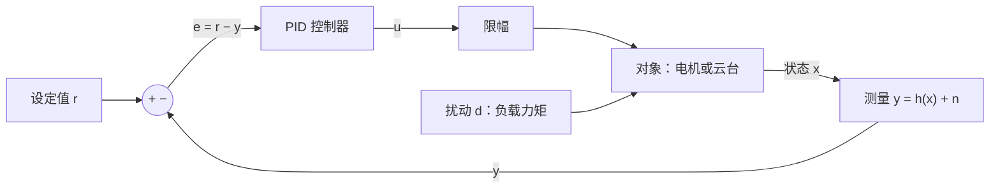

1922 年，Nicolas Minorsky 在《Naval Engineers Journal》上发表了 [Directional stability of automatically steered bodies](https://onlinelibrary.wiley.com/journal/15593584)（1922 年 5 月，第 280 到 309 页），分析怎么让舵机替舵手稳住一条船的航向。据我所知，今天说的“比例加积分加微分”三项控制，常被追溯到这篇论文和他在美国海军舰船上的实验（[Bennett 1984 的历史回顾](http://ieeexplore.ieee.org/iel5/37/24267/01104827.pdf?arnumber=1104827)有详细经过）。一百年之后，我在 RoboMaster 里用的还是同一个东西：我写过很多年 PID，但只会一种写法，位置式、单变量、一个积分限幅、一组 `kp ki kd`，调参靠手感加运气。

这个系列我想把它拆开：从一个电机出发，一路走到状态反馈和 LQR，每一步都自己推公式、自己写代码。这一篇只做最小的事：在仿真的 M3508 转速环和 GM6020 云台上让 P、I、D 一项一项出场，每加一项就看一个数字变化。同一个云台，只用 P 时超调 90.76%，加上 D 降到 15.61%；再加上 I，0.1 N·m 的负载造成的 0.02 rad 静差，平均值降到 0.0007 rad。后面九篇都建立在这一篇搭好的仿真平台上。

> [!NOTE] 本篇检查点
> 这一篇结束时你会有：一份能跑的伴生仓库 `pid-lab`，`make ch01` 通过，生成 `out/ch01/` 下 36 个 CSV（9 组实验，每组 Python、C、C++、Rust 各一份）和 `figures/ch01/` 下 4 张图；以及 P、I、D 三项的完整推导。
> 新增模块：Python 是 `pidlab/sim.py`（RK4 与延迟线）、`pidlab/plants.py`（`MotorSpeed`、`GimbalAxis`）、`pidlab/pid_basic.py`；C 是 `pl/sim.h`、`pl/plants.h`、`pl/pid_basic.h` 及对应的 `.c`；C++ 是 `pidlab/sim.h`、`pidlab/plants.h`、`pidlab/pid_basic.h`；Rust 是 `sim.rs`、`plants.rs`、`pid_basic.rs`。
> 这是第 1 篇，没有前置章节。需要的数学：一阶和二阶常微分方程，知道“阻尼比”是什么就行。

## 这个系列怎么读

下面是整个系列的地图：

| 篇 | 标题 | 主要内容 |
| --- | --- | --- |
| 1 | P、I、D 各自在干什么 | 仿真平台、四种语言的 PID、静差与超调 |
| 2 | [传递函数、极点与根轨迹](/posts/pid-control-02-transfer-functions/) | 拉普拉斯变换、二阶原型、极点配置、Routh 判据、根轨迹 |
| 3 | [频域：Bode、Nyquist 与稳定裕度](/posts/pid-control-03-frequency-domain/) | 相位裕度、延迟裕度、灵敏度函数 |
| 4 | [离散化：位置式、增量式与采样率](/posts/pid-control-04-discretization/) | 三种离散化、位置式与增量式的等价、采样率的代价 |
| 5 | [工程上的坑：积分饱和、微分冲击与前馈](/posts/pid-control-05-practical/) | 抗饱和、微分滤波、前馈、无扰切换，以及系列的 PID 库 |
| 6 | [整定：Ziegler–Nichols、继电器自整定与 SIMC](/posts/pid-control-06-tuning/) | 阶跃法、继电器法、SIMC 规则 |
| 7 | [串级 PID：云台的角度环和速度环](/posts/pid-control-07-cascade/) | 内外环、带宽分离、内环饱和 |
| 8 | [多变量：耦合、RGA、解耦与麦轮底盘](/posts/pid-control-08-mimo/) | RGA、解耦、麦轮的零空间电流 |
| 9 | [状态反馈：LQR、LQI 与平衡步兵](/posts/pid-control-09-lqr/) | LQR、LQI、PID 是状态反馈的一个子集 |
| 10 | [上车之前：float32、定点数与 CAN 量化](/posts/pid-control-10-embedded/) | float32、Q16.16、量化、采样抖动 |

**四种语言。** 每个控制器和每个仿真对象我都写四遍：Python（numpy，只用来当参考实现和画图，仿真本身是手写的）、C（C11，不使用 `malloc`）、C++（C++20，模板，纯头文件）、Rust（edition 2024，`no_std` 兼容）。Python 版承担推导和完整讲解；C、C++、Rust 的核心函数我会贴出来，文字只讲它们和 Python 版的区别：内存归谁、尺寸在哪里确定、标量类型怎么切换、语言本身的惯用法。文中只贴关键的几行，完整文件在仓库里，文末的检查点列了链接。

**同一份数据。** 所有设定值、扰动和测量噪声都由 Python 生成，写成 CSV，四种语言读同一份文件，没有任何一种语言自己造随机数。这一篇的噪声是 0，但文件里已经留了噪声这一列，后面几篇会用到。这恰好也是上车之后的工作流：日志进来，控制器处理。

**真实输出。** 文中所有终端输出、数值和图，都来自我在这台机器上跑 `make ch01` 的结果。每个浮点数在 CSV 里都写成 17 位有效数字，C、C++、Rust 的输出和 Python 参考的最大差值要在 $10^{-9}$ 以内才算通过。

## 装环境

代码在 [pid-lab](https://github.com/bfmhno3/pid-lab/tree/tutorial-v1)，本系列固定在 `tutorial-v1` 标签。仓库里有一个 `flake.nix`，`nix develop` 进去就是我用的全部工具：

```bash
git clone https://github.com/bfmhno3/pid-lab.git
cd pid-lab
git checkout tutorial-v1
nix develop
```

```text
pid-lab dev shell: Python 3.13.15, gcc (GCC) 15.3.0, rustc 1.95.0 (59807616e 2026-04-14) (built from a source tarball)
```

没有 Nix 的话，自己装这几样就行：Python 3 加 `numpy`、`matplotlib`、`scipy`；gcc 13 或更新（要支持 C11 和 C++20）；用 rustup 装的 Rust stable，外加 `clippy`。画图时中文标签用的字体通过环境变量 `PL_CJK_FONT` 指定（`flake.nix` 已经设好），找不到字体时图的标签自动退回英文。

所有命令都在仓库根目录跑。`make ch01` 做五件事：用 Python 生成数据并跑参考实现；编译 C、C++、Rust 三个版本；各自读同一份数据并输出；用 `python/compare.py` 逐列对比；最后打印指标并画图。

## 数学

### 回路、对象和扰动

先把整个回路画出来，后面九篇都是在这张图上加东西：



这一篇有两个对象，都取 RoboMaster 的量级。我先说明哪些是查到的，哪些是我自己取的：

| 对象 | 方程 | 参数 |
| --- | --- | --- |
| `MotorSpeed`（M3508 轮子，输出轴侧） | $J\dot\omega = K_t i - b\omega - \tau_d$ | $K_t = 0.3$ N·m/A，$J = 0.03$ kg·m²，$b = 0.01$ N·m·s/rad，$\lvert i\rvert \le 20$ A |
| `GimbalAxis`（GM6020 yaw，力矩指令） | $J\ddot\psi = \tau - \tau_d - b\dot\psi - b_f(\dot\psi - \omega_c)$ | $J = 0.02$，$b = 0.002$，$b_f = 0.02$，$\lvert\tau\rvert \le 1$ N·m，这一篇令底盘角速度 $\omega_c = 0$ |

$K_t$ 是查到的：[M3508 P19 的用户手册](https://cdn-hz.robomaster.com/robomasters/public/document/RoboMaster%20M3508%20P19%20Brushless%20DC%20Gear%20Motor%20V1.0.pdf)在特征参数表里写转矩常数 0.3 N·m/A，额定转矩 3 N·m。手册没有说这个常数折算在转子侧还是输出轴侧，我把它当输出轴侧的值用，这是我的假设（3 N·m 除以 0.3 N·m/A 得 10 A，和手册的额定电流 10 A 在数量级上吻合，但手册说那是电调输入端的电流，所以我不拿它当证据）。电流上限 20 A 来自 [RoboMaster 官网上 C620 电调的参数](https://www.robomaster.com/zh-CN/products/components/general/M3508)：最大持续电流 20 A。

$J$ 和 $b$ 是我取的，我把 $J = 0.03$ 当成四分之一台 20 kg 的车压在半径 76 mm 的轮子上：$5\times 0.076^2 \approx 0.029$。云台的 $J$、$b$、$b_f$、力矩上限也全是我取的，只是量级合理的数。第 7 篇会解释 $b_f$ 是什么（轴承把底盘的转动带给云台）。你换一组自己车上辨识出来的参数，所有结论的形状不变，数字会变。

采样周期 $t_s = 1$ ms，我选它是因为据我所知 RM 的 CAN 电机反馈大约是这个频率，没有逐个核实。对象用 RK4 积分，每个控制周期切成 10 小步。

### 速度环是一阶系统

电机在常数电流 $i$ 和常数负载 $\tau_d$ 下是一阶线性方程 $J\dot\omega + b\omega = K_t i - \tau_d$，解是

$$
\omega(t) = \omega_\infty\left(1 - e^{-t/T}\right),\quad T = \frac{J}{b},\quad \omega_\infty = \frac{K_t i - \tau_d}{b}
$$

代进去 $T = 0.03/0.01 = 3$ s。开环的轮子要 3 秒才爬到终值的 63%，这就是需要闭环的原因：控制器的第一件工作是把 3 秒压下来。

### P：比例，永远留一个误差

令 $u = K_p e$，$e = r - \omega$。代进模型：

$$
J\dot\omega = K_t K_p (r - \omega) - b\omega - \tau_d \;\Rightarrow\; J\dot\omega + (b + K_t K_p)\,\omega = K_t K_p r - \tau_d
$$

还是一阶系统，时间常数从 $J/b$ 变成 $J/(b + K_t K_p)$。$K_p = 1$ 时是 $0.03/0.31 = 0.0968$ s，比开环快了 31 倍。令 $\dot\omega = 0$ 得稳态转速，误差是

$$
e_{ss} = r - \omega_\infty = \frac{b\,r + \tau_d}{b + K_t K_p}
$$

这个式子里 $K_p$ 只在分母上，所以大 $K_p$ 能压小误差，但分子永远不为零：只要 $r \ne 0$，轮子的黏性阻尼 $b$ 就需要一个非零的电流来克服，而 P 控制器只有在 $e \ne 0$ 时才会输出电流。负载 $\tau_d$ 也是同样的道理。P 控制的误差不是调参能解决的，是结构性的。

### I：积分，强制误差归零

令 $u = K_p e + K_i \int e\,dt$，把积分记成 $z$（$\dot z = e$）。假设闭环最终停在某个平衡点，所有量都不再变化。那么 $\dot z = e$ 也必须是 0，否则 $z$ 在变，$u$ 在变，就不是平衡点。**积分器是一个只有在 $e = 0$ 时才能停下来的东西**，这就是它的全部作用。（类比一下：浴缸里的水位。只要进水口和出水口流量不等，水位就在变；水位不变，必然流量相等。积分器的“水位”就是 $u$ 里那一份，它会一直调节到“出入相等”，也就是误差为零。）

同时看看它对动态的影响。对 $J\dot\omega = K_t(K_p e + K_i z) - b\omega - \tau_d$ 求一次导，再用 $\dot z = e$ 和 $\dot e = \dot r - \dot\omega$：

$$
J\ddot\omega + (b + K_t K_p)\,\dot\omega + K_t K_i\,\omega = K_t K_p\,\dot r + K_t K_i\,r - \dot\tau_d
$$

变成二阶系统。$K_p = 1$，$K_i = 10$ 时：$\omega_n = \sqrt{K_t K_i / J} = 10$ rad/s，阻尼比 $\zeta = (b + K_t K_p)/(2J\omega_n) = 0.517$。不带零点的二阶系统在这个阻尼比下超调应该是 $e^{-\pi\zeta/\sqrt{1-\zeta^2}} = 15.0\%$。后面我会拿实测去对比，剧透：对不上。

### D：微分，给二阶对象加阻尼

云台和轮子的区别是它从力矩到角度是两次积分（再加一点点阻尼）。令底盘不转，$J\ddot\psi = \tau - \tau_d - (b + b_f)\dot\psi$。只用 P：$\tau = K_p(r - \psi)$，得

$$
J\ddot\psi + (b + b_f)\dot\psi + K_p\psi = K_p r - \tau_d
$$

这是弹簧质量阻尼器，$K_p$ 是弹簧，$b + b_f$ 是阻尼。固有频率 $\omega_n = \sqrt{K_p/J} = \sqrt{5/0.02} = 15.81$ rad/s，阻尼比 $\zeta = (b+b_f)/(2\sqrt{JK_p}) = 0.022/0.6325 = 0.035$。这个阻尼比几乎是零：云台会像一根没有减震器的弹簧一样来回晃。超调公式给出 $e^{-\pi\zeta/\sqrt{1-\zeta^2}} = 89.6\%$。

加上 D：$\tau = K_p e + K_d \dot e$，其中 $\dot e \approx -\dot\psi$（设定值不动的时候）。D 项贡献的是一个正比于速度的力矩，和 $b$ 一样是阻尼：

$$
J\ddot\psi + (b + b_f + K_d)\,\dot\psi + K_p\psi = K_p r - \tau_d
$$

$K_d = 0.3$ 时 $\zeta = 0.322/0.6325 = 0.509$，超调预期降到 15.6%。**D 项就是人为加上的阻尼。**（飞机的偏航阻尼器也叫这个名字，同一回事：测角速度，反向加力矩。）

静差：令导数全为零，$K_p(r - \psi) = \tau_d$，所以 $e_{ss} = \tau_d / K_p = 0.1/5 = 0.02$ rad。D 对它没有任何帮助，因为稳态时 $\dot e = 0$。要消掉这个静差还是得 I。三项都加上就是三阶：

$$
J\dddot\psi + (b + b_f + K_d)\ddot\psi + K_p\dot\psi + K_i\psi = \dots
$$

三阶系统稳定需要 $(b + b_f + K_d)K_p > J K_i$，这里是 $0.322\times 5 = 1.61 > 0.02\times 20 = 0.4$，满足。这是 Routh 判据的一个特例，第 2 篇会从头推。

### 采样：回路里还有一个保持器

控制器每 1 ms 才看一次 $y$，输出 $u_k$ 在下一个采样点之前保持不变（零阶保持，ZOH）。一个保持器平均相当于 $t_s/2$ 的延迟，再加上“测量到输出”本身晚一拍，大约是一个半采样周期的纯延迟。$t_s = 1$ ms 时它远小于对象的时间常数，可以忽略；但我后面会遇到它：下面 $e_{ss}$ 的验证里，我得把预测向后移一个采样周期才对得上。第 3、4 篇会把它变成裕度和采样率的数字。

最后是我要先打个预防针的一点：**很多 RM 代码里 `ki` 和 `kd` 是把 $t_s$ 吸收进去的**，比如积分写成 `integral += error` 而不乘 $t_s$，微分写成 `error - last_error` 而不除 $t_s$。据我所知这很常见，但我没有统计过。这样写的增益数值和我这里的 $K_i$、$K_d$ 差一个 $t_s$ 因子，换采样率就要重调。我这里把 $t_s$ 显式留在公式里，第 4 篇会专门算这笔账。

## Python 实现

### 积分器、延迟线和对象

对象的方程要变成代码，先要一个积分器。我用最朴素的经典 RK4：状态是 `list[float]`，对象给出 `deriv(x, u)`，`rk4_step` 在一步里调用它四次，输入 `u` 在这一步里保持不变：

```python
def rk4_step(
    f: Deriv, x: Sequence[float], u: Sequence[float], h: float
) -> list[float]:
    """Advance dx/dt = f(x, u) by h with classic RK4, u held constant."""
    n = len(x)
    k1 = f(x, u)
    k2 = f([x[i] + 0.5 * h * k1[i] for i in range(n)], u)
    k3 = f([x[i] + 0.5 * h * k2[i] for i in range(n)], u)
    k4 = f([x[i] + h * k3[i] for i in range(n)], u)
    return [
        x[i] + h / 6.0 * (k1[i] + 2.0 * k2[i] + 2.0 * k3[i] + k4[i])
        for i in range(n)
    ]
```

一个控制周期里 `advance` 把它调 `substeps` 次（我取 10），每次步长 `ts / substeps`。指令的传输延迟（整数个采样周期）用 `DelayLine`：一个 `deque` 当环形缓冲区，`push(u)` 存进去，取出 `delay` 次之前存的值，`delay = 0` 直接透传。这一篇的延迟是 0，但后面几篇都要用，所以现在就放进回路里。

```python
    def push(self, u: float) -> float:
        """Store u, return the value pushed `delay` calls ago."""
        if not self.buf:
            return u
        out = self.buf.popleft()
        self.buf.append(u)
        return out
```

对象只负责回答“在状态 $x$、输入 $u$ 下导数是多少”。输入向量约定为 `u = [指令, 扰动...]`，所以扰动只是 `u` 的额外条目，数据文件里写什么，对象就收到什么。这个约定后面九篇一直用。转速环和云台各一个方法：

```python
    def deriv(self, x, u):
        return [(self.kt * u[0] - self.b * x[0] - u[1]) / self.j]
```

```python
    def deriv(self, x, u):
        acc = (u[0] - u[1] - self.b * x[1] - self.bf * (x[1] - u[2])) / self.j
        return [x[1], acc]
```

上面是 `MotorSpeed` 和 `GimbalAxis` 的 `deriv`，分别就是 $J\dot\omega = K_t i - b\omega - \tau_d$ 和 $J\ddot\psi = \tau - \tau_d - b\dot\psi - b_f(\dot\psi - \omega_c)$ 解出导数的样子。云台的状态是 $[\psi, \dot\psi]$，所以第一个分量就是 `x[1]`。

### 位置式 PID

这就是 RM 比赛代码里最常见的那一类：积分是矩形累加再限幅，微分是对误差的后向差分，第一拍微分为 0（`primed` 标志防止第一拍用一个不存在的上一次误差），输出限幅。

```python
    def update(self, ref: float, meas: float) -> float:
        err = ref - meas
        self.integral += err * self.ts
        self.integral = clamp(self.integral, -self.i_limit, self.i_limit)
        d = (err - self.prev_err) / self.ts if self.primed else 0.0
        self.prev_err = err
        self.primed = True
        out = self.kp * err + self.ki * self.integral + self.kd * d
        return clamp(out, -self.out_limit, self.out_limit)
```

积分限幅 `i_limit` 作用在积分量 $\int e\,dt$ 上（不是 $K_i\int e\,dt$ 上），所以实际的 I 项上限是 `ki * i_limit`。我在 `speed` 实验里取 `i_limit = 2`，对应 $10\times 2 = 20$ A，刚好是电流上限；云台取 0.05，对应 $20\times 0.05 = 1$ N·m，刚好是力矩上限。这个限幅在这一篇的所有实验里没有触发过，它是第 5 篇的主角。

### 驱动：数据、回路、实验表

驱动 `python/ch01_p_i_d.py` 有两个子命令：`ref` 写数据并跑 Python 参考实现，`report` 对比四种语言、打印指标、断言结论并画图。九个实验用一张表描述：

```python
# name: (plant, kp, ki, kd, r, load, i_limit)
CASES = {
    "speed_p_k0.2": ("speed", 0.2, 0.0, 0.0, 10.0, 1.0, 2.0),
    # ... speed_p_k0.5, k1, k2, k5, speed_pi
    "pos_p": ("pos", 5.0, 0.0, 0.0, 0.1, 0.1, 0.05),
    "pos_pd": ("pos", 5.0, 0.0, 0.3, 0.1, 0.1, 0.05),
    "pos_pid": ("pos", 5.0, 20.0, 0.3, 0.1, 0.1, 0.05),
}
```

转速环的 P（五个 $K_p$）、一个 PI，云台的 P、PD、PID。每个实验 2 秒，设定值在 0.05 s 跳变，负载在 1.0 s 加上。数据文件里有 `t,r,d,n` 四列，`n` 是测量噪声，这一篇全是 0。

每个采样点 $k$ 按下面的顺序执行，四种语言一模一样：

1. $t_k = k\,t_s$。
2. 测量 $y_k = h(x_k) + n_k$，$n_k$ 来自数据文件。
3. 控制器输出 $u_k$。
4. 执行器限幅。
5. 把指令推进延迟线（整数个采样周期，0 也允许，这一篇用 0）。
6. 延迟后的指令和扰动 $d_k$ 在 10 个 RK4 小步里保持不变。
7. 记录这一行，用的是积分之前的 $x_k$。

`run_case` 的循环体和这七步一一对应：

```python
    for k in range(STEPS):
        r, load = data["r"][k], data["d"][k]
        y = plant.output(x) + data["n"][k]
        err = r - y
        d_term = kd * (err - pid.prev_err) / TS if pid.primed else 0.0
        u = pid.update(r, y)
        u = min(max(u, -plant.u_max), plant.u_max)
        rows.append(
            [data["t"][k], r, y, u, kp * err, ki * pid.integral, d_term]
        )
        u_in = delay.push(u)
        if kind == "speed":
            inputs = [u_in, load]
        else:
            inputs = [u_in, load, 0.0]
        x = advance(plant.deriv, x, inputs, TS, SUBSTEPS)
```

注意 `d_term` 和 `kp * err`、`ki * pid.integral` 是在驱动里另算一遍的，目的是把三项分别记进 CSV 画图，PID 类本身不暴露它们。`ref()` 把所有实验循环跑一遍，写 `out/ch01/<case>_py.csv`；`report` 里是对比、指标、断言和画图，在 [`python/ch01_p_i_d.py`](https://github.com/bfmhno3/pid-lab/blob/tutorial-v1/python/ch01_p_i_d.py) 里。

## C、C++、Rust 实现

三个版本的结构和 Python 一样：`sim`、`plants`、`pid_basic` 三个模块加一个驱动。差别在这几处：

- **标量类型。** C 用 `real.h` 里的 `pl_real`（默认 `double`，`-DPL_USE_FLOAT` 切 `float`），C++ 用模板参数 `T`（默认 `double`），Rust 用 `real.rs` 里的 `Real` 别名（`f32` 特性开关）。第 10 篇上 float32 时不用改控制器一行代码。
- **内存。** 没有任何 `malloc`、`new`、`Vec`（读写 CSV 的主机端代码除外）。状态是固定大小的数组：C 里 `PL_MAX_STATES = 8`，C++ 和 Rust 是 `std::array<T, N>` 和 `[Real; N]`，维数编译期确定。延迟线是结构体里一个 `PL_MAX_DELAY = 256` 个元素的数组，调用者拥有它。
- **“把对象传给积分器”。** 这是三种语言差别最大的地方：C 用函数指针加 `const void *ctx`，C++ 用模板参数 `F&&`（lambda 内联），Rust 用 `impl Fn` 闭包。C 的函数指针我没有去看汇编，大概率不会被内联，C++ 和 Rust 的多半会，但这里不是热路径，我没有测。
- **校验。** 构造可能失败的东西（延迟线容量越界）：C 返回 `-EINVAL`，C++ 返回 `std::optional`，Rust 返回 `Option`。

### C

C 是 Linux 内核风格，Tab 缩进，`struct pl_pid_basic` 不 typedef。PID 更新就是 Python 版逐行翻译：

```c
pl_real pl_pid_basic_update(struct pl_pid_basic *pid, pl_real ref,
			    pl_real meas)
{
	pl_real err = ref - meas;
	pl_real d = 0.0;
	pl_real out;

	pid->integral += err * pid->ts;
	pid->integral = pl_clamp(pid->integral, -pid->i_limit, pid->i_limit);
	if (pid->primed)
		d = (err - pid->prev_err) / pid->ts;
	pid->prev_err = err;
	pid->primed = true;
	out = pid->kp * err + pid->ki * pid->integral + pid->kd * d;
	return pl_clamp(out, -pid->out_limit, pid->out_limit);
}
```

对象的 `deriv` 函数签名统一成 `(ctx, x, u, dx)`，`ctx` 指向参数结构体，结果写进调用者给的 `dx`，所以同一个 `pl_rk4_step` 和 `pl_advance` 能积分任何对象：

```c
void pl_motor_speed_deriv(const void *ctx, const pl_real *x, const pl_real *u,
			  pl_real *dx)
{
	const struct pl_motor_speed *p = ctx;

	dx[0] = (p->kt * u[0] - p->b * x[0] - u[1]) / p->j;
}
```

RK4 一步，`k1` 到 `k4` 放在栈上的固定数组里，`n` 不能超过 `PL_MAX_STATES`（调用者的责任）：

```c
	pl_real k1[PL_MAX_STATES], k2[PL_MAX_STATES];
	pl_real k3[PL_MAX_STATES], k4[PL_MAX_STATES];
	pl_real tmp[PL_MAX_STATES];
	int i;

	f(ctx, x, u, k1);
	for (i = 0; i < n; i++)
		tmp[i] = x[i] + 0.5 * h * k1[i];
	f(ctx, tmp, u, k2);
	/* ... k3, k4 the same way, then x[i] += h / 6.0 * (...) */
```

回路本体和七步顺序一一对应，在 [`c/apps/ch01.c`](https://github.com/bfmhno3/pid-lab/blob/tutorial-v1/c/apps/ch01.c) 里：转速环和云台是两个分支，各自调 `pl_advance`，维数用 `PL_MOTOR_SPEED_N` 和 `PL_GIMBAL_AXIS_N` 传进去。

### C++

C++ 是 Google 风格：2 空格缩进，`PascalCase` 函数，`snake_case_` 成员，纯头文件，全部在 `namespace pidlab` 里。`PidBasic` 是一个类，成员私有，状态用访问器读（`integral()`、`prev_err()`、`primed()`）：

```cpp
  // u = kp e + ki * integral(e) + kd (e - e_prev) / ts, then clamped.
  T Update(T ref, T meas) {
    const T err = ref - meas;
    integral_ += err * ts_;
    integral_ = std::clamp(integral_, -i_limit_, i_limit_);
    const T d = primed_ ? (err - prev_err_) / ts_ : T(0);
    prev_err_ = err;
    primed_ = true;
    const T out = kp_ * err + ki_ * integral_ + kd_ * d;
    return std::clamp(out, -out_limit_, out_limit_);
  }
```

RK4 是函数模板，`N`、`M` 是编译期维数，`f` 是任何能被调用的东西，返回 `std::array<T, N>`：

```cpp
template <class T, std::size_t N, std::size_t M, class F>
void Rk4Step(F&& f, std::array<T, N>& x, const std::array<T, M>& u, T h) {
  std::array<T, N> tmp;
  const std::array<T, N> k1 = f(x, u);
  for (std::size_t i = 0; i < N; ++i) tmp[i] = x[i] + T(0.5) * h * k1[i];
  const std::array<T, N> k2 = f(tmp, u);
  // ... k3, k4 the same way
  for (std::size_t i = 0; i < N; ++i) {
    x[i] += h / T(6) * (k1[i] + T(2) * k2[i] + T(2) * k3[i] + k4[i]);
  }
}
```

和 C 的区别：对象是带 `Deriv` 和 `Output` 方法的小 struct，维数写成 `static constexpr std::size_t kN`、`kM`；驱动写成 `RunLoop<Plant>` 模板，用 `Plant::kN`、`Plant::kM` 当数组尺寸，转速环和云台共用同一份回路代码，C 版里这里是两个分支。`DelayLine::Create` 返回 `std::optional`，因为本库不用异常。驱动：[`cpp/apps/ch01.cc`](https://github.com/bfmhno3/pid-lab/blob/tutorial-v1/cpp/apps/ch01.cc)。

### Rust

Rust 是 edition 2024，`rustfmt` 默认格式，库是 `no_std` 兼容的（`io.rs` 在 `std` 特性之后）。PID 更新：

```rust
    /// `u = kp e + ki * integral(e) + kd (e - e_prev) / ts`, then clamped.
    pub fn update(&mut self, r: Real, y: Real) -> Real {
        let err = r - y;
        self.integral += err * self.ts;
        self.integral = self.integral.clamp(-self.i_limit, self.i_limit);
        let d = if self.primed {
            (err - self.prev_err) / self.ts
        } else {
            0.0
        };
        self.prev_err = err;
        self.primed = true;
        let out = self.kp * err + self.ki * self.integral + self.kd * d;
        out.clamp(-self.out_limit, self.out_limit)
    }
```

RK4 用 const generics 把维数放进类型里，积分器签名里的 `impl Fn` 接闭包：

```rust
pub fn rk4_step<const N: usize, const M: usize>(
    f: impl Fn(&[Real; N], &[Real; M]) -> [Real; N],
    x: &mut [Real; N],
    u: &[Real; M],
    h: Real,
) {
    let k1 = f(x, u);
    let mut tmp = [0.0; N];
    for i in 0..N {
        tmp[i] = x[i] + 0.5 * h * k1[i];
    }
    let k2 = f(&tmp, u);
    // ... k3, k4 the same way
}
```

和 C、C++ 的区别：数组越界在 Rust 里是 panic 而不是未定义行为，`clamp` 是 `f64` 自带的方法，不用自己写。驱动里的 `run_loop<const N, const M>` 和 C++ 的 `RunLoop<Plant>` 是同一个想法，对象的 `deriv` 和 `output` 以闭包的形式传进去（`|x, u| p.deriv(x, u)`）。驱动：[`rust/src/bin/ch01.rs`](https://github.com/bfmhno3/pid-lab/blob/tutorial-v1/rust/src/bin/ch01.rs)。

编译参数：C 是 `gcc -std=c11 -O2 -Wall -Wextra -Wpedantic -Werror`，C++ 是 `g++ -std=c++20` 加同样的警告，Rust 是 `cargo build --release` 加 `cargo clippy -- -D warnings`。代码风格我用工具检查，不靠自觉：C 用内核的 `checkpatch.pl --no-tree`（0 errors，0 warnings），C++ 用 `clang-format --style=Google`（21.1.8），Python 用 `ruff format --line-length 79` 和 `ruff check`（0.15.14），Rust 用 `cargo fmt --check`。`checkpatch.pl` 我加了 `--ignore SPDX_LICENSE_TAG,NEW_TYPEDEFS`：前者是它对许可证标识的检查，这个库的许可证是 MIT OR Apache-2.0，我没有去迁就内核的写法，后者因为整个库里我只保留了 `pl_real` 这一个标量 typedef（做 float/double 开关），结构体一概不 typedef。

## 结果

`make ch01` 一次跑完。先看对比：

```text
$ make -s ch01
ch01: C wrote 9 cases to out/ch01
ch01: C++ wrote 9 cases to out/ch01
ch01: Rust wrote 9 cases to out/ch01
ok   pos_p_c.csv: max diff 0.000e+00 <= 1.0e-09
ok   pos_p_cpp.csv: max diff 0.000e+00 <= 1.0e-09
ok   pos_p_rs.csv: max diff 0.000e+00 <= 1.0e-09
ok   pos_pd_c.csv: max diff 0.000e+00 <= 1.0e-09
ok   pos_pd_cpp.csv: max diff 0.000e+00 <= 1.0e-09
ok   pos_pd_rs.csv: max diff 0.000e+00 <= 1.0e-09
... (trimmed: 18 more ok lines)
ok   speed_pi_c.csv: max diff 0.000e+00 <= 1.0e-09
ok   speed_pi_cpp.csv: max diff 0.000e+00 <= 1.0e-09
ok   speed_pi_rs.csv: max diff 0.000e+00 <= 1.0e-09
```

27 个文件（9 个实验乘以 C、C++、Rust），最大差值全是 `0.000e+00`，逐位一致。我没有指望这一点：这里只有加减乘除，IEEE 754 规定它们必须正确舍入，我又把 RK4 每一步的运算顺序在四种语言里写成了一样，而且 x86-64 上 gcc 默认不生成 FMA，所以才一个比特都不差。我猜换成 `-march=native` 或者换一种 CPU 就未必还能做到，这是 $10^{-9}$ 容差存在的理由。

### P：Kp 越大误差越小，但永远不为零


五条曲线是 $K_p = 0.2, 0.5, 1, 2, 5$。上图是转速，下图是电流指令，竖虚线是 1.0 s 加负载的时刻。先看没有负载的阶段：$K_p = 0.2$ 的轮子在 0.99 s 才爬到 7.64 rad/s，还没到；$K_p = 5$ 在 0.99 s 是 9.934 rad/s，很快但还是差一点。再看负载：1 N·m 的负载加上去，每条曲线都掉一截然后停在一个新的位置，$K_p = 5$ 停在 9.27，$K_p = 0.2$ 甚至被拉到了 −4.42 rad/s（负值：负载比它能抵抗的更大，轮子被倒着拖）。下图里 $K_p = 5$ 起跳时电流在 20 A 的上限上停了 31 拍（31 ms），是一段平顶；$K_p = 2$ 刚好碰到上限，只有一个尖峰。

误差公式对不对，我让 `report` 去验证：

```text
$ make -s ch01
...
P-only speed loop: steady error, formula vs simulation
   Kp   phase  e_ss formula   e @ end  tau_cl (s)  prediction  |pred-sim|
  0.2 no load        1.4286    2.3627      0.4286      2.3626    1.08e-04
  0.2    load       15.7143   14.4193      0.4286     14.4193    1.35e-06
  0.5 no load        0.6250    0.6837      0.1875      0.6841    4.34e-04
  0.5    load        6.8750    6.8453      0.1875      6.8451    2.39e-04
    1 no load        0.3226    0.3231      0.0968      0.3231    2.02e-05
    1    load        3.5484    3.5483      0.0968      3.5483    4.28e-06
    2 no load        0.1639    0.1639      0.0492      0.1639    3.37e-08  (sat.)
    2    load        1.8033    1.8033      0.0492      1.8033    4.10e-10
    5 no load        0.0662    0.0662      0.0199      0.0662    1.76e-13  (sat.)
    5    load        0.7285    0.7285      0.0199      0.7285    1.63e-13
```

表里 `e_ss formula` 是 $(br + \tau_d)/(b + K_tK_p)$，`e @ end` 是仿真在该阶段末尾的 $r - y$。$K_p \ge 1$ 的行两者已经对上；$K_p = 0.2$ 和 $0.5$ 的无负载阶段对不上，原因不是公式错，是 1 秒内还没到稳态（$K_p = 0.2$ 的时间常数是 0.4286 s，到 0.99 s 才过了 2.2 个时间常数）。所以我让断言检查的是“带瞬态的预测”：$e(t) = e_{ss} + (e_0 - e_{ss})\,e^{-t/\tau_{cl}}$，对每个起步段没有饱和的阶段，要求它和仿真的差小于 $10^{-3}$ rad/s；起步段饱和的阶段（$K_p = 2, 5$ 的无负载阶段，瞬态不再是一阶的）改成直接比稳态公式，它们已经收敛，差都小于 $10^{-7}$（表里标 `(sat.)` 的就是这两行，表示该阶段起步时电流触顶）。

**我踩的第一个坑。** 我第一次写断言时直接用了 $t = t_{end} - t_{start}$，$K_p = 0.2$ 无负载那一行的偏差是 $2.07\times 10^{-3}$ rad/s，超过了我给自己定的 $10^{-3}$，断言挂了。查下来是上一节说的保持器：控制器的输出相对于它看到的测量晚了大约一个采样周期，所以预测的指数衰减要多走一个 $t_s$。把 $t$ 加上 $t_s$ 之后，全表最大偏差降到 $4.34\times 10^{-4}$（$K_p = 0.5$ 无负载阶段）。理论上这个延迟是一个半周期（$t_s/2$ 加一拍），我只试了加一个 $t_s$，够过断言就停了，没有再细调。这是我第一次在这个系列里直接看到采样的代价，量很小，但不是零。

### I：积分把静差拉回来，代价是超调


$K_p = 1$ 的 P 控制在负载之后留下 3.548 rad/s 的稳态误差（公式预测 3.5484，仿真 3.5483）。同样的 $K_p$ 加上 $K_i = 10$，到 2.0 s 时转速是 9.9835 rad/s，误差 0.0165 rad/s，缩小到原来的 0.46%（$0.0165/3.548$）。代价写在表里：

```text
$ make -s ch01
...
Speed loop (r = 10 rad/s at 0.05 s, 1 N*m load at 1.0 s)
         case  y @0.99s  overshoot %  peak u (A)  dip after load   y @2.0s
 speed_p_k0.2    7.6351         0.00        2.00         14.4193   -4.4193
 speed_p_k0.5    9.3160         0.00        5.00          6.8453    3.1547
   speed_p_k1    9.6769         0.00       10.00          3.5483    6.4517
   speed_p_k2    9.8361         0.00       20.00          1.8033    8.1967
   speed_p_k5    9.9338         0.00       20.00          0.7285    9.2715
     speed_pi   10.0599        28.02       10.10          1.7523    9.9835
speed_pi: settles (2%) 0.742 s after the step, final error 1.65e-02 rad/s
speed_pi after load: min y 8.248 rad/s at 1.122 s
speed_pi final I term 3.670 A (needed (tau_d + b w)/Kt = 3.667 A)
PI (Kp=1, Ki=10): wn = 10.00 rad/s, zeta = 0.517, 2nd-order 15.0 %
```

PI 的超调是 28.02%，不是我前面用二阶公式预测的 15.0%。多出来的 13 个百分点大概率是 PI 控制器本身的零点（闭环传递函数分子里的 $K_p s + K_i$，在 $-K_i/K_p = -10$ rad/s 处，刚好在 $\omega_n$ 附近），它把一部分输入的“速度”也送给了输出，让响应更激进。我说“大概率”是因为这一篇我还没有传递函数这个工具，没法在这里证明，第 2 篇会专门拿 I-P 结构做对照实验。

负载加上去之后 PI 的转速最低掉到 8.248 rad/s（1.122 s），然后爬回来；电流的 I 项最后停在 3.670 A，正好是平衡所需的 $(\tau_d + b\omega)/K_t = (1 + 0.1)/0.3 = 3.667$ A（上面输出的倒数第二行）。这就是积分器的“水位”：它自己记住了负载。

### 云台：P 在晃，D 来阻尼，I 去静差


```text
$ make -s ch01
...
Gimbal loop (r = 0.1 rad at 0.05 s, 0.1 N*m load at 1.0 s)
    case  overshoot %  settle 2% (s)    e @1.0s  mean e 1.6-2s   max|u|
   pos_p        90.76          0.949    -0.0465         0.0211    0.500
  pos_pd        15.61          0.499     0.0001         0.0200    1.000
 pos_pid        45.22          0.797     0.0003         0.0007    1.000
pos_pid: y first reaches r at 0.176 s, I term peaks at 0.147 N*m at 0.175 s
pos_pid: I term ends at 0.0993 N*m, max D term 30.0 N*m
Kd r / ts = 30.0 N*m, u at that sample 1.0 N*m
damping ratio: P only 0.035, PD 0.509; wn = 15.81 rad/s
plain 2nd-order overshoot: P only 89.6 %, PD 15.6 %
static error under load: tau_d/Kp = 0.0200 rad
```

P：超调 90.76%，到 1.0 s 加负载的时候还没停下（误差 −0.0465 rad，仍在晃），2 秒末也在晃。阻尼比 0.035 的二阶系统，公式预测超调 89.6%，仿真 90.76%，差的 1.2 个百分点我归在采样的头上，没有深究。因为 P 没有稳定下来，我把“负载后的静差”取成最后 0.4 s 的平均误差（正好是一个振荡周期 $2\pi/\omega_n \approx 0.397$ s）：0.0211 rad，和 $\tau_d/K_p = 0.02$ 一致。

PD：超调降到 15.61%，公式预测 15.6%；从阶跃起 0.499 s 之后误差一直在 2% 以内，到 1.0 s 误差 0.0001 rad。负载加上之后静差落在 0.0200 rad，和 $\tau_d/K_p$ 精确对上。D 没有消除静差，和推导一致。

PID：负载之后的静差是 0.0007 rad，I 把它清掉了。但它的超调是 45.22%，比 PD 的 15.61% 还大很多。这是我没预料到的：我原先只想到“I 会加一点超调”。输出里有一条线索：云台在 0.176 s 第一次碰到设定值，而 I 项恰好在 0.175 s 到达最高点 0.147 N·m。整个上升过程里误差一直为正，积分器一直在往上攒，过了设定值之后误差才变负，积分器才开始往回放，这份攒多了的 I 项推着云台冲得更远。这是积分饱和的近亲（没有触到限幅，但机制一样），第 5 篇会处理。

**三项各自出了多少力。**


最上面是 P，设定值跳变那一拍是 $5\times 0.1 = 0.5$ N·m，之后随误差衰减，负载期间只剩一点点。第二张是 I，起步时被推到 0.147 N·m，之后降下来，负载加上去后爬到 0.0993 N·m（2.0 s 末），接近 $\tau_d = 0.1$ N·m，积分器学到了负载的大小。

第三张是 D，我最想让你看一眼的一张：D 项在 0.05 s 有一个 **30 N·m** 的尖峰，对应输出里 `max D term 30.0`，$K_d\cdot r/t_s = 0.3\times 0.1/0.001 = 30$。因为设定值是阶跃，误差在一个采样周期内跳了 0.1 rad，后向差分把它除以 1 ms。控制器的输出限幅是 1 N·m，所以实际送给电机的只有 1 N·m 的一拍（总输出图上最前面那一根针），尖峰被限幅削掉了，但它还是白白占用了一拍的力矩。这是“微分冲击”（derivative kick）。这一篇我故意不处理它，让它留在数据里；第 5 篇会用 $c = 0$（微分只作用在测量上）来消掉它。

## 检查点

在仓库根目录、`nix develop` 里运行：

```bash
make -s ch01
```

我的输出见上面的“结果”一节：27 行 `ok`，最大差值全是 `0.000e+00`，然后是三张指标表，`report` 里的断言（$e_{ss}$ 公式与仿真相差小于 $10^{-3}$ rad/s）全部通过，最后画出 4 张图。三种原生语言各写 9 个 CSV，加上 Python 的 9 个，共 36 个文件在 `out/ch01/`。

### 实验清单

这一篇新增的文件，Python 侧（命令都在仓库根目录运行）：

| 文件 | 命令 | 结果 |
| --- | --- | --- |
| [`python/pidlab/sim.py`](https://github.com/bfmhno3/pid-lab/blob/tutorial-v1/python/pidlab/sim.py) | 随 `make -s ch01` 运行 | RK4 和 `DelayLine`，是所有语言的参考 |
| [`python/pidlab/plants.py`](https://github.com/bfmhno3/pid-lab/blob/tutorial-v1/python/pidlab/plants.py) | 同上 | `MotorSpeed`、`GimbalAxis` |
| [`python/pidlab/pid_basic.py`](https://github.com/bfmhno3/pid-lab/blob/tutorial-v1/python/pidlab/pid_basic.py) | 同上 | 位置式 PID |
| [`python/ch01_p_i_d.py`](https://github.com/bfmhno3/pid-lab/blob/tutorial-v1/python/ch01_p_i_d.py) | `python3 python/ch01_p_i_d.py ref` 然后 `report` | `ref` 生成 9 个数据文件和 9 个 `_py.csv`；`report` 对比、打印三张表、画 4 张图 |
| [`python/compare.py`](https://github.com/bfmhno3/pid-lab/blob/tutorial-v1/python/compare.py)、[`python/pidlab/io.py`](https://github.com/bfmhno3/pid-lab/blob/tutorial-v1/python/pidlab/io.py)、[`python/pidlab/plotting.py`](https://github.com/bfmhno3/pid-lab/blob/tutorial-v1/python/pidlab/plotting.py) | 同上 | 逐列对比（容差 $10^{-9}$）、CSV 读写、画图辅助，后面每一篇都用 |

C、C++、Rust 侧，`make -s ch01` 会依次编译并运行三个驱动，各写 9 个 CSV 到 `out/ch01/`：

| 文件 | 命令 | 结果 |
| --- | --- | --- |
| [`c/include/pl/real.h`](https://github.com/bfmhno3/pid-lab/blob/tutorial-v1/c/include/pl/real.h)、[`c/include/pl/csv.h`](https://github.com/bfmhno3/pid-lab/blob/tutorial-v1/c/include/pl/csv.h)、[`c/src/csv.c`](https://github.com/bfmhno3/pid-lab/blob/tutorial-v1/c/src/csv.c) | 随 `make -s ch01` 编译 | `pl_real` 标量开关；C 里唯一用堆的 CSV 读写 |
| [`c/include/pl/sim.h`](https://github.com/bfmhno3/pid-lab/blob/tutorial-v1/c/include/pl/sim.h)、[`c/src/sim.c`](https://github.com/bfmhno3/pid-lab/blob/tutorial-v1/c/src/sim.c) | 同上 | `pl_rk4_step`、`pl_advance`、`struct pl_delay_line` |
| [`c/include/pl/plants.h`](https://github.com/bfmhno3/pid-lab/blob/tutorial-v1/c/include/pl/plants.h)、[`c/src/plants.c`](https://github.com/bfmhno3/pid-lab/blob/tutorial-v1/c/src/plants.c) | 同上 | `struct pl_motor_speed`、`struct pl_gimbal_axis` |
| [`c/include/pl/pid_basic.h`](https://github.com/bfmhno3/pid-lab/blob/tutorial-v1/c/include/pl/pid_basic.h)、[`c/src/pid_basic.c`](https://github.com/bfmhno3/pid-lab/blob/tutorial-v1/c/src/pid_basic.c) | 同上 | `struct pl_pid_basic` |
| [`c/apps/ch01.c`](https://github.com/bfmhno3/pid-lab/blob/tutorial-v1/c/apps/ch01.c) | 同上 | `ch01: C wrote 9 cases to out/ch01` |
| [`cpp/include/pidlab/sim.h`](https://github.com/bfmhno3/pid-lab/blob/tutorial-v1/cpp/include/pidlab/sim.h)、[`plants.h`](https://github.com/bfmhno3/pid-lab/blob/tutorial-v1/cpp/include/pidlab/plants.h)、[`pid_basic.h`](https://github.com/bfmhno3/pid-lab/blob/tutorial-v1/cpp/include/pidlab/pid_basic.h)、[`csv.h`](https://github.com/bfmhno3/pid-lab/blob/tutorial-v1/cpp/include/pidlab/csv.h) | 同上 | `Rk4Step`、`DelayLine<T>`、`MotorSpeed<T>`、`GimbalAxis<T>`、`PidBasic<T>` |
| [`cpp/apps/ch01.cc`](https://github.com/bfmhno3/pid-lab/blob/tutorial-v1/cpp/apps/ch01.cc) | 同上 | `ch01: C++ wrote 9 cases to out/ch01` |
| [`rust/src/real.rs`](https://github.com/bfmhno3/pid-lab/blob/tutorial-v1/rust/src/real.rs)、[`sim.rs`](https://github.com/bfmhno3/pid-lab/blob/tutorial-v1/rust/src/sim.rs)、[`plants.rs`](https://github.com/bfmhno3/pid-lab/blob/tutorial-v1/rust/src/plants.rs)、[`pid_basic.rs`](https://github.com/bfmhno3/pid-lab/blob/tutorial-v1/rust/src/pid_basic.rs)、[`lib.rs`](https://github.com/bfmhno3/pid-lab/blob/tutorial-v1/rust/src/lib.rs) | 同上 | `Real`、`rk4_step`、`DelayLine`、`MotorSpeed`、`GimbalAxis`、`PidBasic` |
| [`rust/src/bin/ch01.rs`](https://github.com/bfmhno3/pid-lab/blob/tutorial-v1/rust/src/bin/ch01.rs) | 同上 | `ch01: Rust wrote 9 cases to out/ch01` |

构建和辅助文件：[`Makefile`](https://github.com/bfmhno3/pid-lab/blob/tutorial-v1/Makefile)（`make ch01` 的规则）、[`c/Makefile`](https://github.com/bfmhno3/pid-lab/blob/tutorial-v1/c/Makefile)、[`cpp/Makefile`](https://github.com/bfmhno3/pid-lab/blob/tutorial-v1/cpp/Makefile)、[`flake.nix`](https://github.com/bfmhno3/pid-lab/blob/tutorial-v1/flake.nix)、[`scripts/sync-figures.sh`](https://github.com/bfmhno3/pid-lab/blob/tutorial-v1/scripts/sync-figures.sh)（把 `figures/ch01/` 里的 4 张 SVG 复制到本站）。

## 下一篇

这一篇我把 P、I、D 分别拆开看了，每一项都对应一个具体的物理效应：P 是弹簧，D 是阻尼，I 是记忆。但我是靠“看曲线加猜”得到这些结论的，有两处没有说清楚：PI 的超调为什么是 28% 而不是 15%；PID 的 45% 超调怎么压下来。第 2 篇 [传递函数、极点与根轨迹](/posts/pid-control-02-transfer-functions/) 引入拉普拉斯变换，把闭环的极点和零点直接写出来，用极点配置把 $K_p$、$K_i$ 从“调”变成“算”，再用 Routh 判据和根轨迹看增益加到多大系统会不稳定。那一篇还会给 `MotorSpeed` 加上电流环的滞后，对象的阶数就比这一篇多一阶了。
