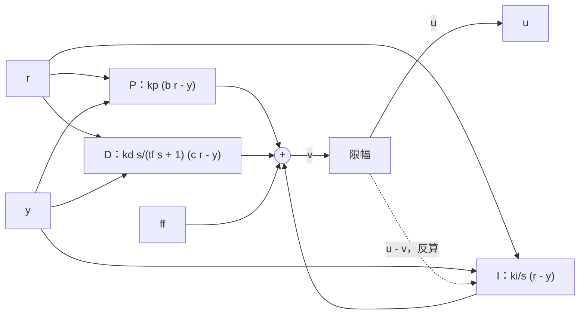

前四篇我一直把 PID 当成一个公式：套上 $u = k_p e + k_i\int e + k_d\dot e$，调几个数，看曲线。这一篇我把它放到一个“会出事”的场景里：电机电流上限 20 A，设定值一次跳到 40 rad/s，积分器在饱和期间照常累加，结果轮速冲到 70.96 rad/s，超调 77.4%；换成条件积分，同一个阶跃只有 2.2%。**饱和、微分冲击、重力和增益切换，是 PID 从课本走到机器人上最先遇到的四个坑，它们各自都有一行修法，但每一行都会碰到别的东西。** 这一篇我把四个坑逐个复现，再把修法收成系列从此以后一直用的 PID 库：$b$、$c$ 两个设定值权重，滤波微分，四种抗饱和模式（还有一个让外部掐掉积分的开关），前馈入口和 `reset`。还有一个我事先用公式算过、看到曲线还是愣了一下的结果：积分限幅是最常见的写法，它在这个负载下留下了 0.79 rad/s 的稳态误差。

> [!NOTE] 本篇检查点
> 这一篇结束时你会有：`make ch05` 通过，`out/ch05/` 下 60 个 CSV（15 个算例：`windup_{none,limit,clamp,backcalc}`、`kick_c1`、`kick_c0`、`weight_b05`、`dfilter_tf{0,0.002,0.01}`、`ff_{none,gravity,gravity_acc}`、`bumpless_{off,on}`，每个 Python、C、C++、Rust 各一份），`figures/ch05/` 下 5 张图；以及积分饱和、设定值权重、微分滤波、前馈、无扰动切换的推导。
> 新增模块：Python 是 `pidlab/pid.py`，另外在 `pidlab/plants.py` 里加了 `GimbalPitch` 和 `round_half_away`；C 是 `pl/pid.h` 和 `pid.c`（`plants.h`、`plants.c` 里加了 `pl_gimbal_pitch`）；C++ 是 `pidlab/pid.h`（`plants.h` 里加了 `GimbalPitch<T>`）；Rust 是 `pid.rs`（`plants.rs` 里加了 `GimbalPitch`）。**这个 `pid` 模块的接口从这一篇起固定，第 6 到第 10 篇都直接用它。**
> 前置：[第 4 篇](/posts/pid-control-04-discretization/)。需要的数学：第 2 篇的一阶、二阶系统，第 4 篇的离散化；这一篇没有新的数学工具。

## 数学

### 积分饱和：电梯按钮按了 40 次

执行器有上限：M3508 的电流指令夹在 $\pm 20$ A。控制器想要的输出记作 $v$，实际发出的记作 $u = \text{sat}(v)$。**积分器不知道 $u \ne v$**：设定值从 0 跳到 40 rad/s，误差 40 rad/s，比例项 $k_p \times 40 = 166.7$ A，电流被夹在 20 A，电机以固定的加速度爬升，这段时间里误差一直为正，积分器照常累加。轮速终于到了 40 rad/s，误差归零，积分器里却攒了几百安培，它要等误差为负足够久才能倒空。这跟反复按电梯按钮一样：电梯没有因为你按了 40 次就来得更快，只是它到了以后，你还得等那 40 次的“欠账”被清掉。

用 $I$ 记积分项，$e = r - y$，$v_k = p_k + I_k + d_k + ff_k$，我在 PID 库里放四种处理，对应枚举 `Windup`：

- **NONE：** $I_{k+1} = I_k + k_iT_se_k$，什么都不做。这是对照组。
- **LIMIT：** 积分之后把 $I$ 夹在 $\pm I_{\lim}$ 里。最常见的写法，一行代码。
- **CLAMP（条件积分）：** 饱和且误差还在把输出往饱和方向推时，这一拍不积分。判据是 $u \ne v$ 且 $e\,(v - u) > 0$：$v - u$ 的符号说明饱和在哪一边，$e$ 同号就说明积分会让它更饱和。
- **BACK_CALC（反算）：** 把 $u - v$ 按跟踪时间常数 $T_t$ 回灌给积分器：

$$
I_{k+1} = I_k + k_iT_se_k + \frac{T_s}{T_t}\,(u_k - v_k)
$$

连续形式是 $\dot I = k_ie + (u - v)/T_t$。饱和时 $u - v$ 是一个负反馈，把 $I$ 往“让 $v$ 回到边界”的方向拉；平衡点满足 $v - u = T_tk_ie$。$T_t$ 越小拉得越紧。第 4 篇我推过限幅的增量式累加器就是 $T_t = T_s$ 的反算，那个 $T_t$ 现在是个参数。我取 $T_t = 0.5\,k_p/k_i$，也就是积分时间 $T_i = k_p/k_i$ 的一半（$k_p = 4.1667$、$k_i = 90$，所以 $T_t = 0.0231$ s）。这个 0.5 是我随手取的，没有扫描过。

**LIMIT 有一个不明显的陷阱。** 设负载力矩 $\tau_d$ 稳态下需要的电流 $i_{ss} = (\tau_d + by)/K_t$ 比 $I_{\lim}$ 大。积分器最多只能提供 $I_{\lim}$，剩下的要比例项补：$k_pe + I_{\lim} = i_{ss}$，而 $y = r - e$，代入电机稳态方程 $K_ti = \tau_d + by$ 得

$$
e_{ss} = \frac{(\tau_d + br)/K_t - I_{\lim}}{k_p + b/K_t}
$$

**积分器的“让误差归零”只在它自己没碰到限幅时成立。** 我的算例里 $\tau_d = 2.4$ N·m，$r = 10$ rad/s，$I_{\lim} = 5$ A：分子 $(2.4 + 0.1)/0.3 - 5 = 3.33$ A，分母 $4.1667 + 0.0333$，$e_{ss} = 0.7937$ rad/s。`report` 会把这个公式和仿真的稳态误差比对。

### 设定值权重和微分冲击

第 2 篇我用过 I-P 形式（比例只看 $-y$）。把它推广：PID 的比例项和微分项各自带一个设定值权重，

$$
U(s) = k_p\,(b\,R - Y) + \frac{k_i}{s}\,(R - Y) + \frac{k_d s}{t_fs + 1}\,(c\,R - Y)
$$

$b$ 是比例权重，$c$ 是微分权重，积分项永远吃完整的误差 $R - Y$。这样设定值到输出的通路和扰动到输出的通路是分开的：反馈通路（$-Y$ 那一项）不变，决定稳定性和扰动抑制；前馈通路（$R$ 那一项）由 $b$、$c$ 决定，只影响设定值响应。**稳态时 $e = 0$，两个权重不起作用，它们只塑造瞬态。**

微分冲击就藏在 $c$ 里。$c = 1$ 时微分项吃 $e$，设定值一个阶跃 $\Delta r$ 进来，后向差分在那一拍看到 $e_k - e_{k-1} = \Delta r$，滤波微分递推是 $d_k = a\,d_{k-1} + \dfrac{k_d}{t_f + T_s}(e_{d,k} - e_{d,k-1})$，阶跃那一拍 $d_{k-1} = 0$、差分是 $\Delta r$，所以

$$
d_k = \frac{k_d\,\Delta r}{t_f + T_s}
$$

我的云台俯仰 PID 是 $\omega_n = 15$、$\zeta = 0.7$ 放出来的（下面有增益），$k_d = 0.313$、$t_f = 2$ ms、$\Delta r = 0.1$ rad：$0.313 \times 0.1 / 0.003 = 10.43$ N·m，下一拍乘 $a = t_f/(t_f + T_s) = 0.667$ 衰减。力矩限幅是 $\pm 1$ N·m。$c = 0$ 之后微分项只吃 $-y$，$y$ 是连续的，没有这一脚。

**启用时的第一拍也是同一类问题。** 如果控制器在 $y \ne 0$ 的时候第一次被调用，而 `prev_ed` 还是 0，$e_k - e_{k-1}$ 就是一个假的阶跃。所以第一次 `update` 把 `prev_ed` 设成当前的 $e_d$（我把微分通路的输入叫 $e_d = cr - y$），这是“primed”标志的作用，也是第 4 篇预告的那一脚的修法。

### 微分滤波和编码器量化

位置传感器是量化的：GM6020 的编码器每圈 8192 个计数，$q = 2\pi/8192 = 7.67\times 10^{-4}$ rad。角度每变一个台阶，微分项在那一拍就看到一个 $q$ 的跳变。滤波微分的响应是 $k_dq/(t_f + T_s)$：

| $t_f$ | 滤波极点 $a = t_f/(t_f+T_s)$ | 单个台阶造成的 D 项 |
| --- | --- | --- |
| 0 | 0 | $0.313 \times 7.67\times 10^{-4}/0.001 = 0.2401$ N·m |
| 2 ms | 0.667 | $0.0800$ N·m |
| 10 ms | 0.909 | $0.0218$ N·m |

滤波是有代价的：$t_f = 10$ ms 的极点在 $1/t_f = 100$ rad/s，离 $\omega_n = 15$ rad/s 不算远，相位多少会被它吃掉一点。我在这个回路里没看到代价（后面的表），但我猜带宽更高的回路上这笔账会显出来，这一点我没有测。

### 前馈：不要让积分器去背重力

俯仰轴有重力矩 $mgl\cos\theta$，$m = 1.5$、$l = 0.03$、$g = 9.81$，水平位置是 $0.4414$ N·m，占 $\pm 1$ N·m 限幅的 44%。PID 要抵消它只能靠误差：比例项需要 $e = 0.4414/k_p = 0.131$ rad，或者靠积分器慢慢补，而我按第 2 篇的习惯取 $k_i = 0.2\,k_p$，$T_i = 5$ s，积分器补得很慢。

前馈的想法是：重力是已知的，直接把它加进输出，让反馈只处理剩下的误差：$u = \text{sat}(p + I + d + ff)$，$ff = mgl\cos r$。两点：

- 前馈在限幅之前加进 $v$，所以饱和判据看到的是总输出；
- 积分器不吃前馈，它仍然只积 $e$，前馈和积分项各管各的。

再往上一层是加速度前馈 $ff = mgl\cos r + J\ddot r$。我的参考信号是 $r = 0.3\sin(2\pi\cdot 0.5\,t)$，$\ddot r = -0.3\pi^2\sin(\pi t)$，$J\ddot r$ 的幅值 $0.015 \times 0.3\pi^2 = 0.0444$ N·m，是重力矩的 10%。

### 无扰动切换：reset 在做什么

比如自瞄在“手动”和“自动瞄准”两种模式之间切换，两种模式用两组增益。增益一变，比例项 $k_p(br - y)$ 立刻变，只要此刻有误差，输出就跳一下。`reset(u, r, y)` 的做法是让下一拍的输出等于 $u$：把积分项改成

$$
I \leftarrow u - k_p\,(b\,r - y) - d
$$

也就是“新增益下，比例项和微分项该是多少，积分项就补多少，凑出 $u$”。同时把 `prev_ed` 设成 $cr - y$，避免微分又踢一脚。注意 $u$ 是 PID 自己的输出，**不含前馈**：驱动里调 `reset(u_last - ff, r, y)`。

**`reset` 不是完美的。** 微分状态 $d$ 没动，它在下一拍的 `update` 里会按 $a = t_f/(t_f + T_s)$ 衰减，输出就多了一个 $d(a - 1)$，大小是 $|d|\,T_s/(t_f + T_s)$。这是一个可以预测的残差，我在结果里对。

### 更新顺序

库的 `update` 按固定顺序做七件事（第 6 步里 `hold_integral` 为真时整个跳过）：

1. $p = k_p(br - y)$。
2. $e_d = cr - y$；若是第一次，`prev_ed = e_d`。
3. $d \leftarrow \dfrac{t_f}{t_f + T_s}d + \dfrac{k_d}{t_f + T_s}(e_d - e_d^{\text{prev}})$，然后 `prev_ed = e_d`。
4. $v = p + I + d + ff$。
5. $u = \text{sat}(v)$，`saturated = (u != v)`。
6. 按窗口模式更新 $I$，用 $e = r - y$。
7. 返回 $u$。

**积分是先用后更新**：第 5 步判饱和要用这一拍的 $v$ 和 $u$，所以输出里的 $I$ 是上一拍的，积分的递推滞后一拍（前向欧拉）。第 4 篇的后向积分把当前的 $e$ 先加进去，现在换成了这样，相位上多了半拍的滞后。我估计在 1 kHz 下这半拍无足轻重，没有单独量化。



## Python 实现

模块是 [`python/pidlab/pid.py`](https://github.com/bfmhno3/pid-lab/blob/tutorial-v1/python/pidlab/pid.py)，不到 100 行。我只贴承重的部分。先是配置，所有字段都是物理单位的并联增益：

```python
@dataclass
class PidConfig:
    kp: float
    ki: float
    kd: float
    ts: float
    tf: float = 0.0
    b: float = 1.0
    c: float = 0.0
    u_min: float = -math.inf
    u_max: float = math.inf
    windup: Windup = Windup.CLAMP
    i_limit: float = math.inf
    tt: float = 0.0
```

**字段顺序是 `kp, ki, kd, ts` 加一串有默认值的字段。** 默认是 $b = 1$、$c = 0$（微分只看测量值）、`CLAMP`、不限幅、不滤波。第 1 篇的 `PidBasic` 基本是它的特例：$c = 1$、`tf = 0`、`LIMIT`，区别只在积分先用后更新。

构造函数拒绝四种配置，并且存的是配置的一份拷贝：

```python
    def __init__(self, cfg: PidConfig) -> None:
        if cfg.ts <= 0.0 or cfg.tf < 0.0 or cfg.u_min > cfg.u_max:
            raise ValueError("need ts > 0, tf >= 0, u_min <= u_max")
        if cfg.windup is Windup.BACK_CALC and cfg.tt <= 0.0:
            raise ValueError("BACK_CALC needs tt > 0")
        self.cfg = replace(cfg)  # a copy: the gains may be edited later
        # ... integral, d_state, prev_ed = 0; primed = saturated = False
```

四种配置是 `ts <= 0`、`tf < 0`、`u_min > u_max`，以及 `BACK_CALC` 却 `tt <= 0`。最后一条是新的，`ts / tt` 除零会产生 `inf`，我宁愿它在构造时失败。

**`self.cfg = replace(cfg)` 这一行是被一个 bug 逼出来的。** 我第一版直接存 `cfg`。`bumpless_off` 在切换时 `pid.cfg.kp *= 2.0`，改的是算例表里那份共享的 `base` 配置，下一个算例 `bumpless_on` 拿到的就是已经翻了一倍的增益，从第 0 拍起就是 2 倍增益。三种原生实现和 Python 一对，`bumpless_on` 的 `sat` 列差了 1.0（`u` 列差了 0.45 N·m 量级），`compare_dir` 如实报了 FAIL。原生版本的配置是按值拷进控制器的，从来没有这个问题，是 Python 的对象引用惹的祸。

接着是 `update`，上面“更新顺序”的七步一步不差：

```python
        c = self.cfg
        p = c.kp * (c.b * r - y)
        ed = c.c * r - y
        if not self.primed:
            self.prev_ed = ed
            self.primed = True
        a = c.tf / (c.tf + c.ts)
        self.d_state = a * self.d_state + c.kd / (c.tf + c.ts) * (
            ed - self.prev_ed
        )
        self.prev_ed = ed
        v = p + self.integral + self.d_state + ff
        u = clamp(v, c.u_min, c.u_max)
        self.saturated = u != v
        if not hold_integral:
            e = r - y
            if c.windup is Windup.NONE:
                self.integral += c.ki * c.ts * e
            # ... LIMIT: the same, then clamp(self.integral, +-i_limit)
            elif c.windup is Windup.CLAMP:
                if not (self.saturated and e * (v - u) > 0.0):
                    self.integral += c.ki * c.ts * e
            else:
                self.integral += c.ki * c.ts * e + c.ts / c.tt * (u - v)
        return u
```

要注意三处。**积分器吃的是 `e = r - y`，不是 `p` 用的 `b * r - y`，** 所以 $b$ 不会改变稳态。**`saturated` 是这一拍的 `u != v`，不含积分更新之后的任何东西，** 这正是第 7 篇外环要读的那个标志。`hold_integral` 为真时整个第 6 步跳过，包括 BACK_CALC 的回灌。`reset` 只有三行，就是前面的 $I \leftarrow u - k_p(br - y) - d$：

```python
    def reset(self, u: float, r: float, y: float) -> None:
        c = self.cfg
        self.integral = u - c.kp * (c.b * r - y) - self.d_state
        self.prev_ed = c.c * r - y
        self.primed = True
```

### 俯仰轴和四舍五入

驱动要一个新植物 `GimbalPitch`（GM6020 俯仰，带重力和编码器）。它的运动方程是 $J\ddot\theta = \tau - \tau_d - b\dot\theta - mgl\cos\theta$，状态 $[\theta, \dot\theta]$，输入 $[\tau, \tau_d]$，$\tau_d$ 是外部负载力矩，加在 `plants.py` 里：

```python
    def deriv(self, x, u):
        grav = self.m * self.g * self.l * math.cos(x[0])
        acc = (u[0] - u[1] - self.b * x[1] - grav) / self.j
        return [x[1], acc]

    def encoder(self, x):
        q = self.quantum
        return round_half_away(x[0] / q) * q
```

（类里没有输入个数 `m`，因为 `m` 在这里是质量，我用了 `n_in`。）`encoder` 把角度除以 $q$、舍入、再乘回去，也就是第 1 篇说过的“编码器读数是 $q$ 的整数倍”。**舍入函数是四种语言必须一致的东西。** Python 内置的 `round` 是银行家舍入（0.5 舍入到偶数），而 C 的 `round`、Rust 的 `f64::round` 都是“远离零”，所以我写了一个显式的版本：

```python
def round_half_away(x: float) -> float:
    a = abs(x)
    f = math.floor(a)
    return math.copysign(f + (1.0 if a - f >= 0.5 else 0.0), x)
```

C 用 `round`/`roundf`，Rust 用 `libm::round`，C++ 用 `std::round`。

### 驱动

驱动 [`python/ch05_practical.py`](https://github.com/bfmhno3/pid-lab/blob/tutorial-v1/python/ch05_practical.py) 的算例表我不贴，用文字说：转速环的 PI 是第 4 篇的 $\omega_n = 30$、$\zeta = 0.7$（$k_p = 4.1667$、$k_i = 90$，电流限幅 $\pm 20$ A，四个 `windup_*` 算例只换 `windup` 字段，`i_limit = 5`、$T_t = 0.5\,k_p/k_i$）；俯仰的 PID 是 $\omega_n = 15$、$\zeta = 0.7$，$k_p = J\omega_n^2 = 3.375$、$k_d = 2\zeta\omega_nJ - b = 0.313$、$k_i = 0.2\,k_p = 0.675$，$t_f = 2$ ms，力矩限幅 $\pm 1$ N·m，微分冲击、滤波和前馈的算例都是在这份 `base` 上换几个字段。

仿真循环比前几章更短，因为没有传输延迟，限幅在 PID 里。增益切换是循环里唯一特别的地方：

```python
        if case.switch and k == SWITCH_K:
            pid.cfg.kp *= 2.0
            pid.cfg.ki *= 2.0
            pid.cfg.kd *= 2.0
            if case.switch == 2:
                pid.reset(u - ff, r, y)
        u = pid.update(r, y, ff)
```

`switch` 为 1 或 2 时在第 1000 拍把三个增益都乘 2，为 2 时再调 `reset(u - ff, r, y)`，减掉 `ff` 是因为 `reset` 的 `u` 不含前馈。俯仰轴的 `y` 是编码器读数，`ideal=True` 时读精确角度，`report` 用它算“没有量化时的理想输出”。每个算例写 8 列：`t,r,y,u,ytrue,integral,d_state,sat`，`ytrue` 是真实输出。数据文件（设定值、负载、前馈三列）由 `write_data` 一次写好，原生版本只读不算，所以 `ff` 的重力项也是 Python 算的，三个原生版本不重新算 $mgl\cos r$。

## C、C++、Rust 实现

三个版本都是 Python 版的逐行翻译，`update` 里的算术顺序和 Python 一致。区别在这几处：

- **枚举和配置。** C 是 `enum pl_windup` 加 `struct pl_pid_config`，没有 `typedef`；C++ 是 `enum class Windup` 和模板结构体 `PidConfig<T>`，用聚合初始化（`PidConfig<double>{kp, ki, kd, ts}`，后面的字段有默认值）；Rust 是 `enum Windup` 和 `PidConfig`，给了一个 `PidConfig::new(kp, ki, kd, ts)` 填默认值。
- **构造的失败方式。** C 的 `pl_pid_init` 返回 0 或 `-EINVAL`；C++ 的 `Pid<T>::Create` 返回 `std::optional<Pid<T>>`；Rust 的 `Pid::new` 返回 `Result<Pid, PidError>`，`PidError::InvalidConfig` 带一个 `&'static str`。
- **运行中改增益。** 第 10 篇还要在运行中改 `ts`。C 的 `pid->cfg` 是公开的结构体字段；C++ 给了 `mutable_config()`（和只读的 `config()` 并存）；Rust 的 `cfg` 是公开字段。这三个是在固定接口之外加的，Python 的 `pid.cfg` 本来就可写。
- **内存。** 三种语言的控制器都是栈上的值，没有堆分配。

### C

[`c/include/pl/pid.h`](https://github.com/bfmhno3/pid-lab/blob/tutorial-v1/c/include/pl/pid.h) 里是两个结构体，配置和状态分开，状态里内嵌一份配置的拷贝：

```c
struct pl_pid_config {
	pl_real kp, ki, kd, ts, tf, b, c;
	pl_real u_min, u_max, i_limit, tt;
	enum pl_windup windup;
};

struct pl_pid {
	struct pl_pid_config cfg;
	pl_real integral, d_state, prev_ed;
	bool primed, saturated;
};
```

[`c/src/pid.c`](https://github.com/bfmhno3/pid-lab/blob/tutorial-v1/c/src/pid.c) 里的 `pl_pid_update` 是 Python `update` 的逐行翻译，窗口模式用 `switch`。从饱和判断开始：

```c
	v = p + pid->integral + pid->d_state + ff;
	u = pl_clamp(v, c->u_min, c->u_max);
	pid->saturated = u != v;
	if (hold_integral)
		return u;
	e = r - y;
	switch (c->windup) {
	/* ... NONE and LIMIT as in Python */
	case PL_WINDUP_CLAMP:
		if (!(pid->saturated && e * (v - u) > 0))
			pid->integral += c->ki * c->ts * e;
		break;
	case PL_WINDUP_BACK_CALC:
		pid->integral += c->ki * c->ts * e + c->ts / c->tt * (u - v);
		break;
	}
	return u;
```

**`-Wdouble-promotion` 在这里起作用。** C 的 `pid.c` 里我用 `cfg->ts <= 0` 而不是 `<= 0.0`：在 `-DPL_USE_FLOAT` 下，`float` 和 `double` 常量比较会被提升成 `double`，而整数常量不会。我也没有在 `pid.c` 里写任何 `0.5` 这样的字面量。

植物 `pl_gimbal_pitch` 在 [`c/src/plants.c`](https://github.com/bfmhno3/pid-lab/blob/tutorial-v1/c/src/plants.c) 里，导数和编码器和 Python 一一对应，编码器是 `PL_ROUND(x[0] / p->quantum) * p->quantum`。C 的 `<math.h>` 在 `-std=c11 -Wpedantic` 下没有 `M_PI`，所以 $2\pi$ 写成数值字面量 `3.141592653589793`；`PL_ROUND` 是新加进 `real.h` 的宏（`double` 下是 `round`，`float` 下是 `roundf`）。

驱动 [`c/apps/ch05.c`](https://github.com/bfmhno3/pid-lab/blob/tutorial-v1/c/apps/ch05.c) 把 15 个算例放在一个 `struct sim_case` 数组里（`MAX_CASES 15`，我第一次写的是 14，数组越界，段错误，这是这一章唯一一次 `make` 直接崩）。

### C++

[`cpp/include/pidlab/pid.h`](https://github.com/bfmhno3/pid-lab/blob/tutorial-v1/cpp/include/pidlab/pid.h) 是头文件库。`Create` 做校验，常量写成 `T(0)`，让它们跟着标量类型走：

```cpp
  static std::optional<Pid> Create(const PidConfig<T>& cfg) {
    if (cfg.ts <= T(0) || cfg.tf < T(0) || cfg.u_min > cfg.u_max) {
      return std::nullopt;
    }
    if (cfg.windup == Windup::kBackCalc && cfg.tt <= T(0)) {
      return std::nullopt;
    }
    return Pid(cfg);
  }
```

构造函数是私有的，`Create` 是唯一入口，所以拿到一个 `Pid` 就意味着它通过了校验。`Update` 的主体和 C 的是同一段，只是成员带下划线、常量带 `T()`：

```cpp
    const T v = p + integral_ + d_state_ + ff;
    const T u = Clamp(v, cfg_.u_min, cfg_.u_max);
    saturated_ = u != v;
    if (hold_integral) return u;
    const T e = r - y;
    switch (cfg_.windup) {
      // ... kNone and kLimit
      case Windup::kClamp:
        if (!(saturated_ && e * (v - u) > T(0))) {
          integral_ += cfg_.ki * cfg_.ts * e;
        }
        break;
      case Windup::kBackCalc:
        integral_ += cfg_.ki * cfg_.ts * e + cfg_.ts / cfg_.tt * (u - v);
        break;
    }
    return u;
```

限幅函数是类里的一个私有静态 `Clamp`，没有用 `std::clamp`：后者在 `lo > hi` 时是未定义行为，而 `i_limit` 没有被校验过符号。驱动 [`cpp/apps/ch05.cc`](https://github.com/bfmhno3/pid-lab/blob/tutorial-v1/cpp/apps/ch05.cc) 里的 `RunLoop<P>` 对植物类型做模板；俯仰轴有 `Encoder` 成员，用 `if constexpr (requires { plant.Encoder(x); })` 在编译期选测量方式，别的植物直接用 `Output`。

### Rust

[`rust/src/pid.rs`](https://github.com/bfmhno3/pid-lab/blob/tutorial-v1/rust/src/pid.rs) 里的 `Pid` 只有 `cfg` 是公开字段，其余状态是私有的：

```rust
pub struct Pid {
    pub cfg: PidConfig,
    integral: Real,
    d_state: Real,
    prev_ed: Real,
    primed: bool,
    saturated: bool,
}
```

`update` 的后半段，窗口模式用 `match`：

```rust
        let v = p + self.integral + self.d_state + ff;
        let u = clamp(v, c.u_min, c.u_max);
        self.saturated = u != v;
        if hold_integral {
            return u;
        }
        let e = r - y;
        match c.windup {
            // ... None and Limit
            Windup::Clamp => {
                if !(self.saturated && e * (v - u) > 0.0) {
                    self.integral += c.ki * c.ts * e;
                }
            }
            Windup::BackCalc => self.integral += c.ki * c.ts * e + c.ts / c.tt * (u - v),
        }
        u
```

`clamp` 是文件里的一个小函数，没有用 `f64::clamp`：标准库那个在 `min > max` 或有 NaN 时会 panic，库是 `no_std` 的，我不想让它 panic。`match` 是穷尽的，加一种窗口模式编译器会逼着我补这一支。驱动 [`rust/src/bin/ch05.rs`](https://github.com/bfmhno3/pid-lab/blob/tutorial-v1/rust/src/bin/ch05.rs) 里的 `run_loop<const N: usize>` 接受三个闭包：测量、真实输出和导数，转速环（`MotorSpeedLag`，2 维）和俯仰轴（`GimbalPitch`，2 维）共用它；`Real` 是 `f64`，`GimbalPitch::new` 里的 $2\pi/8192$ 用 `core::f64::consts::TAU / 8192.0` 再转成 `Real`，这样在 `f32` 特性下同一行也能编译。

### PID 库的接口

下面是系列从此以后的“PID 库”，四种语言的公开接口并排放在一起，第 6 到第 10 篇不会再改它：

| | Python | C | C++ | Rust |
| --- | --- | --- | --- | --- |
| 模式 | `Windup` | `enum pl_windup` | `Windup` | `Windup` |
| 配置 | `PidConfig` | `struct pl_pid_config` | `PidConfig<T>` | `PidConfig` |
| 构造 | `Pid(cfg)`，`ValueError` | `pl_pid_init`，`-EINVAL` | `Pid<T>::Create`，`nullopt` | `Pid::new`，`PidError` |
| 一拍 | `update(r, y, ff, hold)` | `pl_pid_update` | `Update` | `update` |
| 重置 | `reset(u, r, y)` | `pl_pid_reset` | `Reset` | `reset` |
| 饱和标志 | `saturated` | `pid->saturated` | `saturated()` | `saturated()` |

```c
int pl_pid_init(struct pl_pid *pid, const struct pl_pid_config *cfg);
pl_real pl_pid_update(struct pl_pid *pid, pl_real r, pl_real y, pl_real ff,
		      bool hold_integral);
void pl_pid_reset(struct pl_pid *pid, pl_real u, pl_real r, pl_real y);
```

```cpp
static std::optional<Pid> Create(const PidConfig<T>& cfg);
T Update(T r, T y, T ff = T(0), bool hold_integral = false);
void Reset(T u, T r, T y);
bool saturated() const;
```

```rust
pub fn new(cfg: PidConfig) -> Result<Self, PidError>;
pub fn update(&mut self, r: Real, y: Real, ff: Real, hold_integral: bool) -> Real;
pub fn reset(&mut self, u: Real, r: Real, y: Real);
pub fn saturated(&self) -> bool;
```

`hold_integral` 是给第 7 篇的串级用的：内环饱和时，外环可以把这一拍的积分整个冻住，而不用改模式。

### 编译和风格检查

编译参数和前几篇一样：C 是 `gcc -std=c11 -O2 -Wall -Wextra -Wpedantic -Werror`（15.3.0），C++ 是 `g++ -std=c++20` 加同样的警告（15.3.0），Rust 是 rustc 1.95.0、edition 2024，`cargo clippy --release -- -D warnings`（0.1.95）。风格检查：C 用内核的 `checkpatch.pl --no-tree --ignore SPDX_LICENSE_TAG,NEW_TYPEDEFS`，全部文件 0 errors、0 warnings；C++ 用 `clang-format --style=Google`（21.1.8）；Python 用 `ruff format --line-length 79` 和 `ruff check`（0.15.14）；Rust 用 `cargo fmt --check`。

第 10 篇要把这个库放进 float32，我顺手检查了：`gcc -DPL_USE_FLOAT -Wdouble-promotion -Werror` 编译 `pid.c` 没有警告；`cargo build --lib --no-default-features --features f32` 通过；C++ 的 `Pid<float>` 和 `GimbalPitch<float>` 能实例化。这三项我只验证了“编译通过”，数值行为留给第 10 篇。

## 结果

下面五组数字来自同一次 `make -s ch05`：15 个算例乘三种语言，45 个对比文件，输出在后面的检查点里。每个小节先给表，再解释。

### 积分饱和：四种模式

负载和设定值的时间表：0.05 s 设定值 40 rad/s，1.0 s 回到 10 rad/s，2.0 s 加 2.4 N·m 的负载（稳态需要约 8.3 A），电流限幅 $\pm 20$ A，$k_p = 4.1667$、$k_i = 90$：

```text
            case  peak y  overshoot  max|I|   min y  settle after drop  e under load
     windup_none   70.96      77.4%   373.7  -11.25             0.558s        0.0000
    windup_limit   40.58       1.5%     5.0    9.15             0.262s        0.7937
    windup_clamp   40.89       2.2%     8.7    8.98             0.266s        0.0000
 windup_backcalc   41.00       2.5%    44.7    8.89             0.266s        0.0000
LIMIT steady error: formula 0.7937 rad/s, simulated 0.7937 rad/s
```


蓝线是 NONE，最显眼：电流在 20 A 饱和了大约 0.4 s，积分项爬到 373.7 A（限幅的 18.7 倍），轮速冲到 70.96 rad/s，超调 77.4%，在 1.0 s 设定值掉到 10 rad/s 之后又被积分器拖到 $-11.25$ rad/s，回到 $\pm 0.2$ rad/s 以内花了 0.558 s。**条件积分的超调是 2.2%，回稳 0.266 s：超调缩小 35 倍，回稳快 2.1 倍。** 反算 BACK_CALC 是 2.5% 和 0.266 s，和 CLAMP 几乎一样；它的积分项绝对值最大是 44.7 A，比 CLAMP 的 8.7 A 大，因为它把积分拉向“$u - p - d$”，在饱和的头几毫秒里这个数很负（图里下图红线）。这个大数不要紧，因为它是被主动拉过去的，不是累出来的。

**LIMIT 的结果和我预想的有出入，也是我最想让你看到的一个。** 5 A 的积分限幅把超调压到 1.5%（最低），回稳 0.262 s（最快），看起来是赢家，但 2.0 s 加上 2.4 N·m 的负载之后，积分项停在 5.0 A，稳态需要的电流是 8.3 A，剩下的比例项补，最后留下 0.7937 rad/s 的稳态误差。公式给 0.7937，仿真给 0.7937，吻合。如果我把 `i_limit` 取成 10 A（大于 8.3 A），误差会消失，但那时候积分限幅对暂态的保护也就弱了：`i_limit` 要同时比“稳态需要的电流”大、比“饱和时累积的电流”小，两头夹。我没有对 `i_limit` 做扫描，这个说法来自公式，不是实验。条件积分和反算没有这个问题，因为它们只在饱和时介入。

### 微分冲击

三个算例，俯仰轴，0.05 s 设定值阶跃 0.1 rad，$t_f = 2$ ms，力矩限幅 $\pm 1$ N·m。`kick_c1`：$b = 1$、$c = 1$（D 看误差）；`kick_c0`：$b = 1$、$c = 0$（D 只看测量）；`weight_b05`：$b = 0.5$、$c = 0$。重力由前馈补掉（`ch05_step` 数据里 `ff = mgl cos r`，这样三个算例不用先对付 0.131 rad 的下垂）：

```text
       case  peak D  max|u| 5ms  overshoot  y at 1.45 s    rise  sat 50 ms
    kick_c1   10.43       1.000      5.48%       0.1015   0.135          9
    kick_c0    0.24       0.777      5.63%       0.1016   0.139          0
 weight_b05    0.14       0.608      0.00%       0.0625     nan          0
```


上图的 D 项是对数刻度（$\pm 0.1$ 以内线性）：蓝线在阶跃那一拍直接是 10.43 N·m，和我前面算的 $k_d\Delta r/(t_f + T_s) = 10.43$ 一样，下一拍乘 0.667。中图是力矩指令：**D 看误差时，力矩在上限 1 N·m 上停了 9 拍（`sat 50 ms` 那一列）；D 只看测量时，同一时刻是 0.777 N·m，一拍都没有饱和。** 0.777 基本就是重力前馈 $mgl\cos 0.1 = 0.4392$ 加比例项 $k_p \times 0.1 = 0.3375$，合 0.7767，剩下 0.0003 是微分项和积分项。

**但我没能看到这一脚对响应本身有什么坏处。** 超调是 5.48% 对 5.63%，上升时间 0.135 s 对 0.139 s，基本一样，蓝线甚至快一点点，我猜是力矩被夹在上限的那 9 拍把角度推得更快。它的代价在执行器上：一个短暂的满力矩冲击，实机上对应一次 CAN 上的大指令、齿轮的一次撞击。我没有量化这个代价，也不知道 GM6020 的内部限幅会不会先把它削掉。

**`weight_b05` 是我想看“只看误差的一半”会怎样，结果出人意料地差。** 超调是 0%，但 1.45 s 时角度才 0.0625 rad，离 0.1 rad 还差 37.5%，`rise` 是 NaN：它一直没到 90%。原因在 $T_i = k_p/k_i = 5$ s：$b = 0.5$ 让比例项只吃一半设定值，平衡点由积分器去补，而积分器的时间常数在秒的量级。$b < 1$ 要配一个快的积分才有意义，否则就是把响应拖慢。我不会在后面的章节里用 $b < 1$。

**第一拍的 prime。** `report` 里有一个单独的检查：$c = 1$、$r = 0.1$、$y = 0$ 的情况下第一次调用 `update`，D 项是 0.000（不 prime 的话会是 10.433 N·m），而输出恰好是 $k_p \times 0.1$。这条是断言，不通过 `report` 会退出。

### 微分滤波和量化抖动

同一个回路，$c = 0$，换三个 $t_f$（0、2 ms、10 ms）。`report` 把有量化的实际输出和**同一个控制器读精确角度**时的理想输出做差，0.8 s 之后取 rms：

```text
            case  rms(u - u_ideal)  overshoot  settle  D per quantum
     dfilter_tf0           0.16672      6.26%  0.509s         0.2401
 dfilter_tf0.002           0.04447      5.63%  0.509s         0.0800
  dfilter_tf0.01           0.01221      3.28%  0.499s         0.0218
chatter ratio tf = 0 over tf = 0.01: 13.7x
```


**$t_f$ 从 0 加到 10 ms，量化造成的力矩 rms 从 0.16672 N·m 降到 0.01221 N·m，小 13.7 倍。** 最后一列是前面“单个台阶”的预测值，0.2401、0.0800、0.0218，比值 11.0；实测 rms 的比值是 13.7，不完全一致，因为 rms 是很多个台阶叠加的结果，不是一个台阶的峰值，我没有进一步拆。**滤波没有拖慢响应：** 回稳 0.509、0.509、0.499 s，超调反而从 6.26% 降到 3.28%（我猜是滤掉了高频的同时，微分的有效相位超前少了一点，抑制了响应的尖峰，但没有验证）。这个回路上看不到滤波的代价，因为 $1/t_f = 100$ rad/s 比 $\omega_n = 15$ 高一个量级。

### 重力前馈

$r = 0.3\sin(2\pi\cdot 0.5\,t)$，3 s，同一个 PID（$b = 1$、$c = 0$、$t_f = 2$ ms）：

```text
m g l = 0.4414 N*m, J r'' amplitude = 0.0444 N*m
           case    rms e   max|e|
        ff_none   0.1151   0.2095
     ff_gravity   0.0626   0.0911
 ff_gravity_acc   0.0620   0.0904
gravity ff cuts the rms error by 1.84x
```


**重力前馈把 rms 误差从 0.1151 rad 降到 0.0626 rad，缩小 1.84 倍，峰值从 0.2095 降到 0.0911。** 加速度前馈 $J\ddot r$ 把 rms 再降到 0.0620，只有 1%。它的幅值是重力的 10%，但剩下的 0.06 rad 误差主要不是加速度造成的：我猜它是速度项（$b\dot r$ 和 $k_p$ 的有限带宽造成的相位滞后）和积分器太慢，这两样加速度前馈都不管。我没有试速度前馈，也没有把 $k_i$ 调大来看，所以这只是个猜测。

### 无扰动切换

俯仰轴，设定值 0.1 rad，0.5 s 加 0.15 N·m 的恒定负载，重力前馈开着；1.0 s 把三个增益都乘 2（自瞄切换模式的意思）。积分器很慢（$T_i = 5$ s），到 1.0 s 时误差还有 0.0402 rad（表里最后一列），比例项承担了大部分负载，所以增益一翻倍输出就会跳：

```text
         case  u before  u after      |du|  D before  e before
 bumpless_off    0.5122   0.6745  1.62e-01   -0.0800    0.0402
  bumpless_on    0.5122   0.5388  2.67e-02   -0.0800    0.0402
residual jump predicted from the D state: 2.67e-02
reset cuts the jump by 6.1x
```


**直接改增益：力矩从 0.5122 跳到 0.6745 N·m，跳了 0.162 N·m。调用 `reset` 之后：0.5388，跳了 0.0267 N·m，小 6.1 倍。** 剩下的 0.0267 就是前面预测的残差：切换前的 D 项是 $-0.0800$ N·m，$|d|\,T_s/(t_f + T_s) = 0.0800/3 = 0.0267$。`report` 把这个预测和实测的差限制在 20% 以内，实际吻合到三位小数。

两条线之后的路径也很不一样（图下半）：直接改增益的角度被突然变大的力矩拉向目标，`bumpless_on` 的角度在这 0.15 s 里几乎不动，只是后面微分的量化抖动更明显了一些（图上半橙线后半段的尖峰，增益翻倍后 $k_d$ 也翻倍，同一个量化台阶造成的 D 项也翻倍）。我不会说 `reset` 是“更好”：它保证了输出连续，代价是这 0.15 s 里响应更钝，要不要这一脚取决于你是想要平滑还是想要快。

### 没有按直觉发生的事

有几件事和我动手前的直觉不一样，我把它们列在一起，每一条前面的小节里都有数据：

- LIMIT 是超调最低、回稳最快的一个，同时也是唯一一个留下稳态误差（0.79 rad/s）的，所以只看暂态指标会选错。
- 微分冲击把力矩夹在上限 9 拍，但超调和上升时间都没有变差，我没能量化它的坏处。
- `weight_b05` 在 $T_i = 5$ s 的回路里是慢的，不是我在教科书里读到的“减小超调的好办法”。
- 加速度前馈只让 rms 误差降了 1%，我对“剩下的误差是什么”只有猜测。
- 微分滤波在这个回路里没有任何代价，但这是因为 $\omega_n$ 低；回路更快时我估计会不一样，这一点我没测。
- `reset` 之后还剩 0.0267 N·m 的跳变，是 D 状态衰减，不是零。

## 检查点

在仓库根目录（`nix develop` 里）运行：

```bash
make -s ch05
```

输出一共一百来行，我只留下有代表性的几行：每个文件的对比结果是一行 `ok`，下面截取了 Rust 版里差值非零的三个文件和每种算例各一个；中间的指标表就是前面各小节贴过的那些，这里省略。

```text
$ make -s ch05
ch05: C wrote 15 cases to out/ch05
ch05: C++ wrote 15 cases to out/ch05
ch05: Rust wrote 15 cases to out/ch05
ok   bumpless_off_c.csv: max diff 0.000e+00 <= 1.0e-09
ok   bumpless_on_rs.csv: max diff 6.939e-18 <= 1.0e-09
ok   dfilter_tf0_rs.csv: max diff 2.776e-17 <= 1.0e-09
ok   kick_c1_rs.csv: max diff 1.388e-17 <= 1.0e-09
ok   windup_backcalc_cpp.csv: max diff 0.000e+00 <= 1.0e-09
(... 其余 40 个 ok 行，差值全是 0.000e+00 ...)
speed PI at zeta 0.7, wn 30.0: kp = 4.1667, ki = 90.0000
pitch PID at zeta 0.7, wn 15.0: kp = 3.3750, ki = 0.6750, kd = 0.3130
constructor rejects 4 of 4 invalid configs
first update with r = 0.1, y = 0, c = 1: D = 0.000 (unprimed would be 10.433 N*m)
(... 五张指标表 ...)
figure: figures/ch05/windup.svg
figure: figures/ch05/derivative-kick.svg
figure: figures/ch05/d-filter-noise.svg
figure: figures/ch05/gravity-ff.svg
figure: figures/ch05/bumpless.svg

ch05 OK
```

45 个文件和 Python 的最大差值，绝大多数是 `0.000e+00`，逐位一致；有三个是 $10^{-17}$ 到 $10^{-18}$ 的量级（Rust 版的 `dfilter_tf0` 是 $2.8\times 10^{-17}$，`kick_c1` 是 $1.4\times 10^{-17}$，`bumpless_on` 是 $6.9\times 10^{-18}$）。这三个都是俯仰轴的算例，我猜原因是 Rust 的 `cos` 来自 `libm` crate，C、C++ 和 Python 用的是 glibc，两个实现偶尔会差最后一位，我没有去核对。这一章的非线性（限幅、`round`、条件积分）都是比较和舍入，我担心过量化会在最后一位上翻一次台阶，结果没有，所以不需要任何算例的放宽容差。

### 实验清单

文件都在 [pid-lab](https://github.com/bfmhno3/pid-lab/tree/tutorial-v1) 仓库的 `tutorial-v1` 标签里。下面的命令都在仓库根目录运行；`make -s ch05` 会依次生成 Python 参考输出、编译并运行三个原生程序，再做对比和画图，所以表里“结果”一列对应的是这一条命令的整体输出。

| 文件 | 命令 | 结果 |
| --- | --- | --- |
| [`python/pidlab/pid.py`](https://github.com/bfmhno3/pid-lab/blob/tutorial-v1/python/pidlab/pid.py) | `make -s ch05` | PID 库的 Python 参考实现，构造函数拒绝 4 种非法配置（4 of 4） |
| [`python/pidlab/plants.py`](https://github.com/bfmhno3/pid-lab/blob/tutorial-v1/python/pidlab/plants.py) | `make -s ch05` | 新增 `GimbalPitch` 和 `round_half_away`，编码器量化 $q = 2\pi/8192$ |
| [`python/pidlab/sim.py`](https://github.com/bfmhno3/pid-lab/blob/tutorial-v1/python/pidlab/sim.py) | `make -s ch05` | 前几篇的 RK4 积分，这一章直接复用 |
| [`python/ch05_practical.py`](https://github.com/bfmhno3/pid-lab/blob/tutorial-v1/python/ch05_practical.py) | `python3 python/ch05_practical.py ref`，`make -s ch05` | `ref` 写数据和 15 个 `_py.csv`；`report` 对比 45 个文件、断言 LIMIT 稳态误差公式与仿真都是 0.7937 rad/s，画 5 张图，最后打印 `ch05 OK` |
| [`c/include/pl/pid.h`](https://github.com/bfmhno3/pid-lab/blob/tutorial-v1/c/include/pl/pid.h)、[`c/src/pid.c`](https://github.com/bfmhno3/pid-lab/blob/tutorial-v1/c/src/pid.c) | `make -s ch05` | C 版 PID 库，15 个 `_c.csv` 全部 `ok`，差值 0 |
| [`c/include/pl/plants.h`](https://github.com/bfmhno3/pid-lab/blob/tutorial-v1/c/include/pl/plants.h)、[`c/src/plants.c`](https://github.com/bfmhno3/pid-lab/blob/tutorial-v1/c/src/plants.c)、[`c/include/pl/real.h`](https://github.com/bfmhno3/pid-lab/blob/tutorial-v1/c/include/pl/real.h) | `make -s ch05` | `pl_gimbal_pitch` 和 `PL_ROUND` |
| [`cpp/include/pidlab/pid.h`](https://github.com/bfmhno3/pid-lab/blob/tutorial-v1/cpp/include/pidlab/pid.h) | `make -s ch05` | C++ 版，`Pid<T>::Create`，15 个 `_cpp.csv` 全部 `ok`，差值 0 |
| [`cpp/include/pidlab/plants.h`](https://github.com/bfmhno3/pid-lab/blob/tutorial-v1/cpp/include/pidlab/plants.h) | `make -s ch05` | `GimbalPitch<T>` |
| [`rust/src/pid.rs`](https://github.com/bfmhno3/pid-lab/blob/tutorial-v1/rust/src/pid.rs) | `make -s ch05` | Rust 版，`Pid::new`，15 个 `_rs.csv` 全部 `ok`，最大差值 $2.8\times 10^{-17}$ |
| [`rust/src/plants.rs`](https://github.com/bfmhno3/pid-lab/blob/tutorial-v1/rust/src/plants.rs)、[`rust/src/real.rs`](https://github.com/bfmhno3/pid-lab/blob/tutorial-v1/rust/src/real.rs) | `make -s ch05` | `GimbalPitch`，`Real` 标量别名 |
| [`c/apps/ch05.c`](https://github.com/bfmhno3/pid-lab/blob/tutorial-v1/c/apps/ch05.c) | `make -s ch05` | 读 `data/`，写 `out/ch05/`，输出 `C wrote 15 cases` |
| [`cpp/apps/ch05.cc`](https://github.com/bfmhno3/pid-lab/blob/tutorial-v1/cpp/apps/ch05.cc) | `make -s ch05` | 输出 `C++ wrote 15 cases` |
| [`rust/src/bin/ch05.rs`](https://github.com/bfmhno3/pid-lab/blob/tutorial-v1/rust/src/bin/ch05.rs) | `make -s ch05` | 输出 `Rust wrote 15 cases` |
| `figures/ch05/`（5 张 SVG，被忽略的构建产物） | `make -s ch05` | `windup`、`derivative-kick`、`d-filter-noise`、`gravity-ff`、`bumpless`，同步到本站的 `ch05-*.svg` |

## 下一篇

这一篇我把 PID 的四个“坑”做成了数：不处理的积分在 40 rad/s 的阶跃上超调 77.4%，条件积分 2.2%，反算 2.5%，积分限幅 1.5% 却在 2.4 N·m 的负载下留下 0.79 rad/s 的稳态误差；D 看误差，0.1 rad 的设定值阶跃给出 10.43 N·m 的微分冲击；$t_f$ 取 10 ms 让量化抖动小了 13.7 倍；重力前馈让正弦跟踪的 rms 误差缩小了 1.84 倍；`reset` 让增益切换的输出跳变小了 6.1 倍。四种语言的 45 个对比文件逐位一致或差在 $10^{-17}$。

[第 6 篇：整定：Ziegler–Nichols、继电器自整定与 SIMC](/posts/pid-control-06-tuning/)会用这个 PID 库去回答“这些 $k_p$、$k_i$、$k_d$ 从哪来”：阶跃法拟合一阶加延迟模型，继电器法直接测出临界增益和周期，再用 Ziegler–Nichols 和 SIMC 两套规则算增益，放在摩擦轮和一个四阶对象上比较。评估用的就是这一篇的 `Pid`，`CLAMP` 模式，$t_f = T_d/10$。
