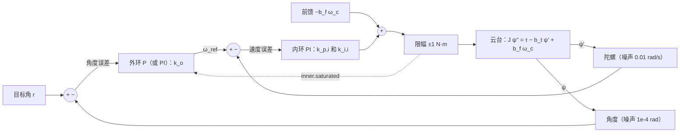

RoboMaster 步兵开小陀螺的时候，底盘以每秒几圈的速度原地转，云台要在这个转动的底座上把枪口对准一个不动的装甲板。我的云台代码一直是“角度环套速度环”，两层 PID，我见过的开源工程大多这么写，我也一直照着写，但从来没问过：**为什么不用一个 PID 直接管角度？** 这一篇我把同一根偏航轴分别接成单环和串级，放进同一份底盘转动数据里，量出来：底盘在 0.5 s 内加速到 6 rad/s，单环的云台角度误差峰值是 7.16 mrad，串级是 0.41 mrad，差 17.5 倍。然后我拆开这个 17.5 是从哪来的，它比我预想的更“无聊”，也更有用。

> [!NOTE] 本篇检查点
> 这一篇结束时你会有：`make ch07` 通过，`out/ch07/` 下 40 个 CSV（10 个算例，每个 Python、C、C++、Rust 各一份），`figures/ch07/` 下 4 张图；以及单环三阶极点配置、串级内外环整定、带宽比分析和内环饱和下外环积分冻结的推导与实验。
> 新增模块：没有。控制器全部是第 5 篇的 `Pid`，串级的接线（外环输出变成内环设定值）直接写在每种语言的 ch07 驱动和应用里。对象还是第 1 篇的 `GimbalAxis`（`u = [τ, τ_d, ω_c]`，第 1 篇里第三个输入恒为 0，这一篇第一次让它非零），相角裕度用第 3 篇的 `freq`。
> 前置：[第 5 篇](/posts/pid-control-05-practical/)和[第 6 篇](/posts/pid-control-06-tuning/)。需要的数学：第 2 篇的二阶系统和极点配置，第 3 篇的相角裕度，第 5 篇的 `hold_integral` 参数。

## 数学

### 对象：云台和转动的底盘

云台偏航轴还是第 1 篇的 `GimbalAxis`，扭矩指令的 GM6020：

$$
J\ddot\psi = \tau - \tau_d - b\dot\psi - b_f\,(\dot\psi - \omega_c)
$$

$\psi$ 是云台相对世界的角度，$\tau$ 是电机力矩（限幅 $\pm1$ N·m），$\omega_c$ 是底盘的角速度。最后一项是轴承的粘性耦合：底盘转起来，轴承会把云台往同一个方向拖。参数 $J = 0.02$ kg·m²、$b = 0.002$、$b_f = 0.02$ 全是我取的量级，不是实测。令 $\omega = \dot\psi$，$b_t = b + b_f = 0.022$，速度子系统是

$$
J\dot\omega = \tau - b_t\,\omega + b_f\,\omega_c
$$

对云台来说，$\omega_c$ 就是一个力矩扰动 $d = b_f\omega_c$：底盘到 6 rad/s 时是 $0.02\times6 = 0.12$ N·m，占力矩上限的 12%。这个扰动是一段斜坡：我让 $\omega_c$ 从 1.0 s 到 1.5 s 线性升到 6 rad/s，之后保持。

测量有两路：角度 $\psi + n_a$，$\sigma_a = 10^{-4}$ rad；陀螺 $\dot\psi + n_g$，$\sigma_g = 0.01$ rad/s。噪声是 Python 用 numpy 种子 7 生成、写进数据 CSV 的，三种原生语言读同一份。这两个数字的出处要交代清楚：[卡尔曼系列第 4 篇](/posts/kalman-filter-04-attitude-imu/)的陀螺仿真用的是 0.005 rad/s，那是“典型消费级 MEMS 的量级”；我这里取了它的 2 倍，是为了让噪声看得见，不是那一篇的结论。角度的 $10^{-4}$ rad（0.0057°）是我假设的姿态估计精度，也不是那一篇测出来的。

### 单环：三个增益摆三个极点

先写单环，它是对照组。用第 5 篇的 `Pid`，只开 P 和 I，D 用陀螺：陀螺读数本身就是角度的导数，不需要对带噪声的角度再差分一次。控制律是

$$
\tau = k_p(r-\psi) + k_i\!\int(r-\psi)\,dt - k_{dg}\,\dot\psi_{gyro}
$$

陀螺项通过 `Pid.update` 的 `ff` 参数送进去（$\mathrm{ff} = -k_{dg}\dot\psi_{gyro}$），它进入限幅前的 $v$，所以抗积分饱和照样看得见它。代入对象，特征多项式是

$$
J s^3 + (b_t + k_{dg})\,s^2 + k_p\,s + k_i = 0
$$

要的极点是一个实极点 $-p$ 加一个 $\zeta = 0.7$ 的共轭对，即 $J(s+p)(s^2 + 2\zeta\omega s + \omega^2)$。对系数得到

$$
k_{dg} = J(p + 2\zeta\omega) - b_t,\qquad
k_p = J(\omega^2 + 2\zeta\omega p),\qquad
k_i = J\,p\,\omega^2
$$

取 $p = \omega = \omega_o = \omega_i/5 = 12$ rad/s（$\omega_i = 60$ rad/s 是后面串级内环的带宽，这样两边“外环带宽”相同，对比才公平）：$k_{dg} = 0.554$，$k_p = 6.912$，$k_i = 34.56$。极点是 $-12$ 和 $-8.40\pm8.57\mathrm{j}$（`report` 打印的）。

这个单环有一个第 2 篇已经讲过的毛病：闭环传递函数 $T(s) = (k_ps + k_i)/(\ldots)$ 有一个零点在 $-k_i/k_p = -5$ rad/s，比极点慢，所以阶跃会超调，不管阻尼多好。我会在结果里看到这一点。

### 串级：内环管速度，外环管角度

串级把这三个增益拆成两层。**内环**是速度 PI，设定值是 $\omega_{ref}$，测量是陀螺：

$$
\tau = k_{p,i}(\omega_{ref} - \omega_{gyro}) + k_{i,i}\!\int(\omega_{ref} - \omega_{gyro})\,dt
$$

被控对象 $\omega/\tau = 1/(Js + b_t)$ 是一阶的，和第 2 篇的电机速度环同一个形状，所以直接套那一篇的极点配置，闭环传递函数是

$$
T_i(s) = \frac{\omega}{\omega_{ref}} = \frac{k_{p,i}s + k_{i,i}}{Js^2 + (b_t + k_{p,i})\,s + k_{i,i}}
$$

令 $\zeta = 0.7$、$\omega_i = 60$ rad/s：$k_{i,i} = J\omega_i^2 = 72$，$k_{p,i} = 2\zeta\omega_iJ - b_t = 1.658$。这个 PI 有一个零点在 $-k_{i,i}/k_{p,i} = -43.4$ rad/s，比 $\omega_i$ 还低一点，稍后会看到它对外环有用。

**外环**是一个纯 P，输入角度误差，输出内环的速度设定值：$\omega_{ref} = k_o(r - \psi)$，$k_o = \omega_i/\text{比值}$。比值就是“内环比外环快多少倍”，是这一篇的主要旋钮。整条链路是：



虚线是这一篇最后一节才用到的：内环把它有没有饱和告诉外环。

外环看到的对象不是云台，而是“内环加一个积分器”：$L_o(s) = k_o\,T_i(s)/s$。如果把 $T_i$ 粗略当成一阶的 $1/(s/\omega_i + 1)$，外环的特征方程是 $s^2 + \omega_i s + \omega_i k_o = 0$，阻尼比 $\zeta_o = \tfrac12\sqrt{\omega_i/k_o} = \tfrac12\sqrt{\text{比值}}$，比值到 4 就是临界阻尼；相角裕度是 $90^\circ - \arctan(\omega_c/\omega_i)$：内环对外环来说就是一个滞后，比值越大，这个滞后在外环穿越频率处吃掉的相位越少。我不信一个近似，所以 `report` 用第 3 篇的 `freq` 在精确的 $T_i$ 上也算一遍（延迟取 ZOH 的半个采样周期）。

### 串级为什么抗扰：等效 PID

回到 17.5 倍。扰动力矩 $d$ 到角度 $\psi$ 的传递函数，单环和串级是同一个形状（令 $r = 0$，把控制律代进去）：

$$
\frac{\psi}{d} = \frac{s}{Js^3 + (b_t + k_d)\,s^2 + k_p\,s + k_i}
$$

单环的 $(k_d, k_p, k_i)$ 就是 $(k_{dg}, k_p, k_i)$；串级的是**等效增益**

$$
k_d = k_{p,i},\qquad k_p = k_ok_{p,i} + k_{i,i},\qquad k_i = k_o\,k_{i,i}
$$

代入数字，比值 5（$k_o = 12$）：

| 回路 | $k_d$ | $k_p$ | $k_i$ | 极点 |
| --- | --- | --- | --- | --- |
| 单环 | 0.554 | 6.912 | 34.56 | $-12.00$，$-8.40\pm8.57\mathrm{j}$ |
| 串级 | 1.658 | 91.896 | 864.0 | $-11.48$，$-36.26\pm49.47\mathrm{j}$ |

两者最慢的极点几乎在同一个位置（$-12.00$ 和 $-11.48$），所以“外环带宽”确实是一样的；串级多出来的是一对 60 rad/s 量级的快极点，换来了 13.3 倍的 $k_p$ 和 25 倍的 $k_i$。对一段斜率为 $m$ 的力矩斜坡，这个 $s/(\ldots)$ 形式的闭环由终值定理给出稳态角度误差 $m/k_i$：

$$
\psi_{ss} = \frac{m}{k_i},\qquad m = \frac{b_f\cdot6}{0.5\ \text{s}} = 0.24\ \text{N·m/s}
$$

单环是 $0.24/34.56 = 6.944$ mrad，串级是 $0.24/864 = 0.278$ mrad。换个说法更直观：内环的 PI 先把速度误差压到 $m/k_{i,i} = 0.24/72 = 3.33$ mrad/s，外环再把它除以 $k_o = 12$，就是 0.278 mrad。**扰动在到达角度之前，已经在速度这一层被消掉了大部分。** 类比的话，这像工厂里班组先把小故障在车间内消化，不往上报给调度：车间的响应快，所以故障还没传远就被吃掉。

要把话说准：这不是说单环做不到。串级的 $(k_d, k_p, k_i) = (1.658, 91.9, 864)$ 直接塞进一个单环 PID，特征多项式和扰动响应完全一样。差别是单环用的是我选的“三个极点都放在 12 rad/s”的配方，三个增益被这个配方锁死了；串级的配方是“先把内环做到 60 rad/s，外环按比值再降”，它用同样的三个增益自由度，摆出了更刚的一组极点，并且让整定变成两个有物理含义的旋钮：内环带宽和比值。设定值通道也不同（外环 P 没有积分，没有那个 $-5$ rad/s 的零点）。

**底盘角速度前馈。** 底盘陀螺（底盘上本来就有）给出 $\omega_c$，所以扰动 $b_f\omega_c$ 是已知的，可以直接在内环的输出上抵消。符号要小心：云台静止（$\dot\psi = 0$）时，耦合项对云台的力矩是 $+b_f\omega_c$，所以前馈是 $\mathrm{ff} = -b_f\omega_c$。（计划里我写的是 $+b_f\omega_c$，写反了；仿真第一次就会告诉你，这里直接用对的。）

### 带宽比：多快才算“快得够”

比值太小，内环在外环穿越频率处的滞后就大，相角裕度掉；比值太大，外环慢得没必要，而且你把整条链路的响应速度扔掉了。我在 $\{1.5, 3, 5, 10\}$ 四个比值上扫：$k_o = 40, 20, 12, 6$ rad/s，内环都不动。

### 内环饱和：外环怎么知道

云台要转一个大角度，比如 1.5 rad，外环给出 $k_o\times1.5 = 18$ rad/s 的速度设定值。力矩上限 1 N·m 对应的最大角加速度是 $1/0.02 = 50$ rad/s²，加速到 18 rad/s 至少要 0.36 s。这段时间里内环的力矩一直贴在上限，**内环饱和了，而外环自己并没有饱和**：外环输出的是速度设定值，我没有给它限幅。所以第 5 篇的条件积分（`CLAMP`）在外环看不出任何问题，如果外环带积分（$k_{i,o} = 0.2\,k_o^2 = 28.8$），它会一直在 1.5 rad 的误差上累加，最后速度设定值积出来一大块，角度冲过头。

解法在第 5 篇的 `hold_integral` 里：驱动把内环**上一个采样**的 `saturated` 标志传给外环，外环这一拍不更新积分：

$$
\text{hold}_k = \text{inner.saturated}_{k-1}
$$

延迟一拍是因为内环要在外环之后才更新；我猜 1 kHz 下一拍的差别可以忽略，但没有单独测。这个策略很粗：内环一饱和就整个冻结外环积分，不看误差方向；第 5 篇的条件积分只在“继续往饱和方向积”时才跳过。我这一篇没有比较两种策略。

## Python 实现

不新增库模块，所以这一篇的 Python 全部在驱动 `python/ch07_cascade.py` 里：算例表、增益、一个闭环仿真、用 `freq` 的裕度分析和 `report`。先是两组增益，和上面的公式一一对应：

```python
def inner_gains() -> tuple[float, float]:
    """Rate PI on J s + (b + bf) placed at zeta, WN_I."""
    g = GimbalAxis()
    kp = 2.0 * ZETA * WN_I * g.j - (g.b + g.bf)
    ki = WN_I * WN_I * g.j
    return kp, ki


def single_gains() -> tuple[float, float, float]:
    """kp, ki and the gyro damping kdg for poles (s + wo)(s^2 + ... wo^2)."""
    g = GimbalAxis()
    wo = WN_I / RATIO
    p = wo
    kdg = g.j * (p + 2.0 * ZETA * wo) - (g.b + g.bf)
    kp = g.j * (wo * wo + 2.0 * ZETA * wo * p)
    ki = g.j * p * wo * wo
    return kp, ki, kdg
```

`Case` 里的五个字段决定一个算例：`kind`（单环或串级）、`ratio`、`ff`（内环前馈）、`outer_i`（外环是 PI 还是 P）和 `hold`（冻结外环积分）。十个算例是：`single_step`，`cascade_r{1.5,3,5,10}_step`（0.2 rad 阶跃），`single_spin`、`cascade_spin`、`cascade_spin_ff`（底盘转动），`outer_aw_off`、`outer_aw_on`（1.5 rad 大阶跃，外环 PI）。

数据由 `write_data` 生成：`ch07_step.csv`（2000 行，0.05 s 时 $r = 0.2$ rad）、`ch07_spin.csv`（3000 行，$r = 0$，$\omega_c$ 从 1.0 s 到 1.5 s 线性升到 6 rad/s）、`ch07_aw.csv`（3000 行，0.05 s 时 $r = 1.5$ rad），每个文件都带 `n_gyro` 和 `n_angle` 两列噪声，numpy 种子 7。

闭环仿真是这一篇的核心，串级的接线就是这几行：

```python
def run_case(case: Case, data=None) -> dict[str, np.ndarray]:
    """One closed loop; `data` overrides the CSV (used by the linear check)."""
    plant = GimbalAxis()
    if data is None:
        data = read_csv(DATA / f"{case.data}.csv")
    u_lim = plant.u_max
    if case.kind == "single":
        kp, ki, kdg = single_gains()
        outer = Pid(PidConfig(kp, ki, 0.0, TS, u_min=-u_lim, u_max=u_lim))
        inner = None
    else:
        kpi, kii = inner_gains()
        ko = WN_I / case.ratio
        kio = OUTER_KI * ko * ko if case.outer_i else 0.0
        outer = Pid(PidConfig(ko, kio, 0.0, TS))
        inner = Pid(
            PidConfig(
                kpi,
                kii,
                0.0,
                TS,
                u_min=-u_lim,
                u_max=u_lim,
                windup=Windup.CLAMP,
            )
        )
    x = [0.0, 0.0]
    rows = []
    for k in range(len(data["t"])):
        r, wc = data["r"][k], data["wc"][k]
        angle = x[0] + data["n_angle"][k]  # the angle estimate
        gyro = x[1] + data["n_gyro"][k]
        if inner is None:
            wref = 0.0
            u = outer.update(r, angle, -kdg * gyro)
            sat = outer.saturated
        else:
            hold = case.hold and inner.saturated  # last sample's flag
            wref = outer.update(r, angle, 0.0, hold)
            ff = -plant.bf * wc if case.ff else 0.0
            u = inner.update(wref, gyro, ff)
            sat = inner.saturated
        rows.append(
            [data["t"][k], r, wc, x[0], x[1], wref, u, outer.integral, sat]
        )
        x = advance(plant.deriv, x, [u, 0.0, wc], TS, SUBSTEPS)
    return dict(zip(COLUMNS, np.array(rows, dtype=float).T))
```

三处值得看：

- **测量。** `angle` 和 `gyro` 是真值加噪声列，控制器永远看不到 `x`。输出 CSV 里的 `psi`、`psid` 是真值，所以后面算超调和峰值不受噪声污染。
- **接线。** 串级先算外环：`wref = outer.update(r, angle, 0.0, hold)`，再把 `wref` 当设定值、陀螺当测量喂给内环：`inner.update(wref, gyro, ff)`。单环只有一次 `update`，陀螺项走 `ff`。
- **`hold`。** 在内环更新之前读 `inner.saturated`，此时它还是上一拍的值，这就是上面公式里的 $k-1$。

裕度分析用第 3 篇的 `freq`。外环的开环是 $L_o = k_oT_i/s$，写成多项式比：

```python
def outer_margins(ratio: float, first_order: bool = False):
    """Margins of L_o = k_o T_i(s) / s, the loop opened at the rate setpoint.

    T_i is the exact inner closed loop (PI on J s + b + bf), or the
    first-order stand-in 1 / (s / wn_i + 1). The delay is the ZOH's ts / 2.
    """
    g = GimbalAxis()
    kpi, kii = inner_gains()
    ko = WN_I / ratio
    if first_order:
        num, den = [ko], poly_mul([1.0, 0.0], [1.0 / WN_I, 1.0])
    else:
        num = [ko * kpi, ko * kii]
        den = poly_mul([1.0, 0.0], [g.j, g.b + g.bf + kpi, kii])
    return margins(num, den, 0.5 * TS, log_grid())


def disturbance_polys() -> dict[str, list[float]]:
    """Denominator of psi / torque disturbance, highest power first.

    Both loops reduce to J s^3 + (b + bf + kd) s^2 + kp s + ki, with the
    cascade's equivalent gains kd = kpi, kp = ko kpi + kii, ki = ko kii.
    """
    g = GimbalAxis()
    bt = g.b + g.bf
    kp, ki, kdg = single_gains()
    kpi, kii = inner_gains()
    ko = WN_I / RATIO
    return {
        "single": [g.j, bt + kdg, kp, ki],
        "cascade": [g.j, bt + kpi, ko * kpi + kii, ko * kii],
    }
```

`disturbance_polys` 就是上一节的等效增益表，`report` 用它求根、算斜坡误差公式。`outer_margins` 里 `first_order=True` 是“把内环当一阶滞后”的粗近似。单环的开环 $L$（断在对象输入处）也有一个 `single_margins`：开环有双积分器，`freq` 的主值相位在起点落在 $+180^\circ$ 的支路上，所以我把算出来的相角裕度折回 $(-180^\circ, 180^\circ]$，在源码里留了注释。

`report` 的断言是这一篇的“实验结论”：相角裕度随比值单调增；上升时间随比值单调增；小阶跃（5 mrad，不会碰到力矩限幅）的超调随比值单调降；单环的 `ψ` 峰值大于串级大于串级加前馈；`outer_aw_on` 的超调小于 `outer_aw_off`；斜坡公式的预测值和仿真峰值之比落在 0.9 到 2.0 之间。

完整驱动（含 `report`、画图）折在这里：

<details>
<summary>完整源码：python/ch07_cascade.py</summary>

```python
#!/usr/bin/env python3
"""Chapter 7 driver: `ch07_cascade.py ref` then `report`."""

import math
import sys
from dataclasses import dataclass
from pathlib import Path

import numpy as np

sys.path.insert(0, str(Path(__file__).resolve().parent))
from compare import compare_dir  # noqa: E402
from pidlab.freq import margins  # noqa: E402
from pidlab.io import read_csv, write_csv  # noqa: E402
from pidlab.metrics import step_metrics  # noqa: E402
from pidlab.pid import Pid, PidConfig, Windup  # noqa: E402
from pidlab.plants import GimbalAxis  # noqa: E402
from pidlab.plotting import ROOT  # noqa: E402
from pidlab.poly import poly_mul, poly_roots  # noqa: E402
from pidlab.sim import advance  # noqa: E402

TS = 1e-3
SUBSTEPS = 10
ZETA = 0.7
WN_I = 60.0  # rad/s, inner rate loop
RATIO = 5.0  # default wn_i / k_o
RATIOS = (1.5, 3.0, 5.0, 10.0)
OUTER_KI = 0.2  # outer PI: ki = 0.2 ko^2
STEP_K = 50  # setpoint step at 0.05 s
SPIN_T0, SPIN_T1, SPIN_W = 1.0, 1.5, 6.0  # rad/s ramp of the chassis
GYRO_SIGMA = 0.01  # rad/s
ANGLE_SIGMA = 1e-4  # rad
SEED = 7
OUT = ROOT / "out" / "ch07"
DATA = ROOT / "data"
COLUMNS = ("t", "r", "wc", "psi", "psid", "wref", "u", "i_out", "sat")


@dataclass
class Case:
    name: str
    data: str
    kind: str  # "single" or "cascade"
    ratio: float = RATIO
    ff: bool = False  # inner feedforward of the chassis rate
    outer_i: bool = False  # outer loop is PI instead of P
    hold: bool = False  # freeze the outer integrator while inner saturates


def make_cases() -> list[Case]:
    cases = [Case("single_step", "ch07_step", "single")]
    for ratio in RATIOS:
        cases.append(
            Case(f"cascade_r{ratio:g}_step", "ch07_step", "cascade", ratio)
        )
    cases += [
        Case("single_spin", "ch07_spin", "single"),
        Case("cascade_spin", "ch07_spin", "cascade"),
        Case("cascade_spin_ff", "ch07_spin", "cascade", ff=True),
        Case("outer_aw_off", "ch07_aw", "cascade", outer_i=True),
        Case("outer_aw_on", "ch07_aw", "cascade", outer_i=True, hold=True),
    ]
    return cases


def inner_gains() -> tuple[float, float]:
    """Rate PI on J s + (b + bf) placed at zeta, WN_I."""
    g = GimbalAxis()
    kp = 2.0 * ZETA * WN_I * g.j - (g.b + g.bf)
    ki = WN_I * WN_I * g.j
    return kp, ki


def single_gains() -> tuple[float, float, float]:
    """kp, ki and the gyro damping kdg for poles (s + wo)(s^2 + ... wo^2)."""
    g = GimbalAxis()
    wo = WN_I / RATIO
    p = wo
    kdg = g.j * (p + 2.0 * ZETA * wo) - (g.b + g.bf)
    kp = g.j * (wo * wo + 2.0 * ZETA * wo * p)
    ki = g.j * p * wo * wo
    return kp, ki, kdg


def write_data() -> None:
    rng = np.random.default_rng(SEED)

    def table(steps, r, wc):
        k = np.arange(steps)
        t = k * TS
        return {
            "t": t,
            "r": r(k),
            "wc": wc(t),
            "n_gyro": GYRO_SIGMA * rng.standard_normal(steps),
            "n_angle": ANGLE_SIGMA * rng.standard_normal(steps),
        }

    def ramp(t):
        frac = np.clip((t - SPIN_T0) / (SPIN_T1 - SPIN_T0), 0.0, 1.0)
        return SPIN_W * frac

    def still(t):
        return np.zeros_like(t)

    def step(k, amp):
        return amp * (k >= STEP_K)

    write_csv(
        DATA / "ch07_step.csv", table(2000, lambda k: step(k, 0.2), still)
    )
    write_csv(DATA / "ch07_spin.csv", table(3000, lambda k: 0.0 * k, ramp))
    write_csv(DATA / "ch07_aw.csv", table(3000, lambda k: step(k, 1.5), still))


def run_case(case: Case, data=None) -> dict[str, np.ndarray]:
    """One closed loop; `data` overrides the CSV (used by the linear check)."""
    plant = GimbalAxis()
    if data is None:
        data = read_csv(DATA / f"{case.data}.csv")
    u_lim = plant.u_max
    if case.kind == "single":
        kp, ki, kdg = single_gains()
        outer = Pid(PidConfig(kp, ki, 0.0, TS, u_min=-u_lim, u_max=u_lim))
        inner = None
    else:
        kpi, kii = inner_gains()
        ko = WN_I / case.ratio
        kio = OUTER_KI * ko * ko if case.outer_i else 0.0
        outer = Pid(PidConfig(ko, kio, 0.0, TS))
        inner = Pid(
            PidConfig(
                kpi,
                kii,
                0.0,
                TS,
                u_min=-u_lim,
                u_max=u_lim,
                windup=Windup.CLAMP,
            )
        )
    x = [0.0, 0.0]
    rows = []
    for k in range(len(data["t"])):
        r, wc = data["r"][k], data["wc"][k]
        angle = x[0] + data["n_angle"][k]  # the angle estimate
        gyro = x[1] + data["n_gyro"][k]
        if inner is None:
            wref = 0.0
            u = outer.update(r, angle, -kdg * gyro)
            sat = outer.saturated
        else:
            hold = case.hold and inner.saturated  # last sample's flag
            wref = outer.update(r, angle, 0.0, hold)
            ff = -plant.bf * wc if case.ff else 0.0
            u = inner.update(wref, gyro, ff)
            sat = inner.saturated
        rows.append(
            [data["t"][k], r, wc, x[0], x[1], wref, u, outer.integral, sat]
        )
        x = advance(plant.deriv, x, [u, 0.0, wc], TS, SUBSTEPS)
    return dict(zip(COLUMNS, np.array(rows, dtype=float).T))


def ref() -> None:
    write_data()
    for case in make_cases():
        write_csv(OUT / f"{case.name}_py.csv", run_case(case))


def load(name: str) -> dict[str, np.ndarray]:
    return read_csv(OUT / f"{name}_py.csv")


# ---- report ------------------------------------------------------------


def log_grid(n: int = 2000) -> list[float]:
    lo, hi = math.log10(0.1), math.log10(1e4)
    return [10.0 ** (lo + (hi - lo) * i / (n - 1)) for i in range(n)]


def outer_margins(ratio: float, first_order: bool = False):
    """Margins of L_o = k_o T_i(s) / s, the loop opened at the rate setpoint.

    T_i is the exact inner closed loop (PI on J s + b + bf), or the
    first-order stand-in 1 / (s / wn_i + 1). The delay is the ZOH's ts / 2.
    """
    g = GimbalAxis()
    kpi, kii = inner_gains()
    ko = WN_I / ratio
    if first_order:
        num, den = [ko], poly_mul([1.0, 0.0], [1.0 / WN_I, 1.0])
    else:
        num = [ko * kpi, ko * kii]
        den = poly_mul([1.0, 0.0], [g.j, g.b + g.bf + kpi, kii])
    return margins(num, den, 0.5 * TS, log_grid())


def single_margins():
    """The single loop opened at the plant input (gyro term in the loop)."""
    g = GimbalAxis()
    kp, ki, kdg = single_gains()
    num = [kdg, kp, ki]
    den = [g.j, g.b + g.bf, 0.0, 0.0]
    m = margins(num, den, 0.5 * TS, log_grid())
    # L starts on a double integrator, where the principal phase picks the
    # +180 degree branch; fold the margin back into (-180, 180].
    pm = (m.pm_deg + 180.0) % 360.0 - 180.0
    return m._replace(pm_deg=pm)


def linear_overshoot(case: Case, amp: float = 0.005) -> float:
    """Step overshoot (%) for a step small enough to never clip."""
    n = 2000
    zeros = np.zeros(n)
    k = np.arange(n)
    data = {
        "t": k * TS,
        "r": amp * (k >= STEP_K),
        "wc": zeros,
        "n_gyro": zeros,
        "n_angle": zeros,
    }
    o = run_case(case, data)
    assert o["sat"].sum() == 0
    return step_metrics(o["psi"], TS, STEP_K, amp).overshoot


def report_steps() -> dict:
    names = ["single_step"] + [f"cascade_r{r:g}_step" for r in RATIOS]
    res = {n: load(n) for n in names}
    print(
        f"\n{'case':>18s} {'rise':>7s} {'overshoot':>10s} {'settle':>7s} "
        f"{'max|u|':>7s} {'sat ms':>7s} {'PM':>7s} {'PM 1st':>7s} {'wc':>6s}"
    )
    stats = {}
    for n, o in res.items():
        sm = step_metrics(o["psi"], TS, STEP_K, 0.2)
        sat = int(o["sat"].sum())
        if n == "single_step":
            m = single_margins()
            pm1 = None
        else:
            ratio = float(n.removeprefix("cascade_r").removesuffix("_step"))
            m = outer_margins(ratio)
            pm1 = outer_margins(ratio, first_order=True).pm_deg
        stats[n] = (sm, m, pm1)
        print(
            f"{n:>18s} {sm.rise:7.3f} {sm.overshoot:9.2f}% {sm.settle:6.3f}s "
            f"{np.abs(o['u']).max():7.3f} {sat:7d} {m.pm_deg:6.1f}d "
            f"{'-' if pm1 is None else format(pm1, '5.1f') + 'd':>7s} "
            f"{m.wc:6.2f}"
        )
    pms = [stats[f"cascade_r{r:g}_step"][1].pm_deg for r in RATIOS]
    rises = [stats[f"cascade_r{r:g}_step"][0].rise for r in RATIOS]
    assert pms == sorted(pms), "PM must grow with the ratio"
    assert rises == sorted(rises), "a slower outer loop must rise slower"
    print(f"\n{'loop':>8s} {'PM':>7s} {'unclipped overshoot (5 mrad)':>30s}")
    single = linear_overshoot(Case("lin", "", "single"))
    print(
        f"{'single':>8s} {stats['single_step'][1].pm_deg:6.1f}d "
        f"{single:29.3f}%"
    )
    lin = []
    for r, pm in zip(RATIOS, pms):
        lin.append(linear_overshoot(Case("lin", "", "cascade", r)))
        print(f"{'r = ' + format(r, 'g'):>8s} {pm:6.1f}d {lin[-1]:29.3f}%")
    assert lin == sorted(lin, reverse=True), "overshoot must fall"
    return res


def spin_error(o: dict, k0: int = 1000) -> tuple[float, float, float]:
    """Peak |psi|, rms |psi| over [1.0, 3.0) s, final |psi| mean."""
    psi = o["psi"][k0:]
    return (
        float(np.abs(psi).max()),
        float(np.sqrt(np.mean(psi**2))),
        float(np.mean(o["psi"][-200:])),
    )


def disturbance_polys() -> dict[str, list[float]]:
    """Denominator of psi / torque disturbance, highest power first.

    Both loops reduce to J s^3 + (b + bf + kd) s^2 + kp s + ki, with the
    cascade's equivalent gains kd = kpi, kp = ko kpi + kii, ki = ko kii.
    """
    g = GimbalAxis()
    bt = g.b + g.bf
    kp, ki, kdg = single_gains()
    kpi, kii = inner_gains()
    ko = WN_I / RATIO
    return {
        "single": [g.j, bt + kdg, kp, ki],
        "cascade": [g.j, bt + kpi, ko * kpi + kii, ko * kii],
    }


def report_spin() -> dict:
    names = ("single_spin", "cascade_spin", "cascade_spin_ff")
    res = {n: load(n) for n in names}
    g = GimbalAxis()
    print(
        f"\nchassis ramp to {SPIN_W} rad/s: disturbance torque "
        f"bf wc = {g.bf * SPIN_W:.3f} N*m"
    )
    polys = disturbance_polys()
    for name, den in polys.items():
        roots = ", ".join(
            f"{z.real:.2f}{z.imag:+.2f}j" for z in poly_roots(den)
        )
        print(
            f"{name:>8s}: J s^3 + {den[1]:.3f} s^2 + {den[2]:.3f} s + "
            f"{den[3]:.3f}; poles {roots}"
        )
    slope = g.bf * SPIN_W / (SPIN_T1 - SPIN_T0)
    pred = {n: slope / d[3] for n, d in polys.items()}
    print(
        f"torque ramp slope {slope:.3f} N*m/s over ki_eq: single "
        f"{1e3 * pred['single']:.3f} mrad, cascade "
        f"{1e3 * pred['cascade']:.3f} mrad"
    )
    print(
        f"{'case':>16s} {'peak |psi|':>11s} {'rms |psi|':>10s} "
        f"{'final':>10s} {'rms u (last 0.5 s)':>19s}"
    )
    peaks = []
    for n, o in res.items():
        peak, rms, fin = spin_error(o)
        peaks.append(peak)
        u_rms = float(np.sqrt(np.mean(o["u"][-500:] ** 2)))
        print(f"{n:>16s} {peak:11.5f} {rms:10.5f} {fin:10.6f} {u_rms:19.5f}")
    print(
        f"cascade cuts the peak by {peaks[0] / peaks[1]:.2f}x, "
        f"with feedforward by {peaks[0] / peaks[2]:.2f}x"
    )
    assert peaks[0] > peaks[1] > peaks[2]
    # the ramp error of a type-1 loop settles at slope / ki_eq
    for key, n in (("single", "single_spin"), ("cascade", "cascade_spin")):
        ratio = spin_error(res[n])[0] / pred[key]
        print(f"{key:>8s}: simulated peak / ramp formula = {ratio:.2f}")
        assert 0.9 < ratio < 2.0, key
    return res


def report_aw() -> dict:
    res = {n: load(n) for n in ("outer_aw_off", "outer_aw_on")}
    print(
        f"\n{'case':>13s} {'peak psi':>9s} {'overshoot':>10s} "
        f"{'max I_out':>10s} {'sat ms':>7s} {'at +1':>6s} {'at -1':>6s} "
        f"{'settle':>7s}"
    )
    stats = {}
    for n, o in res.items():
        sm = step_metrics(o["psi"], TS, STEP_K, 1.5)
        stats[n] = sm
        hi = int(np.sum(o["u"] >= GimbalAxis().u_max))
        lo = int(np.sum(o["u"] <= -GimbalAxis().u_max))
        print(
            f"{n:>13s} {o['psi'].max():9.4f} {sm.overshoot:9.2f}% "
            f"{np.abs(o['i_out']).max():10.3f} {int(o['sat'].sum()):7d} "
            f"{hi:6d} {lo:6d} {sm.settle:6.3f}s"
        )
    off, on = stats["outer_aw_off"], stats["outer_aw_on"]
    assert on.overshoot < off.overshoot
    return res


def report() -> None:
    if not compare_dir(OUT, 1e-9):
        sys.exit(1)
    kpi, kii = inner_gains()
    kp, ki, kdg = single_gains()
    print(
        f"inner rate PI at zeta {ZETA}, wn {WN_I}: kp = {kpi:.4f}, "
        f"ki = {kii:.3f}"
    )
    print(
        f"single loop (poles at {WN_I / RATIO:g} rad/s): kp = {kp:.4f}, "
        f"ki = {ki:.4f}, kd_gyro = {kdg:.4f}"
    )
    ks = ", ".join(f"{WN_I / r:g} (ratio {r:g})" for r in RATIOS)
    print(f"outer k_o = {ks}")
    steps = report_steps()
    spin = report_spin()
    aw = report_aw()
    plot_single_vs_cascade(steps)
    plot_ratio(steps)
    plot_spin(spin)
    plot_inner_saturation(aw)
    print("\nch07 OK")


# ---- figures -----------------------------------------------------------


def plot_single_vs_cascade(res: dict) -> None:
    from pidlab.plotting import L, save
    import matplotlib.pyplot as plt

    fig, (a1, a2) = plt.subplots(2, 1, figsize=(8, 6.4), sharex=True)
    sl = slice(0, 800)
    for n, lab in (
        ("single_step", L("单环（三阶极点配置）", "single loop")),
        ("cascade_r5_step", L("串级，比值 5", "cascade, ratio 5")),
    ):
        o = res[n]
        a1.plot(o["t"][sl], o["psi"][sl], label=lab)
        a2.plot(o["t"][sl], o["u"][sl], label=lab)
    a1.plot(o["t"][sl], o["r"][sl], "k:", lw=1, label=L("目标", "reference"))
    a1.set_ylabel(L("云台角度 (rad)", "gimbal angle (rad)"))
    a2.set_ylabel(L("力矩指令 (N·m)", "torque command (N*m)"))
    a2.set_xlabel(L("时间 (秒)", "time (s)"))
    a1.legend(loc="lower right")
    save(fig, "ch07", "single-vs-cascade")


def plot_ratio(res: dict) -> None:
    from pidlab.plotting import L, save
    import matplotlib.pyplot as plt

    fig, (a1, a2) = plt.subplots(2, 1, figsize=(8, 7.2))
    sl = slice(0, 700)
    for r in RATIOS:
        o = res[f"cascade_r{r:g}_step"]
        a1.plot(
            o["t"][sl], o["psi"][sl], label=L(f"比值 {r:g}", f"ratio {r:g}")
        )
    a1.plot(o["t"][sl], o["r"][sl], "k:", lw=1)
    a1.set_xlabel(L("时间 (秒)", "time (s)"))
    a1.set_ylabel(L("云台角度 (rad)", "gimbal angle (rad)"))
    a1.legend(loc="lower right")
    grid = np.geomspace(1.0, 30.0, 60)
    exact = [outer_margins(float(r)).pm_deg for r in grid]
    first = [outer_margins(float(r), True).pm_deg for r in grid]
    a2.semilogx(grid, exact, label=L("精确内环", "exact inner loop"))
    a2.semilogx(grid, first, "--", label=L("一阶近似内环", "first-order"))
    for r in RATIOS:
        a2.plot(r, outer_margins(r).pm_deg, "ko")
    a2.set_xlabel(L("带宽比 ω_i / k_o", "bandwidth ratio wn_i / k_o"))
    a2.set_ylabel(L("外环相角裕度 (度)", "outer phase margin (deg)"))
    a2.legend(loc="lower right")
    save(fig, "ch07", "bandwidth-ratio")


def plot_spin(res: dict) -> None:
    from pidlab.plotting import L, save
    import matplotlib.pyplot as plt

    names = {
        "single_spin": L("单环", "single loop"),
        "cascade_spin": L("串级", "cascade"),
        "cascade_spin_ff": L("串级 + 底盘角速度前馈", "cascade + feedforward"),
    }
    fig, (a1, a2) = plt.subplots(2, 1, figsize=(8, 6.4), sharex=True)
    sl = slice(800, 2200)
    o = res["single_spin"]
    a1.plot(o["t"][sl], o["wc"][sl], "k")
    a1.set_ylabel(L("底盘角速度 (rad/s)", "chassis rate (rad/s)"))
    for n, lab in names.items():
        a2.plot(res[n]["t"][sl], 1e3 * res[n]["psi"][sl], label=lab)
    a2.set_ylabel(L("云台角度误差 (mrad)", "gimbal angle error (mrad)"))
    a2.set_xlabel(L("时间 (秒)", "time (s)"))
    a2.legend(loc="upper right")
    save(fig, "ch07", "spin-disturbance")


def plot_inner_saturation(res: dict) -> None:
    from pidlab.plotting import L, save
    import matplotlib.pyplot as plt

    names = {
        "outer_aw_off": L("外环一直积分", "outer always integrates"),
        "outer_aw_on": L(
            "内环饱和时冻结外环积分", "freeze while inner saturated"
        ),
    }
    fig, axes = plt.subplots(3, 1, figsize=(8, 8.4), sharex=True)
    sl = slice(0, 2000)
    for n, lab in names.items():
        o = res[n]
        axes[0].plot(o["t"][sl], o["psi"][sl], label=lab)
        axes[1].plot(o["t"][sl], o["u"][sl], lw=1, label=lab)
        axes[2].plot(o["t"][sl], o["i_out"][sl], label=lab)
    o = res["outer_aw_off"]
    axes[0].plot(o["t"][sl], o["r"][sl], "k:", lw=1)
    axes[0].set_ylabel(L("云台角度 (rad)", "gimbal angle (rad)"))
    axes[1].set_ylabel(L("内环力矩 (N·m)", "inner torque (N*m)"))
    axes[2].set_ylabel(L("外环积分项 (rad/s)", "outer integral (rad/s)"))
    axes[2].set_xlabel(L("时间 (秒)", "time (s)"))
    axes[0].legend(loc="lower right")
    save(fig, "ch07", "inner-saturation")


if __name__ == "__main__":
    {"ref": ref, "report": report}[sys.argv[1]]()
```

</details>

## C、C++、Rust 实现

没有新的库模块，三个版本的 ch07 应用都是 Python 驱动的逐行翻译：同样的算例表、同样的增益公式、同样的接线，读同一份数据。区别在这几处：

- **两个控制器的放法。** C 用 `struct pl_pid pid[2]`，下标 0 是外环（或单环），下标 1 是内环，初始化放在 `make_loops` 里，用 `pl_pid_init` 返回的 `-EINVAL` 做错误传递；C++ 是两个 `std::optional<Pid<double>>`，`Create` 失败就返回 `false`；Rust 是两个 `Pid`，`Pid::new` 返回 `Result`，用 `?` 向上传。三种语言都没有堆分配（`csv.c` 除外）。
- **“没有限幅”。** Python 的 `±math.inf`（`PidConfig` 的默认值）、C 的 `INFINITY`（`math.h`）、C++ 的 `std::numeric_limits<double>::infinity()`、Rust 的 `PidConfig::new` 默认值，是同一个意思。外环不给限幅，所以外环自己的 `saturated` 永远是 false，这正是需要 `hold_integral` 的原因。
- **读标志。** C 是结构体字段 `pid[1].saturated`，C++ 是访问器 `inner->saturated()`，Rust 是 `inner.saturated()`，Python 是属性。四种写法读到的都是上一拍的值，因为内环在这一拍还没更新。
- **标量类型。** 这一篇仍是 `double`（`pl_real`、`T`、`Real`），不过没有写死，第 10 篇换 float32。

### C

增益和两个控制器的构造放在 `make_loops`，注释里写明下标约定：

```c
/* Builds the controllers of one case: pid[0] is the outer (or only) loop, */
/* pid[1] the inner rate loop. kdg is the gyro damping of the single loop. */
static int make_loops(const struct sim_case *c, const struct pl_gimbal_axis *g,
		      struct pl_pid *pid, pl_real *kdg)
{
	struct pl_pid_config cfg;
	pl_real kpi, kii, ko, kio;
	pl_real wo = WN_I / RATIO;
	pl_real p = wo;
	int ret;

	*kdg = g->j * (p + 2.0 * ZETA * wo) - (g->b + g->bf);
	if (c->kind == LOOP_SINGLE) {
		set_cfg(&cfg, g->j * (wo * wo + 2.0 * ZETA * wo * p),
			g->j * p * wo * wo);
		cfg.u_min = -g->u_max;
		cfg.u_max = g->u_max;
		return pl_pid_init(&pid[0], &cfg);
	}
	kpi = 2.0 * ZETA * WN_I * g->j - (g->b + g->bf);
	kii = WN_I * WN_I * g->j;
	ko = WN_I / c->ratio;
	kio = c->outer_i ? OUTER_KI * ko * ko : 0.0;
	set_cfg(&cfg, ko, kio);
	ret = pl_pid_init(&pid[0], &cfg);
	if (ret)
		return ret;
	set_cfg(&cfg, kpi, kii);
	cfg.u_min = -g->u_max;
	cfg.u_max = g->u_max;
	return pl_pid_init(&pid[1], &cfg);
}
```

闭环里的接线和 Python 一一对应，`hold` 在内环更新之前读：

```c
	for (k = 0; !ret && k < data.nrows; k++) {
		const double *row = &data.data[k * data.ncols];
		double *out = &rows[k * SIM_COLS];
		pl_real inputs[PL_GIMBAL_AXIS_M] = { 0 };
		pl_real angle = x[0] + row[ca]; /* the angle estimate */
		pl_real gyro = x[1] + row[cg];
		pl_real wref = 0.0, u;
		bool sat;

		if (c->kind == LOOP_SINGLE) {
			u = pl_pid_update(&pid[0], row[cr], angle, -kdg * gyro,
					  false);
			sat = pid[0].saturated;
		} else {
			/* the inner flag still holds the last sample's value */
			bool hold = c->hold && pid[1].saturated;
			pl_real ff = c->ff ? -g.bf * row[cw] : 0.0;

			wref = pl_pid_update(&pid[0], row[cr], angle, 0.0,
					     hold);
			u = pl_pid_update(&pid[1], wref, gyro, ff, false);
			sat = pid[1].saturated;
		}
		out[0] = row[ct];
		out[1] = row[cr];
		out[2] = row[cw];
		out[3] = x[0];
		out[4] = x[1];
		out[5] = wref;
		out[6] = u;
		out[7] = pid[0].integral;
		out[8] = sat ? 1.0 : 0.0;
		inputs[0] = u;
		inputs[2] = row[cw];
		pl_advance(pl_gimbal_axis_deriv, &g, x, inputs,
			   PL_GIMBAL_AXIS_N, TS, SUBSTEPS);
	}
```

完整应用：[`c/apps/ch07.c`](https://github.com/bfmhno3/pid-lab/tree/tutorial-v1/c/apps/ch07.c)。

### C++

外环配置先按单环填好（带 $\pm1$ N·m 限幅），串级时整个换成无限幅的新配置；`Create` 返回 `std::optional`，`inner->saturated()` 是访问器：

```cpp
  // outer is the single loop, or the angle loop of the cascade
  pidlab::PidConfig<double> outer_cfg{g.j * (wo * wo + 2.0 * kZeta * wo * wo),
                                      g.j * wo * wo * wo, 0.0, kTs};
  outer_cfg.u_min = -u_lim;
  outer_cfg.u_max = u_lim;
  pidlab::PidConfig<double> inner_cfg{2.0 * kZeta * kWnI * g.j - (g.b + g.bf),
                                      kWnI * kWnI * g.j, 0.0, kTs};
  inner_cfg.u_min = -u_lim;
  inner_cfg.u_max = u_lim;
  if (c.cascade) {
    const double ko = kWnI / c.ratio;
    outer_cfg = {ko, c.outer_i ? kOuterKi * ko * ko : 0.0, 0.0, kTs};
    outer_cfg.u_min = -inf;
    outer_cfg.u_max = inf;
  }
  auto outer = pidlab::Pid<double>::Create(outer_cfg);
  auto inner = pidlab::Pid<double>::Create(inner_cfg);
  if (!outer || !inner) return false;

  std::vector<std::vector<double>> cols(9);
  std::array<double, 2> x{};
  for (std::size_t k = 0; k < t->size(); ++k) {
    const double angle = x[0] + (*n_angle)[k];  // the angle estimate
    const double gyro = x[1] + (*n_gyro)[k];
    double wref = 0.0;
    double u;
    bool sat;
    if (!c.cascade) {
      u = outer->Update((*r)[k], angle, -kdg * gyro);
      sat = outer->saturated();
    } else {
      // the inner flag still holds the last sample's value
      const bool hold = c.hold && inner->saturated();
      const double ff = c.ff ? -g.bf * (*wc)[k] : 0.0;
      wref = outer->Update((*r)[k], angle, 0.0, hold);
      u = inner->Update(wref, gyro, ff);
      sat = inner->saturated();
    }
    const double row[9] = {(*t)[k],        (*r)[k], (*wc)[k], x[0],
                           x[1],           wref,    u,        outer->integral(),
                           sat ? 1.0 : 0.0};
    for (int i = 0; i < 9; ++i) cols[i].push_back(row[i]);
    const std::array<double, 3> in = {u, 0.0, (*wc)[k]};
    pidlab::Advance([&](const auto& s, const auto& v) { return g.Deriv(s, v); },
                    x, in, kTs, kSubsteps);
  }
```

完整应用：[`cpp/apps/ch07.cc`](https://github.com/bfmhno3/pid-lab/tree/tutorial-v1/cpp/apps/ch07.cc)。

### Rust

`outer_cfg` 和 C++ 一样先按单环填限幅，串级时用一个默认无限幅的 `PidConfig::new` 整个替换：

```rust
    if c.cascade {
        let ko = WN_I / c.ratio;
        let ki = if c.outer_i { OUTER_KI * ko * ko } else { 0.0 };
        outer_cfg = PidConfig::new(ko, ki, 0.0, TS);
    }
    let mut outer = Pid::new(outer_cfg).map_err(|e| format!("{e:?}"))?;
    let mut inner = Pid::new(inner_cfg).map_err(|e| format!("{e:?}"))?;

    let mut x = [0.0; 2];
    let mut cols: Vec<Vec<f64>> = vec![Vec::new(); 9];
    for k in 0..t.len() {
        let angle = x[0] + n_angle[k]; // the angle estimate
        let gyro = x[1] + n_gyro[k];
        let mut wref = 0.0;
        let u;
        let sat;
        if c.cascade {
            // the inner flag still holds the last sample's value
            let hold = c.hold && inner.saturated();
            let ff = if c.ff { -g.bf * wc[k] } else { 0.0 };
            wref = outer.update(r[k], angle, 0.0, hold);
            u = inner.update(wref, gyro, ff, false);
            sat = inner.saturated();
        } else {
            u = outer.update(r[k], angle, -kdg * gyro, false);
            sat = outer.saturated();
        }
        let row = [
            t[k],
            r[k],
            wc[k],
            x[0],
            x[1],
            wref,
            u,
            outer.integral(),
            if sat { 1.0 } else { 0.0 },
        ];
        for (col, v) in cols.iter_mut().zip(row) {
            col.push(v);
        }
        advance(|s, v| g.deriv(s, v), &mut x, &[u, 0.0, wc[k]], TS, SUBSTEPS);
    }
```

完整应用：[`rust/src/bin/ch07.rs`](https://github.com/bfmhno3/pid-lab/tree/tutorial-v1/rust/src/bin/ch07.rs)。

### 编译和风格检查

编译参数和前几篇一样：C 是 `gcc -std=c11 -O2 -Wall -Wextra -Wpedantic -Werror`（15.3.0），C++ 是 `g++ -std=c++20` 加同样的警告，Rust 是 rustc 1.95.0、edition 2024，`cargo clippy --release -- -D warnings`。风格检查：C 用内核的 `checkpatch.pl`（`--no-tree`，忽略 SPDX 和 typedef 两项），0 errors、0 warnings；C++ 用 clang-format 的 Google 风格（`-Werror`）；Python 用 `ruff format --check` 和 `ruff check`，行宽 79；Rust 用 `cargo fmt --check`。四项都在提交前过了。

## 结果

`make ch07` 一次跑完。10 个算例，每种语言 10 个文件，30 个对比文件。下面的输出把中间 24 行 `ok` 裁掉了，其余的 `max diff` 也全是 0：

```text
$ make -s ch07
ch07: C wrote 10 cases to out/ch07
ch07: C++ wrote 10 cases to out/ch07
ch07: Rust wrote 10 cases to out/ch07
ok   cascade_r1.5_step_c.csv: max diff 0.000e+00 <= 1.0e-09
ok   cascade_r1.5_step_cpp.csv: max diff 0.000e+00 <= 1.0e-09
ok   cascade_r1.5_step_rs.csv: max diff 0.000e+00 <= 1.0e-09
... （中间 24 行 ok 省略）
ok   single_step_c.csv: max diff 0.000e+00 <= 1.0e-09
ok   single_step_cpp.csv: max diff 0.000e+00 <= 1.0e-09
ok   single_step_rs.csv: max diff 0.000e+00 <= 1.0e-09
inner rate PI at zeta 0.7, wn 60.0: kp = 1.6580, ki = 72.000
single loop (poles at 12 rad/s): kp = 6.9120, ki = 34.5600, kd_gyro = 0.5540
outer k_o = 40 (ratio 1.5), 20 (ratio 3), 12 (ratio 5), 6 (ratio 10)

              case    rise  overshoot  settle  max|u|  sat ms      PM  PM 1st     wc
       single_step   0.095     29.89%  0.513s   1.000      14   65.9d       -  28.29
 cascade_r1.5_step   0.063     15.62%  0.181s   1.000     138   61.7d   59.0d  50.54
   cascade_r3_step   0.123      0.07%  0.241s   1.000      48   85.4d   71.8d  22.34
   cascade_r5_step   0.186      0.08%  0.354s   1.000      31   88.7d   78.6d  12.49
  cascade_r10_step   0.363      0.08%  0.662s   1.000      12   89.6d   84.1d   6.06

    loop      PM   unclipped overshoot (5 mrad)
  single   65.9d                        33.946%
 r = 1.5   61.7d                         4.608%
   r = 3   85.4d                         0.000%
   r = 5   88.7d                         0.000%
  r = 10   89.6d                         0.000%

chassis ramp to 6.0 rad/s: disturbance torque bf wc = 0.120 N*m
  single: J s^3 + 0.576 s^2 + 6.912 s + 34.560; poles -12.00+0.00j, -8.40-8.57j, -8.40+8.57j
 cascade: J s^3 + 1.680 s^2 + 91.896 s + 864.000; poles -36.26-49.47j, -36.26+49.47j, -11.48+0.00j
torque ramp slope 0.240 N*m/s over ki_eq: single 6.944 mrad, cascade 0.278 mrad
            case  peak |psi|  rms |psi|      final  rms u (last 0.5 s)
     single_spin     0.00716    0.00313  -0.000005             0.12008
    cascade_spin     0.00041    0.00014   0.000029             0.12116
 cascade_spin_ff     0.00016    0.00006   0.000029             0.12116
cascade cuts the peak by 17.51x, with feedforward by 44.07x
  single: simulated peak / ramp formula = 1.03
 cascade: simulated peak / ramp formula = 1.47

         case  peak psi  overshoot  max I_out  sat ms  at +1  at -1  settle
 outer_aw_off    2.1962     46.41%      7.329     467    229    238  1.240s
  outer_aw_on    1.5238      1.59%      0.379     302    182    120  0.329s
figure: figures/ch07/single-vs-cascade.svg
figure: figures/ch07/bandwidth-ratio.svg
figure: figures/ch07/spin-disturbance.svg
figure: figures/ch07/inner-saturation.svg

ch07 OK
```

30 个文件的最大差异都是严格的 `0.000e+00`，不是“在 $10^{-9}$ 以内”。这一篇的循环里没有 `sin`、`cos`、`exp`，只有加减乘除和比较，IEEE 754 的基本运算在三种语言里是同一个结果，只要运算顺序一样（我照着 Python 的顺序写的），比特都一样。前面并不总是这样干净：第 6 篇的最大差异是 $2.2\times10^{-16}$，我没有追查原因，猜是 `libm` 函数的末位差别。

### 单环对串级：阶跃


0.2 rad 的阶跃，单环超调 29.89%，上升时间 0.095 s，调节时间 0.513 s；串级（比值 5）超调 0.08%，上升时间 0.186 s，调节时间 0.354 s。单环的超调主要来自上面说的 $-5$ rad/s 零点，不是阻尼不足：把阶跃缩小到 5 mrad，不碰力矩限幅，`report` 另算了一遍，单环超调是 33.95%，比限幅下的还大 4 个百分点（限幅砍掉了一点峰值）。相角裕度 65.9° 一点也没预报这个超调：相角裕度说的是回路的鲁棒性，不是设定值响应的形状，第 2 篇的教训。

下图的下半部分是力矩：两种回路的第一拍都撞上了 $\pm1$ N·m 限幅，因为 0.2 rad 对单环是 $6.912\times0.2 = 1.38$ N·m，对串级是 $12\times0.2\times1.658 = 3.98$ N·m。单环贴了 14 ms，串级（比值 5）贴了 31 ms。这也意味着这一篇所有 0.2 rad 的阶跃响应都包含了饱和，线性分析要靠小阶跃单独验证。

### 底盘转动


这是实验的主角。三条曲线的峰值：

| 回路 | 峰值误差 | 区间 RMS |
| --- | --- | --- |
| 单环 | 7.16 mrad | 3.13 mrad |
| 串级（比值 5） | 0.41 mrad | 0.14 mrad |
| 串级 + 前馈 | 0.16 mrad | 0.06 mrad |

串级把峰值砍到 1/17.5，加上底盘角速度前馈砍到 1/44.1。“区间”是 1.0 s 到 3.0 s。斜坡误差公式的预测：单环 6.944 mrad，仿真峰值是它的 1.03 倍；串级预测 0.278 mrad，仿真是 1.47 倍。串级这边偏大，我猜是因为 0.5 s 的斜坡对它的两个快极点够长，但角度测量噪声（$10^{-4}$ rad，也就是 0.1 mrad）已经占了峰值的相当一部分，我没有把噪声和斜坡响应拆开验证。两个回路的公式比值是 25 倍（$k_i$ 之比），仿真峰值的比值是 17.5 倍，差的那部分我猜是噪声，加上 0.5 s 的斜坡对串级的快极点并没有长到稳态。

**代价。** 稳态时三个回路都要用约 0.12 N·m 的力矩顶住 $b_f\omega_c$，所以最后 0.5 s 力矩的 RMS 差不多：单环 0.12008、串级 0.12116 N·m。把 0.12 在平方和意义下减掉，粗算噪声分量是单环约 0.004、串级约 0.017 N·m，差 3.8 倍。这是我对打印数字的心算，`report` 没有直接打噪声分量。串级的内环增益 $k_{p,i} = 1.658$ 把陀螺噪声放大了 3 倍（对比单环的 $k_{dg} = 0.554$），这部分是实打实的代价。

### 带宽比


数字来自 `report` 的两张表。先是 0.2 rad 阶跃（含饱和）和线性分析：

| 回路 | 上升 (s) | 超调 | 调节 (s) | 饱和 (ms) | PM 精确 | PM 一阶 | $\omega_c$ (rad/s) |
| --- | --- | --- | --- | --- | --- | --- | --- |
| 单环 | 0.095 | 29.89% | 0.513 | 14 | 65.9° | 无 | 28.29 |
| 串级，比值 1.5 | 0.063 | 15.62% | 0.181 | 138 | 61.7° | 59.0° | 50.54 |
| 串级，比值 3 | 0.123 | 0.07% | 0.241 | 48 | 85.4° | 71.8° | 22.34 |
| 串级，比值 5 | 0.186 | 0.08% | 0.354 | 31 | 88.7° | 78.6° | 12.49 |
| 串级，比值 10 | 0.363 | 0.08% | 0.662 | 12 | 89.6° | 84.1° | 6.06 |

再是 5 mrad 的小阶跃（`outer_margins` 的相角裕度配上一次不饱和的仿真，这一张表只有 Python 跑，没有跨语言对比）：单环 33.946%，比值 1.5 是 4.608%，比值 3、5、10 都是 0.000%。

几个结论：

- **比值 1.5 是唯一出问题的。** 相角裕度 61.7°，不饱和时超调 4.6%，被限幅打断之后（138 ms 贴着上限）超调 15.6%，三倍多。比值 3 以上，线性超调是 0，相角裕度 85° 以上。
- **比值 3 以后是在用速度换不必要的裕度。** 相角裕度从 85.4° 到 88.7° 到 89.6°，只多了 4.2°，上升时间从 0.123 s 到 0.186 s 到 0.363 s，慢了 2.95 倍。在这些假设下，这个对象用比值 3 到 5 就够了；“内环快十倍”的口诀在这里是浪费。
- **一阶近似偏保守。** 比值 1.5 时低 2.7°，比值 3 时低 13.6°。我猜是因为内环 PI 的零点（$-43.4$ rad/s）在外环穿越频率附近带来了超前，一阶近似里没有它，我没有把零点拿掉重算来验证。这是我没想到的：粗近似不是“偏乐观”而是“偏悲观”。
- **大阶跃下比值 5 到 10 的超调都是 0.07% 到 0.08%**，差别在噪声量级，`report` 没有在这上面断言。

### 内环饱和


外环 PI，$k_o = 12$、$k_{i,o} = 28.8$，1.5 rad 阶跃：

| 算例 | 峰值 ψ (rad) | 超调 | 外环积分峰值 (rad/s) | 饱和 (ms) | 调节 (s) |
| --- | --- | --- | --- | --- | --- |
| `outer_aw_off` | 2.1962 | 46.41% | 7.329 | 467 | 1.240 |
| `outer_aw_on` | 1.5238 | 1.59% | 0.379 | 302 | 0.329 |

冻结外环积分把超调从 46.41% 降到 1.59%（29 倍），积分峰值从 7.329 降到 0.379 rad/s（19 倍），调节时间从 1.240 s 缩到 0.329 s（3.8 倍）。内环饱和的时间也短了，467 ms 对 302 ms：外环不再把速度设定值积到离谱的高度，少饱和了 165 ms。`report` 把两种饱和分开数了：`outer_aw_off` 先贴着 $+1$ N·m 229 ms，再贴着 $-1$ N·m 反向刹车 238 ms；`outer_aw_on` 是 182 ms 和 120 ms，刹车的那一段短了一半。

### 对不上的地方

- **前馈符号。** 我在计划里把内环前馈写成 $+b_f\omega_c$，物理上应该是 $-b_f\omega_c$，代码和上面的推导用的是后者。
- **前馈的 44 倍是上限。** 前馈用的是精确的 $\omega_c$，没有给底盘陀螺加噪声和延迟。真车上的底盘陀螺有噪声，而且和云台陀螺不是同一颗，这 44 倍应当打折，打多少折我没测。
- **单环不是“最好的单环”。** 我选的是三个极点都在 12 rad/s 的配方，它被锁在低增益里；上一节已经列出，串级的等效增益塞进单环就是同一个扰动响应。这一篇比较的是“两种整定配方”，不是“单环这种结构”对“串级这种结构”。
- **单环和串级的 $\omega_c$ 不能直接比。** 单环的开环断在对象输入，串级的断在速度设定值，两者的穿越频率是两个不同回路的量。表里放在一起只是为了省地方。
- **饱和混进了线性分析。** 0.2 rad 的阶跃对所有回路都撞限幅，所以阶跃响应的比较要和 5 mrad 的线性表一起看。
- **冻结策略没有和条件积分比较。** 见上面“内环饱和：外环怎么知道”一节。
- **噪声和参数是假设。** $J$、$b$、$b_f$ 和两个噪声标准差都是我取的量级，没有测过。一台真的云台，$b_f$ 很可能比这小一个量级，那样底盘转动的扰动就没有这里这么大。

## 下一篇

这一篇我把云台的偏航轴接成了单环和串级，用同一份带噪声的底盘转动数据去比：串级的角度误差峰值是 0.41 mrad，单环 7.16 mrad（17.5 倍），加底盘角速度前馈是 0.16 mrad；原因不是串级这个结构有什么魔法，而是它把三个增益放成了 $(1.658, 91.9, 864)$，单环的配方放成了 $(0.554, 6.9, 34.6)$，两者最慢的极点都在 12 rad/s 附近。带宽比 1.5 时相角裕度 61.7°，3 以上超过 85°；大阶跃让内环饱和时，外环积分冻结把超调从 46.41% 降到 1.59%。四种语言 30 个对比文件最大差异是 0。

[第 8 篇：多变量：耦合、RGA、解耦与麦轮底盘](/posts/pid-control-08-mimo/)离开云台，去看一个有四个轮子、三个自由度的底盘：四个电机的电流不是互相独立的，一个轮子的力会让整个底盘的速度和转动一起变。我会用 RGA 判断该怎么配对，用解耦器把耦合拆开，并且看到麦轮的零空间电流：四个轮子互相较劲，不产生任何底盘运动，却白白耗电。
