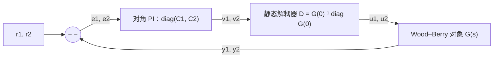

我的底盘代码里有四个 PID，每个轮子一个，互相不认识。四个电机、一个麦轮底盘，我一直这么写，也一直能开。但我从来没问过：**这四个互不相识的 PID，谁在保证“四个轮子别打架”？** 这一篇我去量这个问题的答案。先是一个比底盘更经典的耦合对象，Wood–Berry 精馏塔，用它把“多变量”三个字拆开：RGA 怎么判断两个输入该配哪个输出，静态解耦器能做什么、做不到什么。然后回到麦轮：四个轮子只推三个自由度，多出来的那一维什么也不推，电流照样流。同一份底盘仿真里，我把“轮速超限了怎么办”换成三种写法，其中一种让四个轮子在 1 s 之后平均各吃 14.7 A，另外两种是 4.1 A，而且前者的车根本没有走到目标。

> [!NOTE] 本篇检查点
> 这一篇结束时你会有：`make ch08` 通过，`out/ch08/` 下 28 个 CSV（7 个算例，每个 Python、C、C++、Rust 各一份），`figures/ch08/` 下 4 张图；以及 RGA、静态解耦、麦轮运动学和零空间电流的推导与实验。
> 新增模块：Python `pidlab.mimo`，C `pl/mimo.h` 和 `src/mimo.c`，C++ `pidlab/mimo.h`，Rust `mimo.rs`（2×2 的求逆、RGA、静态解耦，麦轮的 H 矩阵、最小范数电流、正运动学、零空间分量）。新增对象 `WoodBerry` 和 `Mecanum`（四种语言的 `plants` 里）。控制器仍然全是第 5 篇的 `Pid`，整定用第 6 篇的 `simc_pi`，没有新的 PID 变体。
> 前置：[第 6 篇](/posts/pid-control-06-tuning/)和[第 7 篇](/posts/pid-control-07-cascade/)。需要的数学：第 6 篇的 SIMC，第 5 篇的 `hold_integral`，线性代数里的矩阵求逆、伪逆和零空间。

## 数学

### 两个输入、两个输出：耦合是什么

多变量对象的最小例子是 2×2：

$$
\begin{bmatrix}y_1\\y_2\end{bmatrix}=
\begin{bmatrix}g_{11}(s)&g_{12}(s)\\g_{21}(s)&g_{22}(s)\end{bmatrix}
\begin{bmatrix}u_1\\u_2\end{bmatrix}
$$

前七篇的做法放大一倍就是**分散控制**：$u_1 = C_1(r_1 - y_1)$，$u_2 = C_2(r_2 - y_2)$，两个 PID 各管各的（出了事互相甩锅）。耦合是 $g_{12}$ 和 $g_{21}$ 不为零：$u_2$ 会推动 $y_1$，反过来也一样。类比一下：一个淋浴器有冷水和热水两个龙头，目标是水温和水量，每个龙头都同时改变这两个量，两个人各管一个龙头、各自盯着自己的那一个量，就是分散控制。

耦合到底会让回路 1 看到什么？看稳态。回路 2 开着的时候，$y_1 = g_{11}u_1$。回路 2 闭上并且带积分，稳态下 $y_2$ 的偏差被拉回 0，$0 = g_{21}u_1 + g_{22}u_2$，即 $u_2 = -g_{21}u_1/g_{22}$，代入 $y_1$：

$$
y_1 = \Bigl(g_{11} - \frac{g_{12}g_{21}}{g_{22}}\Bigr)u_1 = g_{11}(1-\kappa)\,u_1,
\qquad \kappa = \frac{g_{12}g_{21}}{g_{11}g_{22}}
$$

另一个回路一闭，回路 1 的增益就从 $g_{11}$ 变成了 $g_{11}(1-\kappa)$。你在回路 2 开着的时候整定的 PI，到回路 2 闭上之后用的是另一个对象。

### RGA：把这个比值做成一张表

[Bristol 1966 年](https://doi.org/10.1109/TAC.1966.1098266)提出的相对增益，就是上面这个比值，**开环增益除以“其余回路闭环时的增益”**：

$$
\lambda_{11} = \frac{g_{11}}{g_{11}(1-\kappa)} = \frac{1}{1-\kappa}
= \frac{g_{11}g_{22}}{g_{11}g_{22} - g_{12}g_{21}}
$$

原文只有两页（IEEE TAC 第 11 卷第 1 期，133 到 134 页），我没有找到能读的全文，所以这里的定义和性质是我自己推的，再用 numpy 核对。2×2 的情况每行每列的和都是 1：$\lambda_{12} = \lambda_{21} = 1 - \lambda_{11} = -g_{12}g_{21}/\det G$，$\lambda_{22} = \lambda_{11}$。$n\times n$ 的一般形式是 $\Lambda = G\circ(G^{-1})^T$（逐元素乘），`report` 用 `numpy.linalg.inv` 把它算了一遍，和我手写的 2×2 公式一致。

怎么读：$\lambda_{ij}$ 说的是“$u_j$ 配 $y_i$ 这一对，在别的回路都闭上之后，增益变成原来的 $1/\lambda_{ij}$”。

- $\lambda_{ij}\approx1$：别的回路闭不闭，这一对的增益都差不多，可以配。
- $\lambda_{ij}\gg1$：别的回路一闭，这一对的增益大幅缩水，两个回路在互相牵制。
- $\lambda_{ij}<0$：别的回路一闭，这一对的增益**变号**。据我所知，“别配 RGA 为负的那一对”是这套经验规则里最硬的一条：你按开环符号整定的积分控制器，在另一个回路闭上之后成了正反馈。我不在这里证明它，下面的实验会直接给出结果。

### 对象：Wood–Berry 精馏塔

[Wood 和 Berry 1973 年](https://ui.adsabs.harvard.edu/abs/1973ChEnS..28.1707W/abstract)在一个中试规模的二元精馏塔上做了塔顶、塔底成分的控制研究。后来的教材和论文常拿这个塔的 2×2 传递函数矩阵做多变量控制的例子，时间单位是分钟：

$$
G(s)=\begin{bmatrix}
\dfrac{12.8e^{-s}}{16.7s+1} & \dfrac{-18.9e^{-3s}}{21s+1}\\[2ex]
\dfrac{6.6e^{-7s}}{10.9s+1} & \dfrac{-19.4e^{-3s}}{14.4s+1}
\end{bmatrix}
$$

要交代一件事：这组数是我从常见的转引版本里取的，没有对照 1973 年原文的表格逐项核对。它在这一篇里的角色是“一个 RGA 约等于 2 的耦合对象”，我只要它自洽。

采样周期取 $t_s = 0.1$ 分钟，四个通道的延迟是 10、30、70、30 个采样。实现上把每个通道拆成“一阶滞后加一条 `DelayLine`”，一共四个状态、四条延迟线；$u_1$ 同时进两个通道（$g_{11}$ 和 $g_{21}$），所以要分别推进两条延迟线，$u_2$ 同理。

直流增益矩阵 $G(0)$ 的行列式是 $12.8\times(-19.4) - (-18.9)(6.6) = -123.58$，所以

$$
\lambda_{11} = \frac{12.8\times(-19.4)}{-123.58} = 2.0094,\qquad
\Lambda=\begin{bmatrix}2.0094&-1.0094\\-1.0094&2.0094\end{bmatrix}
$$

我在计划里手算的是 2.0094，`report` 里的断言是 $|\lambda_{11} - 2.0094| < 10^{-3}$，代码给出的数和手算一致。读这张表：对角配对 $\lambda_{11} = 2.01$，回路 2 一闭，回路 1 的直流增益从 12.8 掉到 6.37，也就是 $g_{11}/\lambda_{11}$（`report` 同时用 $g_{11} - g_{12}g_{21}/g_{22}$ 直接算，两个数相同）；非对角配对 $\lambda_{12} = -1.0094$，$y_1$ 从 $u_2$ 的增益在另一个回路闭上之后从 $-18.9$ 变成 $+18.72$，符号反了。

### 分散 PI：SIMC 逐通道

对角配对（$u_1\to y_1$，$u_2\to y_2$）用第 6 篇的 SIMC，$\tau_c = \theta$。每个通道本身就是一阶加延迟，$k$、$\tau$、$\theta$ 直接读表，`simc_pi` 算出来：

| 通道 | $k$ | $\tau$ (min) | $\theta$ (min) | $K_p$ | $T_i$ (min) |
| --- | --- | --- | --- | --- | --- |
| $g_{11}$ | 12.8 | 16.7 | 1 | 0.6523 | 8.0 |
| $g_{22}$ | −19.4 | 14.4 | 3 | −0.1237 | 14.4 |
| $g_{12}$ | −18.9 | 21.0 | 3 | −0.1852 | 21.0 |
| $g_{21}$ | 6.6 | 10.9 | 7 | 0.1180 | 10.9 |

计划里我手算的两个对角通道是 $K_p\approx0.652$、$T_i = 8$ 和 $K_p\approx-0.124$、$T_i = 14.4$，代码给出的 0.6523、8.0、−0.1237、14.4 一致，而且是代码算的，没有硬编码。注意 $g_{22}$ 的增益是负的，所以它的 $K_p$ 也是负的：控制器的符号必须和对象一致，否则第一拍就是正反馈。`Pid` 不关心符号，写错了它也照样给你一个发散的回路。

下面两个通道是错配实验用的：`wb_wrongpair` 里 $y_1$ 由 $u_2$ 管，用的是 $g_{12}$ 那一行的 SIMC 增益，$y_2$ 由 $u_1$ 管，用的是 $g_{21}$ 那一行的。SIMC 在这里的意义很窄：它保证每个通道**单独**闭环时是好的，对另一个回路的存在一无所知，这是下面几个实验里被检验的地方。

### 静态解耦和矩阵增益 PI

既然耦合在稳态下是 $G(0)$ 的非对角项，一个直接的想法是在控制器后面加一个矩阵 $D$，让 $G(0)D$ 变成对角：

$$
D = G(0)^{-1}\operatorname{diag}\bigl(G(0)\bigr),\qquad G(0)D=\operatorname{diag}(12.8,\,-19.4)
$$

Wood–Berry 的 $D = \begin{bmatrix}2.0094&2.9670\\0.6836&2.0094\end{bmatrix}$，`report` 验证了 $G(0)D$ 的非对角项只有 $4\times10^{-15}$。结构是这样的：



两个 PI 是**同一对**对角 PI（用 SIMC 在对角通道上整定的那两个），这是对比的前提。把 $D$ 和 PI 合并看，控制律是 $\mathbf u = D\,[K_p\mathbf e + K_i\!\int\mathbf e]$，也就是一个矩阵增益 PI：

$$
\mathbf u = K_p^{mat}\,\mathbf e + K_i^{mat}\!\int\mathbf e\,dt,\qquad
K_p^{mat} = D\operatorname{diag}(k_{p1},k_{p2}),\quad
K_i^{mat} = D\operatorname{diag}(k_{i1},k_{i2})
$$

所谓“多变量 PID”，在这个层面上不过是把标量增益换成矩阵增益，不多不少。第 9 篇会把这个想法推到底。

静态解耦只管 $s = 0$。$g_{11}$ 到 $g_{22}$ 的延迟和时间常数各不相同，$D$ 想抵消的耦合通道和它本该抵消的通道，在动态上并不对齐。稳态耦合是没了，暂态会变好还是变坏，我没法从公式直接看出来，下面直接看数。

### 麦轮：从几何推出 H

车体系 $x$ 向前、$y$ 向左、$z$ 向上，$\nu = (v_x, v_y, \omega_z)$ 是车体系下的速度。轮子 $i$ 的接地点位置是 $(x_i, y_i)$，$|x_i| = l_x$、$|y_i| = l_y$，接地点的速度是

$$
\mathbf v_i = (v_x - \omega_z y_i,\; v_y + \omega_z x_i)
$$

[麦轮](https://en.wikipedia.org/wiki/Mecanum_wheel)的滚子轴和轮平面成 45°，轮子沿滚子方向可以自由滑动，所以对轮子的转动只有一个约束：轮缘速度 $r\omega_i$ 等于接地点速度在“轮面前进方向”和“垂直方向”上的两个分量按滚子斜度（±45°）的组合：

$$
r\,\omega_i = v_{i,x} + s_i\,v_{i,y},\qquad s_i=\pm1
$$

$s_i$ 由滚子的装法决定。我取 $s = (-1, +1, +1, -1)$，轮子依次是左前（FL）、右前（FR）、左后（RL）、右后（RR），位置 $(x_i, y_i) = (+l_x, +l_y), (+l_x, -l_y), (-l_x, +l_y), (-l_x, -l_y)$。编号和坐标画出来是这样（俯视，$+y$ 指向左边，仿真里的 `i1` 到 `i4` 就是这个顺序）：

```text
              front (+x)
   (+lx,+ly) 1 FL  ^  2 FR (+lx,-ly)
               +---|---+
   (+y) <------|   .   |
               +-------+
   (-lx,+ly) 3 RL     4 RR (-lx,-ly)
               rear (-x)
```

代入：

$$
r\omega_{FL} = v_x - v_y - (l_x+l_y)\omega_z,\quad
r\omega_{FR} = v_x + v_y + (l_x+l_y)\omega_z
$$

$$
r\omega_{RL} = v_x + v_y - (l_x+l_y)\omega_z,\quad
r\omega_{RR} = v_x - v_y + (l_x+l_y)\omega_z
$$

写成 $\omega = H\nu/r$，$L = l_x + l_y = 0.4$ m：

$$
H=\begin{bmatrix}1&-1&-L\\1&1&L\\1&1&-L\\1&-1&L\end{bmatrix}
$$

这就是计划里的 $H$，我从几何重新推了一遍，四行的符号一致，没有要改的。（$s$ 整个反过来的装法，在 $l_x = l_y$ 时每个轮子对 $\omega_z$ 的系数都是 0，底盘转不起来，所以不是它。我没有对照真实的 RoboMaster 底盘去核对滚子朝向，这一组 $s$ 是推导里的假设。）`report` 用 `numpy` 验证了 $H^TH=\operatorname{diag}(4,4,4L^2)$：$H$ 的三列互相正交，这一点后面一直在用。

### 动力学：为什么力矩是 $\tfrac{K_t}{r}H^Ti$

底盘质量 $m$、转动惯量 $I_z$，每个轮子折算到轮轴上的转动惯量 $J_w$。动能是

$$
T=\tfrac12\nu^T\operatorname{diag}(m,m,I_z)\,\nu+\tfrac12J_w\sum_i\omega_i^2
=\tfrac12\nu^T\Bigl(\operatorname{diag}(m,m,I_z)+\tfrac{J_w}{r^2}H^TH\Bigr)\nu
$$

电机功率 $\sum_iK_ti_i\omega_i = \nu^T\bigl(\tfrac{K_t}{r}H^Ti\bigr)$，所以对 $\nu$ 的广义力就是 $\tfrac{K_t}{r}H^Ti$，与 $H$ 行的符号约定无关，只要 $\omega = H\nu/r$。再加粘性阻尼 $-c_v\nu$ 和体系间的向心耦合（车体系下速度分量的导数不是加速度：$m(\dot v_x - \omega_zv_y)=F_x$，$m(\dot v_y + \omega_zv_x)=F_y$），得到

$$
\Bigl(\operatorname{diag}(m,m,I_z)+\tfrac{J_w}{r^2}H^TH\Bigr)\dot\nu
=\tfrac{K_t}{r}H^Ti-c_v\nu+\begin{bmatrix}m\omega_zv_y\\-m\omega_zv_x\\0\end{bmatrix}
$$

世界系位姿 $(X, Y, \psi)$ 由 $\dot X = v_x\cos\psi - v_y\sin\psi$、$\dot Y = v_x\sin\psi + v_y\cos\psi$、$\dot\psi = \omega_z$ 积分。参数还是计划里那些假设值：$m = 20$ kg，$I_z = 0.6$ kg·m²，$r = 0.076$ m，$l_x = l_y = 0.2$ m，$J_w = 0.001$ kg·m²（每轮），$c_v = 0.5$，$K_t = 0.3$ N·m/A（第 1 篇交代过出处和不确定性）。因为 $H^TH$ 是对角的，左边的质量阵也是对角的：$M_{eff} = \operatorname{diag}(20.6925,\ 20.6925,\ 0.7108)$。

要说一句：计划里的方程没有向心耦合那一项，我第一遍就是按计划写的，所以“对象在车体系下是三个独立的一阶系统”。这在 $\omega_z = 0$ 时对，转起来就不对了：这一篇的指令是 $\omega_z\approx2.2$ rad/s，$v\approx1.46$ m/s，向心力在 $x$ 方向的分量 $m\omega_zv_y = 20\times2.192\times1.462 = 64.1$ N，是四个轮子同向推车时推力上限（$4K_t\times20/r\approx316$ N）的五分之一。我把这一项补上了，下面“对不上的地方”给出补之前的数。

### 零空间：四个轮子，三个自由度

$H$ 是 4×3 的，$H^T$ 有一维零空间。向量 $n=[1,1,-1,-1]/2$ 满足 $H^Tn=0$：$H$ 的第一列是 $(1,1,1,1)$，和 $n$ 的内积是 $\tfrac12(1+1-1-1)=0$；第二列 $(-1,1,1,-1)$，$\tfrac12(-1+1-1+1)=0$；第三列 $(-L,L,-L,L)$，$\tfrac12(-L+L+L-L)=0$。`report` 数值核对了 $H^Tn=[0,0,0]$。

物理含义：$n$ 是“左前、右前一起往前拧，左后、右后一起往后拧”的电流模式，它产生的合力和合力矩都是 0。四个人抬一张桌子，两个人往前拉、两个人往后拉，桌子不动，但每个人都在出力：零空间电流就是这样的力，不产生任何底盘运动，只是白白发热（我没有在这一篇里算电机热和电池功率，只给电流）。对任意电流 $i$，可以分解成

$$
i = i_{range} + (n^Ti)\,n,\qquad n^Ti = \tfrac12(i_1+i_2-i_3-i_4)
$$

$n^Ti$ 就是仿真里记录的 `null_i`。给定车体系的合力和合力矩 $w=(F_x,F_y,T_z)$，求满足 $\tfrac{K_t}{r}H^Ti=w$ 的电流，有无穷多解，范数最小的那个是

$$
i=\frac{r}{K_t}\,H\,(H^TH)^{-1}w
$$

它没有零空间分量。同理由轮速求车体速度的正运动学 $\hat\nu = rH^+\omega = r(H^TH)^{-1}H^T\omega$，因为 $H^TH$ 是对角的，这两个式子都不需要矩阵求逆，只要除以 $(4,4,4L^2)$。`report` 把我手写的 $\hat\nu$ 和 `numpy.linalg.pinv` 的结果比，差 $2.2\times10^{-16}$，把最小范数电流和 `pinv` 比，差 $5.6\times10^{-17}$。

### 饱和的时候，方向比大小重要

轮速有上限，$\omega_{max} = 50$ rad/s（[官网](https://www.robomaster.com/zh-CN/products/components/general/M3508)列的 M3508 空载转速约 482 rpm，也就是 50.5 rad/s），电流有上限 20 A。指令是 $\nu_{ref}=(2.0,\,2.0,\,3.0)$，对应的四个轮速是

$$
\omega_{ref}=H\nu_{ref}/r=(-15.79,\ 68.42,\ 36.84,\ 15.79)\ \text{rad/s}
$$

只有轮 2（FR）超限。三种处理：

- **逐轮截断**（`mec_wheel_clip`）：每个轮子的设定值各自截到 $\pm50$，每个轮子的电流各自截到 $\pm20$ A，每个轮子一个 `Pid`（带 $\pm20$ A 限幅，窗口是 `CLAMP`）。
- **逐轮等比缩放**（`mec_wheel_scale`）：整个轮速向量乘同一个系数 $s = 50/68.42 = 0.7308$，电流向量也乘同一个系数让 $\max|i|\le20$。
- **车体系 PI**（`mec_body`）：三个 PI 管 $\hat\nu$，指令乘同一个 $s$，输出的合力和合力矩用最小范数映射成电流，最后电流向量等比缩放。

截断为什么麻烦？$\omega_{ref}$ 本来在 $H$ 的值域里（它是 $H\nu_{ref}/r$），只截轮 2 一个，截出来的向量不再属于值域。值域外的那部分就是零空间分量 $n^T\omega_{clip} = -9.21$ rad/s，而轮子的实际速度永远在值域里（$\omega = H\nu/r$），所以这 $-9.21$ rad/s 的误差**任何底盘运动都消不掉**。四个同样增益的 PI 对它的反应是：比例项单独就是 $k_p\times(-9.21)=-38.4$ A，沿 $n$ 的方向，也就是每个轮子 $\pm19.2$ A，已经是 20 A 限幅的 96%，积分项再把它推到限幅。电流的限幅被零空间电流占满，留给真正推车的“值域”部分的余量没了。

等比缩放的两种写法没有这个问题：缩放后的 $\omega_{ref}$ 仍在值域里，四个 PI 增益相同，值域里的误差只会产生值域里的电流，零空间分量从头到尾是 0（舍入误差除外）。为了让缩放时不积分饱和，缩放这两种的 `Pid` 不设自己的限幅，驱动把“上一个采样是否缩放了”当作 `hold_integral` 传给所有积分器，和第 7 篇冻结外环积分是同一个手法。

## Python 实现

先是新模块 `pidlab/mimo.py`，全文如下。2×2 的函数用长度为 4 的行优先列表，$H$ 用长度为 12 的列表，C、C++、Rust 完全同样的布局：

```python
"""Multivariable helpers: 2x2 RGA, decoupling, mecanum kinematics.

Matrices are flat row-major lists: a 2x2 is [g11, g12, g21, g22] and the
4x3 mecanum matrix H has the row of wheel i at h[3 * i : 3 * i + 3].
"""


def det2(g: list[float]) -> float:
    return g[0] * g[3] - g[1] * g[2]


def inv2(g: list[float]) -> list[float]:
    """Inverse of a 2x2; ValueError if it is (nearly) singular."""
    d = det2(g)
    if abs(d) < 1e-12:
        raise ValueError("singular 2x2 matrix")
    return [g[3] / d, -g[1] / d, -g[2] / d, g[0] / d]


def rga2(g: list[float]) -> list[float]:
    """Relative gain array [l11, l12, l21, l22] of a 2x2 gain matrix.

    l11 = g11 g22 / det, l12 = -g12 g21 / det; rows and columns sum to 1.
    """
    d = det2(g)
    if abs(d) < 1e-12:
        raise ValueError("singular 2x2 matrix")
    l11 = g[0] * g[3] / d
    l12 = -g[1] * g[2] / d
    return [l11, l12, l12, l11]


def static_decoupler(g: list[float]) -> list[float]:
    """D = G^-1 diag(G): G D is diagonal with the diagonal of G."""
    gi = inv2(g)
    return [gi[0] * g[0], gi[1] * g[3], gi[2] * g[0], gi[3] * g[3]]


def mat2_vec(m: list[float], v: list[float]) -> list[float]:
    return [m[0] * v[0] + m[1] * v[1], m[2] * v[0] + m[3] * v[1]]


def mecanum_h(lx: float, ly: float) -> list[float]:
    """Wheel matrix H (4x3): wheel speeds are H nu / r for nu = (vx, vy, wz).

    Wheel order: front left, front right, rear left, rear right.
    """
    s = lx + ly
    return [
        1.0, -1.0, -s,
        1.0, 1.0, s,
        1.0, 1.0, -s,
        1.0, -1.0, s,
    ]  # fmt: skip


def mecanum_gram_diag(lx: float, ly: float) -> list[float]:
    """Diagonal of H^T H. Its columns are orthogonal: diag(4, 4, 4 L^2)."""
    s = lx + ly
    return [4.0, 4.0, 4.0 * s * s]


def mecanum_wheel_speeds(
    nu: list[float], lx: float, ly: float, r: float
) -> list[float]:
    """omega = H nu / r."""
    h = mecanum_h(lx, ly)
    return [
        (h[3 * i] * nu[0] + h[3 * i + 1] * nu[1] + h[3 * i + 2] * nu[2]) / r
        for i in range(4)
    ]


def mecanum_currents(
    w: list[float], lx: float, ly: float, r: float, kt: float
) -> list[float]:
    """Minimum-norm currents for the body wrench w = (Fx, Fy, Tz).

    The wrench is (kt / r) H^T i; the solution is
    i = (r / kt) H (H^T H)^-1 w.
    """
    h = mecanum_h(lx, ly)
    g = mecanum_gram_diag(lx, ly)
    a = [w[k] / g[k] for k in range(3)]
    return [
        r / kt * (h[3 * i] * a[0] + h[3 * i + 1] * a[1] + h[3 * i + 2] * a[2])
        for i in range(4)
    ]


def mecanum_forward(
    omega: list[float], lx: float, ly: float, r: float
) -> list[float]:
    """Forward kinematics nu = r H^+ omega = r (H^T H)^-1 H^T omega."""
    h = mecanum_h(lx, ly)
    g = mecanum_gram_diag(lx, ly)
    return [
        r * sum(h[3 * i + k] * omega[i] for i in range(4)) / g[k]
        for k in range(3)
    ]


def null_current(i: list[float]) -> float:
    """Component n^T i along the null vector n = [1, 1, -1, -1] / 2."""
    return 0.5 * (i[0] + i[1] - i[2] - i[3])
```

两个新对象放进 `plants.py`。Wood–Berry 的四个通道各自一个一阶滞后，延迟（样本数）作为数据挂在对象上，由仿真循环用 `DelayLine` 实现，和 `Flywheel` 的做法一样；麦轮的 `deriv` 就是上面的方程，`inertia()` 是对角质量阵：

```python
@dataclass
class WoodBerry:
    """Wood-Berry column, time in minutes: four first-order channels.

    y1 = x11 + x12, y2 = x21 + x22 with
    tau_ij x_ij' = -x_ij + k_ij u_ij(t - delay_ij). The delays belong to
    the loop, so the sim feeds each channel through its own DelayLine.
    State x = [x11, x12, x21, x22]; input u = [u11, u12, u21, u22] (the
    delayed command of each channel); outputs (y1, y2).
    """

    k: tuple = (12.8, -18.9, 6.6, -19.4)
    tau: tuple = (16.7, 21.0, 10.9, 14.4)
    delay: tuple = (10, 30, 70, 30)  # samples of 0.1 min

    n = 4
    m = 4

    def deriv(self, x, u):
        return [(self.k[i] * u[i] - x[i]) / self.tau[i] for i in range(4)]

    def outputs(self, x):
        return [x[0] + x[1], x[2] + x[3]]
```

```python
    def inertia(self) -> list[float]:
        """Diagonal of M + Jw / r^2 H^T H (H^T H is diagonal)."""
        g = mecanum_gram_diag(self.lx, self.ly)
        base = (self.m_body, self.m_body, self.iz)
        return [base[k] + self.jw / (self.r * self.r) * g[k] for k in range(3)]

    def deriv(self, x, u):
        h = mecanum_h(self.lx, self.ly)
        meff = self.inertia()
        f = []
        for k in range(3):
            wrench = 0.0
            for i in range(4):
                wrench += h[3 * i + k] * u[i]
            f.append(self.kt / self.r * wrench - self.cv * x[k])
        f[0] += self.m_body * x[2] * x[1]
        f[1] -= self.m_body * x[2] * x[0]
        dv = [f[k] / meff[k] for k in range(3)]
        c, s = math.cos(x[5]), math.sin(x[5])
        return [
            dv[0],
            dv[1],
            dv[2],
            c * x[0] - s * x[1],
            s * x[0] + c * x[1],
            x[2],
        ]
```

Wood–Berry 的循环，四个算例只差“谁管谁”几行：

```python
def wb_loops(plant: WoodBerry) -> dict[str, list[Pid]]:
    """SIMC PI (tauc = theta) for the two pairings, parallel gains."""

    def pid(i: int) -> Pid:
        theta = plant.delay[i] * WB_TS
        g = simc_pi(plant.k[i], plant.tau[i], theta)
        return Pid(PidConfig(g.kp, g.ki, 0.0, WB_TS))

    # channel order: 0 = g11, 1 = g12, 2 = g21, 3 = g22
    return {"diag": [pid(0), pid(3)], "off": [pid(1), pid(2)]}


def wb_simc(plant: WoodBerry, i: int) -> tuple[float, float]:
    """kp and Ti of channel i."""
    g = simc_pi(plant.k[i], plant.tau[i], plant.delay[i] * WB_TS)
    return g.kp, g.kp / g.ki


def run_wb(name: str, data=None) -> dict[str, np.ndarray]:
    plant = WoodBerry()
    if data is None:
        data = read_csv(DATA / "ch08_wb.csv")
    loops = wb_loops(plant)
    g0 = [plant.k[0], plant.k[1], plant.k[2], plant.k[3]]
    d = static_decoupler(g0)
    lines = [DelayLine(n) for n in plant.delay]
    x = [0.0] * 4
    rows = []
    for k in range(len(data["t"])):
        r1, r2 = data["r1"][k], data["r2"][k]
        y1, y2 = plant.outputs(x)
        if name == "wb_single1":
            u1, u2 = loops["diag"][0].update(r1, y1), 0.0
        elif name == "wb_decentral":
            u1 = loops["diag"][0].update(r1, y1)
            u2 = loops["diag"][1].update(r2, y2)
        elif name == "wb_wrongpair":
            u2 = loops["off"][0].update(r1, y1)  # y1 is driven by u2
            u1 = loops["off"][1].update(r2, y2)  # y2 is driven by u1
        else:  # wb_decoupled
            v1 = loops["diag"][0].update(r1, y1)
            v2 = loops["diag"][1].update(r2, y2)
            u1, u2 = mat2_vec(d, [v1, v2])
        rows.append([data["t"][k], r1, r2, y1, y2, u1, u2])
        u = [lines[0].push(u1), lines[1].push(u2)]
        u += [lines[2].push(u1), lines[3].push(u2)]
        x = advance(plant.deriv, x, u, WB_TS, WB_SUBSTEPS)
    return dict(zip(WB_COLUMNS, np.array(rows, dtype=float).T))
```

要点：

- **配对。** `loops["diag"]` 是 $g_{11}$ 和 $g_{22}$ 的 PI，`loops["off"]` 是 $g_{12}$ 和 $g_{21}$ 的 PI。`wb_wrongpair` 里 `off[0]` 看 $y_1$、输出给 $u_2$，`off[1]` 看 $y_2$、输出给 $u_1$。
- **四条延迟线。** `lines[0]` 和 `lines[2]` 都吃 $u_1$（延迟 10 和 70），`lines[1]` 和 `lines[3]` 吃 $u_2$（都是 30）。
- **解耦。** `wb_decoupled` 先让两个 PI 输出 $v$，再用 `mat2_vec(d, [v1, v2])` 乘 $D$。记录下来的 `u1`、`u2` 是 $D$ 之后的、进延迟线之前的量。

麦轮的循环是这一篇的核心：

```python
def scale_to(v: list[float], limit: float) -> tuple[list[float], bool]:
    """Scale a vector uniformly so that max |v| <= limit."""
    peak = max(abs(a) for a in v)
    if peak <= limit:
        return list(v), False
    s = limit / peak
    return [a * s for a in v], True


def run_mec(name: str, data=None) -> dict[str, np.ndarray]:
    plant = Mecanum()
    if data is None:
        data = read_csv(DATA / "ch08_mec.csv")
    lx, ly, r, kt = plant.lx, plant.ly, plant.r, plant.kt
    if name == "mec_wheel_clip":
        pids = [Pid(wheel_pid_config(True)) for _ in range(4)]
    elif name == "mec_wheel_scale":
        pids = [Pid(wheel_pid_config(False)) for _ in range(4)]
    else:
        pids = [Pid(c) for c in body_pid_configs(plant)]
    x = [0.0] * 6
    scaled = False  # last sample's scaling flag freezes the integrators
    rows = []
    for k in range(len(data["t"])):
        nu_ref = [data["vx"][k], data["vy"][k], data["wz"][k]]
        omega = plant.wheel_speeds(x)
        wref = mecanum_wheel_speeds(nu_ref, lx, ly, r)
        if name == "mec_wheel_clip":
            wref = [max(-OMEGA_MAX, min(OMEGA_MAX, w)) for w in wref]
            i_cmd = [pids[i].update(wref[i], omega[i]) for i in range(4)]
        elif name == "mec_wheel_scale":
            wref, _ = scale_to(wref, OMEGA_MAX)
            v = [
                pids[i].update(wref[i], omega[i], 0.0, scaled)
                for i in range(4)
            ]
            i_cmd, scaled = scale_to(v, plant.i_max)
        else:
            _, hit = scale_to(wref, OMEGA_MAX)
            s = OMEGA_MAX / max(abs(w) for w in wref) if hit else 1.0
            nu_hat = mecanum_forward(omega, lx, ly, r)
            w = [
                pids[a].update(s * nu_ref[a], nu_hat[a], 0.0, scaled)
                for a in range(3)
            ]
            i_cmd, scaled = scale_to(
                mecanum_currents(w, lx, ly, r, kt), plant.i_max
            )
        row = [data["t"][k], x[3], x[4], x[5], x[0], x[1], x[2]]
        row.extend(i_cmd)
        row.append(null_current(i_cmd))
        rows.append(row)
        x = advance(plant.deriv, x, i_cmd, MEC_TS, MEC_SUBSTEPS)
    return dict(zip(MEC_COLUMNS, np.array(rows, dtype=float).T))
```

三处值得看：

- **测量。** 控制器看到的是 `omega`（四个轮速，真值，没有噪声）。车体系 PI 用 `mecanum_forward` 从轮速恢复 $\hat\nu$。
- **缩放标志。** `scaled` 在循环末尾更新、在下一拍的 `update` 里当 `hold_integral` 用，读到的是上一拍的值，和第 7 篇一样。逐轮截断一支不用它：它的 `Pid` 自己带 $\pm20$ A 限幅，`CLAMP` 照常工作。
- **记录。** `null_i` 是最终发给对象的那一组电流（限幅或缩放之后）的 $n^Ti$，不是 PID 内部的某个量。

完整驱动（含 `report`、画图）折在这里：

<details>
<summary>完整源码：python/ch08_mimo.py</summary>

```python
#!/usr/bin/env python3
"""Chapter 8 driver: `ch08_mimo.py ref` then `report`."""

import math
import sys
from pathlib import Path

import numpy as np

sys.path.insert(0, str(Path(__file__).resolve().parent))
from compare import compare_dir  # noqa: E402
from pidlab.io import read_csv, write_csv  # noqa: E402
from pidlab.mimo import (  # noqa: E402
    mat2_vec,
    mecanum_currents,
    mecanum_forward,
    mecanum_gram_diag,
    mecanum_h,
    mecanum_wheel_speeds,
    null_current,
    rga2,
    static_decoupler,
)
from pidlab.pid import Pid, PidConfig  # noqa: E402
from pidlab.plants import Mecanum, MotorSpeed, WoodBerry  # noqa: E402
from pidlab.plotting import ROOT  # noqa: E402
from pidlab.sim import DelayLine, advance  # noqa: E402
from pidlab.tuning import simc_pi  # noqa: E402

OUT = ROOT / "out" / "ch08"
DATA = ROOT / "data"

# Wood-Berry: minutes, 0.1 min samples, 200 min, setpoints at 10 and 100.
WB_TS = 0.1
WB_SUBSTEPS = 10
WB_ROWS = 2000
WB_STEP1, WB_STEP2 = 100, 1000
WB_COLUMNS = ("t", "r1", "r2", "y1", "y2", "u1", "u2")
WB_CASES = ("wb_single1", "wb_decentral", "wb_wrongpair", "wb_decoupled")

# Mecanum: seconds, 1 kHz, 2 s, twist step at 0.1 s.
MEC_TS = 1e-3
MEC_SUBSTEPS = 10
MEC_ROWS = 2000
MEC_STEP = 100
MEC_TWIST = (2.0, 2.0, 3.0)  # vx, vy, wz
OMEGA_MAX = 50.0  # rad/s, about 482 rpm
ZETA = 0.7
WN = 30.0
MEC_COLUMNS = (
    "t", "x", "y", "psi", "vx", "vy", "wz", "i1", "i2", "i3", "i4", "null_i",
)  # fmt: skip
MEC_CASES = ("mec_wheel_clip", "mec_wheel_scale", "mec_body")


# ---- Wood-Berry --------------------------------------------------------


def wb_loops(plant: WoodBerry) -> dict[str, list[Pid]]:
    """SIMC PI (tauc = theta) for the two pairings, parallel gains."""

    def pid(i: int) -> Pid:
        theta = plant.delay[i] * WB_TS
        g = simc_pi(plant.k[i], plant.tau[i], theta)
        return Pid(PidConfig(g.kp, g.ki, 0.0, WB_TS))

    # channel order: 0 = g11, 1 = g12, 2 = g21, 3 = g22
    return {"diag": [pid(0), pid(3)], "off": [pid(1), pid(2)]}


def wb_simc(plant: WoodBerry, i: int) -> tuple[float, float]:
    """kp and Ti of channel i."""
    g = simc_pi(plant.k[i], plant.tau[i], plant.delay[i] * WB_TS)
    return g.kp, g.kp / g.ki


def run_wb(name: str, data=None) -> dict[str, np.ndarray]:
    plant = WoodBerry()
    if data is None:
        data = read_csv(DATA / "ch08_wb.csv")
    loops = wb_loops(plant)
    g0 = [plant.k[0], plant.k[1], plant.k[2], plant.k[3]]
    d = static_decoupler(g0)
    lines = [DelayLine(n) for n in plant.delay]
    x = [0.0] * 4
    rows = []
    for k in range(len(data["t"])):
        r1, r2 = data["r1"][k], data["r2"][k]
        y1, y2 = plant.outputs(x)
        if name == "wb_single1":
            u1, u2 = loops["diag"][0].update(r1, y1), 0.0
        elif name == "wb_decentral":
            u1 = loops["diag"][0].update(r1, y1)
            u2 = loops["diag"][1].update(r2, y2)
        elif name == "wb_wrongpair":
            u2 = loops["off"][0].update(r1, y1)  # y1 is driven by u2
            u1 = loops["off"][1].update(r2, y2)  # y2 is driven by u1
        else:  # wb_decoupled
            v1 = loops["diag"][0].update(r1, y1)
            v2 = loops["diag"][1].update(r2, y2)
            u1, u2 = mat2_vec(d, [v1, v2])
        rows.append([data["t"][k], r1, r2, y1, y2, u1, u2])
        u = [lines[0].push(u1), lines[1].push(u2)]
        u += [lines[2].push(u1), lines[3].push(u2)]
        x = advance(plant.deriv, x, u, WB_TS, WB_SUBSTEPS)
    return dict(zip(WB_COLUMNS, np.array(rows, dtype=float).T))


# ---- Mecanum -----------------------------------------------------------


def wheel_pid_config(sat: bool) -> PidConfig:
    """PI placed at WN, ZETA on one wheel (the MotorSpeed model)."""
    p = MotorSpeed()
    kp = (2.0 * ZETA * WN * p.j - p.b) / p.kt
    ki = WN * WN * p.j / p.kt
    cfg = PidConfig(kp, ki, 0.0, MEC_TS)
    if sat:
        cfg.u_min, cfg.u_max = -p.u_max, p.u_max
    return cfg


def body_pid_configs(plant: Mecanum) -> list[PidConfig]:
    """PI placed at WN, ZETA on each body axis: meff nu' = F - cv nu."""
    cfgs = []
    for meff in plant.inertia():
        kp = 2.0 * ZETA * WN * meff - plant.cv
        cfgs.append(PidConfig(kp, WN * WN * meff, 0.0, MEC_TS))
    return cfgs


def scale_to(v: list[float], limit: float) -> tuple[list[float], bool]:
    """Scale a vector uniformly so that max |v| <= limit."""
    peak = max(abs(a) for a in v)
    if peak <= limit:
        return list(v), False
    s = limit / peak
    return [a * s for a in v], True


def run_mec(name: str, data=None) -> dict[str, np.ndarray]:
    plant = Mecanum()
    if data is None:
        data = read_csv(DATA / "ch08_mec.csv")
    lx, ly, r, kt = plant.lx, plant.ly, plant.r, plant.kt
    if name == "mec_wheel_clip":
        pids = [Pid(wheel_pid_config(True)) for _ in range(4)]
    elif name == "mec_wheel_scale":
        pids = [Pid(wheel_pid_config(False)) for _ in range(4)]
    else:
        pids = [Pid(c) for c in body_pid_configs(plant)]
    x = [0.0] * 6
    scaled = False  # last sample's scaling flag freezes the integrators
    rows = []
    for k in range(len(data["t"])):
        nu_ref = [data["vx"][k], data["vy"][k], data["wz"][k]]
        omega = plant.wheel_speeds(x)
        wref = mecanum_wheel_speeds(nu_ref, lx, ly, r)
        if name == "mec_wheel_clip":
            wref = [max(-OMEGA_MAX, min(OMEGA_MAX, w)) for w in wref]
            i_cmd = [pids[i].update(wref[i], omega[i]) for i in range(4)]
        elif name == "mec_wheel_scale":
            wref, _ = scale_to(wref, OMEGA_MAX)
            v = [
                pids[i].update(wref[i], omega[i], 0.0, scaled)
                for i in range(4)
            ]
            i_cmd, scaled = scale_to(v, plant.i_max)
        else:
            _, hit = scale_to(wref, OMEGA_MAX)
            s = OMEGA_MAX / max(abs(w) for w in wref) if hit else 1.0
            nu_hat = mecanum_forward(omega, lx, ly, r)
            w = [
                pids[a].update(s * nu_ref[a], nu_hat[a], 0.0, scaled)
                for a in range(3)
            ]
            i_cmd, scaled = scale_to(
                mecanum_currents(w, lx, ly, r, kt), plant.i_max
            )
        row = [data["t"][k], x[3], x[4], x[5], x[0], x[1], x[2]]
        row.extend(i_cmd)
        row.append(null_current(i_cmd))
        rows.append(row)
        x = advance(plant.deriv, x, i_cmd, MEC_TS, MEC_SUBSTEPS)
    return dict(zip(MEC_COLUMNS, np.array(rows, dtype=float).T))


# ---- data and reference ------------------------------------------------


def write_data() -> None:
    k = np.arange(WB_ROWS)
    write_csv(
        DATA / "ch08_wb.csv",
        {
            "t": k * WB_TS,
            "r1": 1.0 * (k >= WB_STEP1),
            "r2": 1.0 * (k >= WB_STEP2),
        },
    )
    k = np.arange(MEC_ROWS)
    on = 1.0 * (k >= MEC_STEP)
    write_csv(
        DATA / "ch08_mec.csv",
        {
            "t": k * MEC_TS,
            "vx": MEC_TWIST[0] * on,
            "vy": MEC_TWIST[1] * on,
            "wz": MEC_TWIST[2] * on,
        },
    )


def ref() -> None:
    write_data()
    for name in WB_CASES:
        write_csv(OUT / f"{name}_py.csv", run_wb(name))
    for name in MEC_CASES:
        write_csv(OUT / f"{name}_py.csv", run_mec(name))


def load(name: str) -> dict[str, np.ndarray]:
    return read_csv(OUT / f"{name}_py.csv")


# ---- report ------------------------------------------------------------


def report_rga() -> dict:
    plant = WoodBerry()
    g0 = list(plant.k)
    lam = rga2(g0)
    ref_lam = np.array(g0).reshape(2, 2)
    ref_rga = ref_lam * np.linalg.inv(ref_lam).T
    assert abs(lam[0] - 2.0094) < 1e-3, lam
    assert np.allclose(lam, ref_rga.ravel(), atol=1e-12)
    print(
        "Wood-Berry G(0) = [[12.8, -18.9], [6.6, -19.4]], "
        f"det = {g0[0] * g0[3] - g0[1] * g0[2]:.3f}"
    )
    print(
        f"RGA = [[{lam[0]:.4f}, {lam[1]:.4f}], [{lam[2]:.4f}, {lam[3]:.4f}]]"
        " (matches numpy G * inv(G)^T)"
    )
    eff = g0[0] - g0[1] * g0[2] / g0[3]
    print(
        f"loop 1 gain with loop 2 open {g0[0]:.3f}, closed {eff:.3f} "
        f"(= g11 / lambda11 = {g0[0] / lam[0]:.3f})"
    )
    eff12 = g0[1] - g0[0] * g0[3] / g0[2]
    print(
        f"off-diagonal pair (y1 from u2): gain with the other loop open "
        f"{g0[1]:.3f}, closed {eff12:.3f} "
        f"(= g12 / lambda12 = {g0[1] / lam[1]:.3f})"
    )
    assert eff12 * g0[1] < 0.0
    d = static_decoupler(g0)
    gd = np.array(g0).reshape(2, 2) @ np.array(d).reshape(2, 2)
    print(
        f"D = [[{d[0]:.4f}, {d[1]:.4f}], [{d[2]:.4f}, {d[3]:.4f}]], "
        f"G(0) D = diag({gd[0, 0]:.3f}, {gd[1, 1]:.3f}) "
        f"(off-diagonal {abs(gd[0, 1]) + abs(gd[1, 0]):.1e})"
    )
    assert abs(gd[0, 1]) + abs(gd[1, 0]) < 1e-12
    return {"lam": lam, "d": d}


def report_simc() -> None:
    plant = WoodBerry()
    print("\nSIMC PI (tauc = theta), computed by simc_pi:")
    names = ("g11", "g12", "g21", "g22")
    for i, nm in enumerate(names):
        kp, ti = wb_simc(plant, i)
        print(
            f"  {nm}: k = {plant.k[i]:6.1f}, tau = {plant.tau[i]:4.1f}, "
            f"theta = {plant.delay[i] * WB_TS:3.1f}  ->  "
            f"Kp = {kp:8.4f}, Ti = {ti:5.1f}"
        )
    kp1, ti1 = wb_simc(plant, 0)
    kp2, ti2 = wb_simc(plant, 3)
    assert abs(kp1 - 0.652) < 1e-3 and abs(ti1 - 8.0) < 1e-9
    assert abs(kp2 + 0.124) < 1e-3 and abs(ti2 - 14.4) < 1e-9


def seg(o: dict, name: str, a: float, b: float) -> np.ndarray:
    m = (o["t"] >= a) & (o["t"] < b)
    return o[name][m]


def wb_metrics(o: dict) -> dict:
    dt = WB_TS
    e1a = seg(o, "r1", 10, 100) - seg(o, "y1", 10, 100)
    e2a = seg(o, "r2", 10, 100) - seg(o, "y2", 10, 100)
    e1b = seg(o, "r1", 100, 200) - seg(o, "y1", 100, 200)
    e2b = seg(o, "r2", 100, 200) - seg(o, "y2", 100, 200)
    return {
        "iae1": float(np.sum(np.abs(e1a)) * dt),
        "peak2": float(np.max(np.abs(e2a))),
        "iae2": float(np.sum(np.abs(e2b)) * dt),
        "peak1": float(np.max(np.abs(e1b))),
        "y1_end": float(o["y1"][-1]),
        "y2_end": float(o["y2"][-1]),
        "y1_max": float(np.max(seg(o, "y1", 10, 100))),
        "ymax": float(np.max(np.abs([o["y1"], o["y2"]]))),
    }


def report_wb() -> dict:
    res = {n: load(n) for n in WB_CASES}
    print("\nWood-Berry, 200 min (setpoint y1 +1 at 10 min, y2 +1 at 100 min)")
    print(
        f"{'case':14s} {'IAE1':>7s} {'max|e2|':>8s} {'IAE2':>7s} "
        f"{'max|e1|':>8s} {'y1 max':>7s} {'y1 end':>8s} {'y2 end':>8s} "
        f"{'max|y|':>9s}"
    )
    mets = {}
    for n in WB_CASES:
        m = wb_metrics(res[n])
        mets[n] = m
        print(
            f"{n:14s} {m['iae1']:7.2f} {m['peak2']:8.3f} {m['iae2']:7.2f} "
            f"{m['peak1']:8.3f} {m['y1_max']:7.3f} {m['y1_end']:8.3f} "
            f"{m['y2_end']:8.3f} "
            f"{m['ymax']:9.3g}"
        )
    for n in ("wb_decentral", "wb_decoupled"):
        o = res[n]
        m = (o["t"] > 10.0) & (np.abs(o["y2"]) > 0.05)
        print(
            f"{n}: y2 first leaves +-0.05 at {o['t'][m][0]:.1f} min "
            f"(sign {np.sign(o['y2'][m][0]):+.0f}), "
            f"min y2 {o['y2'].min():.3f}"
        )
    o = res["wb_decoupled"]
    for a, b in ((120.0, 130.0), (190.0, 200.0)):
        amp = np.max(np.abs(seg(o, "y1", a, b) - 1.0))
        print(f"wb_decoupled: max |y1 - 1| in [{a:g}, {b:g}) min = {amp:.3f}")
    e = o["y1"][1300:1600] - 1.0
    up = np.flatnonzero((e[:-1] < 0.0) & (e[1:] >= 0.0))
    period = float(np.mean(np.diff(up))) * WB_TS
    print(f"wb_decoupled: ringing period {period:.2f} min")
    o = res["wb_wrongpair"]
    rate = math.log(abs(o["y2"][-1] / o["y2"][1000])) / 100.0
    print(
        f"wb_wrongpair: |y2| grows at {rate:.4f} per min over the last "
        f"100 min, doubling every {math.log(2.0) / rate:.1f} min"
    )
    return {"res": res, "mets": mets}


def twist_stats(o: dict) -> dict:
    """Achieved twist after 0.5 s against the commanded one."""
    cmd = np.array(MEC_TWIST)
    big_l = Mecanum().lx + Mecanum().ly
    m = (o["t"] >= 0.5) & (o["t"] < 2.0)
    ach = np.array([o["vx"][m].mean(), o["vy"][m].mean(), o["wz"][m].mean()])

    def angle(a, b):
        c = np.dot(a, b) / (np.linalg.norm(a) * np.linalg.norm(b))
        return math.degrees(math.acos(min(1.0, c)))

    # the 3-D twist in length units (vx, vy, L wz), so rotation is
    # weighted like translation
    c3 = np.array([cmd[0], cmd[1], big_l * cmd[2]])
    a3 = np.array([ach[0], ach[1], big_l * ach[2]])
    return {
        "ach": ach,
        "ang_xy": angle(cmd[:2], ach[:2]),
        "ang_3d": angle(c3, a3),
        "speed": float(np.linalg.norm(ach[:2])),
    }


def ideal_path(t: np.ndarray, scale: float) -> tuple[np.ndarray, np.ndarray]:
    """Pose of a constant body twist scale * MEC_TWIST started at 0.1 s."""
    vx, vy, wz = (scale * a for a in MEC_TWIST)
    tau = np.clip(t - MEC_STEP * MEC_TS, 0.0, None)
    psi = wz * tau
    x = (vx * np.sin(psi) + vy * (np.cos(psi) - 1.0)) / wz
    y = (vx * (1.0 - np.cos(psi)) + vy * np.sin(psi)) / wz
    return x, y


def mec_scale() -> float:
    p = Mecanum()
    w = mecanum_wheel_speeds(list(MEC_TWIST), p.lx, p.ly, p.r)
    return min(1.0, OMEGA_MAX / max(abs(a) for a in w))


def report_mec() -> dict:
    p = Mecanum()
    h = np.array(mecanum_h(p.lx, p.ly)).reshape(4, 3)
    n = np.array([1.0, 1.0, -1.0, -1.0]) / 2.0
    hp = np.linalg.pinv(h)
    gram = h.T @ h
    off = np.max(np.abs(gram - np.diag(np.diag(gram))))
    print("\nH (rows FL, FR, RL, RR):")
    print(h)
    print(f"H^T H = diag({gram[0, 0]:g}, {gram[1, 1]:g}, {gram[2, 2]:g})")
    print(f"max off-diagonal of H^T H = {off:.1e}")
    print(f"H^T n = {h.T @ n} for n = [1, 1, -1, -1] / 2")
    assert np.max(np.abs(h.T @ n)) < 1e-15
    assert np.allclose(np.diag(gram), mecanum_gram_diag(p.lx, p.ly))
    assert off < 1e-15
    nu = [0.7, -0.3, 1.1]
    om = mecanum_wheel_speeds(nu, p.lx, p.ly, p.r)
    fw = np.array(mecanum_forward(om, p.lx, p.ly, p.r))
    fw_np = p.r * hp @ np.array(om)
    print(
        f"forward kinematics: round trip error {np.max(np.abs(fw - nu)):.1e}"
        f", difference to numpy pinv {np.max(np.abs(fw - fw_np)):.1e}"
    )
    assert np.max(np.abs(fw - nu)) < 1e-14
    assert np.max(np.abs(fw - fw_np)) < 1e-14
    w = [3.0, -2.0, 0.5]
    cur = np.array(mecanum_currents(w, p.lx, p.ly, p.r, p.kt))
    back = p.kt / p.r * h.T @ cur
    cur_np = p.r / p.kt * hp.T @ np.array(w)
    print(
        f"min-norm currents: wrench round trip error "
        f"{np.max(np.abs(back - w)):.1e}, difference to numpy pinv "
        f"{np.max(np.abs(cur - cur_np)):.1e}, "
        f"null component {null_current(list(cur)):.1e}"
    )
    assert np.max(np.abs(back - w)) < 1e-13
    assert np.max(np.abs(cur - cur_np)) < 1e-13
    assert abs(null_current(list(cur))) < 1e-13
    meff = p.inertia()
    print(f"M_eff = diag({meff[0]:.4f}, {meff[1]:.4f}, {meff[2]:.4f})")
    w_cmd = mecanum_wheel_speeds(list(MEC_TWIST), p.lx, p.ly, p.r)
    s = mec_scale()
    text = ", ".join(f"{a:.2f}" for a in w_cmd)
    print(
        f"commanded wheel speeds (rad/s): {text}; "
        f"uniform scale to fit {OMEGA_MAX:g}: {s:.4f}"
    )
    gram = mecanum_gram_diag(p.lx, p.ly)
    ki_wheel = wheel_pid_config(False).ki
    wn_eff = [
        math.sqrt(p.kt * ki_wheel * gram[k] / (p.r * p.r) / meff[k])
        for k in range(3)
    ]
    text = ", ".join(f"{a:.1f}" for a in wn_eff)
    print(
        f"wheel PI seen from the body axes: wn = {text} rad/s "
        f"(body PI is placed at {WN:g} on all three)"
    )
    clipped = [max(-OMEGA_MAX, min(OMEGA_MAX, a)) for a in w_cmd]
    nu_clip = mecanum_forward(clipped, p.lx, p.ly, p.r)
    kp_wheel = wheel_pid_config(False).kp
    text = ", ".join(f"{a:.2f}" for a in clipped)
    print(
        f"clipped setpoints (rad/s): {text}; "
        f"twist r H+ w = ({nu_clip[0]:.3f}, {nu_clip[1]:.3f}, "
        f"{nu_clip[2]:.3f}), null part n^T w = "
        f"{null_current(clipped):.2f} rad/s, "
        f"kp * that = {kp_wheel * null_current(clipped):.1f} A"
    )
    res = {n: load(n) for n in MEC_CASES}
    stats = {}
    for name in MEC_CASES:
        o = res[name]
        ix, iy = ideal_path(o["t"], s)
        dev = np.hypot(o["x"] - ix, o["y"] - iy)
        m = o["t"] >= 0.1
        late = o["t"] >= 1.0
        cur = np.array([o[f"i{j}"] for j in (1, 2, 3, 4)])
        stats[name] = {
            **twist_stats(o),
            "dev_end": float(dev[-1]),
            "dev_max": float(dev.max()),
            "rms_null": float(np.sqrt(np.mean(o["null_i"][m] ** 2))),
            "mean_abs_i": float(np.mean(np.abs(cur[:, late]))),
        }
    print(
        f"\n{'case':16s} {'ang xy':>7s} {'ang 3d':>7s} {'|v_xy|':>7s} "
        f"{'wz':>6s} {'dev end':>8s} {'dev max':>8s}"
    )
    for name, st in stats.items():
        print(
            f"{name:16s} {st['ang_xy']:7.3f} {st['ang_3d']:7.3f} "
            f"{st['speed']:7.3f} {st['ach'][2]:6.3f} {st['dev_end']:8.4f} "
            f"{st['dev_max']:8.4f}"
        )
    print(
        f"\n{'case':16s} {'rms null':>9s} {'null@.1':>8s} {'null@.5':>8s} "
        f"{'null@2':>8s} {'min null':>9s} {'at t':>6s} {'mean |i|':>9s}"
    )
    for name, st in stats.items():
        z = res[name]["null_i"]

        def at(tt: float) -> float:
            return float(z[min(int(round(tt / MEC_TS)), len(z) - 1)])

        k = int(np.argmin(z))
        print(
            f"{name:16s} {st['rms_null']:9.3e} {at(0.1):8.3f} "
            f"{at(0.5):8.3f} {at(2.0):8.3f} {z[k]:9.3f} "
            f"{res[name]['t'][k]:6.3f} {st['mean_abs_i']:9.3f}"
        )
    for name, k in (("mec_wheel_clip", 100), ("mec_body", -1)):
        cur = [round(float(res[name][f"i{j}"][k]), 3) for j in (1, 2, 3, 4)]
        when = "0.1 s" if k == 100 else "2 s"
        print(f"{name} currents at {when} (A): {cur}")
    return {"res": res, "stats": stats, "scale": s}


def check_wb(mets: dict) -> None:
    """The claims of the post about interaction, pairing and decoupling."""
    lam = rga2(list(WoodBerry().k))
    single, central = mets["wb_single1"], mets["wb_decentral"]
    wrong, decoupled = mets["wb_wrongpair"], mets["wb_decoupled"]
    # loop 2 open: y2 settles at (g21 / g11) y1 = 0.516
    assert abs(single["y2_end"] - 6.6 / 12.8) < 1e-3
    assert abs(central["y1_end"] - 1.0) < 0.01
    assert abs(central["y2_end"] - 1.0) < 0.01
    # lambda12 < 0: the effective gain flips sign and the loops diverge
    assert lam[1] < 0.0 and wrong["ymax"] > 1e3
    assert decoupled["iae2"] < central["iae2"]
    assert decoupled["y1_max"] > central["y1_max"]
    assert abs(decoupled["y1_end"] - 1.0) < 0.05


def check_mec(stats: dict) -> None:
    """The claims of the post: what the null current does and does not do."""
    clip, scale, body = (stats[n] for n in MEC_CASES)
    assert clip["ang_xy"] > 5.0 and clip["ang_3d"] > 5.0
    assert scale["ang_xy"] < 0.01 and body["ang_xy"] < 0.01
    assert scale["ang_3d"] < 0.01 and body["ang_3d"] < 0.01
    assert clip["rms_null"] > 10.0
    assert scale["rms_null"] < 1e-9 and body["rms_null"] < 1e-9
    assert clip["dev_end"] > 5.0 * max(scale["dev_end"], body["dev_end"])


def plot_wb_interaction(wb: dict) -> None:
    from pidlab.plotting import L, save
    import matplotlib.pyplot as plt

    res = wb["res"]
    fig, axes = plt.subplots(3, 1, figsize=(8, 8.8), sharex=True)
    names = {
        "wb_single1": L("只闭环 1（回路 2 开环）", "loop 1 only"),
        "wb_decentral": L("两个回路都闭环", "both loops closed"),
    }
    for ax, ch, lab in (
        (axes[0], "y1", L("塔顶成分 y1", "top composition y1")),
        (axes[1], "y2", L("塔底成分 y2", "bottom composition y2")),
    ):
        for n, text in names.items():
            ax.plot(res[n]["t"], res[n][ch], label=text)
        ax.set_ylabel(lab)
    axes[0].plot(res["wb_single1"]["t"], res["wb_single1"]["r1"], "k:", lw=1)
    axes[1].plot(res["wb_single1"]["t"], res["wb_single1"]["r2"], "k:", lw=1)
    axes[0].legend(loc="lower right")
    wrong = res["wb_wrongpair"]
    axes[2].plot(wrong["t"], wrong["y1"], label="y1")
    axes[2].plot(wrong["t"], wrong["y2"], label="y2")
    axes[2].set_yscale("symlog", linthresh=1.0)
    axes[2].set_ylabel(L("配错对：y（symlog）", "wrong pairing (symlog)"))
    axes[2].set_xlabel(L("时间 (分钟)", "time (min)"))
    axes[2].legend(loc="upper left")
    save(fig, "ch08", "wood-berry-interaction")


def plot_wb_decoupled(wb: dict) -> None:
    from pidlab.plotting import L, save
    import matplotlib.pyplot as plt

    res = wb["res"]
    fig, axes = plt.subplots(2, 1, figsize=(8, 6.4), sharex=True)
    names = {
        "wb_decentral": L("分散 PI", "decentralized PI"),
        "wb_decoupled": L(
            "静态解耦 + 同样的 PI", "static decoupler + same PI"
        ),
    }
    for ax, ch in ((axes[0], "y1"), (axes[1], "y2")):
        for n, text in names.items():
            ax.plot(res[n]["t"], res[n][ch], label=text)
        ax.set_ylabel(ch)
    axes[0].plot(res["wb_decentral"]["t"], res["wb_decentral"]["r1"], "k:")
    axes[1].plot(res["wb_decentral"]["t"], res["wb_decentral"]["r2"], "k:")
    axes[0].legend(loc="lower right")
    axes[1].set_xlabel(L("时间 (分钟)", "time (min)"))
    save(fig, "ch08", "wood-berry-decoupled")


def plot_mec_paths(mec: dict) -> None:
    from pidlab.plotting import L, save
    import matplotlib.pyplot as plt

    res = mec["res"]
    names = {
        "mec_wheel_clip": L("逐轮截断", "per-wheel clip"),
        "mec_wheel_scale": L("逐轮等比缩放", "per-wheel uniform scale"),
        "mec_body": L("车体系 PI", "body-frame PI"),
    }
    fig, (a1, a2) = plt.subplots(1, 2, figsize=(10, 4.6))
    o = res["mec_body"]
    ix, iy = ideal_path(o["t"], mec["scale"])
    a1.plot(ix, iy, "k:", lw=1, label=L("缩放后的理想轨迹", "ideal path"))
    for n, lab in names.items():
        a1.plot(res[n]["x"], res[n]["y"], label=lab)
    a1.set_aspect("equal")
    a1.set_xlabel(L("世界系 x (m)", "world x (m)"))
    a1.set_ylabel(L("世界系 y (m)", "world y (m)"))
    a1.legend(loc="lower left")
    for n, lab in names.items():
        a2.plot(res[n]["t"], res[n]["wz"], label=lab)
    a2.axhline(mec["scale"] * MEC_TWIST[2], color="k", ls=":", lw=1)
    a2.set_xlabel(L("时间 (秒)", "time (s)"))
    a2.set_ylabel(L("车体角速度 wz (rad/s)", "yaw rate wz (rad/s)"))
    save(fig, "ch08", "mecanum-paths")


def plot_mec_null(mec: dict) -> None:
    from pidlab.plotting import L, save
    import matplotlib.pyplot as plt

    res = mec["res"]
    names = {
        "mec_wheel_clip": L("逐轮截断", "per-wheel clip"),
        "mec_wheel_scale": L("逐轮等比缩放", "per-wheel uniform scale"),
        "mec_body": L("车体系 PI", "body-frame PI"),
    }
    fig, (a1, a2) = plt.subplots(2, 1, figsize=(8, 6.8), sharex=True)
    for n, lab in names.items():
        a1.plot(res[n]["t"], res[n]["null_i"], label=lab)
    a1.set_ylabel(L("零空间电流 nᵀi (A)", "null current n'i (A)"))
    a1.legend(loc="center right")
    o = res["mec_wheel_clip"]
    for j, w in enumerate(("FL", "FR", "RL", "RR")):
        a2.plot(o["t"], o[f"i{j + 1}"], lw=1, label=w)
    a2.set_ylabel(L("逐轮截断：各轮电流 (A)", "clip: wheel currents (A)"))
    a2.set_xlabel(L("时间 (秒)", "time (s)"))
    a2.legend(loc="lower right", ncol=4)
    save(fig, "ch08", "mecanum-null-current")


def report() -> None:
    if not compare_dir(OUT, 1e-9):
        sys.exit(1)
    report_rga()
    report_simc()
    wb = report_wb()
    check_wb(wb["mets"])
    mec = report_mec()
    check_mec(mec["stats"])
    plot_wb_interaction(wb)
    plot_wb_decoupled(wb)
    plot_mec_paths(mec)
    plot_mec_null(mec)
    print("\nch08 OK")


if __name__ == "__main__":
    {"ref": ref, "report": report}[sys.argv[1]]()
```

</details>

## C、C++、Rust 实现

两个新对象和 `mimo` 模块是 Python 版的逐行翻译，三种语言的 ch08 应用也是 Python 驱动的逐行翻译：同样的算例表、同样的整定、同样的接线，读同一份数据。区别在这几处：

- **2×2 和 $H$ 的存放。** C 用 `const pl_real *`，调用者给长度 4 和 12 的数组，求逆失败返回 `-EINVAL`；C++ 是 `std::array<T, 4>` 和 `std::array<T, 12>`，求逆和 RGA 返回 `std::optional`；Rust 是 `[Real; 4]` 和 `[Real; 12]`，返回 `Option`。三种语言都没有堆分配（`csv.c` 除外）。
- **延迟线。** Wood–Berry 要四条 `DelayLine`。C 是 `struct pl_delay_line lines[4]`，每条是 `PL_MAX_DELAY`（256）个 `pl_real`，`pl_delay_init` 失败返回 `-EINVAL`；C++ 是 `std::vector<DelayLine<double>>`（驱动里的容器不进库），Rust 是 `Vec<DelayLine>`。最长的延迟是 70 个采样，在 256 以内。
- **PID 数组。** 逐轮的算例要四个 `Pid`，车体系要三个。C 是 `struct pl_pid pids[4]`；C++ 的 `Pid<double>` 只能通过 `Create` 构造，所以放进 `std::vector` 之前先 `Create`、检查、再 `push_back`；Rust 同理，`Pid::new` 返回 `Result`，`?` 向上传。
- **缩放。** `scale_to` 原地修改向量并返回“是否缩放了”：C 用 `bool scale_to(pl_real *v, int n, pl_real limit)`，C++ 是 `template <std::size_t N> bool ScaleTo(std::array<double, N>&, double)`，Rust 是 `fn scale_to(v: &mut [Real], limit: Real) -> bool`，Python 返回元组。
- **标量类型。** 这一篇仍是 `double`（`pl_real`、`T`、`Real`）。

### C

最小范数电流映射和 RGA 是这一篇的两个新函数。注意 `pl_mecanum_currents` 里没有任何矩阵求逆：$H^TH$ 的对角元素直接除：

```c
int pl_rga2(const pl_real *g, pl_real *out)
{
	pl_real d = det2(g);
	pl_real l11, l12;

	if (PL_FABS(d) < PL_MIMO_EPS)
		return -EINVAL;
	l11 = g[0] * g[3] / d;
	l12 = -g[1] * g[2] / d;
	out[0] = l11;
	out[1] = l12;
	out[2] = l12;
	out[3] = l11;
	return 0;
}
```

```c
void pl_mecanum_currents(pl_real lx, pl_real ly, pl_real r, pl_real kt,
			 const pl_real *w, pl_real *i)
{
	pl_real h[12], g[3], a[3];
	int k;

	pl_mecanum_h(lx, ly, h);
	pl_mecanum_gram_diag(lx, ly, g);
	for (k = 0; k < 3; k++)
		a[k] = w[k] / g[k];
	for (k = 0; k < 4; k++)
		i[k] = r / kt * (h[3 * k] * a[0] + h[3 * k + 1] * a[1] +
				 h[3 * k + 2] * a[2]);
}
```

对象的方程在 `plants.c`，向心项和 Python 同样的顺序：

```c
void pl_mecanum_deriv(const void *ctx, const pl_real *x, const pl_real *u,
		      pl_real *dx)
{
	const struct pl_mecanum *p = ctx;
	pl_real h[12], meff[3], f[3];
	pl_real c = PL_COS(x[5]);
	pl_real s = PL_SIN(x[5]);
	int i, k;

	pl_mecanum_h(p->lx, p->ly, h);
	pl_mecanum_inertia(p, meff);
	for (k = 0; k < 3; k++) {
		pl_real wrench = 0.0;

		for (i = 0; i < 4; i++)
			wrench += h[3 * i + k] * u[i];
		f[k] = p->kt / p->r * wrench - p->cv * x[k];
	}
	/* centripetal coupling of the body-frame velocity components */
	f[0] += p->m * x[2] * x[1];
	f[1] -= p->m * x[2] * x[0];
	for (k = 0; k < 3; k++)
		dx[k] = f[k] / meff[k];
	dx[3] = c * x[0] - s * x[1];
	dx[4] = s * x[0] + c * x[1];
	dx[5] = x[2];
}
```

应用里麦轮的闭环，三种控制器共用一个循环，只是 `if` 分三支：

```c
	for (k = 0; !ret && k < data.nrows; k++) {
		const double *row = &data.data[k * data.ncols];
		double *out = &rows[k * MEC_COLS];
		pl_real nu_ref[3] = { row[cx], row[cy], row[cz] };
		pl_real omega[4], wref[4], icmd[4];
		pl_real peak = 0.0;

		pl_mecanum_wheel_speeds(p.lx, p.ly, p.r, x, omega);
		pl_mecanum_wheel_speeds(p.lx, p.ly, p.r, nu_ref, wref);
		if (kind == MEC_CLIP) {
			for (i = 0; i < 4; i++) {
				wref[i] = wref[i] < -OMEGA_MAX ? -OMEGA_MAX :
					  wref[i] > OMEGA_MAX ? OMEGA_MAX :
					  wref[i];
				icmd[i] = pl_pid_update(&pids[i], wref[i],
							omega[i], 0.0, false);
			}
		} else if (kind == MEC_SCALE) {
			scale_to(wref, 4, OMEGA_MAX);
			for (i = 0; i < 4; i++)
				icmd[i] = pl_pid_update(&pids[i], wref[i],
							omega[i], 0.0, scaled);
			scaled = scale_to(icmd, 4, p.i_max);
		} else {
			pl_real s = 1.0, nu_hat[3], w[3];

			for (i = 0; i < 4; i++)
				if (PL_FABS(wref[i]) > peak)
					peak = PL_FABS(wref[i]);
			if (peak > OMEGA_MAX)
				s = OMEGA_MAX / peak;
			pl_mecanum_forward(p.lx, p.ly, p.r, omega, nu_hat);
			for (i = 0; i < 3; i++)
				w[i] = pl_pid_update(&pids[i], s * nu_ref[i],
						     nu_hat[i], 0.0, scaled);
			pl_mecanum_currents(p.lx, p.ly, p.r, p.kt, w, icmd);
			scaled = scale_to(icmd, 4, p.i_max);
		}
		out[0] = row[ct];
		out[1] = x[3];
		out[2] = x[4];
		out[3] = x[5];
		out[4] = x[0];
		out[5] = x[1];
		out[6] = x[2];
		for (i = 0; i < 4; i++)
			out[7 + i] = icmd[i];
		out[11] = pl_null_current(icmd);
		pl_advance(pl_mecanum_deriv, &p, x, icmd, PL_MECANUM_N,
			   MEC_TS, MEC_SUBSTEPS);
	}
```

`mimo` 的完整源码折在这里：

<details>
<summary>完整源码：c/include/pl/mimo.h</summary>

```c
/* SPDX-License-Identifier: MIT OR Apache-2.0 */
/* Multivariable helpers: 2x2 RGA and decoupling, mecanum kinematics. */
/* Matrices are flat and row-major: a 2x2 is [g11, g12, g21, g22] and */
/* the 4x3 mecanum matrix H has the row of wheel i at h[3 * i]. */
#ifndef PL_MIMO_H
#define PL_MIMO_H

#include "pl/real.h"

#define PL_MEC_WHEELS 4 /* FL, FR, RL, RR */

/* Wheel matrix H (12 entries): wheel speeds are H nu / r for */
/* nu = (vx, vy, wz). Wheel order: front left, front right, rear left, */
/* rear right. */
void pl_mecanum_h(pl_real lx, pl_real ly, pl_real *h);

/* Inverse of a 2x2. Returns 0, or -EINVAL if it is nearly singular. */
int pl_inv2(const pl_real *g, pl_real *out);

/* Relative gain array [l11, l12, l21, l22]: l11 = g11 g22 / det and */
/* l12 = -g12 g21 / det. Returns 0, or -EINVAL if G is nearly singular. */
int pl_rga2(const pl_real *g, pl_real *out);

/* D = G^-1 diag(G), so that G D is diagonal. Returns 0 or -EINVAL. */
int pl_static_decoupler(const pl_real *g, pl_real *d);

/* out = m v for a 2x2 m and a 2-vector v. */
void pl_mat2_vec(const pl_real *m, const pl_real *v, pl_real *out);

/* Diagonal of H^T H (3 entries). The columns are orthogonal. */
void pl_mecanum_gram_diag(pl_real lx, pl_real ly, pl_real *g);

/* omega = H nu / r. */
void pl_mecanum_wheel_speeds(pl_real lx, pl_real ly, pl_real r,
			     const pl_real *nu, pl_real *omega);

/* Minimum-norm wheel currents (4 entries) for the body wrench */
/* w = (Fx, Fy, Tz): i = (r / kt) H (H^T H)^-1 w. */
void pl_mecanum_currents(pl_real lx, pl_real ly, pl_real r, pl_real kt,
			 const pl_real *w, pl_real *i);

/* Forward kinematics nu = r (H^T H)^-1 H^T omega = r H^+ omega. */
void pl_mecanum_forward(pl_real lx, pl_real ly, pl_real r,
			const pl_real *omega, pl_real *nu);

/* Component n^T i along the null vector n = [1, 1, -1, -1] / 2. */
pl_real pl_null_current(const pl_real *i);

#endif /* PL_MIMO_H */
```

</details>

<details>
<summary>完整源码：c/src/mimo.c</summary>

```c
// SPDX-License-Identifier: MIT OR Apache-2.0
#include "pl/mimo.h"

#include <errno.h>

#define PL_MIMO_EPS 1e-12

static pl_real det2(const pl_real *g)
{
	return g[0] * g[3] - g[1] * g[2];
}

int pl_inv2(const pl_real *g, pl_real *out)
{
	pl_real d = det2(g);

	if (PL_FABS(d) < PL_MIMO_EPS)
		return -EINVAL;
	out[0] = g[3] / d;
	out[1] = -g[1] / d;
	out[2] = -g[2] / d;
	out[3] = g[0] / d;
	return 0;
}

int pl_rga2(const pl_real *g, pl_real *out)
{
	pl_real d = det2(g);
	pl_real l11, l12;

	if (PL_FABS(d) < PL_MIMO_EPS)
		return -EINVAL;
	l11 = g[0] * g[3] / d;
	l12 = -g[1] * g[2] / d;
	out[0] = l11;
	out[1] = l12;
	out[2] = l12;
	out[3] = l11;
	return 0;
}

int pl_static_decoupler(const pl_real *g, pl_real *d)
{
	pl_real gi[4];
	int ret;

	ret = pl_inv2(g, gi);
	if (ret)
		return ret;
	d[0] = gi[0] * g[0];
	d[1] = gi[1] * g[3];
	d[2] = gi[2] * g[0];
	d[3] = gi[3] * g[3];
	return 0;
}

void pl_mat2_vec(const pl_real *m, const pl_real *v, pl_real *out)
{
	out[0] = m[0] * v[0] + m[1] * v[1];
	out[1] = m[2] * v[0] + m[3] * v[1];
}

void pl_mecanum_h(pl_real lx, pl_real ly, pl_real *h)
{
	pl_real s = lx + ly;
	const pl_real rows[12] = {
		1.0, -1.0, -s,
		1.0, 1.0, s,
		1.0, 1.0, -s,
		1.0, -1.0, s,
	};
	int k;

	for (k = 0; k < 12; k++)
		h[k] = rows[k];
}

void pl_mecanum_gram_diag(pl_real lx, pl_real ly, pl_real *g)
{
	pl_real s = lx + ly;

	g[0] = 4.0;
	g[1] = 4.0;
	g[2] = 4.0 * s * s;
}

void pl_mecanum_wheel_speeds(pl_real lx, pl_real ly, pl_real r,
			     const pl_real *nu, pl_real *omega)
{
	pl_real h[12];
	int i;

	pl_mecanum_h(lx, ly, h);
	for (i = 0; i < 4; i++)
		omega[i] = (h[3 * i] * nu[0] + h[3 * i + 1] * nu[1] +
			    h[3 * i + 2] * nu[2]) / r;
}

void pl_mecanum_currents(pl_real lx, pl_real ly, pl_real r, pl_real kt,
			 const pl_real *w, pl_real *i)
{
	pl_real h[12], g[3], a[3];
	int k;

	pl_mecanum_h(lx, ly, h);
	pl_mecanum_gram_diag(lx, ly, g);
	for (k = 0; k < 3; k++)
		a[k] = w[k] / g[k];
	for (k = 0; k < 4; k++)
		i[k] = r / kt * (h[3 * k] * a[0] + h[3 * k + 1] * a[1] +
				 h[3 * k + 2] * a[2]);
}

void pl_mecanum_forward(pl_real lx, pl_real ly, pl_real r,
			const pl_real *omega, pl_real *nu)
{
	pl_real h[12], g[3];
	int i, k;

	pl_mecanum_h(lx, ly, h);
	pl_mecanum_gram_diag(lx, ly, g);
	for (k = 0; k < 3; k++) {
		pl_real s = 0.0;

		for (i = 0; i < 4; i++)
			s += h[3 * i + k] * omega[i];
		nu[k] = r * s / g[k];
	}
}

pl_real pl_null_current(const pl_real *i)
{
	return 0.5 * (i[0] + i[1] - i[2] - i[3]);
}
```

</details>

完整应用：[`c/apps/ch08.c`](https://github.com/bfmhno3/pid-lab/tree/tutorial-v1/c/apps/ch08.c)。

### C++

同样的两个函数，`std::optional` 代替 `-EINVAL`，`std::array` 代替裸指针：

```cpp
template <class T>
std::optional<std::array<T, 4>> Rga2(const std::array<T, 4>& g) {
  const T d = internal::Det2(g);
  if (std::abs(d) < T(internal::kSingular)) return std::nullopt;
  const T l11 = g[0] * g[3] / d;
  const T l12 = -g[1] * g[2] / d;
  return std::array<T, 4>{l11, l12, l12, l11};
}
```

```cpp
template <class T>
std::array<T, 4> MecanumCurrents(T lx, T ly, T r, T kt,
                                 const std::array<T, 3>& w) {
  const auto h = MecanumH(lx, ly);
  const auto g = MecanumGramDiag(lx, ly);
  const std::array<T, 3> a = {w[0] / g[0], w[1] / g[1], w[2] / g[2]};
  std::array<T, 4> i;
  for (std::size_t k = 0; k < 4; ++k) {
    i[k] =
        r / kt * (h[3 * k] * a[0] + h[3 * k + 1] * a[1] + h[3 * k + 2] * a[2]);
  }
  return i;
}
```

应用里的麦轮循环：

```cpp
  for (std::size_t k = 0; k < t->size(); ++k) {
    const std::array<double, 3> nu_ref = {(*vx)[k], (*vy)[k], (*wz)[k]};
    const std::array<double, 3> nu = {x[0], x[1], x[2]};
    const auto omega = pidlab::MecanumWheelSpeeds(p.lx, p.ly, p.r, nu);
    auto wref = pidlab::MecanumWheelSpeeds(p.lx, p.ly, p.r, nu_ref);
    std::array<double, 4> icmd;
    if (kind == MecKind::kClip) {
      for (std::size_t i = 0; i < 4; ++i) {
        wref[i] = std::clamp(wref[i], -kOmegaMax, kOmegaMax);
        icmd[i] = pids[i].Update(wref[i], omega[i]);
      }
    } else if (kind == MecKind::kScale) {
      ScaleTo(wref, kOmegaMax);
      for (std::size_t i = 0; i < 4; ++i) {
        icmd[i] = pids[i].Update(wref[i], omega[i], 0.0, scaled);
      }
      scaled = ScaleTo(icmd, p.i_max);
    } else {
      double peak = 0.0;
      for (double a : wref) peak = std::max(peak, std::abs(a));
      const double s = peak > kOmegaMax ? kOmegaMax / peak : 1.0;
      const auto nu_hat = pidlab::MecanumForward(p.lx, p.ly, p.r, omega);
      std::array<double, 3> w;
      for (std::size_t i = 0; i < 3; ++i) {
        w[i] = pids[i].Update(s * nu_ref[i], nu_hat[i], 0.0, scaled);
      }
      icmd = pidlab::MecanumCurrents(p.lx, p.ly, p.r, p.kt, w);
      scaled = ScaleTo(icmd, p.i_max);
    }
    const double row[12] = {
        (*t)[k], x[3],    x[4],    x[5],    x[0],    x[1],
        x[2],    icmd[0], icmd[1], icmd[2], icmd[3], pidlab::NullCurrent(icmd)};
    for (int i = 0; i < 12; ++i) cols[i].push_back(row[i]);
    pidlab::Advance([&](const auto& s, const auto& v) { return p.Deriv(s, v); },
                    x, icmd, kMecTs, kMecSubsteps);
  }
```

`mimo.h` 的完整源码折在这里：

<details>
<summary>完整源码：cpp/include/pidlab/mimo.h</summary>

```cpp
// Multivariable helpers: 2x2 RGA and decoupling, mecanum kinematics.
// Matrices are flat and row-major: a 2x2 is {g11, g12, g21, g22} and the
// 4x3 mecanum matrix H has the row of wheel i at h[3 * i].
#ifndef PIDLAB_MIMO_H_
#define PIDLAB_MIMO_H_

#include <array>
#include <cmath>
#include <cstddef>
#include <optional>

namespace pidlab {

namespace internal {

inline constexpr double kSingular = 1e-12;

template <class T>
T Det2(const std::array<T, 4>& g) {
  return g[0] * g[3] - g[1] * g[2];
}

}  // namespace internal

// Inverse of a 2x2; std::nullopt if it is nearly singular.
template <class T>
std::optional<std::array<T, 4>> Inv2(const std::array<T, 4>& g) {
  const T d = internal::Det2(g);
  if (std::abs(d) < T(internal::kSingular)) return std::nullopt;
  return std::array<T, 4>{g[3] / d, -g[1] / d, -g[2] / d, g[0] / d};
}

// Relative gain array {l11, l12, l21, l22}: l11 = g11 g22 / det and
// l12 = -g12 g21 / det. std::nullopt if G is nearly singular.
template <class T>
std::optional<std::array<T, 4>> Rga2(const std::array<T, 4>& g) {
  const T d = internal::Det2(g);
  if (std::abs(d) < T(internal::kSingular)) return std::nullopt;
  const T l11 = g[0] * g[3] / d;
  const T l12 = -g[1] * g[2] / d;
  return std::array<T, 4>{l11, l12, l12, l11};
}

// D = G^-1 diag(G), so that G D is diagonal.
template <class T>
std::optional<std::array<T, 4>> StaticDecoupler(const std::array<T, 4>& g) {
  const auto gi = Inv2(g);
  if (!gi) return std::nullopt;
  return std::array<T, 4>{(*gi)[0] * g[0], (*gi)[1] * g[3], (*gi)[2] * g[0],
                          (*gi)[3] * g[3]};
}

// m v for a 2x2 m and a 2-vector v.
template <class T>
std::array<T, 2> Mat2Vec(const std::array<T, 4>& m, const std::array<T, 2>& v) {
  return {m[0] * v[0] + m[1] * v[1], m[2] * v[0] + m[3] * v[1]};
}

// Wheel matrix H (4x3): wheel speeds are H nu / r for nu = (vx, vy, wz).
// Wheel order: front left, front right, rear left, rear right.
template <class T>
std::array<T, 12> MecanumH(T lx, T ly) {
  const T s = lx + ly;
  return {T(1), T(-1), -s, T(1), T(1), s, T(1), T(1), -s, T(1), T(-1), s};
}

// Diagonal of H^T H. The columns are orthogonal: diag(4, 4, 4 L^2).
template <class T>
std::array<T, 3> MecanumGramDiag(T lx, T ly) {
  const T s = lx + ly;
  return {T(4), T(4), T(4) * s * s};
}

// omega = H nu / r.
template <class T>
std::array<T, 4> MecanumWheelSpeeds(T lx, T ly, T r,
                                    const std::array<T, 3>& nu) {
  const auto h = MecanumH(lx, ly);
  std::array<T, 4> omega;
  for (std::size_t i = 0; i < 4; ++i) {
    omega[i] =
        (h[3 * i] * nu[0] + h[3 * i + 1] * nu[1] + h[3 * i + 2] * nu[2]) / r;
  }
  return omega;
}

// Minimum-norm wheel currents for the body wrench w = (Fx, Fy, Tz):
// i = (r / kt) H (H^T H)^-1 w.
template <class T>
std::array<T, 4> MecanumCurrents(T lx, T ly, T r, T kt,
                                 const std::array<T, 3>& w) {
  const auto h = MecanumH(lx, ly);
  const auto g = MecanumGramDiag(lx, ly);
  const std::array<T, 3> a = {w[0] / g[0], w[1] / g[1], w[2] / g[2]};
  std::array<T, 4> i;
  for (std::size_t k = 0; k < 4; ++k) {
    i[k] =
        r / kt * (h[3 * k] * a[0] + h[3 * k + 1] * a[1] + h[3 * k + 2] * a[2]);
  }
  return i;
}

// Forward kinematics nu = r (H^T H)^-1 H^T omega = r H^+ omega.
template <class T>
std::array<T, 3> MecanumForward(T lx, T ly, T r,
                                const std::array<T, 4>& omega) {
  const auto h = MecanumH(lx, ly);
  const auto g = MecanumGramDiag(lx, ly);
  std::array<T, 3> nu;
  for (std::size_t k = 0; k < 3; ++k) {
    T s = T(0);
    for (std::size_t i = 0; i < 4; ++i) s += h[3 * i + k] * omega[i];
    nu[k] = r * s / g[k];
  }
  return nu;
}

// Component n^T i along the null vector n = {1, 1, -1, -1} / 2.
template <class T>
T NullCurrent(const std::array<T, 4>& i) {
  return T(0.5) * (i[0] + i[1] - i[2] - i[3]);
}

}  // namespace pidlab

#endif  // PIDLAB_MIMO_H_
```

</details>

完整应用：[`cpp/apps/ch08.cc`](https://github.com/bfmhno3/pid-lab/tree/tutorial-v1/cpp/apps/ch08.cc)。

### Rust

`libm` 的 `fabs` 经 `real.rs` 的包装进来，所有函数都是自由函数：

```rust
pub fn mecanum_currents(lx: Real, ly: Real, r: Real, kt: Real, w: &[Real; 3]) -> [Real; 4] {
    let h = mecanum_h(lx, ly);
    let g = mecanum_gram_diag(lx, ly);
    let a = [w[0] / g[0], w[1] / g[1], w[2] / g[2]];
    let mut i = [0.0; 4];
    for (k, c) in i.iter_mut().enumerate() {
        *c = r / kt * (h[3 * k] * a[0] + h[3 * k + 1] * a[1] + h[3 * k + 2] * a[2]);
    }
    i
}
```

应用里的麦轮循环，`match kind` 三支：

```rust
    for k in 0..t.len() {
        let nu_ref = [vx[k], vy[k], wz[k]];
        let omega = mecanum_wheel_speeds(p.lx, p.ly, p.r, &[x[0], x[1], x[2]]);
        let mut wref = mecanum_wheel_speeds(p.lx, p.ly, p.r, &nu_ref);
        let mut icmd = [0.0; 4];
        match kind {
            MecKind::Clip => {
                for i in 0..4 {
                    wref[i] = wref[i].clamp(-OMEGA_MAX, OMEGA_MAX);
                    icmd[i] = pids[i].update(wref[i], omega[i], 0.0, false);
                }
            }
            MecKind::Scale => {
                scale_to(&mut wref, OMEGA_MAX);
                for i in 0..4 {
                    icmd[i] = pids[i].update(wref[i], omega[i], 0.0, scaled);
                }
                scaled = scale_to(&mut icmd, p.i_max);
            }
            MecKind::Body => {
                let peak = wref.iter().fold(0.0, |m: Real, a| m.max(a.abs()));
                let s = if peak > OMEGA_MAX {
                    OMEGA_MAX / peak
                } else {
                    1.0
                };
                let nu_hat = mecanum_forward(p.lx, p.ly, p.r, &omega);
                let mut w = [0.0; 3];
                for i in 0..3 {
                    w[i] = pids[i].update(s * nu_ref[i], nu_hat[i], 0.0, scaled);
                }
                icmd = mecanum_currents(p.lx, p.ly, p.r, p.kt, &w);
                scaled = scale_to(&mut icmd, p.i_max);
            }
        }
        let row = [
            t[k],
            x[3],
            x[4],
            x[5],
            x[0],
            x[1],
            x[2],
            icmd[0],
            icmd[1],
            icmd[2],
            icmd[3],
            null_current(&icmd),
        ];
        for (col, v) in cols.iter_mut().zip(row) {
            col.push(v);
        }
        advance(|s, v| p.deriv(s, v), &mut x, &icmd, MEC_TS, MEC_SUBSTEPS);
    }
```

`mimo.rs` 的完整源码折在这里：

<details>
<summary>完整源码：rust/src/mimo.rs</summary>

```rust
//! Multivariable helpers: 2x2 RGA and decoupling, mecanum kinematics.
//!
//! Matrices are flat and row-major: a 2x2 is `[g11, g12, g21, g22]` and the
//! 4x3 mecanum matrix `H` has the row of wheel `i` at `h[3 * i]`.

use crate::real::{Real, fabs};

const SINGULAR: Real = 1e-12;

fn det2(g: &[Real; 4]) -> Real {
    g[0] * g[3] - g[1] * g[2]
}

/// Inverse of a 2x2; `None` if it is nearly singular.
pub fn inv2(g: &[Real; 4]) -> Option<[Real; 4]> {
    let d = det2(g);
    if fabs(d) < SINGULAR {
        return None;
    }
    Some([g[3] / d, -g[1] / d, -g[2] / d, g[0] / d])
}

/// Relative gain array `[l11, l12, l21, l22]`: `l11 = g11 g22 / det` and
/// `l12 = -g12 g21 / det`. `None` if `G` is nearly singular.
pub fn rga2(g: &[Real; 4]) -> Option<[Real; 4]> {
    let d = det2(g);
    if fabs(d) < SINGULAR {
        return None;
    }
    let l11 = g[0] * g[3] / d;
    let l12 = -g[1] * g[2] / d;
    Some([l11, l12, l12, l11])
}

/// `D = G^-1 diag(G)`, so that `G D` is diagonal.
pub fn static_decoupler(g: &[Real; 4]) -> Option<[Real; 4]> {
    let gi = inv2(g)?;
    Some([gi[0] * g[0], gi[1] * g[3], gi[2] * g[0], gi[3] * g[3]])
}

/// `m v` for a 2x2 `m` and a 2-vector `v`.
pub fn mat2_vec(m: &[Real; 4], v: &[Real; 2]) -> [Real; 2] {
    [m[0] * v[0] + m[1] * v[1], m[2] * v[0] + m[3] * v[1]]
}

/// Wheel matrix `H` (4x3): wheel speeds are `H nu / r` for
/// `nu = (vx, vy, wz)`. Wheel order: front left, front right, rear left,
/// rear right.
pub fn mecanum_h(lx: Real, ly: Real) -> [Real; 12] {
    let s = lx + ly;
    [1.0, -1.0, -s, 1.0, 1.0, s, 1.0, 1.0, -s, 1.0, -1.0, s]
}

/// Diagonal of `H^T H`. The columns are orthogonal: `diag(4, 4, 4 L^2)`.
pub fn mecanum_gram_diag(lx: Real, ly: Real) -> [Real; 3] {
    let s = lx + ly;
    [4.0, 4.0, 4.0 * s * s]
}

/// `omega = H nu / r`.
pub fn mecanum_wheel_speeds(lx: Real, ly: Real, r: Real, nu: &[Real; 3]) -> [Real; 4] {
    let h = mecanum_h(lx, ly);
    let mut omega = [0.0; 4];
    for (i, w) in omega.iter_mut().enumerate() {
        *w = (h[3 * i] * nu[0] + h[3 * i + 1] * nu[1] + h[3 * i + 2] * nu[2]) / r;
    }
    omega
}

/// Minimum-norm wheel currents for the body wrench `w = (Fx, Fy, Tz)`:
/// `i = (r / kt) H (H^T H)^-1 w`.
pub fn mecanum_currents(lx: Real, ly: Real, r: Real, kt: Real, w: &[Real; 3]) -> [Real; 4] {
    let h = mecanum_h(lx, ly);
    let g = mecanum_gram_diag(lx, ly);
    let a = [w[0] / g[0], w[1] / g[1], w[2] / g[2]];
    let mut i = [0.0; 4];
    for (k, c) in i.iter_mut().enumerate() {
        *c = r / kt * (h[3 * k] * a[0] + h[3 * k + 1] * a[1] + h[3 * k + 2] * a[2]);
    }
    i
}

/// Forward kinematics `nu = r (H^T H)^-1 H^T omega = r H^+ omega`.
pub fn mecanum_forward(lx: Real, ly: Real, r: Real, omega: &[Real; 4]) -> [Real; 3] {
    let h = mecanum_h(lx, ly);
    let g = mecanum_gram_diag(lx, ly);
    let mut nu = [0.0; 3];
    for (k, v) in nu.iter_mut().enumerate() {
        let mut s = 0.0;
        for (i, w) in omega.iter().enumerate() {
            s += h[3 * i + k] * w;
        }
        *v = r * s / g[k];
    }
    nu
}

/// Component `n^T i` along the null vector `n = [1, 1, -1, -1] / 2`.
pub fn null_current(i: &[Real; 4]) -> Real {
    0.5 * (i[0] + i[1] - i[2] - i[3])
}
```

</details>

完整应用：[`rust/src/bin/ch08.rs`](https://github.com/bfmhno3/pid-lab/tree/tutorial-v1/rust/src/bin/ch08.rs)。

### 编译和风格检查

编译参数和前几篇一样：C 是 `gcc -std=c11 -O2 -Wall -Wextra -Wpedantic -Werror`（15.3.0），C++ 是 `g++ -std=c++20` 加同样的警告，Rust 是 rustc 1.95.0、edition 2024，`cargo clippy --release -- -D warnings`。风格检查：C 用内核的 `checkpatch.pl`（`--no-tree`，忽略 SPDX 和 typedef 两项），0 errors、0 warnings；C++ 用 clang-format 的 Google 风格（`-Werror`）；Python 用 `ruff format --check` 和 `ruff check`，行宽 79；Rust 用 `cargo fmt --check`。四项都在提交前过了。

一个小插曲：`checkpatch.pl` 对 `mimo.h` 里**第一个**用到 `pl_real` 的声明报了 “need consistent spacing around '*'”，因为它不认识这个类型名。在 `#include` 之后放一行 `#define PL_MEC_WHEELS 4` 就不报了（它显然是靠文件里已有的内容猜类型）。这个宏是真的在表达“4 个轮子”，我就留着了；更干净的写法我没有找到。

## 结果

`make ch08` 一次跑完。7 个算例，每种语言 7 个文件，21 个对比文件。下面的输出把中间 15 行 `ok` 裁掉了，其余的 `max diff` 也全是 0：

```text
$ make -s ch08
ch08: C wrote 7 cases to out/ch08
ch08: C++ wrote 7 cases to out/ch08
ch08: Rust wrote 7 cases to out/ch08
ok   mec_body_c.csv: max diff 0.000e+00 <= 1.0e-09
ok   mec_body_cpp.csv: max diff 0.000e+00 <= 1.0e-09
ok   mec_body_rs.csv: max diff 2.220e-16 <= 1.0e-09
... （中间 15 行 ok 省略）
ok   wb_wrongpair_c.csv: max diff 0.000e+00 <= 1.0e-09
ok   wb_wrongpair_cpp.csv: max diff 0.000e+00 <= 1.0e-09
ok   wb_wrongpair_rs.csv: max diff 0.000e+00 <= 1.0e-09
Wood-Berry G(0) = [[12.8, -18.9], [6.6, -19.4]], det = -123.580
RGA = [[2.0094, -1.0094], [-1.0094, 2.0094]] (matches numpy G * inv(G)^T)
loop 1 gain with loop 2 open 12.800, closed 6.370 (= g11 / lambda11 = 6.370)
off-diagonal pair (y1 from u2): gain with the other loop open -18.900, closed 18.724 (= g12 / lambda12 = 18.724)
D = [[2.0094, 2.9670], [0.6836, 2.0094]], G(0) D = diag(12.800, -19.400) (off-diagonal 4.0e-15)

SIMC PI (tauc = theta), computed by simc_pi:
  g11: k =   12.8, tau = 16.7, theta = 1.0  ->  Kp =   0.6523, Ti =   8.0
  g12: k =  -18.9, tau = 21.0, theta = 3.0  ->  Kp =  -0.1852, Ti =  21.0
  g21: k =    6.6, tau = 10.9, theta = 7.0  ->  Kp =   0.1180, Ti =  10.9
  g22: k =  -19.4, tau = 14.4, theta = 3.0  ->  Kp =  -0.1237, Ti =  14.4

Wood-Berry, 200 min (setpoint y1 +1 at 10 min, y2 +1 at 100 min)
case              IAE1  max|e2|    IAE2  max|e1|  y1 max   y1 end   y2 end    max|y|
wb_single1        3.15    0.863   48.44    0.000   1.172    1.000    0.516      1.17
wb_decentral      4.37    0.859   11.87    0.238   1.172    1.001    0.996      1.24
wb_wrongpair    677.05   59.499 173824.31 4999.584   0.611 -4998.584 8730.793  8.73e+03
wb_decoupled     15.58    0.983    7.29    0.467   1.656    1.029    0.996      1.66
wb_decentral: y2 first leaves +-0.05 at 17.2 min (sign +1), min y2 -0.107
wb_decoupled: y2 first leaves +-0.05 at 13.1 min (sign -1), min y2 -0.983
wb_decoupled: max |y1 - 1| in [120, 130) min = 0.139
wb_decoupled: max |y1 - 1| in [190, 200) min = 0.035
wb_decoupled: ringing period 4.15 min
wb_wrongpair: |y2| grows at 0.0498 per min over the last 100 min, doubling every 13.9 min

H (rows FL, FR, RL, RR):
[[ 1.  -1.  -0.4]
 [ 1.   1.   0.4]
 [ 1.   1.  -0.4]
 [ 1.  -1.   0.4]]
H^T H = diag(4, 4, 0.64)
max off-diagonal of H^T H = 0.0e+00
H^T n = [0. 0. 0.] for n = [1, 1, -1, -1] / 2
forward kinematics: round trip error 4.4e-16, difference to numpy pinv 2.2e-16
min-norm currents: wrench round trip error 1.1e-16, difference to numpy pinv 5.6e-17, null component -2.8e-17
M_eff = diag(20.6925, 20.6925, 0.7108)
commanded wheel speeds (rad/s): -15.79, 68.42, 36.84, 15.79; uniform scale to fit 50: 0.7308
wheel PI seen from the body axes: wn = 30.1, 30.1, 64.9 rad/s (body PI is placed at 30 on all three)
clipped setpoints (rad/s): -15.79, 50.00, 36.84, 15.79; twist r H+ w = (1.650, 1.650, 2.125), null part n^T w = -9.21 rad/s, kp * that = -38.4 A

case              ang xy  ang 3d  |v_xy|     wz  dev end  dev max
mec_wheel_clip    11.976  15.898   2.383  1.256   2.1821   2.1821
mec_wheel_scale    0.000   0.001   2.067  2.192   0.0947   0.2204
mec_body           0.001   0.001   2.067  2.192   0.2129   0.2290

case              rms null  null@.1  null@.5   null@2  min null   at t  mean |i|
mec_wheel_clip   2.854e+01  -20.000  -32.925  -29.396   -36.081  0.403    14.698
mec_wheel_scale  2.873e-13   -0.000   -0.000   -0.000    -0.000  1.999     4.145
mec_body         6.712e-16   -0.000   -0.000    0.000    -0.000  0.146     4.145
mec_wheel_clip currents at 0.1 s (A): [-20.0, 20.0, 20.0, 20.0]
mec_body currents at 2 s (A): [-8.291, 0.266, -0.081, -7.944]
figure: figures/ch08/wood-berry-interaction.svg
figure: figures/ch08/wood-berry-decoupled.svg
figure: figures/ch08/mecanum-paths.svg
figure: figures/ch08/mecanum-null-current.svg

ch08 OK
```

21 个文件的最大差异都是严格的 `0.000e+00`。和第 7 篇不同，这一篇的循环里有 `sin` 和 `cos`（麦轮的位姿），Rust 走的是 `libm`，C 走 glibc；它们在这一组输入上给出了同样的比特。我不会因此假定它们永远一样：`sin`、`cos` 在最后一位上不保证相同，只是这一次没有分出差别。

### Wood–Berry：耦合、配对和解耦


200 分钟，$y_1$ 的设定值在第 10 分钟阶跃 +1，$y_2$ 的设定值在第 100 分钟阶跃 +1。对角配对的 SIMC PI，四个算例的指标（IAE 的单位是成分乘分钟，`max|e|` 是误差的最大绝对值）：

| 算例 | $y_1$ IAE（10 到 100 分钟） | $y_2$ 最大偏差（10 到 100 分钟） | $y_2$ IAE（100 到 200 分钟） | $y_1$ 最大偏差（100 到 200 分钟） | $y_1$ 峰值（10 到 100 分钟） | 200 分钟末的 $y_1$、$y_2$ |
| --- | --- | --- | --- | --- | --- | --- |
| `wb_single1` | 3.15 | 0.863 | 48.44 | 0.000 | 1.172 | 1.000、0.516 |
| `wb_decentral` | 4.37 | 0.859 | 11.87 | 0.238 | 1.172 | 1.001、0.996 |
| `wb_wrongpair` | 677.05 | 59.499 | 173824.31 | 4999.584 | 0.611 | −4998.584、8730.793 |
| `wb_decoupled` | 15.58 | 0.983 | 7.29 | 0.467 | 1.656 | 1.029、0.996 |

**回路 2 开环时，$y_2$ 没人管。** `wb_single1` 只闭回路 1：$y_1$ 在 17.2% 的超调后稳在 1，但 $y_2$ 被 $u_1$ 顺带拖到 0.516，正好是 $g_{21}/g_{11} = 6.6/12.8 = 0.516$。这就是耦合：一个没人管的输出，被另一个回路推着走。

**两个回路都闭上。** `wb_decentral` 里 $y_2$ 被拉回 0，$y_1$ 的峰值（1.172，超调 17.2%）和单回路的一模一样，说明峰值出现在回路 2 的作用到达 $y_1$ 之前。$y_1$ 的 IAE 从 3.15 涨到 4.37，多了 38.7%，这是回路 2 反过来搅 $y_1$ 的代价。第 100 分钟 $y_2$ 阶跃时，$y_1$ 被搅动，最大偏差 0.238。最后两个输出都回到设定值（1.001 和 0.996）。

**配成非对角。** `wb_wrongpair` 把 $y_1$ 交给 $u_2$、$y_2$ 交给 $u_1$，每个 PI 单独看都是 SIMC 设计出来的好回路，合起来却发散：200 分钟末 $y_1 = -4998.6$，$y_2 = 8730.8$，$|y_2|$ 在最后 100 分钟的指数增长率是 0.0498 每分钟，**每 13.9 分钟翻一倍**。上面“数学”里的预言兑现了：非对角配对的有效增益从 $-18.9$ 变成 $+18.72$（`report` 打印了这两个数），积分控制器的符号对不上了。（这也是仿真的好处：对象不会真的爆炸。真实的塔有阀门限幅，发散会被限幅截住，但那也不是你想要的“控制”。）三种语言在这个算例上也是严格的 0 差异：发散本来会放大舍入差，但三种语言做的是同样顺序的同样运算，比特一致，没有舍入差可放大。


**静态解耦。** 在同一对 PI 前面加 $D$，是这一节里最需要小心的结果。好的一面：$y_2$ 在第 100 分钟阶跃的 IAE 从 11.87 降到 7.29（降了 38.6%）。坏的一面：$y_1$ 的超调从 17.2% 涨到 65.6%，10 到 100 分钟的 IAE 从 4.37 涨到 15.58（3.6 倍），$y_1$ 在 $y_2$ 阶跃时的最大偏差从 0.238 涨到 0.467，而且 $y_1$ 长时间振荡：振荡周期 4.15 分钟，第 120 到 130 分钟的振幅是 0.139，190 到 200 分钟还有 0.035，到 200 分钟末 $y_1 = 1.029$ 还没有稳下来。

我对原因的猜测，得到两个数的支持：$D_{11}=2.0094$，所以 $v_1$ 通过 $g_{11}$（延迟 1 分钟）送到 $y_1$ 的增益是原来的两倍，而抵消它的那条通道 $g_{12}D_{21}$ 延迟 3 分钟，晚到 2 分钟；一个晚到的抵消，在暂态里等价于回路增益翻倍，相角裕度跟着掉。另一个证据是 $y_2$ 的第一次反向偏移：`wb_decoupled` 在 13.1 分钟 $y_2$ 离开 $\pm0.05$（符号为负，最低 −0.983），正好是第 10 分钟的阶跃加上 $g_{22}$ 的 3 分钟延迟；而它本想抵消的耦合 $g_{21}$ 要到第 17 分钟才到（`wb_decentral` 里 $y_2$ 17.2 分钟才离开 $\pm0.05$，符号为正，最低 −0.107）。静态解耦器把抵消量提前 4 分钟打出去了。我没有做控制器重新整定的对照，所以“同样的 PI”是故意的：解耦之后应当重新整定，这个实验只是说明：**$D$ 不是免费的午餐，同一个控制器不能不加检查地接在它后面。**

### 麦轮：三种处理，一份数据


0.1 s 收到指令，2 s 的仿真，指标取自 `report`（“方向误差”是 0.5 s 到 2 s 平均速度和指令的夹角，$(v_x,v_y)$ 的夹角看平面内的方向，三维的那一列是 $(v_x,v_y,L\omega_z)$ 的夹角，让转动和平动用同一个长度单位；“偏离”是仿真位置和“等比缩放后的指令速度恒定、从 0.1 s 开始”的理想路径的距离，包含了加速段的滞后，所以最好的那条也有 0.1 m 量级）：

| 算例 | $(v_x,v_y)$ 方向误差 | 三维方向误差 | $\lvert v_{xy}\rvert$ (m/s) | $\omega_z$ (rad/s) | 2 s 末偏离 | 最大偏离 |
| --- | --- | --- | --- | --- | --- | --- |
| `mec_wheel_clip` | 11.976° | 15.898° | 2.383 | 1.256 | 2.1821 m | 2.1821 m |
| `mec_wheel_scale` | 0.000° | 0.001° | 2.067 | 2.192 | 0.0947 m | 0.2204 m |
| `mec_body` | 0.001° | 0.001° | 2.067 | 2.192 | 0.2129 m | 0.2290 m |

缩放后的指令速度是 $0.7308\times(2,2,3)$，$\lvert v_{xy}\rvert = 0.7308\times2.828=2.067$ m/s，$\omega_z=2.192$ rad/s，两个“等比”算例都稳稳地走到了；截断那一个，$v_x=2.00$、$v_y=1.30$、$\omega_z=1.25$：速度大了（$|v_{xy}|=2.383$），转得慢了，方向偏了 11.98°，2 s 末位置偏离理想路径 2.18 m，是另外两个的 10 倍以上。

要多说一句，这个偏差不是“截断后的目标本来就变了”这么简单。截断后的轮速设定值，通过 $rH^+$ 变回车体速度，是 $(1.650,\,1.650,\,2.125)$，对 $(v_x,v_y)$ 来说方向没变。实际的稳态 $(2.00,\,1.30,\,1.25)$ 离这个目标很远，原因是下面这张图。


零空间电流 $n^Ti$，`report` 取了几个时刻：

| 算例 | RMS（0.1 s 以后） | 0.1 s | 0.5 s | 2 s | 1 s 之后每轮平均 $\lvert i\rvert$ |
| --- | --- | --- | --- | --- | --- |
| `mec_wheel_clip` | 28.54 A | −20.00 A | −32.93 A | −29.40 A | 14.698 A |
| `mec_wheel_scale` | $2.9\times10^{-13}$ A | 0 | 0 | 0 | 4.145 A |
| `mec_body` | $6.7\times10^{-16}$ A | 0 | 0 | 0 | 4.145 A |

三条结论：

- **计划里的预期成立了一半。** 截断确实产生了大的零空间电流：0.1 s 的第一拍四个轮子的比例项都超过了 20 A，各自被截到 $(-20,\ +20,\ +20,\ +20)$ A，$n^Ti=-20$ A；最深到 $-36.08$ A（0.403 s），之后稳在 $-29.40$ A。计划里写的是“逐轮积分器互相较劲而增长”，比例项单独就占了一大半（$-38.4$ A），积分项是再往上加；它并不是单调增长，是先冲到最深，再随着整个系统找到另一个平衡点而回来一点。
- **车体系 PI 的零空间电流确实是 0，但逐轮等比缩放也是。** 计划里把“零空间电流”当成车体系控制的卖点。数据说的是：决定零空间电流是不是 0 的，不是控制器在轮子层还是车体层，而是**饱和有没有把信号推出 $H$ 的值域**。四个增益相同的逐轮 PI 吃进值域里的误差，就只吐出值域里的电流。只有逐轮截断（每个轮子看自己的限幅）会破坏这一点。车体系的好处在别处：三个 PI 可以分别整定三个轴的带宽。下一条。
- **轮子层的 PI，会悄悄把三个轴整定成不同的带宽。** 同样增益的轮子 PI，从车体轴看，等效带宽是 $\omega_n=(30.1,\,30.1,\,64.9)$ rad/s（`report` 算的，$H^TH=\operatorname{diag}(4,4,4L^2)$ 把转动轴的 $\omega_n^2$ 放大了 $L^2M_{eff,x}/M_{eff,z}=4.66$ 倍）；车体系 PI 我把三个轴都放在 30 rad/s。从图上读，`mec_wheel_scale` 的 $\omega_z$ 在 0.3 s 之前就到位，`mec_body` 晚约 0.1 s，2 s 末偏离路径也是前者小（0.0947 对 0.2129 m）。车体系 PI 是我“有意把转得慢当作选择”，不是它更好。

最后一栏的 14.698 A 和 4.145 A：等比缩放和车体系 PI 在稳态下每个轮子平均 4.145 A，这不是 0，因为向心力 $m\omega_zv$ 要有电流来提供（四个轮子的稳态电流约是 $(-8.29,\ 0.27,\ -0.08,\ -7.94)$ A）。截断那一个平均 14.7 A，每个轮子都吃着零空间的电流，其中左前轮一直贴着 $-20$ A 的限幅，车却没走到目标。按我在第 1 篇里取的假设，$K_t = 0.3$ N·m/A，M3508 的额定转矩 3 N·m 约是 10 A，所以这 14.7 A 的平均值是超过额定的，我没有往下算发热。

### 对不上的地方

- **计划里的 $H$ 没有错，方程少了一项。** 我重新从几何推了 $H$，四行符号一致，不用改。要补的是向心耦合：计划里的动力学在车体系下是三个独立的一阶系统，我第一遍就是这么跑的，那一遍的数是：逐轮截断的零空间电流 RMS 37.59 A，$(v_x,v_y)$ 的方向误差是 0°（指令是 $v_x=v_y$，只有轮 2 超限，它对 $v_x$ 和 $v_y$ 的影响恰好对称），2 s 末偏离 0.6071 m。补上向心项之后：28.54 A，11.976°，2.1821 m。这个“方向误差 0°”如果不细看，会让人以为截断保持方向。
- **“增长的零空间电流”不是单调增长。** 见上面的第一条结论。
- **车体系 PI 不独占“零空间 = 0”。** 见上面的第二条结论。这是计划预期里不成立的那一半。
- **逐轮缩放不能在饱和时让积分器自己保持。** 缩放是在 `Pid` 外面做的，`Pid` 看不到，所以我用上一拍的缩放标志去冻结积分，这是个粗的、晚一拍的策略，我没有和别的抗饱和策略比较。
- **解耦的实验只测了“同样的 PI”。** 没有重新整定，也没有做动态解耦，所以“静态解耦让 $y_1$ 变差”是这个具体实验的结论，不是解耦这件事的结论。
- **Wood–Berry 的数是转引的。** 没有对照原文，也没有加执行器限幅、噪声和对象失配，四个回路的比较是在理想条件下的。
- **麦轮的参数和滚子朝向是假设。** $m$、$I_z$、$J_w$、$c_v$ 都是我取的量级，不是实测；滚子的 $s_i$ 组合我只做了代数推导，没有对照真车。没有轮子打滑，没有电流环动态（电流指令即电流），没有摩擦的静摩擦部分。
- **只有一个指令方向。** 所有麦轮的数都是 $(2,2,3)$ 这一个指令，轮 2 是唯一超限的轮子。换一个指令，截断造成的偏差会不同，我没有扫。

## 下一篇

这一篇我把多变量拆成了三块：Wood–Berry 的 RGA（$\lambda_{11}=2.0094$）告诉我对角配对可以用、非对角配对（$\lambda_{12}=-1.0094$）会发散，每 13.9 分钟翻一倍；静态解耦把 $y_2$ 的 IAE 从 11.87 降到 7.29，但 $y_1$ 的超调从 17.2% 涨到 65.6%；麦轮底盘上，轮速超限时逐轮截断让零空间电流的 RMS 达到 28.54 A，$(v_x,v_y)$ 方向偏 11.98°，等比缩放和车体系 PI 的零空间电流在 $10^{-13}$ A 以下。四种语言 21 个对比文件最大差异是 0。

[第 9 篇：状态反馈：LQR、LQI 与平衡步兵](/posts/pid-control-09-lqr/)把“多维”推到底：平衡步兵有位置、速度、车身倾角、倾角速度四个状态，一个力矩输入。我会把常见的“位置环套速度环套直立环”这一串 PID 写成一个结构受限的状态反馈 $u=-Kx$，再用 LQR 直接算出完整的 $K$，看这一串 PID 少了什么、多了什么。矩阵增益 PI 在那里变成 LQI。
