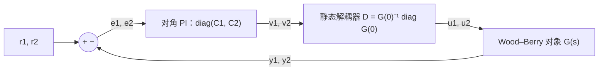

我的底盘代码里有四个 PID，每个轮子一个，互相不认识。四个电机、一个麦轮底盘，我一直这么写，也一直能开。但我从来没问过：**这四个互不相识的 PID，谁在保证“四个轮子别打架”？** 这一篇我去量这个问题的答案。先是一个比底盘更经典的耦合对象，Wood–Berry 精馏塔，用它把“多变量”三个字拆开：RGA 怎么判断两个输入该配哪个输出，静态解耦器能做什么、做不到什么。然后回到麦轮：四个轮子只推三个自由度，多出来的那一维什么也不推，电流照样流。同一份底盘仿真里，我把“轮速超限了怎么办”换成三种写法，其中一种让四个轮子在 1 s 之后平均各吃 14.7 A，另外两种是 4.1 A，而且前者的车根本没有走到目标。

> [!NOTE] 本篇检查点
> 这一篇结束时你会有：`make ch08` 通过，`out/ch08/` 下 28 个 CSV（7 个算例，每个 Python、C、C++、Rust 各一份），`figures/ch08/` 下 4 张图；以及 RGA、静态解耦、麦轮运动学和零空间电流的推导与实验。
> 新增模块：Python `pidlab.mimo`，C `pl/mimo.h` 和 `src/mimo.c`，C++ `pidlab/mimo.h`，Rust `mimo.rs`（2×2 的求逆、RGA、静态解耦，麦轮的 H 矩阵、最小范数电流、正运动学、零空间分量）。新增对象 `WoodBerry` 和 `Mecanum`（四种语言的 `plants` 里）。控制器仍然全是第 5 篇的 `Pid`，整定用第 6 篇的 `simc_pi`，没有新的 PID 变体。
> 前置：[第 6 篇](/posts/pid-control-06-tuning/)和[第 7 篇](/posts/pid-control-07-cascade/)。需要的数学：第 6 篇的 SIMC，第 5 篇的 `hold_integral`，线性代数里的矩阵求逆、伪逆和零空间。

## Wood–Berry：耦合、RGA 与解耦

### 两个输入、两个输出：耦合是什么

多变量对象的最小例子是 2×2：

$$
\begin{bmatrix}y_1\\y_2\end{bmatrix}=
\begin{bmatrix}g_{11}(s)&g_{12}(s)\\g_{21}(s)&g_{22}(s)\end{bmatrix}
\begin{bmatrix}u_1\\u_2\end{bmatrix}
$$

前七篇的做法放大一倍就是**分散控制**：$u_1 = C_1(r_1 - y_1)$，$u_2 = C_2(r_2 - y_2)$，两个 PID 各管各的（出了事互相甩锅）。耦合是 $g_{12}$ 和 $g_{21}$ 不为零：$u_2$ 会推动 $y_1$，反过来也一样。类比一下：一个淋浴器有冷水和热水两个龙头，目标是水温和水量，每个龙头都同时改变这两个量，两个人各管一个龙头、各自盯着自己的那一个量，就是分散控制。

耦合到底会让回路 1 看到什么？看稳态。回路 2 开着的时候，$y_1 = g_{11}u_1$。回路 2 闭上并且带积分，稳态下 $y_2$ 的偏差被拉回 0，$0 = g_{21}u_1 + g_{22}u_2$，即 $u_2 = -g_{21}u_1/g_{22}$，代入 $y_1$：

$$
y_1 = \Bigl(g_{11} - \frac{g_{12}g_{21}}{g_{22}}\Bigr)u_1 = g_{11}(1-\kappa)\,u_1,
\qquad \kappa = \frac{g_{12}g_{21}}{g_{11}g_{22}}
$$

另一个回路一闭，回路 1 的增益就从 $g_{11}$ 变成了 $g_{11}(1-\kappa)$。你在回路 2 开着的时候整定的 PI，到回路 2 闭上之后用的是另一个对象。

### RGA：把这个比值做成一张表

[Bristol 1966 年](https://doi.org/10.1109/TAC.1966.1098266)提出的相对增益，就是上面这个比值，**开环增益除以“其余回路闭环时的增益”**：

$$
\lambda_{11} = \frac{g_{11}}{g_{11}(1-\kappa)} = \frac{1}{1-\kappa}
= \frac{g_{11}g_{22}}{g_{11}g_{22} - g_{12}g_{21}}
$$

原文只有两页（IEEE TAC 第 11 卷第 1 期，133 到 134 页），我没有找到能读的全文，所以这里的定义和性质是我自己推的，再用 numpy 核对。2×2 的情况每行每列的和都是 1：$\lambda_{12} = \lambda_{21} = 1 - \lambda_{11} = -g_{12}g_{21}/\det G$，$\lambda_{22} = \lambda_{11}$。$n\times n$ 的一般形式是 $\Lambda = G\circ(G^{-1})^T$（逐元素乘），`report` 用 `numpy.linalg.inv` 把它算了一遍，和我手写的 2×2 公式一致。

怎么读：$\lambda_{ij}$ 说的是“$u_j$ 配 $y_i$ 这一对，在别的回路都闭上之后，增益变成原来的 $1/\lambda_{ij}$”。

- $\lambda_{ij}\approx1$：别的回路闭不闭，这一对的增益都差不多，可以配。
- $\lambda_{ij}\gg1$：别的回路一闭，这一对的增益大幅缩水，两个回路在互相牵制。
- $\lambda_{ij}<0$：别的回路一闭，这一对的增益**变号**。据我所知，“别配 RGA 为负的那一对”是这套经验规则里最硬的一条：你按开环符号整定的积分控制器，在另一个回路闭上之后成了正反馈。我不在这里证明它，下面的实验会直接给出结果。

代码就是上面那两个公式。2×2 阵用长度为 4 的行优先列表 `[g11, g12, g21, g22]`，四种语言布局相同：

```python
def rga2(g: list[float]) -> list[float]:
    """Relative gain array [l11, l12, l21, l22] of a 2x2 gain matrix.

    l11 = g11 g22 / det, l12 = -g12 g21 / det; rows and columns sum to 1.
    """
    d = det2(g)
    if abs(d) < 1e-12:
        raise ValueError("singular 2x2 matrix")
    l11 = g[0] * g[3] / d
    l12 = -g[1] * g[2] / d
    return [l11, l12, l12, l11]
```

只算 $\lambda_{11}$ 和 $\lambda_{12}$，另外两项靠“行列和为 1”直接复制。行列式接近 0 的时候没有意义，所以 Python 抛 `ValueError`，下面的 C、C++、Rust 各用自己的惯用办法报错。

### 对象：Wood–Berry 精馏塔

[Wood 和 Berry 1973 年](https://ui.adsabs.harvard.edu/abs/1973ChEnS..28.1707W/abstract)在一个中试规模的二元精馏塔上做了塔顶、塔底成分的控制研究。后来的教材和论文常拿这个塔的 2×2 传递函数矩阵做多变量控制的例子，时间单位是分钟：

$$
G(s)=\begin{bmatrix}
\dfrac{12.8e^{-s}}{16.7s+1} & \dfrac{-18.9e^{-3s}}{21s+1}\\[2ex]
\dfrac{6.6e^{-7s}}{10.9s+1} & \dfrac{-19.4e^{-3s}}{14.4s+1}
\end{bmatrix}
$$

要交代一件事：这组数是我从常见的转引版本里取的，没有对照 1973 年原文的表格逐项核对。它在这一篇里的角色是“一个 RGA 约等于 2 的耦合对象”，我只要它自洽。

采样周期取 $t_s = 0.1$ 分钟，四个通道的延迟是 10、30、70、30 个采样。实现上把每个通道拆成“一阶滞后加一条 `DelayLine`”，一共四个状态、四条延迟线：

```python
class WoodBerry:
    # ...
    k: tuple = (12.8, -18.9, 6.6, -19.4)
    tau: tuple = (16.7, 21.0, 10.9, 14.4)
    delay: tuple = (10, 30, 70, 30)  # samples of 0.1 min

    def deriv(self, x, u):
        return [(self.k[i] * u[i] - x[i]) / self.tau[i] for i in range(4)]

    def outputs(self, x):
        return [x[0] + x[1], x[2] + x[3]]
```

通道顺序是 $g_{11}, g_{12}, g_{21}, g_{22}$。延迟不在对象里，由仿真循环用 `DelayLine` 实现，和第 6 篇的 `Flywheel` 一样。$u_1$ 同时进两个通道（$g_{11}$ 和 $g_{21}$），所以 $u_1$ 要分别推进两条延迟线（延迟 10 和 70），$u_2$ 同理。

直流增益矩阵 $G(0)$ 的行列式是 $12.8\times(-19.4) - (-18.9)(6.6) = -123.58$，所以

$$
\lambda_{11} = \frac{12.8\times(-19.4)}{-123.58} = 2.0094,\qquad
\Lambda=\begin{bmatrix}2.0094&-1.0094\\-1.0094&2.0094\end{bmatrix}
$$

手算 $\lambda_{11}=2.0094$，`report` 里断言 $|\lambda_{11} - 2.0094| < 10^{-3}$，代码给出的是同一个数。读这张表：对角配对 $\lambda_{11} = 2.01$，回路 2 一闭，回路 1 的直流增益从 12.8 掉到 6.37，也就是 $g_{11}/\lambda_{11}$（`report` 同时用 $g_{11} - g_{12}g_{21}/g_{22}$ 直接算，两个数相同）；非对角配对 $\lambda_{12} = -1.0094$，$y_1$ 从 $u_2$ 的增益在另一个回路闭上之后从 $-18.9$ 变成 $+18.72$，符号反了。

### 分散 PI：SIMC 逐通道

对角配对（$u_1\to y_1$，$u_2\to y_2$）用第 6 篇的 SIMC，$\tau_c = \theta$。每个通道本身就是一阶加延迟，$k$、$\tau$、$\theta$ 直接读表，`simc_pi` 算出来：

| 通道 | $k$ | $\tau$ (min) | $\theta$ (min) | $K_p$ | $T_i$ (min) |
| --- | --- | --- | --- | --- | --- |
| $g_{11}$ | 12.8 | 16.7 | 1 | 0.6523 | 8.0 |
| $g_{22}$ | −19.4 | 14.4 | 3 | −0.1237 | 14.4 |
| $g_{12}$ | −18.9 | 21.0 | 3 | −0.1852 | 21.0 |
| $g_{21}$ | 6.6 | 10.9 | 7 | 0.1180 | 10.9 |

两个对角通道我先手算过：$K_p = 12.8$ 的通道是 $\tau/(k(\tau_c+\theta)) = 16.7/(12.8\times2) = 0.652$，$T_i = \min(16.7,\ 4\times2) = 8$；$g_{22}$ 是 $14.4/(-19.4\times6) = -0.124$，$T_i = \min(14.4,\ 24) = 14.4$。代码给出的 0.6523、8.0、−0.1237、14.4 与此一致，而且是代码算的，没有硬编码。注意 $g_{22}$ 的增益是负的，所以它的 $K_p$ 也是负的：控制器的符号必须和对象一致，否则第一拍就是正反馈。`Pid` 不关心符号，写错了它也照样给你一个发散的回路。

下面两个通道是错配实验用的：`wb_wrongpair` 里 $y_1$ 由 $u_2$ 管，用的是 $g_{12}$ 那一行的 SIMC 增益，$y_2$ 由 $u_1$ 管，用的是 $g_{21}$ 那一行的。SIMC 在这里的意义很窄：它保证每个通道**单独**闭环时是好的，对另一个回路的存在一无所知，这是下面几个实验里被检验的地方。

四个 `Pid` 的构造只有这几行，控制器就是第 5 篇的 `Pid`，$K_d = 0$：

```python
def wb_loops(plant: WoodBerry) -> dict[str, list[Pid]]:
    """SIMC PI (tauc = theta) for the two pairings, parallel gains."""

    def pid(i: int) -> Pid:
        theta = plant.delay[i] * WB_TS
        g = simc_pi(plant.k[i], plant.tau[i], theta)
        return Pid(PidConfig(g.kp, g.ki, 0.0, WB_TS))

    # channel order: 0 = g11, 1 = g12, 2 = g21, 3 = g22
    return {"diag": [pid(0), pid(3)], "off": [pid(1), pid(2)]}
```

### 静态解耦和矩阵增益 PI

既然耦合在稳态下是 $G(0)$ 的非对角项，一个直接的想法是在控制器后面加一个矩阵 $D$，让 $G(0)D$ 变成对角：

$$
D = G(0)^{-1}\operatorname{diag}\bigl(G(0)\bigr),\qquad G(0)D=\operatorname{diag}(12.8,\,-19.4)
$$

Wood–Berry 的 $D = \begin{bmatrix}2.0094&2.9670\\0.6836&2.0094\end{bmatrix}$，`report` 验证了 $G(0)D$ 的非对角项只有 $4\times10^{-15}$。结构是这样的：



两个 PI 是**同一对**对角 PI（用 SIMC 在对角通道上整定的那两个），这是对比的前提。把 $D$ 和 PI 合并看，控制律是 $\mathbf u = D\,[K_p\mathbf e + K_i\!\int\mathbf e]$，也就是一个矩阵增益 PI：

$$
\mathbf u = K_p^{mat}\,\mathbf e + K_i^{mat}\!\int\mathbf e\,dt,\qquad
K_p^{mat} = D\operatorname{diag}(k_{p1},k_{p2}),\quad
K_i^{mat} = D\operatorname{diag}(k_{i1},k_{i2})
$$

所谓“多变量 PID”，在这个层面上不过是把标量增益换成矩阵增益，不多不少。第 9 篇会把这个想法推到底。

静态解耦只管 $s = 0$。$g_{11}$ 到 $g_{22}$ 的延迟和时间常数各不相同，$D$ 想抵消的耦合通道和它本该抵消的通道，在动态上并不对齐。稳态耦合是没了，暂态会变好还是变坏，我没法从公式直接看出来，下面直接看数。

### 四个算例的循环

四个算例的循环完全一样，只差“谁管谁”这几行：

```python
y1, y2 = plant.outputs(x)
if name == "wb_single1":
    u1, u2 = loops["diag"][0].update(r1, y1), 0.0
elif name == "wb_decentral":
    u1 = loops["diag"][0].update(r1, y1)
    u2 = loops["diag"][1].update(r2, y2)
elif name == "wb_wrongpair":
    u2 = loops["off"][0].update(r1, y1)  # y1 is driven by u2
    u1 = loops["off"][1].update(r2, y2)  # y2 is driven by u1
else:  # wb_decoupled
    v1 = loops["diag"][0].update(r1, y1)
    v2 = loops["diag"][1].update(r2, y2)
    u1, u2 = mat2_vec(d, [v1, v2])
# ...
u = [lines[0].push(u1), lines[1].push(u2)]
u += [lines[2].push(u1), lines[3].push(u2)]
x = advance(plant.deriv, x, u, WB_TS, WB_SUBSTEPS)
```

三件事值得盯一下。**配对**：`wb_wrongpair` 里 `off[0]` 看 $y_1$、输出给 $u_2$，`off[1]` 看 $y_2$、输出给 $u_1$。**四条延迟线**：`lines[0]` 和 `lines[2]` 都吃 $u_1$，`lines[1]` 和 `lines[3]` 都吃 $u_2$，分别对应 $g_{11}, g_{12}, g_{21}, g_{22}$ 的延迟。**解耦**：`wb_decoupled` 先让两个 PI 输出 $v$，再用 `mat2_vec(d, [v1, v2])` 乘 $D$，记录下来的 `u1`、`u2` 是 $D$ 之后、进延迟线之前的量。

## 麦轮：四个轮子，三个自由度

### 从几何推出 H

车体系 $x$ 向前、$y$ 向左、$z$ 向上，$\nu = (v_x, v_y, \omega_z)$ 是车体系下的速度。轮子 $i$ 的接地点位置是 $(x_i, y_i)$，$|x_i| = l_x$、$|y_i| = l_y$，接地点的速度是

$$
\mathbf v_i = (v_x - \omega_z y_i,\; v_y + \omega_z x_i)
$$

[麦轮](https://en.wikipedia.org/wiki/Mecanum_wheel)的滚子轴和轮平面成 45°，轮子沿滚子方向可以自由滑动，所以对轮子的转动只有一个约束：轮缘速度 $r\omega_i$ 等于接地点速度在“轮面前进方向”和“垂直方向”上的两个分量按滚子斜度（±45°）的组合：

$$
r\,\omega_i = v_{i,x} + s_i\,v_{i,y},\qquad s_i=\pm1
$$

$s_i$ 由滚子的装法决定。我取 $s = (-1, +1, +1, -1)$，轮子依次是左前（FL）、右前（FR）、左后（RL）、右后（RR），位置 $(x_i, y_i) = (+l_x, +l_y), (+l_x, -l_y), (-l_x, +l_y), (-l_x, -l_y)$。编号和坐标画出来是这样（俯视，$+y$ 指向左边，仿真里的 `i1` 到 `i4` 就是这个顺序）：

```text
              front (+x)
   (+lx,+ly) 1 FL  ^  2 FR (+lx,-ly)
               +---|---+
   (+y) <------|   .   |
               +-------+
   (-lx,+ly) 3 RL     4 RR (-lx,-ly)
               rear (-x)
```

代入：

$$
r\omega_{FL} = v_x - v_y - (l_x+l_y)\omega_z,\quad
r\omega_{FR} = v_x + v_y + (l_x+l_y)\omega_z
$$

$$
r\omega_{RL} = v_x + v_y - (l_x+l_y)\omega_z,\quad
r\omega_{RR} = v_x - v_y + (l_x+l_y)\omega_z
$$

写成 $\omega = H\nu/r$，$L = l_x + l_y = 0.4$ m：

$$
H=\begin{bmatrix}1&-1&-L\\1&1&L\\1&1&-L\\1&-1&L\end{bmatrix}
$$

（$s$ 整个反过来的装法，在 $l_x = l_y$ 时每个轮子对 $\omega_z$ 的系数都是 0，底盘转不起来，所以真车不是那样装的。我没有对照真实的 RoboMaster 底盘去核对滚子朝向，这一组 $s$ 是推导里的假设。）`report` 用 `numpy` 验证了 $H^TH=\operatorname{diag}(4,4,4L^2)$：$H$ 的三列互相正交，这一点后面一直在用。代码里 $H$ 就是 12 个数的行优先列表，轮 $i$ 的那一行在 `h[3 * i : 3 * i + 3]`：

```python
def mecanum_h(lx: float, ly: float) -> list[float]:
    """Wheel matrix H (4x3): wheel speeds are H nu / r for nu = (vx, vy, wz).

    Wheel order: front left, front right, rear left, rear right.
    """
    s = lx + ly
    return [
        1.0, -1.0, -s,
        1.0, 1.0, s,
        1.0, 1.0, -s,
        1.0, -1.0, s,
    ]  # fmt: skip
```

### 动力学：为什么力矩是 $\tfrac{K_t}{r}H^Ti$

底盘质量 $m$、转动惯量 $I_z$，每个轮子折算到轮轴上的转动惯量 $J_w$。动能是

$$
T=\tfrac12\nu^T\operatorname{diag}(m,m,I_z)\,\nu+\tfrac12J_w\sum_i\omega_i^2
=\tfrac12\nu^T\Bigl(\operatorname{diag}(m,m,I_z)+\tfrac{J_w}{r^2}H^TH\Bigr)\nu
$$

电机功率 $\sum_iK_ti_i\omega_i = \nu^T\bigl(\tfrac{K_t}{r}H^Ti\bigr)$，所以对 $\nu$ 的广义力就是 $\tfrac{K_t}{r}H^Ti$，与 $H$ 行的符号约定无关，只要 $\omega = H\nu/r$。再加粘性阻尼 $-c_v\nu$ 和体系间的向心耦合（车体系下速度分量的导数不是加速度：$m(\dot v_x - \omega_zv_y)=F_x$，$m(\dot v_y + \omega_zv_x)=F_y$），得到

$$
\Bigl(\operatorname{diag}(m,m,I_z)+\tfrac{J_w}{r^2}H^TH\Bigr)\dot\nu
=\tfrac{K_t}{r}H^Ti-c_v\nu+\begin{bmatrix}m\omega_zv_y\\-m\omega_zv_x\\0\end{bmatrix}
$$

世界系位姿 $(X, Y, \psi)$ 由 $\dot X = v_x\cos\psi - v_y\sin\psi$、$\dot Y = v_x\sin\psi + v_y\cos\psi$、$\dot\psi = \omega_z$ 积分。参数是我取的假设值：$m = 20$ kg，$I_z = 0.6$ kg·m²，$r = 0.076$ m，$l_x = l_y = 0.2$ m，$J_w = 0.001$ kg·m²（每轮），$c_v = 0.5$，$K_t = 0.3$ N·m/A（第 1 篇交代过出处和不确定性）。因为 $H^TH$ 是对角的，左边的质量阵也是对角的：$M_{eff} = \operatorname{diag}(20.6925,\ 20.6925,\ 0.7108)$。

向心项值得多说一句。省掉它，对象在车体系下就是三个独立的一阶系统，$\omega_z = 0$ 时没错，转起来就不对了。这一篇的指令最后是 $\omega_z\approx2.2$ rad/s，$v\approx1.46$ m/s，向心力在 $x$ 方向的分量 $m\omega_zv_y = 20\times2.192\times1.462 = 64.1$ N，是四个轮子同向推车时推力上限（$4K_t\times20/r\approx316$ N）的五分之一。我先省掉它跑过一遍，后面“没有按直觉发生的事”给出了两版的数。

放进代码里，`Mecanum.deriv` 就是这个方程：先算广义力 $\tfrac{K_t}{r}H^Ti-c_v\nu$，加向心项，再除以对角的 $M_{eff}$，最后接上位姿的运动学：

```python
def deriv(self, x, u):
    h = mecanum_h(self.lx, self.ly)
    meff = self.inertia()
    f = []
    for k in range(3):
        wrench = 0.0
        for i in range(4):
            wrench += h[3 * i + k] * u[i]
        f.append(self.kt / self.r * wrench - self.cv * x[k])
    f[0] += self.m_body * x[2] * x[1]
    f[1] -= self.m_body * x[2] * x[0]
    dv = [f[k] / meff[k] for k in range(3)]
    c, s = math.cos(x[5]), math.sin(x[5])
    return [
        dv[0],
        dv[1],
        dv[2],
        c * x[0] - s * x[1],
        s * x[0] + c * x[1],
        x[2],
    ]
```

状态是 `[vx, vy, wz, X, Y, psi]`，输入是四个轮子的电流。`inertia()` 返回对角质量阵：$m$、$m$、$I_z$ 各加上 $\tfrac{J_w}{r^2}$ 乘 `mecanum_gram_diag`。

### 零空间：四个轮子，三个自由度

$H$ 是 4×3 的，$H^T$ 有一维零空间。向量 $n=[1,1,-1,-1]/2$ 满足 $H^Tn=0$：$H$ 的第一列是 $(1,1,1,1)$，和 $n$ 的内积是 $\tfrac12(1+1-1-1)=0$；第二列 $(-1,1,1,-1)$，$\tfrac12(-1+1-1+1)=0$；第三列 $(-L,L,-L,L)$，$\tfrac12(-L+L+L-L)=0$。`report` 数值核对了 $H^Tn=[0,0,0]$。

物理含义：$n$ 是“左前、右前一起往前拧，左后、右后一起往后拧”的电流模式，它产生的合力和合力矩都是 0。四个人抬一张桌子，两个人往前拉、两个人往后拉，桌子不动，但每个人都在出力：零空间电流就是这样的力，不产生任何底盘运动，只是白白发热（我没有在这一篇里算电机热和电池功率，只给电流）。对任意电流 $i$，可以分解成

$$
i = i_{range} + (n^Ti)\,n,\qquad n^Ti = \tfrac12(i_1+i_2-i_3-i_4)
$$

$n^Ti$ 就是仿真里记录的 `null_i`。给定车体系的合力和合力矩 $w=(F_x,F_y,T_z)$，求满足 $\tfrac{K_t}{r}H^Ti=w$ 的电流，有无穷多解，范数最小的那个是

$$
i=\frac{r}{K_t}\,H\,(H^TH)^{-1}w
$$

它没有零空间分量。同理由轮速求车体速度的正运动学 $\hat\nu = rH^+\omega = r(H^TH)^{-1}H^T\omega$。因为 $H^TH$ 是对角的，这两个式子都不需要矩阵求逆，只要除以 $(4,4,4L^2)$：

```python
def mecanum_currents(
    w: list[float], lx: float, ly: float, r: float, kt: float
) -> list[float]:
    """Minimum-norm currents for the body wrench w = (Fx, Fy, Tz).

    The wrench is (kt / r) H^T i; the solution is
    i = (r / kt) H (H^T H)^-1 w.
    """
    h = mecanum_h(lx, ly)
    g = mecanum_gram_diag(lx, ly)
    a = [w[k] / g[k] for k in range(3)]
    return [
        r / kt * (h[3 * i] * a[0] + h[3 * i + 1] * a[1] + h[3 * i + 2] * a[2])
        for i in range(4)
    ]


def null_current(i: list[float]) -> float:
    """Component n^T i along the null vector n = [1, 1, -1, -1] / 2."""
    return 0.5 * (i[0] + i[1] - i[2] - i[3])
```

`report` 把我手写的 $\hat\nu$ 和 `numpy.linalg.pinv` 的结果比，差 $2.2\times10^{-16}$，把最小范数电流和 `pinv` 比，差 $5.6\times10^{-17}$。

### 饱和的时候，方向比大小重要

轮速有上限，$\omega_{max} = 50$ rad/s（[官网](https://www.robomaster.com/zh-CN/products/components/general/M3508)列的 M3508 空载转速约 482 rpm，也就是 50.5 rad/s），电流有上限 20 A。指令是 $\nu_{ref}=(2.0,\,2.0,\,3.0)$，对应的四个轮速是

$$
\omega_{ref}=H\nu_{ref}/r=(-15.79,\ 68.42,\ 36.84,\ 15.79)\ \text{rad/s}
$$

只有轮 2（FR）超限。三种处理：

- **逐轮截断**（`mec_wheel_clip`）：每个轮子的设定值各自截到 $\pm50$，每个轮子的电流各自截到 $\pm20$ A，每个轮子一个 `Pid`（带 $\pm20$ A 限幅，窗口是 `CLAMP`）。
- **逐轮等比缩放**（`mec_wheel_scale`）：整个轮速向量乘同一个系数 $s = 50/68.42 = 0.7308$，电流向量也乘同一个系数让 $\max|i|\le20$。
- **车体系 PI**（`mec_body`）：三个 PI 管 $\hat\nu$，指令乘同一个 $s$，输出的合力和合力矩用最小范数映射成电流，最后电流向量等比缩放。

截断为什么麻烦？$\omega_{ref}$ 本来在 $H$ 的值域里（它是 $H\nu_{ref}/r$），只截轮 2 一个，截出来的向量不再属于值域。值域外的那部分就是零空间分量 $n^T\omega_{clip} = -9.21$ rad/s，而轮子的实际速度永远在值域里（$\omega = H\nu/r$），所以这 $-9.21$ rad/s 的误差**任何底盘运动都消不掉**。四个同样增益的 PI 对它的反应是：比例项单独就是 $k_p\times(-9.21)=-38.4$ A，沿 $n$ 的方向，也就是每个轮子 $\pm19.2$ A，已经是 20 A 限幅的 96%，积分项再把它推到限幅。电流的限幅被零空间电流占满，留给真正推车的“值域”部分的余量没了。

等比缩放的两种写法没有这个问题：缩放后的 $\omega_{ref}$ 仍在值域里，四个 PI 增益相同，值域里的误差只会产生值域里的电流，零空间分量从头到尾是 0（舍入误差除外）。为了让缩放时不积分饱和，缩放这两种的 `Pid` 不设自己的限幅，驱动把“上一个采样是否缩放了”当作 `hold_integral` 传给所有积分器，和第 7 篇冻结外环积分是同一个手法。

三个变体共用一个循环，只差 `if` 的三支：

```python
omega = plant.wheel_speeds(x)
wref = mecanum_wheel_speeds(nu_ref, lx, ly, r)
if name == "mec_wheel_clip":
    wref = [max(-OMEGA_MAX, min(OMEGA_MAX, w)) for w in wref]
    i_cmd = [pids[i].update(wref[i], omega[i]) for i in range(4)]
elif name == "mec_wheel_scale":
    wref, _ = scale_to(wref, OMEGA_MAX)
    v = [
        pids[i].update(wref[i], omega[i], 0.0, scaled)
        for i in range(4)
    ]
    i_cmd, scaled = scale_to(v, plant.i_max)
else:
    _, hit = scale_to(wref, OMEGA_MAX)
    s = OMEGA_MAX / max(abs(w) for w in wref) if hit else 1.0
    nu_hat = mecanum_forward(omega, lx, ly, r)
    w = [
        pids[a].update(s * nu_ref[a], nu_hat[a], 0.0, scaled)
        for a in range(3)
    ]
    i_cmd, scaled = scale_to(
        mecanum_currents(w, lx, ly, r, kt), plant.i_max
    )
```

这里有三处要看。**测量**：控制器看到的是 `omega`（四个轮速，真值，没有噪声），车体系 PI 用 `mecanum_forward` 从轮速恢复 $\hat\nu$。**缩放标志**：`scaled` 在循环末尾更新、在下一拍的 `update` 里当 `hold_integral` 用，读到的是上一拍的值，和第 7 篇一样；逐轮截断这一支不用它，它的 `Pid` 自己带 $\pm20$ A 限幅，`CLAMP` 照常工作。**记录**：`null_i` 是最终发给对象的那一组电流（限幅或缩放之后）的 $n^Ti$，不是 `Pid` 内部的某个量。

车体系 PI 的整定在每个轴上一样：$M_{eff}\dot\nu = F - c_v\nu$ 是一阶对象，按第 2 篇的公式放在 $\omega_n = 30$、$\zeta = 0.7$：

```python
def body_pid_configs(plant: Mecanum) -> list[PidConfig]:
    """PI placed at WN, ZETA on each body axis: meff nu' = F - cv nu."""
    cfgs = []
    for meff in plant.inertia():
        kp = 2.0 * ZETA * WN * meff - plant.cv
        cfgs.append(PidConfig(kp, WN * WN * meff, 0.0, MEC_TS))
    return cfgs
```

## C、C++、Rust 里有什么不同

`mimo` 模块和两个新对象是 Python 版的逐行翻译，三种语言的 ch08 应用也是 Python 驱动的逐行翻译：同样的算例表、同样的整定、同样的接线，读同一份数据。区别在内存和类型上，一共这几处。

**2×2 和 $H$ 的存放。** C 用 `const pl_real *`，调用者给长度 4 和 12 的数组，求逆失败返回 `-EINVAL`；C++ 是 `std::array<T, 4>` 和 `std::array<T, 12>`，求逆和 RGA 返回 `std::optional`；Rust 是 `[Real; 4]` 和 `[Real; 12]`，返回 `Option`。三种语言都没有堆分配（`csv.c` 除外）。最小范数电流在 C 里是这样，注意 $H^TH$ 的对角元素直接除，没有矩阵求逆：

```c
void pl_mecanum_currents(pl_real lx, pl_real ly, pl_real r, pl_real kt,
			 const pl_real *w, pl_real *i)
{
	pl_real h[12], g[3], a[3];
	int k;

	pl_mecanum_h(lx, ly, h);
	pl_mecanum_gram_diag(lx, ly, g);
	for (k = 0; k < 3; k++)
		a[k] = w[k] / g[k];
	for (k = 0; k < 4; k++)
		i[k] = r / kt * (h[3 * k] * a[0] + h[3 * k + 1] * a[1] +
				 h[3 * k + 2] * a[2]);
}
```

C 没有返回数组的办法，输出是调用者传进来的 `pl_real *i`；`pl_rga2` 和 `pl_static_decoupler` 则在行列式过小时返回 `-EINVAL`，调用者检查。同一个 RGA 在 C++ 里换成 `std::optional`，把“失败”放进返回类型：

```cpp
template <class T>
std::optional<std::array<T, 4>> Rga2(const std::array<T, 4>& g) {
  const T d = internal::Det2(g);
  if (std::abs(d) < T(internal::kSingular)) return std::nullopt;
  const T l11 = g[0] * g[3] / d;
  const T l12 = -g[1] * g[2] / d;
  return std::array<T, 4>{l11, l12, l12, l11};
}
```

Rust 版几乎一样，`Option<[Real; 4]>`，`fabs` 经 `real.rs` 的包装走 `libm`，所有函数都是自由函数：

```rust
pub fn static_decoupler(g: &[Real; 4]) -> Option<[Real; 4]> {
    let gi = inv2(g)?;
    Some([gi[0] * g[0], gi[1] * g[3], gi[2] * g[0], gi[3] * g[3]])
}
```

`?` 在这里替 Python 的 `raise` 和 C 的 `if (ret) return ret` 干活：`inv2` 失败就整个函数返回 `None`。

**延迟线。** Wood–Berry 要四条 `DelayLine`。C 是 `struct pl_delay_line lines[4]`，每条是 `PL_MAX_DELAY`（256）个 `pl_real`，`pl_delay_init` 失败返回 `-EINVAL`；C++ 是 `std::vector<DelayLine<double>>`（驱动里的容器不进库），Rust 是 `Vec<DelayLine>`。最长的延迟是 70 个采样，在 256 以内。C 应用里的初始化和每一拍的推进是：

```c
for (i = 0; i < 4; i++) {
	g0[i] = p.k[i];
	if (!ret)
		ret = pl_delay_init(&lines[i], p.delay[i], 0.0);
}
/* ... */
in[0] = pl_delay_push(&lines[0], u1);
in[1] = pl_delay_push(&lines[1], u2);
in[2] = pl_delay_push(&lines[2], u1);
in[3] = pl_delay_push(&lines[3], u2);
```

**`Pid` 数组。** 逐轮的算例要四个 `Pid`，车体系要三个。C 是 `struct pl_pid pids[4]`，用 `pl_pid_init` 就地初始化；C++ 的 `Pid<double>` 只能通过 `Create` 构造，所以先 `Create`、检查、再 `push_back` 进 `std::vector`；Rust 同理，`Pid::new` 返回 `Result`，`?` 向上传：

```cpp
auto pid = pidlab::Pid<double>::Create(cfg);
if (!pid) return false;
pids.push_back(*pid);
```

**缩放。** `scale_to` 原地修改向量并返回“是否缩放了”：C 用 `static bool scale_to(pl_real *v, int n, pl_real limit)`，C++ 是 `template <std::size_t N> bool ScaleTo(std::array<double, N>&, double)`，Rust 是 `fn scale_to(v: &mut [Real], limit: Real) -> bool`，Python 返回元组。C 版如下：

```c
static bool scale_to(pl_real *v, int n, pl_real limit)
{
	pl_real peak = 0.0, s;
	int i;

	for (i = 0; i < n; i++)
		if (PL_FABS(v[i]) > peak)
			peak = PL_FABS(v[i]);
	if (peak <= limit)
		return false;
	s = limit / peak;
	for (i = 0; i < n; i++)
		v[i] = v[i] * s;
	return true;
}
```

**麦轮循环。** 对象的方程在 `plants.c`，向心项和 Python 同样的顺序：

```c
/* centripetal coupling of the body-frame velocity components */
f[0] += p->m * x[2] * x[1];
f[1] -= p->m * x[2] * x[0];
for (k = 0; k < 3; k++)
	dx[k] = f[k] / meff[k];
```

应用里三种控制器的最后一支（车体系 PI）在三种语言里是这样的。C：

```c
for (i = 0; i < 4; i++)
	if (PL_FABS(wref[i]) > peak)
		peak = PL_FABS(wref[i]);
if (peak > OMEGA_MAX)
	s = OMEGA_MAX / peak;
pl_mecanum_forward(p.lx, p.ly, p.r, omega, nu_hat);
for (i = 0; i < 3; i++)
	w[i] = pl_pid_update(&pids[i], s * nu_ref[i],
			     nu_hat[i], 0.0, scaled);
pl_mecanum_currents(p.lx, p.ly, p.r, p.kt, w, icmd);
scaled = scale_to(icmd, 4, p.i_max);
```

C++：

```cpp
double peak = 0.0;
for (double a : wref) peak = std::max(peak, std::abs(a));
const double s = peak > kOmegaMax ? kOmegaMax / peak : 1.0;
const auto nu_hat = pidlab::MecanumForward(p.lx, p.ly, p.r, omega);
std::array<double, 3> w;
for (std::size_t i = 0; i < 3; ++i) {
  w[i] = pids[i].Update(s * nu_ref[i], nu_hat[i], 0.0, scaled);
}
icmd = pidlab::MecanumCurrents(p.lx, p.ly, p.r, p.kt, w);
scaled = ScaleTo(icmd, p.i_max);
```

Rust：

```rust
let peak = wref.iter().fold(0.0, |m: Real, a| m.max(a.abs()));
let s = if peak > OMEGA_MAX {
    OMEGA_MAX / peak
} else {
    1.0
};
let nu_hat = mecanum_forward(p.lx, p.ly, p.r, &omega);
let mut w = [0.0; 3];
for i in 0..3 {
    w[i] = pids[i].update(s * nu_ref[i], nu_hat[i], 0.0, scaled);
}
icmd = mecanum_currents(p.lx, p.ly, p.r, p.kt, &w);
scaled = scale_to(&mut icmd, p.i_max);
```

差别是 C 的数组都是调用者给的栈数组，函数写进 `out` 参数；C++ 和 Rust 的固定长度数组按值返回，赋值就是复制 3 或 4 个 `double`，没有堆；Rust 的 `fold` 取最大值对应 C 的 `if` 循环。**标量类型**这一篇仍是 `double`（`pl_real`、`T`、`Real`）。

### 编译和风格检查

编译参数和前几篇一样：C 是 `gcc -std=c11 -O2 -Wall -Wextra -Wpedantic -Werror`（15.3.0），C++ 是 `g++ -std=c++20` 加同样的警告，Rust 是 rustc 1.95.0、edition 2024，`cargo clippy --release -- -D warnings`。风格检查：C 用内核的 `checkpatch.pl`（`--no-tree`，忽略 SPDX 和 typedef 两项），0 errors、0 warnings；C++ 用 clang-format 的 Google 风格（`-Werror`）；Python 用 `ruff format --check` 和 `ruff check`，行宽 79；Rust 用 `cargo fmt --check`。四项都在提交前过了。

一个小插曲：`checkpatch.pl` 对 `mimo.h` 里**第一个**用到 `pl_real` 的声明报了 “need consistent spacing around '*'”，因为它不认识这个类型名。在 `#include` 之后放一行 `#define PL_MEC_WHEELS 4` 就不报了（它显然是靠文件里已有的内容猜类型）。这个宏是真的在表达“4 个轮子”，我就留着了；更干净的写法我没有找到。

## 结果

`make ch08` 一次跑完。7 个算例，每种语言 7 个文件，21 个对比文件。下面的输出把中间 15 行 `ok` 裁掉了：

```text
$ make -s ch08
ch08: C wrote 7 cases to out/ch08
ch08: C++ wrote 7 cases to out/ch08
ch08: Rust wrote 7 cases to out/ch08
ok   mec_body_c.csv: max diff 0.000e+00 <= 1.0e-09
ok   mec_body_cpp.csv: max diff 0.000e+00 <= 1.0e-09
ok   mec_body_rs.csv: max diff 2.220e-16 <= 1.0e-09
... （中间 15 行 ok 省略）
ok   wb_wrongpair_c.csv: max diff 0.000e+00 <= 1.0e-09
ok   wb_wrongpair_cpp.csv: max diff 0.000e+00 <= 1.0e-09
ok   wb_wrongpair_rs.csv: max diff 0.000e+00 <= 1.0e-09
Wood-Berry G(0) = [[12.8, -18.9], [6.6, -19.4]], det = -123.580
RGA = [[2.0094, -1.0094], [-1.0094, 2.0094]] (matches numpy G * inv(G)^T)
loop 1 gain with loop 2 open 12.800, closed 6.370 (= g11 / lambda11 = 6.370)
off-diagonal pair (y1 from u2): gain with the other loop open -18.900, closed 18.724 (= g12 / lambda12 = 18.724)
D = [[2.0094, 2.9670], [0.6836, 2.0094]], G(0) D = diag(12.800, -19.400) (off-diagonal 4.0e-15)

SIMC PI (tauc = theta), computed by simc_pi:
  g11: k =   12.8, tau = 16.7, theta = 1.0  ->  Kp =   0.6523, Ti =   8.0
  g12: k =  -18.9, tau = 21.0, theta = 3.0  ->  Kp =  -0.1852, Ti =  21.0
  g21: k =    6.6, tau = 10.9, theta = 7.0  ->  Kp =   0.1180, Ti =  10.9
  g22: k =  -19.4, tau = 14.4, theta = 3.0  ->  Kp =  -0.1237, Ti =  14.4

Wood-Berry, 200 min (setpoint y1 +1 at 10 min, y2 +1 at 100 min)
case              IAE1  max|e2|    IAE2  max|e1|  y1 max   y1 end   y2 end    max|y|
wb_single1        3.15    0.863   48.44    0.000   1.172    1.000    0.516      1.17
wb_decentral      4.37    0.859   11.87    0.238   1.172    1.001    0.996      1.24
wb_wrongpair    677.05   59.499 173824.31 4999.584   0.611 -4998.584 8730.793  8.73e+03
wb_decoupled     15.58    0.983    7.29    0.467   1.656    1.029    0.996      1.66
wb_decentral: y2 first leaves +-0.05 at 17.2 min (sign +1), min y2 -0.107
wb_decoupled: y2 first leaves +-0.05 at 13.1 min (sign -1), min y2 -0.983
wb_decoupled: max |y1 - 1| in [120, 130) min = 0.139
wb_decoupled: max |y1 - 1| in [190, 200) min = 0.035
wb_decoupled: ringing period 4.15 min
wb_wrongpair: |y2| grows at 0.0498 per min over the last 100 min, doubling every 13.9 min

H (rows FL, FR, RL, RR):
[[ 1.  -1.  -0.4]
 [ 1.   1.   0.4]
 [ 1.   1.  -0.4]
 [ 1.  -1.   0.4]]
H^T H = diag(4, 4, 0.64)
max off-diagonal of H^T H = 0.0e+00
H^T n = [0. 0. 0.] for n = [1, 1, -1, -1] / 2
forward kinematics: round trip error 4.4e-16, difference to numpy pinv 2.2e-16
min-norm currents: wrench round trip error 1.1e-16, difference to numpy pinv 5.6e-17, null component -2.8e-17
M_eff = diag(20.6925, 20.6925, 0.7108)
commanded wheel speeds (rad/s): -15.79, 68.42, 36.84, 15.79; uniform scale to fit 50: 0.7308
wheel PI seen from the body axes: wn = 30.1, 30.1, 64.9 rad/s (body PI is placed at 30 on all three)
clipped setpoints (rad/s): -15.79, 50.00, 36.84, 15.79; twist r H+ w = (1.650, 1.650, 2.125), null part n^T w = -9.21 rad/s, kp * that = -38.4 A

case              ang xy  ang 3d  |v_xy|     wz  dev end  dev max
mec_wheel_clip    11.976  15.898   2.383  1.256   2.1821   2.1821
mec_wheel_scale    0.000   0.001   2.067  2.192   0.0947   0.2204
mec_body           0.001   0.001   2.067  2.192   0.2129   0.2290

case              rms null  null@.1  null@.5   null@2  min null   at t  mean |i|
mec_wheel_clip   2.854e+01  -20.000  -32.925  -29.396   -36.081  0.403    14.698
mec_wheel_scale  2.873e-13   -0.000   -0.000   -0.000    -0.000  1.999     4.145
mec_body         6.712e-16   -0.000   -0.000    0.000    -0.000  0.146     4.145
mec_wheel_clip currents at 0.1 s (A): [-20.0, 20.0, 20.0, 20.0]
mec_body currents at 2 s (A): [-8.291, 0.266, -0.081, -7.944]
figure: figures/ch08/wood-berry-interaction.svg
figure: figures/ch08/wood-berry-decoupled.svg
figure: figures/ch08/mecanum-paths.svg
figure: figures/ch08/mecanum-null-current.svg

ch08 OK
```

21 个文件里 18 个的最大差异是严格的 `0.000e+00`。三个例外都是 Rust 的麦轮文件：`mec_body_rs` 是 2.220e-16，`mec_wheel_clip_rs` 是 1.110e-16，`mec_wheel_scale_rs` 是 5.551e-17，全部远低于 1e-9 的容差。和第 7 篇不同，这一篇的循环里有 `sin` 和 `cos`（麦轮的位姿），Rust 走的是 `libm`，C 走 glibc，最后一位不保证相同；Wood–Berry 的四个算例没有三角函数，三种语言的差异严格是 0，连会放大舍入差的发散算例（`wb_wrongpair`）也是 0，因为三种语言做的是同样顺序的同样运算，没有舍入差可放大。我猜麦轮这三个 $10^{-16}$ 量级的差就来自 `sin` 和 `cos`，但我没有逐项去验证。

### Wood–Berry：耦合、配对和解耦


200 分钟，$y_1$ 的设定值在第 10 分钟阶跃 +1，$y_2$ 的设定值在第 100 分钟阶跃 +1。对角配对的 SIMC PI，四个算例的指标（IAE 的单位是成分乘分钟，`max|e|` 是误差的最大绝对值）：

| 算例 | $y_1$ IAE（10 到 100 分钟） | $y_2$ 最大偏差（10 到 100 分钟） | $y_2$ IAE（100 到 200 分钟） | $y_1$ 最大偏差（100 到 200 分钟） | $y_1$ 峰值（10 到 100 分钟） | 200 分钟末的 $y_1$、$y_2$ |
| --- | --- | --- | --- | --- | --- | --- |
| `wb_single1` | 3.15 | 0.863 | 48.44 | 0.000 | 1.172 | 1.000、0.516 |
| `wb_decentral` | 4.37 | 0.859 | 11.87 | 0.238 | 1.172 | 1.001、0.996 |
| `wb_wrongpair` | 677.05 | 59.499 | 173824.31 | 4999.584 | 0.611 | −4998.584、8730.793 |
| `wb_decoupled` | 15.58 | 0.983 | 7.29 | 0.467 | 1.656 | 1.029、0.996 |

**回路 2 开环时，$y_2$ 没人管。** `wb_single1` 只闭回路 1：$y_1$ 在 17.2% 的超调后稳在 1，但 $y_2$ 被 $u_1$ 顺带拖到 0.516，正好是 $g_{21}/g_{11} = 6.6/12.8 = 0.516$。这就是耦合：一个没人管的输出，被另一个回路推着走。

**两个回路都闭上。** `wb_decentral` 里 $y_2$ 被拉回 0，$y_1$ 的峰值（1.172，超调 17.2%）和单回路的一模一样，说明峰值出现在回路 2 的作用到达 $y_1$ 之前。$y_1$ 的 IAE 从 3.15 涨到 4.37，多了 38.7%，这是回路 2 反过来搅 $y_1$ 的代价。第 100 分钟 $y_2$ 阶跃时，$y_1$ 被搅动，最大偏差 0.238。最后两个输出都回到设定值（1.001 和 0.996）。

**配成非对角。** `wb_wrongpair` 把 $y_1$ 交给 $u_2$、$y_2$ 交给 $u_1$，每个 PI 单独看都是 SIMC 设计出来的好回路，合起来却发散：200 分钟末 $y_1 = -4998.6$，$y_2 = 8730.8$，$|y_2|$ 在最后 100 分钟的指数增长率是 0.0498 每分钟，**每 13.9 分钟翻一倍**。前面 RGA 那一节的预言兑现了：非对角配对的有效增益从 $-18.9$ 变成 $+18.72$（`report` 打印了这两个数），积分控制器的符号对不上了。（这也是仿真的好处：对象不会真的爆炸。真实的塔有阀门限幅，发散会被限幅截住，但那也不是你想要的“控制”。）


**静态解耦。** 在同一对 PI 前面加 $D$，是这一节里最需要小心的结果。好的一面：$y_2$ 在第 100 分钟阶跃的 IAE 从 11.87 降到 7.29（降了 38.6%）。坏的一面：$y_1$ 的超调从 17.2% 涨到 65.6%，10 到 100 分钟的 IAE 从 4.37 涨到 15.58（3.6 倍），$y_1$ 在 $y_2$ 阶跃时的最大偏差从 0.238 涨到 0.467，而且 $y_1$ 长时间振荡：振荡周期 4.15 分钟，第 120 到 130 分钟的振幅是 0.139，190 到 200 分钟还有 0.035，到 200 分钟末 $y_1 = 1.029$ 还没有稳下来。

我对原因的猜测，得到两个数的支持：$D_{11}=2.0094$，所以 $v_1$ 通过 $g_{11}$（延迟 1 分钟）送到 $y_1$ 的增益是原来的两倍，而抵消它的那条通道 $g_{12}D_{21}$ 延迟 3 分钟，晚到 2 分钟；一个晚到的抵消，在暂态里等价于回路增益翻倍，相角裕度跟着掉。另一个证据是 $y_2$ 的第一次反向偏移：`wb_decoupled` 在 13.1 分钟 $y_2$ 离开 $\pm0.05$（符号为负，最低 −0.983），正好是第 10 分钟的阶跃加上 $g_{22}$ 的 3 分钟延迟；而它本想抵消的耦合 $g_{21}$ 要到第 17 分钟才到（`wb_decentral` 里 $y_2$ 17.2 分钟才离开 $\pm0.05$，符号为正，最低 −0.107）。静态解耦器把抵消量提前 4 分钟打出去了。我没有做控制器重新整定的对照，所以“同样的 PI”是故意的：解耦之后应当重新整定，这个实验只是说明：**$D$ 不是免费的午餐，同一个控制器不能不加检查地接在它后面。**

### 麦轮：三种处理，一份数据


0.1 s 收到指令，2 s 的仿真，指标取自 `report`（“方向误差”是 0.5 s 到 2 s 平均速度和指令的夹角，$(v_x,v_y)$ 的夹角看平面内的方向，三维的那一列是 $(v_x,v_y,L\omega_z)$ 的夹角，让转动和平动用同一个长度单位；“偏离”是仿真位置和“等比缩放后的指令速度恒定、从 0.1 s 开始”的理想路径的距离，包含了加速段的滞后，所以最好的那条也有 0.1 m 量级）：

| 算例 | $(v_x,v_y)$ 方向误差 | 三维方向误差 | $\lvert v_{xy}\rvert$ (m/s) | $\omega_z$ (rad/s) | 2 s 末偏离 | 最大偏离 |
| --- | --- | --- | --- | --- | --- | --- |
| `mec_wheel_clip` | 11.976° | 15.898° | 2.383 | 1.256 | 2.1821 m | 2.1821 m |
| `mec_wheel_scale` | 0.000° | 0.001° | 2.067 | 2.192 | 0.0947 m | 0.2204 m |
| `mec_body` | 0.001° | 0.001° | 2.067 | 2.192 | 0.2129 m | 0.2290 m |

缩放后的指令速度是 $0.7308\times(2,2,3)$，$\lvert v_{xy}\rvert = 0.7308\times2.828=2.067$ m/s，$\omega_z=2.192$ rad/s，两个“等比”算例都稳稳地走到了；截断那一个，$v_x=2.00$、$v_y=1.30$、$\omega_z=1.25$：速度大了（$|v_{xy}|=2.383$），转得慢了，方向偏了 11.98°，2 s 末位置偏离理想路径 2.18 m，是另外两个的 10 倍以上。

要多说一句，这个偏差不是“截断后的目标本来就变了”这么简单。截断后的轮速设定值，通过 $rH^+$ 变回车体速度，是 $(1.650,\,1.650,\,2.125)$，对 $(v_x,v_y)$ 来说方向没变。实际的稳态 $(2.00,\,1.30,\,1.25)$ 离这个目标很远，原因是下面这张图。


零空间电流 $n^Ti$，`report` 取了几个时刻：

| 算例 | RMS（0.1 s 以后） | 0.1 s | 0.5 s | 2 s | 1 s 之后每轮平均 $\lvert i\rvert$ |
| --- | --- | --- | --- | --- | --- |
| `mec_wheel_clip` | 28.54 A | −20.00 A | −32.93 A | −29.40 A | 14.698 A |
| `mec_wheel_scale` | $2.9\times10^{-13}$ A | 0 | 0 | 0 | 4.145 A |
| `mec_body` | $6.7\times10^{-16}$ A | 0 | 0 | 0 | 4.145 A |

最后一栏的 14.698 A 和 4.145 A：等比缩放和车体系 PI 在稳态下每个轮子平均 4.145 A，这不是 0，因为向心力 $m\omega_zv$ 要有电流来提供（四个轮子的稳态电流约是 $(-8.29,\ 0.27,\ -0.08,\ -7.94)$ A）。截断那一个平均 14.7 A，每个轮子都吃着零空间的电流，其中左前轮一直贴着 $-20$ A 的限幅，车却没走到目标。按我在第 1 篇里取的假设，$K_t = 0.3$ N·m/A，M3508 的额定转矩 3 N·m 约是 10 A，所以这 14.7 A 的平均值是超过额定的，我没有往下算发热。

### 没有按直觉发生的事

下面三件事，我动手之前的直觉都是错的或者只对一半。

**我原以为截断造成的零空间电流会越攒越多。** 理由是四个逐轮积分器互相较劲。结果它不是单调增长：0.1 s 的第一拍四个轮子的比例项都超过了 20 A，各自被截到 $(-20,\ +20,\ +20,\ +20)$ A，$n^Ti=-20$ A；最深到 $-36.08$ A（0.403 s），之后稳在 $-29.40$ A。比例项单独就占了一大半（$-38.4$ A），积分项只是再往上加，先冲到最深，再随着整个系统找到另一个平衡点而回来一点。

**我原以为只有车体系控制才能把零空间电流压成 0。** 实际上逐轮等比缩放也是 0。决定零空间电流是不是 0 的，不是控制器在轮子层还是车体层，而是**饱和有没有把信号推出 $H$ 的值域**。四个增益相同的逐轮 PI 吃进值域里的误差，就只吐出值域里的电流。只有逐轮截断（每个轮子看自己的限幅）会破坏这一点。

**车体系 PI 的好处在别处：它让我能分别选三个轴的带宽。** 轮子层的 PI 会悄悄把三个轴整定成不同的带宽：同样增益的轮子 PI，从车体轴看，等效带宽是 $\omega_n=(30.1,\,30.1,\,64.9)$ rad/s（`report` 算的，$H^TH=\operatorname{diag}(4,4,4L^2)$ 把转动轴的 $\omega_n^2$ 放大了 $L^2M_{eff,x}/M_{eff,z}=4.66$ 倍）；车体系 PI 我把三个轴都放在 30 rad/s。从图上读，`mec_wheel_scale` 的 $\omega_z$ 在 0.3 s 之前就到位，`mec_body` 晚约 0.1 s，2 s 末偏离路径也是前者小（0.0947 对 0.2129 m）。车体系 PI 是我有意把转得慢当作选择，不是它更好。

还有一个差点让我得出错结论的数。前面说过，我先把对象写成车体系下三个独立的一阶系统（没有向心项）跑了一遍：逐轮截断的零空间电流 RMS 是 37.59 A，$(v_x,v_y)$ 的方向误差是 0°（指令是 $v_x=v_y$，只有轮 2 超限，它对 $v_x$ 和 $v_y$ 的影响恰好对称），2 s 末偏离 0.6071 m。补上向心项之后是 28.54 A，11.976°，2.1821 m。那个“方向误差 0°”如果不细看，会让人以为截断保持方向；它只是这个指令和这个对象的巧合。

### 这些结果的边界

- **逐轮缩放不能在饱和时让积分器自己保持。** 缩放是在 `Pid` 外面做的，`Pid` 看不到，所以我用上一拍的缩放标志去冻结积分，这是个粗的、晚一拍的策略，我没有和别的抗饱和策略比较。
- **解耦的实验只测了“同样的 PI”。** 没有重新整定，也没有做动态解耦，所以“静态解耦让 $y_1$ 变差”是这个具体实验的结论，不是解耦这件事的结论。
- **Wood–Berry 的数是转引的。** 没有对照原文，也没有加执行器限幅、噪声和对象失配，四个回路的比较是在理想条件下的。
- **麦轮的参数和滚子朝向是假设。** $m$、$I_z$、$J_w$、$c_v$ 都是我取的量级，不是实测；滚子的 $s_i$ 组合我只做了代数推导，没有对照真车。没有轮子打滑，没有电流环动态（电流指令即电流），没有摩擦的静摩擦部分。
- **只有一个指令方向。** 所有麦轮的数都是 $(2,2,3)$ 这一个指令，轮 2 是唯一超限的轮子。换一个指令，截断造成的偏差会不同，我没有扫。

## 检查点

在 pid-lab 根目录（`nix develop` 里）运行：

```bash
make -s ch08
```

输出就是上面“结果”里贴的那一段，应当以 `ch08 OK` 结束：21 行 `ok` 都低于 1e-9，RGA 是 $[[2.0094, -1.0094], [-1.0094, 2.0094]]$，两个对角 SIMC PI 的增益是 0.6523 和 −0.1237，`wb_wrongpair` 每 13.9 分钟翻一倍，`mec_wheel_clip` 的零空间电流 RMS 是 28.54 A，另外两种在 $10^{-13}$ A 以下。运行后 `out/ch08/` 下有 28 个 CSV，`figures/ch08/` 下有 4 张 SVG，两个目录都不入库。四种语言的 `Pid` 是第 5 篇的那一份，这一篇没有改它。

### 实验清单

| 文件 | 命令 | 结果 |
| --- | --- | --- |
| [`python/pidlab/mimo.py`](https://github.com/bfmhno3/pid-lab/blob/tutorial-v1/python/pidlab/mimo.py) | `make -s ch08` | 2×2 的求逆、RGA、静态解耦；麦轮的 $H$、最小范数电流、正运动学、`null_current`；$\lambda_{11}=2.0094$ |
| [`python/pidlab/plants.py`](https://github.com/bfmhno3/pid-lab/blob/tutorial-v1/python/pidlab/plants.py) | `make -s ch08` | `WoodBerry`（四个一阶通道）和 `Mecanum`（含向心项和世界系位姿） |
| [`python/pidlab/tuning.py`](https://github.com/bfmhno3/pid-lab/blob/tutorial-v1/python/pidlab/tuning.py) | `make -s ch08` | `simc_pi` 给出 0.6523 / 8.0 和 −0.1237 / 14.4 |
| [`python/pidlab/pid.py`](https://github.com/bfmhno3/pid-lab/blob/tutorial-v1/python/pidlab/pid.py)、[`python/pidlab/sim.py`](https://github.com/bfmhno3/pid-lab/blob/tutorial-v1/python/pidlab/sim.py) | `make -s ch08` | 第 5 篇的 `Pid`（`hold_integral`）和 `DelayLine`、`advance`，原样使用 |
| [`python/ch08_mimo.py`](https://github.com/bfmhno3/pid-lab/blob/tutorial-v1/python/ch08_mimo.py) | `python3 python/ch08_mimo.py ref` 或 `report` | `ref` 写数据和 7 个 `_py.csv`；`report` 比 21 个文件、打印上面的指标表、画 4 张图 |
| [`c/include/pl/mimo.h`](https://github.com/bfmhno3/pid-lab/blob/tutorial-v1/c/include/pl/mimo.h)、[`c/src/mimo.c`](https://github.com/bfmhno3/pid-lab/blob/tutorial-v1/c/src/mimo.c) | `make -s ch08` | C 版 `pl_inv2`、`pl_rga2`、`pl_static_decoupler`、`pl_mecanum_*`；失败返回 `-EINVAL` |
| [`c/include/pl/plants.h`](https://github.com/bfmhno3/pid-lab/blob/tutorial-v1/c/include/pl/plants.h)、[`c/src/plants.c`](https://github.com/bfmhno3/pid-lab/blob/tutorial-v1/c/src/plants.c) | `make -s ch08` | C 版 `pl_wood_berry_*`、`pl_mecanum_*` |
| [`cpp/include/pidlab/mimo.h`](https://github.com/bfmhno3/pid-lab/blob/tutorial-v1/cpp/include/pidlab/mimo.h)、[`cpp/include/pidlab/plants.h`](https://github.com/bfmhno3/pid-lab/blob/tutorial-v1/cpp/include/pidlab/plants.h) | `make -s ch08` | C++ 版，`std::optional` 和 `std::array` |
| [`rust/src/mimo.rs`](https://github.com/bfmhno3/pid-lab/blob/tutorial-v1/rust/src/mimo.rs)、[`rust/src/plants.rs`](https://github.com/bfmhno3/pid-lab/blob/tutorial-v1/rust/src/plants.rs) | `make -s ch08` | Rust 版，`Option` 和 `[Real; N]` |
| [`c/apps/ch08.c`](https://github.com/bfmhno3/pid-lab/blob/tutorial-v1/c/apps/ch08.c)、[`cpp/apps/ch08.cc`](https://github.com/bfmhno3/pid-lab/blob/tutorial-v1/cpp/apps/ch08.cc)、[`rust/src/bin/ch08.rs`](https://github.com/bfmhno3/pid-lab/blob/tutorial-v1/rust/src/bin/ch08.rs) | `make -s ch08` | 各写 7 个 CSV 到 `out/ch08/`；对比 21 个文件，18 个差异为 0，三个 Rust 麦轮文件在 2.2e-16 以内 |

## 下一篇

这一篇我把多变量拆成了三块：Wood–Berry 的 RGA（$\lambda_{11}=2.0094$）告诉我对角配对可以用、非对角配对（$\lambda_{12}=-1.0094$）会发散，每 13.9 分钟翻一倍；静态解耦把 $y_2$ 的 IAE 从 11.87 降到 7.29，但 $y_1$ 的超调从 17.2% 涨到 65.6%；麦轮底盘上，轮速超限时逐轮截断让零空间电流的 RMS 达到 28.54 A，$(v_x,v_y)$ 方向偏 11.98°，等比缩放和车体系 PI 的零空间电流在 $10^{-13}$ A 以下。四种语言 21 个对比文件最大差异不超过 2.2e-16。

[第 9 篇：状态反馈：LQR、LQI 与平衡步兵](/posts/pid-control-09-lqr/)把“多维”推到底：平衡步兵有位置、速度、车身倾角、倾角速度四个状态，一个力矩输入。我会把常见的“位置环套速度环套直立环”这一串 PID 写成一个结构受限的状态反馈 $u=-Kx$，再用 LQR 直接算出完整的 $K$，看这一串 PID 少了什么、多了什么。矩阵增益 PI 在那里变成 LQI。
