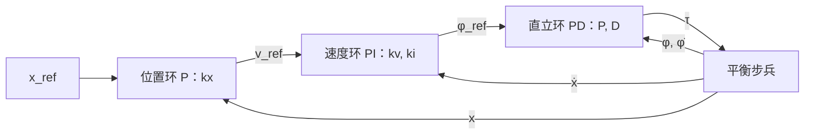

平衡步兵常见的控制结构（据我所知，开源的代码里大多是这样）是：最里面一个“直立环”，输入是车身倾角和倾角速度，输出轮子的力矩；中间一个“速度环”，输出的是倾角的设定值；最外面再套一个位置环。三个 PID，各自整定，叠在一起能站住。这一篇我想回答一个一直没有人（包括我）认真回答过的问题：**这一串 PID，和直接对四个状态做反馈 $u=-Kx$ 有多大区别？** 我的做法是把对象的拉格朗日模型写出来，线性化，用 LQR 算出 $K$，再把一串 PID 展开成它的等价 $K$，放到同一份仿真里比。结果有两处和我预想的不一样：整定好的串级 PID 几乎就是 LQR（代价 6.162 对 6.163），而 LQI 的增益落在串级能表达的范围之外，但它在阶跃上的表现比两个对手都差得多。

> [!NOTE] 本篇检查点
> 这一篇结束时你会有：`make ch09` 通过，`out/ch09/` 下 56 个 CSV（14 个文件，每个 Python、C、C++、Rust 各一份：12 个控制算例、1 个能量自检、1 个增益表），`figures/ch09/` 下 5 张图；以及平衡步兵的拉格朗日推导、线性化、LQR 和 LQI 的推导与实验。
> 新增模块：Python `pidlab.mat` 和 `pidlab.lqr`，C `pl/mat.h`、`pl/lqr.h` 和对应的 `src/mat.c`、`src/lqr.c`，C++ `pidlab/mat.h`、`pidlab/lqr.h`，Rust `mat.rs`、`lqr.rs`（小矩阵运算、矩阵指数、ZOH 离散化、Riccati 迭代、LQR 增益、LQI 增广）。新增对象 `Wip`（四种语言的 `plants` 里）。位置环、速度环、直立环仍是第 5 篇的 `Pid`，没有新的 PID 变体。
> 前置：[第 5 篇](/posts/pid-control-05-practical/)的 `Pid`、[第 7 篇](/posts/pid-control-07-cascade/)的串级接线和 `hold_integral`、[第 8 篇](/posts/pid-control-08-mimo/)的矩阵增益 PID。需要的数学：线性化、状态空间、矩阵指数、特征值。

## 数学

### 对象：平衡步兵的拉格朗日模型

先说我做了什么检查，因为这一节是整篇里最容易默默写错符号的地方：计划里给了两条运动方程，我没有直接抄，而是从拉格朗日量重新推了一遍，再用三个数值检查核对（能量守恒、功率平衡、对中心差分的线性化），这三个检查的结果放在“结果”那一节。

对象是平面里的两轮倒立摆：两个轮子合起来当一个轮子（质量 $m_w=2$ kg，转动惯量 $I_w=0.01$ kg·m²，半径 $r=0.1$ m），车身质量 $M=12$ kg，质心在轮轴上方 $l=0.2$ m，绕质心的转动惯量 $I_b=0.4$ kg·m²，电机力矩上限 10 N·m（这些都是我取的量级，不是实测）。广义坐标取两个：轮子滚过的距离 $x=r\theta_w$，和车身从竖直方向向前倾的角度 $\varphi$（$\varphi>0$ 表示质心跑到 $+x$ 一侧）。

车身质心的位置是 $(x+l\sin\varphi,\ l\cos\varphi)$，速度分量 $\dot x+l\cos\varphi\,\dot\varphi$ 和 $-l\sin\varphi\,\dot\varphi$。动能是轮子的平动加转动、车身质心的平动、车身绕质心的转动：

$$
T=\tfrac12\Bigl(m_w+\tfrac{I_w}{r^2}+M\Bigr)\dot x^2+Ml\cos\varphi\,\dot x\dot\varphi+\tfrac12\,(I_b+Ml^2)\,\dot\varphi^2,
\qquad V=Mgl\cos\varphi
$$

记 $a=m_w+I_w/r^2+M$（数值 15 kg）和 $c=I_b+Ml^2$（0.88 kg·m²）。$L=T-V$ 对 $x$ 不显含，所以 $x$ 方程的左边只有 $\frac{d}{dt}\frac{\partial L}{\partial\dot x}$：

$$
a\ddot x+Ml\cos\varphi\,\ddot\varphi-Ml\sin\varphi\,\dot\varphi^2=Q_x
$$

$\varphi$ 方程里 $\dot x\dot\varphi\sin\varphi$ 这一项在 $\frac{d}{dt}\frac{\partial L}{\partial\dot\varphi}$ 和 $\frac{\partial L}{\partial\varphi}$ 里各出现一次，抵消了：

$$
Ml\cos\varphi\,\ddot x+c\,\ddot\varphi-Mgl\sin\varphi=Q_\varphi
$$

广义力是符号最容易出错的地方，我用虚功算。电机的力矩 $\tau$ 作用在轮子上，同时有一个反作用力矩 $-\tau$ 作用在车身上，所以虚功是 $\tau\,\delta\theta_w-\tau\,\delta\varphi=\tfrac{\tau}{r}\delta x-\tau\,\delta\varphi$，于是 $Q_x=\tau/r$，$Q_\varphi=-\tau$。**$\tau>0$ 的意思是轮子向前滚，车身被向后推**，和“加速时身体后仰”的日常经验一致。再加一个计划里没有的外力：水平方向的力 $F$ 作用在车身质心上（后面的 `push` 算例要用），虚功是 $F\,\delta(x+l\sin\varphi)=F\,\delta x+Fl\cos\varphi\,\delta\varphi$，所以 $Q_x$ 多一个 $F$，$Q_\varphi$ 多一个 $Fl\cos\varphi$。完整的模型是：

$$
\begin{aligned}
a\ddot x+Ml\cos\varphi\,\ddot\varphi-Ml\sin\varphi\,\dot\varphi^2&=\tau/r+F\\
Ml\cos\varphi\,\ddot x+c\,\ddot\varphi-Mgl\sin\varphi&=-\tau+Fl\cos\varphi
\end{aligned}
$$

这就是 `plants.py` 里 `Wip` 的两个等式，和计划里的方程完全一致（我原本以为多了一项向心力或者少了一项，没有，和第 8 篇麦轮不同）。每次求导数的时候解一个 2×2：$\begin{bmatrix}a&Ml\cos\varphi\\Ml\cos\varphi&c\end{bmatrix}$ 乘 $(\ddot x,\ddot\varphi)$ 等于右边，行列式 $ac-(Ml\cos\varphi)^2$ 在 $\varphi=0$ 是 7.44，永远不会是 0（$a c - M^2l^2\cos^2\varphi\ge ac-M^2l^2$），直接用克莱姆法则。

### 线性化：A 和 B 是怎么出来的

在 $\varphi=0$ 附近取 $\sin\varphi\approx\varphi$，$\cos\varphi\approx1$，丢掉 $\dot\varphi^2$，令 $F=0$：

$$
\begin{bmatrix}a&Ml\\Ml&c\end{bmatrix}\begin{bmatrix}\ddot x\\\ddot\varphi\end{bmatrix}=\begin{bmatrix}\tau/r\\Mgl\,\varphi-\tau\end{bmatrix}
$$

记 $\Delta=ac-(Ml)^2$，把 2×2 求逆：

$$
\ddot x=\frac{-Ml\cdot Mgl}{\Delta}\,\varphi+\frac{c/r+Ml}{\Delta}\,\tau,\qquad
\ddot\varphi=\frac{a\cdot Mgl}{\Delta}\,\varphi-\frac{a+Ml/r}{\Delta}\,\tau
$$

代入 $Ml=2.4$，$Mgl=23.544$，$\Delta=15\times0.88-2.4^2=7.44$，状态取 $\mathbf x=(x,\dot x,\varphi,\dot\varphi)$：

$$
A=\begin{bmatrix}0&1&0&0\\0&0&-7.595&0\\0&0&0&1\\0&0&47.468&0\end{bmatrix},\qquad
B=\begin{bmatrix}0\\1.505\\0\\-5.242\end{bmatrix}
$$

两个观察。第一，$A$ 的特征值是 $0,0,\pm\sqrt{47.468}=\pm6.89$ rad/s：一个不稳定极点，倾倒的时间常数 $1/6.89=0.145$ s，所以控制器必须比这快得多（1 kHz 对这个来说足够）。第二，$B$ 的第二项和第四项**符号相反**：$\tau>0$ 让轮子向前加速，同时把车身向后推。要让车向前走，一开始得先向后“退”，让车身前倾，再追上去。这是一个非最小相位的系统，阶跃响应里会有一个先反向的小凹坑，后面的图里能看见，凹坑有多深我后面给数。

我不信手推的结果，所以 `report` 把 $A$ 和 $B$ 和 `Wip.deriv` 的中心差分（步长 $10^{-6}$）比了一次：最大误差 $4.47\times10^{-11}$，是差分本身的截断误差量级。

### 离散化：矩阵指数和 ZOH

控制器每 1 ms 跑一次，输入保持不变（第 4 篇的 ZOH），对象 $\dot x=Ax+B\tau$ 的精确离散化是

$$
x_{k+1}=A_dx_k+B_d\tau_k,\qquad A_d=e^{At_s},\quad B_d=\int_0^{t_s}e^{A\sigma}\,d\sigma\,B
$$

两个量可以用一个矩阵指数同时得到：

$$
\exp\Bigl(\begin{bmatrix}A&B\\0&0\end{bmatrix}t_s\Bigr)=\begin{bmatrix}A_d&B_d\\0&I\end{bmatrix}
$$

验证很短：右边那个矩阵的幂级数里，第二列块是 $\sum_{k\ge1}\frac{t_s^k}{k!}A^{k-1}B=\int_0^{t_s}e^{A\sigma}d\sigma\,B$。

矩阵指数我自己写，不调库：**缩放平方**。先把矩阵除以 $2^s$，直到无穷范数不超过 0.5，对缩小后的矩阵做 12 阶泰勒（截断误差大约是 $0.5^{13}/13!\approx2\times10^{-14}$），再平方 $s$ 次。Python 版和 `scipy.linalg.expm` 在 4 个量级（$0.1$ 到 $30$ 倍的随机 5×5 矩阵）上的最大相对误差是 $2.51\times10^{-13}$，低于计划里的 $10^{-12}$。

### LQR：代价函数、Riccati 方程和 Bryson 权重

LQR 要的是在无穷时域里最小化

$$
J=\sum_{k=0}^{\infty}\bigl(x_k^TQx_k+R\,u_k^2\bigr)
$$

的状态反馈 $u_k=-Kx_k$。Kalman 在 [1960 年的 “Contributions to the theory of optimal control”](https://www.boletin.math.org.mx/pdf/2/5/BSMM%282%29.5.102-119.pdf) 里讨论的就是这一类问题（摘要的原话是设计线性控制系统来最小化某个二次函数的积分）；我这里用的是离散时间的形式，推导我没有去对原文，下面的递推式是标准结果，由 `scipy.linalg.solve_discrete_are` 核对。

最优的 $K$ 由离散代数 Riccati 方程（DARE）的解 $P$ 给出：

$$
K=(R+B_d^TPB_d)^{-1}B_d^TPA_d,\qquad
P=Q+A_d^TPA_d-A_d^TPB_d\,(R+B_d^TPB_d)^{-1}B_d^TPA_d
$$

单输入的时候 $R+B_d^TPB_d$ 是标量，求逆就是一次除法。

**权重怎么取。** 我用的是 Bryson 法则：每个状态（和输入）的权重取“允许的最大值”的平方的倒数，见 [UCSB 的一份讲义](https://courses.ece.ucsb.edu/ECE147/147B_W13Byl/lecture/Lecture18_annotated.pdf)（我没有去翻 Bryson 和 Ho 的原书）。允许值我取：位置 0.5 m、速度 1 m/s、倾角 0.1 rad、倾角速度 1 rad/s、力矩 10 N·m，于是

$$
Q=\operatorname{diag}(4,\ 1,\ 100,\ 1),\qquad R=\frac1{10^2}=0.01
$$

**怎么解 DARE：一个我踩了的坑。** 最直接的做法是从 $P=Q$ 出发反复套上面那个式子，直到不再变化，这也是计划里写的。我先这么写了，结果它不收敛：最大变化量 $\max|\Delta P|$ 在第 4454 步降到最低的 $4.2\times10^{-2}$，然后开始变大，到第 20000 步是 $4.9\times10^{44}$（`report` 里把这个原始版本留着，单独跑一遍打印出来）。原因我猜是舍入：$A_d^TPA_d$ 和 $A_d^TPB_d(\cdot)^{-1}B_d^TPA_d$ 是两个很大、很接近的量相减，而对象有一个不稳定模态，把相减后剩下的舍入误差一步步放大。

修法是把递推换成一个等价但全是“正半定的项相加”的形式：先用当前的 $P$ 算出 $K$，再

$$
P\leftarrow Q+K^TRK+(A_d-B_dK)^TP\,(A_d-B_dK)
$$

等价性两行就能看出来：展开右边得 $Q+A_d^TPA_d-2K^TB_d^TPA_d+K^T(R+B_d^TPB_d)K$，而 $K^T(R+B_d^TPB_d)K=K^TB_d^TPA_d$（把 $K$ 的定义代进去），合并后正是 DARE 的右边。收敛判据按计划：$\max|\Delta P|<10^{-12}(1+\max|P|)$，上限 200000 步，超过返回错误。1 kHz 下 LQR 要 13067 步，LQI 要 15178 步（慢的原因是最慢的闭环极点在 $1-0.00084$，也就是 1.2 s 的时间常数，对 1 ms 的步长来说要迭代上万次）。

这个判据有一个代价：停下来的时候，$P$ 离真解还差大约 $\Delta P/(1-\rho)$，$\rho$ 是收敛率，接近 1。实测 Python 的 $P$ 和 `solve_discrete_are` 的相对差（除以 $\max|P|$）是 LQR $6.53\times10^{-10}$、LQI $4.53\times10^{-10}$，$K$ 是 $3.07\times10^{-10}$ 和 $1.99\times10^{-10}$。过了计划里的 $10^{-9}$ 线，但只有一倍多的余量。

### LQI：给位置误差加一个积分状态

LQR 的 $u=-Kx$ 没有积分：外力持续作用的时候，平衡点会偏。第 1 篇说过，积分项迫使任何稳态的误差为零，LQI 把同一件事放进状态里：增广一个状态 $z$，让它积分位置误差，

$$
z_{k+1}=z_k+t_s\,(x_{ref}-x_k),\qquad
\begin{bmatrix}x\\z\end{bmatrix}_{k+1}=\begin{bmatrix}A_d&0\\-t_s\,c&1\end{bmatrix}\begin{bmatrix}x\\z\end{bmatrix}_k+\begin{bmatrix}B_d\\0\end{bmatrix}u_k+\begin{bmatrix}0\\t_s\end{bmatrix}x_{ref}
$$

$c=(1,0,0,0)$ 取出位置。对这个五阶系统用同一个 DARE 求解，$Q$ 多一项 $q_z=4$，得到 $K$ 的五个分量，最后一个是 $k_z$。我把参考也放进了比例项：$u=-K(x-x_{ref}e_0)-k_zz$，等价于把状态平移到参考点（平衡步兵在任何位置都是平衡点，平移不改变动力学）。力矩饱和时冻结 $z$（和第 5 篇的 `CLAMP` 同一个思路）。

### 串级 PID 是一个受限的状态反馈

现在回到开头的问题。串级的三个环，用第 5 篇的 `Pid` 搭：



直立环的符号要说一下。从上面线性化的结果看，倾角 $\varphi>0$（质心在前）的时候要让轮子向前滚（$\tau>0$）去追质心，也就是 $\tau=+P\varphi+D\dot\varphi$，$P,D>0$。第 5 篇的 `Pid` 算的是 $k_p(r-y)$，所以直立环的 `kp`、`kd` 取**负数**：$-P$ 和 $-D$（`Pid` 允许负增益，第 8 篇 Wood–Berry 的回路 2 就用过）。D 项作用在测量上（`c = 0`），所以 $D$ 项是 $-D\cdot\frac{d}{dt}(-\varphi)=+D\dot\varphi$。速度环输出倾角设定值：想前进更快，就把车身往前倾，$\varphi_{ref}=k_v(v_{ref}-\dot x)+w$，$\dot w=k_i(v_{ref}-\dot x)$，位置环 $v_{ref}=k_x(x_{ref}-x)$。

把三层展开，$\tau=P\varphi+D\dot\varphi-P\varphi_{ref}$：

$$
\tau=P\varphi+D\dot\varphi-Pk_v\bigl(k_x(x_{ref}-x)-\dot x\bigr)-Pw
$$

积分 $w=k_i\int(k_x(x_{ref}-x)-\dot x)\,dt=k_i\bigl(k_xz-(x-x_0)\bigr)$（$z$ 就是上一节 LQI 的 $z$）。整理成 $\tau=-K\,[x-x_{ref},\ \dot x,\ \varphi,\ \dot\varphi,\ z]^T$：

$$
K_x=-P(k_vk_x+k_i),\quad K_{\dot x}=-Pk_v,\quad K_\varphi=-P,\quad K_{\dot\varphi}=-D,\quad K_z=Pk_ik_x
$$

（差一个只取决于 $x_{ref}-x_0$ 的常值力矩，tilt 和 push 里它是 0，阶跃里它等价于积分器的初值不同。）**一串 PID 就是一个状态反馈，五个增益对应 $K$ 的五个分量。** 这是“PID 是 LQI 的一个受限子集”这句话的准确含义。受限在哪？五个参数 $(P,D,k_v,k_x,k_i)$ 对五个分量，看起来够，但中间有一个二次方程：已知一个目标 $K$，$P=-K_\varphi$，$D=-K_{\dot\varphi}$，$k_v=K_{\dot x}/K_\varphi$ 直接得到；剩下 $K_x$ 和 $K_z$ 要求

$$
k_vk_x+k_i=\alpha\equiv\frac{K_x}{K_\varphi},\qquad k_ik_x=\beta\equiv-\frac{K_z}{K_\varphi}
\quad\Longrightarrow\quad k_vk_x^2-\alpha k_x+\beta=0
$$

**没有实根的时候，这个 $K$ 就是任何一组串级增益都够不着的。** 判别式 $\alpha^2-4k_v\beta$ 是 LQI 的 $K$ 能不能被串级复现的判据。LQI 的 $K$ 是 $(-46.34,\ -45.82,\ -150.39,\ -25.54,\ 19.34)$，算出来 $\alpha=0.3082$，$\beta=0.1286$，$k_v=0.3047$，判别式是 $-0.0618<0$。没有实根。离它最近的串级取判别式的顶点，$k_x=\alpha/(2k_v)=0.5057$，$k_i=\alpha-k_vk_x=0.1541$，这样前四个分量和 LQI 完全一样，$K_z$ 只有 11.72（LQI 是 19.34）。

**整定。** 五个增益我交给 `scipy.optimize.minimize(method="Nelder-Mead")`，目标是 $\sum(x^TQx+R\tau^2)\,t_s$ 在 `step` 算例里的值（和 LQR 同一个代价，状态取相对参考的偏差），从上面这组“最接近 LQI”的增益出发，五个增益都限制非负，`maxiter=4000`。优化过程中仿真用每个采样一步 RK4（正式的仿真是每个采样 10 步）。把算出来的增益写进 `data/ch09_cascade_gains.csv`，三个原生程序从里面读，不自己重整定。

## Python 实现

先是两个新模块。`pidlab/mat.py` 是 LQR 要用的那几个矩阵运算，矩阵是行列表组成的列表（`list[list[float]]`），没有用 numpy，因为这是原生版本要逐位对上的参考实现。numpy 和 scipy 只出现在 `report` 里做核对：

```python
"""Small dense matrices as lists of rows: just what LQR needs."""

Matrix = list[list[float]]


def zeros(n: int, m: int) -> Matrix:
    return [[0.0] * m for _ in range(n)]


def identity(n: int) -> Matrix:
    a = zeros(n, n)
    for i in range(n):
        a[i][i] = 1.0
    return a


def mul(a: Matrix, b: Matrix) -> Matrix:
    """a (n x k) times b (k x m)."""
    n, k, m = len(a), len(b), len(b[0])
    out = zeros(n, m)
    for i in range(n):
        for j in range(m):
            s = 0.0
            for p in range(k):
                s += a[i][p] * b[p][j]
            out[i][j] = s
    return out


def add(a: Matrix, b: Matrix) -> Matrix:
    return [[x + y for x, y in zip(ra, rb)] for ra, rb in zip(a, b)]


def sub(a: Matrix, b: Matrix) -> Matrix:
    return [[x - y for x, y in zip(ra, rb)] for ra, rb in zip(a, b)]


def scale(a: Matrix, s: float) -> Matrix:
    return [[x * s for x in row] for row in a]


def transpose(a: Matrix) -> Matrix:
    return [list(col) for col in zip(*a)]


def max_abs(a: Matrix) -> float:
    return max(abs(x) for row in a for x in row)
```

然后是 `pidlab/lqr.py`，五个函数：`expm`、`c2d_zoh`、`dare_iterate`、`lqr_gain`、`lqi_augment`。输入矩阵 $B$ 是 $n\times1$ 的列，增益 $K$ 是 $1\times n$ 的行，单输入的约定写在文档里：

```python
"""Discrete LQR: matrix exponential, ZOH, Riccati iteration, LQI."""

from pidlab.mat import (
    Matrix,
    add,
    identity,
    max_abs,
    mul,
    scale,
    sub,
    transpose,
    zeros,
)

TAYLOR_ORDER = 12
MAX_ITER = 200000


def expm(a: Matrix) -> Matrix:
    """exp(a): scale until ||a||_inf <= 0.5, Taylor to order 12, square."""
    n = len(a)
    nrm = 0.0
    for row in a:
        s = 0.0
        for x in row:
            s += abs(x)
        nrm = max(nrm, s)
    squarings = 0
    while nrm > 0.5:
        nrm *= 0.5
        squarings += 1
    h = scale(a, 0.5**squarings)
    term = identity(n)
    out = identity(n)
    for k in range(1, TAYLOR_ORDER + 1):
        term = scale(mul(term, h), 1.0 / k)
        out = add(out, term)
    for _ in range(squarings):
        out = mul(out, out)
    return out


def c2d_zoh(a: Matrix, b: Matrix, ts: float) -> tuple[Matrix, Matrix]:
    """Zero-order-hold discretization via exp([[A, B], [0, 0]] ts)."""
    n, m = len(a), len(b[0])
    big = zeros(n + m, n + m)
    for i in range(n):
        for j in range(n):
            big[i][j] = a[i][j] * ts
        for j in range(m):
            big[i][n + j] = b[i][j] * ts
    e = expm(big)
    ad = [row[:n] for row in e[:n]]
    bd = [row[n:] for row in e[:n]]
    return ad, bd


def dare_iterate(
    ad: Matrix, bd: Matrix, q: Matrix, r: float
) -> tuple[Matrix, int]:
    """Iterate the Riccati map of a single-input system to a fixed point.

    Each step computes K = (R + B'PB)^-1 B'PA and then
    P <- Q + K'RK + (A - BK)'P(A - BK), which equals
    Q + A'PA - A'PB (R + B'PB)^-1 B'PA but is a sum of positive
    semidefinite terms. Stops when max|dP| < 1e-12 (1 + max|P|) and
    raises RuntimeError after 200000 steps.
    """
    p = q
    for it in range(1, MAX_ITER + 1):
        k = lqr_gain(ad, bd, p, r)
        acl = sub(ad, mul(bd, k))
        kt = transpose(k)
        pn = add(q, scale(mul(kt, k), r))
        pn = add(pn, mul(transpose(acl), mul(p, acl)))
        done = max_abs(sub(pn, p)) < 1e-12 * (1.0 + max_abs(pn))
        p = pn
        if done:
            return p, it
    raise RuntimeError("DARE iteration did not converge")


def lqr_gain(ad: Matrix, bd: Matrix, p: Matrix, r: float) -> Matrix:
    """K = (R + B'PB)^-1 B'PA as a 1 x n matrix."""
    pb = mul(p, bd)
    s = r + mul(transpose(bd), pb)[0][0]
    return scale(mul(transpose(pb), ad), 1.0 / s)


def lqi_augment(
    ad: Matrix, bd: Matrix, c: Matrix, ts: float
) -> tuple[Matrix, Matrix]:
    """Append z+ = z + ts (x_ref - c x) to the state. c is 1 x n."""
    n = len(ad)
    aa = zeros(n + 1, n + 1)
    ba = zeros(n + 1, 1)
    for i in range(n):
        for j in range(n):
            aa[i][j] = ad[i][j]
        ba[i][0] = bd[i][0]
        aa[n][i] = -ts * c[0][i]
    aa[n][n] = 1.0
    return aa, ba
```

三处细节。`expm` 里求范数用显式的循环累加，不用 `sum()`：Python 3.12 起 `sum()` 对浮点数用补偿求和，和 C 的朴素累加在最后一位上会不同，虽然在这里只影响“要缩放几次”这个判断，我还是把它对齐了。`dare_iterate` 里 `K` 在每一步都重新算，就是上面数学里的稳定形式。`lqi_augment` 只放进了“位置误差”这一个积分，`c` 是参数，换成别的输出行也能用。

新对象 `Wip` 加在 `plants.py` 里，和 `Mecanum` 并列。`deriv` 里的 2×2 直接用克莱姆法则，`energy` 是自检用的，`linearize` 是上面手推的 $A$、$B$（只给 $\tau$ 这一列，外力 $F$ 只出现在非线性模型里）：

```python
@dataclass
class Wip:
    """Planar wheeled inverted pendulum (平衡步兵), Lagrange model.

    Coordinates x = r theta_w (wheel travel) and body pitch phi from the
    vertical, positive towards +x. With a = mw + Iw / r^2 + M and
    c = Ib + M l^2:

        a x'' + M l cos(phi) phi'' - M l sin(phi) phi'^2 = tau / r + F
        M l cos(phi) x'' + c phi'' - M g l sin(phi)
            = -tau + F l cos(phi)

    tau is the motor torque on the wheel (the body feels -tau); F is a
    horizontal force on the body COM. State x = [x, xd, phi, phid];
    input u = [tau, F]. The 2 x 2 system is solved on every call.
    """

    m: float = 12.0
    l: float = 0.2  # noqa: E741
    ib: float = 0.4
    mw: float = 2.0
    r: float = 0.1
    iw: float = 0.01
    g: float = 9.81
    tau_max: float = 10.0

    n = 4
    m_in = 2

    def _coefs(self) -> tuple[float, float]:
        a = self.mw + self.iw / (self.r * self.r) + self.m
        return a, self.ib + self.m * self.l * self.l

    def deriv(self, x, u):
        a, c = self._coefs()
        ml = self.m * self.l
        s, co = math.sin(x[2]), math.cos(x[2])
        r1 = u[0] / self.r + u[1] + ml * s * x[3] * x[3]
        r2 = -u[0] + u[1] * self.l * co + ml * self.g * s
        b = ml * co
        det = a * c - b * b
        return [
            x[1],
            (c * r1 - b * r2) / det,
            x[3],
            (a * r2 - b * r1) / det,
        ]

    def energy(self, x) -> float:
        """Kinetic plus potential energy (the COM height is l cos phi)."""
        a, c = self._coefs()
        ml = self.m * self.l
        co = math.cos(x[2])
        kin = 0.5 * a * x[1] * x[1] + ml * co * x[1] * x[3]
        kin += 0.5 * c * x[3] * x[3]
        return kin + ml * self.g * co

    def linearize(self) -> tuple[list[list[float]], list[list[float]]]:
        """A, B of x' = A x + B tau at phi = 0 (hand derivation, ch09)."""
        a, c = self._coefs()
        ml = self.m * self.l
        mgl = ml * self.g
        det = a * c - ml * ml
        amat = [
            [0.0, 1.0, 0.0, 0.0],
            [0.0, 0.0, -ml * mgl / det, 0.0],
            [0.0, 0.0, 0.0, 1.0],
            [0.0, 0.0, a * mgl / det, 0.0],
        ]
        bmat = [
            [0.0],
            [(c / self.r + ml) / det],
            [0.0],
            [-(a + ml / self.r) / det],
        ]
        return amat, bmat
```

驱动 `ch09_lqr.py` 的核心是两个把串级增益和状态反馈 $K$ 互相换算的函数、两个控制器类和一个仿真函数。换算在数学里推过，这里是代码。串级的接线和第 7 篇一样：外环的输出是内环的设定值，速度环的 `hold_integral` 是直立环**上一拍**的 `saturated`。状态反馈那一个，LQR 和 LQI 是同一个类，`integral` 标志区分：

```python
def cascade_equivalent(g: dict) -> list[float]:
    """The 5-entry K the cascade amounts to when the D term is a gyro.

    u = P phi + D phid - P phi_ref with phi_ref = kv (v_ref - xd) + w,
    v_ref = kx (x_ref - x) and w' = ki (v_ref - xd). With
    z' = x_ref - x the integral is w = ki (kx z - (x - x0)), so
    u = -K [x - x_ref, xd, phi, phid, z] with K returned here, up to a
    constant torque that depends on x_ref - x0 (zero for tilt and push).
    """
    p, d = g["p"], g["d"]
    return [
        -p * (g["kv"] * g["kx"] + g["ki"]),
        -p * g["kv"],
        -p,
        -d,
        p * g["ki"] * g["kx"],
    ]
```

```python
def nearest_cascade(k: list[float]) -> dict:
    """Cascade gains whose equivalent K is closest to k (see the post).

    P, D and kv are fixed by k_phi, k_phid and k_xd. The remaining two
    entries need kv kx + ki = alpha and ki kx = beta, i.e. a root of
    kv kx^2 - alpha kx + beta = 0. Without a real root the vertex
    kx = alpha / (2 kv) matches alpha exactly and undershoots beta.
    """
    p, d = -k[2], -k[3]
    kv = k[1] / k[2]
    alpha = k[0] / k[2]
    beta = -k[4] / k[2]
    disc = alpha * alpha - 4.0 * kv * beta
    kx = (
        (alpha + math.sqrt(disc)) / (2.0 * kv)
        if disc >= 0.0
        else (alpha / (2.0 * kv))
    )
    return {"kx": kx, "kv": kv, "ki": alpha - kv * kx, "p": p, "d": d}
```

```python
class Cascade:
    """Position P -> velocity PI -> pitch PD, all from the ch05 Pid."""

    def __init__(self, g: dict) -> None:
        lim = Wip().tau_max
        self.pos = Pid(PidConfig(g["kx"], 0.0, 0.0, TS))
        self.vel = Pid(PidConfig(g["kv"], g["ki"], 0.0, TS))
        # u = P phi + D phid: the pitch loop has negative gains
        self.pit = Pid(
            PidConfig(-g["p"], 0.0, -g["d"], TS, u_min=-lim, u_max=lim)
        )

    def update(self, x: list[float], xref: float) -> float:
        vref = self.pos.update(xref, x[0])
        phiref = self.vel.update(vref, x[1], 0.0, self.pit.saturated)
        return self.pit.update(phiref, x[2])
```

```python
class StateFeedback:
    """u = -K (x - x_ref e0) (- k_z z): LQR when k_z is 0, LQI otherwise."""

    def __init__(self, k: list[float], integral: bool) -> None:
        self.k = k
        self.integral = integral
        self.z = 0.0
        self.lim = Wip().tau_max

    def update(self, x: list[float], xref: float) -> float:
        xt = [x[0] - xref, x[1], x[2], x[3]]
        s = 0.0
        for i in range(4):
            s += self.k[i] * xt[i]
        if self.integral:
            s += self.k[4] * self.z
        v = -s
        u = min(max(v, -self.lim), self.lim)
        if self.integral and u == v:
            self.z -= TS * xt[0]
        return u
```

```python
def simulate(
    name: str,
    gains: dict,
    data: dict,
    substeps: int = SUBSTEPS,
) -> dict[str, np.ndarray]:
    plant = Wip()
    plant.m *= float(data["mscale"][0])
    ctl = make_controller(name, gains)
    x = [0.0, 0.0, float(data["phi0"][0]), 0.0]
    rows = []
    for k in range(len(data["t"])):
        tau = ctl.update(x, data["xref"][k])
        rows.append([data["t"][k], *x, tau])
        x = advance(plant.deriv, x, [tau, data["force"][k]], TS, substeps)
        if abs(x[2]) > 3.0:  # fallen over: freeze (the loop is not a model
            x[2] = math.copysign(3.0, x[2])  # of lying on the floor)
            x[3] = 0.0
    return dict(zip(COLUMNS, np.array(rows, dtype=float).T))
```

`simulate` 的循环顺序和第 1 篇定的约定一样：先用当前状态算控制量，写一行记录（`tau` 是限幅后实际作用的力矩），再保持力矩和外力不变积分 10 个 RK4 步。倾角超过 3 rad 的时候把它冻在 3 rad 上，免得倒下去之后的数值没有意义，本章所有算例都没有走到这一步（`report` 断言了 $|\varphi|<0.5$）。完整驱动（含 `report`、画图）折在这里：

<details>
<summary>完整源码：python/ch09_lqr.py</summary>

```python
#!/usr/bin/env python3
"""Chapter 9 driver: `ch09_lqr.py ref` then `report`."""

import math
import sys
from pathlib import Path

import numpy as np

sys.path.insert(0, str(Path(__file__).resolve().parent))
from compare import compare_dir  # noqa: E402
from pidlab.io import read_csv, write_csv  # noqa: E402
from pidlab.lqr import (  # noqa: E402
    c2d_zoh,
    dare_iterate,
    expm,
    lqi_augment,
    lqr_gain,
)
from pidlab.mat import (  # noqa: E402
    Matrix,
    add,
    mul,
    scale,
    sub,
    transpose,
)
from pidlab.pid import Pid, PidConfig  # noqa: E402
from pidlab.plants import Wip  # noqa: E402
from pidlab.plotting import ROOT  # noqa: E402
from pidlab.sim import advance  # noqa: E402

TS = 1e-3
SUBSTEPS = 10
ROWS = 5000  # 5 s
Q_DIAG = (4.0, 1.0, 100.0, 1.0)  # Bryson: 0.5 m, 1 m/s, 0.1 rad, 1 rad/s
QZ = 4.0
R = 0.01  # Bryson: 10 N m
TILT_PHI0 = 0.15
STEP_T, STEP_X = 0.5, 1.0
PUSH_T, PUSH_F = 2.0, 10.0
MASS_SCALE = 1.3
SCENARIOS = ("tilt", "step", "push", "mass130")
CONTROLLERS = ("cascade", "lqr", "lqi")
COLUMNS = ("t", "x", "xd", "phi", "phid", "tau")
GAIN_COLUMNS = ("k_x", "k_xd", "k_phi", "k_phid", "k_z")
OUT = ROOT / "out" / "ch09"
DATA = ROOT / "data"

# energy self-check: no torque, no damping, 2 s at h = 1e-4
E_PHI0 = 0.3
E_H = 1e-4
E_STEPS = 20000
E_EVERY = 100
E_TOL = 1e-6


# ---- design --------------------------------------------------------------


def q_matrix(n: int) -> Matrix:
    q = [[0.0] * n for _ in range(n)]
    for i, v in enumerate(Q_DIAG):
        q[i][i] = v
    if n == 5:
        q[4][4] = QZ
    return q


def design() -> dict:
    """Discretize the linearization and solve LQR and LQI."""
    a, b = Wip().linearize()
    ad, bd = c2d_zoh(a, b, TS)
    p4, it4 = dare_iterate(ad, bd, q_matrix(4), R)
    k4 = lqr_gain(ad, bd, p4, R)
    aa, ba = lqi_augment(ad, bd, [[1.0, 0.0, 0.0, 0.0]], TS)
    p5, it5 = dare_iterate(aa, ba, q_matrix(5), R)
    k5 = lqr_gain(aa, ba, p5, R)
    return {
        "a": a,
        "b": b,
        "ad": ad,
        "bd": bd,
        "aa": aa,
        "ba": ba,
        "p4": p4,
        "p5": p5,
        "iters": (it4, it5),
        "k_lqr": k4[0] + [0.0],
        "k_lqi": k5[0],
    }


def cascade_equivalent(g: dict) -> list[float]:
    """The 5-entry K the cascade amounts to when the D term is a gyro.

    u = P phi + D phid - P phi_ref with phi_ref = kv (v_ref - xd) + w,
    v_ref = kx (x_ref - x) and w' = ki (v_ref - xd). With
    z' = x_ref - x the integral is w = ki (kx z - (x - x0)), so
    u = -K [x - x_ref, xd, phi, phid, z] with K returned here, up to a
    constant torque that depends on x_ref - x0 (zero for tilt and push).
    """
    p, d = g["p"], g["d"]
    return [
        -p * (g["kv"] * g["kx"] + g["ki"]),
        -p * g["kv"],
        -p,
        -d,
        p * g["ki"] * g["kx"],
    ]


def nearest_cascade(k: list[float]) -> dict:
    """Cascade gains whose equivalent K is closest to k (see the post).

    P, D and kv are fixed by k_phi, k_phid and k_xd. The remaining two
    entries need kv kx + ki = alpha and ki kx = beta, i.e. a root of
    kv kx^2 - alpha kx + beta = 0. Without a real root the vertex
    kx = alpha / (2 kv) matches alpha exactly and undershoots beta.
    """
    p, d = -k[2], -k[3]
    kv = k[1] / k[2]
    alpha = k[0] / k[2]
    beta = -k[4] / k[2]
    disc = alpha * alpha - 4.0 * kv * beta
    kx = (
        (alpha + math.sqrt(disc)) / (2.0 * kv)
        if disc >= 0.0
        else (alpha / (2.0 * kv))
    )
    return {"kx": kx, "kv": kv, "ki": alpha - kv * kx, "p": p, "d": d}


# ---- controllers ---------------------------------------------------------


class Cascade:
    """Position P -> velocity PI -> pitch PD, all from the ch05 Pid."""

    def __init__(self, g: dict) -> None:
        lim = Wip().tau_max
        self.pos = Pid(PidConfig(g["kx"], 0.0, 0.0, TS))
        self.vel = Pid(PidConfig(g["kv"], g["ki"], 0.0, TS))
        # u = P phi + D phid: the pitch loop has negative gains
        self.pit = Pid(
            PidConfig(-g["p"], 0.0, -g["d"], TS, u_min=-lim, u_max=lim)
        )

    def update(self, x: list[float], xref: float) -> float:
        vref = self.pos.update(xref, x[0])
        phiref = self.vel.update(vref, x[1], 0.0, self.pit.saturated)
        return self.pit.update(phiref, x[2])


class StateFeedback:
    """u = -K (x - x_ref e0) (- k_z z): LQR when k_z is 0, LQI otherwise."""

    def __init__(self, k: list[float], integral: bool) -> None:
        self.k = k
        self.integral = integral
        self.z = 0.0
        self.lim = Wip().tau_max

    def update(self, x: list[float], xref: float) -> float:
        xt = [x[0] - xref, x[1], x[2], x[3]]
        s = 0.0
        for i in range(4):
            s += self.k[i] * xt[i]
        if self.integral:
            s += self.k[4] * self.z
        v = -s
        u = min(max(v, -self.lim), self.lim)
        if self.integral and u == v:
            self.z -= TS * xt[0]
        return u


def make_controller(name: str, gains: dict):
    if name == "cascade":
        return Cascade(gains["cascade"])
    if name == "lqr":
        return StateFeedback(gains["k_lqr"], False)
    return StateFeedback(gains["k_lqi"], True)


# ---- simulation ----------------------------------------------------------


def simulate(
    name: str,
    gains: dict,
    data: dict,
    substeps: int = SUBSTEPS,
) -> dict[str, np.ndarray]:
    plant = Wip()
    plant.m *= float(data["mscale"][0])
    ctl = make_controller(name, gains)
    x = [0.0, 0.0, float(data["phi0"][0]), 0.0]
    rows = []
    for k in range(len(data["t"])):
        tau = ctl.update(x, data["xref"][k])
        rows.append([data["t"][k], *x, tau])
        x = advance(plant.deriv, x, [tau, data["force"][k]], TS, substeps)
        if abs(x[2]) > 3.0:  # fallen over: freeze (the loop is not a model
            x[2] = math.copysign(3.0, x[2])  # of lying on the floor)
            x[3] = 0.0
    return dict(zip(COLUMNS, np.array(rows, dtype=float).T))


def step_cost(o: dict[str, np.ndarray], xref: np.ndarray) -> float:
    """Quadratic cost sum (x'Qx + R tau^2) ts of one run."""
    ex = o["x"] - xref
    c = Q_DIAG[0] * ex**2 + Q_DIAG[1] * o["xd"] ** 2
    c += Q_DIAG[2] * o["phi"] ** 2 + Q_DIAG[3] * o["phid"] ** 2
    c += R * o["tau"] ** 2
    return float(np.sum(c) * TS)


def tune_cascade(k_lqi: list[float], data: dict) -> tuple[dict, dict]:
    """Nelder-Mead on the step-scenario cost, from the nearest mapping."""
    from scipy.optimize import minimize

    start = nearest_cascade(k_lqi)
    names = ("kx", "kv", "ki", "p", "d")

    def unpack(v) -> dict:
        return dict(zip(names, (float(a) for a in v)))

    def cost(v) -> float:
        g = unpack(v)
        try:
            o = simulate("cascade", {"cascade": g}, data, 1)
        except ValueError:
            return 1e9
        if np.max(np.abs(o["phi"])) > 1.2:
            return 1e9
        return step_cost(o, data["xref"])

    x0 = [start[n] for n in names]
    res = minimize(
        cost,
        x0,
        method="Nelder-Mead",
        bounds=[(0.0, None)] * 5,  # no negative gains: no positive feedback
        options={"maxiter": 4000},
    )
    info = {
        "start": start,
        "start_cost": float(cost(x0)),
        "cost": float(res.fun),
        "nit": int(res.nit),
        "nfev": int(res.nfev),
    }
    return unpack(res.x), info


# ---- data and reference --------------------------------------------------


def scenario_table(name: str, rows: int = ROWS) -> dict[str, np.ndarray]:
    k = np.arange(rows)
    t = k * TS
    xref = np.zeros(rows)
    force = np.zeros(rows)
    phi0, mscale = 0.0, 1.0
    if name == "tilt":
        phi0 = TILT_PHI0
    elif name in ("step", "mass130"):
        xref = STEP_X * (t >= STEP_T)
        mscale = MASS_SCALE if name == "mass130" else 1.0
    else:
        force = PUSH_F * (t >= PUSH_T)
    return {
        "t": t,
        "xref": xref,
        "force": force,
        "phi0": np.full(rows, phi0),
        "mscale": np.full(rows, mscale),
    }


def energy_run(h: float = E_H, steps: int = E_STEPS) -> dict:
    """tau = 0, no damping: E must stay put while the robot falls over.

    Returns the trace every E_EVERY steps and the worst drift over all steps.
    """
    plant = Wip()
    x = [0.0, 0.0, E_PHI0, 0.0]
    e0 = plant.energy(x)
    rows = []
    worst = 0.0
    for k in range(steps + 1):
        e_rel = (plant.energy(x) - e0) / e0
        worst = max(worst, abs(e_rel))
        if k % E_EVERY == 0:
            rows.append([k * h, x[2], e_rel])
        if k < steps:
            x = advance(plant.deriv, x, [0.0, 0.0], h, 1)
    cols = dict(zip(("t", "phi", "e_rel"), np.array(rows).T))
    cols["worst"] = worst
    return cols


def ref() -> None:
    tables = {n: scenario_table(n) for n in SCENARIOS}
    for n, tab in tables.items():
        write_csv(DATA / f"ch09_{n}.csv", tab)
    g = design()
    cas, info = tune_cascade(g["k_lqi"], tables["step"])
    write_csv(
        DATA / "ch09_nelder_mead.csv",
        {
            n: np.array([info[n]])
            for n in ("start_cost", "cost", "nit", "nfev")
        },
    )
    write_csv(
        DATA / "ch09_cascade_gains.csv",
        {n: np.array([cas[n]]) for n in ("kx", "kv", "ki", "p", "d")},
    )
    gains = {"cascade": cas, "k_lqr": g["k_lqr"], "k_lqi": g["k_lqi"]}
    write_csv(
        OUT / "gains_py.csv",
        {
            n: np.array([g["k_lqr"][i], g["k_lqi"][i]])
            for i, n in enumerate(GAIN_COLUMNS)
        },
    )
    e = energy_run()
    write_csv(OUT / "energy_py.csv", {k: e[k] for k in ("t", "phi", "e_rel")})
    for scn in SCENARIOS:
        data = read_csv(DATA / f"ch09_{scn}.csv")
        for ctl in CONTROLLERS:
            write_csv(OUT / f"{scn}_{ctl}_py.csv", simulate(ctl, gains, data))


# ---- report: the model ---------------------------------------------------


def check_model() -> dict:
    """The Lagrange model against energy, work and finite differences."""
    plant = Wip()
    e = energy_run()
    print(
        f"energy, tau = 0, h = {E_H:g}, {E_STEPS * E_H:g} s: "
        f"max |dE/E0| = {e['worst']:.3e}"
    )
    assert e["worst"] < E_TOL
    e3 = energy_run(1e-3, 2000)
    print(f"  same run at h = 1e-3 (2000 steps): max = {e3['worst']:.3e}")

    # power balance: dE/dt = tau (xd / r - phid) + F (xd + l cos(phi) phid)
    def aug(x, u):
        dx = plant.deriv(x[:4], u)
        p = u[0] * (x[1] / plant.r - x[3])
        p += u[1] * (x[1] + plant.l * math.cos(x[2]) * x[3])
        return [*dx, p]

    x = [0.0, 0.0, 0.2, 0.0, 0.0]
    e0 = plant.energy(x)
    gap = 0.0
    for k in range(3000):
        t = k * 1e-3
        u = [3.0 * math.sin(7.0 * t), 5.0 * math.cos(3.0 * t)]
        x = advance(aug, x, u, 1e-3, 10)
        gap = max(gap, abs(plant.energy(x) - e0 - x[4]))
    print(f"torque and force on, 3 s: max |E - E0 - W| = {gap:.3e} J")
    assert gap < 1e-8
    dx = plant.deriv([0.0, 0.0, 0.0, 0.0], [1.0, 0.0])
    print(
        f"sign check, tau = +1 at rest: xdd = {dx[1]:+.4f}, "
        f"phidd = {dx[3]:+.4f}"
    )
    assert dx[1] > 0.0 > dx[3]
    # linearization against central differences
    a, b = plant.linearize()
    eps = 1e-6
    x0 = [0.0] * 4
    err = 0.0
    for j in range(4):
        xp, xm = list(x0), list(x0)
        xp[j] += eps
        xm[j] -= eps
        fp, fm = plant.deriv(xp, [0.0, 0.0]), plant.deriv(xm, [0.0, 0.0])
        for i in range(4):
            err = max(err, abs((fp[i] - fm[i]) / (2 * eps) - a[i][j]))
    fp, fm = plant.deriv(x0, [eps, 0.0]), plant.deriv(x0, [-eps, 0.0])
    for i in range(4):
        err = max(err, abs((fp[i] - fm[i]) / (2 * eps) - b[i][0]))
    print(f"A, B vs central differences: max error {err:.2e}")
    assert err < 1e-6
    print("A =")
    print(np.array(a))
    print(f"B^T = {np.array(b).ravel()}")
    lam = np.sort(np.linalg.eigvals(np.array(a)).real)
    print(f"open-loop poles (rad/s): {np.array2string(lam, precision=3)}")
    return {"e": e, "e3": e3}


def check_numerics(g: dict) -> dict:
    """expm and DARE against scipy, and the naive Riccati form."""
    import scipy.linalg as sl

    rng = np.random.default_rng(9)
    worst = 0.0
    for scale_a in (0.1, 1.0, 4.0, 30.0):
        m = scale_a * rng.standard_normal((5, 5))
        d = np.abs(np.array(expm(m.tolist())) - sl.expm(m))
        worst = max(worst, float(np.max(d / (1.0 + np.abs(sl.expm(m))))))
    print(f"expm vs scipy.linalg.expm: max relative error {worst:.2e}")
    assert worst < 1e-12
    out = {}
    for name, ad, bd, q, p, k in (
        ("LQR", g["ad"], g["bd"], q_matrix(4), g["p4"], g["k_lqr"][:4]),
        ("LQI", g["aa"], g["ba"], q_matrix(5), g["p5"], g["k_lqi"]),
    ):
        ps = sl.solve_discrete_are(
            np.array(ad), np.array(bd), np.array(q), np.array([[R]])
        )
        rel = float(np.max(np.abs(ps - np.array(p))) / np.max(np.abs(ps)))
        s = R + (np.array(bd).T @ ps @ np.array(bd))[0, 0]
        ks = (np.array(bd).T @ ps @ np.array(ad)) / s
        krel = float(np.max(np.abs(ks - np.array(k))) / np.max(np.abs(ks)))
        it = g["iters"][0 if name == "LQR" else 1]
        print(
            f"{name}: {it} iterations, P vs solve_discrete_are "
            f"{rel:.2e}, K vs scipy {krel:.2e} (relative to the max entry)"
        )
        assert rel < 1e-9
        out[name] = {"rel": rel, "krel": krel}
    # the textbook form of the Riccati map, same loop, same stop rule
    ad, bd, q = g["ad"], g["bd"], q_matrix(4)
    at = transpose(ad)
    p = q
    best, best_it = float("inf"), 0
    for it in range(1, 20001):
        pb = mul(p, bd)
        gg = mul(transpose(pb), ad)
        s = R + mul(transpose(bd), pb)[0][0]
        atpa = mul(at, mul(p, ad))
        pn = sub(add(q, atpa), scale(mul(transpose(gg), gg), 1.0 / s))
        d = max(abs(v) for row in sub(pn, p) for v in row)
        p = pn
        if d < best:
            best, best_it = d, it
    print(
        f"textbook form A'PA - A'PB (R + B'PB)^-1 B'PA: max|dP| bottoms "
        f"out at {best:.1e} (step {best_it}), then grows to {d:.1e} by "
        f"step 20000; the stabilized form converged in {g['iters'][0]}"
    )
    assert d > 1.0
    return out


def closed_loop(g: dict, k: list[float], integral: bool) -> np.ndarray:
    """Eigenvalue moduli of the discrete closed loop with u = -K x."""
    ad, bd = (g["aa"], g["ba"]) if integral else (g["ad"], g["bd"])
    acl = np.array(ad) - np.array(bd) @ np.array([k])
    return np.sort(np.abs(np.linalg.eigvals(acl)))


def check_stability(g: dict, cas: dict, start: dict) -> dict:
    kq = g["k_lqr"][:4]
    out = {}
    # the tuned cascade has k_z = 0: its integrator state is not controlled
    # and sits at eigenvalue 1, so it is checked as a 4-state loop
    for name, k, integral in (
        ("LQR", kq, False),
        ("LQI", g["k_lqi"], True),
        ("cascade (tuned, no I)", cascade_equivalent(cas)[:4], False),
        ("cascade (nearest to LQI)", cascade_equivalent(start), True),
    ):
        mod = closed_loop(g, k, integral)
        rate = -math.log(mod.max()) / TS
        out[name] = (mod, rate)
        print(
            f"{name:26s} max |eig| = {mod.max():.6f}  "
            f"slowest decay {rate:.3f} 1/s (tau = {1.0 / rate:.2f} s)"
        )
        assert mod.max() < 1.0
    return out


# ---- report: scenarios ---------------------------------------------------


def load(scn: str, ctl: str) -> dict[str, np.ndarray]:
    return read_csv(OUT / f"{scn}_{ctl}_py.csv")


def settle_time(t, y, target: float, tol: float) -> float:
    """Last time |y - target| > tol; nan if the run never settles."""
    bad = np.flatnonzero(np.abs(y - target) > tol)
    if len(bad) == 0:
        return 0.0
    if bad[-1] == len(y) - 1:
        return float("nan")
    return float(t[bad[-1] + 1])


def report_scenarios() -> dict:
    res = {(s, c): load(s, c) for s in SCENARIOS for c in CONTROLLERS}
    lim = Wip().tau_max
    print("\ntilt: phi0 = 0.15 rad, x_ref = 0")
    print(
        f"{'ctl':8s} {'|tau| max':>9s} {'sat ms':>7s} {'x max':>7s} "
        f"{'x end':>8s} {'phi<0.01 at':>12s}"
    )
    for c in CONTROLLERS:
        o = res[("tilt", c)]
        sat = float(np.sum(np.abs(o["tau"]) >= lim - 1e-9)) * TS * 1e3
        print(
            f"{c:8s} {np.max(np.abs(o['tau'])):9.2f} {sat:7.0f} "
            f"{np.max(np.abs(o['x'])):7.3f} {o['x'][-1]:8.4f} "
            f"{settle_time(o['t'], o['phi'], 0.0, 0.01):12.3f}"
        )
    for scn in ("step", "mass130"):
        print(f"\n{scn}: x_ref = 1 m at 0.5 s")
        print(
            f"{'ctl':8s} {'overshoot%':>10s} {'x min':>7s} {'x end':>7s} "
            f"{'t95 (s)':>8s} {'phi max':>8s} {'|tau| max':>9s} "
            f"{'sat ms':>7s}"
        )
        for c in CONTROLLERS:
            o = res[(scn, c)]
            sat = float(np.sum(np.abs(o["tau"]) >= lim - 1e-9)) * TS * 1e3
            print(
                f"{c:8s} {100.0 * (np.max(o['x']) - 1.0):10.1f} "
                f"{np.min(o['x'][500:]):7.3f} {o['x'][-1]:7.3f} "
                f"{settle_time(o['t'], o['x'], 1.0, 0.05):8.2f} "
                f"{np.max(np.abs(o['phi'])):8.3f} "
                f"{np.max(np.abs(o['tau'])):9.2f} {sat:7.0f}"
            )
    print("\npush: 10 N on the body COM from 2.0 s")
    print(
        f"{'ctl':8s} {'x @3 s':>7s} {'x @4 s':>7s} {'x @5 s':>7s} "
        f"{'x max':>7s} {'phi @5 s':>9s} {'tau @5 s':>9s}"
    )
    for c in CONTROLLERS:
        o = res[("push", c)]
        print(
            f"{c:8s} {o['x'][3000]:7.3f} {o['x'][4000]:7.3f} "
            f"{o['x'][-1]:7.3f} {np.max(o['x']):7.3f} {o['phi'][-1]:9.4f} "
            f"{o['tau'][-1]:9.4f}"
        )
    return res


def push_steady(k: list[float]) -> tuple[float, float, float]:
    """Exact equilibrium of the robot under the push with u = -K x."""
    p = Wip()
    # tau = -r F from the first equation; the second fixes phi
    tau = -p.r * PUSH_F
    ml = p.m * p.l
    lo, hi = -1.0, 0.0
    for _ in range(80):
        mid = 0.5 * (lo + hi)
        f = ml * p.g * math.sin(mid) + PUSH_F * p.l * math.cos(mid) - tau
        if f > 0.0:
            hi = mid
        else:
            lo = mid
    phi = 0.5 * (lo + hi)
    x = (-tau - k[2] * phi) / k[0]
    return x, phi, tau


def long_push(gains: dict, name: str, rows: int = 30000) -> dict:
    data = scenario_table("push", rows)
    return simulate(name, gains, data)


def report_push(res: dict, g: dict, gains: dict, start: dict) -> dict:
    k = g["k_lqr"]
    x_ss, phi_ss, tau_ss = push_steady(k)
    print(
        f"\npush equilibrium for LQR: tau = {tau_ss:.3f} N m, "
        f"phi = {phi_ss:.4f} rad, x = {x_ss:.4f} m"
    )
    long = {c: long_push(gains, c) for c in CONTROLLERS}
    gains_map = dict(gains)
    gains_map["cascade"] = start
    long["cascade_map"] = long_push(gains_map, "cascade")
    for c, o in long.items():
        print(
            f"{c:12s} 30 s: x(10 s) = {o['x'][10000]:+.4f}, "
            f"x(20 s) = {o['x'][20000]:+.4f}, x(30 s) = {o['x'][-1]:+.4f}, "
            f"phi(30 s) = {o['phi'][-1]:+.4f}"
        )
    # the cascade at the nearest gains against its own equivalent K: same
    # law up to the D term (backward difference instead of phid)
    data = scenario_table("push")
    sf = simulate("lqi", {**gains, "k_lqi": cascade_equivalent(start)}, data)
    casc = simulate("cascade", gains_map, data)
    dev = float(np.max(np.abs(sf["x"] - casc["x"])))
    print(
        f"cascade (nearest) vs state feedback with its equivalent K, push: "
        f"max |dx| = {dev:.2e} m over 5 s"
    )
    assert dev < 1e-3
    assert abs(long["lqr"]["x"][-1] - x_ss) < 1e-3
    assert abs(long["lqr"]["phi"][-1] - phi_ss) < 1e-3
    assert abs(long["lqi"]["x"][-1]) < 1e-3
    assert abs(long["cascade_map"]["x"][-1]) < 1e-3
    assert long["cascade"]["x"][-1] > 0.5
    x5 = {c: res[("push", c)]["x"][-1] for c in CONTROLLERS}
    assert x5["lqi"] < 0.35 * x5["lqr"]
    return {"long": long, "x_ss": x_ss}


def report_cost(gains: dict, start: dict, data: dict) -> dict:
    print("\nstep-scenario cost sum (x'Qx + R tau^2) ts (substeps = 1)")
    cost = {}
    for name, gg in (
        ("cascade (tuned)", gains),
        ("cascade (nearest to LQI)", {**gains, "cascade": start}),
        ("lqr", gains),
        ("lqi", gains),
    ):
        ctl = "cascade" if name.startswith("cascade") else name
        o = simulate(ctl, gg, data, 1)
        cost[name] = step_cost(o, data["xref"])
        print(f"  {name:26s} {cost[name]:9.3f}")
    return cost


def report_step_long(gains: dict) -> None:
    """The 5 s window cuts the step response: look at 30 s."""
    print("\nstep, 30 s run (Python only)")
    data = scenario_table("step", 30000)
    for c in CONTROLLERS:
        o = simulate(c, gains, data)
        j = int(np.argmax(o["x"]))
        print(
            f"  {c:8s} peak x = {o['x'][j]:.4f} at {o['t'][j]:.2f} s "
            f"(overshoot {100.0 * (o['x'][j] - 1.0):.1f}%), "
            f"x(30 s) = {o['x'][-1]:.5f}"
        )
        assert abs(o["x"][-1] - 1.0) < 1e-3


def mass_margin(g: dict, cas: dict, start: dict) -> None:
    """Linear stability against the true mass M x s, gains fixed."""
    print("\nmass sweep (linear, fixed gains, no saturation): stable for s in")
    cases = (
        ("lqr", g["k_lqr"][:4], False),
        ("lqi", g["k_lqi"], True),
        ("cascade (tuned, no I)", cascade_equivalent(cas)[:4], False),
        ("cascade (nearest to LQI)", cascade_equivalent(start), True),
    )
    grid = [round(0.1 * i, 2) for i in range(1, 301)]
    for name, k, integral in cases:
        ok = []
        for sc in grid:
            a, b = Wip(m=12.0 * sc).linearize()
            ad, bd = c2d_zoh(a, b, TS)
            if integral:
                ad, bd = lqi_augment(ad, bd, [[1.0, 0.0, 0.0, 0.0]], TS)
            acl = np.array(ad) - np.array(bd) @ np.array([k])
            ok.append(np.max(np.abs(np.linalg.eigvals(acl))) < 1.0)
        good = [sc for sc, o in zip(grid, ok) if o]
        print(
            f"  {name:26s} {good[0]:.1f} to {good[-1]:.1f} "
            f"({'contiguous' if len(good) == round((good[-1] - good[0]) * 10) + 1 else 'with gaps'})"
        )


# ---- figures -------------------------------------------------------------

COLORS = {"cascade": "tab:green", "lqr": "tab:blue", "lqi": "tab:red"}


def labels() -> dict[str, str]:
    from pidlab.plotting import L

    return {
        "cascade": L("串级 PID", "cascade PID"),
        "lqr": "LQR",
        "lqi": "LQI",
    }


def plot_energy(m: dict) -> None:
    from pidlab.plotting import L, save
    import matplotlib.pyplot as plt

    fig, (a1, a2) = plt.subplots(2, 1, figsize=(8, 6.4), sharex=True)
    e, e3 = m["e"], m["e3"]
    a1.plot(e["t"], e["phi"])
    a1.set_ylabel(L("俯仰角 phi (rad)", "pitch phi (rad)"))
    a2.semilogy(
        e["t"],
        np.abs(e["e_rel"]) + 1e-18,
        label=L("h = 1e-4（本章）", "h = 1e-4"),
    )
    a2.semilogy(
        e3["t"],
        np.abs(e3["e_rel"]) + 1e-18,
        label=L("h = 1e-3", "h = 1e-3"),
    )
    a2.axhline(E_TOL, color="k", ls=":", lw=1)
    a2.set_ylabel(L("相对能量漂移 |dE/E0|", "relative drift |dE/E0|"))
    a2.set_xlabel(L("时间 (秒)", "time (s)"))
    a2.legend(loc="lower right")
    save(fig, "ch09", "energy-check")


def plot_step(res: dict) -> None:
    from pidlab.plotting import L, save
    import matplotlib.pyplot as plt

    lab = labels()
    fig, axes = plt.subplots(3, 1, figsize=(8, 8.6), sharex=True)
    for c in CONTROLLERS:
        o = res[("step", c)]
        axes[0].plot(o["t"], o["x"], color=COLORS[c], label=lab[c])
        axes[1].plot(o["t"], o["phi"], color=COLORS[c])
        axes[2].plot(o["t"], o["tau"], color=COLORS[c])
    axes[0].plot(o["t"], 1.0 * (o["t"] >= STEP_T), "k:", lw=1)
    axes[0].set_ylabel(L("位置 x (m)", "position x (m)"))
    axes[1].set_ylabel(L("俯仰角 phi (rad)", "pitch phi (rad)"))
    axes[2].set_ylabel(L("轮毂力矩 tau (N·m)", "wheel torque (N m)"))
    axes[2].set_xlabel(L("时间 (秒)", "time (s)"))
    axes[0].legend(loc="lower right")
    save(fig, "ch09", "step-compare")


def plot_push(res: dict, pu: dict) -> None:
    from pidlab.plotting import L, save
    import matplotlib.pyplot as plt

    lab = labels()
    fig, (a1, a2) = plt.subplots(2, 1, figsize=(8, 7.2))
    for c in CONTROLLERS:
        o = res[("push", c)]
        a1.plot(o["t"], o["x"], color=COLORS[c], label=lab[c])
    a1.axvline(PUSH_T, color="k", ls=":", lw=1)
    a1.set_xlabel(L("时间 (秒)", "time (s)"))
    a1.set_ylabel(L("位置 x (m)，5 秒", "position x (m), 5 s"))
    a1.legend(loc="upper left")
    t = np.arange(30000) * TS
    for c, o in pu["long"].items():
        if c == "cascade_map":
            a2.plot(
                t,
                o["x"],
                color=COLORS["cascade"],
                ls="--",
                label=L(
                    "串级，积分增益取最接近 LQI 的映射",
                    "cascade, nearest-to-LQI gains",
                ),
            )
        else:
            a2.plot(t, o["x"], color=COLORS[c], label=lab[c])
    a2.axhline(pu["x_ss"], color="k", ls=":", lw=1)
    a2.set_xlabel(L("时间 (秒)", "time (s)"))
    a2.set_ylabel(L("位置 x (m)，30 秒", "position x (m), 30 s"))
    a2.legend(loc="center right")
    save(fig, "ch09", "push-offset")


def plot_mass(res: dict) -> None:
    from pidlab.plotting import L, save
    import matplotlib.pyplot as plt

    lab = labels()
    fig, axes = plt.subplots(1, 3, figsize=(11, 4.2), sharey=True)
    for ax, c in zip(axes, CONTROLLERS):
        ax.plot(
            res[("step", c)]["t"],
            res[("step", c)]["x"],
            color=COLORS[c],
            label=L("标称质量", "nominal M"),
        )
        ax.plot(
            res[("mass130", c)]["t"],
            res[("mass130", c)]["x"],
            color=COLORS[c],
            ls="--",
            label=L("真实质量 x1.3", "true M x 1.3"),
        )
        ax.set_title(lab[c])
        ax.set_xlabel(L("时间 (秒)", "time (s)"))
        ax.legend(loc="lower right")
    axes[0].set_ylabel(L("位置 x (m)", "position x (m)"))
    save(fig, "ch09", "mass-mismatch")


def plot_gain_structure(g: dict, cas: dict, start: dict) -> None:
    from pidlab.plotting import L, save
    import matplotlib.pyplot as plt

    names = ["x", "xd", "phi", "phid", "z"]
    rows = (
        ("LQI", g["k_lqi"], COLORS["lqi"]),
        (L("串级（NM 整定）", "cascade (tuned)"), cascade_equivalent(cas),
         COLORS["cascade"]),
        (L("串级（最接近 LQI）", "cascade (nearest)"),
         cascade_equivalent(start), "tab:olive"),
    )  # fmt: skip
    fig, ax = plt.subplots(figsize=(8, 4.6))
    w = 0.26
    for j, (lab, k, col) in enumerate(rows):
        ax.bar(np.arange(5) + (j - 1) * w, k, w, label=lab, color=col)
    ax.set_xticks(np.arange(5), [f"K_{n}" for n in names])
    ax.set_yscale("symlog", linthresh=1.0)
    ax.set_ylabel(L("增益（symlog 轴）", "gain (symlog axis)"))
    ax.axhline(0.0, color="k", lw=0.8)
    ax.legend(loc="lower right")
    save(fig, "ch09", "gain-structure")


# ---- report --------------------------------------------------------------


def load_gains() -> dict:
    g = read_csv(DATA / "ch09_cascade_gains.csv")
    cas = {n: float(g[n][0]) for n in ("kx", "kv", "ki", "p", "d")}
    k = read_csv(OUT / "gains_py.csv")
    return {
        "cascade": cas,
        "k_lqr": [float(k[n][0]) for n in GAIN_COLUMNS],
        "k_lqi": [float(k[n][1]) for n in GAIN_COLUMNS],
    }


def report() -> None:
    if not compare_dir(OUT, 1e-9):
        sys.exit(1)
    gains = load_gains()
    cas = gains["cascade"]
    g = design()
    assert np.allclose(g["k_lqi"], gains["k_lqi"], rtol=0, atol=1e-12)
    print(
        f"\nWip: A, B from the Lagrange model; ts = {TS:g} s, "
        f"Q = diag{Q_DIAG}, R = {R:g}, q_z = {QZ:g}"
    )
    m = check_model()
    print()
    check_numerics(g)
    print("\nLQR gain K (u = -K x), x = [x, xd, phi, phid]:")
    print(np.array2string(np.array(g["k_lqr"][:4]), precision=4))
    print("LQI gain (last entry is k_z):")
    print(np.array2string(np.array(g["k_lqi"]), precision=4))
    start = nearest_cascade(g["k_lqi"])
    k = g["k_lqi"]
    alpha, beta, kv = k[0] / k[2], -k[4] / k[2], k[1] / k[2]
    disc = alpha * alpha - 4.0 * kv * beta
    print(
        f"\ncascade mapping: P = {-k[2]:.3f}, D = {-k[3]:.3f}, "
        f"kv = {kv:.4f}, alpha = {alpha:.4f}, beta = {beta:.4f}, "
        f"discriminant alpha^2 - 4 kv beta = {disc:.4f}"
    )
    near = ", ".join(f"{n} = {v:.4f}" for n, v in start.items())
    print(f"nearest cascade gains: {near}")
    nm = read_csv(DATA / "ch09_nelder_mead.csv")
    print(
        f"Nelder-Mead: {int(nm['nit'][0])} iterations, "
        f"{int(nm['nfev'][0])} evaluations, cost "
        f"{nm['start_cost'][0]:.3f} -> {nm['cost'][0]:.3f}"
    )
    tuned = ", ".join(f"{n} = {v:.4g}" for n, v in cas.items())
    print(f"tuned cascade gains:   {tuned}")
    print("equivalent K = [K_x, K_xd, K_phi, K_phid, K_z]:")
    for name, kk in (
        ("LQI", g["k_lqi"]),
        ("cascade (tuned)", cascade_equivalent(cas)),
        ("cascade (nearest)", cascade_equivalent(start)),
    ):
        txt = np.array2string(np.array(kk), precision=3, floatmode="fixed")
        print(f"  {name:18s} {txt}")
    assert disc < 0.0
    print()
    check_stability(g, cas, start)
    res = report_scenarios()
    step_data = read_csv(DATA / "ch09_step.csv")
    report_cost(gains, start, step_data)
    pu = report_push(res, g, gains, start)
    mass_margin(g, cas, start)
    report_step_long(gains)
    for c in CONTROLLERS:
        for s in SCENARIOS:
            assert np.max(np.abs(res[(s, c)]["phi"])) < 0.5, (s, c)
    plot_energy(m)
    plot_step(res)
    plot_push(res, pu)
    plot_mass(res)
    plot_gain_structure(g, cas, start)
    print("\nch09 OK")


if __name__ == "__main__":
    {"ref": ref, "report": report}[sys.argv[1]]()
```

</details>

## C、C++、Rust 实现

两个新模块和新对象是 Python 版的逐行翻译，三种语言的 ch09 应用也是 Python 驱动的逐行翻译：同样的算例表、同样的接线，读同一份数据，**自己算 LQR 和 LQI 的 $K$**，写进 `gains_<lang>.csv` 和 Python 的对比。区别在这几处：

- **矩阵的存放。** C 是平铺的行优先数组加维数参数：`pl_mat_mul(a, b, n, k, m, out)`，调用者提供所有数组，上限 `PL_MAX_DIM`（8），输出不能和输入重叠；超过上限的 `pl_expm`、`pl_c2d_zoh`、`pl_dare_iterate` 返回 `-EINVAL`，不收敛返回 `-ERANGE`。C++ 是 `Mat<T, R, C>`（`std::array<std::array<T, C>, R>`）加模板，维数在类型里，写错了编译不过。Rust 是 `[[Real; C]; R]` 加 const 泛型。三种语言都没有堆分配（`csv.c` 除外）。
- **增广一维。** `c2d_zoh` 要在 $n$ 阶系统上做 $(n+1)$ 阶的指数，`lqi_augment` 要把 $n$ 阶变成 $n+1$ 阶。C 的数组长度是运行时的，没有问题。C++ 可以直接写 `Mat<T, N + 1, N + 1>`。**Rust 稳定版不能在类型里写 `N + 1`**（`generic_const_exprs` 还没稳定），所以这两个函数多一个 const 参数 `M`，调用的时候写 `c2d_zoh::<4, 5>`，函数内部检查 `M == N + 1`，不对就返回 `None`。我没有找到更干净的写法。
- **失败的处理。** `dare_iterate`：C 是 `-ERANGE`，C++ 是 `std::optional<DareResult<T, N>>`（结果里有 $P$ 和迭代次数），Rust 是 `Option<(Mat<N, N>, usize)>`，Python 抛 `RuntimeError`。
- **能量自检。** 三种语言的 ch09 应用在做任何别的事之前，先跑 $\tau=0$、$F=0$、没有阻尼的 2 s 自由落体（$\varphi_0=0.3$，RK4，$h=10^{-4}$），相对能量漂移超过 $10^{-6}$ 就退出码 1。每一步都检查，不只是写进文件的那 201 行。
- **标量类型。** 这一篇仍是 `double`（`pl_real`、`T`、`Real`），但 `mat.c` 和 `lqr.c` 里的字面量我都写成了跟着 `pl_real` 走的形式（`HALF`、`ONE`、`DARE_TOL` 三个宏），因为我想看它们在 `-DPL_USE_FLOAT -Wdouble-promotion` 下过不过。下面“编译和风格检查”里说结果。

### C

矩阵乘是整个 LQR 的基础，一个朴素的三重循环，累加顺序和 Python 一致：

```c
void pl_mat_mul(const pl_real *a, const pl_real *b, int n, int k, int m,
		pl_real *out)
{
	int i, j, p;

	for (i = 0; i < n; i++) {
		for (j = 0; j < m; j++) {
			pl_real s = 0.0;

			for (p = 0; p < k; p++)
				s += a[i * k + p] * b[p * m + j];
			out[i * m + j] = s;
		}
	}
}
```

`pl_expm` 里的缩放因子 `f` 是在循环里一次次乘 `HALF` 得到的，不调 `pow`，所以和 Python 的 `0.5**squarings` 逐位相同（2 的幂是精确的）：

```c
int pl_expm(const pl_real *a, int n, pl_real *out)
{
	pl_real h[MAT_SIZE], term[MAT_SIZE], tmp[MAT_SIZE];
	pl_real nrm = 0.0, f = ONE;
	int squarings = 0, i, j, k;

	if (n < 1 || n > PL_MAX_DIM)
		return -EINVAL;
	for (i = 0; i < n; i++) {
		pl_real row = 0.0;

		for (j = 0; j < n; j++)
			row += PL_FABS(a[i * n + j]);
		if (row > nrm)
			nrm = row;
	}
	while (nrm > HALF) {
		nrm *= HALF;
		f *= HALF;
		squarings++;
	}
	pl_mat_scale(a, f, n, n, h);
	pl_mat_identity(n, term);
	pl_mat_identity(n, out);
	for (k = 1; k <= TAYLOR_ORDER; k++) {
		pl_mat_mul(term, h, n, n, n, tmp);
		pl_mat_scale(tmp, 1.0 / k, n, n, term);
		pl_mat_add(out, term, n, n, tmp);
		for (i = 0; i < n * n; i++)
			out[i] = tmp[i];
	}
	for (k = 0; k < squarings; k++) {
		pl_mat_mul(out, out, n, n, n, tmp);
		for (i = 0; i < n * n; i++)
			out[i] = tmp[i];
	}
	return 0;
}
```

Riccati 迭代拆成两个函数：`dare_step` 做一步，返回 $\max|P^+-P|$；`pl_dare_iterate` 管循环和判据。`dare_step` 里的临时矩阵是栈上的 $8\times8$ 数组：

```c
/* One step of the stabilized Riccati map; returns max|P+ - P|. */
static pl_real dare_step(const pl_real *ad, const pl_real *bd,
			 const pl_real *q, pl_real r, int n,
			 const pl_real *cur, pl_real *nxt)
{
	pl_real k[PL_MAX_DIM], acl[MAT_SIZE], t1[MAT_SIZE], t2[MAT_SIZE];
	pl_real t3[MAT_SIZE];

	pl_lqr_gain(ad, bd, cur, r, n, k);
	pl_mat_mul(bd, k, n, 1, n, t1);
	pl_mat_sub(ad, t1, n, n, acl); /* A - BK */
	pl_mat_transpose(k, 1, n, t1);
	pl_mat_mul(t1, k, n, 1, n, t2);
	pl_mat_scale(t2, r, n, n, t3);
	pl_mat_add(q, t3, n, n, t1); /* Q + K'RK */
	pl_mat_mul(cur, acl, n, n, n, t2);
	pl_mat_transpose(acl, n, n, t3);
	pl_mat_mul(t3, t2, n, n, n, acl);
	pl_mat_add(t1, acl, n, n, nxt);
	pl_mat_sub(nxt, cur, n, n, t1);
	return pl_mat_max_abs(t1, n, n);
}
```

```c
int pl_dare_iterate(const pl_real *ad, const pl_real *bd, const pl_real *q,
		    pl_real r, int n, pl_real *p, int *iters)
{
	pl_real cur[MAT_SIZE], nxt[MAT_SIZE], diff;
	int it, i;

	if (n < 1 || n > PL_MAX_DIM)
		return -EINVAL;
	for (i = 0; i < n * n; i++)
		cur[i] = q[i];
	for (it = 1; it <= PL_DARE_MAX_ITER; it++) {
		diff = dare_step(ad, bd, q, r, n, cur, nxt);
		for (i = 0; i < n * n; i++)
			cur[i] = nxt[i];
		if (diff < DARE_TOL * (ONE + pl_mat_max_abs(cur, n, n))) {
			for (i = 0; i < n * n; i++)
				p[i] = cur[i];
			*iters = it;
			return 0;
		}
	}
	return -ERANGE;
}
```

对象在 `plants.c`，和 Python 的 `Wip.deriv` 同样的表达式顺序（这是 C 和 Python 逐位一致的前提）：

```c
void pl_wip_deriv(const void *ctx, const pl_real *x, const pl_real *u,
		  pl_real *dx)
{
	const struct pl_wip *p = ctx;
	pl_real a = p->mw + p->iw / (p->r * p->r) + p->m;
	pl_real c = p->ib + p->m * p->l * p->l;
	pl_real ml = p->m * p->l;
	pl_real s = PL_SIN(x[2]);
	pl_real co = PL_COS(x[2]);
	pl_real r1 = u[0] / p->r + u[1] + ml * s * x[3] * x[3];
	pl_real r2 = -u[0] + u[1] * p->l * co + ml * p->g * s;
	pl_real b = ml * co;
	pl_real det = a * c - b * b;

	dx[0] = x[1];
	dx[1] = (c * r1 - b * r2) / det;
	dx[2] = x[3];
	dx[3] = (a * r2 - b * r1) / det;
}
```

自检的函数在 `apps/ch09.c`，每一步都比较：

```c
/* Energy must stay put with tau = 0, no damping and no force. */
static int energy_check(void)
{
	struct pl_wip p;
	pl_real x[PL_MAX_STATES] = { 0, 0, E_PHI0, 0 };
	const pl_real u[PL_WIP_M] = { 0.0, 0.0 };
	pl_real e0, worst = 0.0;
	double out[E_ROWS * 3];
	int k, ret;

	pl_wip_init(&p);
	e0 = pl_wip_energy(&p, x);
	for (k = 0; k <= E_STEPS; k++) {
		pl_real e_rel = (pl_wip_energy(&p, x) - e0) / e0;

		if (PL_FABS(e_rel) > worst)
			worst = PL_FABS(e_rel);
		if (k % E_EVERY == 0) {
			double *row = &out[(k / E_EVERY) * 3];

			row[0] = k * E_H;
			row[1] = x[2];
			row[2] = e_rel;
		}
		if (k < E_STEPS)
			pl_rk4_step(pl_wip_deriv, &p, x, u, PL_WIP_N, E_H);
	}
	printf("energy check: max |dE/E0| = %.3e over %g s (limit %.0e)\n",
	       (double)worst, E_STEPS * E_H, E_TOL);
	if (worst >= E_TOL)
		return -EDOM;
	ret = pl_csv_write("out/ch09/energy_c.csv", energy_names, 3, E_ROWS,
			   out);
	return ret;
}
```

四个 C 文件的全文：

<details>
<summary>完整源码：c/include/pl/mat.h</summary>

```c
/* SPDX-License-Identifier: MIT OR Apache-2.0 */
/* Small dense matrices for LQR. Everything is flat and row-major; the */
/* caller owns the arrays and passes the dimensions. Outputs must not */
/* alias inputs. */
#ifndef PL_MAT_H
#define PL_MAT_H

#include "pl/real.h"

#define PL_MAX_DIM 8 /* matrices up to PL_MAX_DIM x PL_MAX_DIM */

/* out (n x m) = a (n x k) * b (k x m). */
void pl_mat_mul(const pl_real *a, const pl_real *b, int n, int k, int m,
		pl_real *out);

/* out = a + b and out = a - b for n x m matrices. */
void pl_mat_add(const pl_real *a, const pl_real *b, int n, int m,
		pl_real *out);
void pl_mat_sub(const pl_real *a, const pl_real *b, int n, int m,
		pl_real *out);

/* out = s * a for an n x m matrix. */
void pl_mat_scale(const pl_real *a, pl_real s, int n, int m, pl_real *out);

/* out (m x n) = a' for an n x m matrix. */
void pl_mat_transpose(const pl_real *a, int n, int m, pl_real *out);

/* n x n identity. */
void pl_mat_identity(int n, pl_real *out);

/* Largest absolute entry of an n x m matrix. */
pl_real pl_mat_max_abs(const pl_real *a, int n, int m);

#endif /* PL_MAT_H */
```

</details>

<details>
<summary>完整源码：c/src/mat.c</summary>

```c
// SPDX-License-Identifier: MIT OR Apache-2.0
#include "pl/mat.h"

void pl_mat_mul(const pl_real *a, const pl_real *b, int n, int k, int m,
		pl_real *out)
{
	int i, j, p;

	for (i = 0; i < n; i++) {
		for (j = 0; j < m; j++) {
			pl_real s = 0.0;

			for (p = 0; p < k; p++)
				s += a[i * k + p] * b[p * m + j];
			out[i * m + j] = s;
		}
	}
}

void pl_mat_add(const pl_real *a, const pl_real *b, int n, int m,
		pl_real *out)
{
	int i;

	for (i = 0; i < n * m; i++)
		out[i] = a[i] + b[i];
}

void pl_mat_sub(const pl_real *a, const pl_real *b, int n, int m,
		pl_real *out)
{
	int i;

	for (i = 0; i < n * m; i++)
		out[i] = a[i] - b[i];
}

void pl_mat_scale(const pl_real *a, pl_real s, int n, int m, pl_real *out)
{
	int i;

	for (i = 0; i < n * m; i++)
		out[i] = a[i] * s;
}

void pl_mat_transpose(const pl_real *a, int n, int m, pl_real *out)
{
	int i, j;

	for (i = 0; i < n; i++)
		for (j = 0; j < m; j++)
			out[j * n + i] = a[i * m + j];
}

void pl_mat_identity(int n, pl_real *out)
{
	int i, j;

	for (i = 0; i < n; i++)
		for (j = 0; j < n; j++)
			out[i * n + j] = i == j ? 1.0 : 0.0;
}

pl_real pl_mat_max_abs(const pl_real *a, int n, int m)
{
	pl_real peak = 0.0;
	int i;

	for (i = 0; i < n * m; i++)
		if (PL_FABS(a[i]) > peak)
			peak = PL_FABS(a[i]);
	return peak;
}
```

</details>

<details>
<summary>完整源码：c/include/pl/lqr.h</summary>

```c
/* SPDX-License-Identifier: MIT OR Apache-2.0 */
/* Discrete LQR for single-input systems: matrix exponential, ZOH */
/* discretization, Riccati iteration, LQI augmentation. Matrices are */
/* flat and row-major with dimensions up to PL_MAX_DIM; the input */
/* matrix b is n x 1 and a gain k is 1 x n. */
#ifndef PL_LQR_H
#define PL_LQR_H

#include "pl/mat.h"

#define PL_DARE_MAX_ITER 200000

/* out = exp(a) for an n x n matrix: scale until the infinity norm is */
/* at most 0.5, Taylor series to order 12, square back. Returns 0 or */
/* -EINVAL if n > PL_MAX_DIM. */
int pl_expm(const pl_real *a, int n, pl_real *out);

/* ZOH discretization of x' = a x + b u through exp([[A, B], [0, 0]] ts). */
/* Needs n + 1 <= PL_MAX_DIM. Returns 0 or -EINVAL. */
int pl_c2d_zoh(const pl_real *a, const pl_real *b, int n, pl_real ts,
	       pl_real *ad, pl_real *bd);

/* K = (R + B'PB)^-1 B'PA, a 1 x n gain. */
void pl_lqr_gain(const pl_real *ad, const pl_real *bd, const pl_real *p,
		 pl_real r, int n, pl_real *k);

/* Iterates P <- Q + K'RK + (A - BK)'P(A - BK) with K from the current P, */
/* starting at P = Q, until max|dP| < 1e-12 (1 + max|P|). Stores the */
/* iteration count in *iters. Returns 0, -EINVAL for a bad n, or -ERANGE */
/* after PL_DARE_MAX_ITER steps. */
int pl_dare_iterate(const pl_real *ad, const pl_real *bd, const pl_real *q,
		    pl_real r, int n, pl_real *p, int *iters);

/* Appends z+ = z + ts (x_ref - c x) to the state: aa is (n + 1) square, */
/* ba is (n + 1) x 1 and c is 1 x n. Returns 0 or -EINVAL. */
int pl_lqi_augment(const pl_real *ad, const pl_real *bd, const pl_real *c,
		   pl_real ts, int n, pl_real *aa, pl_real *ba);

#endif /* PL_LQR_H */
```

</details>

<details>
<summary>完整源码：c/src/lqr.c</summary>

```c
// SPDX-License-Identifier: MIT OR Apache-2.0
#include "pl/lqr.h"

#include <errno.h>

#define TAYLOR_ORDER 12
#define HALF ((pl_real)0.5)
#define ONE ((pl_real)1.0)
#define DARE_TOL ((pl_real)1e-12)
#define MAT_SIZE (PL_MAX_DIM * PL_MAX_DIM)

int pl_expm(const pl_real *a, int n, pl_real *out)
{
	pl_real h[MAT_SIZE], term[MAT_SIZE], tmp[MAT_SIZE];
	pl_real nrm = 0.0, f = ONE;
	int squarings = 0, i, j, k;

	if (n < 1 || n > PL_MAX_DIM)
		return -EINVAL;
	for (i = 0; i < n; i++) {
		pl_real row = 0.0;

		for (j = 0; j < n; j++)
			row += PL_FABS(a[i * n + j]);
		if (row > nrm)
			nrm = row;
	}
	while (nrm > HALF) {
		nrm *= HALF;
		f *= HALF;
		squarings++;
	}
	pl_mat_scale(a, f, n, n, h);
	pl_mat_identity(n, term);
	pl_mat_identity(n, out);
	for (k = 1; k <= TAYLOR_ORDER; k++) {
		pl_mat_mul(term, h, n, n, n, tmp);
		pl_mat_scale(tmp, 1.0 / k, n, n, term);
		pl_mat_add(out, term, n, n, tmp);
		for (i = 0; i < n * n; i++)
			out[i] = tmp[i];
	}
	for (k = 0; k < squarings; k++) {
		pl_mat_mul(out, out, n, n, n, tmp);
		for (i = 0; i < n * n; i++)
			out[i] = tmp[i];
	}
	return 0;
}

int pl_c2d_zoh(const pl_real *a, const pl_real *b, int n, pl_real ts,
	       pl_real *ad, pl_real *bd)
{
	pl_real big[MAT_SIZE] = { 0 }, e[MAT_SIZE];
	int m = n + 1, i, j, ret;

	if (m > PL_MAX_DIM)
		return -EINVAL;
	for (i = 0; i < n; i++) {
		for (j = 0; j < n; j++)
			big[i * m + j] = a[i * n + j] * ts;
		big[i * m + n] = b[i] * ts;
	}
	ret = pl_expm(big, m, e);
	if (ret)
		return ret;
	for (i = 0; i < n; i++) {
		for (j = 0; j < n; j++)
			ad[i * n + j] = e[i * m + j];
		bd[i] = e[i * m + n];
	}
	return 0;
}

void pl_lqr_gain(const pl_real *ad, const pl_real *bd, const pl_real *p,
		 pl_real r, int n, pl_real *k)
{
	pl_real pb[PL_MAX_DIM], btpb, tmp[PL_MAX_DIM];

	pl_mat_mul(p, bd, n, n, 1, pb);
	pl_mat_mul(bd, pb, 1, n, 1, &btpb);
	pl_mat_mul(pb, ad, 1, n, n, tmp);
	pl_mat_scale(tmp, ONE / (r + btpb), 1, n, k);
}

/* One step of the stabilized Riccati map; returns max|P+ - P|. */
static pl_real dare_step(const pl_real *ad, const pl_real *bd,
			 const pl_real *q, pl_real r, int n,
			 const pl_real *cur, pl_real *nxt)
{
	pl_real k[PL_MAX_DIM], acl[MAT_SIZE], t1[MAT_SIZE], t2[MAT_SIZE];
	pl_real t3[MAT_SIZE];

	pl_lqr_gain(ad, bd, cur, r, n, k);
	pl_mat_mul(bd, k, n, 1, n, t1);
	pl_mat_sub(ad, t1, n, n, acl); /* A - BK */
	pl_mat_transpose(k, 1, n, t1);
	pl_mat_mul(t1, k, n, 1, n, t2);
	pl_mat_scale(t2, r, n, n, t3);
	pl_mat_add(q, t3, n, n, t1); /* Q + K'RK */
	pl_mat_mul(cur, acl, n, n, n, t2);
	pl_mat_transpose(acl, n, n, t3);
	pl_mat_mul(t3, t2, n, n, n, acl);
	pl_mat_add(t1, acl, n, n, nxt);
	pl_mat_sub(nxt, cur, n, n, t1);
	return pl_mat_max_abs(t1, n, n);
}

int pl_dare_iterate(const pl_real *ad, const pl_real *bd, const pl_real *q,
		    pl_real r, int n, pl_real *p, int *iters)
{
	pl_real cur[MAT_SIZE], nxt[MAT_SIZE], diff;
	int it, i;

	if (n < 1 || n > PL_MAX_DIM)
		return -EINVAL;
	for (i = 0; i < n * n; i++)
		cur[i] = q[i];
	for (it = 1; it <= PL_DARE_MAX_ITER; it++) {
		diff = dare_step(ad, bd, q, r, n, cur, nxt);
		for (i = 0; i < n * n; i++)
			cur[i] = nxt[i];
		if (diff < DARE_TOL * (ONE + pl_mat_max_abs(cur, n, n))) {
			for (i = 0; i < n * n; i++)
				p[i] = cur[i];
			*iters = it;
			return 0;
		}
	}
	return -ERANGE;
}

int pl_lqi_augment(const pl_real *ad, const pl_real *bd, const pl_real *c,
		   pl_real ts, int n, pl_real *aa, pl_real *ba)
{
	int m = n + 1, i, j;

	if (m > PL_MAX_DIM)
		return -EINVAL;
	for (i = 0; i < m * m; i++)
		aa[i] = 0.0;
	for (i = 0; i < n; i++) {
		for (j = 0; j < n; j++)
			aa[i * m + j] = ad[i * n + j];
		ba[i] = bd[i];
		aa[n * m + i] = -ts * c[i];
	}
	ba[n] = 0.0;
	aa[n * m + n] = 1.0;
	return 0;
}
```

</details>

完整应用：[`c/apps/ch09.c`](https://github.com/bfmhno3/pid-lab/tree/tutorial-v1/c/apps/ch09.c)。

### C++

`Mat` 是别名模板，`Mul` 的三个维数参数 `N, K, M` 由两个实参推出来，维数对不上的乘法编译不过：

```cpp
// R x C matrix, row-major.
template <class T, std::size_t R, std::size_t C>
using Mat = std::array<std::array<T, C>, R>;

template <class T, std::size_t N, std::size_t K, std::size_t M>
Mat<T, N, M> Mul(const Mat<T, N, K>& a, const Mat<T, K, M>& b) {
  Mat<T, N, M> out;
  for (std::size_t i = 0; i < N; ++i) {
    for (std::size_t j = 0; j < M; ++j) {
      T s = T(0);
      for (std::size_t p = 0; p < K; ++p) s += a[i][p] * b[p][j];
      out[i][j] = s;
    }
  }
  return out;
}
```

`Expm` 和 `DareIterate` 是 Python 版的逐行翻译，模板参数 `T`（默认 `double`）和 `N`（状态维数）由实参推出来：

```cpp
// exp(a): scale until the infinity norm is at most 0.5, Taylor series to
// order 12, square back.
template <class T, std::size_t N>
Mat<T, N, N> Expm(const Mat<T, N, N>& a) {
  T nrm = T(0);
  for (const auto& row : a) {
    T s = T(0);
    for (T v : row) s += std::fabs(v);
    nrm = s > nrm ? s : nrm;
  }
  int squarings = 0;
  T f = T(1);
  while (nrm > T(0.5)) {
    nrm *= T(0.5);
    f *= T(0.5);
    ++squarings;
  }
  const Mat<T, N, N> h = Scale(a, f);
  Mat<T, N, N> term = Identity<T, N>();
  Mat<T, N, N> out = Identity<T, N>();
  for (int k = 1; k <= 12; ++k) {
    term = Scale(Mul(term, h), T(1) / T(k));
    out = Add(out, term);
  }
  for (int k = 0; k < squarings; ++k) out = Mul(out, out);
  return out;
}
```

```cpp
// Iterates P <- Q + K'RK + (A - BK)'P(A - BK) with K from the current P,
// starting at P = Q, until max|dP| < 1e-12 (1 + max|P|). Returns
// std::nullopt after kDareMaxIter steps.
template <class T, std::size_t N>
std::optional<DareResult<T, N>> DareIterate(const Mat<T, N, N>& ad,
                                            const Mat<T, N, 1>& bd,
                                            const Mat<T, N, N>& q, T r) {
  Mat<T, N, N> p = q;
  for (int it = 1; it <= kDareMaxIter; ++it) {
    const Mat<T, 1, N> k = LqrGain(ad, bd, p, r);
    const Mat<T, N, N> acl = Sub(ad, Mul(bd, k));
    Mat<T, N, N> pn = Add(q, Scale(Mul(Transpose(k), k), r));
    pn = Add(pn, Mul(Transpose(acl), Mul(p, acl)));
    const bool done = MaxAbs(Sub(pn, p)) < T(1e-12) * (T(1) + MaxAbs(pn));
    p = pn;
    if (done) return DareResult<T, N>{p, it};
  }
  return std::nullopt;
}
```

对象是 `Wip<T>` 结构体，`Deriv` 返回 `std::array<T, 4>`，驱动里用 lambda 包装给 `Advance`：

```cpp
std::array<T, kN> Deriv(const std::array<T, kN>& x,
                        const std::array<T, kM>& u) const {
  const T a = mw + iw / (r * r) + m;
  const T c = ib + m * l * l;
  const T ml = m * l;
  const T s = std::sin(x[2]);
  const T co = std::cos(x[2]);
  const T r1 = u[0] / r + u[1] + ml * s * x[3] * x[3];
  const T r2 = -u[0] + u[1] * l * co + ml * g * s;
  const T b = ml * co;
  const T det = a * c - b * b;
  return {x[1], (c * r1 - b * r2) / det, x[3], (a * r2 - b * r1) / det};
}
```

两个头文件的全文：

<details>
<summary>完整源码：cpp/include/pidlab/mat.h</summary>

```cpp
// Small fixed-size matrices for LQR.
#ifndef PIDLAB_MAT_H_
#define PIDLAB_MAT_H_

#include <array>
#include <cmath>
#include <cstddef>

namespace pidlab {

// R x C matrix, row-major.
template <class T, std::size_t R, std::size_t C>
using Mat = std::array<std::array<T, C>, R>;

template <class T, std::size_t N, std::size_t K, std::size_t M>
Mat<T, N, M> Mul(const Mat<T, N, K>& a, const Mat<T, K, M>& b) {
  Mat<T, N, M> out;
  for (std::size_t i = 0; i < N; ++i) {
    for (std::size_t j = 0; j < M; ++j) {
      T s = T(0);
      for (std::size_t p = 0; p < K; ++p) s += a[i][p] * b[p][j];
      out[i][j] = s;
    }
  }
  return out;
}

template <class T, std::size_t N, std::size_t M>
Mat<T, N, M> Add(const Mat<T, N, M>& a, const Mat<T, N, M>& b) {
  Mat<T, N, M> out;
  for (std::size_t i = 0; i < N; ++i) {
    for (std::size_t j = 0; j < M; ++j) out[i][j] = a[i][j] + b[i][j];
  }
  return out;
}

template <class T, std::size_t N, std::size_t M>
Mat<T, N, M> Sub(const Mat<T, N, M>& a, const Mat<T, N, M>& b) {
  Mat<T, N, M> out;
  for (std::size_t i = 0; i < N; ++i) {
    for (std::size_t j = 0; j < M; ++j) out[i][j] = a[i][j] - b[i][j];
  }
  return out;
}

template <class T, std::size_t N, std::size_t M>
Mat<T, N, M> Scale(const Mat<T, N, M>& a, T s) {
  Mat<T, N, M> out;
  for (std::size_t i = 0; i < N; ++i) {
    for (std::size_t j = 0; j < M; ++j) out[i][j] = a[i][j] * s;
  }
  return out;
}

template <class T, std::size_t N, std::size_t M>
Mat<T, M, N> Transpose(const Mat<T, N, M>& a) {
  Mat<T, M, N> out;
  for (std::size_t i = 0; i < N; ++i) {
    for (std::size_t j = 0; j < M; ++j) out[j][i] = a[i][j];
  }
  return out;
}

template <class T, std::size_t N>
Mat<T, N, N> Identity() {
  Mat<T, N, N> out{};
  for (std::size_t i = 0; i < N; ++i) out[i][i] = T(1);
  return out;
}

template <class T, std::size_t N, std::size_t M>
T MaxAbs(const Mat<T, N, M>& a) {
  T peak = T(0);
  for (const auto& row : a) {
    for (T v : row) peak = std::fabs(v) > peak ? std::fabs(v) : peak;
  }
  return peak;
}

}  // namespace pidlab

#endif  // PIDLAB_MAT_H_
```

</details>

<details>
<summary>完整源码：cpp/include/pidlab/lqr.h</summary>

```cpp
// Discrete LQR for single-input systems: matrix exponential, ZOH
// discretization, Riccati iteration, LQI augmentation. The input matrix b is
// N x 1 and a gain k is 1 x N.
#ifndef PIDLAB_LQR_H_
#define PIDLAB_LQR_H_

#include <cmath>
#include <cstddef>
#include <optional>
#include <utility>

#include "pidlab/mat.h"

namespace pidlab {

inline constexpr int kDareMaxIter = 200000;

// exp(a): scale until the infinity norm is at most 0.5, Taylor series to
// order 12, square back.
template <class T, std::size_t N>
Mat<T, N, N> Expm(const Mat<T, N, N>& a) {
  T nrm = T(0);
  for (const auto& row : a) {
    T s = T(0);
    for (T v : row) s += std::fabs(v);
    nrm = s > nrm ? s : nrm;
  }
  int squarings = 0;
  T f = T(1);
  while (nrm > T(0.5)) {
    nrm *= T(0.5);
    f *= T(0.5);
    ++squarings;
  }
  const Mat<T, N, N> h = Scale(a, f);
  Mat<T, N, N> term = Identity<T, N>();
  Mat<T, N, N> out = Identity<T, N>();
  for (int k = 1; k <= 12; ++k) {
    term = Scale(Mul(term, h), T(1) / T(k));
    out = Add(out, term);
  }
  for (int k = 0; k < squarings; ++k) out = Mul(out, out);
  return out;
}

// ZOH discretization of x' = a x + b u through exp([[A, B], [0, 0]] ts).
template <class T, std::size_t N>
std::pair<Mat<T, N, N>, Mat<T, N, 1>> C2dZoh(const Mat<T, N, N>& a,
                                             const Mat<T, N, 1>& b, T ts) {
  Mat<T, N + 1, N + 1> big{};
  for (std::size_t i = 0; i < N; ++i) {
    for (std::size_t j = 0; j < N; ++j) big[i][j] = a[i][j] * ts;
    big[i][N] = b[i][0] * ts;
  }
  const auto e = Expm(big);
  Mat<T, N, N> ad;
  Mat<T, N, 1> bd;
  for (std::size_t i = 0; i < N; ++i) {
    for (std::size_t j = 0; j < N; ++j) ad[i][j] = e[i][j];
    bd[i][0] = e[i][N];
  }
  return {ad, bd};
}

// K = (R + B'PB)^-1 B'PA, a 1 x N gain.
template <class T, std::size_t N>
Mat<T, 1, N> LqrGain(const Mat<T, N, N>& ad, const Mat<T, N, 1>& bd,
                     const Mat<T, N, N>& p, T r) {
  const Mat<T, N, 1> pb = Mul(p, bd);
  const T s = r + Mul(Transpose(bd), pb)[0][0];
  return Scale(Mul(Transpose(pb), ad), T(1) / s);
}

template <class T, std::size_t N>
struct DareResult {
  Mat<T, N, N> p;
  int iters;
};

// Iterates P <- Q + K'RK + (A - BK)'P(A - BK) with K from the current P,
// starting at P = Q, until max|dP| < 1e-12 (1 + max|P|). Returns
// std::nullopt after kDareMaxIter steps.
template <class T, std::size_t N>
std::optional<DareResult<T, N>> DareIterate(const Mat<T, N, N>& ad,
                                            const Mat<T, N, 1>& bd,
                                            const Mat<T, N, N>& q, T r) {
  Mat<T, N, N> p = q;
  for (int it = 1; it <= kDareMaxIter; ++it) {
    const Mat<T, 1, N> k = LqrGain(ad, bd, p, r);
    const Mat<T, N, N> acl = Sub(ad, Mul(bd, k));
    Mat<T, N, N> pn = Add(q, Scale(Mul(Transpose(k), k), r));
    pn = Add(pn, Mul(Transpose(acl), Mul(p, acl)));
    const bool done = MaxAbs(Sub(pn, p)) < T(1e-12) * (T(1) + MaxAbs(pn));
    p = pn;
    if (done) return DareResult<T, N>{p, it};
  }
  return std::nullopt;
}

// Appends z+ = z + ts (x_ref - c x) to the state; c is 1 x N.
template <class T, std::size_t N>
std::pair<Mat<T, N + 1, N + 1>, Mat<T, N + 1, 1>> LqiAugment(
    const Mat<T, N, N>& ad, const Mat<T, N, 1>& bd, const Mat<T, 1, N>& c,
    T ts) {
  Mat<T, N + 1, N + 1> aa{};
  Mat<T, N + 1, 1> ba{};
  for (std::size_t i = 0; i < N; ++i) {
    for (std::size_t j = 0; j < N; ++j) aa[i][j] = ad[i][j];
    ba[i][0] = bd[i][0];
    aa[N][i] = -ts * c[0][i];
  }
  aa[N][N] = T(1);
  return {aa, ba};
}

}  // namespace pidlab

#endif  // PIDLAB_LQR_H_
```

</details>

完整应用：[`cpp/apps/ch09.cc`](https://github.com/bfmhno3/pid-lab/tree/tutorial-v1/cpp/apps/ch09.cc)。

### Rust

const 泛型让矩阵运算的签名和数学一致：`mul` 是 `Mat<N, K> * Mat<K, M> -> Mat<N, M>`。`c2d_zoh` 的 `M = N + 1` 问题前面说过，这是它的样子：

```rust
/// ZOH discretization of `x' = a x + b u` through `exp([[A, B], [0, 0]] ts)`.
/// `M` must be `N + 1`.
pub fn c2d_zoh<const N: usize, const M: usize>(
    a: &Mat<N, N>,
    b: &Mat<N, 1>,
    ts: Real,
) -> Option<(Mat<N, N>, Mat<N, 1>)> {
    if M != N + 1 {
        return None;
    }
    let mut big = [[0.0; M]; M];
    for i in 0..N {
        for j in 0..N {
            big[i][j] = a[i][j] * ts;
        }
        big[i][N] = b[i][0] * ts;
    }
    let e = expm(&big);
    let mut ad = [[0.0; N]; N];
    let mut bd = [[0.0; 1]; N];
    for i in 0..N {
        for j in 0..N {
            ad[i][j] = e[i][j];
        }
        bd[i][0] = e[i][N];
    }
    Some((ad, bd))
}
```

```rust
/// Iterates `P <- Q + K'RK + (A - BK)'P(A - BK)` with `K` from the current
/// `P`, starting at `P = Q`, until `max|dP| < 1e-12 (1 + max|P|)`. Returns
/// `P` and the iteration count, or `None` after `DARE_MAX_ITER` steps.
pub fn dare_iterate<const N: usize>(
    ad: &Mat<N, N>,
    bd: &Mat<N, 1>,
    q: &Mat<N, N>,
    r: Real,
) -> Option<(Mat<N, N>, usize)> {
    let mut p = *q;
    for it in 1..=DARE_MAX_ITER {
        let k = lqr_gain(ad, bd, &p, r);
        let acl = sub(ad, &mul(bd, &k));
        let mut pn = add(q, &scale(&mul(&transpose(&k), &k), r));
        pn = add(&pn, &mul(&transpose(&acl), &mul(&p, &acl)));
        let done = max_abs(&sub(&pn, &p)) < 1e-12 * (1.0 + max_abs(&pn));
        p = pn;
        if done {
            return Some((p, it));
        }
    }
    None
}
```

对象 `Wip` 是一个普通的结构体，`deriv` 取 `&[Real; 4]` 和 `&[Real; 2]`，返回 `[Real; 4]`：

```rust
pub fn deriv(&self, x: &[Real; 4], u: &[Real; 2]) -> [Real; 4] {
    let a = self.mw + self.iw / (self.r * self.r) + self.m;
    let c = self.ib + self.m * self.l * self.l;
    let ml = self.m * self.l;
    let s = sin(x[2]);
    let co = cos(x[2]);
    let r1 = u[0] / self.r + u[1] + ml * s * x[3] * x[3];
    let r2 = -u[0] + u[1] * self.l * co + ml * self.g * s;
    let b = ml * co;
    let det = a * c - b * b;
    [x[1], (c * r1 - b * r2) / det, x[3], (a * r2 - b * r1) / det]
```

两个文件的全文：

<details>
<summary>完整源码：rust/src/mat.rs</summary>

```rust
//! Small fixed-size matrices for LQR, with const-generic dimensions.

use crate::real::{Real, fabs};

/// `R x C` matrix, row-major.
pub type Mat<const R: usize, const C: usize> = [[Real; C]; R];

/// `a (N x K) * b (K x M)`.
pub fn mul<const N: usize, const K: usize, const M: usize>(
    a: &Mat<N, K>,
    b: &Mat<K, M>,
) -> Mat<N, M> {
    let mut out = [[0.0; M]; N];
    for i in 0..N {
        for j in 0..M {
            let mut s = 0.0;
            for p in 0..K {
                s += a[i][p] * b[p][j];
            }
            out[i][j] = s;
        }
    }
    out
}

pub fn add<const N: usize, const M: usize>(a: &Mat<N, M>, b: &Mat<N, M>) -> Mat<N, M> {
    let mut out = [[0.0; M]; N];
    for i in 0..N {
        for j in 0..M {
            out[i][j] = a[i][j] + b[i][j];
        }
    }
    out
}

pub fn sub<const N: usize, const M: usize>(a: &Mat<N, M>, b: &Mat<N, M>) -> Mat<N, M> {
    let mut out = [[0.0; M]; N];
    for i in 0..N {
        for j in 0..M {
            out[i][j] = a[i][j] - b[i][j];
        }
    }
    out
}

pub fn scale<const N: usize, const M: usize>(a: &Mat<N, M>, s: Real) -> Mat<N, M> {
    let mut out = [[0.0; M]; N];
    for i in 0..N {
        for j in 0..M {
            out[i][j] = a[i][j] * s;
        }
    }
    out
}

pub fn transpose<const N: usize, const M: usize>(a: &Mat<N, M>) -> Mat<M, N> {
    let mut out = [[0.0; N]; M];
    for i in 0..N {
        for j in 0..M {
            out[j][i] = a[i][j];
        }
    }
    out
}

pub fn identity<const N: usize>() -> Mat<N, N> {
    let mut out = [[0.0; N]; N];
    for (i, row) in out.iter_mut().enumerate() {
        row[i] = 1.0;
    }
    out
}

pub fn max_abs<const N: usize, const M: usize>(a: &Mat<N, M>) -> Real {
    let mut peak = 0.0;
    for row in a {
        for &v in row {
            if fabs(v) > peak {
                peak = fabs(v);
            }
        }
    }
    peak
}
```

</details>

<details>
<summary>完整源码：rust/src/lqr.rs</summary>

```rust
//! Discrete LQR for single-input systems: matrix exponential, ZOH
//! discretization, Riccati iteration, LQI augmentation. The input matrix `b`
//! is `N x 1` and a gain `k` is `1 x N`. Stable Rust cannot spell `N + 1` in
//! a type, so the functions that grow the state take `M = N + 1` explicitly
//! and return `None` when it does not hold.

use crate::mat::{Mat, add, identity, max_abs, mul, scale, sub, transpose};
use crate::real::{Real, fabs};

pub const DARE_MAX_ITER: usize = 200_000;

/// `exp(a)`: scale until the infinity norm is at most 0.5, Taylor series to
/// order 12, square back.
pub fn expm<const N: usize>(a: &Mat<N, N>) -> Mat<N, N> {
    let mut nrm = 0.0;
    for row in a {
        let mut s = 0.0;
        for &v in row {
            s += fabs(v);
        }
        if s > nrm {
            nrm = s;
        }
    }
    let mut squarings = 0;
    let mut f = 1.0;
    while nrm > 0.5 {
        nrm *= 0.5;
        f *= 0.5;
        squarings += 1;
    }
    let h = scale(a, f);
    let mut term = identity::<N>();
    let mut out = identity::<N>();
    for k in 1..=12 {
        term = scale(&mul(&term, &h), 1.0 / k as Real);
        out = add(&out, &term);
    }
    for _ in 0..squarings {
        out = mul(&out, &out);
    }
    out
}

/// ZOH discretization of `x' = a x + b u` through `exp([[A, B], [0, 0]] ts)`.
/// `M` must be `N + 1`.
pub fn c2d_zoh<const N: usize, const M: usize>(
    a: &Mat<N, N>,
    b: &Mat<N, 1>,
    ts: Real,
) -> Option<(Mat<N, N>, Mat<N, 1>)> {
    if M != N + 1 {
        return None;
    }
    let mut big = [[0.0; M]; M];
    for i in 0..N {
        for j in 0..N {
            big[i][j] = a[i][j] * ts;
        }
        big[i][N] = b[i][0] * ts;
    }
    let e = expm(&big);
    let mut ad = [[0.0; N]; N];
    let mut bd = [[0.0; 1]; N];
    for i in 0..N {
        for j in 0..N {
            ad[i][j] = e[i][j];
        }
        bd[i][0] = e[i][N];
    }
    Some((ad, bd))
}

/// `K = (R + B'PB)^-1 B'PA`, a `1 x N` gain.
pub fn lqr_gain<const N: usize>(
    ad: &Mat<N, N>,
    bd: &Mat<N, 1>,
    p: &Mat<N, N>,
    r: Real,
) -> Mat<1, N> {
    let pb = mul(p, bd);
    let s = r + mul(&transpose(bd), &pb)[0][0];
    scale(&mul(&transpose(&pb), ad), 1.0 / s)
}

/// Iterates `P <- Q + K'RK + (A - BK)'P(A - BK)` with `K` from the current
/// `P`, starting at `P = Q`, until `max|dP| < 1e-12 (1 + max|P|)`. Returns
/// `P` and the iteration count, or `None` after `DARE_MAX_ITER` steps.
pub fn dare_iterate<const N: usize>(
    ad: &Mat<N, N>,
    bd: &Mat<N, 1>,
    q: &Mat<N, N>,
    r: Real,
) -> Option<(Mat<N, N>, usize)> {
    let mut p = *q;
    for it in 1..=DARE_MAX_ITER {
        let k = lqr_gain(ad, bd, &p, r);
        let acl = sub(ad, &mul(bd, &k));
        let mut pn = add(q, &scale(&mul(&transpose(&k), &k), r));
        pn = add(&pn, &mul(&transpose(&acl), &mul(&p, &acl)));
        let done = max_abs(&sub(&pn, &p)) < 1e-12 * (1.0 + max_abs(&pn));
        p = pn;
        if done {
            return Some((p, it));
        }
    }
    None
}

/// Appends `z+ = z + ts (x_ref - c x)` to the state; `c` is `1 x N` and `M`
/// must be `N + 1`.
pub fn lqi_augment<const N: usize, const M: usize>(
    ad: &Mat<N, N>,
    bd: &Mat<N, 1>,
    c: &Mat<1, N>,
    ts: Real,
) -> Option<(Mat<M, M>, Mat<M, 1>)> {
    if M != N + 1 {
        return None;
    }
    let mut aa = [[0.0; M]; M];
    let mut ba = [[0.0; 1]; M];
    for i in 0..N {
        for j in 0..N {
            aa[i][j] = ad[i][j];
        }
        ba[i][0] = bd[i][0];
        aa[N][i] = -ts * c[0][i];
    }
    aa[N][N] = 1.0;
    Some((aa, ba))
}
```

</details>

完整应用：[`rust/src/bin/ch09.rs`](https://github.com/bfmhno3/pid-lab/tree/tutorial-v1/rust/src/bin/ch09.rs)。

### 编译和风格检查

编译参数和前几篇一样：C 是 `gcc -std=c11 -O2 -Wall -Wextra -Wpedantic -Werror`（15.3.0），C++ 是 `g++ -std=c++20` 加同样的警告，Rust 是 rustc 1.95.0、edition 2024，`cargo clippy --release -- -D warnings`。风格检查：C 用内核的 `checkpatch.pl`（`--no-tree`，忽略 SPDX 和 typedef 两项），0 errors、0 warnings；C++ 用 clang-format 的 Google 风格（`-Werror`）；Python 用 `ruff format --check` 和 `ruff check`，行宽 79；Rust 用 `cargo fmt --check`。四项都在提交前过了。

两个额外检查。第一，`mat.c` 和 `lqr.c` 在 `-DPL_USE_FLOAT -Wdouble-promotion -Werror` 下能编译（要用 `HALF` 这几个宏，直接写 `0.5` 会被报 float 提升成 double）；`plants.c` 过不了这个检查，因为前面几篇的对象里就有 `0.5 * h` 这种写法，我没有为它改旧代码。需要说清楚：**能编译不等于能用。** 我另写了一个 15 行的 C 程序，用 `-DPL_USE_FLOAT` 把 LQR 的 4 阶 DARE 跑了一遍：它在 9134 步停下来（double 是 13067 步），$P_{22}$ 是 17131.5，double 的是 17131.1，相对差 $2\times10^{-5}$。$10^{-12}$ 的判据在 float 下达不到，它还是停了，我猜是迭代在 float 的精度上卡住不动了。这个 $K$ 的精度我没有量。LQR 的增益本来就应该在 PC 上算好再写进 MCU，上车的代码只需要 $u=-Kx$ 那几次乘加，这是第 10 篇的事。第二，`cargo build --lib --features f32` 能过：库本身是 `no_std` 兼容的，`mat.rs` 和 `lqr.rs` 没有引入任何新依赖。

`checkpatch.pl` 这次没有重现第 8 篇的那个误报（它对 `pl_real` 的第一次使用报间距），因为 `mat.h` 里 `PL_MAX_DIM` 的 `#define` 在 `pl_real` 的第一次使用之前。这一回是我碰巧按第 8 篇学到的做法排的序，不是修了什么。

## 结果

`make ch09` 一次跑完（Python 的 `ref` 里有 Nelder–Mead 的约 930 次仿真，加上 DARE，整套大约 100 秒，三个原生程序各约 0.1 到 0.2 秒（含 DARE 和写文件））。14 个文件，每种语言 14 个，42 个对比文件，最大差异 $5.06\times10^{-13}$（`push_cascade_rs.csv`），出现在 Rust 的串级里，我猜是 `libm` 和 glibc 的 `sin`、`cos` 在最后一位上的差别在 5 秒的仿真里累积。下面的输出裁掉了中间 36 行 `ok`；三个原生程序的能量自检、迭代次数完全一样，DARE 的迭代次数（13067 和 15178）在三种语言里一步不差：

```text
$ make -s ch09
energy check: max |dE/E0| = 1.063e-13 over 2 s (limit 1e-06)
DARE iterations: LQR 13067, LQI 15178
ch09: C wrote 12 cases to out/ch09
energy check: max |dE/E0| = 1.063e-13 over 2 s (limit 1e-06)
DARE iterations: LQR 13067, LQI 15178
ch09: C++ wrote 12 cases to out/ch09
energy check: max |dE/E0| = 1.063e-13 over 2 s (limit 1e-6)
DARE iterations: LQR 13067, LQI 15178
ch09: Rust wrote 12 cases to out/ch09
ok   energy_c.csv: max diff 0.000e+00 <= 1.0e-09
ok   energy_cpp.csv: max diff 0.000e+00 <= 1.0e-09
ok   energy_rs.csv: max diff 7.898e-16 <= 1.0e-09
... （中间 36 行 ok 省略）
ok   tilt_lqr_c.csv: max diff 0.000e+00 <= 1.0e-09
ok   tilt_lqr_cpp.csv: max diff 0.000e+00 <= 1.0e-09
ok   tilt_lqr_rs.csv: max diff 0.000e+00 <= 1.0e-09

Wip: A, B from the Lagrange model; ts = 0.001 s, Q = diag(4.0, 1.0, 100.0, 1.0), R = 0.01, q_z = 4
energy, tau = 0, h = 0.0001, 2 s: max |dE/E0| = 1.063e-13
  same run at h = 1e-3 (2000 steps): max = 9.897e-10
torque and force on, 3 s: max |E - E0 - W| = 3.181e-12 J
sign check, tau = +1 at rest: xdd = +1.5054, phidd = -5.2419
A, B vs central differences: max error 4.47e-11
A =
[[ 0.          1.          0.          0.        ]
 [ 0.          0.         -7.59483871  0.        ]
 [ 0.          0.          0.          1.        ]
 [ 0.          0.         47.46774194  0.        ]]
B^T = [ 0.          1.50537634  0.         -5.24193548]
open-loop poles (rad/s): [-6.89  0.    0.    6.89]

expm vs scipy.linalg.expm: max relative error 2.51e-13
LQR: 13067 iterations, P vs solve_discrete_are 6.53e-10, K vs scipy 3.07e-10 (relative to the max entry)
LQI: 15178 iterations, P vs solve_discrete_are 4.53e-10, K vs scipy 1.99e-10 (relative to the max entry)
textbook form A'PA - A'PB (R + B'PB)^-1 B'PA: max|dP| bottoms out at 4.2e-02 (step 4454), then grows to 4.9e+44 by step 20000; the stabilized form converged in 13067

LQR gain K (u = -K x), x = [x, xd, phi, phid]:
[ -19.3507  -29.8702 -133.6297  -20.8277]
LQI gain (last entry is k_z):
[ -46.3429  -45.8187 -150.3896  -25.5436   19.3436]

cascade mapping: P = 150.390, D = 25.544, kv = 0.3047, alpha = 0.3082, beta = 0.1286, discriminant alpha^2 - 4 kv beta = -0.0618
nearest cascade gains: kx = 0.5057, kv = 0.3047, ki = 0.1541, p = 150.3896, d = 25.5436
Nelder-Mead: 596 iterations, 932 evaluations, cost 6.318 -> 6.162
tuned cascade gains:   kx = 0.6546, kv = 0.2174, ki = 1.528e-12, p = 119.6, d = 17.76
equivalent K = [K_x, K_xd, K_phi, K_phid, K_z]:
  LQI                [ -46.343  -45.819 -150.390  -25.544   19.344]
  cascade (tuned)    [-1.702e+01 -2.600e+01 -1.196e+02 -1.776e+01  1.196e-10]
  cascade (nearest)  [ -46.343  -45.819 -150.390  -25.544   11.718]

LQR                        max |eig| = 0.999158  slowest decay 0.842 1/s (tau = 1.19 s)
LQI                        max |eig| = 0.999235  slowest decay 0.765 1/s (tau = 1.31 s)
cascade (tuned, no I)      max |eig| = 0.999185  slowest decay 0.816 1/s (tau = 1.23 s)
cascade (nearest to LQI)   max |eig| = 0.999642  slowest decay 0.358 1/s (tau = 2.80 s)

tilt: phi0 = 0.15 rad, x_ref = 0
ctl      |tau| max  sat ms   x max    x end  phi<0.01 at
cascade      10.00      18   0.082  -0.0020        1.049
lqr          10.00      18   0.084  -0.0017        1.080
lqi          10.00      22   0.075  -0.0090        0.973

step: x_ref = 1 m at 0.5 s
ctl      overshoot%   x min   x end  t95 (s)  phi max |tau| max  sat ms
cascade         2.7  -0.033   1.027     3.52    0.135     10.00      13
lqr             2.2  -0.032   1.022     3.55    0.134     10.00      14
lqi            38.8  -0.072   1.132      nan    0.299     10.00      45

mass130: x_ref = 1 m at 0.5 s
ctl      overshoot%   x min   x end  t95 (s)  phi max |tau| max  sat ms
cascade         2.1  -0.030   1.021     3.52    0.135     10.00      13
lqr             1.8  -0.029   1.018     3.56    0.133     10.00      13
lqi            37.9  -0.065   1.131      nan    0.297     10.00      42

push: 10 N on the body COM from 2.0 s
ctl       x @3 s  x @4 s  x @5 s   x max  phi @5 s  tau @5 s
cascade    0.293   0.632   0.802   0.802   -0.1469   -1.1813
lqr        0.292   0.625   0.791   0.791   -0.1462   -1.1748
lqi        0.248   0.339   0.228   0.343   -0.1296   -1.0185

step-scenario cost sum (x'Qx + R tau^2) ts (substeps = 1)
  cascade (tuned)                6.162
  cascade (nearest to LQI)       6.318
  lqr                            6.163
  lqi                           10.783

push equilibrium for LQR: tau = -1.000 N m, phi = -0.1271 rad, x = 0.8259 m
cascade      30 s: x(10 s) = +0.8343, x(20 s) = +0.8344, x(30 s) = +0.8344, phi(30 s) = -0.1271
lqr          30 s: x(10 s) = +0.8260, x(20 s) = +0.8259, x(30 s) = +0.8259, phi(30 s) = -0.1271
lqi          30 s: x(10 s) = -0.0011, x(20 s) = +0.0000, x(30 s) = -0.0000, phi(30 s) = -0.1271
cascade_map  30 s: x(10 s) = +0.0446, x(20 s) = +0.0012, x(30 s) = +0.0000, phi(30 s) = -0.1271
cascade (nearest) vs state feedback with its equivalent K, push: max |dx| = 8.67e-05 m over 5 s

mass sweep (linear, fixed gains, no saturation): stable for s in
  lqr                        0.2 to 14.8 (contiguous)
  lqi                        0.2 to 15.2 (contiguous)
  cascade (tuned, no I)      0.2 to 13.2 (contiguous)
  cascade (nearest to LQI)   0.2 to 15.2 (contiguous)

step, 30 s run (Python only)
  cascade  peak x = 1.0268 at 5.04 s (overshoot 2.7%), x(30 s) = 1.00000
  lqr      peak x = 1.0226 at 5.11 s (overshoot 2.3%), x(30 s) = 1.00000
  lqi      peak x = 1.3884 at 3.19 s (overshoot 38.8%), x(30 s) = 1.00000
figure: figures/ch09/energy-check.svg
figure: figures/ch09/step-compare.svg
figure: figures/ch09/push-offset.svg
figure: figures/ch09/mass-mismatch.svg
figure: figures/ch09/gain-structure.svg

ch09 OK
```

### 模型对得上吗


上图是原生程序启动时的自检（也是 Python 的 `energy_run`）：$\varphi_0=0.3$ rad，$\tau=0$，没有阻尼，车身倒下去，0.4 s 过了水平，到 2 s 一路摆到了对面：$\varphi$ 的最大值是 5.9832 rad，正好是 $2\pi-0.3$，也就是几乎回到起点的高度，这是能量守恒最直观的证据。相对能量漂移最大 $1.06\times10^{-13}$，是舍入量级。步长放大 10 倍（$h=10^{-3}$，等于每个控制周期只积分一步，不做子步）最大漂移是 $9.9\times10^{-10}$，仍然在 $10^{-6}$ 以下，所以对这个对象，每个周期积分 10 步已经是很宽的余量，积分器不会是误差来源。

能量守恒只能说明 $T$ 和 $V$ 对应的运动方程自洽，说明不了广义力的符号。所以还有一个检查：施加 $\tau=3\sin7t$ 和 $F=5\cos3t$ 跑 3 s，把电机和外力做的功 $\int[\tau(\dot x/r-\dot\varphi)+F(\dot x+l\cos\varphi\,\dot\varphi)]dt$ 当作第五个状态一起积分，最大的 $|E-E_0-W|$ 是 $3.18\times10^{-12}$ J。$\tau=+1$ 静止出发的加速度是 $\ddot x=+1.5054$、$\ddot\varphi=-5.2419$，和手推的 $B$ 的第二、第四项 $1.505$、$-5.242$ 一致，符号也对：向前滚，车身向后。**模型没有错，计划里的方程是对的。**

### 增益和闭环极点

LQR 的 $K$（$u=-Kx$，状态 $x,\dot x,\varphi,\dot\varphi$）是 $(-19.35,\ -29.87,\ -133.63,\ -20.83)$，LQI 是 $(-46.34,\ -45.82,\ -150.39,\ -25.54,\ +19.34)$。倾角分量是 $-133.6$：倾 0.1 rad 就要 13 N·m，超过了 10 N·m 的上限，所以后面的 tilt 和 step 一开始都会撞限幅。四个闭环（LQR、LQI、整定后的串级、最接近 LQI 的串级）的离散特征值模都小于 1，最慢的极点：

| 闭环 | 最大 $\lvert\lambda\rvert$ | 最慢衰减 | 时间常数 |
| --- | --- | --- | --- |
| LQR | 0.999158 | 0.842 /s | 1.19 s |
| LQI | 0.999235 | 0.765 /s | 1.31 s |
| 串级（整定后，无积分） | 0.999185 | 0.816 /s | 1.23 s |
| 串级（最接近 LQI 的增益） | 0.999642 | 0.358 /s | 2.80 s |

最慢极点都在 1 s 以上，和 $Q_x=4$（位置只惩罚了 0.5 m 对应的权重）有关：位置回路在设计上就是慢的，这个时间常数决定了后面几乎所有的“5 秒里没到”。

### 倾倒、阶跃：三个控制器几乎一样（除了 LQI）

`tilt`：$\varphi_0=0.15$ rad，位置参考 0。三个控制器都先把力矩打满 10 N·m，然后拉回：

| 控制器 | 峰值 $\lvert\tau\rvert$ | 饱和时间 | 最大 $\lvert x\rvert$ | 5 s 末 $x$ | $\lvert\varphi\rvert<0.01$ 的时刻 |
| --- | --- | --- | --- | --- | --- |
| 串级 | 10.00 N·m | 18 ms | 0.082 m | −0.0020 m | 1.049 s |
| LQR | 10.00 N·m | 18 ms | 0.084 m | −0.0017 m | 1.080 s |
| LQI | 10.00 N·m | 22 ms | 0.075 m | −0.0090 m | 0.973 s |

三个都稳。倾 0.15 rad 要 20 N·m 的线性反馈，实际只给 10，饱和了 18 到 22 ms，在不稳定极点 6.89 rad/s 下这点时间还救得回来。


`step`：0.5 s 时位置参考从 0 跳到 1 m。上图的三条曲线里串级（绿）和 LQR（蓝）几乎盖在一起：

| 控制器 | 超调（5 s 窗口） | 超调（30 s） | 最小 $x$（凹坑） | 5 s 末 $x$ | 进入 ±5% | 峰值 $\lvert\varphi\rvert$ | 饱和时间 |
| --- | --- | --- | --- | --- | --- | --- | --- |
| 串级 | 2.7% | 2.7%（5.04 s） | −0.033 m | 1.027 m | 3.52 s | 0.135 rad | 13 ms |
| LQR | 2.2% | 2.3%（5.11 s） | −0.032 m | 1.022 m | 3.55 s | 0.134 rad | 14 ms |
| LQI | 38.8% | 38.8%（3.19 s） | −0.072 m | 1.132 m | 5 s 内没有 | 0.299 rad | 45 ms |

两个观察。**凹坑是非最小相位。** 前面推 $B$ 的时候说了，$\tau$ 对 $x$ 和 $\varphi$ 的作用符号相反：LQR 在 0.665 s 的时候 $x$ 凹到 $-0.032$ m，力矩一开始是 $-10$ N·m，让轮子向后滚、车身向前倾，然后车才往前去。这个凹坑是对象的性质，不是控制器的：任何增益都躲不掉（只能调大小），三个控制器都有。**LQI 的 38.8% 超调是积分器的账。** 阶跃之后位置要到 2 s 左右才越过 1 m，这 1.5 s 里位置误差一直是 $O(1)$ m，$z$ 积了一大块，然后要靠“位置冲过头”来还。30 s 里它也回到了 1.00000，只是 5 秒的窗口看不到。LQI 的阶跃代价（$\sum x^TQx+R\tau^2$）是 10.783，LQR 是 6.163，**LQI 是 LQR 的 1.75 倍**：积分作用买的是抗扰，不是阶跃的成绩。

### 推一把：LQR 偏离 0.826 m，LQI 能拉回来，但 5 秒不够


`push`：2.0 s 起，一个 10 N 的水平力作用在车身质心上。要平衡住，稳态必须满足 $\tau=-rF=-1$ N·m（第一个运动方程），倾角由第二个方程 $Mgl\sin\varphi+Fl\cos\varphi=\tau$ 定：$\varphi=-0.1271$ rad，车身向后仰着顶住这股力。然后 LQR 的 $u=-Kx$ 要产生 $-1$ N·m 的力矩，$-K_x x-K_\varphi\varphi=-1$，解出 $x=0.8259$ m。这个预言在 30 s 的仿真里得到了：LQR 的 $x(30\text{ s})=0.8259$，$\varphi=-0.1271$，和预测一致到小数点后四位。

| 控制器 | $x$@3 s | $x$@4 s | $x$@5 s | 最大 $x$ | $\varphi$@5 s | $x$@10 s | $x$@30 s |
| --- | --- | --- | --- | --- | --- | --- | --- |
| 串级（整定后） | 0.293 | 0.632 | 0.802 | 0.802 | −0.1469 | 0.8343 | 0.8344 |
| LQR | 0.292 | 0.625 | 0.791 | 0.791 | −0.1462 | 0.8260 | 0.8259 |
| LQI | 0.248 | 0.339 | 0.228 | 0.343 | −0.1296 | −0.0011 | 0.0000 |
| 串级（最接近 LQI） | 无 | 无 | 无 | 无 | 无 | 0.0446 | 0.0000 |

最后一行只在 Python 里跑了 30 s，不在 `out/ch09/` 的 CSV 里。**计划里的预期成立，但要加一个条件：LQI 去除偏差要很久。** 5 秒的窗口里，LQI 的 $x$ 在 3.81 s 到顶 0.343 m，到 5 s 回到 0.228 m，还没有到 0。它最慢的闭环极点的时间常数是 1.31 s，推力在 2.0 s 才来，只剩 3 s，不到 2.3 个时间常数，不够。30 s 的仿真才看见零偏差：10 s 时 $-0.0011$ m，20 s 后 $0.0000$ m（`report` 在 30 s 处断言 $|x|<10^{-3}$）。同时 5 s 窗口里我断言了 LQI 的 $x$ 小于 LQR 的 0.35 倍（实际 0.228 对 0.791，是 0.29 倍）。

**整定好的串级 PID 没有消除偏差，和 LQR 一样。** Nelder–Mead 把积分增益 $k_i$ 整定到了 $1.5\times10^{-12}$，等于删掉了积分。原因我想得到：优化的目标是 `step` 算例的代价，这个场景里没有外力，积分项对代价没有任何好处，只会带来超调，优化器就把它关了。串级的结构有积分，整定的目标把它关了，这是我选目标的问题，不是串级的问题。最后一行是反证：把串级的增益换成“最接近 LQI”的那一组（$k_i=0.1541$），它也能把偏差拉回 0（$x(10\text{ s})=0.0446$，$x(30\text{ s})=0.0000$），比 LQI 慢一点，因为 $K_z$ 只有 11.72。这一组的串级和它的等价状态反馈在 `push` 上的位置最大差 $8.67\times10^{-5}$ m（5 秒里最大位移是 0.34 m），验证了上面“串级就是状态反馈”的推导；这点差别来自 D 项：串级里是 1 ms 的后向差分，状态反馈里是真的 $\dot\varphi$。

### 质量对不上：比我预期的温和得多


`mass130`：控制器按 $M=12$ kg 设计，对象的车身质量是 $1.3\times$。三个控制器的阶跃响应和标称质量几乎重合：串级的超调 2.1%（标称 2.7%），LQR 1.8%（2.3%），LQI 37.9%（38.8%），最小 $x$ 差 0.003 到 0.007 m，5 s 末的 $x$ 差 0.001 到 0.006 m。我预想质量不对会在 LQR 和串级之间分出胜负，**没有分出来**。线性的稳定范围解释了为什么：把真实质量扫成 $s\times12$ kg，固定增益，看离散闭环是否稳定，LQR 在 $s\in[0.2,\,14.8]$ 内稳定，LQI 到 15.2，整定后的串级到 13.2，最接近 LQI 的串级到 15.2。1.3 在这个范围的最近一端的十倍以外。这是线性、无饱和的结论，不是说真车上质量差 10 倍也没事（那时候力矩早就饱和了），我只想说：$1.3\times$ 离这个设计的失稳边界很远，失配实验在这个强度上没有信息量。

### 增益的结构：串级够不到 LQI


纵轴是 symlog，所以 $K_z$ 看起来矮，其实 19.3 和 $-150$ 是同一个数量级的东西。三根柱子：红的是 LQI 的 $K$；黄的是“最接近 LQI 的串级”的等价 $K$，前四个分量和红的一样，只有 $K_z$ 不同（11.72 对 19.34），因为那个二次方程没有实根（判别式 $-0.0618$）；绿的是 Nelder–Mead 整定后的串级，$K=(-17.02,\ -26.00,\ -119.6,\ -17.76,\ 0)$，和 LQR 的 $(-19.35,\ -29.87,\ -133.63,\ -20.83)$ 的比值是 0.88、0.87、0.90、0.85，**整定后的串级大约是 LQR 的 0.87 倍缩放**。`step` 的代价 6.162 对 LQR 的 6.163，优化器没有找到比 LQR 更好的东西（在线性、无饱和、无限时域的意义上 LQR 就是最优的，不可能被超过），差的这 0.001 我猜来自力矩饱和和 5 s 的截断，没有去验证。

所以我对开头那个问题的回答是：**串级 PID 和状态反馈的差别不在“多不多维”，在“增益是怎么来的”。** 展开之后它就是 $u=-Kx-k_zz$，五个自由参数；LQR 的好处是增益从一个代价函数里算出来，改一个权重（比如把 $Q_\varphi$ 放大一倍）重新算一遍就好，串级要重新整定五个互相耦合的增益。这一次实验里串级的表现不比 LQR 差，是因为我让优化器去优化同一个代价。**如果让一个人手调这五个增益，我不知道结果会怎样**，我没有做这个实验。

### 对不上的地方

- **计划里的 DARE 递推写法在这个对象上不收敛。** 教科书形式的 Riccati 递推在 4454 步之后开始发散，我换成了等价的稳定形式（$Q+K^TRK+(A-BK)^TP(A-BK)$）。这改变了计划里写的公式，但没有改变停止判据和迭代上限。
- **LQI 的“零偏差”在 5 秒内没有出现。** `push` 在 5 s 处 LQI 还有 0.228 m。零偏差是在 30 s 的 Python 仿真里验证的。计划里的“assert LQI zero offset”我在 5 s 的 CSV 上断言的是“小于 LQR 的 0.35 倍”，在 30 s 上断言的是 $|x|<10^{-3}$ m。
- **LQI 的阶跃超调 38.8%。** 计划没有预期这个，我也没有调参去压它：$q_z=4$ 是计划给的，我没有扫。
- **串级的积分被整定没了。** $k_i=1.5\times10^{-12}$，整定后的串级本质上是一个没有积分的两层 PD，和 LQR 只差一个 0.87 的缩放。这是目标函数选择的后果，不是计划里预期的“串级比 LQR 差”。
- **`mass130` 没有分出胜负。** 1.3 倍质量对三种控制器的影响都是亚百分点量级。
- **串级和状态反馈只在 D 项用陀螺仪的时候严格等价。** 我的串级用 `Pid` 的 1 ms 后向差分算 $\dot\varphi$，不是读陀螺仪，所以和 LQR 的 $\dot\varphi$ 有半个采样的相位差。等价性在 `push` 上验证到了 $8.67\times10^{-5}$ m，阶跃场景里积分器的初值还差一个常数（前面推导里说过）。
- **DARE 对 scipy 的差是 $6.53\times10^{-10}$。** 过了计划的 $10^{-9}$ 线，但只有 1.5 倍余量，这是停止判据决定的，不是 bug。
- **所有对象参数都是我取的量级。** $M$、$l$、$I_b$、$m_w$、$I_w$、$r$ 和 10 N·m 的力矩上限都是假设，不是实测。没有轮子和地面的摩擦，没有电机的电流环动态（力矩指令即力矩），没有编码器和陀螺仪的噪声，也没有第 7 篇那样的延迟。真车上这些加起来，LQR 的 1 kHz 反馈就未必能站得这么稳。
- **只有一个推力、一个初始倾角、一个质量失配。** 所有数都是各一个场景，我没有扫。

## 下一篇

这一篇我把平衡步兵的拉格朗日模型写成了四种语言里的 `Wip`（能量漂移 $1.06\times10^{-13}$），把 LQR 和 LQI 的整条链（矩阵指数、ZOH、Riccati 迭代、增广）写了四遍，三种语言的 $K$ 和 Python 逐位一致，DARE 迭代次数一步不差。LQR 在 10 N 的推力下稳态偏离 0.826 m，LQI 在 30 s 内拉回 0（5 s 内没拉完），代价是阶跃超调 38.8%（LQR 2.3%）；串级 PID 被整定成了 LQR 的 0.87 倍缩放（代价 6.162 对 6.163），LQI 的增益向量落在串级能表达的范围之外（判别式 $-0.0618$）。四种语言 42 个对比文件最大差异 $5.06\times10^{-13}$。

第 10 篇是最后一篇：前九篇所有的控制器都跑在 `double` 上，真车上的 C 板没有这个余裕。我会把第 5 篇的 `Pid` 搬到 `float`，再搬到 Q16.16 定点，让它在一个会停住的积分器、整数化的 CAN 量化、抖动的采样周期下各跑一遍，看每一步丢了什么。
