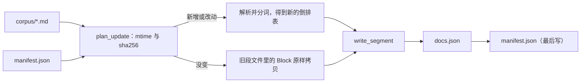

上一篇结束时，每条 `sift search` 都要先花 2 秒多把 123 篇文章重新分词、建一遍索引，然后再花几毫秒回答问题，这个比例让我有点不好意思。这一篇我把那 2 秒换成磁盘上的一个文件：第一次 `sift index` 照样要 3 秒（现在它还得把结果写下来），第二次发现 123 个文件一个没变，46 毫秒收工，之后每条 `sift search` 打开索引只要 150 毫秒。文件的头四个字节是我自己挑的魔数，后面每个字节怎么摆也都是我规定的：

```text
$ sift index
documents: 123
vocabulary: 81167
full rebuild: parsed 123, unchanged 0, removed 0; segment 2880196 bytes; took 3087.6 ms
$ sift index
documents: 123
vocabulary: 81167
incremental: parsed 0, unchanged 123, removed 0; segment 2880196 bytes; took 46.3 ms
$ wc -c .sift/*
4398409 .sift/docs.json
  22080 .sift/manifest.json
2880196 .sift/segment.sft
7300685 total
$ sift search --limit 1 kalman | tail -1
8 hits in 123 files: index opened in 151.0 ms, query took 7.168 ms
$ head -c 4 .sift/segment.sft; echo
SIFT
```

`manifest.json` 里记着语料的绝对路径，所以它和上面的总字节数会随检出路径差几个字节，段文件不受影响。

> [!NOTE] 本篇检查点
> 这一篇结束时仓库处于标签 `ch12`：新增 `src/sift/storage/`(`varint.py`、`segment.py`、`manifest.py`、`store.py`、`atomic.py`)、`src/sift/config.py`、仓库根目录的 `sift.toml`、6 个新的测试文件，以及 `lab/ch12` 下 15 个脚本和 `extra.sh`；改动了 `src/sift/query/evaluate.py`（停用词和短语，见后面的一节）、`src/sift/cli.py`（`index` 真的写盘，`search`、`show`、`stats` 读盘）、`tests/test_cli.py`、`README.md`，以及第 1、11 篇的两个 `extra.sh`（它们要先建好索引再计时）。`varint.py`、`segment.py`、`manifest.py`、`atomic.py` 是定稿；`store.py` 里的 `docs.json` 部分我猜会在第 13 篇被数据库取代，`config.py` 会在第 15 篇换一种写法，`cli.py` 还会随着后面的章节继续改；`evaluate.py`、`sift.toml` 和 `lab/ch12` 的文件我没有后续改动的记录，但后面的章节可能还会往里加东西。`make ch12` 通过，完整的 `python3 -m pytest` 是 450 个通过、1 个预期失败。
> 涉及的 Python 特性：文件对象与 `io` 栈 (`TextIOWrapper`、`BufferedReader`、`FileIO`)、编码与换行、`pathlib`、`os`、`shutil`、`tempfile`、`struct`、位运算、`mmap`、`pickle`、`json`、`marshal`、`tomllib`、`csv`、`zlib`、`bz2`、`lzma`、`compression.zstd`、`zipfile`、`hashlib`、原子写入。
> 前置：[第 11 篇](/posts/python-by-sift-11-modules-packaging-cli/)，需要知道 `sift` 命令和 `src` 布局是怎么来的。

我先从最底下说起：一个 `open()` 返回的到底是什么，字节怎么变成字符，什么时候真正写到磁盘。然后是 `struct` 和位运算，用它们拼出一个 32 字节的文件头，再加上 varint，把倒排表压成每个位置平均 2.38 字节。接下来是读的一侧（`mmap`、`bisect`，以及一个我没料到的 110 毫秒），拿 `pickle`、`json`、`marshal` 和我自己的格式比大小和速度，再把压缩模块排一遍队。最后是写的一侧（原子替换、sha256 清单、增量重建）、`sift.toml`，以及一个我本来以为不会发生的事：命令行的流水线现在带停用词了，有些查询的结果变了，有些没有。

## 环境

和前几篇同一台机器，仓库在标签 `ch12`，命令都在 `nix develop` 里、仓库根目录 `~/Projects/sift` 下跑：

```text
$ uname -r; python3 -VV; git describe --tags; git log --oneline -3
6.18.57
Python 3.14.7 (main, Aug  5 2026, 10:29:49) [GCC 15.3.0]
ch12
3b0bb80 test: stopword queries, resolved corpus path, config error file name
4a2e6b3 fix(ch12): ignore stopword-only query terms, honour phrase gaps, name config file in errors
6c575b3 test: varint, segment, manifest, store and config
$ python3 -c 'import zlib; from compression import zstd; \
    print(zlib.ZLIB_RUNTIME_VERSION, zstd.zstd_version)'
1.3.2 1.5.7
```

这台机器的 CPU 有快慢两个状态（前几篇里测到过差约 2.5 倍），所以这一篇每个计时脚本都让各个对手轮流跑若干轮，贴出最小值和中位数。另外我写了一个只测 CPU 状态的小脚本，在每次计时前后各跑一遍：

```python
"""Time a fixed busy loop a few times to see the CPU state."""

import time


def spin() -> float:
    """Return the milliseconds of one fixed loop."""
    start = time.perf_counter()
    total = 0
    for i in range(3_000_000):
        total += i
    return (time.perf_counter() - start) * 1000


def main() -> None:
    """Print five timings."""
    print(" ".join(f"{spin():.0f}" for _ in range(5)), "ms")


if __name__ == "__main__":
    main()
```

本篇贴出的每一轮计时，前后两次它都给出 110 到 120 ms 之间的数，也就是都在快状态。探索阶段我另外撞见过慢状态：`171 147 113 113 111 ms` 和 `166 165 166 167 125 ms`，同一个循环慢了约 1.5 倍。我没有在慢状态下重跑这一篇的数字，所以绝对值在慢状态下可能偏大，比例比较可靠（每个脚本都是轮流跑的）。输出里的家目录我一律缩写成了 `~`，临时脚本放在 `/tmp/sift-scratch/`，不进仓库，正文里整份贴出。

## 文件对象：三层包装

`open()` 不是一个类，是一个工厂函数，它按 mode 和 buffering 参数把最多三层对象叠在一起。`lab/ch12/open_modes.py` 的第一个函数把每一层的类型打出来：

```python
def io_stack(path: Path) -> None:
    """Show the layers behind open() in text, buffered and raw mode."""
    with path.open("r", encoding="utf-8") as text:
        print("text    :", type(text).__name__)
        print("  .buffer:", type(text.buffer).__name__)
        print("  .buffer.raw:", type(text.buffer.raw).__name__)
    with path.open("rb") as binary:
        print("binary  :", type(binary).__name__)
        print("  .raw  :", type(binary.raw).__name__)
    with path.open("rb", buffering=0) as raw:
        print("raw     :", type(raw).__name__)
    print("io.DEFAULT_BUFFER_SIZE:", io.DEFAULT_BUFFER_SIZE)
```

```text
$ python3 lab/ch12/open_modes.py | sed -n 1,8p
--- io_stack
text    : TextIOWrapper
  .buffer: BufferedReader
  .buffer.raw: FileIO
binary  : BufferedReader
  .raw  : FileIO
raw     : FileIO
io.DEFAULT_BUFFER_SIZE: 131072
```

最里面的 `FileIO` 只是文件描述符的一层薄壳，每次 `read` 就是一次 `read(2)` 系统调用，没有任何缓存。中间的 `BufferedReader` 在它外面攒一块字节缓冲，让你一次读 8 个字节不必真的去问内核 8 次。最外面的 `TextIOWrapper` 带着一个增量解码器和换行转换，把字节流变成 `str`。二进制模式 (`"rb"`) 停在中间那层，`buffering=0` 停在最里面。CPython 里这个叠法就写在 `open()` 的 C 实现里：`Modules/_io/_iomodule.c`(tag v3.14.7) 第 322 到 335 行创建 `FileIO`，第 394 到 414 行按 mode 挑 `BufferedReader`、`BufferedWriter` 或 `BufferedRandom`，第 427 到 432 行（文本模式才会走到）再套上 `TextIOWrapper`。

缓冲区大小也在那里定：第 365 到 375 行在 `buffering < 0` 时取 `max(min(块大小, 8 MiB), DEFAULT_BUFFER_SIZE)`，而 `DEFAULT_BUFFER_SIZE` 在 v3.14.7 的 `Modules/_io/_iomodule.h` 第 81 行是 `(128 * 1024)`。我特意去翻了 v3.13.0 的同一行：那里是 `(8 * 1024)`。这个数字下面马上要用到。

### 文本模式的四个坑

同一个文件按 `str` 读和按 `bytes` 读，长度并不一样，这在第 2 篇讲过。这里只补第 2 篇没有碰的那一层：文本模式在字节和 `str` 之间还做了换行转换，而且默认的编码取决于环境。

```python
def newlines(path: Path) -> None:
    """Newline translation: what is on disk vs what Python gives you."""
    with path.open("w", encoding="utf-8", newline="\r\n") as file:
        file.write("one\ntwo\n")
    print("on disk        :", path.read_bytes())
    with path.open("r", encoding="utf-8") as file:
        print("default read   :", repr(file.read()))
    with path.open("r", encoding="utf-8", newline="") as file:
        print("newline='' read:", repr(file.read()))
```

```text
--- newlines
on disk        : b'one\r\ntwo\r\n'
default read   : 'one\ntwo\n'
newline='' read: 'one\r\ntwo\r\n'
newline='\r\n' : 'one\r\ntwo\r\n'
```

写的时候 `newline="\r\n"` 把每个 `\n` 换成了两个字节；读的时候默认把 `\r\n`、`\r`、`\n` 统一成 `\n`，`newline=""` 则原样交给你。后者不是什么冷门选项：`csv` 模块要求你用它打开文件，因为引号里的换行必须原样保留（`lab/ch12/csv_demo.py` 就是这样写的）。

编码是第二个坑。`open()` 不写 `encoding=` 就用环境的默认值，这里恰好是 UTF-8，换一个环境就不一定了：

```text
$ python3 -c 'print(open("/dev/null").encoding)'
UTF-8
$ LC_ALL=POSIX PYTHONUTF8=0 python3 -c 'print(open("/dev/null").encoding)'
ANSI_X3.4-1968
$ python3 -X warn_default_encoding -c 'open("/dev/null").close()'
<string>:1: EncodingWarning: 'encoding' argument not specified
```

所以仓库里每一处 `open`、`read_text`、`write_text` 都写了 `encoding="utf-8"`，`-X warn_default_encoding` 就是用来抓漏写的。用错编码读文件时，Python 不会悄悄给你乱码，除非你主动要求：

```text
--- encodings
utf-16 bytes: b'\xff\xfe"}\x15_'
read as utf-8: UnicodeDecodeError invalid start byte
errors=replace: '��"}\x15_'
utf-8 BOM: 'x'
```

开头的 `\xff\xfe` 是 UTF-16 的字节序标记，`utf-8-sig` 编码就是专门吃掉 UTF-8 的 BOM 的。

第三个坑是缓冲：写进去的字节什么时候对别的读者可见。`stat().st_size` 看的是磁盘上的文件，不是你手里的对象：

```python
def buffering(path: Path) -> None:
    """A buffered write is invisible to other readers until flush."""
    with path.open("wb") as file:
        file.write(b"hello")
        print("after write, size on disk:", path.stat().st_size)
        file.flush()
        print("after flush, size on disk:", path.stat().st_size)
    # ...
```

```text
--- buffering
after write, size on disk: 0
after flush, size on disk: 5
unbuffered, size on disk : 5
line-buffered, no \n    : 0
line-buffered, after \n : 15
```

`flush()` 只把 Python 这一层的缓冲交给内核，内核自己还有页缓存，要真正落盘得 `os.fsync`。后面的原子写入要同时用到这两个动作。

第四个坑是 `seek` 和 `tell`。二进制文件里它们就是字节偏移，文本文件里 `tell()` 返回的是一个不透明的整数 (cookie)：

```text
--- seek_tell
readline  : '索引a\n' tell: 8
seek(1) + read: UnicodeDecodeError invalid start byte
tell() after next(): telling position disabled by next() call
binary seek(3) + read(1): b'\xe5'
```

`索引a\n` 是 3 + 3 + 1 + 1 = 8 个字节，这里的 cookie 碰巧等于字节偏移，但文档只承诺你可以把它交还给 `seek`。`Modules/_io/textio.c` (v3.14.7) 第 2389 到 2395 行定义了 cookie 里装的五个字段：`start_pos`、解码器标志、`bytes_to_feed`、`chars_to_skip` 和 `need_eof`，因为多字节字符和有状态的解码器让“第 n 个字符在第几个字节”不再是一个整数能说清的事。`seek(1)` 把位置放进了 `索` 的 3 个字节中间，下一次 `read` 就解码失败了。`for line in text` 之后 `tell()` 被明确禁用，第 2763 到 2767 行就是这句报错。UTF-8、UTF-16、GB18030 下 cookie 恰好都等于字节偏移，有状态的编码就不是了：`iso2022_jp` 文件读完第一行后 `tell()` 是 160203995535087573890236428。结论很朴素：要随机访问就用二进制文件，Sift 的段文件正是这么做的。

```text
$ python3 -c '
import tempfile
from pathlib import Path

with tempfile.TemporaryDirectory() as d:
    p = Path(d) / "j.txt"
    p.write_text("索引a\nbc\n", encoding="iso2022_jp")
    with p.open(encoding="iso2022_jp") as t:
        t.readline()
        print(t.tell())
'
160203995535087573890236428
```

### 缓冲区大小：128 KiB 的代价

二进制文件上随机读也不是白送的。我想知道在段文件上读 20,000 个随机位置的 8 个字节，缓冲区大小有没有影响，于是写了这个脚本，对同一组偏移轮流用不同的 `buffering` 打开：

```python
"""Time random 8-byte reads of the segment at several buffer sizes."""

import io
import random
import statistics
import time
from pathlib import Path

PATH = Path(".sift/segment.sft")
READS = 20000
ROUNDS = 7
SIZES = (0, 512, 8192, io.DEFAULT_BUFFER_SIZE)


def read_all(offsets: list[int], buffering: int) -> int:
    """Seek and read 8 bytes at every offset; return a checksum."""
    total = 0
    with PATH.open("rb", buffering=buffering) as file:
        for off in offsets:
            file.seek(off)
            total += file.read(8)[0]
    return total


def main() -> None:
    """Alternate the buffer sizes over the same offsets."""
    size = PATH.stat().st_size
    rng = random.Random(1234)
    offsets = [rng.randrange(0, size - 8) for _ in range(READS)]
    assert len({read_all(offsets, b) for b in SIZES}) == 1
    times: dict[int, list[float]] = {b: [] for b in SIZES}
    for _ in range(ROUNDS):
        for buffering in SIZES:
            start = time.perf_counter_ns()
            read_all(offsets, buffering)
            times[buffering].append((time.perf_counter_ns() - start) / 1e6)
    print(f"{READS} random 8-byte reads, {ROUNDS} alternating rounds")
    for buffering, ms in times.items():
        label = "unbuffered" if buffering == 0 else f"{buffering} bytes"
        print(
            f"buffering={label:<12} min {min(ms):6.2f} ms  "
            f"median {statistics.median(ms):6.2f} ms"
        )


if __name__ == "__main__":
    main()
```

```text
$ python3 /tmp/sift-scratch/cpu_state.py; \
    python3 /tmp/sift-scratch/buffer_size.py; \
    python3 /tmp/sift-scratch/cpu_state.py
111 112 112 114 115 ms
20000 random 8-byte reads, 7 alternating rounds
buffering=unbuffered   min  25.85 ms  median  26.53 ms
buffering=512 bytes    min  35.45 ms  median  35.94 ms
buffering=8192 bytes   min  39.21 ms  median  39.51 ms
buffering=131072 bytes min 103.95 ms  median 104.41 ms
116 115 113 111 114 ms
```

默认的 128 KiB 缓冲比完全不缓冲慢了 4.0 倍，比 8 KiB 慢 2.7 倍。8 KiB 是 3.13 源码里的默认值，不过我没有装 3.13，没法验证老版本上的耗时，只能说这个数字在 3.14 上是我自己设出来的。原因在 `Modules/_io/bufferedio.c` (v3.14.7) 里：`seek` 在目标落在当前缓冲区之内时只挪一下指针（第 1389 到 1415 行的快速路径），落在外面就走第 1420 行起的后备路径，把缓冲清空再做一次真正的 `lseek`；随后的 `read(8)` 发现缓冲是空的，调用 `_bufferedreader_fill_buffer`（第 1660 到 1675 行），后者向内核要 `buffer_size - start` 个字节，也就是 128 KiB。随机读 20,000 次就是 20,000 次 128 KiB 的拷贝，约 2.6 GB，耗时随缓冲区增大单调上升和这个解释是吻合的，不过我没有用 `strace` 数过系统调用，所以只能说大概就是这个原因。我也没有量顺序读，但这个机制反过来说明：缓冲越大对顺序读越有利，同一个 `BufferedReader` 在随机读上就越吃亏，这就是后面段文件的读取不走它的原因。

## 路径、目录和临时文件

文件名这一层，我在前十一篇里只用了 `Path("corpus/posts")` 和 `rglob("*.md")`。`lab/ch12/pathlib_tour.py` 把用到的那一圈成员过了一遍，第一部分不碰磁盘，`Path` 只是个纯字符串操作：

```text
$ python3 lab/ch12/pathlib_tour.py | sed -n 1,12p
--- paths (no disk access)
relative_to : posts/rust/ownership.md
name        : ownership.md
stem        : ownership
suffix      : .md
parent.name : rust
parts[-3:]  : ('posts', 'rust', 'ownership.md')
with_suffix : ownership.html
with_name   : borrow.md
suffixes    : ['.tar', '.gz'] stem: backup.tar
joinpath    : True
absolute?   : True False
```

`/` 是 `Path.__truediv__`，`Path("a", "b") / "c" == Path("a/b/c")` 为 `True`（上面输出里的 `joinpath`）。`.suffix` 只取最后一段，`backup.tar.gz` 要用 `.suffixes`，而 `.stem` 也只去掉最后一段 (`backup.tar`)。

第二部分碰磁盘：

```text
--- paths on disk
glob *.txt   : ['notes.txt']
glob */*.md  : ['raii.md', 'lifetimes.md', 'ownership.md']
rglob *.md   : ['cpp/raii.md', 'rust/lifetimes.md', 'rust/ownership.md']
read_text    : 'not a post\n'
stat.st_size : 11
mtime_ns type: int
exists/is_dir: True False True
iterdir      : ['cpp', 'notes.txt', 'rust']
after rename : ['notes.md']
```

脚本里每个 `glob` 外面都套了 `sorted(...)`，这不是洁癖：`Path.glob` 吐结果的顺序由文件系统决定，文档不保证它。后面的 manifest 给文件编号靠的就是排序后的路径，所以 `plan_update` 的第一行是 `paths = sorted(corpus.rglob("*.md"))`；少了这个 `sorted`，同一份语料在两台机器上可能得到两套 `doc_id`。

`stat()` 那里我特意选了 `st_mtime_ns`（整数纳秒）而不是 `st_mtime`（浮点秒）。浮点数只有 53 位有效数字，现在的纳秒时间戳是 19 位的十进制数，已经超过了它能精确表示的范围：

```text
$ touch /tmp/sift-scratch/mtime_probe
$ python3 -c '
import os

st = os.stat("/tmp/sift-scratch/mtime_probe")
print(st.st_mtime_ns)
print(int(st.st_mtime * 10**9))
print(st.st_mtime_ns - int(st.st_mtime * 10**9), "ns lost")
'
1792735697241021450
1792735697241021440
10 ns lost
```

这一次丢了 10 纳秒（`st_mtime * 10**9` 这个乘积在 1.79e18 附近，相邻两个双精度数差 256 纳秒；`st_mtime` 本身的网格约 238 纳秒）。清单要靠 mtime 相等来判断“这个文件没动过”，所以整数是唯一合理的选择。

第三部分是 `os` 和 `shutil` 里和 `pathlib` 重叠的那些旧拼法，以及 `tempfile`：

```text
--- os and shutil
os.listdir   : ['cpp', 'rust']
os.scandir   : ['cpp', 'rust']
os.walk      : posts []
os.walk      : posts/cpp ['raii.md']
os.walk      : posts/rust ['lifetimes.md', 'ownership.md']
copytree     : 3 files
copy2 + move : # raii
rmtree       : False
os.cpu_count : True
os.sep       : '/' os.linesep: '\n'
--- tempfile
TemporaryDirectory: True
NamedTemporaryFile: hello
deleted on exit   : True
TemporaryFile     : b'no name i'
mkdtemp stays     : True
```

四个 `tempfile` 入口的区别是谁负责清理：`TemporaryDirectory` 和 `NamedTemporaryFile` 离开 `with` 就删，`TemporaryFile` 在 Unix 上通常没有文件名，`mkdtemp` 则永远不删，要你自己 `shutil.rmtree`。`lab/ch12` 里要建索引的脚本都用 `TemporaryDirectory`，所以跑完不会在 `/tmp` 里留下 7 MB 的垃圾。后面的原子写入会用到 `NamedTemporaryFile(delete=False)`：自己决定文件什么时候消失。

## struct：把整数摆成字节

Python 的 `int` 没有宽度，文件格式却全是宽度：这个字段 2 个字节，那个字段 8 个字节，谁在前谁在后。`struct` 是两边的翻译官，格式串第一个字符选字节序和对齐，后面的字母选类型。`lab/ch12/struct_demo.py` 先从最小的例子开始：

```text
$ python3 lab/ch12/struct_demo.py | sed -n 1,4p
pack('<HI', 1, 300): 01 00 2c 01 00 00
unpack back        : (1, 300)
big endian         : 00 00 01 2c
little endian      : 2c 01 00 00
```

`300 = 0x12c`，小端把低位字节 `2c` 放在最前面，大端相反。Sift 的文件全用小端 (`<`)，原因很实际：我现在用的 x86-64 和 ARM 常见配置都是小端，读的时候不需要翻转。

真正容易踩的是格式串的第一个字符。不写前缀就是 `@`，意思是“本机字节序、本机大小、本机对齐”，也就是 C 编译器会怎么摆一个 `struct` 它就怎么摆：

```text
--- size: '@' pads, '<' does not
calcsize('@BI' ) = 8
calcsize('<BI' ) = 5
calcsize('=BI' ) = 5
calcsize('@BQ' ) = 16
calcsize('<BQ' ) = 9
calcsize('@l'  ) = 8
calcsize('<l'  ) = 4
calcsize('@BH' ) = 4
padded bytes @BI: 01 00 00 00 02 00 00 00
packed bytes <BI: 01 02 00 00 00
```

一个 1 字节的 `B` 后面跟一个 4 字节的 `I`，`@` 给了 8 字节（中间垫了 3 个零），`<` 给 5 字节。`@l` 是 8 字节而 `<l` 是 4 字节：`@` 下 `long` 随平台走，Linux x86-64 上是 8，`<`、`>`、`=` 下它永远是 4。垫零的逻辑在 `Modules/_struct.c` (v3.14.7) 第 1597 到 1613 行的 `align()` 里：把当前大小向上取整到该类型对齐的倍数；`<` 和 `>` 用的是另外两张不带对齐的表（第 1556 行起的 `whichtable()`，注释里还特意写了 `=` 是“和 native 的区别在于对齐”）。写文件格式时不要省前缀，更不要让默认的 `@` 混进来，否则同一个格式串在不同平台上的字节数都会变。

Sift 段文件的头就是这样一个格式串，写在 `segment.py` 里：

```python
MAGIC = b"SIFT"
VERSION = 1
FLAG_ZLIB = 1
HEADER = struct.Struct("<4sHHIIQQ")
```

`struct.Struct` 把格式串预编译一次，`HEADER.size` 是 32 (4 + 2 + 2 + 4 + 4 + 8 + 8)，之后 `HEADER.pack(...)` 和 `HEADER.unpack_from(buf, offset)` 省掉每次解析格式串的开销。下面是真实索引文件的前 32 个字节，再对着格式串一个字段一个字段读：

```text
$ hexdump -C -n 32 .sift/segment.sft
00000000  53 49 46 54 01 00 00 00  7b 00 00 00 0f 3d 01 00  |SIFT....{....=..|
00000010  0c 02 00 00 00 00 00 00  b2 30 0f 00 00 00 00 00  |.........0......|
00000020
$ python3 lab/ch12/mmap_demo.py | grep 'header fields'
header fields  : (b'SIFT', 1, 0, 123, 81167, 524, 995506)
```

- `53 49 46 54`：魔数 `SIFT`，4 个字节。
- `01 00`：版本，`u16`，值为 1。
- `00 00`：标志位，`u16`，bit 0 是 zlib，这个文件没开。
- `7b 00 00 00`：`n_docs`，`0x7b` = 123。
- `0f 3d 01 00`：`n_terms`，`0x00013d0f` = 81,167，和 `sift index` 打印的词表大小一致。
- `0c 02 00 00 00 00 00 00`：`dict_off`，`u64`，`0x20c` = 524 = 32 + 4 × 123，也就是头和 123 个文档长度之后的第一个字节。
- `b2 30 0f 00 00 00 00 00`：`post_off`，`0x0f30b2` = 995,506，倒排表从这里开始。

读文件时我从不假设它是我写的。`parse_header` 把这 7 个字段挨个验一遍，每一项都对应一种真实会出现的坏文件：

```python
    if size < HEADER.size:
        raise fail("truncated header")
    magic, version, flags, n_docs, n_terms, dict_off, post_off = (
        HEADER.unpack_from(data, 0)
    )
    if magic != MAGIC:
        raise fail(f"bad magic {magic!r}, expected {MAGIC!r}")
    if version != VERSION:
        raise fail(f"unsupported version {version}")
    if flags & ~FLAG_ZLIB:
        raise fail(f"unknown flags {flags:#x}")
    if dict_off != HEADER.size + 4 * n_docs:
        raise fail("dictionary offset does not follow doclens")
    if not dict_off <= post_off <= size:
        raise fail("offsets outside the file")
```

这几行里有两个位运算：`flags & ~FLAG_ZLIB` 的意思是“除了 zlib 位以外，还有别的位被置了吗”。`lab/ch12/bit_ops.py` 把这类操作过了一遍，Python 里最值得讲的是负数：`int` 是无限位宽的补码，所以 `~a` 是 `-a - 1`，要得到固定宽度的结果必须自己用掩码截断。

```text
$ python3 lab/ch12/bit_ops.py | sed -n '6,17p;22,26p'
~a     = -13 (= -a - 1), ~a & 0xF = 0011
a << 2 = 110000 (48), a >> 2 = 11
--- masks
n = 0xdeadbeef
low byte   : 0xef
high byte  : 0xde
7-bit group: 0x6f, rest 0x1bd5b7d
--- negative numbers are infinite two's complement
-1 & 0xFF  = 255
-2 & 0xFFFF = 0xfffe
-1 >> 10   = -1
(-5) .to_bytes(2, signed) = fb ff
--- flags
zlib flag set? False
after |=       True flags=0b0001
after &= ~     False flags=0b0000
after ^=       True
```

`-1 >> 10` 还是 `-1`（算术右移，符号位无限延伸），`-1 & 0xFF` 是 255，所以只要想把一个可能为负的数塞进固定宽度，就先 `& 0xFF...`，或者像 `to_bytes(..., signed=True)` 那样明说。`|=` 置位、`&= ~` 清位、`^=` 翻转，三个操作一个标志字段全覆盖了，`flags & FLAG_ZLIB` 则是测试。（C 程序员读到这里会觉得太熟了，唯一的区别是这里没有溢出：`~0` 不会变成 `0xFFFFFFFF`，它就是 `-1`。）

还有一个小工具在这一章用得不多，但值得知道：`int.to_bytes` 和 `int.from_bytes` 可以替代只有一个整数的 `struct`，`(300).to_bytes(4, "little")` 和 `struct.pack("<I", 300)` 给出同样的 `2c 01 00 00`，而 `int.bit_length()` 告诉你一个数要几位，下一节估算 varint 的字节数就用得上它（`-(-n.bit_length() // 7)`，300 是 9 位，要 2 个字节，`bit_ops.py` 里有这一行）。

## varint 与 delta：让小数字只占一个字节

倒排表里到处是小整数：文档编号的差、词频、位置的差。每个都用 4 字节的 `u32` 存，浪费的是高位那一串零。LEB128 的 varint 的做法是每个字节只用低 7 位装数据，最高位说“后面还有一个字节”，小于 128 的数一个字节就够了。（DWARF 调试信息和 protobuf 用的也是这个思路。）`varint.py` 的编码很短：

```python
def encode(n: int) -> bytes:
    """Return the LEB128 bytes of the non-negative integer n."""
    if n < 0:
        raise ValueError(f"varint cannot encode a negative number: {n}")
    out = bytearray()
    while n >= 0x80:
        out.append(n & 0x7F | 0x80)
        n >>= 7
    out.append(n)
    return bytes(out)
```

`n & 0x7F` 取低 7 位，`| 0x80` 把继续位置上，`n >>= 7` 丢掉已经写出去的 7 位，最后一个字节不带继续位。因为 Python 的 `int` 没有宽度，编码对 `2**200` 也照样工作（给出 29 个字节），只是 `decode` 会拒绝它：我规定一个 64 位的数最多 10 个字节，超过的不是我写的数。`lab/ch12/varint_demo.py` 把几个有代表性的数编码给你看：

```text
$ python3 -c '
from sift.storage.varint import decode, encode

b = encode(2**200)
print(len(b))
decode(b, 0)
' 2>&1 | sed -n '1p;$p'
29
ValueError: varint too long at offset 0
```

```text
$ python3 lab/ch12/varint_demo.py | sed -n 1,13p
           n  bytes  hex
           0      1  00
           1      1  01
         127      1  7f
         128      2  80 01
         300      2  ac 02
       16383      2  ff 7f
       16384      3  80 80 01
  4294967296      5  80 80 80 80 10
9223372036854775808     10  80 80 80 80 80 80 80 80 80 01
--- 300 by hand
300 = 0b000100101100; low 7 bits 0101100, rest 10
first byte 0xac (continuation bit set), second byte 0x02
```

127 是一个字节的上限，128 要两个：`128 = 1 << 7`，低 7 位全零，所以第一个字节是 `0x80`（只有继续位），第二个字节是 `01`。300 的二进制是 `1 0010 1100`，低 7 位 `010 1100`(`0x2c`) 加上继续位成了 `0xac`，剩下的高位 `10`(2) 单独成为第二个字节，这就是上面最后两行。`2**32` 要 5 个字节，比定长的 4 字节还多一个，varint 对大数是亏的，对小数是赚的，所以倒排表里它才划算。

解码是反向走一遍，里面有一条我特意留的快速路径：

```python
def decode(
    buf: bytes | bytearray | memoryview, offset: int
) -> tuple[int, int]:
    """Return ``(value, next_offset)`` of the varint at buf[offset]."""
    # ...
    if offset < len(buf) and buf[offset] < 0x80:
        return buf[offset], offset + 1  # the common one-byte case
    value = 0
    shift = 0
    pos = offset
    while True:
        if pos >= len(buf):
            raise ValueError(f"truncated varint at offset {offset}")
        byte = buf[pos]
        pos += 1
        value |= (byte & 0x7F) << shift
        if byte < 0x80:
            return value, pos
        shift += 7
        if pos - offset >= MAX_BYTES:
            raise ValueError(f"varint too long at offset {offset}")
```

返回 `(值, 下一个偏移)` 这个二元组是我在整个格式里统一的接口：解码器不持有状态，调用者自己带着偏移往前走。真实数据里 36% 的位置差只要一个字节（下面会量），所以第一个 `if` 能直接返回，省掉后面的循环。损坏的数据有两种死法，一种是缓冲区在半个 varint 里结束，一种是继续位一直亮着：

```text
$ python3 lab/ch12/varint_demo.py | sed -n '26,27p'
ValueError: truncated varint at offset 0
ValueError: varint too long at offset 0
```

varint 只管非负数。我没有给负数做之字形编码（protobuf 的 `sint` 那一套），因为倒排表里没有负数：文档编号只增不减，位置也是，我拿它们的**差**来存，差永远不小于 0。`encode_deltas` 就是这么做的，一个递减的序列直接报错：

```python
def encode_deltas(seq: Iterable[int]) -> bytes:
    """Return the varints of seq as differences between neighbours.

    The first number is stored as is. seq must not decrease; equal
    neighbours give a delta of 0.
    """
    out = bytearray()
    previous = 0
    for n in seq:
        if n < previous:
            raise ValueError(f"sequence decreases: {previous} then {n}")
        out += encode(n - previous)
        previous = n
    return bytes(out)
```

```text
$ python3 lab/ch12/varint_demo.py | sed -n 15,20p
doc ids      : [3, 120, 125, 40000, 40001, 40010]
deltas       : [3, 117, 5, 39875, 1, 9]
as varints   : 12 bytes
as deltas    : 8 bytes
as u32       : 24 bytes
round trip   : ([3, 120, 125, 40000, 40001, 40010], 8)
```

同样 6 个文档编号，定长 `u32` 是 24 字节，直接 varint 是 12，delta 之后是 8。越是密集的序列（差越小），省得越多。

### 这批倒排表里字节花在哪

这些是玩具数据。真实索引里 varint 和 delta 到底省了多少，我写了个脚本把段文件里的倒排表全部解出来，对每个 `Posting` 重新编码，按用途计字节：

```python
"""Count the bytes each part of the postings block takes."""

from collections import Counter
from pathlib import Path

from sift.storage.segment import Segment, read_header
from sift.storage.varint import encode


def main() -> None:
    """Count postings, positions and the bytes each part needs."""
    path = Path(".sift/segment.sft")
    postings = positions = 0
    bytes_by_part = Counter()
    delta_bytes = Counter()
    with Segment(path) as segment:
        for _, plist in segment.iter_postings():
            previous = 0
            for posting in plist:
                postings += 1
                bytes_by_part["doc_id deltas"] += len(
                    encode(posting.doc_id - previous)
                )
                bytes_by_part["tf"] += len(encode(posting.tf))
                previous = posting.doc_id
                last = 0
                for position in posting.positions:
                    positions += 1
                    size = len(encode(position - last))
                    bytes_by_part["position deltas"] += size
                    delta_bytes[size] += 1
                    last = position
        total = segment.size - read_header(path).post_off
    print(f"postings {postings}, positions {positions}")
    print(f"postings block: {total} bytes")
    for part, size in bytes_by_part.items():
        print(f"  {part:<16}{size:>9} bytes  {size / total:6.1%}")
    print("position delta sizes:", dict(sorted(delta_bytes.items())))
    print(f"bytes per position: {total / positions:.2f} (a u32 would be 4)")


if __name__ == "__main__":
    main()
```

```text
$ python3 /tmp/sift-scratch/postings_stats.py
postings 289357, positions 792920
postings block: 1884690 bytes
  doc_id deltas      289357 bytes   15.4%
  tf                 289598 bytes   15.4%
  position deltas   1305735 bytes   69.3%
position delta sizes: {1: 286581, 2: 499863, 3: 6476}
bytes per position: 2.38 (a u32 would be 4)
```

三个部分加起来正好是 1,884,690 字节，和段文件里倒排表的大小一致。289,357 个 `Posting`（一个词在一篇文档里的出现记录）里，每个 `doc_id` 的差和 `tf` 平均都只占 1 个字节，真正占地方的是位置：792,920 个位置占了 69.3%。位置差的分布也不好看，只有 36% 是 1 字节，63% 要 2 字节（差 ≥ 128），因为一篇文章 8,000 个词里，一个词多半隔很远才再出现一次。即便如此，每个位置平均 2.38 字节，比 `u32` 的 4 字节省了四成（这里的分母把 `doc_id` 和 `tf` 的字节也算进去了，所以是整块倒排表除以位置数）。

位置是为了第 8 篇的短语查询才存的：`"device tree"` 要检查 `tree` 是不是恰好在 `device` 后面一个位置。如果只做词袋检索，这 69% 都可以不要，倒排表会缩到原来的三成。这是一个格式层面的取舍，我这一版选了留着，因为前面的查询语言已经依赖它了。

## 段文件：把索引摆成一个文件

### 格式

有了 `struct` 和 varint，格式本身就是 `segment.py` 开头那段 docstring 里的一张图：

```text
header   magic b"SIFT" | version u16 | flags u16 | n_docs u32
         | n_terms u32 | dict_off u64 | post_off u64
doclens  n_docs x u32 token counts, indexed by doc_id
dict     per term, in sorted order: varint len | utf-8 bytes
         | varint df | varint post_rel_off | varint post_len
postings per term: per document, varint doc_id delta | varint tf
         | tf x varint position delta (zlib-compressed per term
         when flag bit 0 is set)
```

四个区域在真实文件里是这样排的（头里的两个偏移加上文件大小就能算出来）：

| 区域 | 起点 | 字节数 | 内容 |
| --- | --- | --- | --- |
| header | 0 | 32 | 上一节逐字节读过的那 32 个字节 |
| doclens | 32 | 492 | 123 个 `u32`，每篇文档的词元数 |
| dict | 524 | 994,982 | 81,167 个词，每个 `长度 + UTF-8 + df + 偏移 + 长度` |
| postings | 995,506 | 1,884,690 | 每个词一块，varint 编码 |

我是照着搜索时要做的三件事定的这个顺序：按词查找，所以词典排序、可以二分；只解码查询用到的词，所以倒排表和词典分开存，词典里只记偏移和长度；BM25 要文档长度，所以 `doclens` 是一个按 `doc_id` 直接下标的数组。词典的每一项是 `varint 长度 | UTF-8 字节 | df | 偏移 | 长度`，用 `df` 就能不解码倒排表直接回答“这个词出现在几篇文档里”。前 4 个词典项我用脚本手动解了一遍，和十六进制对得上：

```python
"""Decode the first dictionary entries of the segment by hand."""

from pathlib import Path

from sift.storage.segment import read_header
from sift.storage.varint import decode

PATH = Path(".sift/segment.sft")


def main() -> None:
    """Print the first four entries: term, df, offset and length."""
    header = read_header(PATH)
    data = PATH.read_bytes()
    pos = header.dict_off
    print(f"dictionary starts at byte {pos}, postings at {header.post_off}")
    for _ in range(4):
        start = pos
        size, pos = decode(data, pos)
        term = data[pos : pos + size].decode("utf-8")
        pos += size
        df, pos = decode(data, pos)
        rel, pos = decode(data, pos)
        length, pos = decode(data, pos)
        raw = data[start:pos].hex(" ")
        print(f"{term!r:6} df {df:>3} rel {rel:>5} len {length:>5}  {raw}")


if __name__ == "__main__":
    main()
```

```text
$ python3 /tmp/sift-scratch/dict_peek.py
dictionary starts at byte 524, postings at 995506
'0'    df 116 rel     0 len 16284  01 30 74 00 9c 7f
'0#'   df   1 rel 16284 len     4  02 30 23 01 9c 7f 04
'00'   df  43 rel 16288 len   478  02 30 30 2b a0 7f de 03
'00+'  df   3 rel 16766 len    12  03 30 30 2b 03 fe 82 01 0c
```

第一项 `01 30 74 00 9c 7f` 读作：长度 1，字符 `30`(`'0'`)，`df = 0x74 = 116`，偏移 0，倒排表长度 `9c 7f` 这两个字节拼起来是 `0x1c + (0x7f << 7) = 16,284`。第二项的偏移正好是 16,284，因为倒排表块是头尾相接的。排在最前面的词是 `0`、`0#`、`00`，不是什么英文单词：分词器把数字也当词，`0` 出现在 116 篇文档里，它的倒排表有 16,284 字节。

### 写：词典和倒排表一起攒

写段文件的函数 `write_segment` 做的事很直白：按排好序的词遍历，把每个词的倒排表编码成块，往两个 `bytearray` 里追加，最后一次性把头、文档长度、词典、倒排表四块交给原子写入：

```python
    dictionary = bytearray()
    postings = bytearray()
    n_terms = 0
    previous: str | None = None
    for term, value in terms:
        if previous is not None and term <= previous:
            raise ValueError(f"terms not sorted: {previous!r}, {term!r}")
        previous = term
        if isinstance(value, Block):
            df, block = value.df, value.data
        else:
            df, block = len(value), _encode_postings(value)
        if compress:
            block = zlib.compress(block)
        raw = term.encode("utf-8")
        dictionary += encode(len(raw)) + raw
        dictionary += encode(df)
        dictionary += encode(len(postings)) + encode(len(block))
        postings += block
        n_terms += 1
```

这里有两处和后面的增量更新直接相关。一是 `terms` 里的值可以是 `PostingList`，也可以是 `Block`（已经编码好的字节加 `df`），后者直接拷进新文件，省掉“解码再编码”；二是排序检查：`term <= previous` 比的是 Python 字符串（按码点），UTF-8 的字节序和码点序一致，所以写入的顺序、磁盘上的字节顺序和读取时 `bisect` 比较的顺序是同一个。

### 读：mmap

写完的文件怎么读进来？前面那一节已经知道 `BufferedReader` 在随机读上不合适。`Segment.__init__` 用的是 `mmap`：

```python
        with file:
            size = file.seek(0, 2)
            if size < HEADER.size:
                raise IndexCorruptError(f"{path}: truncated header")
            self._map = mmap.mmap(file.fileno(), 0, access=mmap.ACCESS_READ)
```

`mmap` 像墙上的一张仓库货架图：你可以指着任何一格说“我要这个”，货直到你真去拿才会从仓库运来。内核在这里的实现是缺页：映射建立时没有读任何数据，第一次访问某个 4 KiB 的页才把它从磁盘（或页缓存）带进来，之后再访问同一页就是一次普通的内存读。文件对象在 `with` 结束时就关了，映射有自己的引用，不需要它。`access=mmap.ACCESS_READ` 在 `Modules/mmapmodule.c` (v3.14.7) 第 1821 到 1824 行对应 `MAP_SHARED` 加 `PROT_READ`，写入会失败，`ACCESS_COPY`（第 1829 到 1832 行）是 `MAP_PRIVATE`，可以写但改动只留在内存里。`lab/ch12/mmap_demo.py` 把它们都试了一遍：

```text
$ python3 lab/ch12/mmap_demo.py | sed -n 2,12p
len(mapped)    : 2880196 bytes
magic          : b'SIFT' True
header fields  : (b'SIFT', 1, 0, 123, 81167, 524, 995506)
find(b'SIFT')  : 0
slice copies   : bytes
memoryview     : memoryview 7b000000
write to ACCESS_READ: mmap can't modify a readonly memory map.
page size      : 4096
--- copy on write
in memory      : b'XXXX'
on disk        : b'SIFT' == b'SIFT'
```

`mapped[:4]` 和 `HEADER.unpack_from(mapped, 0)` 都像在操作一个 `bytes`，但切片会复制 (`slice copies: bytes`)，要零拷贝得用 `memoryview(mapped)`。`Segment` 没有费这个事：`_read_dictionary` 先把词典那一段切成 `bytes` 再解码，一个查询要的倒排表块同样是切一刀、解码、扔掉。

随机读的差距我量了一下，同样的 20,000 个偏移、7 轮轮流：

```text
$ python3 lab/ch12/mmap_demo.py | sed -n 14,18p
20000 random reads, 7 alternating rounds (ms):
  mmap slice               min   2.34  median   2.75
  seek + read (buffered)   min 102.45  median 102.80
  seek + read (raw)        min  24.92  median  25.92
  os.pread                 min  17.75  median  18.12
```

`mmap` 切片比默认缓冲的 `seek + read` 快 44 倍，比 `os.pread` 快 7.6 倍。`pread` 每次是一次系统调用，`mmap` 在页已经映射之后是一次内存读加一个很小的 `bytes` 对象。这是文件在页缓存里（刚刚写过）的情况，我没有清页缓存，所以没有量冷读；第一次碰到某一页时 `mmap` 也要付缺页的代价。

词典读进来以后用 `bisect` 查：

```text
$ python3 -c '
from pathlib import Path

from sift.storage.segment import Segment

with Segment(Path(".sift/segment.sft")) as s:
    print(s.terms_with_prefix("owner"))
    print(s.df("kalman"), "kalman" in s, "zzzz" in s)
' | sed -n '1,2p'
['owner', 'ownership']
8 True False
```

`bisect_left` 在 81,167 个词里最多比 17 次，`owner*` 这种前缀查询是一对 `bisect_left`（前缀本身，和前缀加 `U+10FFFF`）切出一段。`in` 只查词典，不解码倒排表。

### 打开一个索引要 110 毫秒，是我没料到的

整个设计的卖点是“只解码用到的东西”，所以我估计打开应该几乎是免费的：映射一下，读 32 个字节的头。但 `sift search` 报告的 `index opened in` 是 150 毫秒。我把 `open_index` 拆成三块各自计时，轮流跑 9 轮：

```python
"""Break down the ~150 ms of opening the index.

Times the pieces of ``open_index`` one by one, in alternating rounds.
"""

import statistics
import time
from pathlib import Path

from sift.storage.segment import Segment
from sift.storage.store import DOCS, SEGMENT, SegmentIndex, load_docs

INDEX = Path(".sift")
ROUNDS = 9


def ms(start: int) -> float:
    """Milliseconds since start (a perf_counter_ns value)."""
    return (time.perf_counter_ns() - start) / 1e6


def main() -> None:
    """Time docs.json, the dictionary scan and the title index."""
    names, documents = load_docs(INDEX / DOCS)
    rows: dict[str, list[float]] = {
        "load_docs (docs.json, 4.4 MB)": [],
        "Segment() (map + dictionary scan)": [],
        "SegmentIndex() (title index, lengths)": [],
        "all three": [],
    }
    for _ in range(ROUNDS):
        start = time.perf_counter_ns()
        load_docs(INDEX / DOCS)
        rows["load_docs (docs.json, 4.4 MB)"].append(ms(start))

        start = time.perf_counter_ns()
        segment = Segment(INDEX / SEGMENT)
        rows["Segment() (map + dictionary scan)"].append(ms(start))

        start = time.perf_counter_ns()
        SegmentIndex(segment, names, documents)
        rows["SegmentIndex() (title index, lengths)"].append(ms(start))
        segment.close()

        start = time.perf_counter_ns()
        _, docs = load_docs(INDEX / DOCS)
        with Segment(INDEX / SEGMENT) as seg:
            SegmentIndex(seg, names, docs)
        rows["all three"].append(ms(start))
    print(f"{len(documents)} documents, {ROUNDS} alternating rounds")
    for name, values in rows.items():
        print(
            f"{name:<40} min {min(values):6.1f} ms  "
            f"median {statistics.median(values):6.1f} ms"
        )


if __name__ == "__main__":
    main()
```

```text
$ python3 /tmp/sift-scratch/cpu_state.py; \
    python3 /tmp/sift-scratch/open_breakdown.py; \
    python3 /tmp/sift-scratch/cpu_state.py
117 118 116 117 116 ms
123 documents, 9 alternating rounds
load_docs (docs.json, 4.4 MB)            min   34.5 ms  median   36.9 ms
Segment() (map + dictionary scan)        min  108.0 ms  median  110.9 ms
SegmentIndex() (title index, lengths)    min    3.4 ms  median    3.7 ms
all three                                min  146.3 ms  median  150.5 ms
113 115 115 115 115 ms
```

映射本身不花时间，`Segment()` 的 110.9 毫秒（中位数）全在 `_read_dictionary` 里，占整个打开时间的 74%。它把 81,167 个词一个一个从字节里解出来，放进一个 `list[str]` 和一个元组列表。我用 `cProfile` 数了一下：

```text
$ python3 -c '
import cProfile, pstats
from pathlib import Path
from sift.storage.segment import Segment

p = cProfile.Profile()
p.enable()
Segment(Path(".sift/segment.sft")).close()
p.disable()
pstats.Stats(p).sort_stats("tottime").print_stats(3)
' | sed -n 1,12p
         1141160 function calls in 0.276 seconds

   Ordered by: internal time
   List reduced from 38 to 3 due to restriction <3>

   ncalls  tottime  percall  cumtime  percall filename:lineno(function)
        1    0.106    0.106    0.276    0.276 ~/Projects/sift/src/sift/storage/segment.py:216(_read_dictionary)
   324668    0.106    0.000    0.138    0.000 ~/Projects/sift/src/sift/storage/varint.py:32(decode)
   572954    0.032    0.000    0.032    0.000 {built-in method builtins.len}
```

324,668 次 `decode` 调用，正好是 81,167 × 4（长度、`df`、偏移、倒排表长度各一次）。分析器开着时总时间膨胀到 276 毫秒，所以这些秒数不能和上面那张表比，但调用次数是准的。也就是说我设计了一个“按需解码倒排表”的格式，却在打开时把整本词典用纯 Python 解了一遍，`mmap` 省下来的那部分，被一个 81,167 次的 Python 循环又花了回去。

这是我这一版留下的一个已知上限，我没有在本章修它：词典是变长项，没有偏移表就不能在磁盘上直接二分，只能顺序走一遍。要改就得改格式（给词典加一个定长的偏移数组，或者分块建稀疏索引，让二分直接在映射上做），这会是一次 `VERSION = 2`，我把它留作练习 2。另一块 36.9 毫秒是解析 4.4 MB 的 `docs.json`，那是文档的正文和元数据，和段文件无关，下一篇会换掉存它们的方式。

## 序列化横评：pickle、json、marshal 和段文件

自己发明一个二进制格式之前，该先问一句：标准库已经有三个现成的，为什么不用？`lab/ch12/serialization_compare.py` 把同一份索引（81,167 个词、289,357 个 `Posting`，以及每篇文档的长度）用四种方式存下来，量大小和加载时间。对手轮流跑 7 轮，所以表里是最小值和中位数：


```text
$ python3 /tmp/sift-scratch/cpu_state.py; \
    python3 lab/ch12/serialization_compare.py; \
    python3 /tmp/sift-scratch/cpu_state.py
112 112 111 111 112 ms
terms 81167, postings 289357
format                           bytes  vs pickle   min ms  median ms
pickle                         5150335      1.00x    237.4      248.7
json                           8459140      1.64x    307.3      317.1
marshal                        7844112      1.52x    165.0      167.3
segment (open)                 2880196      0.56x    109.0      109.9
segment (decode all)           2880196      0.56x    705.7      717.8
segment+zlib (decode all)      3480641      0.68x    762.3      771.1
(rounds: 7, alternating formats)
113 115 114 114 114 ms
```

大小先说：段文件是 `pickle` 的 0.56 倍，`json` 是 1.64 倍，`marshal` 是 1.52 倍。`json` 最大是预料之中的事，它拿十进制 ASCII 写每个整数，再加上括号和逗号。`marshal` 比 `pickle` 大我一开始没想到，它给每个整数固定 5 个字节（类型字节加 4 字节），`pickle` 给小整数 2 个字节：

```text
$ python3 -c 'import marshal, pickle; print(marshal.dumps(5), pickle.dumps(5))'
b'\xe9\x05\x00\x00\x00' b'\x80\x05K\x05.'
```

`pickle` 那串里 `\x80\x05` 是协议头（协议 5，3.14 的默认值），`K\x05` 才是整数本身，最后的 `.` 是结束标志。段文件再小一半，是因为 varint 加 delta 比任何通用格式都懂这批数据的形状。

速度这一栏要读仔细。`json.loads` 最慢（307 毫秒），`pickle.loads` 237 毫秒，`marshal.loads` 165 毫秒，这三个都是 C 写的，一次把整个索引变成 Python 对象。段文件的 `open` 只要 109 毫秒，但它只扫了词典，一个倒排表都没解；把所有倒排表都解出来要 706 毫秒，是 `pickle` 的 3 倍，因为那是我用纯 Python 写的 varint 循环在解 792,920 个位置。所以这张表的结论不是“段文件更快”，而是“段文件让你只付你用到的那部分”：一条查询通常只碰几个词，不会去解另外八万个。如果每次都要把整个索引读进内存，`marshal` 更好；如果每次只看一眼，才轮到我的格式。

最后一行是我意料之外的：按词压缩的段文件（3,480,641 字节）比不压缩的（2,880,196 字节）还大 21%。原因下一节有。

`json` 还有一个不明显的代价，不在表里：它不保留类型。`Posting` 的位置是元组，字典的键是整数，`json` 一律改成列表和字符串：

```text
$ python3 -c '
import json

data = {5: (1, 2)}
print(json.loads(json.dumps(data)))
print(json.loads(json.dumps(data)) == data)
'
{'5': [1, 2]}
False
```

所以 `docs.json` 里我只放了天生是 JSON 形状的东西（字符串、数字、字符串列表），日期存成 ISO 8601 字符串，读的时候转回来。

### csv：给别的工具吃的格式

`csv` 是最常见的交换格式，`lab/ch12/csv_demo.py` 把文档数最高的 10 个词导出再读回来：

```text
$ python3 lab/ch12/csv_demo.py | sed -n 1,3p
raw bytes: b'term,df,tf\r\n1,122,11405\r\n2,122,6620\r\n3,120,4572\r\n\xe4\xb8\x80\xe4\xb8\xaa,120,'
rows read back: 10
first row     : {'term': '1', 'df': '122', 'tf': '11405'}
$ python3 lab/ch12/csv_demo.py | sed -n 8,12p
--- quoting
written: b'"a,b","say ""hi""","line\nbreak",\xe7\xb4\xa2\xe5\xbc\x95\r\n'
read   : [['a,b', 'say "hi"', 'line\nbreak', '索引']]
dialects: ['excel', 'excel-tab', 'unix']
tab-delimited: b'a\tb c\r\n'
```

`DictReader` 读回来的一切都是字符串（`'122'`，不是 `122`），类型要自己转。默认方言 `excel` 用 `\r\n` 做行尾，文件要用 `newline=""` 打开，让 `csv` 自己控制换行（文档的要求，我在 Linux 上没有演示出差别）。含逗号、引号、换行的字段自动加引号，引号双写转义，读回来原样还原。排在最前面的是 `1`、`2`、`3`：分词器把数字当词，而停用词表只有 25 个英文功能词。

### marshal 是 .pyc 的格式

`marshal` 我从来没在自己的程序里用过，但每个 Python 程序天天都在读它：`.pyc` 文件就是 16 字节的头加一个 `marshal` 转储的代码对象。

```text
$ python3 -c '
import importlib.util
import marshal
from pathlib import Path

import sift.util

pyc = Path(importlib.util.cache_from_source(sift.util.__file__))
code = marshal.loads(pyc.read_bytes()[16:])
print(pyc.stat().st_size, code.co_names[:3])
'
3090 ('__doc__', 'functools', 'sys')
```

头的前 4 个字节是魔数 (`importlib.util.MAGIC_NUMBER`)，我没有跨版本验证它的变化，但文档说格式本身会变。`Doc/library/marshal.rst` (v3.14.7) 第 14 行写得很直白：格式是故意不文档化的，可能随 Python 版本变化 (“although it rarely does”)；第 35 到 39 行的 warning 还说它不是为防御有错误或恶意构造的数据而设计的；第 27 到 33 行还加了一句，要序列化自己的对象请用 `pickle`。这就是它不适合存索引的原因，我的格式带着 `VERSION = 1`，就是为了让下一个读它的程序有机会知道自己读不懂。

### pickle：为什么永远不要读别人给你的

`pickle` 是三个里最方便的（几乎什么对象都能存），也是唯一一个读它等于运行别人的程序的。原因藏在它的格式里：`pickle` 不是数据，是给一台小型栈机器的指令。`lab/ch12/pickle_danger_fail.py` 构造了一个对象，让它的 `__reduce__` 返回“调用 `os.system('echo pwned')`”：

```python
class Payload:
    """An object whose pickle is a call, not data."""

    def __reduce__(self) -> tuple:
        """Tell pickle to rebuild this object by calling os.system."""
        return (os.system, ("echo pwned",))
```

先反汇编它的字节，再用一个禁止一切全局名字的 `Unpickler` 读，最后用 `pickle.loads` 读：

```text
$ python3 lab/ch12/pickle_danger_fail.py 2>/dev/null
pickle bytes: 48
--- the opcodes: STACK_GLOBAL imports os.system, REDUCE calls it
    0: \x80 PROTO      5
    2: \x95 FRAME      37
   11: \x8c SHORT_BINUNICODE 'posix'
   18: \x94 MEMOIZE    (as 0)
   19: \x8c SHORT_BINUNICODE 'system'
   27: \x94 MEMOIZE    (as 1)
   28: \x93 STACK_GLOBAL
   29: \x94 MEMOIZE    (as 2)
   30: \x8c SHORT_BINUNICODE 'echo pwned'
   42: \x94 MEMOIZE    (as 3)
   43: \x85 TUPLE1
   44: \x94 MEMOIZE    (as 4)
   45: R    REDUCE
   46: \x94 MEMOIZE    (as 5)
   47: .    STOP
highest protocol among opcodes = 4
--- a restricted Unpickler refuses
UnpicklingError: forbidden global posix.system
--- pickle.loads runs the command
pwned
loads returned: 0 (the exit status of the shell)
$ python3 lab/ch12/pickle_danger_fail.py 2>&1 >/dev/null | tail -1
RuntimeError: pickle.loads ran os.system and returned 0, not an index
$ python3 lab/ch12/pickle_danger_fail.py >/dev/null 2>&1; echo $?
1
```

那一行 `RuntimeError` 就是文件里 `# error:` 注释写的那句，退出码是 1。`posix` 是 `os.system` 真正所在的模块（`os` 只是转手）。看反汇编：两个 `SHORT_BINUNICODE` 压入 `'posix'` 和 `'system'`，`STACK_GLOBAL` 把它们变成 `posix.system` 这个函数，再压入参数元组 `('echo pwned',)`，`REDUCE` 一调用，shell 就执行了。

默认的 `pickle.Unpickler` 是 C 写的版本，纯 Python 的那份留在 `_Unpickler` 这个名字下：

```text
$ python3 -c 'import pickle; print(pickle.Unpickler.__module__, pickle._Unpickler.__module__)'
_pickle pickle
```

两份的逻辑一样，纯 Python 的好读。`Lib/pickle.py` (v3.14.7) 第 1697 到 1702 行的 `load_reduce` 一共四行：

```python
    def load_reduce(self):
        stack = self.stack
        args = stack.pop()
        func = stack[-1]
        stack[-1] = func(*args)
```

`func(*args)`，`func` 是字节流里任何人指定的任何可调用对象。能拦它的只有 `find_class`（第 1678 行，`STACK_GLOBAL` 解析名字时要经过它），脚本里的 `SafeUnpickler` 就是重写它，一概拒绝。这一招对付 `os.system` 管用，但“允许哪些名字”本身就是一份必须小心维护的白名单。我自己的规则更简单：`pickle` 只读自己刚写的、不会被别人改动的文件，其余一律不用。这一章的段文件格式、`manifest.json`、`docs.json` 都选了“读它只会得到数据”的格式，代价就是上面那 706 毫秒。

## 压缩：同一块字节，四个模块

段文件头里留了一位给 zlib（`flags` 的 bit 0）。要不要开它，我在 `lab/ch12/compression_compare.py` 里拿真实的倒排表来量：取段文件的 postings 区（1,884,690 字节，所有词连在一起），分别用 `zlib`、`bz2`、`lzma` 和 3.14 新增的 `compression.zstd`(PEP 784) 压一遍，再解压，对每个设置轮流跑 5 轮。

```python
def codecs() -> dict[str, tuple[Callable, Callable]]:
    """Return name -> (compress, decompress) for every setting."""
    return {
        "zlib 1": (lambda b: zlib.compress(b, 1), zlib.decompress),
        "zlib 6": (lambda b: zlib.compress(b, 6), zlib.decompress),
        "zlib 9": (lambda b: zlib.compress(b, 9), zlib.decompress),
        "bz2 9": (lambda b: bz2.compress(b, 9), bz2.decompress),
        "lzma 6": (lambda b: lzma.compress(b, preset=6), lzma.decompress),
        "zstd 1": (lambda b: zstd.compress(b, 1), zstd.decompress),
        "zstd 3": (lambda b: zstd.compress(b, 3), zstd.decompress),
        "zstd 19": (lambda b: zstd.compress(b, 19), zstd.decompress),
    }
```

`from compression import zstd` 就是全部的接入代价，它是标准库里的一个包（`Lib/compression/zstd/__init__.py`，v3.14.7 第 138 行起是 `compress(data, level=None, options=None, zstd_dict=None)`），底下用的 libzstd 版本可以从 `zstd.zstd_version` 读出来，这里是 1.5.7。

```text
$ python3 /tmp/sift-scratch/cpu_state.py; \
    python3 lab/ch12/compression_compare.py | sed -n 1,10p; \
    python3 /tmp/sift-scratch/cpu_state.py
112 113 112 111 112 ms
postings block: 1884690 bytes
codec       bytes   ratio  comp min  comp med  decomp min  decomp med  (ms)
zlib 1    1605892   0.852      41.3      41.4         7.6         7.6
zlib 6    1576718   0.837      68.1      68.2         7.3         7.4
zlib 9    1576705   0.837      68.3      68.3         7.4         7.4
bz2 9     1570134   0.833     124.1     124.9        84.2        84.8
lzma 6    1456660   0.773     484.7     497.5        38.4        39.1
zstd 1    1536017   0.815       2.1       2.3         1.5         1.7
zstd 3    1530939   0.812       4.9       5.3         1.7         1.9
zstd 19   1521148   0.807     395.1     406.7         2.2         2.8
113 114 115 114 115 ms
```

先说压缩率：这批字节已经被 varint 和 delta 压过一遍了，再压只能挤出 15% 到 23%，最好的 `lzma 6` 也只有 0.773。`zlib 6` 和 `zlib 9` 的输出只差 13 个字节，9 级却多花了同样的时间，在这里是白给。再说速度：`zstd 3`（`COMPRESSION_LEVEL_DEFAULT`，默认级别）比 `zlib 6` 小 3%（0.812 对 0.837），压缩快 14 倍（4.9 对 68.1 毫秒），解压快 4.3 倍（1.7 对 7.3 毫秒）；`zstd 1` 压缩快 32 倍，解压快 4.9 倍，比 `zlib 6` 还略小。`zstd 19` 能到 0.807，但要 395 毫秒；`lzma 6` 压得最狠，压缩要 485 毫秒，解压也要 38 毫秒；`bz2` 压得不比 zlib 好多少 (0.833)，解压却是最慢的 84 毫秒。只看压缩率是 `lzma` 赢，要兼顾速度，`zstd` 在这张表里没有对手。段文件里能开的压缩目前只有 zlib 这一种 (`FLAG_ZLIB`)，换成 zstd 得再占一个标志位。

那么段文件的 zlib 开关到底值不值？前面的表已经露了底：开了之后文件反而大了。这个脚本的最后一步把同一份索引分别写成不压缩和压缩的两个段文件：

```text
$ python3 lab/ch12/compression_compare.py | sed -n 11,14p
(rounds: 5, alternating codecs; zstd 1.5.7)
--- per-term blocks, as the segment stores them
segment plain: 2880196 bytes
segment zlib : 3480641 bytes
```

段文件是**每个词单独**压一块（这样查询才能只解开一个词），而一个词的倒排表平均只有 23 字节。我数了一遍：

```python
"""Check whether zlib helps on a block of 23 bytes."""

import zlib
from pathlib import Path

from sift.storage.segment import Segment


def main() -> None:
    """Compress every term's block alone and compare the sizes."""
    bigger = smaller = 0
    raw_total = packed_total = 0
    with Segment(Path(".sift/segment.sft")) as segment:
        for _, block in segment.iter_blocks():
            packed = len(zlib.compress(block.data))
            raw_total += len(block.data)
            packed_total += packed
            if packed > len(block.data):
                bigger += 1
            else:
                smaller += 1
    print(f"terms whose block grew  : {bigger}")
    print(f"terms whose block shrank: {smaller}")
    print(f"sum raw {raw_total}, sum zlib {packed_total}")
    print("zlib.compress(b''):", len(zlib.compress(b"")), "bytes")


if __name__ == "__main__":
    main()
```

```text
$ python3 /tmp/sift-scratch/zlib_blocks.py
terms whose block grew  : 80155
terms whose block shrank: 1012
sum raw 1884690, sum zlib 2470470
zlib.compress(b''): 8 bytes
```

81,167 个词里 80,155 个的块变大了，只有 1,012 个变小。`zlib.compress(b"")` 光是空输入就要 8 个字节，每个流的固定开销（头、Adler-32 校验和、结束标志）加起来，把平均 23 字节的块撑大了 7 字节左右，81,167 块就是 58 万字节。

所以“压缩每个词”是个坏主意，除非给压缩器一份共享的词典，让它不必在每个小块里重新学一遍统计；`zstd.compress` 的 `zstd_dict` 参数就是干这个的，我没有试，留作练习 3。这一章的默认因此是不压缩，`update_index(..., compress=True)` 只有实验脚本用，命令行没有这个开关。

## 写的一侧：原子替换、清单和增量索引

### 写到一半断电会怎样

读的一侧讲完了，轮到写。最朴素的写法是 `path.open("w")` 然后 `write`，它的问题是 `"w"` 一打开文件就被截成空的，写完之前的任何时刻，别的进程读到的都是半个文件。`lab/ch12/atomic_write.py` 用一个会“崩溃”的写入把两种写法对比了一下：

```text
$ python3 lab/ch12/atomic_write.py | sed -n 1,7p
start          : {"version": 1}
naive, crash   : '{"version": 2,'
atomic, crash  : '{"version": 1}\n'
temp files left: ['manifest.json']
atomic, ok     : '{"version": 2}\n'
inode changed  : True
mode           : 0o644
```

原地写在崩溃以后留下的是 `'{"version": 2,'`，一个不合法的 JSON，旧内容已经没了；原子写在崩溃以后文件还是旧的完整内容，目录里也没有遗留的临时文件。做法在 `storage/atomic.py` 里，一共 13 行：

```python
    with tempfile.NamedTemporaryFile(
        dir=path.parent, prefix=f".{path.name}.", delete=False
    ) as tmp:
        try:
            for chunk in chunks:
                tmp.write(chunk)
            tmp.flush()
            os.fsync(tmp.fileno())
            os.chmod(tmp.name, 0o644)
            os.replace(tmp.name, path)
        except BaseException:
            os.unlink(tmp.name)
            raise
```

先写到同一个目录里的临时文件，写完 `flush`（Python 的缓冲交给内核）再 `fsync`（内核的页缓存交给磁盘），最后 `os.replace` 把临时文件改名盖过目标。读者在任何时刻看到的要么是旧文件、要么是新文件，因为改名是文件系统的一次原子操作：`Modules/posixmodule.c` (v3.14.7) 里 `os_replace_impl`（第 6004 到 6010 行）只是以 `is_replace=1` 调用 `internal_rename`，后者第 5944 行就是 C 库的 `rename(src->narrow, dst->narrow)`。Python 这一层没有任何魔法。

几个细节：临时文件必须放在**同一个目录**，因为 `rename` 不能跨文件系统，跨了就不是原子的（脚本最后一行检查的就是这个）；`except BaseException` 里的 `unlink` 连 `KeyboardInterrupt` 也会清理；`chmod 0o644` 是因为 `NamedTemporaryFile` 为了安全默认创建 `0o600` 的文件，不改的话索引文件会变成只有我自己能读：

```text
$ python3 -c '
import os
import stat
import tempfile

with tempfile.NamedTemporaryFile() as tmp:
    print(oct(stat.S_IMODE(os.stat(tmp.name).st_mode)))
'
0o600
```

还有一个我想明确说出来的限制：我 `fsync` 了文件，却没有 `fsync` 它所在的目录。据我所知，没有后者，断电以后改名本身可能没有落盘：你会得到完整的旧文件，不会得到半个文件，但可能是旧的。对一个可以随时 `sift index --full` 重建的索引，我选了这个取舍。脚本的后半段还验证了另一件事：

```text
$ python3 lab/ch12/atomic_write.py | sed -n 8,11p
--- a reader that keeps the old file open
old reader sees: {"version": 2}
new open sees  : {"version": 3}
--- os.replace needs the same file system
```

一个已经打开旧文件的读者继续读到旧内容（它拿着的是旧 inode），新打开的读到新内容。照这个道理，一个已经 `mmap` 了旧段文件的 `sift search` 也不会被正在运行的 `sift index` 打断：映射指向的是已经脱离目录的 inode，直到映射关闭才真正释放。我没有专门做这个并发实验，所以这一条是从上面的输出推出来的，不是量出来的。

### 清单：谁变了

增量索引需要先回答“哪些文件变了”。`manifest.json` 对语料里每个 `.md` 记一条：`sha256`、`mtime_ns` 和 `doc_id`。

```text
$ sed -n 1,8p /tmp/sift-scratch/work/idx/manifest.json
{
 "corpus": "/tmp/sift-scratch/work/posts",
 "next_doc_id": 123,
 "files": {
  "armv7-a-isa.md": {
   "sha256": "7f9fc0bda47deed6341e6c7cf5111e4769d45f163d62e5cdf03029867df373ae",
   "mtime_ns": 1792736292285023495,
   "doc_id": 0
```

判断逻辑在 `plan_update` 的循环里，两层：

```python
    for path in paths:
        relpath = path.relative_to(corpus).as_posix()
        mtime_ns = path.stat().st_mtime_ns
        known = previous.get(relpath)
        if known is not None and known.mtime_ns == mtime_ns:
            files[relpath] = known
            unchanged += 1
            continue
        digest = sha256_file(path)
        if known is None:
            entry = FileEntry(digest, mtime_ns, next_id)
            next_id += 1
            reparse.append(Change(relpath, entry))
        elif known.sha256 == digest:
            entry = FileEntry(digest, mtime_ns, known.doc_id)
            unchanged += 1
        else:
            entry = FileEntry(digest, mtime_ns, known.doc_id)
            reparse.append(Change(relpath, entry))
        files[relpath] = entry
```

`mtime_ns` 相同就认为没变，连文件都不用读；不同才算 sha256，摘要也相同（只是被 `touch` 过）就仍然不重解析，只更新记下的 mtime。`sha256_file` 一行搞定：

```python
def sha256_file(path: Path) -> str:
    """Return the hex SHA-256 of the file at path."""
    with path.open("rb") as file:
        return hashlib.file_digest(file, "sha256").hexdigest()
```

`hashlib.file_digest`（3.11 起，`Lib/hashlib.py` v3.14.7 第 195 行）一次读 256 KiB 一块喂给哈希对象。`lab/ch12/hashing.py` 量了对整个语料（123 个文件，4.61 MB）算一遍的时间，4 种写法轮流跑 7 轮：

```text
$ python3 lab/ch12/hashing.py | sed -n '1,3p;10,15p'
sha256(b'')    : e3b0c44298fc1c149afbf4c8996fb92427ae41e4649b934ca495991b7852b855
sha256(b'abc') : ba7816bf8f01cfea414140de5dae2223 ...
blake2b(b'abc'): ba80a53f981c4d0d6a2797b69f12f6e9 ...
compare_digest: True
--- 123 files, 4.61 MB
sha256 chunked       min   3.78 ms  median   3.86 ms
sha256 file_digest   min   4.20 ms  median   4.36 ms
blake2b file_digest  min   7.30 ms  median   7.43 ms
md5 file_digest      min   6.88 ms  median   6.96 ms
```

整个语料 4 毫秒，比我想的便宜得多，所以“`mtime` 先挡一道”在这个规模上省的钱很有限。我把这件事量出来：把 123 个文件全部 `touch` 一遍（`mtime` 全变、字节没变），让清单走完全部的 `sha256` 分支：

```text
$ export SIFT_INDEX=/tmp/sift-scratch/work/idx
$ sift index --corpus /tmp/sift-scratch/work/posts | tail -1
incremental: parsed 0, unchanged 123, removed 0; segment 2880196 bytes; took 44.1 ms
$ touch /tmp/sift-scratch/work/posts/*.md
$ sift index --corpus /tmp/sift-scratch/work/posts | tail -1
incremental: parsed 0, unchanged 123, removed 0; segment 2880196 bytes; took 50.4 ms
$ sift index --corpus /tmp/sift-scratch/work/posts | tail -1
incremental: parsed 0, unchanged 123, removed 0; segment 2880196 bytes; took 45.9 ms
```

所有文件都被 `touch` 的那一次多花了 6 毫秒，下一次清单里记下了新的 `mtime`，又回到 46 毫秒。`mtime` 这一层在 4.6 MB 的语料上几乎是摆设，我留着它是因为语料大了以后读文件不再是 4 毫秒的事。另外两个值得说的事：`hashlib.file_digest` 比我手写的 64 KiB 分块循环还慢一点（4.20 对 3.78 毫秒，我没有去查原因），`md5` 比 `sha256` 慢（6.88 对 4.20 毫秒），这台 CPU (Ryzen 7 PRO 6850U) 有 SHA 指令集：`grep -o sha_ni /proc/cpuinfo | sort -u` 打印 `sha_ni`，我没有进一步验证 OpenSSL 确实用了它。

这套判断有三处我知道的限制。一是 `mtime` 捷径会漏掉保留了 `mtime_ns` 的改动（比如 `cp -p` 覆盖一个内容不同的文件），清单会认为它没变。二是流水线只按名字比较，改了 `stopwords.txt` 的内容不会触发重建，要 `sift index --full`。三是 `docs.json` 存的是相对当前目录的路径，换个目录运行就对不上。

### 增量更新：只重解析改动的文件

清单告诉 `update_index` 哪些文件要重新解析，剩下的是怎么把新的倒排表并进旧的，而不是从头建：



核心是 `_merged`：只有两类词的倒排表可能变，一类是新文件里出现的词，另一类是被改动或删除的旧文件里出现过的词（它们的旧倒排表要剔除这些文档）。其余的词，`Block` 连解码都不用，直接拷：

```python
    merged: dict[str, PostingList | Block] = {}
    if old is not None:
        affected = set(fresh)
        for doc_id in stale & old_docs.keys():
            affected.update(pipeline.terms(old_docs[doc_id].body))
        for term, block in old.iter_blocks():
            if term not in affected:
                merged[term] = block
                continue
            kept = old.parse_block(term, block).without(stale)
            if kept:
                merged[term] = kept
    for term, plist in fresh.items():
        known = merged.get(term)
        if isinstance(known, PostingList):
            plist = known | plist
        merged[term] = plist
    return sorted(merged.items())
```

`stale` 是这次要丢掉旧倒排表的文档编号。注意 `pipeline.terms(old_docs[doc_id].body)`：为了知道一个被改动的旧文件贡献过哪些词，它把旧正文再分析一遍（所以 `docs.json` 里必须存正文）。`known | plist` 是第 6 篇里的 `PostingList.__or__`，按 `doc_id` 归并。`extra.sh` 把整条路径走了一遍：冷启动，什么都没变，只 `touch`，追加一行，删一个再加一个，最后 `--full`：

```text
$ bash lab/ch12/extra.sh | sed -n 1,31p
$ sift index --corpus <copy>          # cold
documents: 123
vocabulary: 81167
full rebuild: parsed 123, unchanged 0, removed 0; segment 2880196 bytes; took 3161.4 ms

$ sift index --corpus <copy>          # nothing changed
documents: 123
vocabulary: 81167
incremental: parsed 0, unchanged 123, removed 0; segment 2880196 bytes; took 45.6 ms

$ touch one file                      # mtime only, same bytes
documents: 123
vocabulary: 81167
incremental: parsed 0, unchanged 123, removed 0; segment 2880196 bytes; took 46.4 ms

$ append a line to one file           # new sha256
documents: 123
vocabulary: 81168
incremental: parsed 1, unchanged 122, removed 0; segment 2880221 bytes; took 656.8 ms
$ sift search zymurgy                 # the new word is found
1 hits in 123 files: index opened in 151.8 ms, query took 5.873 ms

$ delete one file and add one
documents: 123
vocabulary: 80983
incremental: parsed 1, unchanged 122, removed 1; segment 2874488 bytes; took 501.8 ms

$ sift index --full --corpus <copy>
documents: 123
vocabulary: 80983
full rebuild: parsed 123, unchanged 0, removed 0; segment 2874484 bytes; took 3130.9 ms
```

（`<copy>` 是脚本打印的占位符，真实路径是一个临时目录里的语料副本。）读这份输出有三点。第一，`touch` 那一步 `parsed 0`，对应上面清单里“摘要相同就不重解析”那一支。第二，追加一行以后 `parsed 1`，新词 `zymurgy`（词表从 81,167 变成 81,168）立刻能搜到。第三，删一个文件再加一个，增量得到的段文件是 2,874,488 字节，`--full` 重建出的却是 2,874,484 字节，差了 4 个字节：稳定的 `doc_id` 不会复用，删掉的那个编号在 `doclens` 里留了一个值为 0 的空位，多占 4 个字节，而 `--full` 会重新紧凑编号。这个差别不是 bug，是“编号永不复用”的代价。只改内容、不删文件的时候，增量更新和从头重建得到的段文件逐字节相同，`tests/test_store.py` 里有一个测试专门验这件事：

```text
$ python3 -m pytest tests/test_store.py -k byte_identical 2>&1 | tail -1
1 passed, 20 deselected in 0.64s
```

### 增量到底快了多少

最小的改动（一个文件）值得多快？`extra.sh` 的第二部分把 `sift index` 当成一个完整的进程，轮流跑 5 轮，量的是墙钟时间（所以包含 Python 启动和 import）：

```text
$ bash lab/ch12/extra.sh | sed -n 32,37p
wall clock of one `sift index` process, 5 alternating rounds
cold (--full)                            min    3280 ms  median    3323 ms
incremental, nothing changed             min     162 ms  median     165 ms
incremental, 1 file changed              min     779 ms  median     783 ms
python3 -c 'import sift.cli' (startup)   min     111 ms  median     112 ms
cold / incremental (medians): 4.2x
```

改一个文件的增量更新是冷启动重建的 1/4.2，而不是我天真地以为的 1/123。原因我留到最后一节用一个计时脚本量：整本词典要被读一遍，再整本重新编码写出去，只有倒排表的块是被拷贝的，所以增量更新里有一部分代价跟**词表的大小**成正比，而不是跟**改动的大小**成正比；另一部分跟改动有关（受影响的词要解码旧倒排表、合并、再编码，我没有单独给 `_merged` 计时，所以不给它的数）。前一部分是把词典存成变长项、每次整本重写的格式的自然后果，和上一节那 110 毫秒是同一个根源。

## sift.toml 和 tomllib：读得进来，写不出去

前十一篇里每个参数都是写死的：语料目录、BM25 的 `k1` 和 `b`、结果条数、分词流水线。这一篇把它们搬进仓库根目录的 `sift.toml`，`sift index` 和 `sift search` 都从它读：

```toml
[index]
corpus = "corpus/posts"
path = ".sift"

[analysis]
pipeline = ["mixed", "nfkc", "stopwords"]

[search]
k1 = 1.2
b = 0.75
limit = 10
```

读它的是标准库的 `tomllib`（3.11 起）。`lab/ch12/tomllib_demo.py` 先读这份真实的文件，再读一份把 TOML 每种类型都占到的样本：

```text
$ python3 lab/ch12/tomllib_demo.py | sed -n '1,5p;7,17p'
sift.toml as a dict:
  [index] {'corpus': 'corpus/posts', 'path': '.sift'}
  [analysis] {'pipeline': ['mixed', 'nfkc', 'stopwords']}
  [search] {'k1': 1.2, 'b': 0.75, 'limit': 10}
types: {'k1': 'float', 'b': 'float', 'limit': 'int'}
  title  str       'TOML types'
  count  int       3
  ratio  float     0.75
  flag   bool      True
  when   datetime  datetime.datetime(2026, 1, 2, 8, 0, tzinfo=datetime.timezone(datetime.timedelta(seconds=28800)))
  day    date      datetime.date(2026, 1, 2)
  tags   list      ['a', 'b']
  table  dict      {'key': 'value'}
  points list      [{'x': 1}, {'x': 2}]
TypeError: File must be opened in binary mode, e.g. use `open('foo.toml', 'rb')`
```

TOML 的类型和 Python 的几乎一一对应：带时区的时间戳直接变成 aware 的 `datetime`（第 6 篇解析发布时间时用的 `Asia/Shanghai`，这里是 `+08:00` 的固定偏移，一行就读进来了），日期是 `date`，`[[points]]` 这种表的数组是字典的列表。`tomllib.load` 要的是**二进制**文件对象，传文本文件会得到上面那个 `TypeError`：TOML 规定文件必须是 UTF-8，让解析器自己解码，比让调用者的 `open()` 按环境默认编码去猜要可靠（回头看前面“文本模式的坑”，这是同一个坑的另一头）。

### 为什么它读不了就写不了

```text
$ python3 lab/ch12/tomllib_demo.py | sed -n 21,24p
--- read only
has dumps/dump: False False
public names  : ['TOMLDecodeError', 'load', 'loads']
a rewrite would drop comments and layout; edit the file by hand
```

`tomllib` 只有三个公开名字，没有 `dump`、没有 `dumps`。`Lib/tomllib/__init__.py` (v3.14.7) 第 5 行就是 `__all__ = ("loads", "load", "TOMLDecodeError")`。这不是疏忽，PEP 680 里有专门一节讲“为什么不包含写 TOML 的 API”，理由有三层。第一，motivating 的用例（打包工具、读配置的项目）都不需要写。第二，修改一份已有的 TOML 文件，需要保留注释、缩进和排版，这要求解析器的输出带着样式信息，没法再是朴素的 `dict`，所以这件事交给保留样式的第三方库更合适。第三，哪怕不管样式，写出去的风格（缩进、空行、引号）、校验、自定义类型的序列化都有太多设计自由度，而标准库“只有一次把它做对的机会”，当时又没有核心开发者愿意维护它。

放到 Sift 上，第二层最贴切：`sift.toml` 里是我手写的、有顺序和说明的配置，如果程序把它读成 `dict` 再 `dump` 回去，注释和排版都没了。所以 `config.py` 一开始就在 docstring 里写明：Sift 从不改写自己的配置。读是只读，要改配置就用编辑器。

### 读进来以后还要自己验

`tomllib` 只管 TOML 语法对不对，不管内容对不对。`sift.toml` 里把 `limit` 写成 `limt` 它完全接受：

```text
$ python3 lab/ch12/tomllib_demo.py | sed -n 26,28p
tomllib accepts it: {'search': {'limt': 3}}
ConfigError: <tmp>/sift.toml: unknown key in [search]: limt
ConfigError: no config file at no-such.toml
```

所以 `load_config` 在 `tomllib` 之后又验了一遍：认识的段、认识的键、类型、取值范围，任何一项不对就抛第 9 篇的 `ConfigError`。读文件和翻译错误的那一段是这样：

```python
    try:
        with path.open("rb") as file:
            data = tomllib.load(file)
    except FileNotFoundError:
        raise ConfigError(f"no config file at {path}") from None
    except tomllib.TOMLDecodeError as error:
        raise ConfigError(f"{path}: {error}") from None
```

验数字的地方藏着一个 Python 特有的坑，`_number` 里有这么一句：

```python
    if isinstance(value, bool) or not isinstance(value, int | float):
        raise ConfigError(f"{path}: [{name}] {key} must be a number")
```

多出来的 `isinstance(value, bool)` 不是废话：`bool` 是 `int` 的子类，`k1 = true` 如果只检查 `int | float` 会被当成 `1.0` 放过去。

```text
$ python3 -c 'print(isinstance(True, int), isinstance(True, int | float))'
True True
```

`Config` 本身是一个冻结的 `slots` 数据类，字段的默认值和 `sift.toml` 一致，所以文件不存在时 `load_config()` 返回 `Config()`，行为不变；但**显式**传一个不存在的路径会报错，因为那多半是拼错了。命令行侧有三种常见的失败，我都跑了一遍（在一个没有 `.sift`、没有语料的空目录里）：

```text
$ cd /tmp/sift-scratch/cfg2
$ sift search kalman; echo $?
sift: no index at .sift, run 'sift index' first
4
$ printf '[search]\nlimt = 3\n' > sift.toml; sift search kalman; echo $?
error: sift.toml: unknown key in [search]: limt
1
$ printf '[search\nlimit = 3\n' > sift.toml; sift search kalman; echo $?
error: sift.toml: Expected ']' at the end of a table declaration (at line 1, column 8)
1
```

退出码 4 是第 9、11 篇定下的“没有索引”，1 是其余的 `SiftError`。两种配置错误的消息现在都以 `sift.toml:` 开头，指明是哪个文件（这是我在草稿里发现“未知键”的消息没有文件名之后补上的）。另一个值得知道的事：`.sift` 和 `corpus/posts` 都是相对路径，相对于**当前目录**，不是相对于 `sift.toml` 所在的目录。上面第一条命令在空目录里就是因为这个才找不到索引。

### 配置真的在驱动流水线

`[analysis] pipeline` 是配置里最有分量的一项，因为它决定倒排表里放什么词。索引建好以后，流水线的名字也存进了 `docs.json`，`sift search` 用索引自己记着的那份，而不是现在的 `sift.toml`，免得两边对不上。反过来，改了 `sift.toml` 里的流水线以后，下一次 `sift index` 发现名字不一样，就自动整个重建：

```text
$ cd /tmp/sift-scratch/cfg
$ sift index | tail -2
vocabulary: 81167
full rebuild: parsed 123, unchanged 0, removed 0; segment 2880196 bytes; took 3090.6 ms
$ cat sift.toml
[analysis]
pipeline = ["mixed", "nfkc"]
$ sift index | tail -3
documents: 123
vocabulary: 81192
full rebuild: parsed 123, unchanged 0, removed 0; segment 2910418 bytes; took 3285.5 ms
```

（`cfg` 目录里有一个指向仓库 `corpus` 的符号链接，第一条 `sift index` 用的是没有 `sift.toml` 时的默认值；第二条之前我写了上面那个只有一段的 `sift.toml`。）去掉 `stopwords` 之后，词表从 81,167 回到 81,192，正好多出那 25 个停用词，和前几篇里一直出现的 81,192 对得上；段文件大了 30,222 字节 (1%)。这个数字是下一节的伏笔：命令行的默认流水线已经和前几篇不是一回事了。

## 同一条命令，换了流水线：搜索结果变了吗

前面几篇里 `sift search` 用的是 `build_pipeline()` 的默认值，也就是 `mixed` 加 `nfkc`，没有停用词。从这一章起命令行读 `sift.toml`，里面写的是 `["mixed", "nfkc", "stopwords"]`，停用词在命令行里第一次真的生效了。所以第 5、6、8 篇里贴过的那些排名，现在还一样吗？我有点担心第 8 篇开头那个 `"device tree"` 的第一名会变。

要比就得有 ch11 的行为。我把标签 `ch11` 的代码导出到一个临时目录，用 `PYTHONPATH` 指过去（语料用符号链接），这样它就在内存里建索引、不带停用词，和上一篇完全一样：

```text
$ mkdir /tmp/sift-scratch/ch11 && git archive ch11 | tar -x -C /tmp/sift-scratch/ch11
$ ln -s "$PWD/corpus" /tmp/sift-scratch/ch11/corpus
$ PYTHONPATH=/tmp/sift-scratch/ch11/src python3 -c 'import sift; print(sift.__file__)'
/tmp/sift-scratch/ch11/src/sift/__init__.py
```

然后写一个脚本，对 `bench/queries.txt` 里的 12 条查询各跑两边，比较前 10 个文件名的**顺序**是否完全相同，以及对应位置上分数的最大偏差；再加 4 条里面带停用词的查询：

```python
"""Compare `sift search` at tag ch11 and at tag ch12, query by query.

ch11 builds its index in memory with the default pipeline (no
stopwords); ch12 reads the segment built with sift.toml's pipeline
(with stopwords). Both are asked for the top 10 hits as JSON.
"""

import json
import os
import subprocess
from pathlib import Path

OLD = Path("/tmp/sift-scratch/ch11")
QUERIES = Path("bench/queries.txt")
STOPWORD_QUERIES = (
    "the",
    "memory of the kernel",
    "to be or not to be",
    '"top of the stack"',
)


def search(argv: list[str], env: dict[str, str]) -> dict:
    """Run a search command and return its JSON output."""
    done = subprocess.run(
        argv, env=env, capture_output=True, text=True, check=True
    )
    return json.loads(done.stdout)


def both(query: str) -> tuple[dict, dict]:
    """Return the ch11 and the ch12 result of query."""
    old_env = {**os.environ, "PYTHONPATH": str(OLD / "src")}
    old = search(
        ["python3", "-m", "sift", "search", "--limit", "10", "--json", query],
        old_env,
    )
    new = search(
        ["sift", "search", "--limit", "10", "--json", query], os.environ
    )
    return old, new


def names(result: dict) -> list[str]:
    """Return the file names of the hits, best first."""
    return [Path(hit["path"]).name for hit in result["hits"]]


def main() -> None:
    """Print one line per query."""
    print("--- bench/queries.txt: same top 10, in the same order?")
    for query in filter(None, QUERIES.read_text().splitlines()):
        old, new = both(query)
        drift = max(
            (
                abs(a["score"] - b["score"])
                for a, b in zip(old["hits"], new["hits"], strict=False)
            ),
            default=0.0,
        )
        same = names(old) == names(new)
        print(f"{same!s:5} max score drift {drift:.3f}  {query}")
    print("--- queries that contain a stopword: hits and best file")
    for query in STOPWORD_QUERIES:
        old, new = both(query)
        print(f"{query}")
        for label, result in (("ch11", old), ("ch12", new)):
            best = names(result)[:1]
            print(f"  {label}: {result['total']:>3} hits  {best}")


if __name__ == "__main__":
    main()
```

```text
$ python3 /tmp/sift-scratch/compare_rankings.py 2>/dev/null
--- bench/queries.txt: same top 10, in the same order?
True  max score drift 0.024  rust 所有权
True  max score drift 0.034  kalman filter
True  max score drift 0.019  "device tree"
True  max score drift 0.012  pid AND 积分
True  max score drift 0.012  tag:Rust lifetime
True  max score drift 0.008  矩阵 OR matrix
True  max score drift 0.001  typst -latex
True  max score drift 0.029  cmake vcpkg
True  max score drift 0.035  gdb 断点
True  max score drift 0.027  linux kernel module
True  max score drift 0.005  奇异值
True  max score drift 0.024  owner*
--- queries that contain a stopword: hits and best file
the
  ch11:  78 hits  ['notes-of-effective-cmake.md']
  ch12:   0 hits  []
memory of the kernel
  ch11:   2 hits  ['devicetree-study-notes.md']
  ch12:   4 hits  ['understanding-qemu.md']
to be or not to be
  ch11:  29 hits  ['notes-of-effective-cmake.md']
  ch12:  64 hits  ['notes-of-effective-cmake.md']
"top of the stack"
  ch11:   1 hits  ['rust-by-pebble-10-bytecode-macros.md']
  ch12:   1 hits  ['rust-by-pebble-10-bytecode-macros.md']
```

结果分成两半，一半让我放心，一半不让。

### 没变的那一半

12 条基准查询的前 10 名，顺序一模一样，分数最多漂了 0.035。`"device tree"` 的第一名仍然是 `devicetree-study-notes.md`。不带引号的 `device tree`（两个词的 AND）第一名在 ch11 上就是 `understanding-qemu.md`，不是 `devicetree-study-notes.md`，这个顺序在 ch12 上没变，如果有人以为它该是后者，那在 ch11 上就不成立。我把两边的分数、文档长度和词频放在一起看，这个小脚本只做这一件事：

```python
"""Show what the stopwords filter changes for ``device tree``."""

from pathlib import Path

from sift.analysis import build_pipeline
from sift.cli import CORPUS, load_index
from sift.search import Searcher
from sift.storage.store import open_index

WITH = ("mixed", "nfkc", "stopwords")
WITHOUT = ("mixed", "nfkc")
DOCS = ("understanding-qemu.md", "devicetree-study-notes.md")


def show(label: str, index, pipeline) -> None:
    """Print lengths, tf and the top three of ``device tree``."""
    print(f"--- {label}: avgdl {index.avg_doc_len:.0f}")
    by_name = {d.path.name: d.doc_id for d in index.documents.values()}
    for name in DOCS:
        doc_id = by_name[name]
        tf = {
            t: next(p.tf for p in index[t] if p.doc_id == doc_id)
            for t in ("device", "tree")
        }
        print(f"{name:<26} dl {index.doc_len(doc_id):>5}  tf {tf}")
    result = Searcher(index, pipeline=pipeline).search("device tree", 3)
    for hit in result.hits:
        print(f"  {hit.score:6.3f}  {Path(hit.path).name}")


def main() -> None:
    """Compare the in-memory index without stopwords and the segment."""
    pipeline = build_pipeline(list(WITHOUT))
    _, index = load_index(CORPUS, pipeline)
    show("ch11 pipeline (no stopwords), built in memory", index, pipeline)
    pipeline = build_pipeline(list(WITH))
    with open_index(Path(".sift")) as segment_index:
        show("sift.toml pipeline, from the segment", segment_index, pipeline)


if __name__ == "__main__":
    main()
```

```text
$ python3 /tmp/sift-scratch/stopword_effect.py 2>/dev/null
--- ch11 pipeline (no stopwords), built in memory: avgdl 6604
understanding-qemu.md      dl  8087  tf {'device': 33, 'tree': 6}
devicetree-study-notes.md  dl  3965  tf {'device': 8, 'tree': 5}
   8.741  understanding-qemu.md
   8.564  devicetree-study-notes.md
   6.431  understanding-kbuild.md
--- sift.toml pipeline, from the segment: avgdl 6447
understanding-qemu.md      dl  8046  tf {'device': 33, 'tree': 6}
devicetree-study-notes.md  dl  3961  tf {'device': 8, 'tree': 5}
   8.729  understanding-qemu.md
   8.550  devicetree-study-notes.md
   6.409  understanding-kbuild.md
```

`device` 和 `tree` 都不在那 25 个停用词里，词频一个没变，变的只有长度：平均文档长度从 6,604 降到 6,447（少了 2.4%，那份表只有 25 个英文功能词，对中文双字组和代码都不起作用），`understanding-qemu.md` 少了 41 个词元，`devicetree-study-notes.md` 只少了 4 个。BM25 的长度归一化看的是 `dl / avgdl`，两篇文章的比值都略微升高（分母掉得比分子多），分数就跟着小幅下降：8.741 变成 8.729，8.564 变成 8.550。方向和量级都对得上，排名不动。（这是我按公式推的，没有把 BM25 逐项重算一遍。）

### 变了的那一半：两个 bug，当场修掉

后四行才是我要认真对待的。这一章第一次提交 (`7c81c34`，后面的 `6c575b3` 只补了测试，行为一样) 时，带停用词的查询两边差得离谱：`the` 从 78 篇命中变成 0 篇，`memory of the kernel` 从 2 变成 0，`to be or not to be` 从 29 变成 0；`"top of the stack"` 还是 1 个命中，却换成了另一篇文章，`rust-by-pebble-04-lifetimes-lexer.md`，而语料里写着这句话的是 `rust-by-pebble-10-bytecode-macros.md`，grep 说了算：

```text
$ grep -rnoiE 'top (of the )?stack' corpus/posts | cut -c1-80
corpus/posts/rust-by-pebble-10-bytecode-macros.md:305:top of the stack
corpus/posts/rust-by-pebble-10-bytecode-macros.md:311:top of the stack
corpus/posts/rust-by-pebble-10-bytecode-macros.md:2595:top of the stack
```

修之前（`7c81c34`，我用 `git archive` 导出到临时目录、`PYTHONPATH` 指过去跑出来的，对比的是同一个 ch11 基线）：

```text
the
  ch11:  78 hits  ['notes-of-effective-cmake.md']
  ch12:   0 hits  []
memory of the kernel
  ch11:   2 hits  ['devicetree-study-notes.md']
  ch12:   0 hits  []
to be or not to be
  ch11:  29 hits  ['notes-of-effective-cmake.md']
  ch12:   0 hits  []
"top of the stack"
  ch11:   1 hits  ['rust-by-pebble-10-bytecode-macros.md']
  ch12:   1 hits  ['rust-by-pebble-04-lifetimes-lexer.md']
```

这是两个 bug，原因都在 `evaluate`。第一个：查询里的 `of`、`the` 在索引里已经不存在了，它们分词之后一个词元都不剩，当时的求值规则是“分不出词元的词匹配空集”，空集 AND 任何东西还是空集，所以只要查询里有一个停用词，整条 AND 就是 0 篇。第二个更隐蔽：`"top of the stack"` 在查询这一侧被分析成 `top`、`stack`，`of` 和 `the` 被丢掉，也没有留下空位，于是它等价于要求 `top` 后面紧挨着 `stack`。`StopwordFilter` 自己的文档字符串（`filters.py` 第 44 到 49 行）写着“位置不重新编号，所以短语匹配仍然能看到那个空位”，索引一侧确实留了空位，查询一侧却不知道。那篇 `lifetimes-lexer` 里的 `Some(top) = stack.pop()` 去掉标点之后恰好是两个相邻的词元，真正写着 `top of the stack` 的那篇中间隔着两个词元，反而匹配不上。`"top stack"` 和 `"top of the stack"` 当时搜出来的一模一样，就是证据。

我把这两处都修了。规则变成：分不出词元的词被忽略（不收窄 AND，不放宽 OR，对它取 NOT 什么都不做），只剩停用词的查询干净地返回 0 篇；短语里每个词记着它在原句里的相对位置，被丢掉的停用词仍然占着位置。`phrase_postings` 多了一个 `offsets` 参数（`evaluate.py` 第 11 到 30 行），`_positioned`（第 59 到 82 行）负责算偏移，`evaluate` 的文档字符串（第 188 到 203 行）也改成了新规则。新增了 `tests/test_stopword_queries.py`，8 个测试。修完以后同样的查询是这样：

```text
$ sift search 'memory of the kernel' | grep -E '^ *[0-9]+ +[0-9.]+ |hits'
 1    9.004  corpus/posts/understanding-qemu.md
 2    8.675  corpus/posts/devicetree-study-notes.md
 3    8.611  corpus/posts/fhs-of-linux.md
 4    7.208  corpus/posts/armv7-a-isa.md
4 hits in 123 files: index opened in 148.7 ms, query took 26.894 ms
$ sift search --limit 3 --json '"top stack"' | jq -c '[.total, (.hits[] | .path)]'
[1,"corpus/posts/rust-by-pebble-04-lifetimes-lexer.md"]
$ sift search --limit 3 --json '"top of the stack"' | jq -c '[.total, (.hits[] | .path)]'
[1,"corpus/posts/rust-by-pebble-10-bytecode-macros.md"]
$ sift search the | tail -1; echo $?
0 hits in 123 files: index opened in 149.6 ms, query took 0.120 ms
0
```

`"top of the stack"` 现在找到了写着它的那篇，`"top stack"` 仍然只找到相邻的那篇；`to be or not to be` 从 29 变成 64：六个词里 `to`、`be`、`or` 都是停用词（`not` 不在那 25 个词里），现在只剩 `not` 一个词在起作用，匹配的文档当然更多，这是新规则的预期结果，不是回归。`memory of the kernel` 忽略了 `of` 和 `the`，得到 4 篇（ch11 没有停用词时是 2 篇，因为 `of the` 也要求出现），只有停用词的 `the` 退化成 0 篇，退出码 0。回头看这件事的教训很朴素：索引和查询共用同一条流水线，这一点没有错，错在位置的约定。第 7 篇的流水线和第 8 篇的短语求值各自都对，它们只是在这一章第一次被同时打开，才暴露出彼此的假设对不上。想退回前几篇的行为也很容易，把 `sift.toml` 里的流水线改回 `["mixed", "nfkc"]` 再 `sift index`，前面 `sift.toml` 一节的实验里 `the` 就回到了 78 个命中。

## 数字：把索引放到磁盘上，换来了什么

开头那条 `sift search` 的 150 毫秒是索引的打开时间，不是整条命令的时间。我想知道整条命令的墙钟时间，以及它和第 8 篇那种“每次都重建”的做法差多少，所以 `extra.sh` 的第三部分把两种做法写成两个进程，轮流各跑 7 轮（查询是 `rust 所有权`，语料是一份临时副本，重建的那条用的是 `ch11` 里就有的 `load_index`）：

```text
$ bash lab/ch12/extra.sh | sed -n 38,43p
query 'rust 所有权': wall clock of one process, 7 alternating rounds
sift search (mmap segment)               min     329 ms  median     332 ms
rebuild index, then search (ch08)        min    2552 ms  median    2578 ms
python3 -c 'import sift.cli' (startup)   min     111 ms  median     112 ms
rebuild / mmap (medians): 7.8x
10 hits in 123 files: index opened in 154.6 ms, query took 54.325 ms
```

整条命令从 2578 毫秒降到 332 毫秒，7.8 倍。332 毫秒里，Python 启动加 `import sift.cli` 占 112，打开索引占 155（其中 110 是词典扫描），第一条查询 54，剩下的是打印和退出。所以现在这条命令里最大的一块不是搜索，是还没来得及开始搜索之前的 267 毫秒。

查询本身变快了吗？没有。`sift bench search` 在一个进程里连续跑 `bench/queries.txt` 的 12 条查询（不含建索引或打开索引的时间）。我把标签 `ch11` 的版本（内存里的索引）和这一版轮流各跑 3 轮：

```text
$ for round in 1 2 3; do
    echo -n "ch11: "
    PYTHONPATH=/tmp/sift-scratch/ch11/src python3 -m sift bench search 2>/dev/null | tail -1
    echo -n "ch12: "
    sift bench search | tail -1
  done
ch11:  1007.21 ms  total for 12 queries
ch12:   978.37 ms  total for 12 queries
ch11:  1012.08 ms  total for 12 queries
ch12:   991.21 ms  total for 12 queries
ch11:  1014.26 ms  total for 12 queries
ch12:   994.06 ms  total for 12 queries
```

差 2% 到 3%，可以当作没有差别：ch12 在 3 轮里都略快，大约 3%；我猜是按需解码倒排表的开销和内存索引的哈希查找大致抵消，没有分别量过。这符合我对这个设计的预期：持久化索引省下的是**启动**，不是**查询**。

代价在另一头：冷启动建索引现在变慢了。`sift bench index` 建一遍完整的索引，ch11 只建内存里的对象，这一版还要编码、写盘，两个版本轮流跑 2 轮，每轮 3 次建索引：

```text
$ for round in 1 2; do
    echo -n "ch11: "
    PYTHONPATH=/tmp/sift-scratch/ch11/src python3 -m sift bench index --repeat 3 2>/dev/null
    echo -n "ch12: "
    sift bench index --repeat 3
  done
ch11: 3 builds: min 2111.7 ms, median 2161.5 ms
ch12: 3 builds: min 3109.9 ms, median 3189.4 ms
ch11: 3 builds: min 2096.6 ms, median 2146.5 ms
ch12: 3 builds: min 3163.1 ms, median 3237.1 ms
```

多出来的约 1 秒去了哪里？我写了个脚本，给 `write_segment` 和 `Segment._read_dictionary` 各包一层计时，分别报告一次完整构建和一次改一个文件的更新：

```python
"""Time write_segment inside a full and an incremental update."""

import shutil
import tempfile
import time
from pathlib import Path

from sift.storage import segment, store

NAMES = ("mixed", "nfkc", "stopwords")
spent = {"write_segment": 0.0, "_read_dictionary": 0.0}


def clocked(name, func):
    """Wrap func so that its seconds are added to spent[name]."""

    def wrapper(*args, **kwargs):
        start = time.perf_counter()
        try:
            return func(*args, **kwargs)
        finally:
            spent[name] += time.perf_counter() - start

    return wrapper


def update(corpus: Path, index: Path, **options: bool) -> float:
    """Run update_index and return its seconds; reset spent."""
    spent.update({key: 0.0 for key in spent})
    start = time.perf_counter()
    store.update_index(corpus, index, NAMES, **options)
    return time.perf_counter() - start


def main() -> None:
    """Report a full build and a one-file update."""
    store.write_segment = clocked("write_segment", store.write_segment)
    original = segment.Segment._read_dictionary
    segment.Segment._read_dictionary = clocked("_read_dictionary", original)
    with tempfile.TemporaryDirectory(prefix="sift-cost-") as tmp:
        corpus, index = Path(tmp) / "posts", Path(tmp) / "idx"
        shutil.copytree("corpus/posts", corpus)
        total = update(corpus, index, full=True)
        print(f"full build        : {total:5.2f} s", end="")
        print(f"  write_segment {spent['write_segment']:.2f} s")
        first = sorted(corpus.glob("*.md"))[0]
        with first.open("a", encoding="utf-8") as file:
            file.write("\nprofiling marker\n")
        total = update(corpus, index)
        print(f"one-file update   : {total:5.2f} s", end="")
        print(f"  write_segment {spent['write_segment']:.2f} s", end="")
        print(f"  dictionary read {spent['_read_dictionary']:.2f} s")


if __name__ == "__main__":
    main()
```

```text
$ python3 /tmp/sift-scratch/write_cost.py
full build        :  3.10 s  write_segment 0.86 s
one-file update   :  0.69 s  write_segment 0.24 s  dictionary read 0.11 s
```

完整构建里，`write_segment` 一个函数就占了 0.86 秒：约 80 万个位置、29 万条 posting 都要经过纯 Python 的 `encode`。这笔 1 秒的投资第一条查询就回本了，原来每条 `sift search` 要付 2 秒多。改一个文件的更新是 0.69 秒，其中读旧词典占 0.11 秒（和上一节那 110 毫秒是同一件事），把整本词典重新编码写出去又占掉了 `write_segment` 的 0.24 秒；没变的词的块只是被拷贝，但受影响的词还要解码、合并、重编码，这一段我没有计时，所以不能说上面的 4.2 倍全是词表大小造成的：词表大小是一个固定成本，改动大小是另一个。

回头看这一章，比我预想的难的是**读**，不是写。写段文件是一个单向的流水线，一个 `bytearray` 追加到底；读要同时满足“不要全部解码”和“打开要快”，而我第一版只做到了前一半。比预想的容易的反而是原子写入和增量更新：一旦所有写入都走 `atomic_write`，每个文件就只有“旧”和“新”两种状态，增量更新的正确性可以直接和“从头重建”逐字节比，测试好写得出奇（三个文件合起来的崩溃一致性我没有做实验，不下结论）。

## 跑一遍

整章一个 `make` 目标加 `make lint`，再加完整的测试：

```text
$ make lint
ruff format --check --line-length 79 .
225 files already formatted
ruff check .
All checks passed!
$ make ch12 2>&1 | grep -E "^ok"
ok   lab/ch12/atomic_write.py
ok   lab/ch12/bit_ops.py
ok   lab/ch12/compression_compare.py
ok   lab/ch12/csv_demo.py
ok   lab/ch12/hashing.py
ok   lab/ch12/mmap_demo.py
ok   lab/ch12/open_modes.py
ok   lab/ch12/pathlib_tour.py
ok   lab/ch12/pickle_danger_fail.py
ok   lab/ch12/segment_corrupt_fail.py
ok   lab/ch12/serialization_compare.py
ok   lab/ch12/struct_demo.py
ok   lab/ch12/tomllib_demo.py
ok   lab/ch12/varint_demo.py
ok   lab/ch12/zip_bundle.py
ok   lab/ch12/extra.sh
```

```text
$ python3 -m pytest 2>&1 | tail -1
450 passed, 1 xfailed in 7.46s
$ python3 -m pytest tests/test_varint.py tests/test_segment.py tests/test_manifest.py \
    tests/test_store.py tests/test_config.py 2>&1 | tail -1
98 passed in 3.03s
$ python3 -m pytest src/sift/storage/varint.py 2>&1 | tail -1
1 passed in 0.58s
$ git diff --shortstat ch11 ch12
 36 files changed, 3825 insertions(+), 137 deletions(-)
```

测试从 338 个涨到 450 个，新增的 112 个里，98 个在五个新文件里：`test_varint.py` 15 个，`test_segment.py` 25 个（含一个 `hypothesis` 的往返属性），`test_manifest.py` 15 个，`test_store.py` 22 个，`test_config.py` 21 个；新的 `test_stopword_queries.py` 8 个；`tests/test_cli.py` 从 37 个变成 42 个；剩下的 1 个是 `varint.py` 模块文档字符串里的 doctest（仓库的 pytest 配置带着 `--doctest-modules`）。`pickle_danger_fail.py` 和 `segment_corrupt_fail.py` 两个文件按设计以退出码 1 结束，`make ch12` 把它们记成 `ok`，是因为 `scripts/chapter.py` 对文件名以 `_fail` 结尾的脚本要求退出码非 0 才算通过。

## 本篇文件

这一章动了 36 个文件（上面最后一条命令）：16 个在 `lab/ch12` 下（15 个脚本加 `extra.sh`），9 个源码文件（多出来的一个是 `src/sift/query/evaluate.py`），7 个测试文件，另外是 `sift.toml`、`README.md`，以及第 1、11 篇的两个 `extra.sh`。结果列是我在本篇环境里重新跑出来的；`lab/ch12` 下每个脚本的命令都是 `python3 lab/ch12/<名字>.py`，计时和路径以外的输出是确定的。

| 文件 | 命令 | 结果 |
| --- | --- | --- |
| [`sift.toml`](https://github.com/bfmhno3/sift/blob/ch12/sift.toml) | `python3 -c 'import tomllib; print(tomllib.load(open("sift.toml", "rb"))["search"])'` | 退出码 0，输出 `{'k1': 1.2, 'b': 0.75, 'limit': 10}`；11 行 |
| [`src/sift/storage/__init__.py`](https://github.com/bfmhno3/sift/blob/ch12/src/sift/storage/__init__.py) | `python3 -c 'import sift.storage as s; print(s.__doc__)'` | 退出码 0，输出 `The index on disk: varints, segment files, manifest, the store.`；1 行 |
| [`src/sift/storage/varint.py`](https://github.com/bfmhno3/sift/blob/ch12/src/sift/storage/varint.py) | `python3 -c 'from sift.storage.varint import encode; print(encode(300).hex())'` | 退出码 0，输出 `ac02`；84 行 |
| [`src/sift/storage/segment.py`](https://github.com/bfmhno3/sift/blob/ch12/src/sift/storage/segment.py) | `python3 -c 'from sift.storage.segment import HEADER; print(HEADER.format, HEADER.size)'` | 退出码 0，输出 `<4sHHIIQQ 32`；356 行 |
| [`src/sift/storage/manifest.py`](https://github.com/bfmhno3/sift/blob/ch12/src/sift/storage/manifest.py) | `python3 -c 'from pathlib import Path; from sift.storage.manifest import sha256_file; print(sha256_file(Path("sift.toml"))[:16])'` | 退出码 0，输出 16 个十六进制字符（`sift.toml` 的 sha256 前缀，内容一变它就变）；155 行 |
| [`src/sift/storage/atomic.py`](https://github.com/bfmhno3/sift/blob/ch12/src/sift/storage/atomic.py) | `python3 lab/ch12/atomic_write.py \| sed -n 3p` | 退出码 0，输出 `atomic, crash  : '{"version": 1}\n'`；30 行 |
| [`src/sift/storage/store.py`](https://github.com/bfmhno3/sift/blob/ch12/src/sift/storage/store.py) | `sift index \| tail -1` | 退出码 0，最后一行以 `incremental: parsed 0, unchanged 123, removed 0` 开头（索引已建好时）；390 行 |
| [`src/sift/config.py`](https://github.com/bfmhno3/sift/blob/ch12/src/sift/config.py) | `python3 -c 'from sift.config import load_config; print(load_config().pipeline)'` | 退出码 0，输出 `('mixed', 'nfkc', 'stopwords')`；113 行 |
| [`src/sift/cli.py`](https://github.com/bfmhno3/sift/blob/ch12/src/sift/cli.py) | `sift stats \| sed -n 3p` | 退出码 0，输出 `segment: 2880196 bytes`；414 行 |
| [`tests/test_varint.py`](https://github.com/bfmhno3/sift/blob/ch12/tests/test_varint.py)、[`tests/test_segment.py`](https://github.com/bfmhno3/sift/blob/ch12/tests/test_segment.py)、[`tests/test_manifest.py`](https://github.com/bfmhno3/sift/blob/ch12/tests/test_manifest.py)、[`tests/test_store.py`](https://github.com/bfmhno3/sift/blob/ch12/tests/test_store.py)、[`tests/test_config.py`](https://github.com/bfmhno3/sift/blob/ch12/tests/test_config.py) | `python3 -m pytest tests/test_<名字>.py \| tail -1` | 退出码 0，依次 `15 passed`、`25 passed`、`15 passed`、`22 passed`、`21 passed` |
| [`tests/test_cli.py`](https://github.com/bfmhno3/sift/blob/ch12/tests/test_cli.py) | `python3 -m pytest tests/test_cli.py \| tail -1` | 退出码 0，`42 passed`（上一章 37 个）；417 行 |
| [`src/sift/query/evaluate.py`](https://github.com/bfmhno3/sift/blob/ch12/src/sift/query/evaluate.py) | `sift search the \| tail -1` | 退出码 0，`0 hits in 123 files: ...`；203 行 |
| [`tests/test_stopword_queries.py`](https://github.com/bfmhno3/sift/blob/ch12/tests/test_stopword_queries.py) | `python3 -m pytest tests/test_stopword_queries.py \| tail -1` | 退出码 0，`8 passed`；109 行 |
| [`README.md`](https://github.com/bfmhno3/sift/blob/ch12/README.md) | `git diff --shortstat ch11 ch12 -- README.md` | 退出码 0，` 1 file changed, 3 insertions(+)` |
| [`lab/ch01/extra.sh`](https://github.com/bfmhno3/sift/blob/ch12/lab/ch01/extra.sh)、[`lab/ch11/extra.sh`](https://github.com/bfmhno3/sift/blob/ch12/lab/ch11/extra.sh) | `git diff --shortstat ch11 ch12 -- lab/ch01/extra.sh lab/ch11/extra.sh` | 退出码 0，` 2 files changed, 12 insertions(+)`（两个脚本现在先在临时目录里建好索引再计时） |
| [`lab/ch12/open_modes.py`](https://github.com/bfmhno3/sift/blob/ch12/lab/ch12/open_modes.py) | `python3 lab/ch12/open_modes.py` | 退出码 0，第一行 `--- io_stack`，最后一行 `after w : ''` |
| [`lab/ch12/pathlib_tour.py`](https://github.com/bfmhno3/sift/blob/ch12/lab/ch12/pathlib_tour.py) | `python3 lab/ch12/pathlib_tour.py` | 退出码 0，第一行 `--- paths (no disk access)`，最后一行 `first: armv7-a-isa.md` |
| [`lab/ch12/struct_demo.py`](https://github.com/bfmhno3/sift/blob/ch12/lab/ch12/struct_demo.py) | `python3 lab/ch12/struct_demo.py` | 退出码 0，第一行 `pack('<HI', 1, 300): 01 00 2c 01 00 00`，最后一行 `int.to_bytes agrees: 2c 01 00 00` |
| [`lab/ch12/varint_demo.py`](https://github.com/bfmhno3/sift/blob/ch12/lab/ch12/varint_demo.py) | `python3 lab/ch12/varint_demo.py` | 退出码 0，最后一行 `ValueError: varint too long at offset 0`（解码损坏数据时的预期报错，已被脚本捕获） |
| [`lab/ch12/bit_ops.py`](https://github.com/bfmhno3/sift/blob/ch12/lab/ch12/bit_ops.py) | `python3 lab/ch12/bit_ops.py` | 退出码 0，第一行 `a      = 1100`，最后一行 `bitset 0b1000010010, docs: [1, 4, 9]` |
| [`lab/ch12/serialization_compare.py`](https://github.com/bfmhno3/sift/blob/ch12/lab/ch12/serialization_compare.py) | `python3 lab/ch12/serialization_compare.py` | 退出码 0，第一行 `terms 81167, postings 289357`，最后一行 `(rounds: 7, alternating formats)`；计时每次不同 |
| [`lab/ch12/pickle_danger_fail.py`](https://github.com/bfmhno3/sift/blob/ch12/lab/ch12/pickle_danger_fail.py) | `python3 lab/ch12/pickle_danger_fail.py` | 退出码 1：`RuntimeError: pickle.loads ran os.system and returned 0, not an index`（文件里有对应的 `# error:` 注释；中途 stdout 里有一行 `pwned`） |
| [`lab/ch12/compression_compare.py`](https://github.com/bfmhno3/sift/blob/ch12/lab/ch12/compression_compare.py) | `python3 lab/ch12/compression_compare.py` | 退出码 0，第一行 `postings block: 1884690 bytes`，最后一行 `segment zlib : 3480641 bytes`；计时每次不同 |
| [`lab/ch12/mmap_demo.py`](https://github.com/bfmhno3/sift/blob/ch12/lab/ch12/mmap_demo.py) | `python3 lab/ch12/mmap_demo.py` | 退出码 0，第一行 `--- the mapping`，最后四行是 `mmap`、缓冲、裸 `seek`、`pread` 的随机读耗时 |
| [`lab/ch12/atomic_write.py`](https://github.com/bfmhno3/sift/blob/ch12/lab/ch12/atomic_write.py) | `python3 lab/ch12/atomic_write.py` | 退出码 0，第一行 `start          : {"version": 1}`，最后一行 `temp dir is next to the target: True` |
| [`lab/ch12/hashing.py`](https://github.com/bfmhno3/sift/blob/ch12/lab/ch12/hashing.py) | `python3 lab/ch12/hashing.py` | 退出码 0，第一行是空串的 sha256(`e3b0c442...`)，最后四行是 4 种哈希的耗时 |
| [`lab/ch12/tomllib_demo.py`](https://github.com/bfmhno3/sift/blob/ch12/lab/ch12/tomllib_demo.py) | `python3 lab/ch12/tomllib_demo.py` | 退出码 0，第一行 `sift.toml as a dict:`，最后一行 `ConfigError: no config file at no-such.toml` |
| [`lab/ch12/csv_demo.py`](https://github.com/bfmhno3/sift/blob/ch12/lab/ch12/csv_demo.py) | `python3 lab/ch12/csv_demo.py` | 退出码 0，第一行以 `raw bytes: b'term,df,tf\r\n1,122,11405` 开头，最后一行 `tab-delimited: b'a\tb c\r\n'` |
| [`lab/ch12/zip_bundle.py`](https://github.com/bfmhno3/sift/blob/ch12/lab/ch12/zip_bundle.py) | `python3 lab/ch12/zip_bundle.py` | 退出码 0，第一行 `index directory: 7300685 bytes`，最后一行 `made: snapshot.zip True` |
| [`lab/ch12/segment_corrupt_fail.py`](https://github.com/bfmhno3/sift/blob/ch12/lab/ch12/segment_corrupt_fail.py) | `python3 lab/ch12/segment_corrupt_fail.py` | 退出码 1：`sift.errors.IndexCorruptError: segment.sft: bad magic b'XIFT', expected b'SIFT'`（文件里有对应的 `# error:` 注释） |
| [`lab/ch12/extra.sh`](https://github.com/bfmhno3/sift/blob/ch12/lab/ch12/extra.sh) | `bash lab/ch12/extra.sh` | 退出码 0，第一行 `$ sift index --corpus <copy>          # cold`，最后一行形如 `10 hits in 123 files: index opened in 154.6 ms, query took 54.325 ms` |

## 练习

**1.** 读 `tests/test_stopword_queries.py`，找一条它没覆盖的查询（比如单独的 `NOT the`，或者 `the -rust`；`the*`、`title:the` 和 `kernel AND NOT the` 测试里已经有了），先预测结果，再用 `sift search` 验证；如果和你的预测不一致，判断是测试漏了还是规则本身该改。

**2.** 去掉打开索引时那 110 毫秒。给词典加一个定长的偏移数组（比如每个词一个 `u32`，放在词典前面），让 `Segment` 不再扫一遍，而是对映射本身做二分，只在 `bisect` 比较时才解出对应的词。格式变了，`VERSION` 要升到 2，`parse_header` 里 `dict_off` 的检查也要跟着改。用 `/tmp/sift-scratch/open_breakdown.py`（正文里贴了全文）量前后，看 `Segment()` 那一行能不能掉到和 `SegmentIndex()` 同一个数量级；顺便想想 `terms_with_prefix` 要怎么改。

**3.** 给每个词的块配一份共享词典。`compression.zstd` 的 `train_dict(samples, dict_size)` 能从若干样本训练出一份词典，`ZstdDict` 把它交给 `compress` 的 `zstd_dict` 参数。用 `iter_blocks` 取出所有块当样本，训练一份 16 KiB 左右的词典，逐块压缩，和不压缩的 2,880,196 字节、zlib 的 3,480,641 字节比。词典本身也要存进文件，所以还要想想放在哪、怎么用标志位告诉读者有它。

**4.** 破坏文件的方式有很多。`lab/ch12/segment_corrupt_fail.py` 只改了魔数。照它另写三个：把版本号字节改成 2、把文件截断到 1000 字节、把头里的 `dict_off` 改小。先猜每一种会抛什么 `IndexCorruptError`、消息是什么，再运行，最后对照 `tests/test_segment.py` 里的 `test_bad_version`、`test_truncated_postings`、`test_offsets_outside_the_file`。

## 下一篇

下一篇是《数据库：sqlite3、FTS5 与 SQLAlchemy》。这一篇结束时，索引的另一半还住在 `docs.json` 里：每篇文章的标题、标签和整个正文，被存成一个读起来要整个解析一遍的 JSON 文件。文档本来就不是倒排表那种“按词查”的数据，它们要按编号取、按标签筛、被查询日志引用，而这些恰好是关系数据库做了几十年的事。我想知道的是：把它们交给 SQLite 以后，Python 的 `sqlite3` 和 SQLAlchemy 各要多少行代码；以及 SQLite 自带的 FTS5 也是一个倒排索引，它在这份语料上排出来的前十名，和我手写的这一个有多少重合。

