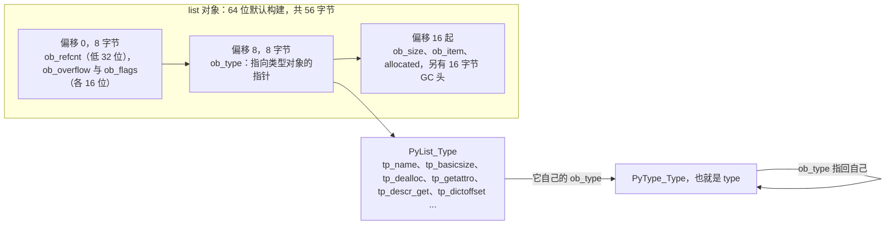

上一篇留下的 `Config` 是个冻结的 dataclass，我把它重写成了一组描述符：`config.limit = 0` 现在立刻抛 `ConfigError`，不用等到第一次搜索才出事。账单来得也很快：给 `config.limit` 赋一次值要 521.3 ns，给普通实例的同名属性赋一次值只要 18.2 ns，差 28.6 倍；读一次是 144.7 ns 对 21.0 ns，差 6.9 倍（两边都含 13.7 ns 的空循环开销，扣掉以后赋值的差距是 113 倍）。这 500 多纳秒花在哪里是这一篇的主线，沿路我会把 `obj.attr` 这个点号背后的整条链拆开：属性查找、描述符、元类、字节码、AST、引用计数、循环垃圾回收和弱引用。

```text
$ python3 lab/ch15/descriptors.py | tail -5
empty loop   min   13.7  median   14.0
set plain    min   18.2  median   18.6
set Setting  min  521.3  median  527.7
get plain    min   21.0  median   21.4
get Setting  min  144.7  median  147.9
```

> [!NOTE] 本篇检查点
> 这一篇结束时仓库处于标签 `ch15`：`src/sift/config.py` 重写成 `Setting` 描述符加 `Settings` 基类，`Config` 从冻结的 dataclass 变成可变的普通类；`src/sift/cli.py` 的 `--limit` 改用 `Config.limit` 的规则；`src/sift/document.py` 给 `Document` 加了弱引用槽，`src/sift/search.py` 的 `Searcher` 多了一个 `WeakValueDictionary` 文档缓存；`tests/test_cli.py`、`tests/test_config.py` 和 `tests/test_search.py` 补了测试；`lab/ch15` 下有 16 个脚本（没有 `extra.sh`）。一共 23 个文件，`git diff --shortstat ch14 ch15` 给出 `23 files changed, 2044 insertions(+), 81 deletions(-)`。`make ch15` 16 行全是 `ok`，完整测试 547 passed、1 xfailed，`make typecheck` 仍是 0 个错误。后面的篇章还会改 `cli.py`、`log.py`、`search.py`，`pyproject.toml` 和 `Makefile` 也会再添条目。
> 涉及的 Python 特性：`PyObject` 布局、属性查找与描述符、`__getattr__` 一族、类的创建步骤与元类、类装饰器、`inspect`、`dis`、`ast`、`compile`/`exec`/`eval`、引用计数、循环 GC、弱引用、`__del__`、驻留。
> 前置：[第 14 篇](/posts/python-by-sift-14-type-system/)。上一篇结尾我猜 `Setting[T]` 会是 mypy 和 pyright 吵得最凶的地方，这一篇会验证，结果和我猜的不一样。

## 环境

和前几篇同一台机器（AMD Ryzen 7 PRO 6850U，16 个线程），仓库在标签 `ch15`，命令都在 `nix develop` 里、仓库根目录 `~/Projects/sift` 下跑：

```text
$ uname -r
6.18.57
$ python3 -VV
Python 3.14.7 (main, Aug  5 2026, 10:29:49) [GCC 15.3.0]
$ python3.14t -VV
Python 3.14.7 free-threading build (main, Aug  5 2026, 10:29:49) [GCC 15.3.0]
$ git describe --tags
ch15
```

几件事先交代。第一，这台机器的 CPU 有快慢两个状态（前几篇测到过差约 2.5 倍），所以每个计时脚本都让对手轮流跑，并且前后各跑一遍 `cpu_state.py`（第 12 篇贴过的固定忙循环，快状态下 5 个数都在 110 到 120 ms 之间）；这一篇的每一组计时，前后各夹一次 `cpu_state.py`，数都在 111 到 124 ms 之间，只有 gc 实验开头的一个数是 134 ms，都算快状态（开头那一块也是夹在两次 `cpu_state.py` 之间跑的，没有贴出来）。开头那一块和后面 `descriptor_cost.py` 的完整一轮是两次独立的运行，所以同一个量会有 521.3 和 534.9 ns 这样的小差别。我没有在慢状态下重跑，所以慢状态下绝对值会偏大，比例才可信。第二，输出里的家目录缩写成 `~`；临时脚本放在 `/tmp/sift-scratch/`，不进仓库，整份贴出，都满足 79 列并通过仓库的 `ruff` 配置；仓库里的实验文件只贴被讲到的片段，省略处标 `# ...`。故意写错的行标 `# BAD`，故意让运行时抛异常的行标 `# error: 异常类型: 真实的 3.14.7 报错信息`。

第三，Nix 的 Python 不带 C 源码，所以文中引用的 CPython 源码（文件和行号都指 `v3.14.7` 标签）我是按路径从 GitHub 的 raw 地址拉下来放在 `/tmp/cpython-3.14.7/` 的，这个循环一共 22 个文件；文中每一段 C 源码都是脚本按行号从这份拷贝里切出来的，行号和内容对得上：

```bash
$ cd /tmp && mkdir -p cpython-3.14.7 && cd cpython-3.14.7
$ for f in Include/object.h Include/refcount.h Include/cpython/object.h \
      Include/internal/pycore_interp_structs.h \
      Include/internal/pycore_long.h Objects/object.c \
      Objects/typeobject.c Objects/funcobject.c Objects/descrobject.c \
      Objects/unicodeobject.c Python/bltinmodule.c Python/bytecodes.c \
      Python/specialize.c Python/sysmodule.c Python/gc.c \
      Modules/gcmodule.c Lib/inspect.py Lib/dis.py Lib/ast.py \
      Lib/weakref.py Lib/dataclasses.py Doc/whatsnew/3.14.rst; do
    mkdir -p "$(dirname "$f")"
    curl -sfL -o "$f" \
        "https://raw.githubusercontent.com/python/cpython/v3.14.7/$f"
done
```

最后，仓库的状态：`make ch15` 全绿，完整测试和类型检查也都过了（mypy 和 pyright 在 34 个文件上都是 0 个错误）：

```text
$ make ch15
python3 scripts/chapter.py ch15
ok   lab/ch15/ast_tour.py
ok   lab/ch15/attribute_lookup.py
ok   lab/ch15/class_decorator.py
ok   lab/ch15/del_pitfall.py
ok   lab/ch15/descriptors.py
ok   lab/ch15/dis_tour.py
ok   lab/ch15/dynamic_classes.py
ok   lab/ch15/eval_danger.py
ok   lab/ch15/getattr_proxy.py
ok   lab/ch15/inspect_tour.py
ok   lab/ch15/metaclass_demo.py
ok   lab/ch15/object_sizes.py
ok   lab/ch15/refcount_gc.py
ok   lab/ch15/setting_validation_fail.py
ok   lab/ch15/small_int_and_interning.py
ok   lab/ch15/weakref_demo.py
$ python3 -m pytest | tail -1
547 passed, 1 xfailed in 12.05s
$ make typecheck
mypy && pyright
Success: no issues found in 34 source files
0 errors, 0 warnings, 0 informations
```

## 一个对象，一张图

CPython 里的每个对象，不管是 `1`、`None`、一个列表还是一个类，内存里最前面的 16 个字节长得一样：前 8 个字节放引用计数（外加两个 16 位的辅助字段），后 8 个字节是一个指针，指向它的类型对象，各类型自己的数据排在后面。这一篇要拆的东西都是从这 16 个字节上长出来的：



“56 字节”是 `sys.getsizeof([])` 的真实结果，其中 16 字节的 GC 头在对象前面，不算在 `PyObject` 里。`Include/object.h` 第 122 到 139 行是默认构建的头（第 144 行紧接着是 `PyTypeObject *ob_type;`）：

```c
    union {
#if SIZEOF_VOID_P > 4
        PY_INT64_T ob_refcnt_full; /* This field is needed for efficient initialization with Clang on ARM */
        struct {
#  if PY_BIG_ENDIAN
            uint16_t ob_flags;
            uint16_t ob_overflow;
            uint32_t ob_refcnt;
#  else
            uint32_t ob_refcnt;
            uint16_t ob_overflow;
            uint16_t ob_flags;
#  endif
        };
#else
        Py_ssize_t ob_refcnt;
#endif
    };
```

引用计数只有低 32 位。`Include/refcount.h` 解释了为什么：32 位计数不小于 2^31 的对象被当成“不朽” (PEP 683)，`Py_INCREF` 和 `Py_DECREF` 碰到它们什么也不做。`Py_DECREF` 的主体是这几行（第 411 到 422 行）：

```c
static inline Py_ALWAYS_INLINE void Py_DECREF(PyObject *op)
{
    // Non-limited C API and limited C API for Python 3.9 and older access
    // directly PyObject.ob_refcnt.
    if (_Py_IsImmortal(op)) {
        _Py_DECREF_IMMORTAL_STAT_INC();
        return;
    }
    _Py_DECREF_STAT_INC();
    if (--op->ob_refcnt == 0) {
        _Py_Dealloc(op);
    }
```

减一，等于零就调 `_Py_Dealloc`，没有别的了。`lab/ch15/object_sizes.py` 先量了 28 种东西的 `sys.getsizeof`，再用 `ctypes` 直接读一个列表的头，读头的函数是：

```python
def header(obj: object) -> tuple[int, int]:
    """Return (refcount, type pointer) read from the object's memory.

    CPython puts ob_refcnt first and ob_type second; id(obj) is the
    address of that header (a CPython detail).
    """
    refcnt = ctypes.c_ssize_t.from_address(id(obj)).value
    ob_type = ctypes.c_size_t.from_address(id(obj) + 8).value
    return refcnt, ob_type
```

`id(obj)` 在 CPython 里就是对象的地址（实现细节，PyPy 上没有这回事），所以第一个字是引用计数，加 8 是类型指针。整份输出：

```text
$ python3 lab/ch15/object_sizes.py
-- sys.getsizeof
  object()          16
  None              16
  True              28
  0                 28
  1                 28
  2**30             32
  2**60             36
  2**100            40
  1.5               24
  ''                41
  'a'               42
  'ab' * 10         61
  '中'               60
  b''               33
  ()                48
  (1,)              56
  []                56
  [1]               64
  {}                64
  {1: 1}           224
  set()            216
  frozenset()      216
  lambda: 0        168
  Plain()           48
  WithSlots()       32
  TwoSlots()        48
  Point(1, 2)       48
  Plain (class)   1720
-- an instance dict is extra
  Plain() with one attribute: 48
  its __dict__              : 296
-- the header: refcount, then the type pointer
  refcount via ctypes   : 1
  sys.getrefcount       : 1
  type pointer is id(list): True
  after another name    : 2
  pointer size          : 8
```

`object()` 和 `None` 都是 16 字节，正好是那个头。整数从 28 字节起步，`2**30` 是 32，`2**60` 是 36，`2**100` 是 40：每多 30 位多 4 个字节，整数在内存里是 30 位一个“数位”的数组。末尾五行里，`ctypes` 读到的计数和 `sys.getrefcount` 都是 1，多一个名字以后变成 2，类型指针等于 `id(list)`。`sys.getsizeof` 本身是 `__sizeof__()` 加上“前置头”的大小（`Objects/typeobject.c` 第 7895 到 7911 行的 `object___sizeof___impl` 返回 `tp_basicsize` 加上变长对象的 `ob_size * tp_itemsize`（所以 `()` 是 48 而 `(1,)` 是 56），`Python/sysmodule.c` 第 1965 到 1973 行再加前置头），所以实例属性的存储不在它数的范围里（至少这个例子里是这样：`Plain()` 加了一个属性还是 48 字节，而它的 `__dict__` 单独是 296 字节）。

`None` 的头长什么样，以及自由线程构建 (`python3.14t`) 的 `object()` 有多大：

```text
$ python3 -c "import ctypes; print(hex(ctypes.c_uint64.from_address(id(None)).value))"
0x50000c0000000
$ python3.14t -c "import sys; print(sys.getsizeof(object()))"
32
```

`None` 的第一个字是 `0x50000c0000000`：低 32 位 `0xc0000000` 就是 `3ULL << 30`（`refcount.h` 第 49 行的 `_Py_IMMORTAL_INITIAL_REFCNT`），高位的 5 是 `ob_flags`，等于静态分配标志 4 加不朽标志 1（第 22、23 行）。自由线程构建的头是 32 字节：`ob_tid`、标志加互斥锁加 GC 位加 32 位的 `ob_ref_local`、`ob_ref_shared`、最后才是 `ob_type`（`Include/object.h` 第 152 到 163 行）。多出来的 16 字节的用处留给下一篇。

## 点号背后：属性查找的顺序

`obj.name` 在字节码里是一条 `LOAD_ATTR`，最后调 `type(obj)` 的 `tp_getattro` 槽。普通类的这个槽就是 `object.__getattribute__`（C 里叫 `PyObject_GenericGetAttr`），顺序我背过很多遍，这次想让它跑起来。`lab/ch15/attribute_lookup.py` 造了三种“证人”：一个数据描述符（有 `__get__` 和 `__set__`）、一个非数据描述符（只有 `__get__`）、一个普通类属性，再把同名的值偷偷塞进实例的 `__dict__`，看谁赢：

```python
class Demo:
    """Every step of the lookup has a witness here."""

    data = Data()
    nondata = NonData()
    plain = "class attribute"

    def __init__(self) -> None:
        # __dict__ writes bypass __set__ and show who wins on reads
        self.__dict__["data"] = "instance dict"
        self.__dict__["nondata"] = "instance dict"
        self.__dict__["plain"] = "instance dict"

    def __getattr__(self, name: str) -> str:
        return f"__getattr__({name})"
```

最后那个 `__getattr__` 是兜底，整个查找失败以后才轮到它。输出：

```text
$ python3 lab/ch15/attribute_lookup.py
1. data descriptor on the type beats the instance dict
   Data.__get__(data)
  Data.__set__(data, 'assigned')
  instance dict still holds: instance dict
2. instance dict beats a non-data descriptor
   instance dict
   instance dict
3. delete the dict entries: the class side shows through
   NonData.__get__(nondata)
   class attribute
4. nothing found: __getattr__ is the last resort
   __getattr__(missing)
lookup() agrees with getattr on every name:
  data     True
  nondata  True
  plain    True
  missing  True
__getattribute__ override sees method and data access
   42
   ['method', 'value']
```

第 1 组：`demo.data` 返回 `Data.__get__(data)`，实例字典里的 `"instance dict"` 被无视；`demo.data = "assigned"` 走进 `Data.__set__`，实例字典纹丝未动。第 2 组：非数据描述符和普通类属性都输给了实例字典。第 3 组：把实例字典里的条目删掉，类那一侧才露出来。第 4 组：`demo.missing` 一路落空，`__getattr__` 接住。实验文件里还用 Python 把整个顺序重写了一遍 (`lookup()`)，和 `getattr` 在四个名字上结论一致。末尾的 `Traced` 重写了 `__getattribute__`，它看到 `method` 和 `value` 两次访问：连 `traced.method()` 里取方法的那一下也走它。

顺序是：先在类型的 MRO 上找名字；找到的是数据描述符就直接调它的 `__get__`，实例字典连看都不看；否则看实例字典；再否则，类上找到的东西是非数据描述符就调 `__get__`，是普通值就原样返回；全落空才轮到 `__getattr__`。C 里的对应物是 `Objects/object.c` 的 `_PyObject_GenericGetAttrWithDict`（第 1808 到 1929 行，一百二十来行）。数据描述符这一支在第 1845 到 1854 行：

```c
    if (descr != NULL) {
        f = Py_TYPE(descr)->tp_descr_get;
        if (f != NULL && PyDescr_IsData(descr)) {
            res = f(descr, obj, (PyObject *)Py_TYPE(obj));
            if (res == NULL && suppress &&
                    PyErr_ExceptionMatches(PyExc_AttributeError)) {
                PyErr_Clear();
            }
            goto done;
        }
```

`PyDescr_IsData(descr)` 看的是类型的 `tp_descr_set` 槽是否非空。查类属性先去方法缓存找（每个解释器一份，`interp->types.type_cache`），键是类型版本号加属性名（`Objects/typeobject.c` 第 5911 到 5917 行）。

在类上取属性 (`Config.limit`) 走的是 `type.__getattribute__`，`_Py_type_getattro_impl`（`Objects/typeobject.c` 第 6103 到 6190 行），顺序多一层：先查元类上的数据描述符，再查类自己和基类的字典，找到的东西如果有 `__get__`，就用 `NULL` 作实例、类作 `owner` 去调（第 6156 行），这就是 `Setting.__get__(None, Config)` 的来历，最后才用元类上的非数据描述符或普通属性。

## 函数是描述符：方法是怎么绑定的

描述符协议只有三个方法：`__get__(self, obj, owner)`、`__set__(self, obj, value)`、`__delete__(self, obj)`，一个类属性的类型只要定义了其中任何一个，上一节的查找就会去调它。每次讲这个都有人问“那 `self` 是哪来的”，答案是：函数本身就是一个只有 `__get__` 的描述符。`lab/ch15/descriptors.py` 的第一个类里放了四种东西：

```python
class Greeter:
    """A class with one method of each kind."""

    def __init__(self, name: str) -> None:
        self._name = name

    def hello(self) -> str:
        return f"hello, {self._name}"

    @property
    def name(self) -> str:
        return self._name

    @classmethod
    def anonymous(cls) -> Greeter:
        return cls("nobody")

    @staticmethod
    def shout(text: str) -> str:
        return text.upper()
```

`Greeter.__dict__["hello"]` 是个普通函数；`greeter.hello` 触发查找，在类上找到函数，它有 `__get__` 没有 `__set__`，是非数据描述符，查实例字典（没有）以后调它的 `__get__(greeter, Greeter)`，得到一个绑定方法。C 里就是 `Objects/funcobject.c` 的 `func_descr_get`，第 1277 到 1285 行：

```c
/* Bind a function to an object */
static PyObject *
func_descr_get(PyObject *func, PyObject *obj, PyObject *type)
{
    if (obj == Py_None || obj == NULL) {
        return Py_NewRef(func);
    }
    return PyMethod_New(func, obj);
}
```

通过类访问（`obj` 是 `NULL` 或 `None`）原样返回函数，通过实例访问就包一个 `PyMethod_New(func, obj)`。每次 `greeter.hello` 都新造一个方法对象，所以下面输出里 `greeter.hello is bound` 是 `False`（`obj.method()` 这种直接调用有特殊路径，见 `Python/bytecodes.c` 第 2297 到 2302 行）。`classmethod` 和 `staticmethod` 套路相同，只是绑定的东西不同：`cm_descr_get`（`funcobject.c` 第 1546 到 1558 行）把访问时的类绑到函数上，`sm_descr_get`（第 1792 到 1802 行）什么也不绑，原样交出函数。`property` 是个数据描述符：`Objects/descrobject.c` 的 `property_descr_get`（第 1661 到 1694 行）通过类访问时返回自己，通过实例访问时调 `prop_get`；没有 setter 时赋值不会落到实例字典，是因为 `property_descr_set`（第 1697 行起）在 `prop_set` 为空时直接抛 `AttributeError`。

纯 Python 的 `property` 克隆（`class Clone` 用它装饰 `x`，输出里的 `clone.x` 经过它的 `__get__` 和 `__set__`）：

```python
class MyProperty:
    """A pure-Python property: a data descriptor."""

    def __init__(
        self,
        fget: Callable[[Any], Any],
        fset: Callable[[Any, Any], None] | None = None,
    ) -> None:
        self.fget = fget
        self.fset = fset
        self.__doc__ = fget.__doc__

    def setter(self, fset: Callable[[Any, Any], None]) -> MyProperty:
        return type(self)(self.fget, fset)

    def __get__(self, obj: object, owner: type | None = None) -> Any:
        if obj is None:
            return self
        return self.fget(obj)

    def __set__(self, obj: object, value: object) -> None:
        if self.fset is None:
            raise AttributeError("property has no setter")
        self.fset(obj, value)
```

整个实验的输出如下，最后 5 行是计时，前后各夹一次 `cpu_state.py`，下一节细看：

```text
$ python3 /tmp/sift-scratch/cpu_state.py; \
    python3 lab/ch15/descriptors.py; \
    python3 /tmp/sift-scratch/cpu_state.py
113 115 115 114 114 ms
-- functions are non-data descriptors
type in class dict : function
has __get__        : True
has __set__        : False
func.__get__(obj)  : method
bound.__self__ is obj: True
bound.__func__ is func: True
Greeter.hello is func : True
greeter.hello is bound: False
instance dict wins     : from the instance dict
-- property, classmethod, staticmethod
name       property      __get__=True __set__=True
anonymous  classmethod   __get__=True __set__=False
shout      staticmethod  __get__=True __set__=False
property without setter: property 'name' of 'Greeter' object has no setter
Greeter.anonymous().name: nobody
greeter.shout('a')      : A
-- the clones behave the same
clone.x       : 5
Clone.x.__doc__: The x value.
Clone.make()  : Clone
clone.twice(4): 8
-- what a Setting costs (ns per operation, 10 rounds)
empty loop   min   13.1  median   13.3
set plain    min   17.6  median   17.7
set Setting  min  520.6  median  524.5
get plain    min   20.6  median   20.6
get Setting  min  142.3  median  143.3
121 126 114 114 117 ms
```

逐行读：`type in class dict: function`，类字典里的东西就是个 `function`，有 `__get__` 无 `__set__`；`func.__get__(obj)` 得到 `method`，`__self__` 和 `__func__` 都对得上；`Greeter.hello is func` 为真（通过类访问不绑定）；把一个 lambda 塞进实例字典以后 `greeter.hello()` 调的是它 (`instance dict wins`)，因为函数不是数据描述符；`name` 是 `property`，`__set__=True`，没有 setter 时赋值得到 `property 'name' of 'Greeter' object has no setter`，和 C 里 `property_descr_set` 的格式串对得上。

## Setting：我自己的描述符

回到 Sift。第 14 篇结束时，`config.py` 里每个设置的校验都是散落在 `_number` 和 `_section` 里的手写 `isinstance`，`Config` 是个冻结的 dataclass，字段的类型和默认值写在一处，校验写在另一处。现在两样东西合在一起，一个设置就是类上的一个描述符，类型、默认值、范围和它在 `sift.toml` 里的位置都在同一行：

```python
class Config(Settings):
    """The settings of Sift; defaults match the shipped sift.toml."""

    corpus = PathSetting(default=Path("corpus/posts"), section="index")
    index_path = PathSetting(
        default=Path(".sift"), section="index", key="path"
    )
    pipeline = StrTupleSetting(
        default=("mixed", "nfkc", "stopwords"), section="analysis"
    )
    k1 = Setting(float, default=1.2, min=0.0, section="search")
    b = Setting(float, default=0.75, min=0.0, max=1.0, section="search")
    limit = Setting(int, default=10, min=1, max=100, section="search")
```

`Setting(float, default=1.2, min=0.0, section="search")` 创建的对象放在类的命名空间里，这时它还不知道自己叫 `k1`：赋值右边求值的时候，类还没造出来，名字只是左边的一个标识符。告诉它名字的是 `__set_name__`：`type.__new__` 在类对象造好以后，对类字典里每个有 `__set_name__` 的值调用一次（C 里是 `type_new_set_names`，`Objects/typeobject.c` 第 11531 到 11572 行，后面讲类的创建步骤时再细看）。`Setting` 用它记下名字，顺手检查默认值：

```python
    def __set_name__(self, owner: type, name: str) -> None:
        """Record the name, then check that the default is valid."""
        super().__set_name__(owner, name)
        try:
            self.validate(self.default)
        except ConfigError as error:
            raise ValueError(f"bad default: {error}") from None

    @overload
    def __get__(self, instance: None, owner: type[object]) -> Self: ...
    @overload
    def __get__(self, instance: object, owner: type[object]) -> T: ...
    def __get__(
        self, instance: object | None, owner: type[object]
    ) -> Self | T:
        """Return the stored value; on the class, the setting itself."""
        if instance is None:
            return self
        stored = instance.__dict__.get(self.name, self.default)
        return cast("T", stored)

    def __set__(self, instance: object, value: T) -> None:
        """Validate value and store it in the instance."""
        instance.__dict__[self.name] = self.validate(value)

    def __delete__(self, instance: object) -> None:
        """Forget the stored value: the default shows again."""
        instance.__dict__.pop(self.name, None)
```

`__get__` 的两个 `@overload` 是给类型检查器看的：通过类访问 (`instance is None`) 得到 `Self`，也就是 `Setting[int]` 本身，通过实例访问得到 `T`，也就是 `int`。读的时候先查实例字典里以名字为键的值，没有就回默认值；写的时候先 `validate` 再存进实例字典，所以 `vars(config)` 里只有被赋过值的设置。字典里有同名的键，读的时候却不会绕过描述符，因为上一节的顺序：数据描述符排在实例字典前面，只有 `__get__` 自己去读字典。`__set__` 和 `__delete__`（第 112 到 118 行）都直接操作 `instance.__dict__`：`del config.limit` 把存下的值弹掉，默认值又露出来。

`validate`（第 137 到 163 行）先挡掉 `bool`（它是 `int` 的子类，`limit = true` 不该当 1 用），`float` 设置接受整数并存成浮点数，再 `isinstance` 检查类型（数字类型是预先算好的元组 `_NUMBER_TYPES`）和闭区间范围，错误信息统一从 `label`（`[search] limit` 这样）来，`from_toml` 再在前面接上文件名。一组设置怎么变成 `Config`，靠 `Settings` 基类的 `__init_subclass__`：它在子类的类体执行完、类对象造好以后被调用一次，把这个类和它基类上的描述符按声明顺序收进 `_settings`，构造函数、`==`、`__repr__` 和 `from_toml` 都只看这个字典，不用再维护字段名列表：

`from_toml`（第 300 行起）按设置所在的段分组，先拒绝未知的段和键，再把每个值交给 `setting.parse`，出错时在信息前面加上文件路径。`Settings.__init_subclass__`（第 245 行起）在子类造好以后收集描述符：

```python
    def __init_subclass__(cls) -> None:
        """Collect the settings of cls and of its bases."""
        super().__init_subclass__()
        found: dict[str, SettingBase] = {}
        for base in reversed(cls.__mro__):
            for name, value in vars(base).items():
                if not isinstance(value, SettingBase):
                    found.pop(name, None)  # a plain attribute shadows
                elif hasattr(Settings, name):
                    raise TypeError(
```

`Settings` 还有一道拼写保护（第 267 到 276 行）：

```python
    def __setattr__(self, name: str, value: object) -> None:
        """Only declared settings can be assigned.

        A typo such as ``config.limt = 5`` raises ConfigError, not a
        silent new attribute.
        """
        if name not in self._settings:
            raise ConfigError(self._unknown(name))
        super().__setattr__(name, value)

```

`config.limt = 5` 因此抛 `ConfigError`，而不是悄悄多出一个属性；`Settings.__init__`（第 262 行）逐项 `setattr`，所以 `Config(limt=5)` 走同一条路。这一层的价钱，下一节会量。

测试在 `tests/test_config.py` 的后半段和 `tests/test_search.py`，结果在文末的表里。

### 静态检查器怎么看它

上一篇结尾我写过：我猜 `Setting[T]` 会是 mypy 和 pyright 争得最凶的地方，因为 `__get__` 需要重载。现在可以验证了。下面的脚本问两个检查器同一组问题（pyright 的输出我用 `grep` 和 `sed` 只留了结论行，`sed` 去掉了文件路径；我把仓库的 `src` 和 `pyproject.toml` 拷到 `/tmp/sift-scratch/tc/`，因为 Nix 的 mypy 看不到可编辑安装，脚本也放进去）：

```python
"""Ask the type checkers what a Setting looks like from outside."""

from typing import reveal_type

from sift.config import Config

config = Config()
reveal_type(Config.limit)
reveal_type(config.limit)
reveal_type(config.k1)
config.limit = "5"  # error: both checkers object
config.limt = 5  # error: only run time objects
Config(limit="5")  # error: only run time objects
Config(limt=5)  # error: only run time objects
```

```text
$ cd /tmp/sift-scratch/tc && mypy reveal_setting.py
reveal_setting.py:8: note: Revealed type is "sift.config.Setting[int]"
reveal_setting.py:9: note: Revealed type is "int"
reveal_setting.py:10: note: Revealed type is "float"
reveal_setting.py:11: error: Incompatible types in assignment (expression has type "str", variable has type "int")  [assignment]
Found 1 error in 1 file (checked 1 source file)
$ cd /tmp/sift-scratch/tc \
    && pyright reveal_setting.py | grep -E 'Type of|error: Cannot' | sed 's#.*reveal_setting.py:##'
8:13 - information: Type of "Config.limit" is "Setting[int]"
9:13 - information: Type of "config.limit" is "int"
10:13 - information: Type of "config.k1" is "float"
11:8 - error: Cannot assign to attribute "limit" for class "Config"
```

两个检查器的结论仍然一模一样：`Config.limit` 是 `Setting[int]`，`config.limit` 是 `int`，`config.k1` 是 `float`，`config.limit = "5"` 被拒绝（原因是 `__set__` 的 `value: int`，mypy 和 pyright 各报 1 个错误）。所以我上一篇的猜测是错的，两个检查器对重载的 `__get__` 没有分歧。

但 `config.limt = 5` 这一行现在两个检查器都不报了（脚本里的注释是 `only run time objects`，运行时抛 `ConfigError`）：`Settings` 定义了 `__setattr__`，检查器看到这样的类就放行任意属性赋值。运行时的拼写保护顺手关掉了静态检测；`ea53da8` 的检查器抓得住它，只是因为那时没有这层保护。`Settings.__init__` 的签名是 `**values: object`，`Config(limit="5")` 和 `Config(limt=5)` 同样两个检查器都放行，运行时才报 `ConfigError`（后者带 “did you mean limit?”）。冻结的 dataclass 的 `__init__` 是带类型的，这两个错误以前在运行之前就抓得住。补上的办法大概是给 `Config` 写参数带类型的显式 `__init__`，我没试。

### 行为上变了什么

`Config` 从冻结的 dataclass 变成可变的普通类，不只是换了写法。我把同一个脚本放在三棵源码树上跑：`ch14`、重新打标签之前的提交 `ea53da8`（那时 `Config` 没有拼写保护和 `__delete__`）、现在的 `ch15`。旧的两棵用 `git archive` 解出来，不动仓库：

```text
$ rm -rf /tmp/sift-scratch/ch14src \
    && mkdir -p /tmp/sift-scratch/ch14src \
    && git archive ch14 | tar -x -C /tmp/sift-scratch/ch14src

```

```python
"""Poke at Config the same way at three tags and compare the answers."""

from collections.abc import Callable

from sift.config import Config


def attempt(label: str, action: Callable[[], object]) -> None:
    try:
        result = action()
    except Exception as error:
        print(f"{label:24} {type(error).__name__}: {error}")
    else:
        print(f"{label:24} ok {result!r}")


def assign(config: Config, name: str, value: object) -> None:
    setattr(config, name, value)


def main() -> None:
    """Run the same probes against whatever Config is installed."""
    config = Config()
    attempt("Config(limit=0)", lambda: Config(limit=0).limit)
    attempt("Config(limit=500)", lambda: Config(limit=500).limit)
    attempt("config.limit = 5", lambda: assign(config, "limit", 5))
    attempt("config.limt = 5", lambda: assign(config, "limt", 5))
    attempt("config.limit = 0", lambda: assign(config, "limit", 0))
    attempt("Config(limt=5)", lambda: Config(limt=5))
    attempt("hash(config)", lambda: hash(config))
    attempt(
        "del; config.limit",
        lambda: (delattr(config, "limit"), config.limit)[1],
    )


if __name__ == "__main__":
    main()
```

```text
$ PYTHONPATH=/tmp/sift-scratch/ch14src/src python3 /tmp/sift-scratch/config_changes.py
Config(limit=0)          ok 0
Config(limit=500)        ok 500
config.limit = 5         FrozenInstanceError: cannot assign to field 'limit'
config.limt = 5          FrozenInstanceError: cannot assign to field 'limt'
config.limit = 0         FrozenInstanceError: cannot assign to field 'limit'
Config(limt=5)           TypeError: Config.__init__() got an unexpected keyword argument 'limt'. Did you mean 'limit'?
hash(config)             ok -5189201884036671983
del; config.limit        FrozenInstanceError: cannot delete field 'limit'
$ PYTHONPATH=/tmp/sift-scratch/old15/src python3 /tmp/sift-scratch/config_changes.py
Config(limit=0)          ConfigError: [search] limit must be an integer between 1 and 100
Config(limit=500)        ConfigError: [search] limit must be an integer between 1 and 100
config.limit = 5         ok None
config.limt = 5          ok None
config.limit = 0         ConfigError: [search] limit must be an integer between 1 and 100
Config(limt=5)           TypeError: unknown setting: limt
hash(config)             TypeError: unhashable type: 'Config'
del; config.limit        AttributeError: __delete__
$ python3 /tmp/sift-scratch/config_changes.py
Config(limit=0)          ConfigError: [search] limit must be an integer between 1 and 100
Config(limit=500)        ConfigError: [search] limit must be an integer between 1 and 100
config.limit = 5         ok None
config.limt = 5          ConfigError: unknown setting: limt (did you mean limit?)
config.limit = 0         ConfigError: [search] limit must be an integer between 1 and 100
Config(limt=5)           ConfigError: unknown setting: limt (did you mean limit?)
hash(config)             TypeError: unhashable type: 'Config'
del; config.limit        ok 10
```

三组依次是 `ch14`、`ea53da8`、现在的 `ch15`，对照读：

- `config.limit = 5`：`ch14` 抛 `FrozenInstanceError`，后两者合法（配置变成可变的）；
- 拼写错的 `config.limt = 5`：`ch14` 抛 `FrozenInstanceError`；`ea53da8` 悄悄创建一个新属性，是个真实的退步；现在抛 `ConfigError: unknown setting: limt (did you mean limit?)`，保护回来了，代价是上一节说的每次赋值多 240 ns 左右；`Config(limt=5)` 同理（`ea53da8` 里是 `TypeError`）；
- `Config(limit=0)` 和 `Config(limit=500)`：`ch14` 能构造成功，校验只在 `load_config` 里做，现在构造函数就校验；
- `hash(config)`：`ch14` 能用，现在是 `TypeError: unhashable type: 'Config'`，因为 `Settings` 定义了 `__eq__` 而没有 `__hash__`（[第 6 篇](/posts/python-by-sift-06-classes-data-model/)讲过这条规则）；
- `del config.limit`：`ch14` 抛 `FrozenInstanceError`，`ea53da8` 是 `AttributeError: __delete__`（`Setting` 没有 `__delete__`），现在是把设置重置回默认值，脚本里读回来是 10。

错误信息也变了。`limit = 0` 以前是 `[search] limit must be an integer of at least 1`，现在是 `[search] limit must be an integer between 1 and 100`；`b = 1.5` 以前是 `[search] b must be between 0 and 1`，现在多了两个字：`must be a number between 0 and 1`。实质变化是 `limit` 有了上界 100，`limit = 101` 以前合法现在被拒绝。命令行也跟上了：`ea53da8` 里 `--limit` 用的 `positive_int` 只检查大于等于 1，现在用 `limit_arg`（`src/sift/cli.py` 第 118 到 129 行），直接调 `Config.limit.validate`，两处的规则是同一份。同一条命令在两棵树上：

```text
$ PYTHONPATH=/tmp/sift-scratch/old15/src python3 -m sift search x --limit 101 2>&1; \
    echo "exit code $?"
sift: no index at .sift, run 'sift index' first
exit code 4
$ python3 -m sift search x --limit 101 2>&1; echo "exit code $?"
usage: sift search [-h] [--limit LIMIT] [--json] [--no-log] query [query ...]
sift search: error: argument --limit: [search] limit must be an integer between 1 and 100
exit code 2
```

旧树没有拒绝 101，一路走到“没有索引”（退出码 4，我没建索引）；新树在解析参数时就以退出码 2 拒绝，信息和 `sift.toml` 里写 `limit = 101` 时一字不差（只是没有文件名前缀）。

评审时我还发现一个回归：新的校验对 NaN 不设防，`nan` 既不小于下界也不大于上界，范围检查全部放行，`Config(b=nan)` 就悄悄成功了；再大的整数 (`10**400`) 转浮点会抛 `OverflowError`。仓库里已经修掉，`validate` 现在拒绝 NaN 并把溢出转成 `ConfigError`：

```python
"""Feed NaN and a huge int to Config and print what it says."""

from sift.config import Config


def main() -> None:
    nan = float("nan")
    for values in ({"b": nan}, {"k1": nan}, {"k1": 10**400}):
        try:
            Config(**values)
        except Exception as error:
            print(type(error).__name__ + ":", error)


if __name__ == "__main__":
    main()
```

```text
$ python3 /tmp/sift-scratch/nan_check.py
ConfigError: [search] b must be a number between 0 and 1
ConfigError: [search] k1 must be a number
ConfigError: [search] k1 must be a number
```

`lab/ch15/setting_validation_fail.py` 是故意失败的演示，给 `config.limit` 赋 0，退出码 1。回溯有四帧，`<module>`、`Settings.__setattr__`（`config.py` 第 275 行）、`Setting.__set__`（第 114 行）、`validate`（第 161 行）：

```text
$ python3 lab/ch15/setting_validation_fail.py 2>&1; echo "exit code $?"
Traceback (most recent call last):
  File "~/Projects/sift/lab/ch15/setting_validation_fail.py", line 16, in <module>
    main()
    ~~~~^^
  File "~/Projects/sift/lab/ch15/setting_validation_fail.py", line 11, in main
    config.limit = 0
    ^^^^^^^^^^^^
  File "~/Projects/sift/src/sift/config.py", line 275, in __setattr__
    super().__setattr__(name, value)
    ~~~~~~~~~~~~~~~~~~~^^^^^^^^^^^^^
  File "~/Projects/sift/src/sift/config.py", line 114, in __set__
    instance.__dict__[self.name] = self.validate(value)
                                   ~~~~~~~~~~~~~^^^^^^^
  File "~/Projects/sift/src/sift/config.py", line 161, in validate
    raise self._out_of_range()
sift.errors.ConfigError: [search] limit must be an integer between 1 and 100
exit code 1
```

信息不带文件名，因为这是代码里的赋值，不是从 `sift.toml` 读出来的。
## 这 510 多纳秒花在哪

开头的数字是 `lab/ch15/descriptors.py` 量出来的（标签 `ch15` 在加入拼写保护等修正以后重新打过一次，这一篇所有数字都是在新标签上量的）。这个比例太夸张，我不放心，所以另写了一个脚本，把四种实现放在一起量，再加一个空循环做基线：普通实例属性、`property`、一个什么都不检查的纯 Python 数据描述符 (`Bare`)、`Setting`。每一轮四种实现轮流各跑 200,000 次，10 轮，取最小值和中位数：

```python
"""Split the cost of a Setting into call overhead and validation."""

import statistics
import time
from collections.abc import Callable
from typing import Any

from sift.config import Config

LOOPS = 200_000
ROUNDS = 10


class Plain:
    def __init__(self) -> None:
        self.limit = 10


class Bare:
    def __set_name__(self, owner: type, name: str) -> None:
        self.name = name

    def __get__(self, obj: object, owner: type | None = None) -> int:
        return obj.__dict__[self.name]

    def __set__(self, obj: object, value: int) -> None:
        obj.__dict__[self.name] = value


class WithBare:
    limit = Bare()

    def __init__(self) -> None:
        self.limit = 10


class WithProperty:
    def __init__(self) -> None:
        self._limit = 10

    @property
    def limit(self) -> int:
        return self._limit

    @limit.setter
    def limit(self, value: int) -> None:
        self._limit = value


def loop_set(obj: Any) -> Callable[[], None]:
    def run() -> None:
        for _ in range(LOOPS):
            obj.limit = 20

    return run


def loop_get(obj: Any) -> Callable[[], None]:
    def run() -> None:
        for _ in range(LOOPS):
            _ = obj.limit

    return run


def loop_empty() -> None:
    for _ in range(LOOPS):
        pass


def main() -> None:
    """Alternate the variants, print ns per operation."""
    objs: dict[str, Any] = {
        "plain": Plain(),
        "property": WithProperty(),
        "bare descriptor": WithBare(),
        "Setting": Config(),
    }
    for kind, make in (("set", loop_set), ("get", loop_get)):
        runs = {name: make(obj) for name, obj in objs.items()}
        runs["empty loop"] = loop_empty
        samples: dict[str, list[float]] = {name: [] for name in runs}
        for _ in range(ROUNDS):
            for name, run in runs.items():
                start = time.perf_counter_ns()
                run()
                elapsed = time.perf_counter_ns() - start
                samples[name].append(elapsed / LOOPS)
        for name, values in samples.items():
            print(
                f"{kind} {name:16} min {min(values):6.1f} ns"
                f"  median {statistics.median(values):6.1f} ns"
            )


if __name__ == "__main__":
    main()
```

```text
$ python3 /tmp/sift-scratch/cpu_state.py; \
    python3 /tmp/sift-scratch/descriptor_cost.py; \
    python3 /tmp/sift-scratch/cpu_state.py
116 119 118 119 119 ms
set plain            min   18.5 ns  median   19.5 ns
set property         min   72.4 ns  median   73.1 ns
set bare descriptor  min  115.4 ns  median  116.5 ns
set Setting          min  534.9 ns  median  536.5 ns
set empty loop       min   13.8 ns  median   14.0 ns
get plain            min   21.4 ns  median   21.4 ns
get property         min   33.1 ns  median   33.7 ns
get bare descriptor  min  102.5 ns  median  103.5 ns
get Setting          min  147.5 ns  median  150.1 ns
get empty loop       min   13.8 ns  median   13.9 ns
117 119 121 119 120 ms
```

前后两次 `cpu_state.py` 的 10 个数都在 116 到 119 和 117 到 121 ms 之间，快状态。所有数字都含 13.8 ns 的空循环，我用最小值扣掉它，得到净值（手算；`Setting` 这一行包含 `Settings.__setattr__` 的拼写保护，下面会拆）：

- 普通属性：赋值 18.5 ns（净 4.7），读取 21.4 ns（净 7.6）；
- `property`：赋值 72.4 ns（净 58.6），读取 33.1 ns（净 19.3）；
- 什么都不检查的 `Bare`：赋值 115.4 ns（净 101.6），读取 102.5 ns（净 88.7）；
- `Setting`：赋值 534.9 ns（净 521.1），读取 147.5 ns（净 133.7）。

净值看，赋值慢了 111 倍，读取慢了 17.6 倍。`Setting` 比 `Bare` 读一次多 45.0 ns，赋一次多 419.5 ns。`property` 和 `Bare` 的差也有意思：同样是 Python 写的函数，`property` 读取只要 33.1 ns，`Bare` 要 102.5 ns，差 3.1 倍。原因在字节码层：3.11 起的自适应解释器会在一条 `LOAD_ATTR` 执行几次以后，按它实际看到的对象换成专门的版本 (PEP 659)。下面的脚本对每种对象热身 100 次，再用 `dis.get_instructions(adaptive=True)` 看换成了什么：

```python
"""Show which LOAD_ATTR and STORE_ATTR the interpreter picks."""

import dis
from collections.abc import Callable
from types import FunctionType
from typing import Any

from sift.config import Config

from descriptor_cost import Plain, WithBare, WithProperty


def read(obj: Any) -> object:
    return obj.limit


def write(obj: Any) -> None:
    obj.limit = 20


def attr_ops(func: Callable[..., object]) -> list[str]:
    return [
        i.opname
        for i in dis.get_instructions(func, adaptive=True)
        if "ATTR" in i.opname
    ]


def main() -> None:
    """Warm each function up on one kind of object, then look."""
    kinds: dict[str, Any] = {
        "plain": Plain(),
        "property": WithProperty(),
        "bare descriptor": WithBare(),
        "Setting": Config(),
    }
    for name, obj in kinds.items():
        # replace() copies the code, so each kind gets its own cache
        get = FunctionType(read.__code__.replace(co_name="get"), globals())
        put = FunctionType(write.__code__.replace(co_name="put"), globals())
        for _ in range(100):
            get(obj)
            put(obj)
        print(f"{name:16} load {attr_ops(get)}  store {attr_ops(put)}")


if __name__ == "__main__":
    main()
```

```text
$ python3 /tmp/sift-scratch/specialize_attr.py
plain            load ['LOAD_ATTR_INSTANCE_VALUE']  store ['STORE_ATTR_INSTANCE_VALUE']
property         load ['LOAD_ATTR_PROPERTY']  store ['STORE_ATTR']
bare descriptor  load ['LOAD_ATTR']  store ['STORE_ATTR']
Setting          load ['LOAD_ATTR']  store ['STORE_ATTR']
```

普通属性被换成 `LOAD_ATTR_INSTANCE_VALUE` 和 `STORE_ATTR_INSTANCE_VALUE`，直接从对象里的固定位置取、写；`property` 的读取换成 `LOAD_ATTR_PROPERTY`，把 getter 的栈帧直接压进当前解释器循环，但写入没得换；`Bare` 和 `Setting` 的读写都停在通用的 `LOAD_ATTR` 与 `STORE_ATTR`。分类逻辑在 `Python/specialize.c` 的 `classify_descriptor`（第 867 到 907 行），只有 C 里定义的 `property` 能走到下面这几行：

```c
        if (desc_cls == &PyProperty_Type) {
            /* We can't detect at runtime whether an attribute exists
               with property. So that means we may have to call
               __getattr__. */
            return has_getattr ? GETSET_OVERRIDDEN : PROPERTY;
        }
        return OVERRIDING;
```

第 874 到 876 行先检查描述符的类型是不是不可变类型 (`Py_TPFLAGS_IMMUTABLETYPE`)，不是就一律归为 `MUTABLE`，而任何 Python 写的描述符类都是可变类型；`MUTABLE` 在读取时直接放弃特化（第 1254 到 1256 行），写入时同样（第 1440 到 1442 行）。所以写 Python 描述符的人几乎拿不到特化，每次读都要走一遍通用查找，再从 C 里调回 Python 的 `__get__`。

赋值那 500 多纳秒我先怀疑 `validate`：`ea53da8`（重新打标签之前的提交）里它写的是 `isinstance(value, int | float)`，反汇编一下：

```text
$ python3 -c "import dis; dis.dis('isinstance(v, int | float)')"
  0           RESUME                   0

  1           LOAD_NAME                0 (isinstance)
              PUSH_NULL
              LOAD_NAME                1 (v)
              LOAD_NAME                2 (int)
              LOAD_NAME                3 (float)
              BINARY_OP                7 (|)
              CALL                     2
              RETURN_VALUE
```

`BINARY_OP 7 (|)` 不是常量，每次调用都要执行：两个类型相或，造出一个新的联合类型对象，`isinstance` 再去展开它。现在的 `ch15` 已经换成模块级的 `_NUMBER_TYPES = (int, float)`（`config.py` 第 24 行，第 157 行使用）。这个改动值多少，我把旧提交解到 `/tmp/sift-scratch/old15/`：

```bash
$ cd ~/Projects/sift && mkdir -p /tmp/sift-scratch/old15 && \
    git archive ea53da8 | tar -x -C /tmp/sift-scratch/old15
```

再写了个脚本把一次赋值从里到外分成四层，在两棵树上交替各跑两遍（旧、新、旧、新），每层 200,000 次、9 轮取最小值：

```python
"""Time the layers of one Config assignment, from the inside out."""

import statistics
import time
from collections.abc import Callable

from sift.config import Config

LOOPS = 200_000
ROUNDS = 9
CONFIG = Config()
LIMIT = Config.limit


def validate() -> None:
    for _ in range(LOOPS):
        LIMIT.validate(20)


def descriptor_set() -> None:
    for _ in range(LOOPS):
        LIMIT.__set__(CONFIG, 20)


def generic_set() -> None:
    for _ in range(LOOPS):
        object.__setattr__(CONFIG, "limit", 20)


def attribute_set() -> None:
    for _ in range(LOOPS):
        CONFIG.limit = 20


def main() -> None:
    """Alternate the layers and print ns per call (min and median)."""
    runs: dict[str, Callable[[], None]] = {
        "validate": validate,
        "Setting.__set__": descriptor_set,
        "object.__setattr__": generic_set,
        "config.limit = 20": attribute_set,
    }
    samples: dict[str, list[float]] = {name: [] for name in runs}
    for _ in range(ROUNDS):
        for name, run in runs.items():
            start = time.perf_counter_ns()
            run()
            samples[name].append((time.perf_counter_ns() - start) / LOOPS)
    for name, values in samples.items():
        print(
            f"{name:20} min {min(values):6.1f} ns"
            f"  median {statistics.median(values):6.1f} ns"
        )


if __name__ == "__main__":
    main()
```

```text
$ python3 /tmp/sift-scratch/cpu_state.py; \
    PYTHONPATH=/tmp/sift-scratch/old15/src python3 /tmp/sift-scratch/set_breakdown.py; \
    python3 /tmp/sift-scratch/set_breakdown.py; \
    PYTHONPATH=/tmp/sift-scratch/old15/src python3 /tmp/sift-scratch/set_breakdown.py; \
    python3 /tmp/sift-scratch/set_breakdown.py; \
    python3 /tmp/sift-scratch/cpu_state.py
114 116 116 116 115 ms
validate             min  406.8 ns  median  412.3 ns
Setting.__set__      min  486.0 ns  median  490.1 ns
object.__setattr__   min  645.1 ns  median  653.5 ns
config.limit = 20    min  559.5 ns  median  565.5 ns
validate             min  199.6 ns  median  212.3 ns
Setting.__set__      min  264.3 ns  median  275.6 ns
object.__setattr__   min  405.7 ns  median  419.3 ns
config.limit = 20    min  518.9 ns  median  526.9 ns
validate             min  404.7 ns  median  416.0 ns
Setting.__set__      min  481.5 ns  median  487.9 ns
object.__setattr__   min  639.7 ns  median  654.6 ns
config.limit = 20    min  562.6 ns  median  582.2 ns
validate             min  215.4 ns  median  220.3 ns
Setting.__set__      min  280.7 ns  median  287.6 ns
object.__setattr__   min  431.7 ns  median  441.0 ns
config.limit = 20    min  529.1 ns  median  546.5 ns
116 120 123 115 118 ms
```

四组依次是旧、新、旧、新，前后的 `cpu_state.py` 在 114 到 123 ms，快状态。旧树两组 `validate` 都在 405 ns 上下，新树在 200 到 215 ns：换成元组让 `validate` 快了一半，`Setting.__set__` 从 486 和 481.5 ns 降到 264 和 281 ns，省了 200 ns 上下，和 `dis` 之后的怀疑量级对得上。

可是最后一行不一样：`config.limit = 20` 从旧树的 559.5 和 562.6 ns 只降到新树的 518.9 和 529.1 ns，省了 34 到 41 ns。新树里 `config.limit = 20` 比 `Setting.__set__` 本身多 249 到 255 ns，这笔钱有两份：通用的 `STORE_ATTR` 路径本身（旧树里同样的差是 73 到 81 ns，没有拼写保护也要付），其余约 175 ns 才是 `Settings.__setattr__` 这个 Python 层的拼写保护（它先走一遍 Python 函数，再 `super().__setattr__` 才轮到描述符）。所以单看 `validate`，换成元组快了一倍，而用户看到的赋值只快了 6% 到 7%，因为同一个提交把保护加了进来；想知道一处改动的价值，得量用户看到的那一层。

拼写保护值不值约 175 ns，取决于它防的错有多贵：`config.limt = 5` 在旧树里悄悄通过，一次运行里又只赋值几次，我觉得值。重要的是别把“描述符慢”全算在描述符头上：`Setting` 的读是 133 ns（其中 `Bare` 的 89 ns 是 Python 层 `__get__` 拿不到特化的代价），写的 520 ns 里 `validate` 占 200，`__set__` 本身再加 65 上下，通用 `STORE_ATTR` 加 75，保护加 175 上下。所以 28 倍这个数字的故事是：描述符协议本身不贵（`property` 读一次净 19 ns），贵的是 Python 写的描述符拿不到特化，加上我一层一层叠上去的 Python 函数调用。配置对象一次运行里只赋值几次，一次赋值的 520 ns，是 12 条基准查询总耗时（约 1 秒，后面的缓存实验里是 1000 到 1004 ms）的 190 万分之一，要紧的是知道它在哪里、值多少。

## `__getattr__`、`__getattribute__` 和 `__setattr__`

这三个名字我读文档读了很多年才分清，现在的分法是：`__getattribute__` 是入口，每次点号取值都先到它；`__getattr__` 是候补，只在入口抛出 `AttributeError` 以后才被叫到；`__setattr__` 是写的入口，包括 `__init__` 里每一句 `self.x = ...`。“候补”写在 `Objects/typeobject.c` 的 `_Py_slot_tp_getattr_hook`（第 10389 到 10438 行）里。类里有 `__getattr__` 时，`tp_getattro` 槽换成这个钩子（第 10414 到 10434 行）：没重写 `__getattribute__` 的类调上一节的通用查找，传 `suppress=1` 让它失败时不设异常，钩子再去调 `__getattr__`；重写了的类调 Python 函数，得到 `AttributeError` 就清掉异常再试 `__getattr__`。

`__setattr__` 简单：`slot_tp_setattro`（第 10441 到 10459 行）把调用直接转给 Python 里的 `__setattr__` 或 `__delattr__`，没有候补。

`lab/ch15/getattr_proxy.py` 里有三个类：`Proxy` 把没找到的属性转发给目标对象并记日志，`Naive` 是教科书式的错误写法，`Lazy` 是“算一次、之后让实例字典接管”：

```python
class Proxy:
    """Forward unknown attributes to a target and log them."""

    def __init__(self, target: object) -> None:
        # object.__setattr__ skips our own __setattr__ below
        object.__setattr__(self, "_target", target)
        object.__setattr__(self, "log", [])

    def __getattr__(self, name: str) -> Any:
        # only called when normal lookup failed
        target = self.__dict__.get("_target")
        if target is None:  # a half-built copy: no recursion
            raise AttributeError(name)
        self.log.append(f"get {name}")
        return getattr(target, name)

    def __setattr__(self, name: str, value: object) -> None:
        self.__dict__["log"].append(f"set {name}")
        setattr(self.__dict__["_target"], name, value)


class Naive:
    """The classic bug: __getattr__ reads self._target."""

    def __init__(self, target: object) -> None:
        self._target = target

    def __getattr__(self, name: str) -> Any:
        return getattr(self._target, name)


class Lazy:
    """Compute an attribute once, then let the instance dict win."""

    def __init__(self) -> None:
        self.calls = 0

    def __getattr__(self, name: str) -> int:
        if name != "answer":
            raise AttributeError(name)
        self.calls += 1
        self.__dict__["answer"] = 42  # next read never gets here
        return 42
```

`Proxy.__init__` 用 `object.__setattr__` 绕过自己的 `__setattr__`，否则第一句就会走进它，而它要读的 `log` 那时还没有。`__getattr__` 里不读 `self._target` 而读 `self.__dict__.get("_target")`，原因在 `Naive` 身上：它在 `__getattr__` 里读 `self._target`，实例上没有 `_target` 的时候这个读取本身又触发 `__getattr__`，无限递归。输出：

```text
$ python3 lab/ch15/getattr_proxy.py
limit  : 10
limit  : 25
k1     : 1.2
log    : ['get limit', 'set limit', 'get k1']
refused: ConfigError [search] limit must be an integer between 1 and 100
-- the trap: __getattr__ before __init__ has run
naive.limit: 25
copy.copy(Naive) -> RecursionError
copy.copy(Proxy) -> Proxy
-- lazy attribute
42 42 42 calls: 1
hasattr(lazy, 'other'): False
```

`proxy.limit` 转发到 `Config` 的描述符，`proxy.limit = 25` 经过 `Proxy.__setattr__` 转给目标，`config.limit` 变成 25，日志是 `['get limit', 'set limit', 'get k1']`；`proxy.limit = 0` 被目标上的 `Setting` 拒绝，`ConfigError` 原样穿过代理。`Lazy` 只算一次，之后实例字典接管 (`42 42 42 calls: 1`)。

所以写 `__getattr__` 有两条守则：对不认识的名字必须抛 `AttributeError`，不能返回 `None`，否则 `hasattr` 会说谎（`Lazy` 的最后一行 `hasattr(lazy, 'other')` 为 `False` 靠的就是它）；并且绝不能通过 `self.xxx` 去读一个可能不存在的实例属性，否则像 `copy.copy(Naive)` 那样递归到 `RecursionError`。

## 类是怎么造出来的

`class Foo(Base): ...` 是一条语句，不是声明：它在运行时执行，结果绑定到名字 `Foo`。先看字节码。下面的脚本把一条带元类的类语句编译、反汇编（`depth=0`，不展开类体），再用 `builtins.__build_class__` 手工重放：

```python
"""Call __build_class__, the function a class statement compiles to."""

import builtins
import dis
from types import CodeType, FunctionType
from typing import Any

SOURCE = """\
class Greeter(Base, metaclass=Meta):
    greeting = "hi"
"""


class Meta(type):
    def __new__(
        mcs,
        name: str,
        bases: tuple[type, ...],
        ns: dict[str, Any],
    ) -> Meta:
        print(f"  Meta.__new__ name={name!r} bases={bases}")
        print(f"    namespace keys: {sorted(ns)}")
        return super().__new__(mcs, name, bases, ns)


class Base:
    pass


def main() -> None:
    """Show the bytecode of a class statement, then replay it."""
    module = compile(SOURCE, "<class>", "exec")
    print("-- the class statement, disassembled")
    dis.dis(module, depth=0)
    print("-- replaying it with builtins.__build_class__")
    body = next(c for c in module.co_consts if isinstance(c, CodeType))
    cls = builtins.__build_class__(
        FunctionType(body, globals()), "Greeter", Base, metaclass=Meta
    )
    print(" ", cls, type(cls).__name__, cls.greeting)


if __name__ == "__main__":
    main()
```

```text
$ python3 /tmp/sift-scratch/build_class_by_hand.py
-- the class statement, disassembled
  0           RESUME                   0

  1           LOAD_BUILD_CLASS
              PUSH_NULL
              LOAD_CONST               0 (<code object Greeter at 0x7ffff6e08030, file "<class>", line 1>)
              MAKE_FUNCTION
              LOAD_CONST               1 ('Greeter')
              LOAD_NAME                0 (Base)
              LOAD_NAME                1 (Meta)
              LOAD_CONST               2 (('metaclass',))
              CALL_KW                  4
              STORE_NAME               2 (Greeter)
              LOAD_CONST               3 (None)
              RETURN_VALUE
-- replaying it with builtins.__build_class__
  Meta.__new__ name='Greeter' bases=(<class '__main__.Base'>,)
    namespace keys: ['__firstlineno__', '__module__', '__qualname__', '__static_attributes__', 'greeting']
  <class '__main__.Greeter'> Meta hi
```

（反汇编里的 `0x7ffff...` 是代码对象的地址，每次不一样。）模块层面只有一次函数调用：`LOAD_BUILD_CLASS` 把 `builtins.__build_class__` 压栈（`Python/bytecodes.c` 第 1496 到 1506 行，就是按名字从 builtins 里取），类体被编译成一个函数 (`MAKE_FUNCTION`)，连同类名、基类、`metaclass=` 关键字一起 `CALL_KW`。类体函数里除了你写的 `greeting = "hi"`，编译器还自动加了 `__module__`、`__qualname__`、`__firstlineno__` 和 `__static_attributes__`，所以元类的 `__new__` 收到的命名空间有五个键（输出里的 `namespace keys`）。

`__build_class__` 的 C 实现在 `Python/bltinmodule.c` 第 101 到 247 行。元类的选择在第 155 到 180 行：显式的 `metaclass=` 优先，没有就用第一个基类的类型，没有基类就用 `type`，再由 `_PyType_CalculateMetaclass` 在所有基类的元类里挑最派生的那个。后面三步在第 183 到 214 行（读 `__prepare__`、跑类体、调元类）。

先调元类的 `__prepare__` 得到类体的命名空间（`type` 的默认版本给一个空字典），再以它为局部变量去跑类体函数（`_PyEval_Vector`，这就是类体里的赋值和 `def` 落进 `ns` 的原因），最后用 `(name, bases, ns)` 加上多余的关键字参数去调元类。**调用元类就是调用 `type.__call__`**，`type_call`（`Objects/typeobject.c` 第 2331 到 2394 行）先 `tp_new` 后 `tp_init`。`type.__new__` 自己（`type_new_impl`，第 4647 到 4692 行）在造好类对象之后还做两件事：

```c
    if (type_new_set_names(type) < 0) {
        goto error;
    }

    if (type_new_init_subclass(type, ctx->kwds) < 0) {
        goto error;
    }
```

先对类字典里每个有 `__set_name__` 的值调用它（`type_new_set_names`，第 11531 行起），再调父类的 `__init_subclass__`（`type_new_init_subclass`，第 11577 行起，类语句里多余的关键字参数就是这时传给它的）。这两步都在 `type.__new__` 里面，所以比元类自己的 `__init__` 更早。`lab/ch15/metaclass_demo.py` 把这个顺序写成了会自己报告的代码：命名空间是个记录赋值的 `dict` 子类，元类每一步都写事件，`Marker` 带 `__set_name__`，`Base` 带 `__init_subclass__`：

```python
class Marker:
    """Show where __set_name__ and __init_subclass__ fall."""

    def __set_name__(self, owner: type, name: str) -> None:
        say(f"__set_name__({owner.__name__}.{name})")


class Base:
    def __init_subclass__(cls) -> None:
        say(f"__init_subclass__({cls.__name__})")


class Steps(Base, metaclass=Meta):
    """The order is the lesson."""

    first = 1
    marker = Marker()

    def method(self) -> None:
        pass
```

```text
$ python3 lab/ch15/metaclass_demo.py
-- the class statement of Steps ran at import:
  __prepare__('Steps')
  body assigns first
  body assigns marker
  body assigns method
  __new__('Steps') builds the class object
  __set_name__(Steps.marker)
  __init_subclass__(Steps)
  __init__('Steps') initializes it
-- type(name, bases, ns) is what `class` calls
  <class '__main__.Made'> 2 type
-- instance creation goes through Meta.__call__
  ['Meta.__call__ makes an instance of Steps']
-- metaclass of everything
  <class 'type'> <class 'type'> <class '__main__.Meta'> <class '__main__.Base'>
-- registry as a metaclass vs __init_subclass__
  ['plugina', 'pluginb']
  ['hooka', 'hookb']
```

读法：`__prepare__('Steps')`，类体里三次赋值（`Namespace` 把以 `__` 开头的键过滤了），元类的 `__new__` 造出类对象；紧接着 `type.__new__` 内部先触发 `__set_name__(Steps.marker)`，再触发 `Base` 的 `__init_subclass__(Steps)`，最后才是元类的 `__init__`，和上面的 C 源码顺序一致。后面：`type(name, bases, ns)` 就是 `class` 语句最终调用的东西，`type(type)` 是 `type`，`type(Steps)` 是 `Meta`；`Meta.__call__` 在 `Steps()` 造实例时被调用，所以元类也是单例和“造实例前做点什么”的地方。最后两行是同一个注册表的两种写法：元类的 `__init__` (`['plugina', 'pluginb']`) 和 `__init_subclass__` (`['hooka', 'hookb']`)，结果一样，后者少一个类，也不会和别的元类冲突。

### 元类冲突

两个基类的元类互不相干时，`class C(A, B)` 没有合适的元类可选。脚本故意触发它：

```python
"""Combine two classes whose metaclasses do not agree."""


class MetaA(type):
    pass


class MetaB(type):
    pass


class A(metaclass=MetaA):
    pass


class B(metaclass=MetaB):
    pass


def main() -> None:
    """Try to inherit from both."""

    # error: TypeError: metaclass conflict: the metaclass of a derived
    # class must be a (non-strict) subclass of the metaclasses of all
    # its bases
    class C(A, B):
        pass

    print("unreachable:", C)


if __name__ == "__main__":
    main()
```

```text
$ python3 /tmp/sift-scratch/metaclass_conflict_fail.py 2>&1; echo "exit code $?"
Traceback (most recent call last):
  File "/tmp/sift-scratch/metaclass_conflict_fail.py", line 33, in <module>
    main()
    ~~~~^^
  File "/tmp/sift-scratch/metaclass_conflict_fail.py", line 26, in main
    class C(A, B):
        pass
TypeError: metaclass conflict: the metaclass of a derived class must be a (non-strict) subclass of the metaclasses of all its bases
exit code 1
```

报错信息来自 `_PyType_CalculateMetaclass`（`Objects/typeobject.c` 第 3921 到 3953 行，第 3945 到 3950 行是那句话），回溯最后一行就是 C 里几个字符串拼成的整句。这是 `Settings` 用 `__init_subclass__` 而不用元类的理由之一：`Settings` 要是有自己的元类，想同时继承 `abc.ABC` 的人就会撞上这个错误。

### 不写 class 语句也能造类，以及选哪个钩子

`type(name, bases, ns)`、`types.new_class`、`make_dataclass`、`namedtuple` 都能在运行时造类。我造了一个 `Tiny(Settings)`，里面有一个 `Setting(int, default=3, min=1, section="tiny")`（`dynamic_classes.py` 输出的第 5、6 行）：

```text
$ python3 lab/ch15/dynamic_classes.py | sed -n 5,6p
-- __set_name__ and __init_subclass__ work too
  size ['size'] Tiny(size=9)
```

动态造的类一样触发 `__set_name__` 和 `__init_subclass__`，它们是 `type.__new__` 的一部分，和 `class` 语句无关。四个钩子的取舍，我大概是这样：

一句话的取舍：类属性要知道自己的名字用 `__set_name__`；每个子类被定义时要登记或检查用 `__init_subclass__`（都在 `type.__new__` 里）；对造好的类做一次性改写用类装饰器（类语句执行完、名字绑定之前）；要改类体的命名空间或每次实例化的过程才用元类的 `__prepare__` 和 `__call__`。

能用 `__init_subclass__` 的地方，我就不写元类。

## 类装饰器

类装饰器是类创建的最后一个出口：类对象已经造好，名字还没绑定，装饰器拿到这个类，返回一个类（通常是同一个）。我想确认“名字还没绑定”，就反汇编了一个带装饰器的类语句（`depth=0` 不展开类体）：

```text
$ python3 -c "import dis; dis.dis('@dec\nclass A: pass\n', depth=0)"
  0           RESUME                   0

  1           LOAD_NAME                0 (dec)

  2           LOAD_BUILD_CLASS
              PUSH_NULL
              LOAD_CONST               0 (<code object A at 0x7ffff6f76790, file "<dis>", line 1>)
              MAKE_FUNCTION
              LOAD_CONST               1 ('A')
              CALL                     2

  1           CALL                     0

  2           STORE_NAME               1 (A)
              LOAD_CONST               2 (None)
              RETURN_VALUE
```

`LOAD_NAME dec` 在 `LOAD_BUILD_CLASS` 之前，先把装饰器求值；`CALL 2` 是 `__build_class__(body, 'A')`，得到类；紧接着 `CALL 0` 把它交给装饰器；`STORE_NAME A` 最后才绑定名字。装饰器返回什么，`A` 就是什么。`lab/ch15/class_decorator.py` 里的 `register` 只登记，`auto_repr` 往类上塞一个 `__repr__`，`count_calls` 给每个公开方法包一层计数器：

```text
$ python3 lab/ch15/class_decorator.py
Point(1, 2)      : Point(x=1, y=2)
KNOWN            : ['Point']
CALLS            : {'Counter.bump': 2}
bump.__name__    : bump
Version(1,2)<(1,3): True
Grade(1) <= (2)  : True
Grade(3) >= (2)  : True
```

输出里 `Point(1, 2)` 打印成 `Point(x=1, y=2)`，`CALLS` 里 `Counter.bump` 是 2，`bump.__name__` 仍是 `bump` (`functools.wraps`)。最后三行是标准库的两个例子：`@dataclass(frozen=True, order=True)` 给 `Version` 生成了 `__lt__`，`@functools.total_ordering` 只靠 `__eq__` 和 `__lt__` 补齐了 `<=` 和 `>=`，它们也都是类装饰器：拿到类，往上加方法，把类还回来。

`auto_repr` 第 20 行用 `co_varnames[1:]` 当参数名，会把 `__init__` 里的局部变量也算进去，该取前 `co_argcount` 个。这是实验文件里一个已知的局限，仓库不改它，留作练习的好材料。装饰器是显式的，只作用于贴着它的类；`__init_subclass__` 是隐式的，所有子类自动生效，`Settings` 要的是后者。

## `inspect`：运行时的 X 光

前面我一直在用 `vars`、`__dict__`、`__mro__` 看对象，`inspect` 把它们收拾成了一套更正经的接口。`lab/ch15/inspect_tour.py` 拿 Sift 自己的代码做样本：`Searcher.__init__` 的签名，`bm25` 的源码，`Setting` 的成员，还有调用栈。输出：

```text
$ python3 lab/ch15/inspect_tour.py
-- signature
  self        POSITIONAL_OR_KEYWORD <class 'inspect._empty'>
  index       POSITIONAL_OR_KEYWORD <class 'inspect._empty'>
  k1          KEYWORD_ONLY         1.2
  b           KEYWORD_ONLY         0.75
  pipeline    KEYWORD_ONLY         None
  cache_size  KEYWORD_ONLY         256
  load        KEYWORD_ONLY         None
  return: None
  bind: {'tf': 3, 'df': 2, 'doc_len': 100, 'avg_len': 120.0, 'n_docs': 8, 'k1': 1.2, 'b': 0.75}
-- getsource (first 6 lines of bm25)
  | def bm25(
  |     tf: int,
  |     df: int,
  |     doc_len: int,
  |     avg_len: float,
  |     n_docs: int,
-- getmembers of Setting (public, by kind)
  label      function=False
  parse      function=True
  validate   function=True
-- getdoc, getmodule, ismethod
   Return the BM25 weight of a term in one document.
   sift.scoring
   True
   False
-- frames
  caller of where_am_i: outer
  locals: {'answer': 42, 'word': 'hi'}
  stack depth in main: 1
  stack names: ['main', '<module>']
```

`signature` 给出每个参数的 `kind` 和默认值：`k1`、`b`、`pipeline`、`cache_size`、`load` 都是 `KEYWORD_ONLY`（参数表里有个裸的 `*`），没有默认值的显示为 `inspect._empty`；`bind(...)` 加 `apply_defaults()` 能还原一次调用产生的完整参数表（`bm25` 的 `k1` 和 `b` 被默认值补上）。`getsource` 在 `Lib/inspect.py` 第 1160 到 1167 行，经 `getsourcelines` 和 `findsource` 读源文件，再用 `getblock`（第 1120 到 1137 行，借 `tokenize`）切出对象那几行，所以 `exec` 出来的、没有源文件的函数它拿不到（我读源码得出，没有另外跑）。

`inspect.ismethod(Config.limit.validate)` 是 `True`、`inspect.ismethod(Setting.validate)` 是 `False`：通过实例访问时函数被描述符协议绑成了方法，正是前面“函数是描述符”那一节的演示。`getmembers` 对 `dir(obj)` 里的每个名字调 `getattr`（`Lib/inspect.py` 第 525 到 528 行），所以会触发描述符和 `__getattr__`。帧这一段：`where_am_i()` 返回调用它的函数的名字 (`outer`)，`demo_locals()` 的两个局部变量通过 `frame.f_back.f_locals` 被读了出来。`inspect.currentframe()` 只有一行，调的是 `sys._getframe(1)`（`Lib/inspect.py` 第 1660 到 1662 行）；`inspect.stack()` 对每一帧调 `findsource` 读源文件（第 1599 到 1603 行），不要在热路径上调它，只要帧本身用 `sys._getframe` 就够了。

## `dis`：看字节码

`dis` 是我最常用的元编程工具，因为它最诚实：不管你怎么想，解释器执行的就是它打印出来的那串指令。`lab/ch15/dis_tour.py` 拿三个小函数做样本，一个平方的列表推导式，一个在循环里读全局变量 `SCALE`，一个先把它拷进局部变量（第三个与第二个只差一行，不贴）：

输出很长，我只贴前 34 行和后 12 行 (`sed -n '1,34p;64,75p'`)，中间第 35 到 63 行是 `scaled_global` 的整段反汇编，和 `squares` 只差一条 `LOAD_GLOBAL`：

```text
$ python3 lab/ch15/dis_tour.py | sed -n '1,34p;64,75p'
-- dis.dis(squares): 3.12+ inlines the comprehension
   9           RESUME                   0

  11           LOAD_FAST_BORROW         0 (numbers)
               GET_ITER
               LOAD_FAST_AND_CLEAR      1 (n)
               SWAP                     2
       L1:     BUILD_LIST               0
               SWAP                     2
       L2:     FOR_ITER                11 (to L3)
               STORE_FAST_LOAD_FAST    17 (n, n)
               LOAD_FAST_BORROW         1 (n)
               BINARY_OP                5 (*)
               LIST_APPEND              2
               JUMP_BACKWARD           13 (to L2)
       L3:     END_FOR
               POP_ITER
       L4:     SWAP                     2
               STORE_FAST               1 (n)
               RETURN_VALUE

  --   L5:     SWAP                     2
               POP_TOP

  11           SWAP                     2
               STORE_FAST               1 (n)
               RERAISE                  0
ExceptionTable:
  L1 to L4 -> L5 [2]
-- code objects nested in squares:
   []
-- global vs local
  scaled_global loop body: ['FOR_ITER', 'STORE_FAST_LOAD_FAST', 'LOAD_GLOBAL', 'BINARY_OP', 'LIST_APPEND']
  scaled_local  loop body: ['FOR_ITER', 'STORE_FAST_LOAD_FAST', 'LOAD_FAST_BORROW', 'BINARY_OP', 'LIST_APPEND']
-- co_varnames / co_names
  squares      : ('numbers', 'n') ()
  scaled_global: ('numbers', 'n') ('SCALE',)
-- dis of a string, without a def
  0           RESUME                   0

  1           LOAD_NAME                0 (a)
              LOAD_NAME                1 (b)
              LOAD_SMALL_INT           2
              BINARY_OP                5 (*)
              BINARY_OP                0 (+)
              RETURN_VALUE
```

读 `squares`，`RESUME 0` 是函数入口标记：

- `LOAD_FAST_BORROW 0 (numbers)`、`GET_ITER`：把参数压栈，取迭代器。`LOAD_FAST_BORROW` 是 3.14 的新指令，和 `LOAD_FAST` 的区别是不增加引用计数，直接“借”局部变量里的引用（`Python/bytecodes.c` 第 277 到 285 行，`LOAD_FAST` 里是 `PyStackRef_DUP`，`LOAD_FAST_BORROW` 里是 `PyStackRef_Borrow`），后面讲引用计数时它就是 `sys.getrefcount` 在 3.14 里“少 1”的原因；
- `LOAD_FAST_AND_CLEAR 1 (n)`、`SWAP 2`：推导式从 3.12 起 (PEP 709) 内联在当前函数里，不再是单独的嵌套函数，输出里 `code objects nested in squares:` 后面的 `[]` 就是证明。内联以后循环变量 `n` 要和外面同名的变量隔开，办法是先取出 `n` 原来的值并清空（`bytecodes.c` 第 287 到 290 行），循环结束再放回去 (`STORE_FAST 1 (n)`)；
- `FOR_ITER 11 (to L3)`、`STORE_FAST_LOAD_FAST 17 (n, n)`：没有下一项就跳到 `L3`，否则一条超级指令把栈顶存进 `n` 再取回来，参数 17 是两个局部变量编号各占 4 位拼在一起 (`1 << 4 | 1`)；接着 `LOAD_FAST_BORROW`、`BINARY_OP 5 (*)`、`LIST_APPEND 2`、`JUMP_BACKWARD` 回到循环头；
- 最下面的异常表 `L1 to L4 -> L5` 保证异常路径上外面的 `n` 也被恢复，这是内联推导式的代价。

全局和局部的对比：`scaled_global` 的循环体是 `['FOR_ITER', 'STORE_FAST_LOAD_FAST', 'LOAD_GLOBAL', 'BINARY_OP', 'LIST_APPEND']`，`scaled_local` 里 `LOAD_GLOBAL` 换成了 `LOAD_FAST_BORROW`；省略的那段整段反汇编里，`FOR_ITER` 的偏移是 15 而不是 11，`JUMP_BACKWARD` 是 17 而不是 13，我猜是 `LOAD_GLOBAL` 带着内联缓存、占的指令槽更多。局部变量在栈帧里按编号取，名字在 `co_varnames` (`('numbers', 'n')`) 里；全局变量要按名字找，名字在 `co_names` (`('SCALE',)`) 里。这个差别值多少钱我没量：`LOAD_GLOBAL` 热身以后也会被特化，我不想拿没测的数字下结论。

最后一块是 `dis.dis("a + b * 2")`：不在函数里，所以名字用 `LOAD_NAME`（先查局部字典、全局字典、内建，模块层和类体里的变量就这么访问），常量 `2` 用 3.14 的新指令 `LOAD_SMALL_INT`（`bytecodes.c` 第 344 到 348 行，后面“小整数”一节再碰到它）。`dis` 本身是纯 Python，`Lib/dis.py` 第 652 行起的 `get_instructions` 把字节码解码成 `Instruction`，`adaptive=True` 显示热身后改写过的指令。

## `ast`、`compile`、`exec` 和 `eval`：源码的四种形态

一段 Python 源码在内存里依次是四种东西：字符串、抽象语法树 (AST)、代码对象、执行的结果。`ast`、`compile`、`exec`、`eval` 是它们之间的箭头。`ast.parse` 不是独立的功能，它的实现就是带标志的 `compile`：`Lib/ast.py` 第 26 到 47 行最后一句是 `compile(source, filename, mode, flags, ...)`，`flags` 里有 `PyCF_ONLY_AST` 就在语法分析后停下，把 AST 交回来。`lab/ch15/ast_tour.py` 沿着这条路走完全程：解析、打印 AST、用 `NodeTransformer` 把 `x ** 2` 改成 `x * x`、反解析成源码、编译、执行。改写器是这样的：

```python

class Square(ast.NodeTransformer):
    """Rewrite ``name ** 2`` into ``name * name``."""

    def __init__(self) -> None:
        self.count = 0

    def visit_BinOp(self, node: ast.BinOp) -> ast.AST:
        self.generic_visit(node)  # children first
        if (
            isinstance(node.op, ast.Pow)
            and isinstance(node.left, ast.Name)
            and isinstance(node.right, ast.Constant)
            and node.right.value == 2
        ):
            self.count += 1
            return ast.copy_location(
                ast.BinOp(node.left, ast.Mult(), node.left), node
            )
```

先 `generic_visit` 处理子节点，再检查是不是“名字 ** 常量 2”，是就换掉。我只匹配 `ast.Name`，因为 `f() ** 2` 改成 `f() * f()` 会把 `f()` 执行两次；对自定义类型 `__pow__` 和 `__mul__` 也不一定等价。输出：

```text
$ python3 lab/ch15/ast_tour.py
-- ast.dump(indent=2)
Module(
  body=[
    FunctionDef(
      name='area',
      args=arguments(
        args=[
          arg(arg='x')]),
      body=[
        Return(
          value=BinOp(
            left=BinOp(
              left=Name(id='x', ctx=Load()),
              op=Pow(),
              right=Constant(value=2)),
            op=Add(),
            right=Constant(value=1)))])])
-- the same, as a one-liner expression
BinOp(left=Name(id='x', ctx=Load()), op=Pow(), right=Constant(value=2))
-- rewrites: 1
def area(x):
    return x * x + 1
-- compile + exec
  area(7) = 50
  same answer: True
-- literal_eval on a safe literal
  {'a': [1, 2, (3, 4)]}
-- walk: names used
  ['x']
```

`x ** 2 + 1` 的 AST 是 `BinOp(left=BinOp(Name('x'), Pow(), Constant(2)), op=Add(), right=Constant(1))`。改写后 `ast.unparse` 给出 `return x * x + 1`，编译执行得到的 `area(7)` 是 50，和原始源码编出来的结果相同。`ast.fix_missing_locations` 是手造节点时的稳妥默认，这个改写器用了 `copy_location`，碰巧不需要它。`pytest` 的断言内省用的就是这套机制：它在 `_pytest/assertion/rewrite.py` 里 `ast.parse`（第 348 行），用继承 `ast.NodeVisitor` 的 `AssertionRewriter`（第 606 行）改写每条 `assert`（`visit_Assert`，第 845 行），再 `compile`（第 350 行）；这是我读源码得到的，没有另外跑命令。

`eval(text)` 就是 `compile(text, "<string>", "eval")` 再执行，所以字符串里的任何表达式它都跑。`lab/ch15/eval_danger.py` 演示三件事：

```text
$ python3 lab/ch15/eval_danger.py
-- an innocent expression
  3
-- but the input chooses what runs
  __import__('sys').version_info.major -> 3
-- emptying __builtins__ is not a sandbox
  reached object.__subclasses__(): True
  the direct way is blocked: name '__import__' is not defined
-- ast.literal_eval accepts literals only
  [1, 2.5, 'x', (None, True), {'k': -3}]
  "__import__('os')" -> ValueError: malformed node or string on line 1: Call...
  '1 + 2 * 3' -> ValueError: malformed node or string on line 1: BinO...
  "[x for x in 'ab']" -> ValueError: malformed node or string on line 1: List...
-- only a number plus an imaginary one may be joined
  (1+2j)
```

一，`eval("__import__('sys').version_info.major")` 得到 3，输入自己选择跑什么。二，把 `__builtins__` 设成空字典不是沙箱：直接的 `__import__('os')` 被挡下 (`NameError: name '__import__' is not defined`)，但 `().__class__.__bases__[0].__subclasses__()` 一路走到 `object` 的所有子类，。三，`ast.literal_eval` 只接受字面量，函数调用、算术、推导式都得到 `ValueError: malformed node or string on line 1: ...`（节点名被实验截成 40 个字符），唯一的例外是 `1 + 2j` 这种实数加虚数的复数写法。配置文件该用 `tomllib`，Sift 的 `sift.toml` 就是。

标准库里还有一个熟人在用 `exec`：`@dataclass` 生成 `__init__`、`__repr__`、`__eq__` 的办法，是把函数源码拼成字符串再执行，`Lib/dataclasses.py` 第 504 到 507 行：

```python
        txt = f"def __create_fn__({local_vars}):\n{fns_src}\n return {return_names}"
        ns = {}
        exec(txt, self.globals, ns)
        fns = ns['__create_fn__'](**self.locals)
```

`txt` 是拼出来的 `def __create_fn__(...)` 源码（第 492 到 502 行的注释给了缩略的样子），`exec(txt, self.globals, ns)` 执行，再调 `__create_fn__` 拿到那几个函数。生成的方法没有源文件，它们的 `co_filename` 是 `<string>`。

## 引用计数：对象什么时候死

规则只有一条：每多一个指向对象的引用，计数加一，每少一个减一，减到零对象立刻被销毁。`_Py_Dealloc`（`Objects/object.c` 第 3186 行起）取出类型的 `tp_dealloc` 槽去调，第 3215 行是真正的 `(*dealloc)(op);`。下面的脚本数一数，并把 `sys.getrefcount` 的文档字符串一起打印出来：

```python
"""What sys.getrefcount says in 3.14, and what its docstring says."""

import sys


def main() -> None:
    """Print the docstring and a few counts."""
    doc = sys.getrefcount.__doc__ or ""
    print(doc.splitlines()[3:5])
    data = [1, 2, 3]
    print("local list     :", sys.getrefcount(data))
    print("fresh list     :", sys.getrefcount([1, 2, 3]))
    print("None           :", sys.getrefcount(None))
    print("small int 7    :", sys.getrefcount(7))
    print("interned 'sift':", sys.getrefcount("sift"))
    holders = [data, data, data]
    print("three holders  :", sys.getrefcount(data), len(holders))


if __name__ == "__main__":
    main()
```

```text
$ python3 /tmp/sift-scratch/refcount_peek.py
['because it includes the (temporary) reference as an argument to', 'getrefcount().']
local list     : 1
fresh list     : 1
None           : 3221225472
small int 7    : 3221225472
interned 'sift': 3
three holders  : 4 3
```

`data` 只有一个名字时计数是 1，放进列表三次以后是 4（变量加三个元素）。这里有个 3.14 的细节：按文档字符串的说法，`getrefcount` 的返回值“通常比你想的大 1”，因为实参会占一个临时引用（脚本第一行打印的是文档字符串的第 4、5 行，在 `Python/sysmodule.c` 第 2017 到 2019 行），但 3.14.7 里一个只有一个名字的列表返回 1，一个临时列表 (`fresh list`) 也是 1。3.14 的解释器把局部变量压栈时改成了“借”（上一节的 `LOAD_FAST_BORROW`），不再增加计数；`Doc/whatsnew/3.14.rst` 第 3449 到 3455 行写的就是“这可能让引用计数的值比以前版本小”。文档字符串没跟着改，我猜是改字节码的人没回头改它，没去提 issue。

`None` 和小整数 `7` 的计数是 3,221,225,472，就是第一节里的 `0xc0000000`：不朽对象的计数不再变化（PEP 683，3.12），`None`、`True`、小整数这些几乎每条指令都碰的对象不必为引用计数反复写内存，`Py_INCREF` 和 `Py_DECREF` 看一眼不朽标志就返回（自由线程构建里的判断在 `refcount.h` 第 127 到 129 行），代价就是它们的计数不再有意义。

引用计数还有个对手：借书卡上的记录，A 拿着 B 的书、B 拿着 A 的书，两张卡永远划不完，下一节就是处理这种情况的图书管理员。

## 循环垃圾回收：图书管理员

引用计数处理不了环：两个对象互相指着对方，别处都放手了，各自的计数还是 1。CPython 为此另带了一个“图书管理员”，循环垃圾回收器。它不管所有对象，只管“可能参与环”的对象，也就是能持有别的对象引用的容器：列表、字典、实例、函数、类。`int` 和 `str` 里装不了别的对象，不会成环，不在管辖范围：

```text
$ python3 -c "import gc; print([gc.is_tracked(x) for x in (1, 'a', {}, [])])"
[False, False, True, True]
```

（命令是 `gc.is_tracked` 依次问整数、字符串、空字典、空列表。）字典这一项值得说一句：`Python/gc.c` 第 1406 到 1412 行有一段注释：

```c
        // In Python <= 3.13, we called untrack_dicts(young) here to untrack
        // atomic-only dicts (see issue #14775). Python 3.14 removed the lazy
        // dict tracking machinery entirely (GH-127010) -- dicts are always
        // tracked from creation and never untracked by GC. That way, we don't
        // have to restore MAINTAIN_TRACKING across every PyDict_SetItem call
        // site; the cost is slightly more work for full collections on dicts
        // with only atomic values.
```

3.13 以前只装原子值的字典会被取消追踪，3.14 把这套惰性机制整个拿掉了，字典一出生就被追踪。

回收器怎么找出环？核心在 `deduce_unreachable`（`Python/gc.c` 第 1112 行起），三步：`update_refs`（第 392 行起）把每个被追踪对象的引用计数拷到临时字段 `gc_refs`（不朽对象在这里被直接取消追踪）；`subtract_refs`（第 482 行起）对每个对象调 `tp_traverse`，把它指向的、同在这一批里的对象的 `gc_refs` 减一，也就是把“集合内部的引用”从计数里扣掉；扣完仍大于零的对象被集合外面引用着，一定活着，`move_unreachable`（第 571 行起）从它们出发遍历，剩下的就是垃圾。算法不需要知道“根”在哪，只靠计数和 `tp_traverse`。整个回收的顺序在 `gc_collect_main`（第 1313 行起，第 1440 到 1467 行）：先清掉垃圾上的弱引用并调回调，再调终结器 (`__del__`)，处理终结器可能造成的“复活”，再清一遍弱引用（这次不调回调），最后 `delete_garbage` 对真垃圾调 `tp_clear`，把环拆开，让引用计数自己降到零。`lab/ch15/refcount_gc.py` 的后半段造了一个环，再用 `gc.collect()` 收拾，并用 `gc.callbacks` 在回收前后各插一个钩子：

```python
    print("-- a cycle: refcount never reaches zero")
    left, right = Node("left"), Node("right")
    left.other, right.other = right, left
    probe = weakref.ref(left)
    del left, right
    print("  alive after del:", probe() is not None)
    gc.callbacks.append(watch)
    collected = gc.collect()
    gc.callbacks.remove(watch)
    print("  gc.collect()   :", collected)
    print("  alive after gc :", probe() is not None)
    print("  callback saw   :", events)
    print("-- 100 cycles; the last pair is still named a and b")
    for _ in range(100):
        a, b = Node("a"), Node("b")
        a.other, b.other = b, a
    print("  gc.collect()   :", gc.collect(), "(2 * 100 - 2)")
```

```text
$ python3 lab/ch15/refcount_gc.py
-- sys.getrefcount (3.14 borrows the argument: no +1)
  new list      : 1
  + alias       : 2
  + in a dict   : 3
  after del both: 1
  None, 1, 'a'  : True True True (immortal objects in 3.12+)
-- refcount hits zero: freed at once
  alive after del: False
-- a cycle: refcount never reaches zero
  alive after del: True
  gc.collect()   : 2
  alive after gc : False
  callback saw   : ['gen 2: collected 2, uncollectable 0']
-- 100 cycles; the last pair is still named a and b
  gc.collect()   : 198 (2 * 100 - 2)
-- 3.14 note
  thresholds     : (2000, 10, 10)
  generations    : 3
  3.14.0-3.14.4 shipped an incremental collector;
  3.14.5+ reverted to the 3.13 generational one.
  running 3.14.7
```

`left` 和 `right` 互指，`del left, right` 以后探针仍然活着 (`alive after del: True`)，因为环里两个计数各是 1。`gc.collect()` 返回 2：`Modules/gcmodule.c` 第 80 行的文档说它返回“不可达对象的数量”，这里正好是那两个 `Node`。钩子看到 `gen 2: collected 2`：手动 `gc.collect()` 默认回收最老的一代。第二组造 100 个环，最后一对还被名字 `a` 和 `b` 指着，所以回收了 198 个。自动触发看阈值：默认构建三代是 `(2000, 10, 10)`，写在 `Include/internal/pycore_interp_structs.h` 第 268 到 275 行的 `GC_GENERATION_INIT` 里。第 0 代的计数是新分配的被追踪对象数减去释放的数（`gc.c` 第 1865 行 `count++`，第 2000 到 2001 行 `count--`），超过 2000 就回收第 0 代；第 1261 行是 `count > threshold`，所以满 10 次以上才轮到第 1 代。

成本用一个脚本量：一百万个小列表，回收器开着和关着各做一次，轮流跑 7 轮，记下每一代的回收次数：

```python
"""Time building a million small lists with the collector on and off."""

import gc
import statistics
import time

N = 1_000_000
ROUNDS = 7


def build(enabled: bool) -> tuple[float, list[int]]:
    before = [s["collections"] for s in gc.get_stats()]
    if enabled:
        gc.enable()
    else:
        gc.disable()
    start = time.perf_counter()
    keep = [[i] for i in range(N)]
    elapsed = (time.perf_counter() - start) * 1000
    gc.enable()
    after = [s["collections"] for s in gc.get_stats()]
    del keep
    gc.collect()
    return elapsed, [a - b for a, b in zip(after, before, strict=True)]


def main() -> None:
    """Alternate gc on and off and print the medians."""
    times: dict[str, list[float]] = {"gc on": [], "gc off": []}
    runs: dict[str, list[int]] = {}
    for _ in range(ROUNDS):
        for name, enabled in (("gc on", True), ("gc off", False)):
            ms, runs[name] = build(enabled)
            times[name].append(ms)
    for name, values in times.items():
        print(
            f"{name:6} min {min(values):6.1f} ms"
            f"  median {statistics.median(values):6.1f} ms"
            f"  collections per generation {runs[name]}"
        )
    on, off = min(times["gc on"]), min(times["gc off"])
    print(f"ratio on/off (min): {on / off:.2f}")


if __name__ == "__main__":
    main()
```

```text
$ python3 /tmp/sift-scratch/cpu_state.py; \
    python3 /tmp/sift-scratch/gc_cost.py; \
    python3 /tmp/sift-scratch/cpu_state.py
113 114 114 115 134 ms
gc on  min  195.2 ms  median  195.9 ms  collections per generation [455, 41, 3]
gc off min   80.8 ms  median   83.1 ms  collections per generation [0, 0, 0]
ratio on/off (min): 2.42
115 116 116 115 117 ms
```

开着 195.2 ms，关着 80.8 ms，慢 2.42 倍（最小值之比；开头那次 `cpu_state.py` 里有一个 134 ms，其余都在 113 到 117 ms）；开着时触发了 455 次第 0 代、41 次第 1 代、3 次第 2 代回收。这是“批量建大结构之前先 `gc.disable()`”这个老办法的依据。

### 增量 GC，到底是哪一版

实验文件末尾写着：3.14.0 到 3.14.4 带的是增量回收器，3.14.5 起回退到了 3.13 的分代回收器。这句话我不想原样信，所以拉了 3.14.7 的源码核对，三条证据。第一，3.14.7 自己的 What's New 写着（`Doc/whatsnew/3.14.rst` 第 962 到 975 行）：

```text
$ sed -n 962,975p /tmp/cpython-3.14.7/Doc/whatsnew/3.14.rst

**From Python 3.14.5 onwards:**

The garbage collector (GC) has changed in Python 3.14.5.

Python 3.14.0-3.14.4 shipped with a new incremental GC.
However, due to a number of `reports
<https://github.com/python/cpython/issues/142516>`__
of significant memory pressure in production environments,
it has been reverted back to the generational GC from 3.13.
This is the GC now used in Python 3.14.5 and later.

**Previously in Python 3.14.0-3.14.4:**
```

另一处在“3.14.5 的重要变化”里（第 3496 到 3507 行（`Notable changes in 3.14.5` 的 gc 条目，同样的说明在第 963、2221、3502 行也有）），说的是同一件事。

第二，`Python/gc.c` 里一个 `incremental` 也没有（`grep -c` 数出 0 行，退出码因此是 1）：

```text
$ grep -ci incremental /tmp/cpython-3.14.7/Python/gc.c
0
```

第三，源码里的结构是分代的：`NUM_GENERATIONS` 是 3，默认构建三代的阈值是上面的 `2000, 10, 10`，实验输出里 `generations: 3`（`gc.get_stats()` 有三个字典），而 What's New 对增量版的描述是“现在只有两代，年轻代和老年代”。三条加在一起，这句话是对的：3.14.5 起回退，3.14.7 用的是分代回收器。没验证的是增量版本自己的行为：我没装 3.14.0 到 3.14.4 的任何一版。回退的原因，What's New 引的是 [issue 142516](https://github.com/python/cpython/issues/142516)，一份关于生产环境内存压力的报告。

## 弱引用：缓存不该延长寿命

弱引用是个“不算数”的引用：它指向对象，但不增加引用计数，所以不影响对象的死活；对象死了，弱引用变成空的。`lab/ch15/weakref_demo.py` 演示弱引用、被弱引用的限制和 `weakref.finalize`，输出：

```text
$ python3 lab/ch15/weakref_demo.py 2>&1
-- ref: a reference that does not keep the object alive
  ref() is blob: True
  callback: blob died
  after del    : None
-- what cannot be weakly referenced
  int      cannot create weak reference to 'int' object
  str      cannot create weak reference to 'str' object
  list     cannot create weak reference to 'list' object
  tuple    cannot create weak reference to 'tuple' object
  dict     cannot create weak reference to 'dict' object
  Slotted  cannot create weak reference to 'Slotted' object
-- finalize: cleanup that survives without __del__
  alive: True
  finalized: b
  alive: False
  detach: True -> no callback ever
-- WeakValueDictionary: entries vanish with their values
  keys: ['one', 'two']
  keys: ['one']
-- Searcher.documents over the corpus
load_index took 1999.6 ms
  queries            : 12
  shared  hits/misses: 16/61
  copies  hits/misses: 0/77
  shared  cached now : 61
  copies  cached now : 0
  copies, held doc 0 : [0]
  copies, released   : []
```

`del blob` 以后回调立刻打印 `callback: blob died`，`ref()` 变成 `None`，这是引用计数的立即销毁。“不能被弱引用”那一组：`int`、`str`、`list`、`tuple`、`dict` 都是 `cannot create weak reference to '...' object`，只有 `__slots__` 而没有 `__weakref__` 槽的 `Slotted` 也一样。原因是支持弱引用的对象都要有个地方放弱引用链表的表头，类型对象的 `tp_weaklistoffset` 字段（`Include/cpython/object.h` 第 197 行，Python 层叫 `__weakrefoffset__`）告诉解释器这个位置在哪，0 表示没有。`finalize`（`Lib/weakref.py` 第 440 行起）自己没有状态，信息放在类上的注册表里，所以终结器不会成为引用环的一部分；输出里 `finalized: b`、`alive: False`，`detach()` 之后回调不会运行。

`Document` 正好撞上这个限制：它是 `@dataclass(frozen=True, slots=True)`，槽类默认没有 `__weakref__`，而 `Searcher` 要把它放进 `WeakValueDictionary`。`document.py` 里的改动只有一行：

```python
@dataclass(frozen=True, slots=True, weakref_slot=True)
class Document:
    """A post: its metadata and its text with Markdown stripped.

    ``weakref_slot=True`` adds a ``__weakref__`` slot, so a
    WeakValueDictionary can hold documents without keeping them alive.
    """
```

`weakref_slot=True`（3.11 起 `dataclass` 的参数）加一个 `__weakref__` 槽。`WeakValueDictionary` 里是个普通 `dict`，值是 `KeyedRef`（类在 `Lib/weakref.py` 第 277 行），对象死时它的回调把键删掉（`Lib/weakref.py` 第 104 到 113 行）。

### Searcher 的文档缓存

`Searcher` 在第 15 篇多了一个按 `doc_id` 缓存 `Document` 的弱字典，`src/sift/search.py` 第 85 到 110 行：

```python
        self.index = index
        self.k1 = k1
        self.b = b
        self.pipeline = pipeline or build_pipeline()
        self.term_cache = LRUCache[str, tuple[str, ...]](cache_size)
        self._load = load or index.documents.__getitem__
        self.documents = weakref.WeakValueDictionary[int, Document]()
        self.doc_hits = 0
        self.doc_misses = 0

    def _document(self, doc_id: int) -> Document:
        """Return the Document of doc_id, shared while it is alive.

        ``documents`` holds weak references only: an entry vanishes
        when nothing else refers to its Document, so the cache never
        keeps a removed or replaced document alive. A hit is counted
        in ``doc_hits``, a miss in ``doc_misses``.
        """
        doc = self.documents.get(doc_id)
        if doc is None:
            self.doc_misses += 1
            doc = self._load(doc_id)
            self.documents[doc_id] = doc
        else:
            self.doc_hits += 1
        return doc
```

`load` 默认是 `index.documents.__getitem__`。每次要一个 `Document`，先查弱字典，查不到调 `load`、放进去、记一次未命中，查到记一次命中。设计意图写在文档字符串里：条目随着没人引用的 `Document` 一起消失，缓存永远不会让一个被删掉或被替换的文档继续活着。实验里除了默认的 `Searcher` (`shared`) 还造了 `copies`，它的 `load` 每次返回 `replace(index.documents[i])`，也就是新造的副本，两个都对 12 条基准查询各跑一遍。输出最后一段（从 `-- Searcher.documents over the corpus` 起）：`shared` 是 16 次命中、61 次未命中，缓存里最后有 61 个条目；`copies` 是 0 次命中、77 次未命中，缓存里 0 个。16 加 61 等于 77，也就是 12 条查询一共取了 77 个文档。`copies` 一次没命中，因为 `search()` 返回时 `Hit` 已经复制了标题、路径这些字段，没人再拿着那个 `Document`，它一出作用域计数归零，弱字典里的条目当场消失；`held doc 0` 那一行是反过来的情况：有人拿着 0 号文档时弱字典里有它 (`[0]`)，放手以后又没了（`[]`）。

`shared` 的 16 次命中只是不同查询的前 10 名里有重叠的文档，条目一个都不会丢，因为索引自己拿着对象。我想知道它到底省没省时间，写了个脚本：

```python
"""Run the 12 bench queries with and without the Document cache."""

import statistics
import time

from sift.analysis import build_pipeline
from sift.cli import CORPUS, QUERIES, load_index
from sift.document import Document
from sift.search import Searcher

ROUNDS = 5


class Direct(Searcher):
    def _document(self, doc_id: int) -> Document:
        return self.index.documents[doc_id]


def total_ms(searcher: Searcher, queries: list[str]) -> float:
    start = time.perf_counter()
    for query in queries:
        searcher.search(query)
    return (time.perf_counter() - start) * 1000


def main() -> None:
    """Count hits and misses, then time both searchers in turn."""
    pipeline = build_pipeline()
    _, index = load_index(CORPUS, pipeline)
    queries = [q for q in QUERIES.read_text("utf-8").splitlines() if q]
    weak = Searcher(index, pipeline=pipeline)
    direct = Direct(index, pipeline=pipeline)
    times: dict[str, list[float]] = {"weak cache": [], "direct dict": []}
    for _ in range(ROUNDS):
        times["weak cache"].append(total_ms(weak, queries))
        times["direct dict"].append(total_ms(direct, queries))
    print("hits/misses after 5 rounds:", weak.doc_hits, weak.doc_misses)
    for name, values in times.items():
        print(
            f"{name:12} min {min(values):7.1f} ms"
            f"  median {statistics.median(values):7.1f} ms"
        )


if __name__ == "__main__":
    main()
```

```text
$ python3 /tmp/sift-scratch/cpu_state.py; \
    python3 /tmp/sift-scratch/cache_counts.py 2>&1; \
    python3 /tmp/sift-scratch/cpu_state.py
114 114 114 114 114 ms
load_index took 1991.5 ms
hits/misses after 5 rounds: 324 61
weak cache   min  1004.2 ms  median  1008.3 ms
direct dict  min  1000.0 ms  median  1007.7 ms
111 115 115 115 116 ms
```

`Direct` 子类绕过缓存直接读 `index.documents[doc_id]`，两个 `Searcher` 轮流跑 12 条查询，各 5 轮（前后的 `cpu_state.py` 是 111 到 116 ms）；单轮的命中数 16 来自不同查询的前 10 名有重叠，五轮合计 324 次命中、61 次未命中。耗时几乎全在给每个命中生成摘要时的重新分词（[第 8 篇](/posts/python-by-sift-08-bm25-query-language/)量过），取 `Document` 这一步被淹没了，两边的中位数在噪声里。

所以结论有点扫兴：默认配置下，这个缓存既不省时间也不省内存，只是多了一层按 `doc_id` 共享对象的身份映射；它的价值只会出现在 `load` 每次造新对象、调用方又自己拿着 `Document` 的场合。

## 终结器：`__del__` 和它的坑

`__del__` 在对象被销毁时调用，看起来像 C++ 的析构函数。`lab/ch15/del_pitfall.py` 放了四个类，`Loud`（销毁时打印）、`Broken`（`__del__` 里抛异常）、`Phoenix`（`__del__` 里把自己存起来）、`Closing`（上下文管理器，作对照），这里贴 `Loud` 和 `Phoenix`：

```python
class Loud:
    """Announce destruction."""

    def __init__(self, name: str) -> None:
        self.name = name

    def __del__(self) -> None:
        print(f"  __del__({self.name})")
# ...
class Phoenix:
    """__del__ that stores self: resurrection."""

    graveyard: list[Phoenix] = []

    def __del__(self) -> None:
        print("  __del__(Phoenix) resurrects the object")
        Phoenix.graveyard.append(self)
```

```text
$ python3 lab/ch15/del_pitfall.py
-- del x only unbinds a name
  after del a: still reachable through b
  __del__(a)
-- exceptions in __del__ go to sys.unraisablehook
  captured: ['RuntimeError: boom in __del__']
-- a cycle with __del__ is collected since PEP 442
  before gc.collect()
  __del__(one)
  __del__(two)
  collected: 2
-- resurrection: __del__ runs once, the object lives on
  __del__(Phoenix) resurrects the object
  graveyard: 1
  cleared; __del__ does not run again: True
-- the deterministic alternative
  inside the block
  closed in __exit__
```

逐条读。一，`del a` 只是解除名字绑定：`a` 和 `b` 指着同一个对象，`del a` 之后对象还活着，直到 `del b` 计数降到零，`__del__(a)` 才打印。二，`__del__` 里抛的异常不能传播，被送给 `sys.unraisablehook`，实验里得到 `['RuntimeError: boom in __del__']`。三，带 `__del__` 的环：3.4 以前这样的环不可回收，PEP 442 以后可以：两个 `Loud` 互指，`del one, two` 后什么也没发生（`before gc.collect()` 先打印了），`gc.collect()` 才触发 `__del__(one)` 和 `__del__(two)`，`collected: 2`。这对应 `gc_collect_main` 里的顺序：先 `finalize_garbage`（`Python/gc.c` 第 989 到 1020 行调终结器），再检查复活，最后才 `delete_garbage`。

四，复活。`Phoenix()` 一创建就没有引用，计数归零，销毁开始，调 `__del__`，`__del__` 把 `self` 存进 `graveyard`，对象又有了一个引用，活下来了 (`graveyard: 1`)。`PyObject_CallFinalizerFromDealloc`（`Objects/object.c` 第 593 到 628 行）先“临时复活”对象、调终结器、再检查计数，终结器让它重新被引用就放弃销毁（返回 -1）；而且终结器只调一次，第 575 到 590 行的 `PyObject_CallFinalizer` 先查标志，已经调过就直接返回。所以实验最后清空 `graveyard`、对象再次死亡时，输出里没有第二行 `__del__(Phoenix) resurrects the object`。五，对照：`Closing` 用上下文管理器，`__exit__` 在 `with` 块退出时确定地运行，不依赖引用计数，也不依赖垃圾回收，换个 Python 实现也一样。要“用完一定释放”的东西（文件、锁、连接）用 `with`；要“万一忘了也别泄漏”的兜底用 `weakref.finalize`（上一节），它的回调不属于对象本身，不会把对象变成带终结器的环，也不会复活它。`__del__` 留给确实要在销毁时做点事、又愿意接受上面几条的场合，

## 驻留与小整数：`is` 为什么有时候是 `True`

最后收拾两个最让人迷惑的例子，小整数和字符串驻留。`lab/ch15/small_int_and_interning.py` 的前半段：

```python
    for text in ("-6", "-5", "0", "256", "257", "1000"):
        a, b = runtime(text), runtime(text)
        print(f"  {text:>5}  ==: {a == b}  is: {a is b}")
    print("-- the same number twice in one code object may be shared")
    x = 1000
    y = 1000
    print("  x is y (constants of one code object):", x is y)
    print("-- strings: identifier-like literals are interned")
    s1 = "sift"
    s2 = "".join(["si", "ft"])
    print("  literal vs built at run time: ==", s1 == s2, " is", s1 is s2)
    s3 = sys.intern(s2)
    print("  after sys.intern(s2)        :", "is", s1 is s3)
```

```text
$ python3 lab/ch15/small_int_and_interning.py
-- ints: -5 to 256 are preallocated singletons
     -6  ==: True  is: False
     -5  ==: True  is: True
      0  ==: True  is: True
    256  ==: True  is: True
    257  ==: True  is: False
   1000  ==: True  is: False
-- the same number twice in one code object may be shared
  x is y (constants of one code object): True
-- strings: identifier-like literals are interned
  literal vs built at run time: == True  is False
  after sys.intern(s2)        : is True
-- text that is not identifier-like
  == True  is False
  sys.intern(t2) is sys.intern(t1): True
-- single characters and the empty string are singletons
  chr(97) is chr(97): True
  ''.join([]) is ''.join([]): True
-- the rule for code: use == for values, is for None
  1000 is 1000 as a runtime fact proves nothing about equality
```

整数这一组：-5 到 256 之间，运行时造出来的两个整数是同一个对象 (`is: True`)，-6 和 257 以上不是，`==` 永远是 `True`。这个范围写在源码里：`Include/internal/pycore_long.h` 第 63 到 68 行，`_PY_NSMALLPOSINTS` 不能小于 257，`_PY_IS_SMALL_INT(val)` 的条件是 `-_PY_NSMALLNEGINTS <= val < _PY_NSMALLPOSINTS`。这批整数在解释器启动时就预先分配好，而且是不朽对象（所以 `getrefcount(7)` 才是 3,221,225,472）；3.14 还给它们开了专用指令 `LOAD_SMALL_INT`（`Python/bytecodes.c` 第 344 到 348 行），前面 `dis.dis("a + b * 2")` 里见过。“同一个代码对象里的两个 1000”那行 (`x is y`) 是 `True`，因为编译器把同一个代码对象里相同的常量合并了，不是因为 1000 在小整数缓存里。

字符串这一组：像标识符的字面量 (`"sift"`) 在编译时被驻留，运行时拼出来的同样的字符串不会，所以 `s1 == s2` 为真而 `s1 is s2` 为假，`sys.intern(s2)` 返回表里已有的那个，`s1 is s3` 就为真了；不像标识符的字面量 (`"hello world!"`) 编译器也不驻留。`sys.intern` 本身（`Python/sysmodule.c` 第 1004 到 1018 行）调的是 `_PyUnicode_InternMortal`：造出来的驻留字符串是可回收的，最后一个引用没了就从表里消失；`Objects/unicodeobject.c` 的 `intern_common`（第 15995 行起，第 16017 到 16027 行）里，已经驻留的字符串在要求“不朽”时会被升级。

最后一条规则，也是实验文件最后一行说的：`is` 只用来和 `None`、`True`、`False` 这样的单例比较，值的比较永远用 `==`。小整数缓存和字符串驻留都是 CPython 的实现细节。

## 本篇文件

这一章动了 23 个文件（`git diff --shortstat ch14 ch15`：`23 files changed, 2044 insertions(+), 81 deletions(-)`），其中 `src/sift` 4 个，`tests` 3 个，`lab/ch15` 新增 16 个（这一章没有 `extra.sh`）。`/tmp/sift-scratch/` 里的脚本不进仓库，不在表里；表里的“结果”是我在仓库里实际跑出来的：

| 文件 | 命令 | 结果 |
| --- | --- | --- |
| [`cli.py`](https://github.com/bfmhno3/sift/blob/ch15/src/sift/cli.py) | `git diff --shortstat ch14 ch15 -- src/sift/cli.py` | 退出码 0，`16 insertions(+), 1 deletion(-)` |
| [`config.py`](https://github.com/bfmhno3/sift/blob/ch15/src/sift/config.py) | `git diff --shortstat ch14 ch15 -- src/sift/config.py` | 退出码 0，`314 insertions(+), 73 deletions(-)` |
| [`document.py`](https://github.com/bfmhno3/sift/blob/ch15/src/sift/document.py) | `git diff --shortstat ch14 ch15 -- src/sift/document.py` | 退出码 0，`6 insertions(+), 2 deletions(-)` |
| [`search.py`](https://github.com/bfmhno3/sift/blob/ch15/src/sift/search.py) | `git diff --shortstat ch14 ch15 -- src/sift/search.py` | 退出码 0，`29 insertions(+), 2 deletions(-)` |
| [`test_cli.py`](https://github.com/bfmhno3/sift/blob/ch15/tests/test_cli.py) | `python3 -m pytest tests/test_cli.py \| tail -1` | 退出码 0，`53 passed in 3.13s`；`18 insertions(+)` |
| [`test_config.py`](https://github.com/bfmhno3/sift/blob/ch15/tests/test_config.py) | `python3 -m pytest tests/test_config.py \| tail -1` | 退出码 0，`56 passed in 0.65s`；`271 insertions(+), 3 deletions(-)` |
| [`test_search.py`](https://github.com/bfmhno3/sift/blob/ch15/tests/test_search.py) | `python3 -m pytest tests/test_search.py \| tail -1` | 退出码 0，`18 passed in 0.69s`；`58 insertions(+)` |
| [`ast_tour.py`](https://github.com/bfmhno3/sift/blob/ch15/lab/ch15/ast_tour.py) | `python3 lab/ch15/ast_tour.py` | 退出码 0，第一行 `-- ast.dump(indent=2)` |
| [`attribute_lookup.py`](https://github.com/bfmhno3/sift/blob/ch15/lab/ch15/attribute_lookup.py) | `python3 lab/ch15/attribute_lookup.py` | 退出码 0，第一行 `1. data descriptor on the type beats the instance dict` |
| [`class_decorator.py`](https://github.com/bfmhno3/sift/blob/ch15/lab/ch15/class_decorator.py) | `python3 lab/ch15/class_decorator.py` | 退出码 0，第一行 `Point(1, 2)      : Point(x=1, y=2)` |
| [`del_pitfall.py`](https://github.com/bfmhno3/sift/blob/ch15/lab/ch15/del_pitfall.py) | `python3 lab/ch15/del_pitfall.py` | 退出码 0，第一行 `-- del x only unbinds a name` |
| [`descriptors.py`](https://github.com/bfmhno3/sift/blob/ch15/lab/ch15/descriptors.py) | `python3 lab/ch15/descriptors.py` | 退出码 0，第一行 `-- functions are non-data descriptors` |
| [`dis_tour.py`](https://github.com/bfmhno3/sift/blob/ch15/lab/ch15/dis_tour.py) | `python3 lab/ch15/dis_tour.py` | 退出码 0，第一行 `-- dis.dis(squares): 3.12+ inlines the comprehension` |
| [`dynamic_classes.py`](https://github.com/bfmhno3/sift/blob/ch15/lab/ch15/dynamic_classes.py) | `python3 lab/ch15/dynamic_classes.py` | 退出码 0，第一行 `-- type(name, bases, ns)` |
| [`eval_danger.py`](https://github.com/bfmhno3/sift/blob/ch15/lab/ch15/eval_danger.py) | `python3 lab/ch15/eval_danger.py` | 退出码 0，第一行 `-- an innocent expression` |
| [`getattr_proxy.py`](https://github.com/bfmhno3/sift/blob/ch15/lab/ch15/getattr_proxy.py) | `python3 lab/ch15/getattr_proxy.py` | 退出码 0，第一行 `limit  : 10` |
| [`inspect_tour.py`](https://github.com/bfmhno3/sift/blob/ch15/lab/ch15/inspect_tour.py) | `python3 lab/ch15/inspect_tour.py` | 退出码 0，第一行 `-- signature` |
| [`metaclass_demo.py`](https://github.com/bfmhno3/sift/blob/ch15/lab/ch15/metaclass_demo.py) | `python3 lab/ch15/metaclass_demo.py` | 退出码 0，第一行 `-- the class statement of Steps ran at import:` |
| [`object_sizes.py`](https://github.com/bfmhno3/sift/blob/ch15/lab/ch15/object_sizes.py) | `python3 lab/ch15/object_sizes.py` | 退出码 0，第一行 `-- sys.getsizeof` |
| [`refcount_gc.py`](https://github.com/bfmhno3/sift/blob/ch15/lab/ch15/refcount_gc.py) | `python3 lab/ch15/refcount_gc.py` | 退出码 0，第一行 `-- sys.getrefcount (3.14 borrows the argument: no +1)` |
| [`setting_validation_fail.py`](https://github.com/bfmhno3/sift/blob/ch15/lab/ch15/setting_validation_fail.py) | `python3 lab/ch15/setting_validation_fail.py` | 退出码 1，标准错误最后一行 `sift.errors.ConfigError: [search] limit must be an integer between 1 and 100` |
| [`small_int_and_interning.py`](https://github.com/bfmhno3/sift/blob/ch15/lab/ch15/small_int_and_interning.py) | `python3 lab/ch15/small_int_and_interning.py` | 退出码 0，第一行 `-- ints: -5 to 256 are preallocated singletons` |
| [`weakref_demo.py`](https://github.com/bfmhno3/sift/blob/ch15/lab/ch15/weakref_demo.py) | `python3 lab/ch15/weakref_demo.py` | 退出码 0，第一行 `-- ref: a reference that does not keep the object alive` |

## 练习

**1.** `Settings.__setattr__` 的拼写保护让每次赋值多付约 175 ns。想一个办法既保留保护又不付这笔钱（比如只在 `__init__` 和一个显式的 `update()` 里检查，赋值回到纯描述符），用 `set_breakdown.py` 的办法量一次，并说明你放弃了哪一部分保护。

**2.** `Config()` 在类型检查器眼里可以接受任何关键字参数。给 `Config` 写一个带类型的显式 `__init__`，让 `Config(limit="5")` 在 `mypy` 里就报错，并保证 `Config(limt=5)` 的运行时报错信息不变。

## 下一篇

下一篇是《并发（上）：线程、进程、GIL 与自由线程》。这一篇里我一直在回避一件事：`python3.14t` 的对象头比默认构建的长，多出来的字段是线程 id，加上本地和共享两套引用计数，它们是自由线程构建能让几个线程同时碰同一个对象的原因，也是我这一篇所有“引用计数只是对象里的一个整数”的说法在那个构建上不成立的地方。`LRUCache` 不是线程安全的，`Searcher` 里的两个缓存也没有加锁；我猜 GIL 在这里替我挡掉了很多没写出来的问题，把同一份索引交给几个线程以后，哪些会现形，我想挨个量一遍。
