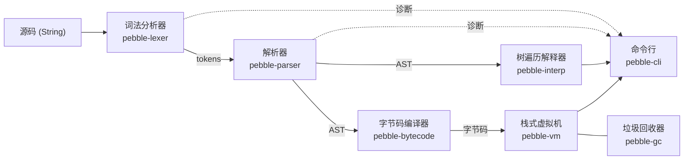

我手上有一个用 Rust 写的小语言，叫 Pebble：16 个 crate，一个词法分析器，一个解析器，一个树遍历解释器，一个字节码编译器加栈式虚拟机，外加一个手写的垃圾回收器。下面是它跑 `examples/fib.pebble` 的样子，同一个程序，两个后端：

```text
$ cargo run -q -p pebble-cli -- run examples/fib.pebble
6765
$ cargo run -q -p pebble-cli -- run --vm examples/fib.pebble
6765
```

这个系列要做的事很简单：我们从一个空目录开始，一章一章把这个项目重新写一遍。写完第 15 章，你手里的代码和我的仓库一致，而你需要的所有 Rust 知识，都会在它第一次被用到的地方讲清楚。不需要先去读《The Rust Programming Language》。

> [!NOTE] 本篇检查点
> 这一篇结束时你会有：一个叫 `pebble` 的 Cargo workspace，里面有第一个 crate `pebble-span`（只含 `SourceId`、`Span` 和它们的两个测试），`cargo test -p pebble-span` 通过；还有一个叫 `rust-lab` 的小实验场，后面每一篇的编译错误演示都在里面做。
> 涉及的 Rust 特性：`cargo`、workspace、`let`/`mut`/遮蔽、整数类型与 `as`、溢出、表达式与分号、控制流、`struct`/`impl`、`const fn`、`#[derive]`、`#[must_use]`、`#[test]`。
> 这是第 1 篇，没有前置章节。

## Pebble 长什么样

先把整个系统的数据流摆出来，后面每一章都是其中一个方框：



实线是数据，虚线是错误报告。所有阶段都要说"第几行第几列出错了"，所以最底下还有两个被所有人依赖的小 crate：`pebble-span`（位置）和 `pebble-diag`（错误报告）。我们今天从 `pebble-span` 起步，因为它是整张依赖图的叶子。

## 这个系列怎么读

我定了几条规矩，因为我自己踩过"看懂了但写不出来"的坑。

**边写边建。** 每一章你会写某几个 crate 的核心部分，从一个最小版本开始，逐步长成仓库里的样子。重复、冗长、和本章主题无关的部分（比如 30 个只是名字不同的 builtin 函数），我会指名道姓让你从仓库里复制，并告诉你为什么现在可以不读。

**实验场。** 每次我说"这段代码不会编译"，你都应该自己试一遍。所以现在就建一个 `~/rust-lab`（下面马上建），所有实验都是里面的一个文件，文件名我会写出来：`src/bin/ch01_bindings.rs`，`ch` 后面是章节号。

**真实输出。** 本系列里所有的编译错误、命令输出、测试统计，都是我在这台机器上用 `rustc 1.95.0` 实际跑出来的。输出偶尔会被截断（用 `...` 标出），但每一行都不会被我改写。路径里的 `/tmp/rust-lab` 是我机器上的位置，你的会是 `~/rust-lab`。如果你的编译器版本不同，措辞可能略有出入。

**固定的代码快照。** 我的参考实现是仓库的 [`tutorial-v1`](https://github.com/bfmhno3/pebble/tree/tutorial-v1) 标签。每章末尾有一个检查点，列出"到这里为止哪些文件必须和标签完全一致"（可以用 `diff` 验证），以及哪些文件是还会继续变的中间版本。

下面是整个系列的地图：

| 章 | 标题 | 主要的 Rust 内容 |
| --- | --- | --- |
| 1 | 第一个 crate：从 cargo new 到 Span | cargo、workspace、`let`、整数、表达式、控制流、`struct`/`impl`、`derive`、测试 |
| 2 | [所有权：SourceMap 里的 String 归谁](/posts/rust-by-pebble-02-ownership/) | `String`/`&str`、移动、借用、`Vec`、`Option`、闭包初见、UTF-8、`Index`、`no_std` |
| 3 | [enum、trait 与第一份错误报告](/posts/rust-by-pebble-03-enums-traits-diagnostics/) | `enum`、`match`、`Display`/`Error`、trait 默认方法、孤儿规则 |
| 4 | [生命周期：让 token 借用源码](/posts/rust-by-pebble-04-lifetimes-lexer/) | 生命周期、`Cow`、`Iterator`、模式匹配 |
| 5 | [递归类型、泛型与 trait：搭一棵 AST](/posts/rust-by-pebble-05-ast-generics/) | `Box`、泛型、trait 约束、`?Sized`、`IntoIterator` |
| 6 | [过程宏：让编译器替我写 impl Spanned](/posts/rust-by-pebble-06-proc-macros/) | derive 宏、`syn`、`quote` |
| 7 | [Result、? 与递归下降：解析器和第一个命令行](/posts/rust-by-pebble-07-parser-errors-cli/) | `Result`、`?`、panic、`clap`、`anyhow`、集成测试 |
| 8 | [共享与可变：Rc、RefCell 和运行时的值](/posts/rust-by-pebble-08-rc-refcell-values/) | `Rc`、`RefCell`、`HashMap`、`Hash`/`Eq`、trait 对象、函数指针 |
| 9 | [树遍历解释器：闭包、控制流与一个内存泄漏](/posts/rust-by-pebble-09-interpreter-closures/) | `Fn`/`FnMut`/`FnOnce`、`move`、`Weak`、`FromStr` |
| 10 | [字节码编译器：macro_rules!、回填和常量池](/posts/rust-by-pebble-10-bytecode-macros/) | `macro_rules!`、函数式过程宏、`HashMap` entry |
| 11 | [手写垃圾回收器：泛型容器、Cell 与第一次 unsafe](/posts/rust-by-pebble-11-gc-unsafe/) | 泛型结构体、`Cell`、`unsafe`、裸指针、`MaybeUninit` |
| 12 | [栈式虚拟机：GC 根、两个后端与 Criterion](/posts/rust-by-pebble-12-vm-backends/) | 关联常量、GAT、静态/动态分派、属性宏、Criterion |
| 13 | [越过边界：FFI 调 C 与 no_std](/posts/rust-by-pebble-13-ffi-nostd/) | FFI、`build.rs`、`repr(C)`、`UnsafeCell`、原子、`GlobalAlloc` |
| 14 | [并发与 async：线程、Send/Sync 和一个 Tokio 服务](/posts/rust-by-pebble-14-concurrency-async/) | 线程、`Arc`/`Mutex`、`Future`、`Pin`、Tokio |
| 15 | [收尾：Cargo features、测试、lint 与 CI](/posts/rust-by-pebble-15-engineering/) | features、文档、clippy、CI、全特性索引 |

没有哪一章是"选读"。顺序就是依赖顺序：每一章只会用到前面讲过的东西，偶尔需要提前露个脸的概念，我会写明"先当成 X，第 N 篇细讲"。

## 装环境

我用的是 `rustc 1.95.0`。仓库里有一个 `flake.nix`，`nix develop` 进去就是这个版本；没有 Nix 的话，用 rustup 装 stable，仓库的 `rust-toolchain.toml` 要求的就是 `stable` 加 `rustfmt`、`clippy` 两个组件：

```bash
curl --proto '=https' --tlsv1.2 -sSf https://sh.rustup.rs | sh
rustup component add rustfmt clippy
```

确认一下：

```text
$ rustc --version
rustc 1.95.0 (59807616e 2026-04-14) (built from a source tarball)
$ cargo --version
cargo 1.95.0 (f2d3ce0bd 2026-03-21)
```

`rustc` 是编译器，对应 `gcc`/`clang`。`cargo` 是构建系统加包管理器，对应 CMake 加 vcpkg/Conan 的合体。绝大多数时候你只和 `cargo` 说话，它再去调用 `rustc`。

## 实验场：你的第一个 cargo 项目

```bash
cd ~
cargo new rust-lab --edition 2024
cd rust-lab
```

`cargo new` 创建了这些东西：

```text
rust-lab/
├── Cargo.toml
├── .gitignore
└── src/
    └── main.rs
```

`Cargo.toml` 是项目清单（对应 `CMakeLists.txt`，但是是声明式的，没有脚本）：

```toml
[package]
name = "rust-lab"
version = "0.1.0"
edition = "2024"

[dependencies]
```

`edition` 是 Rust 的"方言版本"，大约每三年一个（2015、2018、2021、2024）。不同 edition 的 crate 可以互相链接，所以语言可以做不兼容的改进而不分裂生态。本系列全部用 2024。

`src/main.rs` 是 `cargo new` 替你写好的：

```rust
fn main() {
    println!("Hello, world!");
}
```

运行：

```text
$ cargo run --quiet --bin rust-lab
Hello, world!
```

这里有三件事值得停一下。

第一，`println!` 后面的 `!` 不是装饰：它表示这是一个**宏**，不是函数。Rust 的宏在编译期展开，所以 `println!("{}", x)` 的格式字符串是在编译期检查的：占位符数量不对，直接编译失败，而不是像 C 的 `printf` 那样运行时读栈上的垃圾。第 6 篇和第 10 篇我们会自己写宏。

第二，没有头文件。Rust 的编译单元是整个 crate（后面会讲），编译器能看到 crate 里所有的项，谁用谁不需要先声明。可见性靠 `pub` 关键字显式标注，默认私有。

第三，多出来的 `target/` 目录：编译产物都在这里，`target/debug/` 是调试构建，`cargo run --release` 会用 `target/release/`。它是 `.gitignore` 里的第一行，对应 CMake 的 `build/`。

接下来我们会在这个项目里往 `src/bin/` 下面放实验文件，每个文件自动成为一个独立的可执行程序，名字是文件名（不带 `.rs`）。运行某一个：`cargo run --quiet --bin ch01_bindings`。`--quiet` 去掉 cargo 自己的 "Compiling..." 噪音。注意，一旦 `src/bin/` 里有多个程序，单独一个 `cargo run` 会因为不知道跑哪个而报错，所以以后总是带 `--bin`（不带的话，cargo 会报错 "could not determine which binary to run"，并让你用 `--bin` 指定，我试过）。

```bash
mkdir -p src/bin
```

## 搭一个 workspace

Pebble 有 16 个 crate。这里先把三个词分清楚，因为 C/C++ 里没有一一对应的概念：

- **crate**：Rust 的编译单元，一个库或一个可执行文件，从一个根文件（`lib.rs` 或 `main.rs`）开始，整个模块树编译成一个产物。粗略对应"一个静态库/可执行文件"，但编译器是把整个 crate 当成一个翻译单元来处理的。
- **package**：一个带 `Cargo.toml` 的目录，可以包含一个库 crate 和若干个二进制 crate。cargo 管理的是 package。
- **workspace**：一组共享同一个 `Cargo.lock` 和同一个 `target/` 的 package。对应 CMake 的顶层工程加 `add_subdirectory`。

还有第四个词 **module**（模块），是 crate 内部的命名空间，对应 C++ 的 `namespace`，但和文件系统绑定（第 7 篇会写 `mod cli;`）。

现在开始。建一个新目录，不是 `rust-lab`，而是我们真正的项目：

```bash
cd ~
mkdir pebble && cd pebble
git init
```

写根目录的 `Cargo.toml`。注意它没有 `[package]`，只有 `[workspace]`，这叫虚拟 workspace：

```toml
[workspace]
resolver = "3"
members = ["crates/*"]

[workspace.package]
version = "0.1.0"
edition = "2024"
rust-version = "1.88"
authors = ["bfmhno3"]
license = "MIT OR Apache-2.0"
repository = "https://github.com/bfmhno3/pebble"
description = "Pebble: a small scripting language and toolchain, built from scratch in Rust."
keywords = ["language", "interpreter", "compiler", "vm", "learning"]
categories = ["development-tools", "compilers"]

[workspace.dependencies]
pebble-span = { path = "crates/pebble-span", version = "0.1.0" }

[workspace.lints.rust]
rust_2018_idioms = "warn"
unsafe_op_in_unsafe_fn = "warn"

[workspace.lints.clippy]
all = "warn"
```

逐段看：

- `members = ["crates/*"]`：`crates/` 下每个子目录都是成员，以后加 crate 不用改这一行。
- `resolver = "3"`：依赖解析算法的版本。虚拟 workspace 没有根 package，cargo 没法从 edition 推断，所以得显式写。我试过不写：

```text
warning: virtual workspace defaulting to `resolver = "1"` despite one or more workspace members being on edition 2024 which implies `resolver = "3"`
  |
  = note: to keep the current resolver, specify `workspace.resolver = "1"` in the workspace root's manifest
  = note: to use the edition 2024 resolver, specify `workspace.resolver = "3"` in the workspace root's manifest
...
```

- `[workspace.package]`：所有成员共享的元数据，一处定义，各 crate 用 `version.workspace = true` 引用，类似 CMake 里的顶层变量。`rust-version = "1.88"` 是我承诺支持的最低编译器版本（MSRV）。
- `[workspace.dependencies]`：统一管理依赖的版本，成员写 `pebble-span.workspace = true` 就行。现在只有一行，随着章节推进会长到 16 个内部 crate 加十几个外部依赖。`path` 指向本地目录，`version` 在将来发布到 crates.io 时才有用。
- `[workspace.lints]`：lint 是编译器和 clippy（官方的 linter）的警告开关。`rust_2018_idioms` 要求你写 2018 以来的惯用法；`unsafe_op_in_unsafe_fn` 第 11 篇讲；`clippy::all` 打开 clippy 的默认检查组。所有成员通过 `[lints] workspace = true` 继承它们。

再建 `.gitignore`，一行就够：

```text
/target
```

现在让 cargo 创建第一个 crate。`--lib` 表示这是库，不是可执行文件：

```text
$ cargo new --lib crates/pebble-span
    Creating library `pebble-span` package
note: see more `Cargo.toml` keys and their definitions at https://doc.rust-lang.org/cargo/reference/manifest.html
```

cargo 给我们的 `crates/pebble-span/Cargo.toml` 是最小的：

```toml
[package]
name = "pebble-span"
version = "0.1.0"
edition = "2024"

[dependencies]
```

把它整个替换成继承 workspace 配置的版本（文件 `crates/pebble-span/Cargo.toml`）：

```toml
[package]
name = "pebble-span"
description = "Source offsets, spans, and source maps for the Pebble toolchain."
version.workspace = true
edition.workspace = true
rust-version.workspace = true
authors.workspace = true
license.workspace = true
repository.workspace = true

[lints]
workspace = true
```

`version.workspace = true` 这种点号写法是 TOML 的普通语法，等价于 `[version]` 表里写 `workspace = true`。这个文件和仓库标签里的**完全一致**，以后不会再改。

`cargo new` 还生成了一个 `lib.rs`，里面有一个 `add` 函数和一个叫 `it_works` 的测试。这是它的模板，我们要整个换掉。先把这个文件清空，下面开始写真正的内容。

## 写 `SourceId`：一个零开销的 newtype

编译器每个阶段都要说"出错在哪"。最朴素的做法是传两个整数：文件号和字节偏移。C 程序员这时候会写：

```c
struct span { unsigned source; unsigned start; unsigned end; };
```

Rust 里可以写得几乎一样。但我想在这上面再加一点编译期的保护：文件号不是随便一个整数，不应该能和"偏移量"混着用。做法是把它包进一个只有一个字段的元组结构体，叫 **newtype**：

```rust
/// Identifies one source file.
#[derive(Copy, Clone, PartialEq, Eq, PartialOrd, Ord, Hash)]
pub struct SourceId(pub u32);
```

先把每个词过一遍：

- `pub struct SourceId(pub u32);`：`struct` 定义结构体；这种圆括号形式叫**元组结构体**，字段没有名字，按位置访问：`id.0`。里面的 `pub` 说明这个字段对外可见（默认私有）；`u32` 是 32 位无符号整数。
- `///` 是文档注释，会进 `cargo doc` 生成的文档。仓库的规则是每个公开项都要有。
- `#[derive(...)]` 让编译器按字段自动生成 trait 的实现。trait 是第 2 篇才正式讲的东西，现在把它理解成"接口"，对应 C++ 的 concept 或抽象基类就够了。这里一口气派生了六个：
  - `Copy` 和 `Clone`：复制。`Copy` 的意思是"按位复制就是完整的复制"，和 C 里 struct 赋值一样（`memcpy`）。后面会看到，有些类型（比如拥有堆内存的 `String`）不能 `Copy`，第 2 篇解释为什么。
  - `PartialEq` 和 `Eq`：`==` 和 `!=`。
  - `PartialOrd` 和 `Ord`：`<`、`>` 和排序。
  - `Hash`：可以做哈希表的键。

这些在 C++ 里你需要手写 `operator==`（或者 C++20 的 `= default`），而 Rust 里一行 derive 搞定。

newtype 的价值我们实际看一下。下面是实验 `src/bin/ch01_newtype.rs`，里面有一个故意写错的调用：

```rust
let ok = Span::new(SourceId(0), 2, 9);
let bad = Span::new(0, 2, 9);
```

编译：

```text
$ cargo build --bin ch01_newtype
   Compiling rust-lab v0.1.0 (/tmp/rust-lab)
error[E0308]: mismatched types
  --> src/bin/ch01_newtype.rs:21:25
   |
21 |     let bad = Span::new(0, 2, 9);
   |               --------- ^ expected `SourceId`, found integer
   |               |
   |               arguments to this function are incorrect
   |
...
help: try wrapping the expression in `SourceId`
   |
21 |     let bad = Span::new(SourceId(0), 2, 9);
   |                         +++++++++ +

For more information about this error, try `rustc --explain E0308`.
error: could not compile `rust-lab` (bin "ch01_newtype") due to 1 previous error
```

（完整文件在 [lab 的实验清单](#实验清单) 里说明；你只需要把 `SourceId`、`Span` 和 `Span::new` 抄进去。）这条错误里最重要的是编码 `E0308`：以后你会无数次见到它。`rustc --explain E0308` 会打印一段详细解释。

那它有运行时代价吗？没有。实验 `ch01_sizes.rs`：

```text
$ cargo run -q --bin ch01_sizes
size_of::<SourceId>() = 4
size_of::<Span>()     = 12
size_of::<usize>()    = 8
0 2 9
```

`SourceId` 就是 4 个字节，和 `unsigned` 一模一样；`Span` 是 12 个字节，和上面那个 C 的 `struct span` 一样。类型安全完全是编译期的东西，编译完就蒸发了。顺便注意 `usize`：它是"指针宽度的无符号整数"，对应 C 的 `size_t`，在这台机器上是 8 个字节，用来做索引和长度。

### 为什么偏移量是 `u32` 而不是 `usize`

我可以用 `usize` 表示偏移，那样索引切片的时候不用转换。我选 `u32` 是因为一个 `Span` 里有两个偏移，每个都从 8 字节降到 4 字节，`Span` 从 24 字节降到 12 字节。AST 的每个节点都带一个 `Span`，这个省出来的空间是实打实的。代价是源文件不能超过 4 GiB，对一个脚本语言我认为可以接受。Rust 不让你悄悄越界，所以代价会以"需要显式转换"的形式出现，下一节就会碰到。

### 为 `SourceId` 手写 `Debug`

还差一个 trait。派生的 `Debug` 会把 `SourceId(0)` 打印成 `SourceId(0)`，我想让它更短，所以手写：

```rust
impl fmt::Debug for SourceId {
    fn fmt(&self, f: &mut fmt::Formatter<'_>) -> fmt::Result {
        write!(f, "source#{}", self.0)
    }
}
```

这一块你只需要照抄，我现在只解释大意：`impl Trait for Type { ... }` 是"为这个类型实现这个 trait"，`fmt` 是 `Debug` 要求你提供的唯一一个方法，`write!` 往格式化器里写字符。`&self` 是"我只借用，不拿走"，`'_` 是一个我们第 4 篇才会讲的东西（生命周期），现在当成噪音；`fmt::Result` 是"写成功了还是失败了"的返回类型，第 3 篇、第 7 篇会彻底讲清楚。别紧张，今天的目标是你能抄对并看懂形状。

这个文件顶上需要 `use core::fmt;` 把名字带进来。文件开头写成这样：

```rust
//! Source offsets and spans.
//!
//! Everything in the front end of the compiler talks about positions in terms
//! of *byte offsets into a source file*. Those offsets are grouped into
//! [`Span`]s.

use core::fmt;
```

`//!` 是给"外层"（这里是整个 crate）写的文档注释。`use` 把路径引入作用域，类似 C++ 的 `using`，`core::fmt` 里的 `core` 是 Rust 的最小标准库，第 2 篇会讲它和 `std` 的关系；现在你知道 `core::fmt` 和 `std::fmt` 是同一个东西就够了。

## 写 `Span`：值、方法和表达式

把 `SourceId` 的代码放在 `use` 的后面，紧接着写 `Span`：

```rust
/// A half-open byte range `[start, end)` inside a single source file.
///
/// `Span` is `Copy`: it is three small integers, so passing it around is free
/// and never moves any source text.
#[derive(Copy, Clone, PartialEq, Eq, Hash)]
pub struct Span {
    pub source: SourceId,
    pub start: u32,
    pub end: u32,
}
```

这是普通的带名字段结构体。半开区间 `[start, end)` 是我和你都应该熟悉的惯例（C++ 迭代器区间、Python 切片都是这样）：长度是 `end - start`，空区间是 `start == end`，相邻两个区间首尾相接不重叠。

`Span` 没有派生 `PartialOrd`：两个 span 比大小没有意义，我就不给它这个能力。另外它也没有派生 `Debug`，因为我想要紧凑的 `2..9`，一会儿手写。

### `impl` 块：方法和关联函数

```rust
impl Span {
    /// A span that points at nothing; useful as a placeholder.
    pub const DUMMY: Span = Span {
        source: SourceId(0),
        start: 0,
        end: 0,
    };

    /// Builds a span from a source id and a byte range.
    #[must_use]
    pub const fn new(source: SourceId, start: u32, end: u32) -> Self {
        Self { source, start, end }
    }
```

`impl Span { ... }` 是"固有实现"，给类型加方法，相当于 C++ 在类体里写成员函数，只是数据和方法分开写。这里有几个新东西：

- **关联常量** `pub const DUMMY: Span = ...`：属于类型的常量，用 `Span::DUMMY` 访问，对应 C++ 的 `static constexpr`。
- **关联函数** `new`：第一个参数不是 `self`，所以它不是方法，调用写成 `Span::new(...)`，对应 C++ 的静态成员函数。Rust 没有构造函数，`new` 只是社区约定的名字。
- `Self` 是"当前 impl 的类型"的别名，这里就是 `Span`。
- `Self { source, start, end }` 是结构体字面量；当变量名和字段名相同时可以简写（和 JavaScript 的对象简写一样）。
- 函数体最后一行没有分号，它就是返回值。下一节细讲。
- `const fn` 表示这个函数可以在编译期求值。实验 `ch01_const_fn.rs`：

```rust
const fn double(x: u32) -> u32 { x * 2 }
fn triple(x: u32) -> u32 { x * 3 }

const A: u32 = double(21);
const B: u32 = triple(14);
```

```text
$ cargo build --bin ch01_const_fn
   Compiling rust-lab v0.1.0 (/tmp/rust-lab)
error[E0015]: cannot call non-const function `triple` in constants
  --> src/bin/ch01_const_fn.rs:10:16
   |
10 | const B: u32 = triple(14);
   |                ^^^^^^^^^^
   |
note: function `triple` is not const
...
```

对应 C++ 的 `constexpr`：只有标成 `const fn` 的函数才能在常量里被调用。`Span::DUMMY` 和任何 `const` 里用到 `Span::new` 的地方，都依赖 `new` 是 `const fn`。

- `#[must_use]`：如果调用者忽略返回值，编译器发警告。实验 `ch01_must_use.rs`，一个 `#[must_use]` 的 `len` 被我丢掉了结果：

```text
$ cargo build --bin ch01_must_use
   Compiling rust-lab v0.1.0 (/tmp/rust-lab)
warning: unused return value of `Span::len` that must be used
  --> src/bin/ch01_must_use.rs:15:5
   |
15 |     s.len();
   |     ^^^^^^^
   |
   = note: `#[warn(unused_must_use)]` (part of `#[warn(unused)]`) on by default
help: use `let _ = ...` to ignore the resulting value
...
```

C++ 里对应的是 `[[nodiscard]]`。对 `merge`、`len` 这种纯函数，忽略结果几乎一定是 bug，所以我给它们都标上了。

接着写 `empty`、`len`、`is_empty`：

```rust
    /// An empty span located at `at`.
    #[must_use]
    pub const fn empty(source: SourceId, at: u32) -> Self {
        Self {
            source,
            start: at,
            end: at,
        }
    }

    /// Number of bytes covered by the span.
    #[must_use]
    pub const fn len(self) -> u32 {
        self.end.saturating_sub(self.start)
    }

    /// Whether the span covers zero bytes.
    #[must_use]
    pub const fn is_empty(self) -> bool {
        self.start >= self.end
    }
```

`len(self)` 的第一个参数是 `self`，所以它是方法，用 `span.len()` 调用。注意是 `self` 而不是 `&self`：按值接收。在 C++ 里你习惯写 `const Span&` 来避免拷贝，但 `Span` 只有 12 个字节并且是 `Copy` 的，按值传和传引用一样便宜，调用者的 `span` 在调用后依然可用。这一点我们在练习里验证。第 2 篇讲借用时你会看到 `&self`。

`saturating_sub` 是"饱和减法"：结果小于 0 时停在 0，而不是回绕。这里我用它是防御性的：理论上 `end >= start` 总成立，但万一有个 bug 造出了反向的 span，`len()` 返回 0 比返回 4294967295 好调试得多。

### 整数：没有隐式转换，溢出不是未定义行为

`len` 返回 `u32`，我想用它去索引一个切片，就需要 `usize`。你觉得应该怎么办？C 里你什么都不用做，编译器静默转换。Rust 不会。实验 `ch01_casts.rs`：

```rust
fn main() {
    let a: u32 = 7;
    let b: usize = 3;
    let sum = a + b;
    println!("{sum}");
}
```

```text
$ cargo build --bin ch01_casts
   Compiling rust-lab v0.1.0 (/tmp/rust-lab)
error[E0308]: mismatched types
 --> src/bin/ch01_casts.rs:4:19
  |
4 |     let sum = a + b;
  |                   ^ expected `u32`, found `usize`

error[E0277]: cannot add `usize` to `u32`
 --> src/bin/ch01_casts.rs:4:17
  |
4 |     let sum = a + b;
  |                 ^ no implementation for `u32 + usize`
  |
  = help: the trait `Add<usize>` is not implemented for `u32`
help: the following other types implement trait `Add<Rhs>`
...
error: could not compile `rust-lab` (bin "ch01_casts") due to 2 previous errors
```

这里同时出现了两条错误，第二条透露了一个事实：`a + b` 其实是调用 `u32` 上的 `Add` trait，而 `u32` 只实现了 `Add<u32>`。运算符本质是 trait，第 2 篇我们会为自己的类型重载运算符。

要转换就明说，用 `as`（实验 `ch01_casts_ok.rs`）：

```rust
println!("{}", a as usize + b);
println!("{}", a + b as u32);
println!("{}", 300_i32 as u8);
println!("{}", -1_i32 as u32);
println!("{}", 3.9_f64 as i32);
println!("{}", -1.0_f64 as u8);
println!("{}", u32::try_from(300_i64).unwrap());
println!("{:?}", u8::try_from(300_i32));
```

```text
$ cargo run --quiet --bin ch01_casts_ok
10
10
44
4294967295
3
0
300
Err(TryFromIntError(()))
```

读一下：前两行是我们要的；`300 as u8` 静默截断成 44（和 C 的 `(uint8_t)300` 一样）；`-1 as u32` 是 4294967295（和 C 一样）；`3.9 as i32` 截断成 3；`-1.0 as u8` 饱和成 0（C 里浮点数转整数越界是未定义行为，Rust 把它定义成了饱和）。`as` 永远不会失败，也永远不会警告，这既方便又危险：Pebble 的 `Span` 里 `u32` 和 `usize` 之间的转换点我都是刻意写的，第 2 篇你会在 `SourceFile` 里看到一堆 `as u32`，它们每一处都意味着"我断言这个文件小于 4 GiB"。需要检查的转换用 `TryFrom`，最后两行显示 300 能放进 `u32` 但放不进 `u8`，失败时返回 `Err`，我们在第 8 篇会自己实现一个。

溢出呢？实验 `ch01_overflow.rs`（里面的 `black_box` 只是让优化器看不出值，不然编译器会在编译期直接拒绝这个溢出）：

```rust
let big: u8 = std::hint::black_box(255);
println!("wrapping_add   = {}", big.wrapping_add(1));
println!("saturating_add = {}", big.saturating_add(1));
println!("checked_add    = {:?}", big.checked_add(1));
println!("overflowing    = {:?}", big.overflowing_add(1));
let plain = big + 1;
println!("big + 1        = {plain}");
```

调试构建：

```text
$ cargo run --quiet --bin ch01_overflow
wrapping_add   = 0
saturating_add = 255
checked_add    = None
overflowing    = (0, true)

thread 'main' (51943) panicked at src/bin/ch01_overflow.rs:11:17:
attempt to add with overflow
note: run with `RUST_BACKTRACE=1` environment variable to display a backtrace
```

发布构建：

```text
$ cargo run --quiet --release --bin ch01_overflow
wrapping_add   = 0
saturating_add = 255
checked_add    = None
overflowing    = (0, true)
big + 1        = 0
```

同一行 `big + 1`，调试构建里 panic（程序带着错误信息终止），发布构建里回绕成 0。**这两种行为都是有定义的**，没有 C 里有符号溢出那种"编译器可以假设它不发生并删掉你的检查"的未定义行为。想要确定的语义，就明说：`wrapping_*`（回绕）、`saturating_*`（饱和）、`checked_*`（返回 `Option`，`None` 表示溢出）、`overflowing_*`（返回结果和是否溢出）。`Option` 是第 2 篇的内容，现在把 `None` 读成"没有结果"。

### 表达式与分号

回到 `len`。它的函数体是 `self.end.saturating_sub(self.start)`，没有 `return`，没有分号。Rust 是一门**表达式语言**：几乎一切都有值，一个块 `{ ... }` 的值是它最后一个没有分号的表达式。分号的意思是"丢掉这个表达式的值"，整个语句的值是 `()`（读作 unit，一个只有一个值的类型，近似 C 的 `void`，但它是真正的值）。

这条规则的后果可以用实验 `ch01_tail_expr.rs` 看：

```rust
fn add_one(x: u32) -> u32 {
    x + 1;
}
```

```text
$ cargo build --bin ch01_tail_expr
   Compiling rust-lab v0.1.0 (/tmp/rust-lab)
error[E0308]: mismatched types
 --> src/bin/ch01_tail_expr.rs:1:23
  |
1 | fn add_one(x: u32) -> u32 {
  |    -------            ^^^ expected `u32`, found `()`
  |    |
  |    implicitly returns `()` as its body has no tail or `return` expression
2 |     x + 1;
  |          - help: remove this semicolon to return this value

For more information about this error, try `rustc --explain E0308`.
error: could not compile `rust-lab` (bin "ch01_tail_expr") due to 1 previous error
```

一个多余的分号，改变了整个函数的类型。编译器的建议很准：去掉它。这是我从 C 转过来的前一个月，犯得最多的错误，之后它会变成你最先学会不再犯的错误，因为报错信息实在太好了。再看一个能编译的版本（`ch01_tail_expr_ok.rs`）：

```rust
let block_value = {
    let a = 2;
    a * 10 // no semicolon: the block evaluates to this
};
let unit = {
    let a = 2;
    a * 10;
};
println!("{}", add_one(1));
println!("{block_value}");
println!("{unit:?}");
```

```text
$ cargo run --quiet --bin ch01_tail_expr_ok
warning: unused arithmetic operation that must be used
  --> src/bin/ch01_tail_expr_ok.rs:12:9
   |
12 |         a * 10;
   |         ^^^^^^ the arithmetic operation produces a value
   |
   = note: `#[warn(unused_must_use)]` (part of `#[warn(unused)]`) on by default
help: use `let _ = ...` to ignore the resulting value
   |
12 |         let _ = a * 10;
   |         +++++++

2
20
()
```

块可以直接当值用，所以 Rust 里没有 `?:` 三元运算符：`if` 本身就是表达式，下面马上看到。

### `let`、`mut` 和遮蔽

我一直在用 `let` 而没有解释它。实验 `ch01_bindings.rs`：

```rust
let x = 5;
let x = x * 2; // shadowing: a brand new variable that reuses the name
{
    let x = "inner"; // shadowing may even change the type
    println!("inner x = {x}");
}
println!("outer x = {x}");

let mut count = 0;
count += 1;
count += 1;
println!("count = {count}");
```

```text
$ cargo run --quiet --bin ch01_bindings
inner x = inner
outer x = 10
count = 2
```

三件事。一，类型是推断的：`let x = 5` 没写类型，编译器推断成 `i32`（默认整数类型）；也可以写 `let x: u32 = 5`。二，**遮蔽**（shadowing）：同一个作用域里可以再 `let x`，创建一个全新的变量，旧的就不可见了，它甚至可以换类型。三，**绑定默认不可变**，和 C++ 的默认相反：要改就得写 `let mut`。违反时（`ch01_immutable.rs`）：

```text
$ cargo build --bin ch01_immutable
   Compiling rust-lab v0.1.0 (/tmp/rust-lab)
error[E0384]: cannot assign twice to immutable variable `y`
 --> src/bin/ch01_immutable.rs:3:5
  |
2 |     let y = 1;
  |         - first assignment to `y`
3 |     y = 2;
  |     ^^^^^ cannot assign twice to immutable variable
  |
help: consider making this binding mutable
  |
2 |     let mut y = 1;
  |         +++

warning: value assigned to `y` is never read
...
```

可变性在类型系统里是显式的，这件事到第 2 篇会变成整个所有权体系的一半。

### 控制流

下一个方法 `merge` 要用到 `min` 和 `max`，也用到一条 `debug_assert_eq!`，但控制流的几种形式我想先在实验里过一遍。`ch01_control_flow.rs`：

```rust
let n = 7;
let kind = if n % 2 == 0 { "even" } else { "odd" };
println!("{n} is {kind}");

let mut tries = 0;
let first_square_over_50 = loop {
    tries += 1;
    if tries * tries > 50 {
        break tries * tries;
    }
};
println!("first square over 50: {first_square_over_50}");
```

```text
7 is odd
first square over 50: 64
```

`if` 是表达式，两个分支的类型必须一致，条件不用括号，大括号不能省。`loop` 是无限循环，`break` 可以带一个值，整个 `loop` 就等于这个值（所以"重试直到成功并返回结果"可以写得很直白）。

```rust
let mut i = 0;
while i < 3 {
    print!("{i} ");
    i += 1;
}
println!();
for j in 0..3 {
    print!("{j} ");
}
println!();
for j in 0..=3 {
    print!("{j} ");
}
println!();
```

```text
0 1 2 
0 1 2 
0 1 2 3 
```

`while` 和 C 的一样。`for` 没有 C 的三段式，它遍历一个"可迭代的东西"，`0..3` 是半开区间，`0..=3` 是闭区间。迭代器是第 3 篇和第 4 篇的主题。最后是标签 break：

```rust
'outer: for row in 0..5 {
    for col in 0..5 {
        if row * col == 6 {
            println!("found {row} * {col} == 6");
            break 'outer;
        }
    }
}
```

```text
found 2 * 3 == 6
```

`'outer:` 是给循环起的标签（单引号开头），`break 'outer` 一次跳出两层，C 里你要用 `goto`。（那个单引号和第 4 篇的"生命周期"是同一个词法形态，不是巧合，但是两件事。）

### `merge` 和 `contains`

现在可以把 `Span` 的 impl 写完了：

```rust
    /// The smallest span covering both `self` and `other`.
    ///
    /// Both spans must belong to the same source file; the compiler guarantees
    /// this, and a debug build will panic if it is ever violated.
    #[must_use]
    pub fn merge(self, other: Span) -> Span {
        debug_assert_eq!(
            self.source, other.source,
            "tried to merge spans from different files"
        );
        Span {
            source: self.source,
            start: self.start.min(other.start),
            end: self.end.max(other.end),
        }
    }

    /// Whether `offset` falls inside the half-open range.
    #[must_use]
    pub const fn contains(self, offset: u32) -> bool {
        self.start <= offset && offset < self.end
    }
}
```

`merge` 不是 `const fn`：我试过把它改成 `pub const fn merge`，编译器回了 `error[E0015]: cannot call non-const operator in constant functions`，指向的正是 `debug_assert_eq!` 里对 `SourceId` 的 `==`（派生出来的 `PartialEq` 不是 `const` 的）。`contains` 只比较基本整数，所以可以是 `const fn`。

`debug_assert_eq!(a, b, "message")` 断言 `a == b`，失败则 panic。它和 C 的 `assert` + `NDEBUG` 是一个思路：只在调试构建里检查，发布构建里整行消失。我们的 `merge` 的契约是"两个 span 来自同一个文件"，违反它是编译器自己的 bug，不是用户的错，所以用 debug 断言，不污染发布版本。`self.start.min(other.start)` 里的 `.min` 是整数的方法，不是宏，不需要 `<algorithm>`。

最后手写 `Span` 的 `Debug` 和 `Display`，二者输出相同的 `2..9`：

```rust
impl fmt::Debug for Span {
    fn fmt(&self, f: &mut fmt::Formatter<'_>) -> fmt::Result {
        write!(f, "{}..{}", self.start, self.end)
    }
}

impl fmt::Display for Span {
    fn fmt(&self, f: &mut fmt::Formatter<'_>) -> fmt::Result {
        write!(f, "{}..{}", self.start, self.end)
    }
}
```

`Debug` 是给程序员看的（`{:?}`），`Display` 是给用户看的（`{}`），第 3 篇会讲怎么区分，以及为什么要有两个。为什么不用 `#[derive(Debug)]`？我们等一下用测试失败时的输出来对比。

到这里 `crates/pebble-span/src/lib.rs` 的非测试部分写完了，按顺序是：文件头的 `//!` 和 `use`，`SourceId`，它的 `Debug`，`Span`，`impl Span`，`Span` 的 `Debug` 和 `Display`。

## 写测试

Rust 的测试是语言内置的，没有 gtest，没有 CMake 的 `add_test`。在文件底部加：

```rust
#[cfg(test)]
mod tests {
    use super::*;

    #[test]
    fn merge_covers_both() {
        let a = Span::new(SourceId(0), 2, 5);
        let b = Span::new(SourceId(0), 7, 9);
        assert_eq!(a.merge(b), Span::new(SourceId(0), 2, 9));
    }

    #[test]
    #[should_panic(expected = "different files")]
    fn merge_across_files_is_a_bug() {
        let a = Span::new(SourceId(0), 0, 1);
        let b = Span::new(SourceId(1), 0, 1);
        let _ = a.merge(b);
    }
}
```

- `#[cfg(test)]`：条件编译，只有在 `cargo test` 下这个模块才存在，对应 `#ifdef TESTING`。发布版本里这些代码完全不存在。
- `mod tests { ... }`：一个内联的模块（命名空间）。`use super::*;` 把父模块的所有名字带进来，所以测试可以直接写 `Span`。单元测试住在被测代码的同一个文件里，因此它甚至可以访问私有项，第 2 篇你会用到。
- `#[test]` 标记一个测试函数。它不接收参数，正常返回就是通过，panic 就是失败。
- `assert_eq!(left, right)`：失败时打印两边的值，这要求类型实现了 `Debug`，这就是为什么前面我们给 `SourceId` 和 `Span` 都实现了它。
- `#[should_panic(expected = "different files")]`：这个测试**期望**发生 panic，并且 panic 消息必须包含这个子串。它验证的是 `merge` 里 `debug_assert_eq!` 的那条消息。

注意这个 `should_panic` 测试依赖 `debug_assert`。我试了 `cargo test --release -p pebble-span`：

```text
test tests::merge_covers_both ... ok
test tests::merge_across_files_is_a_bug - should panic ... FAILED
note: test did not panic as expected at crates/pebble-span/src/lib.rs:115:8
test result: FAILED. 1 passed; 1 failed; 0 ignored; 0 measured; 0 filtered out; finished in 0.00s
```

发布构建里断言整行消失，函数不再 panic，测试就失败了。这不是 bug，是 `debug_assert` 的定义；你只需要记住：测试默认在调试构建下跑。

跑起来：

```text
$ cargo test -p pebble-span
   Compiling pebble-span v0.1.0 (/tmp/pebble-rebuild-01/crates/pebble-span)
    Finished `test` profile [unoptimized + debuginfo] target(s) in 0.45s
     Running unittests src/lib.rs (target/debug/deps/pebble_span-3b8ae416ebb198e2)

running 2 tests
test tests::merge_covers_both ... ok
test tests::merge_across_files_is_a_bug - should panic ... ok

test result: ok. 2 passed; 0 failed; 0 ignored; 0 measured; 0 filtered out; finished in 0.00s

   Doc-tests pebble_span

running 0 tests

test result: ok. 0 passed; 0 failed; 0 ignored; 0 measured; 0 filtered out; finished in 0.00s
```

`-p pebble-span` 指定 package，在 workspace 里只测这一个。最后的 "Doc-tests" 是文档里的代码示例也会被当成测试编译运行，第 10 篇我们会写一个。

### 看一眼失败长什么样

通过的测试没有故事。我在一个临时副本里故意改坏：把期望值的 `9` 改成 `8`，并且去掉第二个测试上的 `#[should_panic]`。结果：

```text
---- scratch::cross_file_without_should_panic stdout ----
thread 'scratch::cross_file_without_should_panic' (57352) panicked at crates/pebble-span/src/lib.rs:72:9:
assertion `left == right` failed: tried to merge spans from different files
  left: source#0
 right: source#1
note: run with `RUST_BACKTRACE=1` environment variable to display a backtrace
---- scratch::wrong_on_purpose stdout ----
thread 'scratch::wrong_on_purpose' (57353) panicked at crates/pebble-span/src/lib.rs:130:9:
assertion `left == right` failed
  left: 2..9
 right: 2..8
```

第一个让你看到了我们手写 `Debug` 的另一层用处：`left: source#0` 和 `right: source#1`。第二个，`left: 2..9`，一眼看出差在哪。如果把 `Span` 改成 `#[derive(Debug)]`，同一个断言失败时是：

```text
assertion `left == right` failed
  left: Span { source: source#0, start: 2, end: 9 }
 right: Span { source: source#0, start: 2, end: 8 }
```

也不是不能读，但是在一个会出现几千次 `Span` 的编译器测试里，你会很快理解我为什么偏爱短的那种。

## 检查点

在 `~/pebble` 下：

```bash
cargo test -p pebble-span
cargo clippy --workspace --all-targets -- -D warnings
cargo fmt --all --check
```

测试输出就是上面那个：2 个通过，0 个失败。clippy 加 `-D warnings`（把所有警告当作错误）应当安静地结束：

```text
    Checking pebble-span v0.1.0 (/tmp/pebble-rebuild-01/crates/pebble-span)
    Finished `dev` profile [unoptimized + debuginfo] target(s) in 0.18s
```

`cargo fmt --all --check` 什么都不输出（退出码 0）就是格式正确。如果它打印了 diff，直接运行 `cargo fmt --all` 让 rustfmt 替你改。

**必须和标签一致的文件：**

- [`crates/pebble-span/Cargo.toml`](https://github.com/bfmhno3/pebble/blob/tutorial-v1/crates/pebble-span/Cargo.toml)：已经完成，以后不会再变。验证：

```bash
diff <(git -C /path/to/pebble show tutorial-v1:crates/pebble-span/Cargo.toml) crates/pebble-span/Cargo.toml
```

**中间版本（后面的章节会继续改）：**

- 根 [`Cargo.toml`](https://github.com/bfmhno3/pebble/blob/tutorial-v1/Cargo.toml)：我们的 `[workspace.dependencies]` 目前只有 `pebble-span` 一行，之后每章添一个 crate。`[workspace.package]`、`[workspace.lints]` 和仓库一致，`[profile.*]` 段第 15 篇再加。
- [`.gitignore`](https://github.com/bfmhno3/pebble/blob/tutorial-v1/.gitignore)：目前只有 `/target`，仓库里的是更完整的版本。
- [`crates/pebble-span/src/lib.rs`](https://github.com/bfmhno3/pebble/blob/tutorial-v1/crates/pebble-span/src/lib.rs)：目前只有 `SourceId`、`Span` 和它们的两个测试，120 行（`wc -l` 应当是 120）；没有 `#![no_std]`、没有 `SourceFile`、没有 `SourceMap`。第 2 篇会把它写成标签里的最终版本，届时 `diff` 要求一致。

### 实验清单

这一篇用到的所有实验文件，都在 `~/rust-lab/src/bin/` 下：

| 文件 | 命令 | 结果 |
| --- | --- | --- |
| `ch01_bindings.rs` | `cargo run --quiet --bin ch01_bindings` | 运行 |
| `ch01_immutable.rs` | `cargo build --bin ch01_immutable` | E0384 |
| `ch01_casts.rs` | `cargo build --bin ch01_casts` | E0308 + E0277 |
| `ch01_casts_ok.rs` | `cargo run --quiet --bin ch01_casts_ok` | 运行 |
| `ch01_overflow.rs` | `cargo run --quiet [--release] --bin ch01_overflow` | 调试 panic，发布回绕 |
| `ch01_tail_expr.rs` | `cargo build --bin ch01_tail_expr` | E0308 |
| `ch01_tail_expr_ok.rs` | `cargo run --quiet --bin ch01_tail_expr_ok` | 运行 |
| `ch01_control_flow.rs` | `cargo run --quiet --bin ch01_control_flow` | 运行 |
| `ch01_newtype.rs` | `cargo build --bin ch01_newtype` | E0308 |
| `ch01_sizes.rs` | `cargo run --quiet --bin ch01_sizes` | 4、12、8 |
| `ch01_const_fn.rs` | `cargo build --bin ch01_const_fn` | E0015 |
| `ch01_must_use.rs` | `cargo build --bin ch01_must_use` | 警告 |

## 练习

**1.** 给 `Span` 加一个方法 `intersect(self, other: Span) -> Option<Span>`：两个 span 的交集，没有交集（或者不在同一个文件）时返回 `None`。`Option<T>` 是"要么有一个 `T`（写作 `Some(x)`），要么没有（`None`）"，第 2 篇会细讲，这里你只需要会构造它。提示：开头取 `max`，结尾取 `min`。

<details>
<summary>参考答案</summary>

```rust
/// The overlap of two spans, or `None` when they do not share a byte.
#[must_use]
pub fn intersect(self, other: Span) -> Option<Span> {
    if self.source != other.source {
        return None;
    }
    let start = self.start.max(other.start);
    let end = self.end.min(other.end);
    if start < end {
        Some(Span::new(self.source, start, end))
    } else {
        None
    }
}
```

我用一份独立的拷贝在实验里验证过（`ch01_intersect.rs`）：`2..8` 与 `5..12` 的交集输出 `Some(Span { source: SourceId(0), start: 5, end: 8 })`，`2..8` 与 `9..12` 输出 `None`。注意 `start < end` 而不是 `<=`：半开区间里 `[5, 5)` 是空的，没有共享任何字节，所以相邻的两个 span 的交集是 `None`。

</details>

**2.** 下面三段代码，哪几段能编译？先预测，再到实验场验证（`ch01_copy.rs`、`ch01_copy_string.rs`）。

- A：`#[derive(Copy, Clone)] struct Pt { x: u32 }`，把一个 `Pt` 变量连续两次传给 `fn show_pt(p: Pt)`。
- B：`struct Name { len: u32 }`（没有 derive `Copy`），把一个 `Name` 变量连续两次传给 `fn show_name(n: Name)`。
- C：`#[derive(Copy, Clone)] struct Label { name: String }`。

<details>
<summary>参考答案</summary>

A 能编译：`Pt` 是 `Copy`，传参是按位复制，原变量仍然可用，和 `Span` 的行为一样。

B 不能：

```text
$ cargo build --bin ch01_copy
   Compiling rust-lab v0.1.0 (/tmp/rust-lab)
error[E0382]: use of moved value: `n`
  --> src/bin/ch01_copy.rs:26:15
   |
24 |     let n = Name { len: 1 };
   |         - move occurs because `n` has type `Name`, which does not implement the `Copy` trait
25 |     show_name(n);
   |               - value moved here
26 |     show_name(n); // snippet B
   |               ^ value used here after move
...
```

第二次传参时 `n` 已经被移动走了。没有 `Copy` 的类型，按值传参就是**移动**，原变量不能再用。这就是第 2 篇的主题。

C 也不能：

```text
$ cargo build --bin ch01_copy_string
   Compiling rust-lab v0.1.0 (/tmp/rust-lab)
error[E0204]: the trait `Copy` cannot be implemented for this type
 --> src/bin/ch01_copy_string.rs:2:8
  |
1 | #[derive(Copy, Clone)]
  |          ---- in this derive macro expansion
2 | struct Label {
  |        ^^^^^
3 |     name: String,
  |     ------------ this field does not implement `Copy`

For more information about this error, try `rustc --explain E0204`.
error: could not compile `rust-lab` (bin "ch01_copy_string") due to 1 previous error
```

`String` 持有堆内存，按位复制会造成两个对象指向同一块堆，析构时 double free，Rust 干脆禁止 `Copy`。同样的道理，C++ 里你需要写拷贝构造函数。第 2 篇从这里开始。

</details>

**3.** 把下面的 `while` 循环改写成 `loop { ... break value }` 的形式，不改变结果：

```rust
fn first_power_of_two_over(limit: u32) -> u32 {
    let mut p = 1;
    while p <= limit {
        p *= 2;
    }
    p
}
```

<details>
<summary>参考答案</summary>

```rust
fn first_power_of_two_over_loop(limit: u32) -> u32 {
    let mut p = 1;
    loop {
        if p > limit {
            break p;
        }
        p *= 2;
    }
}
```

两个函数在 `ch01_loop_value.rs` 里都对 `100` 调了一遍，输出都是 `128`。`while` 版本更短，也更清楚，我会选它；`loop` 版本只在"退出条件出现在循环中间"或者"循环本身要产生一个值"（比如重试直到成功）时才更好。

</details>

## 下一篇

`Span` 有一个特点：它是 `Copy` 的，所以我们一直回避了一个问题，谁拥有源码文本？一个编译器要把文件名和文件内容存在某处，还要能根据字节偏移反查"第几行第几列"，这时候 `String` 出场，所有权问题也会出场。C++ 程序员在这里的肌肉记忆是 `std::string` 和 `const std::string&`，还有"别返回指向局部变量的引用"这条纪律。Rust 的做法是把这条纪律写进编译器，而且不需要你背：它会在编译期告诉你哪一行违反了，并给出一个看得懂的错误。第 2 篇，[所有权：SourceMap 里的 String 归谁](/posts/rust-by-pebble-02-ownership/)，我们把 `pebble-span` 写完。
