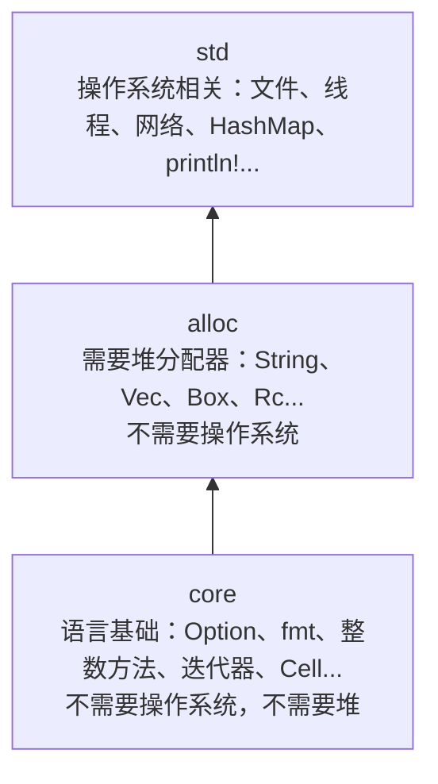

下面这段 C++ 我用 `g++ -std=c++20 -Wall -Wextra` 编译，没有一条警告。它返回一个指向局部变量的 `std::string_view`，运行时打印出来的是乱码：

```c
std::string_view file_name() {
    std::string name = "a.pebble";
    return name;
}
```

Rust 版本根本编译不过，而且报错告诉你哪一行有问题。这一篇我们就是要搞清楚它为什么能做到：我们给 `pebble-span` 加上 `SourceMap`，一个持有所有源文件文本、能把字节偏移翻译成"第几行第几列"的东西。文本放在哪、谁拥有、谁只是借用，这几个问题一旦问出口，Rust 的所有权系统就是答案。

> [!NOTE] 本篇检查点
> 这一篇结束时，`crates/pebble-span/src/lib.rs` 是 368 行，和仓库标签 `tutorial-v1` 里的文件逐字节一致，`cargo test -p pebble-span` 通过 6 个测试。
> 涉及的 Rust 特性：`String`/`&str`、移动与 `Copy`/`Clone`、共享借用与可变借用、`Vec`、切片、`Option` 与 `?`、`match`、闭包初见、UTF-8、`impl Into<String>`、`std::mem::take`、trait 初见（`Spanned`）、`Index` 运算符重载、`no_std`。
> 接着[第 1 篇](/posts/rust-by-pebble-01-first-crate/)：你需要先有 `pebble-span` 里的 `SourceId`、`Span` 和它们的两个测试。

## 问题：从字节偏移到行列

`Span` 只存字节偏移：`start` 和 `end`。用户想看到的是 `a.pebble:2:2`，第 2 行第 2 列。这中间差一张表，也差一份源码本身（要打印出错那一行，得有文本）。

最简单的表是"每一行从第几个字节开始"。对一个 7 字节的文件 `ab\n中c`（`中` 是 3 个字节的 UTF-8，后面验证）：

```text
字节偏移:  0  1  2  3 4 5  6
内容:      a  b  \n 中      c
line_starts = [0, 3]
```

偏移 6 落在第 2 行（`line_starts` 里最后一个 `<= 6` 的是 3），行首是 3，所以列要数 `[3, 6)` 这一段里有几个**字符**再加 1，得到 2。这就是整个算法：一次扫描建表，每次查询做一次二分查找。

于是我们需要这些东西：

- 一个 `SourceFile`，拥有文件名、文本和 `line_starts`。
- 一个 `SourceMap`，拥有所有 `SourceFile`，给它们发 `SourceId`。
- 一个 `Position { line, column }`。
- 一个 `Spanned` trait，"任何知道自己在哪儿的东西"。

问题是：这些字符串谁拥有？

## 谁拥有文本：`String` 和 `&str`

C++ 里你有 `std::string`（拥有，堆上，会析构）、`const std::string&`（借用）、`std::string_view`（带长度的借用）。Rust 的对应物几乎是一一的：

| C++ | Rust | 含义 |
| --- | --- | --- |
| `std::string` | `String` | 拥有一块堆内存，离开作用域时自动释放 |
| `std::string_view` | `&str` | 借用一段 UTF-8 文本：指针加长度 |
| `const std::string&` | `&String` | 借用一个 `String` 本身，实际中很少写 |
| 字符串字面量 | `&'static str` | 编译进可执行文件的文本，永远有效（`'static` 第 4 篇讲） |

实验 `src/bin/ch02_string.rs`（你的 `~/rust-lab` 里）：

```rust
let literal: &str = "a.pebble";
let mut owned: String = String::from("a.pebble");
owned.push_str(".bak");
let view: &str = &owned[..8];
println!("size_of::<String>() = {}", size_of::<String>());
println!("size_of::<&str>()   = {}", size_of::<&str>());
```

```text
$ cargo run --quiet --bin ch02_string
literal = a.pebble, owned = a.pebble.bak, view = a.pebble
size_of::<String>() = 24
size_of::<&str>()   = 16
len = 12, capacity >= len: true
```

`String` 是 24 字节：堆指针、容量、长度，三个字。`&str` 是 16 字节：指针和长度，和 `string_view` 一样。（我在这台机器上编译了 C++ 的 `sizeof(std::string)`，是 32，libstdc++ 为了短字符串优化多放了一块内联缓冲区；`string_view` 同样是 16。）`&owned[..8]` 从 `owned` 里切出前 8 个字节，没有复制任何字符，`view` 只是指回 `owned` 的堆内存。

区别在于 Rust 编译器**知道** `view` 借自 `owned`。这件事要用整篇文章来展开。我们先从最基础的一刀切起。

## 移动：`std::move` 变成默认

实验 `ch02_move.rs`。一个函数拿走一个 `String` 的所有权，调用者之后还想用它：

```rust
fn byte_len(text: String) -> usize {
    text.len()
}

fn main() {
    let name = String::from("a.pebble");
    let n = byte_len(name);
    println!("{n} bytes in {name}");
}
```

```text
$ cargo build --bin ch02_move
error[E0382]: borrow of moved value: `name`
 --> src/bin/ch02_move.rs:8:29
  |
6 |     let name = String::from("a.pebble");
  |         ---- move occurs because `name` has type `String`, which does not implement the `Copy` trait
7 |     let n = byte_len(name);
  |                      ---- value moved here
8 |     println!("{n} bytes in {name}");
  |                             ^^^^ value borrowed here after move
  |
note: consider changing this parameter type in function `byte_len` to borrow instead if owning the value isn't necessary
 --> src/bin/ch02_move.rs:1:19
  |
1 | fn byte_len(text: String) -> usize {
  |    --------       ^^^^^^ this parameter takes ownership of the value
  |    |
  |    in this function
help: consider cloning the value if the performance cost is acceptable
  |
7 |     let n = byte_len(name.clone());
  |                          ++++++++
...
```

`let n = byte_len(name)` 把 `name` **移动**进了函数。移动之后 `name` 就是一块"已经没人住的房子"，编译器记住了这件事，下一次用它就报错 E0382。

这和 C++ 的 `std::move` 有一个关键区别。我写了一个 C++ 对照：

```c
std::string name = "a.pebble";
consume(std::move(name));
std::printf("after move: size=%zu, empty=%d\n", name.size(), (int)name.empty());
```

它编译通过，输出 `after move: size=0, empty=1`。C++ 的移动是"调用移动构造函数，把源对象掏空成一个有效但未指定的状态"，掏空之后对象仍然存在，仍然会被析构，你仍然可以不小心用它（只是不知道里面是什么）。Rust 的移动是：**按位复制 24 字节（指针、容量、长度）到新位置，同时把旧变量标成不可用**。没有移动构造函数，没有"被掏空的对象"，也没有旧位置上的析构：编译器在每个作用域结尾，对**仍然拥有值**的变量恰好插入一次释放代码（RAII，和 C++ 析构的时机一致）。所以 Rust 里"忘了这个值已经被搬走"是编译错误，不是运行时的惊喜。

默认是移动，对不能随便复制的东西这是对的：`String` 如果可以按位复制，两个变量会指向同一块堆内存，释放两次。第 1 篇练习里的 `#[derive(Copy)]` 对 `String` 字段报 E0204 就是这个原因。反过来，`SourceId` 和 `Span` 只是几个整数，按位复制就是完整的复制，所以它们是 `Copy` 的：传参后原变量依然可用，就像 `int`。

如果你**确实**想要两份，说出来，`.clone()` 是显式的深拷贝（实验 `ch02_clone.rs`，输出 `8 bytes in a.pebble`、`a.pebble`）。C++ 里拷贝是默认的、移动是要说的（`std::move`）；Rust 反过来：移动是默认的、拷贝是要说的。我认为 Rust 的默认值更好，因为昂贵的操作（拷贝堆内存）在代码里是可见的。

## 写 `SourceFile`：先搭骨架

现在可以动手了。打开 `crates/pebble-span/src/lib.rs`，在 `Span` 的 `Display` 实现和 `#[cfg(test)]` 之间加入下面的代码。先是 `Position` 和 `SourceFile` 的定义：

```rust
/// A one-based line and column, counted in Unicode scalar values.
#[derive(Copy, Clone, PartialEq, Eq, Debug)]
pub struct Position {
    pub line: u32,
    pub column: u32,
}

/// One file of source text plus the offsets at which each line starts.
#[derive(Clone)]
pub struct SourceFile {
    id: SourceId,
    name: String,
    text: String,
    /// Byte offset of the first character of every line. Always starts with 0.
    line_starts: Vec<u32>,
}
```

`Position` 是两个 `pub` 字段的普通结构体，`Copy`，因为它只是两个整数。（`Debug` 这次是派生的，因为 `Position { line: 2, column: 2 }` 就够读。）

`SourceFile` 的字段**没有** `pub`。字段默认私有，私有的意思是"只有这个模块（这里是整个 crate 根）能直接访问"。这里的原因是不变量：`line_starts` 必须永远和 `text` 匹配，如果外面的代码能直接改 `text`，表就过时了。所以外面只能通过我们提供的方法读取。C++ 里你会写 `private:` 加 getter；Rust 的粒度是模块而不是类，同一个模块里的函数可以访问彼此的私有字段，这一点我们在测试里会用到。

三个字段里有两个 `String` 和一个 `Vec<u32>`（动态数组，对应 `std::vector<uint32_t>`），都是拥有堆内存的类型，所以 `SourceFile` 也拥有它们，整个结构体因此不是 `Copy` 的。`#[derive(Clone)]` 给它一个显式的深拷贝，会逐字段克隆（复制两段字符串和一个向量）；我保留这个能力是因为测试和别处偶尔需要一份独立的副本，但调用它的人必须把 `.clone()` 写出来。

### 构造函数和 getter

```rust
impl SourceFile {
    fn new(id: SourceId, name: String, text: String) -> Self {
        let line_starts = compute_line_starts(&text);
        Self {
            id,
            name,
            text,
            line_starts,
        }
    }
```

注意 `new` 没有 `pub`：外面的人不能直接造一个 `SourceFile`，只有 `SourceMap::add` 可以（它会负责发 `id`）。这是 Rust 里表达"只能通过工厂创建"的标准办法，没有 `friend` 也没有 `private` 构造函数。

这四行里藏着所有权的第一次实战。`compute_line_starts(&text)` 里的 `&text` 是**借用**：把 `text` 的一个只读引用交给函数，函数用完还回来，`text` 仍然属于我们。接下来 `Self { id, name, text, line_starts }` 把 `name`、`text` 和 `line_starts` **移动**进新结构体，之后这三个局部变量不能再用。顺序很重要：如果先移动再借用，就是上面的 E0382。

接着三个 getter：

```rust
    /// The id handed out by the owning [`SourceMap`].
    #[must_use]
    pub fn id(&self) -> SourceId {
        self.id
    }

    /// A human-readable name, e.g. a path.
    #[must_use]
    pub fn name(&self) -> &str {
        &self.name
    }

    /// The raw source text.
    #[must_use]
    pub fn text(&self) -> &str {
        &self.text
    }
```

`id()` 返回 `SourceId`，`Copy`，直接按值复制一份。`name()` 返回 `&str`：把内部 `String` 借出去。`&self.name` 的类型是 `&String`，函数声明要 `&str`，这里编译器自动做了转换（**解引用强制转换**，`&String` 能自动变成 `&str`，因为 `String` 实现了"可以当 `str` 用"，第 8 篇再细讲这个机制；现在记住：需要 `&str` 的地方放 `&String` 总是可以的）。

`&self` 是第 1 篇预告过的东西：方法**借用**调用者，不拿走。也就是说 `file.name()` 之后 `file` 还在。返回的 `&str` 因此必须不比 `file` 活得更久。我们当场验证编译器是否强制这一点（`ch02_getter.rs`：把一个 `File` 的 `name()` 存到块外面，然后让 `File` 先死）：

```text
$ cargo build --bin ch02_getter
error[E0597]: `file` does not live long enough
  --> src/bin/ch02_getter.rs:15:16
   |
14 |         let file = File { name: String::from("a.pebble") };
   |             ---- binding `file` declared here
15 |         name = file.name();
   |                ^^^^ borrowed value does not live long enough
16 |     }
   |     - `file` dropped here while still borrowed
17 |     println!("{name}");
   |                ---- borrow later used here
...
```

编译器从 `fn name(&self) -> &str` 这个签名读出了："返回值借自 `self`"。这叫**生命周期省略**：规则是"如果有 `&self`，返回的引用默认借自 `self`"。`ch02_getter_ok.rs` 里我把编译器补上的完整写法也放了进去，`fn name_explicit<'a>(&'a self) -> &'a str`，运行正常，输出 `a.pebble a.pebble`。那个 `'a` 是生命周期参数，第 4 篇是整整一篇的主题，现在你只要知道：**签名里藏着一条"返回值借自谁"的声明，编译器据此检查调用点**。

`#[must_use]` 你在第 1 篇见过了。

### 建表：`Vec`、迭代、`as`

`new` 调用的 `compute_line_starts` 是一个自由函数，放在 `impl` 外面（文件里任何位置都行，我放在 `Debug` 实现的后面，下面一并给出完整位置）：

```rust
fn compute_line_starts(text: &str) -> Vec<u32> {
    let mut starts = Vec::with_capacity(text.len() / 24 + 1);
    starts.push(0);
    for (index, byte) in text.bytes().enumerate() {
        if byte == b'\n' {
            starts.push(index as u32 + 1);
        }
    }
    starts
}
```

参数是 `&str`：只读借用，调用者传 `&String` 或字符串字面量都行。逐行看：

- `Vec::with_capacity(n)` 预留 `n` 个元素的空间，对应 `std::vector::reserve`。我猜每行平均 24 个字节（拍脑袋的估计），所以预留 `len / 24 + 1`。`Vec<u32>` 的元素类型靠后面的 `push(0)` 和返回类型推断出来。
- `let mut starts`：`push` 要修改向量，所以绑定必须是 `mut`（第 1 篇）。
- `text.bytes()` 是字节迭代器，`.enumerate()` 给每个元素配上下标，产出 `(下标, 字节)` 的**元组**。`for (index, byte) in ...` 在循环头里直接把元组拆开，这叫解构模式。迭代器第 3 篇和第 4 篇会详细讲，这里把它当成一个范围 `for`。
- `b'\n'` 是**字节字面量**，类型是 `u8`，对应 C 的 `'\n'`（但 Rust 的 `'\n'` 是 `char`，是 Unicode 标量值，两者不同：字符和字节在 Rust 里是不同类型）。
- `index as u32 + 1`：`index` 是 `usize`，要存进 `Vec<u32>`，所以 `as u32`。`as` 比 `+` 优先级高，所以是 `(index as u32) + 1`。这是第 1 篇预告过的"我断言这个文件小于 4 GiB"。
- 最后一行 `starts` 没有分号，它是返回值，**移动**出函数：调用者拿到向量，没有拷贝。

实验 `ch02_vec.rs` 看一眼 `Vec` 和切片：

```rust
let starts: Vec<u32> = vec![0, 4, 9];
let middle: &[u32] = &starts[1..];
println!("get(1) = {:?}, get(10) = {:?}", starts.get(1), starts.get(10));
let mut grown: Vec<u32> = Vec::with_capacity(8);
grown.push(0);
grown.push(5);
println!("len = {}, capacity = {}", grown.len(), grown.capacity());
let index = std::hint::black_box(10);
println!("starts[10] = {}", starts[index]);
```

```text
$ cargo run --quiet --bin ch02_vec
slice = [4, 9], len = 2
get(1) = Some(4), get(10) = None
len = 2, capacity = 8

thread 'main' (79263) panicked at src/bin/ch02_vec.rs:13:39:
index out of bounds: the len is 3 but the index is 10
note: run with `RUST_BACKTRACE=1` environment variable to display a backtrace
```

`vec![...]` 是宏，创建并初始化向量。`&starts[1..]` 是**切片**（`&[u32]`）：指针加长度，对应 `std::span<const uint32_t>`，借自 `starts`。`starts[10]` 越界会 panic（和 `at()` 一样，而不是 `operator[]` 那种未定义行为）；`.get(10)` 返回 `None`，让你自己决定怎么办。后面会反复看到这对搭档："会 panic 的下标"和"返回 `Option` 的 `get`"。（`black_box` 只是不让编译器在编译期看穿 10 越界。）

## 写查询：`Option`、`?`、闭包

先把上面这些写进文件（`SourceFile` 定义、`impl SourceFile` 里的 `new` 和三个 getter、`compute_line_starts`），然后用 `cargo build -p pebble-span` 编译。你会看到编译器的一个小提醒，而且这是我想让你看到的：

```text
$ cargo build -p pebble-span
   Compiling pebble-span v0.1.0 (/tmp/pebble-rebuild-02/crates/pebble-span)
warning: associated function `new` is never used
   --> crates/pebble-span/src/lib.rs:120:8
    |
119 | impl SourceFile {
    | --------------- associated function in this implementation
120 |     fn new(id: SourceId, name: String, text: String) -> Self {
    |        ^^^
    |
    = note: `#[warn(dead_code)]` (part of `#[warn(unused)]` for the whole crate)
...
```

`new` 是私有的，整个 crate 里没人调用，编译器就如实告诉你。`pub` 的函数不会收到这种警告，因为外面的 crate 可能会用。这个警告会在写完 `SourceMap::add` 之后消失。

### `Option`：没有空指针

```rust
    /// Number of lines. A file always has at least one (possibly empty) line.
    #[must_use]
    pub fn line_count(&self) -> u32 {
        self.line_starts.len() as u32
    }

    /// Byte offset at which one-based `line` starts.
    #[must_use]
    pub fn line_start(&self, line: u32) -> Option<u32> {
        let index = line.checked_sub(1)? as usize;
        self.line_starts.get(index).copied()
    }
```

`line_start` 的返回类型是 `Option<u32>`：`Option<T>` 是一个标准库的枚举，要么是 `Some(值)`，要么是 `None`。它解决的问题和 C 里"返回 `-1` 表示没有"、"返回 `NULL` 表示没有"一样，区别是**类型系统逼你处理 `None`**：你拿不到 `u32`，只拿到 `Option<u32>`，除非你拆开它。（枚举本身是第 3 篇的主题，先把 `Option` 当成"可能为空的值"。）

`line_start(0)` 应该是 `None`，因为行号从 1 开始。`line.checked_sub(1)` 是第 1 篇的 `checked_*` 家族：`0 - 1` 溢出，返回 `None`。后面那个小小的 `?` 是本章第一个重要的语法：在返回 `Option` 的函数里，`expr?` 的意思是"如果 `expr` 是 `None`，**立刻让整个函数返回 `None`**；如果是 `Some(v)`，把 `v` 取出来继续"。没有 `?` 的话，同样的逻辑是一个 `match`：

```rust
let index = match line.checked_sub(1) {
    Some(v) => v,
    None => return None,
};
```

`match` 对每种情况给一个分支，编译器检查你没有漏掉（第 3 篇会让它报错）。`?` 就是这个 `match` 的缩写。

第二行 `self.line_starts.get(index)` 返回 `Option<&u32>`：向量里元素的**引用**，因为 `get` 不想把元素搬出向量。我们的函数要 `Option<u32>`，所以需要 `.copied()`，它把 `Option<&u32>` 里的引用解开、复制成值（`u32` 是 `Copy`，可以复制）。如果忘了，编译器直接告诉你该用什么（实验 `ch02_copied.rs`）：

```text
$ cargo build --bin ch02_copied
error[E0308]: mismatched types
 --> src/bin/ch02_copied.rs:3:5
  |
1 | fn line_start(starts: &[u32], line: u32) -> Option<u32> {
  |                                             ----------- expected `Option<u32>` because of return type
2 |     let index = line.checked_sub(1)? as usize;
3 |     starts.get(index)
  |     ^^^^^^^^^^^^^^^^^ expected `Option<u32>`, found `Option<&u32>`
  |
  = note: expected enum `Option<_>`
             found enum `Option<&_>`
help: use `Option::copied` to copy the value inside the `Option`
  |
3 |     starts.get(index).copied()
  |                      +++++++++
...
```

整个小函数在 `ch02_option.rs` 里跑一遍：

```text
$ cargo run --quiet --bin ch02_option
Some(3)
None
None
line 3 starts at byte 9
width = 0
```

`line_start(&starts, 2)` 是 `Some(3)`，行号 0 和 7 都是 `None`。顺带看到了 `match` 怎么拆 `Option`，以及 `map_or(默认值, 函数)`：`None` 时给默认值，`Some(x)` 时对 `x` 调函数。后面马上会用到。

### 闭包初见：`partition_point`

下一个方法，给一个字节偏移，找出它在第几行：

```rust
    /// Zero-based index of the line containing `offset`.
    #[must_use]
    pub fn line_index(&self, offset: u32) -> u32 {
        // `line_starts[0] == 0 <= offset` always holds, so the result is >= 1.
        let count = self.line_starts.partition_point(|&start| start <= offset);
        (count - 1) as u32
    }
```

`partition_point` 是二分查找：假设切片的前半部分让谓词返回 `true`、后半部分返回 `false`，返回第一个 `false` 的位置。C++ 里有同名的 `std::partition_point`。`line_starts` 是升序的，所以 `|start| start <= offset` 对前一段成立、对后一段不成立，返回值就是"起点不超过 `offset` 的行数"，减 1 得到下标。

`|&start| start <= offset` 是一个**闭包**（匿名函数）：竖线里是参数，后面是函数体。它可以直接使用周围的变量 `offset`，对应 C++ 的 `[&](auto start) { return start <= offset; }`。Rust 的闭包怎么捕获变量、什么时候是 `Fn`/`FnMut`/`FnOnce`，第 9 篇讲；今天只要会读。

有趣的是参数那个 `&start`。`partition_point` 对切片 `[u32]` 的每个元素传的是 `&u32`（引用，不是值），所以参数类型是 `&u32`。`&start` 写在**参数位置**，它是一个**模式**：意思是"这个参数是一个引用，把它指向的 `u32` 绑定到名字 `start`"。如果不这样写（实验 `ch02_closure_pattern.rs`）：

```text
$ cargo build --bin ch02_closure_pattern
error[E0308]: mismatched types
 --> src/bin/ch02_closure_pattern.rs:8:60
  |
8 |     let bad = line_starts.partition_point(|start| start <= offset);
  |                                                            ^^^^^^ expected `&u32`, found `u32`
  |
help: consider dereferencing the borrow
  |
8 |     let bad = line_starts.partition_point(|start| *start <= offset);
  |                                                   +
...
```

`start` 是 `&u32`，`offset` 是 `u32`，不能直接比。两种修法，都在 `ch02_closure_ok.rs` 里跑过（预期都输出 3）：`|&start|` 在参数里解引用，或者 `|start| *start <= offset` 在函数体里用 `*` 解引用（和 C 一样，`*` 是解引用）。我偏爱前者，把"它是个引用"这件事放在签名里。

`(count - 1) as u32`：`count` 是 `usize`（切片下标的类型）。因为 `line_starts[0] == 0`，对任何 `offset` 谓词至少对第一个元素成立，`count >= 1`，所以 `count - 1` 不会下溢。我把这个推理写在了注释里，这是"为什么这里不用 `checked_sub`"的理由。

### 取一行文本：借用的切片

```rust
    /// The text of one-based `line`, without its trailing line terminator.
    #[must_use]
    pub fn line(&self, line: u32) -> Option<&str> {
        let index = line.checked_sub(1)? as usize;
        let start = *self.line_starts.get(index)? as usize;
        let end = self
            .line_starts
            .get(index + 1)
            .map_or(self.text.len(), |&next| next as usize);
        let raw = &self.text[start..end];
        Some(strip_line_ending(raw))
    }
```

这个函数返回 `Option<&str>`：一段借自 `self.text` 的文本，**没有复制**。`*self.line_starts.get(index)? as usize` 的读法是：`get(index)` 得到 `Option<&u32>`，`?` 在 `None` 时提前返回，否则得到 `&u32`，`*` 解引用得 `u32`（运算顺序：`?` 先，`*` 再，`as` 最后）。`end` 是下一行的行首，如果这是最后一行，没有下一行（`get` 返回 `None`），就用 `map_or` 给默认值 `self.text.len()`，也就是文件末尾。`&self.text[start..end]` 是范围下标，在 `String` 上切出 `str`，前面加 `&` 得到 `&str`。

行首总是紧跟在 `\n` 后面，所以 `start` 和 `end` 永远落在字符边界上，切片不会 panic。（不在字符边界上会怎样，下一节马上看。）

最后一个辅助函数把行尾的 `\n` 和 `\r` 去掉，处理 Windows 的 `\r\n`：

```rust
fn strip_line_ending(line: &str) -> &str {
    let line = line.strip_suffix('\n').unwrap_or(line);
    line.strip_suffix('\r').unwrap_or(line)
}
```

`strip_suffix` 返回 `Option<&str>`：有这个后缀就是去掉后缀后的 `Some`，没有就是 `None`；`unwrap_or(default)` 在 `None` 时给默认值。参数 `line` 被遮蔽了两次（第 1 篇的遮蔽），每次都是更短的 `&str`。注意返回类型 `&str` 没有任何生命周期标注，编译器用的是"只有一个引用参数，返回值就借自它"的规则。这就是下一节要认真对待的东西。

## 悬垂引用：C++ 的坑，Rust 的编译错误

回到文章开头的那段 C++。把它翻译成 Rust 并运行（`ch02_dangling.rs`）：

```rust
fn file_name() -> &str {
    let name = String::from("a.pebble");
    &name
}
```

```text
$ cargo build --bin ch02_dangling
error[E0106]: missing lifetime specifier
 --> src/bin/ch02_dangling.rs:1:19
  |
1 | fn file_name() -> &str {
  |                   ^ expected named lifetime parameter
  |
  = help: this function's return type contains a borrowed value, but there is no value for it to be borrowed from
help: consider using the `'static` lifetime, but this is uncommon unless you're returning a borrowed value from a `const` or a `static`
  |
1 | fn file_name() -> &'static str {
  |                    +++++++
help: instead, you are more likely to want to return an owned value
  |
1 - fn file_name() -> &str {
1 + fn file_name() -> String {
  |
...
```

"this function's return type contains a borrowed value, but there is no value for it to be borrowed from"：编译器说这个函数返回借来的东西，但没有任何参数可借。这里 `&name` 借的是局部变量，局部变量在函数结束时被释放，这就是一个悬垂引用。它给的修复建议也很对：如果你真想把文本交出去，**返回拥有它的 `String`**。

再看一个有参数的版本（`ch02_dangling_local.rs`），这次编译器能找到借用的来源，但来源是错的：

```rust
fn shout(text: &str) -> &str {
    let loud = text.to_uppercase();
    &loud
}
```

```text
$ cargo build --bin ch02_dangling_local
error[E0515]: cannot return reference to local variable `loud`
 --> src/bin/ch02_dangling_local.rs:3:5
  |
3 |     &loud
  |     ^^^^^ returns a reference to data owned by the current function
...
```

签名说"返回值借自 `text`"，但函数体返回了 `loud`，一个局部的 `String`。编译器直接指出。对照 C++ 的两个版本，我用 `-Wall -Wextra` 编译：

- 返回 `const std::string&` 指向局部变量：GCC 报 `warning: reference to local variable 'copy' returned [-Wreturn-local-addr]`。它抓到了最明显的写法。
- 返回 `std::string_view` 指向局部 `std::string`：**没有任何警告**，运行时打印的是乱码。

C++ 的情况是"有些写法被抓到，有些没有"；Rust 的情况是**所有**没有借用来源的引用都是错误，没有例外，不需要警告开关。能用的版本（`ch02_dangling_ok.rs`）：

```rust
fn first_word(text: &str) -> &str {
    match text.find(' ') {
        Some(end) => &text[..end],
        None => text,
    }
}
```

运行 `first_word(&line)`（`line` 是 `String`，所以这里又一次发生 `&String` 到 `&str` 的自动转换）输出 `let`。返回值是 `text` 的一个切片，借自参数，没有任何局部变量被借走。

`strip_line_ending` 和我们的 `line` 方法都是这个形状：返回的 `&str` 借自输入，输入活着，借用就合法。

## 字符和字节：`position`

最后一个查询，把字节偏移换成行和列：

```rust
    /// Converts a byte offset into a one-based [`Position`].
    #[must_use]
    pub fn position(&self, offset: u32) -> Position {
        let index = self.line_index(offset);
        let line_start = self.line_starts[index as usize];
        let head = &self.text[line_start as usize..(offset as usize).min(self.text.len())];
        Position {
            line: index + 1,
            // +1 because columns are one-based.
            column: head.chars().count() as u32 + 1,
        }
    }
```

`head` 是从行首到 `offset` 的那一段文本（`min` 把过大的 `offset` 夹到文件末尾，免得切片越界），列号是这一段里的**字符数**加 1。关键是 `.chars().count()` 而不是 `.len()`。Rust 的 `String` 和 `str` 永远是合法的 UTF-8，`.len()` 是字节数。实验 `ch02_utf8.rs`：

```rust
let text = "ab\n中c";
println!("len()           = {}", text.len());
println!("chars().count() = {}", text.chars().count());
println!("find('c')       = {:?}", text.find('c'));
let cut = std::hint::black_box(4);
println!("{}", &text[cut..]);
```

```text
$ cargo run --quiet --bin ch02_utf8
len()           = 7
chars().count() = 5
find('c')       = Some(6)
  byte 0: 'a' (1 bytes)
  byte 1: 'b' (1 bytes)
  byte 2: '\n' (1 bytes)
  byte 3: '中' (3 bytes)
  byte 6: 'c' (1 bytes)
is_char_boundary(4) = false

thread 'main' (78667) panicked at src/bin/ch02_utf8.rs:11:25:
start byte index 4 is not a char boundary; it is inside '中' (bytes 3..6) of `ab
中c`
note: run with `RUST_BACKTRACE=1` environment variable to display a backtrace
```

7 个字节，5 个字符；`c` 的字节偏移是 6，但它在第 2 行的第 2 列。偏移 4 落在 `中` 的中间，切片直接 panic，消息说得很清楚。这是 Rust 对 `str` 的一个设计：它不会让你构造出非法的 UTF-8 切片。C++ 里 `std::string` 只是字节袋，你可以随便在字符中间切开，之后下游函数才会发现编码坏了。代价是 Rust 里 `text[3]` 这种按字符下标取值是不允许的（编译错误），因为 UTF-8 是变长的，O(1) 的"第 n 个字符"不存在；要么按字节切片（并保证边界合法），要么 `.chars()` 遍历。

我们的 `position` 只会在合法的偏移上被调用（偏移来自词法分析器，它按字符前进），所以不会触发这个 panic。如果有人传了落在字符中间的偏移，panic 是正确的响应：这是一个编译器内部的 bug，不是用户的错。

### `Debug`：不打印全部文本

`SourceFile` 里有整个文件的文本，派生 `Debug` 会把它全打出来，一个 1000 行的文件会淹没断言失败的输出。所以我手写了一个只打印摘要的：

```rust
impl fmt::Debug for SourceFile {
    fn fmt(&self, f: &mut fmt::Formatter<'_>) -> fmt::Result {
        f.debug_struct("SourceFile")
            .field("id", &self.id)
            .field("name", &self.name)
            .field("lines", &self.line_count())
            .field("bytes", &self.text.len())
            .finish()
    }
}
```

`debug_struct` 是标准库提供的"构造器"，一连串方法调用最后以 `.finish()` 结束（这种写法叫 builder，第 3 篇会自己写一个）。`&self.line_count()` 借用的是一个临时值，这行结束就释放，没有问题。完整的文件顺序是：`impl SourceFile` 之后紧跟这个 `Debug` 实现，然后是 `compute_line_starts`，然后是 `strip_line_ending`。

### 为 `SourceFile` 写测试

把下面三个测试加到 `mod tests` 的最前面，也就是 `use super::*;` 的下面、`merge_covers_both` 的上面：

```rust
    #[test]
    fn line_starts_include_a_line_after_a_trailing_newline() {
        let map_file = SourceFile::new(SourceId(0), "t".into(), "a\nb\n".into());
        assert_eq!(map_file.line_count(), 3);
        assert_eq!(map_file.line(1), Some("a"));
        assert_eq!(map_file.line(2), Some("b"));
        assert_eq!(map_file.line(3), Some(""));
    }

    #[test]
    fn handles_crlf() {
        let file = SourceFile::new(SourceId(0), "t".into(), "a\r\nb".into());
        assert_eq!(file.line(1), Some("a"));
        assert_eq!(file.line(2), Some("b"));
    }

    #[test]
    fn position_counts_characters_not_bytes() {
        // Each CJK character is three bytes; the second line's "c" is the 5th
        // column even though it sits at byte offset 8.
        let file = SourceFile::new(SourceId(0), "t".into(), "ab\n中c".into());
        let offset = file.text().find('c').unwrap() as u32;
        let pos = file.position(offset);
        assert_eq!(pos.line, 2);
        assert_eq!(pos.column, 2);
    }
```

我要诚实地指出：这第三个测试里的注释写得不准（`c` 实际在字节偏移 6，第 2 列，上面的实验已经证明；注释里的数字是我早期写的，后来改了断言但没改注释）。注释留着是因为这一篇的目标是文件和仓库逐字节一致，不过断言本身是对的，这也是为什么**测试比注释可信**。

几点：

- `SourceFile::new` 是私有的，但测试在同一个模块的子模块里，`use super::*` 把它带进来，所以能调用。这就是"同模块可访问私有"的实际用处，单元测试可以直接测内部函数，不用为了测试而 `pub`。
- `"t".into()`：`new` 要的是 `String`，字面量是 `&str`，`.into()` 做转换，目标类型靠函数签名推断。下面 `SourceMap::add` 会正式讲 `Into`。
- `assert_eq!(map_file.line(1), Some("a"))` 比较的是两个 `Option<&str>`。`Option<T>` 在 `T` 可以比较时自己也可以比较，不需要拆开。
- `.find('c')` 返回 `Option<usize>`，`.unwrap()` 取出里面的值，没有的话 panic。测试里 `unwrap` 是可以的：这里我们**知道**有，没有就是测试写错了；在库代码里用 `unwrap` 要三思，第 7 篇再说。

此时 `cargo test -p pebble-span` 应该有 5 个测试通过（原来的两个加上这三个）。

## 第一个 trait：`Spanned`

接下来是文件里的第一个手写 trait。放在 `strip_line_ending` 的后面：

```rust
/// Anything that knows the source range it came from.
///
/// The AST implements this for every node; the `pebble-macros` crate can derive
/// it, and `pebble-span` provides the blanket cases.
pub trait Spanned {
    /// The node's source range.
    fn span(&self) -> Span;
}

impl Spanned for Span {
    fn span(&self) -> Span {
        *self
    }
}
```

**trait** 是一组方法签名的集合，类型可以"实现"它。最接近的 C++ 概念是"带纯虚函数的抽象基类"，或者 C++20 的 concept。和基类相比有三点不同：一，实现与类型定义分开，`impl Spanned for Span` 写在任何地方都行（只要这个 crate 拥有 trait 或者类型，这条"孤儿规则"是第 3 篇的内容）；二，实现不改变类型的内存布局，没有隐藏的虚表指针；三，默认是**静态分派**，编译器知道具体类型，没有虚调用（需要动态分派时有 `dyn`，第 8 篇讲）。

注释说"AST 会为每个节点实现它"。这是预告：第 5 篇我们手写那些实现，第 6 篇写一个过程宏替我们写。`impl Spanned for Span` 里 `*self` 是把 `&Span` 解引用复制出一个 `Span`，因为 `Span` 是 `Copy`，这一步不会被"不能从借用里移出"拦住，下面马上讲到的那种错误在这里不会出现。

顺带，`Spanned` 的方法要在 trait 被引入作用域之后才能用点语法调用（调用方需要 `use pebble_span::Spanned;`）。不然 `x.span()` 找不到方法，这是 Rust 避免多个 trait 的同名方法冲突的办法。

## 写 `SourceMap`：`String` 的最终归宿

现在轮到整个 crate 的核心，那个拥有所有文件的结构：

```rust
/// Owns every source file and hands out [`SourceId`]s.
#[derive(Default)]
pub struct SourceMap {
    files: Vec<SourceFile>,
}

impl SourceMap {
    /// Creates an empty map.
    #[must_use]
    pub fn new() -> Self {
        Self::default()
    }
```

`SourceMap` 只有一个私有字段，一个 `Vec<SourceFile>`。`#[derive(Default)]` 是又一个可派生的 trait：`Default` 提供 `T::default()`，"这个类型的零值"，派生版本对每个字段调用它自己的 `default()`，`Vec` 的默认值是空向量。`new()` 只是转发给它。（C++ 里这相当于一个默认构造函数。）

### `add`：`impl Into<String>` 和可变借用

```rust
    /// Registers a new file and returns its id.
    pub fn add(&mut self, name: impl Into<String>, text: impl Into<String>) -> SourceId {
        let id = SourceId(self.files.len() as u32);
        self.files
            .push(SourceFile::new(id, name.into(), text.into()));
        id
    }
```

这里有三件新事。

**`&mut self`**：可变借用。`add` 要往 `self.files` 里 `push`，所以必须能修改 `self`。`&self` 是只读借用，`&mut self` 是读写借用，调用者的变量必须是 `let mut map`。

**`impl Into<String>`**：参数类型不是 `String`，也不是 `&str`，而是"任何能转换成 `String` 的类型"。调用者可以传字符串字面量、`String`、`format!(...)` 的结果，函数体里统一用 `.into()` 转成 `String`。`Into` 是标准库的 trait，`&str` 和 `String` 都实现了到 `String` 的转换。这样 API 对调用者友好：`map.add("a.pebble", "...")` 不需要 `.to_string()`。实验 `ch02_into.rs` 验证三种调用都能工作（输出 `8 9 8`）；传一个整数则是：

```text
$ cargo build --bin ch02_into_bad
error[E0277]: the trait bound `String: From<{integer}>` is not satisfied
 --> src/bin/ch02_into_bad.rs:7:29
  |
7 |     println!("{}", register(42));
  |                    -------- ^^ the trait `From<{integer}>` is not implemented for `String`
  |                    |
  |                    required by a bound introduced by this call
  |
  = help: the following other types implement trait `From<T>`:
            `String` implements `From<&String>`
            `String` implements `From<&mut str>`
            `String` implements `From<&str>`
            `String` implements `From<Box<str>>`
            `String` implements `From<Cow<'_, str>>`
            `String` implements `From<char>`
  = note: required for `{integer}` to implement `Into<String>`
...
```

这是第一次出现"trait bound"：函数对参数类型提出的要求。`impl Trait` 写在参数位置是"某个实现了该 trait 的类型"的简写，它背后是**泛型**，第 5 篇完整讲。你现在可以把它读成"接受任何能转成 `String` 的东西"。（和 C++ 的 `template <std::convertible_to<std::string> S>` 很像。）

**所有权的流转**：调用者传进来一个 `&str`，`.into()` 把它复制成一个新的 `String`；如果调用者传进来的本来就是 `String`，`.into()` 直接移动，没有复制。无论哪种，`SourceMap` 里的 `SourceFile` **拥有**自己的文本，调用者的变量（如果有的话）和 `SourceMap` 之间没有任何关系。这回答了本篇标题的问题：**`String` 归 `SourceFile`，`SourceFile` 归 `SourceMap`**。其他所有人（词法分析器、诊断渲染器）只能借用。

### 两种取文件的方式，以及可变借用的代价

```rust
    /// Looks up a file by id, returning `None` for an unknown id.
    #[must_use]
    pub fn get(&self, id: SourceId) -> Option<&SourceFile> {
        self.files.get(id.0 as usize)
    }

    /// Number of registered files.
    #[must_use]
    pub fn len(&self) -> usize {
        self.files.len()
    }

    /// Whether no files have been registered.
    #[must_use]
    pub fn is_empty(&self) -> bool {
        self.files.is_empty()
    }
}
```

`get` 返回 `Option<&SourceFile>`：借用，可能没有。`len` 和 `is_empty` 是一对：我试过只写 `len`，clippy 直接报错：

```text
error: struct `SourceMap` has a public `len` method, but no `is_empty` method
   --> crates/pebble-span/src/lib.rs:278:5
    |
278 |     pub fn len(&self) -> usize {
    |     ^^^^^^^^^^^^^^^^^^^^^^^^^^
    |
    = help: for further information visit https://rust-lang.github.io/rust-clippy/master/index.html#len_without_is_empty
    = note: `-D clippy::len-without-is-empty` implied by `-D warnings`
...
```

这是 clippy 的 `len_without_is_empty` 规则，约定任何有 `len` 的容器都应该有 `is_empty`。

现在是这篇文章最重要的一个实验：**共享借用和可变借用不能同时存在**。`ch02_borrow.rs`：

```rust
let mut files = vec![String::from("a.pebble")];
let first = &files[0];
files.push(String::from("b.pebble"));
println!("first = {first}");
```

```text
$ cargo build --bin ch02_borrow
error[E0502]: cannot borrow `files` as mutable because it is also borrowed as immutable
 --> src/bin/ch02_borrow.rs:4:5
  |
3 |     let first = &files[0];
  |                  ----- immutable borrow occurs here
4 |     files.push(String::from("b.pebble"));
  |     ^^^^^^^^^^^^^^^^^^^^^^^^^^^^^^^^^^^^ mutable borrow occurs here
5 |     println!("first = {first}");
  |                        ----- immutable borrow later used here
...
```

这是 C++ 里经典的迭代器失效：拿着 `vector` 里某个元素的引用，然后 `push_back`，`vector` 重新分配了内存，旧引用悬空。C++ 编译这段没问题，运行时是未定义行为，Rust 在编译期拒绝它。规则是：

- 任何时刻，对一个值要么有**任意多个共享借用**（`&T`，只读），要么**恰好一个可变借用**（`&mut T`，读写），不能两者同时存在。
- 引用不能比它指向的值活得久（上面的悬垂引用）。

这叫"**别名与可变性互斥**"。很多人觉得它很苛刻；我的体会是，它精确地对应了所有"在遍历时修改容器"一类的 bug，换来的是编译器可以保证没有数据竞争，也不需要 C++ 里那种"小心引用失效"的长期警惕。

注意报错里最后一行：`immutable borrow later used here`。借用的**结束点是最后一次使用**，不是作用域结束。这叫 NLL（non-lexical lifetimes）。把 `println!` 挪到 `push` 之前，同样的代码就合法了（`ch02_nll.rs`，输出 `first = a.pebble` 和 `now 2 files`）。借用检查器看的是"这个引用之后还会不会被用到"，而不是花括号的位置。

`SourceMap::add` 是 `&mut self`，所以一个 `&SourceFile`（比如 `&map[id]`）活着的时候不能再 `add`。这在真实代码里是个切实的约束：编译一个文件的过程中不能顺手注册新文件。我们放到练习里体验它。

### 从 `&mut` 里搬出东西：`std::mem::take`

既然提到 `&mut self`，还有一个新手几乎一定会撞上的墙。实验 `ch02_take.rs`：

```rust
struct Holder {
    name: String,
}

impl Holder {
    fn steal(&mut self) -> String {
        self.name
    }
}
```

```text
$ cargo build --bin ch02_take
error[E0507]: cannot move out of `self.name` which is behind a mutable reference
 --> src/bin/ch02_take.rs:7:9
  |
7 |         self.name
  |         ^^^^^^^^^ move occurs because `self.name` has type `String`, which does not implement the `Copy` trait
  |
help: consider cloning the value if the performance cost is acceptable
  |
7 |         self.name.clone()
  |                  ++++++++
...
```

我们只借了 `self`，不拥有它。把 `name` 搬走会让 `self` 留下一个"空洞"，这个对象之后还要被其他人使用甚至析构，对空洞做析构就是 double free。C++ 的做法是让你写 `std::move(self.name)`，把字符串掏空，留下一个有效的空串。Rust 的要求是：**搬走的同时，必须放回一个有效的值**。标准库给了三个工具（`ch02_take_ok.rs`）：

```rust
mem::take(&mut self.name)                          // 取走，留下 String::default()，即空串
mem::replace(&mut holder.name, String::from("b.pebble"))  // 取走，换上你指定的值
mem::swap(&mut holder.name, &mut other)            // 两个位置互换
```

```text
$ cargo run --quiet --bin ch02_take_ok
stolen = "a.pebble"
left   = ""
old = "", new = "b.pebble"
holder = "c.pebble", other = "b.pebble"
```

`take` 对应 C++ 的 `std::exchange(x, T{})`，`replace` 对应 `std::exchange(x, v)`，`swap` 对应 `std::swap`。老实说，我 `grep` 过整个 Pebble 仓库，一次也没有用到它们：Pebble 的数据流设计得不需要从借用里掏东西。但你一定会在别人的代码里到处遇到，而 E0507 是新手最常撞的墙之一，所以放在这里。

### 运算符重载：`Index`

`SourceMap` 里还差一个：`map[id]` 这种写法。C++ 里你重载 `operator[]`。Rust 里运算符是 trait：`a + b` 是 `Add::add(a, b)` 的语法糖，`a[b]` 是 `Index::index(&a, b)` 的语法糖。第 1 篇你已经在 `u32 + usize` 的报错里看过它们的影子。实验 `ch02_ops_missing.rs`，没有实现 `Add` 的 `Offset` 做加法：

```text
$ cargo build --bin ch02_ops_missing
error[E0369]: cannot add `Offset` to `Offset`
 --> src/bin/ch02_ops_missing.rs:7:24
  |
7 |     println!("{:?}", a + b);
  |                      - ^ - Offset
  |                      |
  |                      Offset
  |
note: an implementation of `Add` might be missing for `Offset`
 --> src/bin/ch02_ops_missing.rs:2:1
  |
2 | struct Offset(u32);
  | ^^^^^^^^^^^^^ must implement `Add`
...
```

在 `ch02_ops.rs` 里我给 `Offset` 实现了 `Add`、`Add<u32>`（和不同类型相加）、`Sub`（返回 `u32` 而不是 `Offset`，`Output` 是关联类型，由你决定）、`AddAssign`（`+=`）和 `Index`：

```rust
impl Add for Offset {
    type Output = Offset;
    fn add(self, other: Offset) -> Offset {
        Offset(self.0 + other.0)
    }
}

impl Index<Offset> for Names {
    type Output = String;
    fn index(&self, at: Offset) -> &String {
        &self.0[at.0 as usize]
    }
}
```

```text
$ cargo run --quiet --bin ch02_ops
Offset(7) Offset(4) 14
b.pebble
...
thread 'main' (78868) panicked at src/bin/ch02_ops.rs:51:25:
index out of bounds: the len is 2 but the index is 9
```

（最后几行是故意越界的 `names[Offset(9)]`。）一条规则：`impl Add for Offset` 的意思是 `Offset + Offset` 可用，`Add<u32>` 是 `Offset + u32`，每一种右操作数各自是一个 trait 实例，这比 C++ 里 `operator+` 重载解析要明确。`type Output` 是 trait 里的**关联类型**：实现者在这里声明"这个运算的结果类型是什么"。

现在为 `SourceMap` 写 `Index<SourceId>`。放在 `impl SourceMap` 的后面：

```rust
impl core::ops::Index<SourceId> for SourceMap {
    type Output = SourceFile;

    /// Looks up a file by id, panicking on an unknown id.
    ///
    /// Ids only ever come from this map, so a bad id is a bug in the compiler,
    /// not something the user did. Use [`SourceMap::get`] for a fallible lookup.
    ///
    /// # Panics
    ///
    /// Panics when `id` did not come from this map.
    fn index(&self, id: SourceId) -> &SourceFile {
        &self.files[id.0 as usize]
    }
}
```

`map[id]` 现在等价于 `*map.index(id)`。`index` 的实现用 `self.files[...]`，所以越界时 panic。一个 panic 的函数应该在文档里说明，惯例是 `# Panics` 小节，clippy 会检查它。`get` 和 `[]` 同时存在，就像 `Vec::get` 和 `vec[i]`：**调用者知道 id 一定合法就用 `[]`，不确定就用 `get`**。（C++ 里这对搭档是 `operator[]`（不检查）和 `at()`（检查，抛异常）。Rust 的 `[]` 检查并 panic，不会 UB。）

没写 `Index` 时，下面这个测试会得到什么（它就是第 6 个测试）？

```rust
    #[test]
    fn source_map_assigns_sequential_ids() {
        let mut map = SourceMap::new();
        let first = map.add("a.pebble", "");
        let second = map.add("b.pebble", "");
        assert_eq!(first, SourceId(0));
        assert_eq!(second, SourceId(1));
        assert_eq!(map[second].name(), "b.pebble");
    }
```

把它加到 `mod tests` 的末尾（`merge_across_files_is_a_bug` 的后面），然后在还没写 `Index` 的时候运行 `cargo test`：

```text
$ cargo test -p pebble-span
   Compiling pebble-span v0.1.0 (/tmp/pebble-rebuild-02/crates/pebble-span)
error[E0608]: cannot index into a value of type `SourceMap`
   --> crates/pebble-span/src/lib.rs:339:23
    |
339 |         assert_eq!(map[second].name(), "b.pebble");
    |                       ^^^^^^^^

For more information about this error, try `rustc --explain E0608`.
error: could not compile `pebble-span` (lib test) due to 1 previous error
```

写上 `Index` 的实现，这个错误消失。为了让你看到 `[]` 越界到底说什么，我用一个临时的小程序对一个只有两个文件的 `SourceMap` 查 `SourceId(9)`：`map.get(SourceId(9))` 给出 `None`，而 `map[SourceId(9)]` 给出：

```text
thread 'main' (83327) panicked at crates/pebble-span/examples/ex_index_panic.rs:8:23:
index out of bounds: the len is 2 but the index is 9
```

最后，`SourceMap` 的 `Debug`，和 `SourceFile` 一样，只打印摘要。放在 `Index` 实现之后：

```rust
impl fmt::Debug for SourceMap {
    fn fmt(&self, f: &mut fmt::Formatter<'_>) -> fmt::Result {
        f.debug_struct("SourceMap")
            .field("files", &self.files.len())
            .finish()
    }
}
```

到这里 `SourceMap` 写完了，上面那个 dead_code 警告也消失了：`SourceMap::add` 调用了 `SourceFile::new`。这时的 `cargo test -p pebble-span` 应该有 6 个测试通过。但我们还差一件事。

## `no_std`：这个 crate 不需要操作系统

在文件的最前面加两行：

```rust
#![cfg_attr(not(test), no_std)]
#![forbid(unsafe_code)]
```

第一行：`#![...]` 是**内层属性**，作用于整个 crate（对比 `#[...]` 只作用于紧跟着的那一项）。`cfg_attr(条件, 属性)` 是"条件满足时才应用这个属性"，这里的意思是"**除了测试时**，这个 crate 是 `no_std`"。

第二行：`forbid(unsafe_code)` 让整个 crate 里出现 `unsafe` 成为编译错误。我加了一个临时函数里写 `unsafe { *(&x as *const u8) }` 试了一下：

```text
error: usage of an `unsafe` block
   --> crates/pebble-span/src/lib.rs:236:5
    |
236 |     unsafe { *(&x as *const u8) }
    |     ^^^^^^^^^^^^^^^^^^^^^^^^^^^
    |
note: the lint level is defined here
   --> crates/pebble-span/src/lib.rs:2:11
    |
  2 | #![forbid(unsafe_code)]
    |           ^^^^^^^^^^^
```

`forbid` 比 `deny` 更强：连局部的 `#[allow]` 也不能放行。`unsafe` 是什么，第 11 篇讲；这里先记住 `pebble-span` 保证不用它。这对读者也是一个信号：这一个 crate 里的所有代码，编译器都替你证明了内存安全。

### `core`、`alloc`、`std`：三层标准库

`no_std` 是什么？Rust 的标准库分三层：



`std` 是你平常用的那个，它把 `core` 和 `alloc` 的东西重新导出，所以 `std::fmt` 和 `core::fmt` 是同一个东西，这也兑现了第 1 篇的承诺。`#![no_std]` 的意思是"我只链接 `core`，不链接 `std`"。对应 C 里的 freestanding 与 hosted：freestanding 环境（`-ffreestanding`）没有 `malloc`，没有 `printf`，没有文件，只有语言本身；hosted 才有完整的标准库。

我为什么要这样限制一个看起来是普通数据结构的 crate？因为第 13 篇会写一个跑在没有操作系统的环境里的求值器，它要用 Pebble 的词法分析器，而词法分析器依赖 `pebble-span`。依赖链上的每一个 crate 都得是 `no_std`，**一个 crate 不能比它的依赖更自由**。

我们试一试。只加第一行属性（不加 `forbid`），然后 `cargo build -p pebble-span`：

```text
$ cargo build -p pebble-span
   Compiling pebble-span v0.1.0 (/tmp/pebble-rebuild-02/crates/pebble-span)
error[E0425]: cannot find type `String` in this scope
   --> crates/pebble-span/src/lib.rs:114:11
    |
114 |     name: String,
    |           ^^^^^^ not found in this scope

error[E0425]: cannot find type `String` in this scope
   --> crates/pebble-span/src/lib.rs:115:11
    |
115 |     text: String,
    |           ^^^^^^ not found in this scope

...
Some errors have detailed explanations: E0425, E0433.
For more information about this error, try `rustc --explain E0425`.
error: could not compile `pebble-span` (lib) due to 10 previous errors
```

一共 10 条错误，都是同一件事：`String` 和 `Vec` 不在了。它们之前在**预导入**（prelude）里：每个 Rust 文件开头都隐式有 `use std::prelude::*`，里面有 `String`、`Vec`、`Option`、`Some`、`None`、`Box` 等。`no_std` 的预导入是 `core` 的那一份，没有堆类型。

`String` 和 `Vec` 属于 `alloc` 层。要用它们，先把 `use alloc::string::String; use alloc::vec::Vec;` 写上，试一下（只加 `use`）：

```text
error[E0433]: cannot find module or crate `alloc` in this scope
 --> crates/pebble-span/src/lib.rs:8:5
  |
8 | use alloc::string::String;
  |     ^^^^^ use of unresolved module or unlinked crate `alloc`
  |
  = help: add `extern crate alloc` to use the `alloc` crate
...
```

编译器告诉你要显式链接 `alloc`：`extern crate alloc;`（`extern crate` 是 2015 年时代的写法，现在几乎只用于 `alloc` 这种"标准库里不在预导入的 crate"）。把文件开头整个换成这样：

```rust
#![cfg_attr(not(test), no_std)]
#![forbid(unsafe_code)]
//! Source offsets, spans, and source maps.
//!
//! Everything in the front end of the compiler talks about positions in terms
//! of *byte offsets into a source file*. Those offsets are grouped into
//! [`Span`]s, and [`SourceMap`] is the thing that turns an offset back into a
//! human position (`file.pebble:12:7`).
//!
//! The crate is `#![no_std]` on purpose: it only needs `core` and `alloc`, so
//! the same code runs on a microcontroller (see `pebble-nostd`). That is also
//! why you will see `alloc::string::String` instead of `std::string::String`.

extern crate alloc;

use alloc::string::String;
use alloc::vec::Vec;
use core::fmt;

/// Identifies one source file inside a [`SourceMap`].
#[derive(Copy, Clone, PartialEq, Eq, PartialOrd, Ord, Hash)]
pub struct SourceId(pub u32);
```

也就是：删掉第 1 篇那段旧的 `//!` 文档和 `use core::fmt;`，换成这一段，并把 `SourceId` 的文档注释改成现在这个（现在 `SourceMap` 存在，文档链接才有意义；`[`SourceMap`]` 是 rustdoc 的**文档链接**，第 15 篇讲）。其余部分不变。

为什么是 `not(test)`？Rust 的测试框架依赖 `std`（线程、`println!`、panic 捕获），所以 `cargo test` 时 crate 仍然用 `std` 编译，只有正常构建才是 `no_std`。这也意味着：**一个 `no_std` crate 在测试里即使偷用了 `std` 的东西，`cargo test` 也会通过，但 `cargo build` 会失败**，所以光看测试通过是不够的，必须同时构建（检查点会跑）。

## 检查点

整个文件写完了。在 `~/pebble` 下：

```bash
cargo test -p pebble-span
cargo clippy --workspace --all-targets -- -D warnings
cargo fmt --all --check
```

测试输出：

```text
$ cargo test -p pebble-span
   Compiling pebble-span v0.1.0 (/tmp/pebble-rebuild-02/crates/pebble-span)
    Finished `test` profile [unoptimized + debuginfo] target(s) in 0.33s
     Running unittests src/lib.rs (target/debug/deps/pebble_span-3b8ae416ebb198e2)

running 6 tests
test tests::line_starts_include_a_line_after_a_trailing_newline ... ok
test tests::handles_crlf ... ok
test tests::merge_covers_both ... ok
test tests::position_counts_characters_not_bytes ... ok
test tests::merge_across_files_is_a_bug - should panic ... ok
test tests::source_map_assigns_sequential_ids ... ok

test result: ok. 6 passed; 0 failed; 0 ignored; 0 measured; 0 filtered out; finished in 0.00s

   Doc-tests pebble_span

running 0 tests

test result: ok. 0 passed; 0 failed; 0 ignored; 0 measured; 0 filtered out; finished in 0.00s
```

（测试的执行顺序不固定，你的输出行序可能和我的不同。）clippy 输出：

```text
    Checking pebble-span v0.1.0 (/tmp/pebble-rebuild-02/crates/pebble-span)
    Finished `dev` profile [unoptimized + debuginfo] target(s) in 0.22s
```

`cargo fmt --all --check` 无输出。

**必须和标签一致的文件：**

- [`crates/pebble-span/src/lib.rs`](https://github.com/bfmhno3/pebble/blob/tutorial-v1/crates/pebble-span/src/lib.rs)：现在是最终版，368 行。
- [`crates/pebble-span/Cargo.toml`](https://github.com/bfmhno3/pebble/blob/tutorial-v1/crates/pebble-span/Cargo.toml)：第 1 篇已经完成。

```bash
diff <(git -C /path/to/pebble show tutorial-v1:crates/pebble-span/src/lib.rs) crates/pebble-span/src/lib.rs
diff <(git -C /path/to/pebble show tutorial-v1:crates/pebble-span/Cargo.toml) crates/pebble-span/Cargo.toml
```

两条 `diff` 都应该没有输出。文件顺序（对照用）：属性和文档、`extern crate`、`use`、`SourceId` 与它的 `Debug`、`Span` 与它的 `Debug`/`Display`、`Position`、`SourceFile`、`impl SourceFile`、`SourceFile` 的 `Debug`、`compute_line_starts`、`strip_line_ending`、`Spanned` 与 `impl Spanned for Span`、`SourceMap`、`impl SourceMap`、`Index` 实现、`SourceMap` 的 `Debug`、`mod tests`（顺序是 `line_starts_...`、`handles_crlf`、`position_counts_...`、`merge_covers_both`、`merge_across_files_is_a_bug`、`source_map_assigns_...`）。

**中间版本（后面的章节继续改）：**

- 根 [`Cargo.toml`](https://github.com/bfmhno3/pebble/blob/tutorial-v1/Cargo.toml) 和 [`.gitignore`](https://github.com/bfmhno3/pebble/blob/tutorial-v1/.gitignore)：和第 1 篇结尾一样，没有变化。

如果你用了我下面练习里的 `examples/` 临时文件，记得删掉再 `diff`，不然 crate 目录会多出文件。

### 实验清单

`~/rust-lab/src/bin/` 下，这一篇用到的实验：

| 文件 | 命令 | 结果 |
| --- | --- | --- |
| `ch02_string.rs` | `cargo run --quiet --bin ch02_string` | 运行：24 与 16 字节 |
| `ch02_move.rs` | `cargo build --bin ch02_move` | E0382 |
| `ch02_clone.rs` | `cargo run --quiet --bin ch02_clone` | 运行 |
| `ch02_getter.rs` | `cargo build --bin ch02_getter` | E0597 |
| `ch02_getter_ok.rs` | `cargo run --quiet --bin ch02_getter_ok` | 运行 |
| `ch02_vec.rs` | `cargo run --quiet --bin ch02_vec` | 运行后越界 panic |
| `ch02_option.rs` | `cargo run --quiet --bin ch02_option` | 运行 |
| `ch02_copied.rs` | `cargo build --bin ch02_copied` | E0308 |
| `ch02_closure_pattern.rs` | `cargo build --bin ch02_closure_pattern` | E0308 |
| `ch02_closure_ok.rs` | `cargo run --quiet --bin ch02_closure_ok` | 运行：3、3、1 |
| `ch02_dangling.rs` | `cargo build --bin ch02_dangling` | E0106 |
| `ch02_dangling_local.rs` | `cargo build --bin ch02_dangling_local` | E0515 |
| `ch02_dangling_ok.rs` | `cargo run --quiet --bin ch02_dangling_ok` | 运行 |
| `ch02_utf8.rs` | `cargo run --quiet --bin ch02_utf8` | 运行后切片 panic |
| `ch02_into.rs` | `cargo run --quiet --bin ch02_into` | 运行 |
| `ch02_into_bad.rs` | `cargo build --bin ch02_into_bad` | E0277 |
| `ch02_borrow.rs` | `cargo build --bin ch02_borrow` | E0502 |
| `ch02_nll.rs` | `cargo run --quiet --bin ch02_nll` | 运行 |
| `ch02_take.rs` | `cargo build --bin ch02_take` | E0507 |
| `ch02_take_ok.rs` | `cargo run --quiet --bin ch02_take_ok` | 运行 |
| `ch02_ops_missing.rs` | `cargo build --bin ch02_ops_missing` | E0369 |
| `ch02_ops.rs` | `cargo run --quiet --bin ch02_ops` | 运行后越界 panic |

这里面的大多数（尤其是编译错误的那些）是上文给出的几行代码外加一个 `fn main`；`ch02_ops.rs` 是上面三个 `impl` 加一个 `Offset` 和一个 `Names(Vec<String>)` 的完整小程序。动手写一遍比抄快。

## 练习

**1.** 给 `SourceFile` 加一个方法 `lines(&self) -> Vec<&str>`，返回所有行（不含行尾）。提示：用 `line_count()`、`line()` 和 `Vec::new()`，循环里 `match` 一下 `line()` 的结果。想一想返回的 `&str` 借自谁。

<details>
<summary>参考答案</summary>

```rust
    /// Every line of the file, without line terminators.
    #[must_use]
    pub fn lines(&self) -> Vec<&str> {
        let mut all = Vec::new();
        for number in 1..=self.line_count() {
            match self.line(number) {
                Some(text) => all.push(text),
                None => break,
            }
        }
        all
    }
```

我把它放进一份拷贝里，加了一个测试 `assert_eq!(file.lines(), ["a", "bb", ""])`（文本是 `"a\r\nbb\n"`），7 个测试全部通过，clippy 也没有意见。返回类型 `Vec<&str>` 里的 `&str` 借自 `&self`：生命周期省略规则把"借自 `self`"这个事实填进了 `Vec` 里元素的类型里。所以只要 `lines()` 的结果还活着，这个 `SourceFile` 就不能被修改或销毁。没有一次字符串复制，只有一个 `Vec` 分配。

</details>

**2.** 下面这个函数为什么编译不过？有哪两种修法？

```rust
fn first_word(s: String) -> &str {
    match s.find(' ') {
        Some(end) => &s[..end],
        None => &s,
    }
}
```

<details>
<summary>参考答案</summary>

编译器报 E0106（`ch02_first_word.rs`）：

```text
error[E0106]: missing lifetime specifier
 --> src/bin/ch02_first_word.rs:1:32
  |
1 | fn first_word(text: String) -> &str {
  |                                ^ expected named lifetime parameter
  |
  = help: this function's return type contains a borrowed value, but there is no value for it to be borrowed from
help: consider using the `'static` lifetime, but this is uncommon unless you're returning a borrowed value from a `const` or a `static`
  |
1 | fn first_word(text: String) -> &'static str {
  |                                 +++++++
help: instead, you are more likely to want to change the argument to be borrowed...
  |
1 | fn first_word(text: &String) -> &str {
  |                     +
help: ...or alternatively, you might want to return an owned value
  |
1 - fn first_word(text: String) -> &str {
1 + fn first_word(text: String) -> String {
  |
...
```

根本原因：`s` 是**按值**传进来的，函数结束时它就被释放了。返回一个指向它内部的 `&str` 就是悬垂引用，所以编译器连"借自谁"都找不到（参数里没有任何引用）。两种修法：把参数改成借用 `&str`（`ch02_dangling_ok.rs` 里就是这个版本，输入 `"let x = 1;"` 输出 `let`），或者返回拥有所有权的 `String`（需要 `.to_string()` 复制出来）。哪一种更好取决于你想不想复制。

</details>

**3.** 下面的程序有一个 E0502。不改变语义，调整语句顺序让它编译通过。（把它放进 `crates/pebble-span/examples/ex_borrow.rs`，用 `cargo build -p pebble-span --example ex_borrow` 编译，做完删掉这个文件。）

```rust
use pebble_span::SourceMap;

fn main() {
    let mut map = SourceMap::new();
    let first = map.add("a.pebble", "let x = 1;");
    let file = &map[first];
    map.add("b.pebble", "");
    println!("{}", file.name());
}
```

<details>
<summary>参考答案</summary>

原来的错误：

```text
error[E0502]: cannot borrow `map` as mutable because it is also borrowed as immutable
 --> crates/pebble-span/examples/ex_borrow.rs:7:5
  |
6 |     let file = &map[first];
  |                 --- immutable borrow occurs here
7 |     map.add("b.pebble", "");
  |     ^^^^^^^^^^^^^^^^^^^^^^^ mutable borrow occurs here
8 |     println!("{}", file.name());
  |                    ---- immutable borrow later used here
```

`file` 是借自 `map` 的 `&SourceFile`，而 `map.add` 需要 `&mut map`，两者在 `file` 的使用期间重叠。把 `add` 提前，让借用在所有修改之后再开始：

```rust
let mut map = SourceMap::new();
let first = map.add("a.pebble", "let x = 1;");
map.add("b.pebble", "");
let file = &map[first];
println!("{}", file.name());
```

这个版本编译并输出 `a.pebble`。注意 `first` 是个 `SourceId`，`Copy` 的整数，不是借用，所以它在 `add` 之后仍然有效。这也是 Pebble 用 `SourceId` 而不是 `&SourceFile` 到处传的原因之一：id 是普通的值，不会把整个 `SourceMap` 锁在借用里。

</details>

## 下一篇

`pebble-span` 完成了。回头看，整个 crate 里谁拥有字符串这个问题，只有一个答案：`SourceMap`。词法分析器会借用它的文本，诊断渲染器会借用它的行，一旦谁想长期持有，就必须说清楚借自谁、能活多久。我一开始以为这套规则会很烦，后来发现它做的事，我在 C++ 里靠"约定"和 code review 做：每个 `string_view` 的背后都有一个"这玩意儿指向谁"的心理账本，Rust 只是把这本账交给了编译器。

下一章我们要开始报错了。一个编译器的错误报告，也是一段要在几个阶段之间传递、最后才被渲染的数据：严重程度、消息、位置、颜色，这些东西天然是一个 `enum` 加一堆 `struct`。第 3 篇，[enum、trait 与第一份错误报告](/posts/rust-by-pebble-03-enums-traits-diagnostics/)，我们写 `pebble-diag`，用 `Span` 和 `SourceMap` 画出一个带 `^^^` 的错误框。
