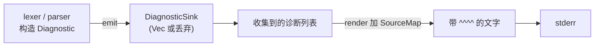

Pebble 里最小的一个 bug 只有两个字符：把 `writeln!` 写成 `write!`，删掉 `ln`。编译器不抱怨，三个测试照样通过，但整份错误报告的第一行会变成 `` error[E1001]: expected an expression, found `;` --> examples/errors.pebble:5:17 ``，标题和位置箭头粘在了一起。抓住它的是整个 crate 里唯一一条断言，我们在本篇末尾会真的把这个 bug 种进去再看它怎么死。在那之前，先把这个 crate 从零写出来：357 行，4 个测试，用到 `enum`、`Option`、builder、`Display`、`Error`、带默认方法的 trait，以及一次和孤儿规则的正面冲突。

> [!NOTE] 本篇检查点
> 我们将写完 `pebble-diag`：`Severity`、`Label`、`Diagnostic`、`DiagnosticSink` 以及把它们画成带 `^^^^` 下划线报告的 `render`。用到的 Rust 特性：带数据的 `enum` 与穷尽 `match`、`Option`、`if let` / `let ... else`、builder 模式与结构体更新语法、`Display` 与 `Debug`、`fmt::Write`、supertrait、默认方法、孤儿规则、类型别名、迭代器初体验。
> 本篇结束时 `crates/pebble-diag/` 的两个文件与 tag `tutorial-v1` 逐字节相同。上一篇：[所有权：SourceMap 里的 String 归谁](/posts/rust-by-pebble-02-ownership/)，`pebble-span` 已经完成，本篇直接依赖它。

## 错误应该是数据

先说我们要的东西长什么样。这是 Pebble 最终版本对 `examples/errors.pebble` 的报告（真实输出，不是手写的）：

```text
error[E1001]: expected an expression, found `;`
 --> examples/errors.pebble:5:17
  |
5 | let total = 1 + ;
  |                 ^
  |
```

C 里的第一反应是在解析器报错的地方直接 `fprintf(stderr, "%s:%d: error: ...")`。我也写过很多次。它有三个问题：

1. 解析器深处不知道源码文本，打不出那行带 `^` 的原文。
2. 没法测试：你要么捕获 stderr，要么 mock 一个 `FILE*`。
3. 没法"先收集，后输出"。我们的解析器遇到第一个错误后会同步到下一条语句继续解析（第 7 篇），一次报出所有错误。边解析边打印的话，输出顺序和格式全由解析器决定。

所以 Pebble 的设计是：**报告一切，打印一无所有**。这像实验室里的记录本：现场只负责把读数记下来，排版成报告是回办公室以后的事，而且同一份记录可以排成屏幕上的一页，也可以排成测试里的一个字符串。深处的代码只构造一个 `Diagnostic` 值（纯数据），交给某个"接收者"；真正需要文字的时候，再拿 `SourceMap` 去渲染。



这个图里每个方框都会变成本篇的一个类型或 trait。

## 起步：第二个 crate

在第 1 篇的工作区根目录（我的叫 `pebble-rebuild`，你的随意）运行：

```bash
cargo new --lib crates/pebble-diag
```

```text
    Creating library `pebble-diag` package
note: see more `Cargo.toml` keys and their definitions at https://doc.rust-lang.org/cargo/reference/manifest.html
```

因为目录在 workspace 里，`cargo new` 自己把 `version.workspace = true` 之类的继承行和 `[lints] workspace = true` 都写好了（其中也有 `description.workspace`、`keywords.workspace`、`categories.workspace` 三行）。我们要把 `description` 换成这个 crate 自己的一句话，删掉 `keywords` 和 `categories` 两行，再补一个依赖。先在根 `Cargo.toml` 的 `[workspace.dependencies]` 里，`pebble-span` 那行下面加一行：

```toml
pebble-diag = { path = "crates/pebble-diag", version = "0.1.0" }
```

然后让 `crates/pebble-diag/Cargo.toml` 成为下面这样（和 tag 一致）：

```toml
[package]
name = "pebble-diag"
description = "Diagnostics, labels, and human-readable rendering for Pebble."
version.workspace = true
edition.workspace = true
rust-version.workspace = true
authors.workspace = true
license.workspace = true
repository.workspace = true

[dependencies]
pebble-span.workspace = true

[lints]
workspace = true
```

`pebble-span.workspace = true` 的意思是"依赖 `pebble-span`，具体路径和版本去根 `Cargo.toml` 的 `[workspace.dependencies]` 里查"。它相当于 CMake 里 `target_link_libraries(pebble-diag PUBLIC pebble-span)`，区别是这里没有头文件要 include：依赖一声明，`pebble_span::Span` 就能直接用（crate 名里的 `-` 在代码里变成 `_`）。

现在把 `crates/pebble-diag/src/lib.rs` 清空，写文件头。前两行属性你在第 2 篇见过：测试之外 `no_std`，禁用 `unsafe`。接下来是 7 行 `//!` 模块文档（第 3 到 9 行）。第 8 行里有一个全角破折号，手敲容易走样，而我们的检查点要求逐字节相同，所以这 7 行直接从 tag 取：

```bash
git -C ~/pebble-tag show tutorial-v1:crates/pebble-diag/src/lib.rs | sed -n 3,9p
```

（`~/pebble-tag` 是 tag 的本地克隆：`git clone --branch tutorial-v1 https://github.com/bfmhno3/pebble ~/pebble-tag`。第 1 篇的检查点已经让你克隆过；没有的话现在建。）

其余部分的文件头是：

```rust
#![cfg_attr(not(test), no_std)]
#![forbid(unsafe_code)]
//! (这里是上面取到的第 3 到 9 行模块文档)

extern crate alloc;

use alloc::string::String;
use alloc::vec::Vec;
use core::fmt::{self, Write as _};

use pebble_span::{SourceMap, Span};
```

`Write as _` 这个奇怪的写法我们很快会遇到，先照抄。

## `Severity`：一个 enum，但不是 C 的那种

错误、警告、提示、帮助：四个严重程度。C 程序员一秒钟写完：

```c
enum Severity { ERROR, WARNING, NOTE, HELP };
```

然后在某处写一个 `switch` 把它转成字符串，几个月后有人加了第五个枚举值，忘了改 `switch`。我把这个场景真的编出来跑了一遍（[`lab/cpp/ch03_sev.c`](https://github.com/bfmhno3/pebble/blob/tutorial-v1/lab/cpp/ch03_sev.c)，`gcc -Wall -Wextra`）：

```text
sev.c: In function 'as_str':
sev.c:6:5: warning: enumeration value 'HELP' not handled in switch [-Wswitch]
    6 |     switch (s) {
      |     ^~~~~~
??? ???
```

一条 warning，程序照常跑，打印出两个 `???`（后一个是我故意塞进去的 `(enum Severity)42`，C 的枚举不过是个 `int`，任何值都能强转进去）。

Rust 的 `enum` 是另一种东西：它是一个**只能取列出的那几个值**的类型，不能把任意整数强转成它，而且 `match` 必须穷尽。把同样的错误写给 Rust（实验文件 `src/bin/ch03_match.rs`，在第 1 篇建的 `~/rust-lab` 里）：

```rust
#[derive(Copy, Clone)]
enum Severity {
    Error,
    Warning,
    Note,
    Help,
}

fn as_str(severity: Severity) -> &'static str {
    match severity {
        Severity::Error => "error",
        Severity::Warning => "warning",
        Severity::Note => "note",
    }
}
```

```bash
cargo build --bin ch03_match
```

```text
error[E0004]: non-exhaustive patterns: `Severity::Help` not covered
  --> src/bin/ch03_match.rs:10:11
   |
10 |     match severity {
   |           ^^^^^^^^ pattern `Severity::Help` not covered
   |
note: `Severity` defined here
  --> src/bin/ch03_match.rs:2:6
   |
 2 | enum Severity {
   |      ^^^^^^^^
...
 6 |     Help,
   |     ---- not covered
   = note: the matched value is of type `Severity`
help: ensure that all possible cases are being handled by adding a match arm with a wildcard pattern or an explicit pattern as shown
   |
13 ~         Severity::Note => "note",
14 ~         Severity::Help => todo!(),
   |

For more information about this error, try `rustc --explain E0004`.
error: could not compile `rust-lab` (bin "ch03_match") due to 1 previous error
```

同样的疏忽，C 给一条可以忽略的 warning，Rust 给一条无法忽略的 error。这是我最喜欢 `enum` 的地方：以后每增加一个变体，编译器会带我找到每一处需要修改的 `match`。第 5 篇里 AST 有几十个变体，这个性质会救我们很多次。

顺带认识语法：变体用 `Severity::Error` 这样的路径引用（不会像 C 那样污染外层作用域）；`match` 的每个分支是 `模式 => 表达式`，整个 `match` 本身是个表达式，值就是被选中分支的值，所以函数体里不需要 `return`（第 1 篇的"最后一个表达式不加分号"）。

### enum 还能带数据

C 的 `enum` 只是整数。Rust 的变体可以各自携带不同形状的数据，这时它更像 C 里的 `tagged union`，或者 C++ 的 `std::variant`。我们这一章的 `Severity` 用不到这点，但整个系列都要用，所以趁早看一眼（实验文件 `src/bin/ch03_variant.rs`）：

```rust
#[derive(Debug)]
enum Shape {
    Point,
    Circle(f64),
    Rect { w: f64, h: f64 },
}

fn area(shape: &Shape) -> f64 {
    match shape {
        Shape::Point => 0.0,
        Shape::Circle(r) => 3.0 * r * r,
        Shape::Rect { w, h } => w * h,
    }
}
```

```bash
cargo run --quiet --bin ch03_variant
```

```text
Point has area 0
Circle(2.0) has area 12
Rect { w: 2.0, h: 5.0 } has area 10
size_of::<Shape>() = 24
size_of::<Option<String>>() = 24
size_of::<String>() = 24
```

三种形状：没有数据的、元组式的 `Circle(f64)`、结构体式的 `Rect { w, h }`。`match` 的分支里直接把数据解构成局部变量 `r`、`w`、`h`，没有 `std::get<1>(v)` 或 `std::holds_alternative` 那一套；并且和 `std::visit` 要求访问者覆盖所有备选类型一样，漏一个变体就编译失败。区别是语法：`std::variant` 是库类型，`std::visit` 加 `overloaded` 的写法大家都懂的；Rust 的 `enum` 是语言内建，`match` 是语言内建，错误信息也因此能直接告诉你缺哪个变体。

最后三行数字是个小彩蛋：`Option<String>` 和 `String` 一样大，都是 24 字节。`Option` 本质上就是一个带数据的 `enum`（`None` 和 `Some(T)`），而 `String` 的容量字段永远不会超过 `isize::MAX`，编译器把 `None` 编码成容量字段里的一个非法值，不需要额外的标签字节。我们很快就大量使用 `Option<String>`，这里记住：它不贵。

### 写 `Severity`

回到 `pebble-diag`。在文件头后面写：

```rust
/// How serious a diagnostic is.
#[derive(Copy, Clone, PartialEq, Eq, Debug)]
pub enum Severity {
    Error,
    Warning,
    Note,
    Help,
}
```

`#[derive(...)]` 你在第 1 篇见过：`Copy` 和 `Clone` 让它能按位复制（四个无数据的变体，本质上就是一个字节），`PartialEq` 和 `Eq` 让它支持 `==`，`Debug` 让它能被 `{:?}` 打印。`Severity::Error` 里的 `Error` 是变体名，和后面的 `Error` trait 不冲突，因为变体总是通过 `Severity::` 前缀访问。

接着是把它转成字符串的方法，`as_str`：

```rust
impl Severity {
    /// A lowercase, stable name for the severity.
    #[must_use]
    pub const fn as_str(self) -> &'static str {
        match self {
            Severity::Error => "error",
            Severity::Warning => "warning",
            Severity::Note => "note",
            Severity::Help => "help",
        }
    }
}
```

这里有几个小点。`match self` 里直接写 `Severity::Error` 而不写 `*self`，因为 `self` 是按值传入的（`Severity` 是 `Copy`，传值是免费的）。`const fn` 表示这个函数可以在编译期求值。返回类型 `&'static str` 的 `'static` 表示这个字符串活在整个程序运行期（字符串字面量就放在可执行文件的只读段里），它的完整含义留到[第 4 篇](/posts/rust-by-pebble-04-lifetimes-lexer/)。`#[must_use]` 告诉编译器：如果调用者调用了 `as_str()` 又丢掉结果，给 warning，因为这样做几乎一定是 bug。

### Display 与 Debug：给人看的和给程序员看的

我们已经 derive 了 `Debug`，它会打印 `Error`、`Warning`，但那是给程序员调试的格式。用户在终端里希望看到小写的 `error`。Rust 里这两种输出是两个不同的 trait：

- `Debug`（占位符 `{:?}`）：给程序员看，通常 `#[derive]` 一个。
- `Display`（占位符 `{}`）：给最终用户看，必须手写，因为"用户该看到什么"只有你知道。

做一次对比（实验文件 `src/bin/ch03_format.rs`）：

```rust
#[derive(Debug)]
struct Label {
    start: u32,
    message: Option<String>,
}
```

```rust
let label = Label { start: 4, message: Some("found `;`".to_string()) };
println!("{label:?}");
println!("{label:#?}");
```

```text
Label { start: 4, message: Some("found `;`") }
Label {
    start: 4,
    message: Some(
        "found `;`",
    ),
}
```

`{:?}` 一行，`{:#?}` 多行缩进，两者都是编译器替你生成的。`{label}` 这样直接把变量名写进花括号是 Rust 1.58 起的"内联格式参数"，等价于 `println!("{}", label)`。

手写 `Display` 的样子是：

```rust
impl fmt::Display for Severity {
    fn fmt(&self, f: &mut fmt::Formatter<'_>) -> fmt::Result {
        f.write_str(self.as_str())
    }
}
```

`impl fmt::Display for Severity` 读作"为 `Severity` 实现 `Display` trait"。trait 要求的唯一方法是 `fmt`，参数是 `&self` 和一个 `Formatter`（可以理解成"写到哪里去"的句柄），返回 `fmt::Result`。`f.write_str(...)` 把一段文本写进去。这里没有 `return`，也没有 `;`：又是最后一个表达式。

以后任何地方写 `println!("{}", severity)` 或者 `format!("{severity}")`，调用的都是这个 `fmt`。

## `Label` 和 `Diagnostic`

一份诊断由三种东西组成：一个标题（"expected an expression"），若干个指向源码的标签（"这里"），和若干条末尾备注。标签可以带说明文字，也可以不带；诊断可以带错误码（`E0001`），也可以不带。

C 里"可能没有"通常用 `NULL`，或者在结构体里加一个 `has_message` 布尔。Rust 里是 `Option<T>`：它是 `enum Option<T> { None, Some(T) }`，不是特殊的语言机制。在你把 `Some` 拆开之前，没法碰里面的 `T`，所以不可能"忘了检查空指针"。

先写 `Label`（紧接在 `Severity` 的 `Display` 之后）：

```rust
/// A pointer at one span of source, with an optional message.
#[derive(Clone, PartialEq, Eq, Debug)]
pub struct Label {
    /// Where to point.
    pub span: Span,
    /// What to say about it.
    pub message: Option<String>,
    /// Primary labels get the `^^^^` underline; secondary ones get `----`.
    pub primary: bool,
}
```

三个字段都是 `pub`，意思是 crate 之外的代码可以直接读写它们（`Span` 在第 1 篇也是这样）。`primary` 决定下划线是 `^^^^` 还是 `----`：主标签指向"错误本身"，次标签指向"相关的东西"（比如"`a` 在这里定义"）。

两个构造函数：

```rust
impl Label {
    /// A primary label.
    #[must_use]
    pub fn primary(span: Span, message: impl Into<String>) -> Self {
        Self {
            span,
            message: Some(message.into()),
            primary: true,
        }
    }

    /// A secondary label.
    #[must_use]
    pub fn secondary(span: Span, message: impl Into<String>) -> Self {
        Self {
            span,
            message: Some(message.into()),
            primary: false,
        }
    }
}
```

注意这里有一个小细节：`Label` 有一个字段叫 `primary`，也有一个关联函数叫 `primary`。这没有冲突，Rust 里字段和方法在不同的命名空间，`label.primary` 是字段，`Label::primary(...)` 是函数。`impl Into<String>` 是第 2 篇的老朋友：调用者可以传 `&str`，也可以传 `String`，函数内部 `message.into()` 统一变成 `String`。

再写 `Diagnostic` 本身：

```rust
/// A single compiler message.
#[derive(Clone, PartialEq, Eq, Debug)]
pub struct Diagnostic {
    /// Error / warning / note / help.
    pub severity: Severity,
    /// An optional stable code, e.g. `E0001`.
    pub code: Option<String>,
    /// The headline.
    pub message: String,
    /// Pointers into the source.
    pub labels: Vec<Label>,
    /// Trailing `= note:` lines.
    pub notes: Vec<String>,
}
```

`Vec<Label>` 和 `Vec<String>` 为空时不分配堆内存，所以"没有标签""没有备注"不用 `Option` 包一层，空 `Vec` 就是"没有"。

### Builder：拼出一份诊断

构造一份带错误码、带标签、带备注的诊断，你不想写一个十参数的构造函数。C++ 里常见的做法是链式调用 setter，返回 `*this`。Rust 的版本叫 builder：

```rust
impl Diagnostic {
    /// Creates an error with just a headline.
    #[must_use]
    pub fn error(message: impl Into<String>) -> Self {
        Self {
            severity: Severity::Error,
            code: None,
            message: message.into(),
            labels: Vec::new(),
            notes: Vec::new(),
        }
    }

    /// Creates a warning with just a headline.
    #[must_use]
    pub fn warning(message: impl Into<String>) -> Self {
        Self {
            severity: Severity::Warning,
            ..Self::error(message)
        }
    }
```

`Diagnostic::error("...")` 是最基本的构造，其余字段都取默认值。`warning` 用到了**结构体更新语法**：`..Self::error(message)` 的意思是"其余字段照 `Self::error(message)` 那个值填"，我们只覆盖了 `severity`。（`Self` 是当前类型的别名，在 `impl Diagnostic` 里就是 `Diagnostic`。）

然后是一串"附加"方法。注意签名：`mut self`，返回 `Self`。

```rust
    /// Attaches a stable error code.
    #[must_use]
    pub fn with_code(mut self, code: impl Into<String>) -> Self {
        self.code = Some(code.into());
        self
    }

    /// Attaches a primary label.
    #[must_use]
    pub fn with_primary(mut self, span: Span, message: impl Into<String>) -> Self {
        self.labels.push(Label::primary(span, message));
        self
    }

    /// Attaches a secondary label.
    #[must_use]
    pub fn with_secondary(mut self, span: Span, message: impl Into<String>) -> Self {
        self.labels.push(Label::secondary(span, message));
        self
    }

    /// Attaches an unlabeled primary span.
    #[must_use]
    pub fn with_span(mut self, span: Span) -> Self {
        self.labels.push(Label {
            span,
            message: None,
            primary: true,
        });
        self
    }

    /// Appends a `= note:` line.
    #[must_use]
    pub fn with_note(mut self, note: impl Into<String>) -> Self {
        self.notes.push(note.into());
        self
    }
```

`with_code(mut self, ...) -> Self` 拿走整个 `Diagnostic` 的所有权（第 2 篇的"移动"），改完再还回去，所以可以这样串起来：

```rust
let diag = Diagnostic::error("bad name")
    .with_code("E0001")
    .with_span(span)
    .with_note("did you mean `y`?");
```

每一步旧值被移动进下一步，没有一次拷贝，没有任何地方持有半成品。`mut self` 的 `mut` 只是说"函数体里我可以改自己这份"，调用者那边的变量没有被改，因为它已经被移走了。这和 C++ 里返回 `Diagnostic&` 的链式 setter 形成对比：那种写法把半成品的引用暴露给外面，Rust 的写法每一步都是一个独立的值。

每个 builder 方法前面的 `#[must_use]` 是有用的：如果你写了 `diag.with_code("E0001");` 然后丢掉返回值，编译器会警告，因为 `diag` 已经被移走，这行代码什么效果也没有。

我们把一个小例子放到实验文件 `src/bin/ch03_builder_update.rs` 里，同时顺便跑一下 `if let` 和 `let ... else`，它们马上要用在 `render` 里：

```rust
fn describe(label: Option<&str>) -> String {
    let Some(label) = label else {
        return "no label".to_string();
    };
    if let Some(first) = label.chars().next() {
        format!("label {label} starts with {first}")
    } else {
        "empty label".to_string()
    }
}
```

```text
Config { name: "demo", retries: 5, verbose: true }
Config { name: "demo", retries: 5, verbose: false }
no label
empty label
label x starts with x
```

（前两行来自同一个文件里的 `Config`，演示 `Config { verbose: false, ..base.clone() }` 这样的结构体更新。）

- `if let Some(x) = opt { ... } else { ... }`：只关心一个模式的 `match`。
- `let Some(x) = opt else { return/continue/break };`：解包成功就继续往下用 `x`，失败就必须离开当前流程（`else` 块必须发散）。这比嵌套 `if let` 少缩进一层。

### 第一次迭代器：`primary_span`

最后一个方法回答"该把箭头指到哪"：第一个主标签的 span。

```rust
    /// The span the printer should focus on: the first primary label, if any.
    #[must_use]
    pub fn primary_span(&self) -> Option<Span> {
        self.labels
            .iter()
            .find(|label| label.primary)
            .map(|label| label.span)
    }
```

这里是迭代器的第一次登场。`self.labels.iter()` 产生一个"借用每个元素"的迭代器（元素类型是 `&Label`，没有复制任何标签）；`.find(|label| label.primary)` 找到第一个满足条件的元素，返回 `Option<&Label>`；`.map(|label| label.span)` 对 `Option` 里的值做变换：`Some(label)` 变成 `Some(label.span)`，`None` 保持 `None`。`Span` 是 `Copy`，所以 `label.span` 直接复制出来，没有借用残留。竖线里的 `|label|` 是闭包参数，你在第 2 篇的 `partition_point` 里已经见过。

这几个适配器都是惰性的：`iter()` 本身什么也不做，`find` 一旦找到就停。我写了一个小实验（`src/bin/ch03_iter.rs`）确认迭代之后原集合依旧可用，同时看看 `sort_by_key` 和 `repeat_n`：

```text
first primary starts at Some(4)
[Label { start: 4, primary: true }, Label { start: 12, primary: true }, Label { start: 30, primary: false }]
^^^^^
labels still usable: 3
```

`impl Diagnostic` 还没写完，下一节要往里再加两个方法。为了现在就能编译，先在 `primary_span` 后面临时补一个 `}`；下一节会在它**前面**插新方法，插到最后一块（它自带 `impl` 真正的收尾 `}`）时，把这个临时的删掉。

此刻编译一下：

```bash
cargo build -p pebble-diag
```

```text
   Compiling pebble-diag v0.1.0 (/tmp/pebble-rebuild-03/crates/pebble-diag)
warning: unused import: `SourceMap`
  --> crates/pebble-diag/src/lib.rs:17:19
   |
17 | use pebble_span::{SourceMap, Span};
   |                   ^^^^^^^^^
   |
   = note: `#[warn(unused_imports)]` (part of `#[warn(unused)]`) on by default

warning: unused import: `Write`
  --> crates/pebble-diag/src/lib.rs:15:23
   |
15 | use core::fmt::{self, Write as _};
   |                       ^^^^^

warning: `pebble-diag` (lib) generated 2 warnings (run `cargo fix --lib -p pebble-diag` to apply 1 suggestion)
    Finished `dev` profile [unoptimized + debuginfo] target(s) in 0.15s
```

通过，只是提示我们有两个 `use` 还没派上用场。它们下一节就会用到。

## `render`：把诊断画出来

`render` 要做的是：对每个标签，找到所在文件，算出行号和列号，打印 `--> 文件:行:列`，打印原文那一行，再在下面画 `^^^^` 和说明。

### 往 `String` 里 `write!`

最自然的做法是：新建一个 `String`，一行一行地"打印"到里面去。C 里你用 `snprintf` 或者 `std::ostringstream`；Rust 里对应的是 `write!` 宏，它像 `println!` 但目标是任何"能写文本的东西"。把这个试一下（实验文件 `src/bin/ch03_write_import.rs`）：

```rust
use std::fmt;

fn header(out: &mut String, code: u32) -> fmt::Result {
    write!(out, "error[E{code:04}]")
}
```

```bash
cargo build --bin ch03_write_import
```

```text
error[E0599]: cannot write into `&mut String`
 --> src/bin/ch03_write_import.rs:4:12
  |
4 |     write!(out, "error[E{code:04}]")
  |            ^^^
  |
note: must implement `io::Write`, `fmt::Write`, or have a `write_fmt` method
 --> src/bin/ch03_write_import.rs:4:12
  |
4 |     write!(out, "error[E{code:04}]")
  |            ^^^
  = help: items from traits can only be used if the trait is in scope
help: trait `Write` which provides `write_fmt` is implemented but not in scope; perhaps you want to import it
  |
1 + use std::fmt::Write;
  |

For more information about this error, try `rustc --explain E0599`.
error: could not compile `rust-lab` (bin "ch03_write_import") due to 1 previous error
```

`String` 当然实现了写入，但要调用 trait 的方法，**这个 trait 必须在作用域里**。这是 Rust 和 C++ 一个重要区别：C++ 的成员函数属于类，写在类里面，永远在；Rust 的 trait 方法是"外挂"的，你得 `use` 那个 trait。

`write!` 展开后调用的是 `out.write_fmt(...)`，而标准库里有**两个**都叫 `Write` 的 trait：

- `std::fmt::Write`：往**文本**里写（`String`、`Formatter`）。
- `std::io::Write`：往**字节流**里写（文件、socket、`Stdout`）。

`io::Write` 是 `std` 的东西；`no_std` 的 `pebble-diag` 没有 `std::io`，所以我们用 `fmt::Write`。导入时写成 `use core::fmt::Write as _;`：`as _` 的意思是"我只要这个 trait 的方法，不要它的名字"，免得和 `fmt::Result`、`fmt::Display` 这些混在一起。你刚才写的文件头里已经有了这一行。

还有一点：`write!` 返回 `fmt::Result`，因为对"任意写入目标"来说，写入可能失败；对 `String` 来说永远不会。`Result` 是 `#[must_use]` 的，直接丢掉会警告，所以我们写 `let _ = write!(...)`，明确表示"我知道有个结果，我丢掉它"。

### 格式化小语言

`render` 里用到了不少格式规则，我在 `ch03_format.rs` 里把它们都试了一遍：

```rust
let line_no = 7;
let width = 4;
println!("[{line_no}]");
println!("[{line_no:>width$}]");
println!("[{line_no:<width$}]");
println!("[{line_no:0>width$}]");
println!("[{:>1$}]", line_no, 6);
println!("{:x} {:#x} {:b}", 255, 255, 5);
println!("{:.3}", 3.14159);
```

```text
[7]
[   7]
[7   ]
[0007]
[     7]
ff 0xff 101
3.142
```

`{:>width$}` 的意思是右对齐，宽度取自变量 `width`；`{:0>4}` 用 `0` 填充；`{:x}` 十六进制，`{:#x}` 带 `0x` 前缀，`{:b}` 二进制，`{:.3}` 三位小数。语法对 C 程序员几乎是 `printf` 的平行宇宙，唯一的大区别是编译期检查：格式串和参数个数、类型对不上，直接编译失败，而不是 `-Wformat` 的 warning 或者运行时的 UB。

### `render` 本体

有了这些，把 `render` 写在 `primary_span` 后面、临时的 `}` 前面（先看开头）：

```rust
    /// Renders the diagnostic against a source map into a multi-line string.
    ///
    /// The output mimics the `rustc` style:
    ///
    /// ```text
    /// error[E0001]: unexpected token
    ///   --> demo.pebble:4:13
    ///    |
    ///  4 |     let x = ;
    ///    |             ^ expected an expression
    /// ```
    #[must_use]
    pub fn render(&self, sources: &SourceMap) -> String {
        let mut out = String::new();
        self.write_header(&mut out);

        // Stable order so snapshots do not depend on construction order.
        let mut labels: Vec<&Label> = self.labels.iter().collect();
        labels.sort_by_key(|label| (label.span.source, label.span.start));

```

`sources.get(...)` 返回的是 `Option<&SourceFile>`（第 2 篇），有些标签可能指向一个不在 `SourceMap` 里的文件 id，我们选择跳过它们。

`labels.sort_by_key(|label| (label.span.source, label.span.start))` 有一个小技巧：元组按字典序比较，所以先按文件，再按偏移排序。能这样排序，是因为 `SourceId` 的 `#[derive(...)]` 里有 `Ord`（回头看一眼 `pebble-span`）。排序的是 `Vec<&Label>`：里面装的是对原标签的引用，没有复制任何一个 `Label`。我们这么做是为了让输出不依赖于调用者添加标签的先后（"稳定顺序，快照测试才不会随机失败"）。

接着是循环内部：

```rust
        for label in labels {
            let Some(file) = sources.get(label.span.source) else {
                continue;
            };
            let pos = file.position(label.span.start);
            let line_no = pos.line;
            let width = digits(line_no);
            let pad = " ".repeat(width);

            let _ = writeln!(out, "{pad}--> {}:{}:{}", file.name(), line_no, pos.column);
            let _ = writeln!(out, "{pad} |");

            let line_text = file.line(line_no).unwrap_or("");
            let _ = writeln!(out, "{line_no:>width$} | {line_text}");

            let (caret_col, caret_len) = caret_geometry(file, label.span, line_no, line_text);
            let marker = if label.primary { '^' } else { '-' };
            let carets: String = core::iter::repeat_n(marker, caret_len).collect();
            let lead = " ".repeat(caret_col);
            match &label.message {
                Some(message) => {
                    let _ = writeln!(out, "{pad} | {lead}{carets} {message}");
                }
                None => {
                    let _ = writeln!(out, "{pad} | {lead}{carets}");
                }
            }
            let _ = writeln!(out, "{pad} |");
        }
```

循环的第一行就是 `let ... else`：找不到文件就 `continue` 去处理下一个标签。`"{pad}--> ..."` 里的 `{pad}` 是内联参数，`{line_no:>width$}` 是我们刚学的右对齐。`core::iter::repeat_n(marker, caret_len).collect()` 产生 `caret_len` 个 `marker` 字符，收集成 `String`，`let carets: String = ...` 左边的类型标注告诉 `collect` 应该收集成什么。`" ".repeat(n)` 是 `str` 的方法。

> [!NOTE] `{pad}` 的宽度从哪来？
> `digits(line_no)` 是行号的位数，`pad` 是同样宽度的空格，让 `-->` 和 `|` 在不同行号位数下都对齐。位数从哪来，下一小节说。

最后是备注和返回，然后是 `write_header`，然后是 `impl` 真正的收尾 `}`（现在可以删掉那个临时的了）：

```rust
        for note in &self.notes {
            let _ = writeln!(out, "  = note: {note}");
        }

        out
    }

    fn write_header(&self, out: &mut String) {
        let _ = write!(out, "{}", self.severity);
        if let Some(code) = &self.code {
            let _ = write!(out, "[{code}]");
        }
        let _ = writeln!(out, ": {}", self.message);
    }
}
```

`write_header` 里 `if let Some(code) = &self.code` 的 `&self.code` 是 `&Option<String>`，所以 `code` 的类型是 `&String`，没有移动任何东西。**注意最后一行的 `writeln!`**：它在消息后面追加换行。留着这个细节，本篇结尾我们会回来。

### `digits` 的三种写法

`render` 里用了一个小函数 `digits`，数 `n` 有几位十进制数。写在 `impl Diagnostic` 块后面（后面的 `Display` 和 `DiagnosticSink` 会插进来，最终 `digits` 在它们后面）：

```rust
/// Number of decimal digits in `n` (at least 1).
fn digits(n: u32) -> usize {
    let mut n = n;
    let mut count = 1;
    while n >= 10 {
        n /= 10;
        count += 1;
    }
    count
}
```

我同时写了三个版本放到实验里（`src/bin/ch03_digits.rs`），顺便展示几个语法点：

```rust
fn digits_loop(mut n: u32) -> usize {
    let mut count = 1;
    loop {
        if n < 10 {
            break count;
        }
        n /= 10;
        count += 1;
    }
}

fn digits_ilog(n: u32) -> usize {
    n.checked_ilog10().map_or(1, |log| log as usize + 1)
}
```

第 1 篇的 `loop { break value }` 在这里派上用场；`checked_ilog10` 对 0 返回 `None`（0 没有对数），否则返回 `Some(floor(log10(n)))`，`map_or(1, ...)` 把 `None` 映射成 1。跑一下：

```text
         0: while=1 loop=1 ilog=1
         9: while=1 loop=1 ilog=1
        10: while=2 loop=2 ilog=2
        99: while=2 loop=2 ilog=2
       100: while=3 loop=3 ilog=3
     12345: while=5 loop=5 ilog=5
4294967295: while=10 loop=10 ilog=10
```

三个版本结果一致（实验里有 `assert_eq!`）。仓库保留了 `while` 版本：它是最没有"聪明"的那一个，在 `render` 里调一次，没有理由选更难读的。`let mut n = n;` 这一行是**遮蔽**（第 1 篇）：参数 `n` 是不可变的，我们新建一个同名可变的绑定，把原来的盖住。

### `caret_geometry`：字符，不是字节

下划线要画在哪一列、画多长，在 UTF-8 里不能直接用字节偏移：`"中c"` 里 `c` 的字节偏移是 3，但它在第 2 列。第 2 篇已经遇到过这个问题。这个函数把 `Span` 的字节范围换算成字符列，放在 `digits` 之后、`#[cfg(test)]` 之前（它是文件里最后一个非测试项）：

```rust
/// Computes the caret start column and length, in characters, for a span.
fn caret_geometry(
    file: &pebble_span::SourceFile,
    span: Span,
    line_no: u32,
    line_text: &str,
) -> (usize, usize) {
    let line_start = file.line_start(line_no).unwrap_or(0);
    let byte_in_line = span.start.saturating_sub(line_start) as usize;
    let byte_in_line = byte_in_line.min(line_text.len());

    // Character columns, not byte columns, so CJK lines line up.
    let caret_col = line_text[..byte_in_line].chars().count();

    let line_end = line_start + line_text.len() as u32;
    let covered_end = span.end.min(line_end).max(span.start);
    let covered = (covered_end - span.start) as usize;
    let slice_end = (byte_in_line + covered).min(line_text.len());
    let caret_len = line_text[byte_in_line..slice_end].chars().count().max(1);

    (caret_col, caret_len)
}
```

`saturating_sub`、`.min`、`.max` 都是为了不 panic：`Span` 可能超出这一行，也可能被 `Span::DUMMY` 之类的东西弄成怪值。`line_text[..byte_in_line].chars().count()` 就是第 2 篇的"切片后数字符"，`byte_in_line.min(line_text.len())` 保证切片不越界。返回元组 `(usize, usize)`，调用处用 `let (caret_col, caret_len) = ...` 解构。

### 三个测试

在文件末尾写测试模块（先写前三个，第四个和下一节的 trait 一起写；写完这三个之后，补一个 `}` 关闭 `mod tests`）：

```rust
#[cfg(test)]
mod tests {
    use super::*;

    #[test]
    fn renders_a_single_caret_line() {
        let mut sources = SourceMap::new();
        let id = sources.add("demo.pebble", "let x = 1;\nlet y = ;\n");
        let span = Span::new(id, 19, 19);
        let diag = Diagnostic::error("expected an expression")
            .with_code("E0001")
            .with_primary(span, "found `;`");

        let rendered = diag.render(&sources);
        assert!(
            rendered.starts_with("error[E0001]: expected an expression\n"),
            "header must be on its own line:\n{rendered}"
        );
        assert!(rendered.contains("--> demo.pebble:2:9"));
        assert!(rendered.contains("^ found `;`"));
    }

    #[test]
    fn caret_length_tracks_span_length() {
        let mut sources = SourceMap::new();
        let id = sources.add("demo.pebble", "let abcdef = 1;\n");
        // Span covering `abcdef` (bytes 4..10).
        let diag = Diagnostic::error("bad name").with_span(Span::new(id, 4, 10));
        let rendered = diag.render(&sources);
        assert!(rendered.contains("^^^^^^"), "got:\n{rendered}");
    }

    #[test]
    fn notes_are_rendered() {
        let mut sources = SourceMap::new();
        let id = sources.add("demo.pebble", "x\n");
        let diag = Diagnostic::error("nope")
            .with_span(Span::new(id, 0, 1))
            .with_note("did you mean `y`?");
        assert!(diag.render(&sources).contains("= note: did you mean `y`?"));
    }
```

`assert!` 和 `assert_eq!` 是你熟悉的断言。注意 `assert!` 的第二个参数：失败时打印的消息，可以是带 `{rendered}` 的格式串。第一个测试里 `starts_with("error[E0001]: expected an expression\n")` 就是我说的"整个 crate 里最重要的断言"，保存好这个印象。第二个测试里 `Span::new(id, 4, 10)` 刚好盖住 `abcdef`（字节 4 到 10），所以应该有六个 `^`。

```bash
cargo test -p pebble-diag
```

```text
running 3 tests
test tests::caret_length_tracks_span_length ... ok
test tests::notes_are_rendered ... ok
test tests::renders_a_single_caret_line ... ok

test result: ok. 3 passed; 0 failed; 0 ignored; 0 measured; 0 filtered out; finished in 0.00s
```

（上面的输出省略了 `cargo test` 的编译提示和 `Doc-tests` 部分，每一行都没有改。）

### 亲眼看看

测试是对的，但我想看到一份真正的报告，一个两个标签的那种。在 `crates/pebble-diag/examples/demo.rs` 写（`examples/` 里的每个 `.rs` 文件都是一个独立的小程序，`cargo run --example demo` 运行；我们只是借它用一下，检查点之前会删掉）：

```rust
use pebble_diag::Diagnostic;
use pebble_span::{SourceMap, Span};

fn main() {
    let mut sources = SourceMap::new();
    let id = sources.add("demo.pebble", "let a = 1;\nlet b = a + c;\n");
    let diag = Diagnostic::error("undefined variable `c`")
        .with_code("E0100")
        .with_primary(Span::new(id, 23, 24), "not found in this scope")
        .with_secondary(Span::new(id, 4, 5), "`a` is defined here")
        .with_note("variables must be declared with `let`");
    print!("{}", diag.render(&sources));
    println!("---");
    println!("{diag}");
    println!("{diag:?}");
}
```

```bash
cargo run -q -p pebble-diag --example demo
```

```text
error[E0277]: `Diagnostic` doesn't implement `std::fmt::Display`
  --> crates/pebble-diag/examples/demo.rs:14:15
   |
14 |     println!("{diag}");
   |               ^^^^^^ `Diagnostic` cannot be formatted with the default formatter
   |
   = help: the trait `std::fmt::Display` is not implemented for `Diagnostic`
   = note: in format strings you may be able to use `{:?}` (or {:#?} for pretty-print) instead

For more information about this error, try `rustc --explain E0277`.
error: could not compile `pebble-diag` (example "demo") due to 1 previous error
```

这是我故意埋的：我们给 `Severity` 写了 `Display`，没给 `Diagnostic` 写。`Diagnostic` 上 `{:?}` 能用（它 derive 了 `Debug`），`{}` 不行。这个错误是编译期的，没有"链接时才发现缺 `operator<<`"。

## `Display`、`Error`，以及孤儿规则

把下面这段写在 `impl Diagnostic` 块之后、`digits` 之前，先给 `Diagnostic` 写 `Display`。为什么不是 `render`？因为 `render` 需要 `SourceMap`，而 `Display::fmt` 只有 `&self` 和一个 `Formatter`。所以 `Display` 输出的是不带源码的一行摘要，`` error[E0100]: undefined variable `c` ``。同一段里还有一行很短的代码，`Error`：

```rust
/// `core::error::Error` is available even in `no_std` since Rust 1.81.
impl core::error::Error for Diagnostic {}

impl fmt::Display for Diagnostic {
    fn fmt(&self, f: &mut fmt::Formatter<'_>) -> fmt::Result {
        if let Some(code) = &self.code {
            write!(f, "{}[{}]: {}", self.severity, code, self.message)
        } else {
            write!(f, "{}: {}", self.severity, self.message)
        }
    }
}
```

`if let Some(code) = &self.code { ... } else { ... }` 在这里是表达式（两个分支的值类型都是 `fmt::Result`），所以它直接是函数的返回值。`write!` 对 `Formatter` 同样有效：`Formatter` 也实现了 `fmt::Write`。

`Error` 是标准库里"这是一个错误类型"的标志 trait。`impl core::error::Error for Diagnostic {}` 里**什么方法都没写**，因为 `Error` 的方法全有默认实现。它有什么用？以后 `Result<T, Box<dyn Error>>` 和 `anyhow::Error` 能装下任何实现了 `Error` 的类型（第 7 篇会用到）。

### supertrait：为什么 `Error` 要求你先有 `Display`

`Error` 的定义大致是 `trait Error: Debug + Display`，冒号后面叫 **supertrait**：想实现 `Error`，你得先实现 `Debug` 和 `Display`。我们的 `Diagnostic` 两个都有，所以空 `impl` 能过。如果没有呢？实验文件 `src/bin/ch03_supertrait.rs` 里写了个只有 `Display` 的 `Oops`：

```rust
struct Oops;

impl fmt::Display for Oops {
    fn fmt(&self, f: &mut fmt::Formatter<'_>) -> fmt::Result {
        f.write_str("oops")
    }
}

impl std::error::Error for Oops {}
```

```text
error[E0277]: `Oops` doesn't implement `Debug`
  --> src/bin/ch03_supertrait.rs:11:28
   |
11 | impl std::error::Error for Oops {}
   |                            ^^^^ the trait `Debug` is not implemented for `Oops`
   |
   = note: add `#[derive(Debug)]` to `Oops` or manually `impl Debug for Oops`
note: required by a bound in `std::error::Error`
  --> /rustc/59807616e1fa2540724bfbac14d7976d7e4a3860/library/core/src/error.rs:59:0
help: consider annotating `Oops` with `#[derive(Debug)]`
   |
 3 + #[derive(Debug)]
 4 | struct Oops;
   |

For more information about this error, try `rustc --explain E0277`.
error: could not compile `rust-lab` (bin "ch03_supertrait") due to 1 previous error
```

编译器甚至给出了修复：加 `#[derive(Debug)]`。supertrait 有点像 C++ 里"继承"的约束一面：`class Error : public Debug, public Display`，但没有内存布局、没有虚表上的关系，纯粹是"能实现 A 的前提是先实现 B"。

> [!NOTE] `core::error::Error`
> 源码里有一行文档注释说：`core::error::Error` 从 Rust 1.81 起在 `no_std` 里也能用。`std::error::Error` 就是它的重导出。因为 `pebble-diag` 是 `no_std`，所以我们用 `core::` 路径。

### 孤儿规则：我想给 `Vec<u8>` 实现 `Display`

既然 trait 是"外挂"的，你可能想：那我能不能给别人的类型实现别人的 trait？比如给标准库的 `Vec<u8>` 实现 `Display`，让 `println!("{}", vec![1u8, 2, 3])` 打印 `3 bytes`？（实验文件 `src/bin/ch03_orphan.rs`）：

```rust
impl fmt::Display for Vec<u8> {
    fn fmt(&self, f: &mut fmt::Formatter<'_>) -> fmt::Result {
        write!(f, "{} bytes", self.len())
    }
}
```

```text
error[E0117]: only traits defined in the current crate can be implemented for types defined outside of the crate
 --> src/bin/ch03_orphan.rs:3:1
  |
3 | impl fmt::Display for Vec<u8> {
  | ^^^^^^^^^^^^^^^^^^^^^^-------
  |                       |
  |                       `Vec` is not defined in the current crate
  |
  = note: impl doesn't have any local type before any uncovered type parameters
  = note: for more information see https://doc.rust-lang.org/reference/items/implementations.html#orphan-rules
  = note: define and implement a trait or new type instead

For more information about this error, try `rustc --explain E0117`.
error: could not compile `rust-lab` (bin "ch03_orphan") due to 1 previous error
```

这叫**孤儿规则**（orphan rule）：`impl Trait for Type` 要求 `Trait` 或 `Type` 至少有一个是**你的 crate 自己定义的**。C++ 里你随时可以在任何命名空间里为别人的类型加一个 `operator<<` 重载，靠 ADL 找得到；两个库各自加一个，链接或调用时才出现歧义。Rust 选择了更严的规则：整个依赖图里，对任何 `(trait, type)` 组合最多有一个实现，而保证这点的办法就是"只有 trait 或 type 的主人能写 impl"。

这个规则怎么影响我们？我们的 `Diagnostic` 是自己的类型，`DiagnosticSink` 是自己的 trait，所以：

- `impl Error for Diagnostic`：trait 是别人的，类型是我们的。允许。
- `impl DiagnosticSink for Vec<Diagnostic>`（下一节）：类型是别人的，trait 是我们的。允许。
- `impl Display for Vec<u8>`：两个都是别人的。拒绝。

编译器的最后一行给了出路：定义一个自己的类型（newtype，比如 `struct Bytes(Vec<u8>);`，你在第 1 篇的 `SourceId` 里写过）再给它实现。

### 为什么 `.to_string()` 凭空出现

你也许注意到，我们从没写过 `to_string`，却可以对任何实现了 `Display` 的类型调用它。标准库里有这样一个实现（简化）：

```rust
impl<T: Display + ?Sized> ToString for T { /* ... */ }
```

读作"对每一个实现了 `Display` 的类型 `T`，`T` 自动实现 `ToString`"。这叫 **blanket impl**（覆盖式实现）。`T: Display` 是**trait bound**，即泛型参数的约束；`?Sized` 先别管，第 5 篇再讲。它和 C++ 里受 concept 约束的模板函数同源：`template<typename T> requires Displayable<T> std::string to_string(T)`。实验文件 `src/bin/ch03_blanket.rs`：

```rust
struct Pt(i32, i32);

impl fmt::Display for Pt {
    fn fmt(&self, f: &mut fmt::Formatter<'_>) -> fmt::Result {
        write!(f, "({}, {})", self.0, self.1)
    }
}

// We never wrote `to_string` for Pt.
let s: String = Pt(1, 2).to_string();
```

```text
(1, 2)
42x
```

我们只写了 `Display`，就白得了 `ToString`。这就是 trait 系统的经济学：一个小的 trait（一个方法），换回一堆功能。泛型的完整故事留到[第 5 篇](/posts/rust-by-pebble-05-ast-generics/)。

### 再跑一次 demo

`Display` 补上以后，回到刚才失败的 demo：

```bash
cargo run -q -p pebble-diag --example demo
```

```text
error[E0100]: undefined variable `c`
 --> demo.pebble:1:5
  |
1 | let a = 1;
  |     - `a` is defined here
  |
 --> demo.pebble:2:13
  |
2 | let b = a + c;
  |             ^ not found in this scope
  |
  = note: variables must be declared with `let`
---
error[E0100]: undefined variable `c`
Diagnostic { severity: Error, code: Some("E0100"), message: "undefined variable `c`", labels: [Label { span: 23..24, message: Some("not found in this scope"), primary: true }, Label { span: 4..5, message: Some("`a` is defined here"), primary: false }], notes: ["variables must be declared with `let`"] }
```

三种输出各司其职：`render` 是给用户的完整报告（次标签先出现，因为它的偏移更小）；`{diag}` 是 `Display` 的一行摘要；`{diag:?}` 是编译器替我们生成的 `Debug`，里面的 `23..24` 是 `pebble-span` 里 `Span` 手写的 `Debug` 输出。

## `DiagnosticSink`：错误去哪

最后一块：诊断被构造出来之后交给谁？解析器要么把它们收集起来（命令行），要么扔掉它们（"我只是想知道能不能解析"的测试和某些调用者）。这是个典型的"同一个接口，两种实现"。本节的 `DiagnosticSink`、两个 `impl`、`SilentSink` 和 `DiagResult` 依次写在 `Display` 实现之后、`digits` 之前（这也是 tag 里的顺序，检查点的 `diff` 要求一致）。

C++ 里你会写抽象基类加虚函数：`struct Sink { virtual void emit(Diagnostic) = 0; }`。Rust 里是 **trait**：

```rust
/// Something that accepts diagnostics.
///
/// This is the trait that lets the parser be generic over "where errors go":
/// a `Vec<Diagnostic>` collects them, while [`SilentSink`] throws them away.
pub trait DiagnosticSink {
    /// Records one diagnostic.
    fn emit(&mut self, diagnostic: Diagnostic);

    /// Convenience: emit an error built from a span.
    fn error(&mut self, span: Span, message: impl Into<String>) {
        self.emit(Diagnostic::error(message).with_span(span));
    }
}
```

两个方法，性质不同。`emit` 只有签名，没有函数体：**实现者必须提供**。`error` 带了函数体：这是**默认方法**，实现者不写就用这个。默认方法里可以调用同一个 trait 的其他方法（`self.emit`），所以实现者只实现最小集合 `emit`，白得一个便利方法 `error`。这有点像 C++ 里 `std::ranges::view_interface`（或 `boost::iterator_facade`）靠几个核心操作派生出一堆方法，只是它们要借助 CRTP，而 trait 默认方法不需要。

两个实现，是给两个具体类型的：

```rust
impl DiagnosticSink for Vec<Diagnostic> {
    fn emit(&mut self, diagnostic: Diagnostic) {
        self.push(diagnostic);
    }
}

/// A sink that drops everything; handy for tests and "just parse it" callers.
#[derive(Default, Debug)]
pub struct SilentSink;

impl DiagnosticSink for SilentSink {
    fn emit(&mut self, _diagnostic: Diagnostic) {}
}
```

`impl DiagnosticSink for Vec<Diagnostic>` 是孤儿规则允许的那一类（trait 是我们的）。给标准库的 `Vec` "加一个接口"，在 C++ 里只能包装一层或者写自由函数，这里是原生的。

`SilentSink` 是**单元结构体**（unit struct）：没有字段，写成 `pub struct SilentSink;`，大小为零。它的值就写作 `SilentSink`。`#[derive(Default, Debug)]` 额外给它 `SilentSink::default()`。`emit(&mut self, _diagnostic: Diagnostic)` 里参数名前的 `_` 告诉编译器"我故意不用它"，免得"未使用变量"的警告。

还剩一个类型别名：

```rust
/// Either a value or the diagnostics that stopped us producing one.
pub type DiagResult<T> = Result<T, Diagnostic>;
```

`type DiagResult<T> = Result<T, Diagnostic>;` 等同于 C++ 里的 `template<class T> using DiagResult = std::expected<T, Diagnostic>;`：只是个名字，不是新类型。写它是因为"要么得到一个值，要么得到阻止我们产生它的那份诊断"这句话会在后面几乎每个签名里出现。

最后补上测试模块里第四个测试，放在 `notes_are_rendered` 后面、`mod tests` 的 `}` 前面：

```rust
    #[test]
    fn sink_collects_errors() {
        let mut sink = Vec::new();
        sink.error(Span::DUMMY, "boom");
        assert_eq!(sink.len(), 1);
    }
```

`Vec::new()` 的元素类型没写，编译器是怎么知道它是 `Vec<Diagnostic>` 的？我的理解是：`error` 这个方法只在 `DiagnosticSink` 里，而 `DiagnosticSink` 只为 `Vec<Diagnostic>` 实现过，所以类型被唯一确定了。这是我隐约觉得很神奇的地方：类型推断不仅向前（从初始值），也向后（从使用方式）。

### 题外话：这个 trait 不能变成 `dyn`

C++ 的虚基类可以持有 `std::unique_ptr<Sink>`，然后在运行期换实现。`DiagnosticSink` 能不能这样做？我在实验里试了一下（`src/bin/ch03_sink_dyn.rs`，一个同形状的缩小版 trait）：

```text
error[E0038]: the trait `Sink` is not dyn compatible
  --> src/bin/ch03_sink_dyn.rs:16:27
   |
16 |     let mut sink: Box<dyn Sink> = Box::new(Vec::new());
   |                           ^^^^ `Sink` is not dyn compatible
   |
note: for a trait to be dyn compatible it needs to allow building a vtable
      for more information, visit <https://doc.rust-lang.org/reference/items/traits.html#dyn-compatibility>
  --> src/bin/ch03_sink_dyn.rs:4:8
   |
 1 | trait Sink {
   |       ---- this trait is not dyn compatible...
...
 4 |     fn error(&mut self, message: impl Into<String>) {
   |        ^^^^^ ...because method `error` has generic type parameters
   = help: consider moving `error` to another trait
   = help: only type `std::vec::Vec<std::string::String>` implements `Sink`; consider using it directly instead.

For more information about this error, try `rustc --explain E0038`.
error: could not compile `rust-lab` (bin "ch03_sink_dyn") due to 1 previous error
```

`impl Into<String>` 参数让 `error` 成为泛型方法，泛型方法没法放进虚表（每种参数类型都是不同的函数）。所以这个 trait 只能通过泛型（`fn parse(sink: &mut impl DiagnosticSink)`）使用，不能做运行期多态。第 8 篇会专门讲 `dyn Trait` 和虚表，第 12 篇在 `Backend` 上再碰到同一个问题。

## 那个只有两个字符的 bug

现在回到开头。我把这个 crate 在一个独立的 git worktree 里（`/tmp/pebble-repro-03`，tag 的一份检出，不碰原仓库）改了一行，把 `write_header` 末尾的 `writeln!` 换成 `write!`。

先看正确的输出（改之前，用最终的 `pebble` 命令行）：

```text
error[E1001]: expected an expression, found `;`
 --> examples/errors.pebble:5:17
  |
5 | let total = 1 + ;
  |                 ^
  |
```

再看改之后：

```text
error[E1001]: expected an expression, found `;` --> examples/errors.pebble:5:17
  |
5 | let total = 1 + ;
  |                 ^
  |
```

肉眼就能看出来：标题和 `-->` 粘在了同一行。再看测试：

```bash
cargo test -p pebble-diag
```

```text
running 4 tests
test tests::notes_are_rendered ... ok
test tests::caret_length_tracks_span_length ... ok
test tests::sink_collects_errors ... ok
test tests::renders_a_single_caret_line ... FAILED

failures:

---- tests::renders_a_single_caret_line stdout ----

thread 'tests::renders_a_single_caret_line' (55944) panicked at crates/pebble-diag/src/lib.rs:323:9:
header must be on its own line:
error[E0001]: expected an expression --> demo.pebble:2:9
  |
2 | let y = ;
  |         ^ found `;`
  |

note: run with `RUST_BACKTRACE=1` environment variable to display a backtrace


failures:
    tests::renders_a_single_caret_line

test result: FAILED. 3 passed; 1 failed; 0 ignored; 0 measured; 0 filtered out; finished in 0.00s

error: test failed, to rerun pass `-p pebble-diag --lib`
```

死的是 `renders_a_single_caret_line`，就是我们前面写的那条 `starts_with("...\n")`。有意思的是：同一个测试里另外两条断言是 `rendered.contains("--> demo.pebble:2:9")` 和 `rendered.contains("^ found `;`")`。这两个子串在坏掉的输出里**一个都没少**。为了确认，我把 `starts_with` 那条断言删掉再跑：

```text
test tests::caret_length_tracks_span_length ... ok
test tests::notes_are_rendered ... ok
test tests::sink_collects_errors ... ok
test tests::renders_a_single_caret_line ... ok
test result: ok. 4 passed; 0 failed; 0 ignored; 0 measured; 0 filtered out; finished in 0.00s
```

四个测试全绿，bug 照样在。教训很具体：`contains` 只证明"这些片段出现了"，没证明"它们出现在该出现的位置"。要检测格式，至少有一条断言得盯住边界（开头、换行），这就是 `starts_with("error[E0001]: expected an expression\n")` 的用处。然后我 `git checkout -- .` 还原，并删除了 worktree。

## 检查点

删掉 `crates/pebble-diag/examples/demo.rs`（以及 `examples` 目录），然后：

```bash
cargo test --workspace
```

```text
     Running unittests src/lib.rs (target/debug/deps/pebble_diag-e12009e933f49099)
test result: ok. 4 passed; 0 failed; 0 ignored; 0 measured; 0 filtered out; finished in 0.00s
     Running unittests src/lib.rs (target/debug/deps/pebble_span-3b8ae416ebb198e2)
test result: ok. 6 passed; 0 failed; 0 ignored; 0 measured; 0 filtered out; finished in 0.00s
```

（过滤掉了编译提示和两个"0 passed"的 `Doc-tests` 汇总行。）`pebble-diag` 4 个测试，`pebble-span` 6 个测试，共 10 个。再检查和 tag 的差异，在你的工作区根目录运行：

```bash
diff ~/pebble-tag/crates/pebble-diag/src/lib.rs crates/pebble-diag/src/lib.rs && echo identical
diff ~/pebble-tag/crates/pebble-diag/Cargo.toml crates/pebble-diag/Cargo.toml && echo identical
```

```text
identical
identical
```

此时应当与 tag 逐字节相同的文件（已完成）：

- [`crates/pebble-diag/Cargo.toml`](https://github.com/bfmhno3/pebble/blob/tutorial-v1/crates/pebble-diag/Cargo.toml)
- [`crates/pebble-diag/src/lib.rs`](https://github.com/bfmhno3/pebble/blob/tutorial-v1/crates/pebble-diag/src/lib.rs)
- [`crates/pebble-span/src/lib.rs`](https://github.com/bfmhno3/pebble/blob/tutorial-v1/crates/pebble-span/src/lib.rs) 与 [`crates/pebble-span/Cargo.toml`](https://github.com/bfmhno3/pebble/blob/tutorial-v1/crates/pebble-span/Cargo.toml)（第 2 篇完成）

中间状态（现在这样就对，后面的章节会补全）：

- 根 `Cargo.toml`：`[workspace.dependencies]` 目前只有 `pebble-span` 和 `pebble-diag` 两行，`[workspace.lints]` 与 tag 的一样；tag 里完整的版本还有外部依赖和 release profile，随后续章节逐步加入。

### 实验清单

这一篇的所有实验文件都在仓库的 [`lab/` 目录](https://github.com/bfmhno3/pebble/tree/tutorial-v1/lab/rust-lab)里。按第 1 篇克隆的 `~/pebble-tag`，它们在 `~/pebble-tag/lab/rust-lab`，先 `cd ~/pebble-tag/lab/rust-lab`（或者把这个目录复制成 `~/rust-lab`）再运行下面的命令。结果列是我用 `rustc 1.95.0` 在调试构建下重新跑出来的。

| 文件 | 命令 | 结果 |
| --- | --- | --- |
| [`ch03_match.rs`](https://github.com/bfmhno3/pebble/blob/tutorial-v1/lab/rust-lab/src/bin/ch03_match.rs) | `cargo build --bin ch03_match` | 编译失败：E0004 |
| [`ch03_variant.rs`](https://github.com/bfmhno3/pebble/blob/tutorial-v1/lab/rust-lab/src/bin/ch03_variant.rs) | `cargo run --quiet --bin ch03_variant` | 退出码 0，输出 `Point has area 0` |
| [`ch03_format.rs`](https://github.com/bfmhno3/pebble/blob/tutorial-v1/lab/rust-lab/src/bin/ch03_format.rs) | `cargo run --quiet --bin ch03_format` | 退出码 0，第一行 `[7]`；编译时有警告：fields start and message are never read |
| [`ch03_builder_update.rs`](https://github.com/bfmhno3/pebble/blob/tutorial-v1/lab/rust-lab/src/bin/ch03_builder_update.rs) | `cargo run --quiet --bin ch03_builder_update` | 退出码 0，第一行 `Config { name: "demo", retries: 5, verbose: true }`；编译时有警告：field name is never read |
| [`ch03_iter.rs`](https://github.com/bfmhno3/pebble/blob/tutorial-v1/lab/rust-lab/src/bin/ch03_iter.rs) | `cargo run --quiet --bin ch03_iter` | 退出码 0，第一行 `first primary starts at Some(4)` |
| [`ch03_write_import.rs`](https://github.com/bfmhno3/pebble/blob/tutorial-v1/lab/rust-lab/src/bin/ch03_write_import.rs) | `cargo build --bin ch03_write_import` | 编译失败：E0599 |
| [`ch03_digits.rs`](https://github.com/bfmhno3/pebble/blob/tutorial-v1/lab/rust-lab/src/bin/ch03_digits.rs) | `cargo run --quiet --bin ch03_digits` | 退出码 0，第一行 `         0: while=1 loop=1 ilog=1` |
| [`ch03_supertrait.rs`](https://github.com/bfmhno3/pebble/blob/tutorial-v1/lab/rust-lab/src/bin/ch03_supertrait.rs) | `cargo build --bin ch03_supertrait` | 编译失败：E0277 |
| [`ch03_orphan.rs`](https://github.com/bfmhno3/pebble/blob/tutorial-v1/lab/rust-lab/src/bin/ch03_orphan.rs) | `cargo build --bin ch03_orphan` | 编译失败：E0117 |
| [`ch03_blanket.rs`](https://github.com/bfmhno3/pebble/blob/tutorial-v1/lab/rust-lab/src/bin/ch03_blanket.rs) | `cargo run --quiet --bin ch03_blanket` | 退出码 0，输出 `(1, 2)` |
| [`ch03_sink_dyn.rs`](https://github.com/bfmhno3/pebble/blob/tutorial-v1/lab/rust-lab/src/bin/ch03_sink_dyn.rs) | `cargo build --bin ch03_sink_dyn` | 编译失败：E0038 |
| [`ch03_sev.c`](https://github.com/bfmhno3/pebble/blob/tutorial-v1/lab/cpp/ch03_sev.c) | `cd ~/pebble-tag/lab/cpp && gcc -Wall -Wextra ch03_sev.c -o /tmp/sev && /tmp/sev` | 编译通过但有警告 `enumeration value 'HELP' not handled in switch [-Wswitch]`；程序照常运行，输出 `??? ???` |
| [`lab-ch03-ex/src/lib.rs`](https://github.com/bfmhno3/pebble/blob/tutorial-v1/lab/lab-ch03-ex/src/lib.rs) | `cd ~/pebble-tag/lab/lab-ch03-ex && cargo test` | 3 个测试通过（`help_renders_with_its_own_word`、`counting_sink_counts_only_errors`、`two_labels_on_two_lines`）；有未使用导入的编译警告 |

练习 1 和练习 3 的答案放在边车 crate `lab-ch03-ex` 里（依赖 tag 里最终的 `pebble-diag`，自带 `Cargo.toml`，不属于根 workspace）。C 程序是 `lab/cpp/` 里的 `ch03_sev.c`。

## 练习

**1. 给 `Severity::Help` 加一个渲染测试。** 写一个测试，断言一份 `severity` 是 `Help` 的诊断渲染出来恰好是 `` help: try `let`\n ``。（提示：结构体更新语法。）

<details>
<summary>参考答案</summary>

`Diagnostic` 的字段都是 `pub`，所以可以直接用结构体更新语法改 `severity`，没有标签时 `render` 只输出标题行：

```rust
#[test]
fn help_renders_with_its_own_word() {
    let diag = Diagnostic {
        severity: Severity::Help,
        ..Diagnostic::error("try `let`")
    };
    let rendered = diag.render(&SourceMap::new());
    assert_eq!(rendered, "help: try `let`\n");
}
```

我在一个依赖 `pebble-diag` 的临时 crate 里跑了它，通过；完整版在 [`lab/lab-ch03-ex/src/lib.rs`](https://github.com/bfmhno3/pebble/blob/tutorial-v1/lab/lab-ch03-ex/src/lib.rs)。它同样也是"盯住边界"的断言：用 `assert_eq!` 对整个字符串，而不是 `contains`。

</details>

**2. 两个标签，两行源码。** 用 `"let a = 1;\nlet b = a + c;\n"` 构造一份诊断：主标签盖住 `c`（字节 23..24），次标签盖住第一行的 `a`（字节 4..5）。先**预测**输出顺序，再运行。

<details>
<summary>参考答案</summary>

`render` 按 `(source, start)` 排序，次标签的 `start` 是 4，比主标签的 23 小，所以次标签先输出，尽管它是后加的：

```rust
let diag = Diagnostic::error("undefined variable `c`")
    .with_primary(Span::new(id, 23, 24), "not found")
    .with_secondary(Span::new(id, 4, 5), "defined here");
println!("{}", diag.render(&sources));
```

```text
error: undefined variable `c`
 --> demo.pebble:1:5
  |
1 | let a = 1;
  |     - defined here
  |
 --> demo.pebble:2:13
  |
2 | let b = a + c;
  |             ^ not found
  |
```

每个标签都输出自己的一整段（`-->`、原文、下划线），没有合并相邻的行，这是个已知的简化。

</details>

**3. 写一个数错误的 sink。** 实现 `DiagnosticSink` 的一个新类型 `ErrorCounter { errors: usize }`，只统计 `severity == Severity::Error` 的诊断。用 `sink.error(...)` 和 `sink.emit(Diagnostic::warning(...))` 各调用几次来验证。

<details>
<summary>参考答案</summary>

只需要实现 `emit`，`error` 是默认方法白送的：

```rust
struct ErrorCounter {
    errors: usize,
}

impl DiagnosticSink for ErrorCounter {
    fn emit(&mut self, diagnostic: Diagnostic) {
        if diagnostic.severity == Severity::Error {
            self.errors += 1;
        }
    }
}

#[test]
fn counting_sink_counts_only_errors() {
    let mut sink = ErrorCounter { errors: 0 };
    sink.error(Span::DUMMY, "boom");
    sink.emit(Diagnostic::warning("hmm"));
    sink.error(Span::DUMMY, "again");
    assert_eq!(sink.errors, 2);
}
```

能写 `diagnostic.severity == Severity::Error`，是因为 `Severity` derive 了 `PartialEq`。这个测试我在临时 crate 里跑过，通过。

</details>

我们现在有了一个能说清"错在哪"的 crate，但它还没有任何东西可以报错。下一篇我们造词法分析器：它是第一个真正会产生 `Diagnostic` 的代码，并且第一次让我们撞上 Rust 里最著名的那面墙，生命周期。token 要借用源码而不是复制它，C++ 里这是 `std::string_view` 悬垂的老毛病；在 Rust 里，这个毛病会在编译期现形。继续阅读：[生命周期：让 token 借用源码](/posts/rust-by-pebble-04-lifetimes-lexer/)。
