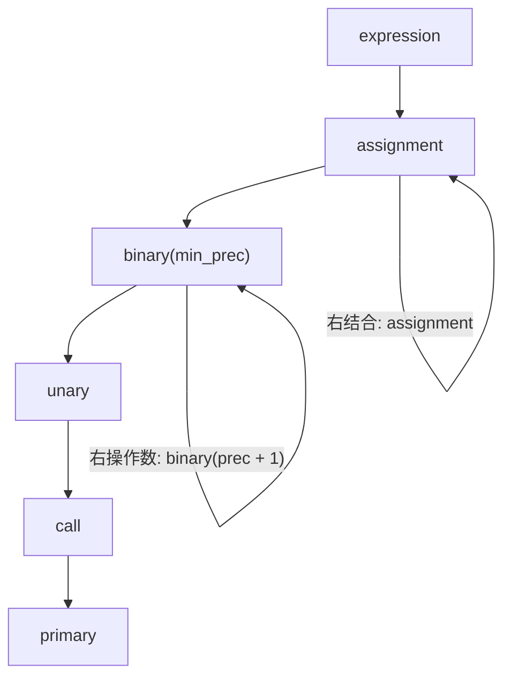

下面这个三行的文件里有两处错误：第一行 `let` 后面忘了变量名，第二行末尾忘了分号。大多数我用过的玩具解析器会在第一个错误处停下，让你改完再跑，再看到第二个。Pebble 的解析器一次报完两处，然后把第三行的 `let z = 3;` 完整地解析出来，一个字都不丢：

```pebble
let = ;
let y = 2
let z = 3;
```

```text
$ cargo run --quiet -p pebble-cli -- parse broken.pebble
error[E1001]: expected identifier, found `=`
 --> broken.pebble:1:5
  |
1 | let = ;
  |     ^
  |
  = note: `let` needs a name
error[E1001]: expected `;`, found `let`
 --> broken.pebble:3:1
  |
3 | let z = 3;
  | ^^^
  |
  = note: statements end with `;`
let z
  int 3
```

这篇的目标就是把上面这个输出做出来。我们要写完 `pebble-parser`（13 个测试），再搭出 `pebble` 命令行的第一个版本，它有 `tokens`、`parse`、`check` 三个子命令。顺路要学的 Rust 东西不少：`Result` 和 `?`、`panic!` 与 `unwrap` 的分寸、`todo!()`、`matches!`、`mem::discriminant`、一个叫 two-phase borrow 的借用细节、clap 的 derive、`anyhow`、文件模块和 `pub(crate)`、集成测试。

> [!NOTE] 本篇检查点
> 做完这一篇，你的 `~/pebble` 里会有 `pebble-parser`（完成，和 `tutorial-v1` 标签逐字节一致）、`pebble-cli` 的第一个版本（中间状态，后面几篇会逐步长成最终版）、以及 `examples/` 下的五个 `.pebble` 示例文件。检查命令是 `cargo test -p pebble-parser -p pebble-cli`。
>
> 上一篇是 [过程宏](/posts/rust-by-pebble-06-proc-macros/)：`pebble-ast` 已经用 `#[derive(Spanned)]` 写完了。这一篇的解析器就是 AST 的第一个真正的用户。

## 先把输入和输出钉死

解析器的函数签名很朴素：token 进去，`Program` 出来。但 Pebble 的前端有个设计原则叫 **报告所有，打印一个都不要**（第 3 篇的 `Diagnostic` 就是为它设计的）：每一层都不直接往终端写东西，而是把问题装进 `Vec<Diagnostic>` 交给上层，最后由命令行统一渲染。所以解析器的返回值是两样东西：

- 能恢复多少 AST 就给多少；
- 一份诊断列表。

我们已经有的零件，写解析器时会直接用到：

- `pebble_lexer::tokenize(source, text)` 返回 `(Vec<Token>, Vec<Diagnostic>)`，而且保证最后一个 token 是 `Eof`。
- `pebble_ast` 里的 `Program`、`Stmt`、`Expr`、`Ident`、三种运算符枚举，每个节点都带一个 `span`，并且 `#[derive(Spanned)]` 让 `.span()` 可用。
- `pebble_diag::Diagnostic`，有 `error(msg)`、`.with_code("E1001")`、`.with_span(span)`、`.with_note(text)` 这套 builder。

先建 crate。在 `~/pebble` 下：

```bash
cargo new --lib crates/pebble-parser
```

把 `crates/pebble-parser/Cargo.toml` 改成下面这样（四个内部依赖都是我们前几篇写的）：

```toml
[package]
name = "pebble-parser"
description = "Recursive-descent and Pratt parser producing the Pebble AST."
version.workspace = true
edition.workspace = true
rust-version.workspace = true
authors.workspace = true
license.workspace = true
repository.workspace = true

[dependencies]
pebble-span.workspace = true
pebble-diag.workspace = true
pebble-lexer.workspace = true
pebble-ast.workspace = true

[lints]
workspace = true
```

根目录的 `Cargo.toml` 还要做两处小改动。`[workspace.dependencies]` 的内部 crate 区加一行 `pebble-parser`，后面写命令行要用的两个外部库 `anyhow` 和 `clap` 也一并加进去（clap 的 `derive` 特性让我们能用属性宏描述命令行，下面会讲）：

```toml
pebble-parser = { path = "crates/pebble-parser", version = "0.1.0" }

anyhow = "1"
clap = { version = "4", features = ["derive", "wrap_help"] }
```

前一行放在 `pebble-macros` 那一行下面，后两行放在 `[workspace.dependencies]` 的 external 区域，和 `proc-macro2`、`quote`、`syn` 并列。

## `Result`：把失败放进返回值里

在写第一行解析器代码之前，我得先把 Rust 处理错误的方式讲清楚，因为这个解析器里几乎每个函数的返回类型都是 `Result<_, Diagnostic>`。

C 的老办法是返回码加输出参数：`int parse_let(Parser *p, Stmt *out)`，返回 0 表示成功。毛病大家都知道：返回码可以被忽略，而且出错时 `out` 里是什么没人保证。C++ 有两条路：异常（`throw`/`catch`，错误会无声地穿过中间所有的栈帧）和 C++23 的 `std::expected<T, E>`。Rust 选的是第二条，而且把它做成了语言的基础设施：

```rust
enum Result<T, E> {
    Ok(T),
    Err(E),
}
```

就是一个普通的泛型 `enum`（泛型第 5 篇讲过，这里只需要知道 `T` 和 `E` 是占位的类型）。函数返回 `Result<Stmt, Diagnostic>`，意思是 "要么给你一个 `Stmt`，要么给你一个 `Diagnostic`"。想用里面的 `Stmt`，你必须先 `match` 掉 `Err`（第 3 篇学过的穷尽匹配）。更狠的一点：`Result` 被标了 `#[must_use]`，忽略它编译器就警告。我在实验室里验证过（`~/rust-lab/src/bin/ch07_must_use.rs`）：

```rust
fn parse_digit(c: char) -> Result<u32, String> {
    c.to_digit(10).ok_or(format!("`{c}` is not a digit"))
}

fn main() {
    parse_digit('x');
    println!("done");
}
```

```text
$ cargo build --bin ch07_must_use
warning: unused `Result` that must be used
 --> src/bin/ch07_must_use.rs:6:5
  |
6 |     parse_digit('x');
  |     ^^^^^^^^^^^^^^^^
  |
  = note: this `Result` may be an `Err` variant, which should be handled
  = note: `#[warn(unused_must_use)]` (part of `#[warn(unused)]`) on by default
help: use `let _ = ...` to ignore the resulting value
  |
6 |     let _ = parse_digit('x');
  |     +++++++

warning: `rust-lab` (bin "ch07_must_use") generated 1 warning
    Finished `dev` profile [unoptimized + debuginfo] target(s) in 0.01s
```

这就是它比 C 的返回码强的地方：忽略错误需要你明确写出来（`let _ = ...`）。

### `?`：错误向上传，一个字符的事

纯用 `match` 处理每一个 `Result` 会把代码淹没在 `Err(e) => return Err(e)` 里。`?` 运算符就是这个模式的缩写：`Ok(v)` 就取出 `v` 继续，`Err(e)` 就立刻从当前函数 `return Err(e)`。实验室里把两种写法并排放（`~/rust-lab/src/bin/ch07_question.rs`（节选））：

```rust
fn with_question(a: &str, b: &str) -> Result<i64, ParseIntError> {
    let x = a.parse::<i64>()?;
    let y = b.parse::<i64>()?;
    Ok(x + y)
}
```

`by_hand` 版本把每个 `?` 展开成 `match { Ok(value) => value, Err(error) => return Err(error) }`，两个函数在好的和坏的输入上行为一致：

```text
$ cargo run --quiet --bin ch07_question
Ok(3)
Ok(3)
Err(ParseIntError { kind: InvalidDigit })
Err(ParseIntError { kind: InvalidDigit })
```

（`parse::<i64>()` 里的 `::<i64>` 叫 turbofish，告诉 `parse` 你要解析成什么类型，第 4 篇见过。）

严格地说 `?` 在 `Err` 分支上还会调用一次 `From::from(e)`，把错误转换成函数返回类型里声明的错误类型。我们这一篇里错误类型总是同一个，所以转换是恒等的；等到命令行那一节，`io::Error` 变成 `anyhow::Error` 就是靠它。

和 C++ 异常比，这里有一个本质区别：**`?` 是可见的**。你读一个函数，每一处可能失败的调用后面都有一个 `?`，每一条提前返回的路径都写在代码里。异常是你看不见的 `goto`。代价是你得老老实实写，没有 "反正上面会 catch" 这回事。我个人觉得解析器是这个设计最适合的场合：每一步都可能失败，而且每一次失败的处理（"记下来，然后恢复"）都是同一个动作。

## 搭骨架：游标和 `todo!()`

递归下降解析器的骨架其实就是一个游标（cursor）：一个 `Vec<Token>` 加一个当前位置，外加几个原语：看当前 token（`peek`）、看上一个（`previous`）、前进（`advance`）、判断类型（`check`）、有条件前进（`matches`）、强制要求（`expect`）。

先写 `crates/pebble-parser/src/lib.rs` 的开头：crate 属性和文档，导入，结果类型，以及入口函数 `parse`。

第 1 行是 crate 属性（和第 2 篇一样，禁止 `unsafe`）；第 2 到 13 行是一段 `//!` 的 crate 文档，说明这个解析器是递归下降加优先级爬升、错误都是值、出错会恢复。那段文字我不在文章里重复了（里面有两个我没改的破折号，要逐字节一致的话请从 `~/pebble-tag` 里原样复制；这是 tag 的本地克隆，没建的话命令在下面复制那一节），然后是导入：

```rust
#![forbid(unsafe_code)]
//! The Pebble parser: tokens in, [`Program`] out.
//! ... (lines 3 to 13: copy them from the reference)

use pebble_ast::{BinaryOp, Expr, Ident, LogicalOp, Program, Spanned as _, Stmt, UnaryOp};
use pebble_diag::Diagnostic;
use pebble_lexer::{Token, TokenKind, tokenize};
use pebble_span::{SourceId, Span};
```

`use pebble_ast::{... Spanned as _ ...}` 里的 `Spanned as _` 只把 trait 的方法带进作用域（后面要对 `Expr` 调用 `.span()`），不引入它的名字。现在先把这些导入都写上，编译时会有几条 "unused import" 的警告，等后面的函数写出来就消失了。

```rust
/// The result of parsing a source file.
#[derive(Debug)]
pub struct ParseResult {
    /// Whatever AST could be recovered.
    pub program: Program,
    /// Lex and parse diagnostics, in source order as best we can manage.
    pub diagnostics: Vec<Diagnostic>,
}

impl ParseResult {
    /// Whether parsing produced no diagnostics at all.
    #[must_use]
    pub fn is_ok(&self) -> bool {
        self.diagnostics.is_empty()
    }
}

/// Parses a whole source file. Never fails; inspect [`ParseResult::diagnostics`].
#[must_use]
pub fn parse(source: SourceId, src: &str) -> ParseResult {
    let (tokens, mut diagnostics) = tokenize(source, src);
    let mut parser = Parser::new(tokens);
    let program = parser.parse_program();
    diagnostics.append(&mut parser.errors);
    ParseResult {
        program,
        diagnostics,
    }
}
```

`ParseResult` 的字段是 `pub` 的：它是个纯粹装数据的结构体，没有什么要保护的不变量。`parse` 本身永远不会失败，签名里没有 `Result`：所有问题都装进 `diagnostics`。注意 `diagnostics.append(&mut parser.errors)`：`append` 把另一个 `Vec` 的内容整个搬过来并清空它，所以它要 `&mut`。词法错误在前，解析错误在后，用户看到的顺序就是这个。

接着是 `Parser` 本身。这里的 `'src` 就是第 4 篇的那个生命周期：token 借用着源码字符串，所以整个解析器不能比源码活得更久。

```rust
/// The recursive-descent parser state.
pub struct Parser<'src> {
    tokens: Vec<Token<'src>>,
    current: usize,
    errors: Vec<Diagnostic>,
}
```

放在 `parse` 函数下面，然后是 `impl` 块的开头：

```rust
impl<'src> Parser<'src> {
    /// Wraps a token stream.
    #[must_use]
    pub fn new(tokens: Vec<Token<'src>>) -> Self {
        Self {
            tokens,
            current: 0,
            errors: Vec::new(),
        }
    }
```

这个 `impl` 块还没有闭合，后面所有的方法都往里面加。游标原语如下，我分开讲：

```rust
    // --- token cursor -----------------------------------------------------

    fn peek(&self) -> &Token<'src> {
        // The lexer guarantees a trailing `Eof`, so indexing is always valid.
        &self.tokens[self.current.min(self.tokens.len() - 1)]
    }

    fn previous(&self) -> &Token<'src> {
        &self.tokens[self.current.saturating_sub(1)]
    }

    fn is_at_end(&self) -> bool {
        self.peek().kind == TokenKind::Eof
    }

    fn check(&self, kind: &TokenKind<'src>) -> bool {
        core::mem::discriminant(&self.peek().kind) == core::mem::discriminant(kind)
    }

    fn advance(&mut self) -> Token<'src> {
        let token = self.peek().clone();
        if !self.is_at_end() {
            self.current += 1;
        }
        token
    }
```

几个值得停一下的点：

- `peek` 返回 `&Token<'src>`，一个借用，不是拷贝。`self.current.min(self.tokens.len() - 1)` 的注释说 "词法分析器保证末尾有 `Eof`，所以下标永远有效"。这是一个**不变量**：如果有人给 `Parser::new` 传了空的 `Vec`，这行代码会 panic。这是 bug，不是用户输入错误，所以用 panic 而不是 `Result`；本章后面会再谈这个界线。
- `check` 比较的是 `mem::discriminant`，也就是 "这是 `TokenKind` 的哪个变体"，不看变体里的数据。为什么要这样？因为我们想问 "当前 token 是不是一个标识符"，却不关心它叫什么名字，而 `==` 会把 `Ident("total")` 和 `Ident("")` 判成不相等。实验室里验证（`~/rust-lab/src/bin/ch07_discriminant.rs`（节选））：

```rust
let wanted = Tok::Ident("");
let found = Tok::Ident("total");
println!("== : {}", wanted == found);
println!("discriminant ==: {}", discriminant(&wanted) == discriminant(&found));
```

```text
$ cargo run --quiet --bin ch07_discriminant
== : false
discriminant ==: true
different variant: false
Semi
```

  C 程序员可以把 `discriminant` 理解成 tagged union 的那个 tag 字段，只是 Rust 不让你直接摸它，要通过这个函数拿到一个只能比较相等的不透明值。所以后面你会看到 `self.expect(&TokenKind::Ident(""), ...)`：那个空字符串只是个占位，`check` 不看它。
- `advance` 返回 token 的**克隆**。这有点浪费（`Str` token 里有个 `Cow`，克隆时可能分配），但它让后面的代码简单很多：拿到手的 token 和游标没有借用关系，我们可以边用它边继续前进。我没有量过这笔开销在 Pebble 的规模上值不值得优化，我猜不值得。

```rust
    fn matches(&mut self, kind: &TokenKind<'src>) -> bool {
        if self.check(kind) {
            self.advance();
            true
        } else {
            false
        }
    }

    fn expect(&mut self, kind: &TokenKind<'src>, context: &str) -> Result<Token<'src>, Diagnostic> {
        if self.check(kind) {
            return Ok(self.advance());
        }
        let found = self.peek();
        Err(Diagnostic::error(format!(
            "expected {}, found {}",
            kind.describe(),
            found.kind
        ))
        .with_code("E1001")
        .with_span(found.span)
        .with_note(context.to_string()))
    }

    fn error<T>(&self, span: Span, message: impl Into<String>) -> Result<T, Diagnostic> {
        Err(Diagnostic::error(message)
            .with_code("E1001")
            .with_span(span))
    }
```

`expect` 是整个解析器里最重要的一个函数：它不只是 "检查并前进"，它还负责生成错误消息。`context` 参数是给人看的提示，比如 `` "`let` needs an initialiser" ``，它会变成诊断里的 `= note:` 一行。你会发现用户看到的所有 "帮助性" 文字，都来自调用 `expect` 时传的这个字符串。

最后一个，`error<T>`，值得单独说。它的返回类型是 `Result<T, Diagnostic>`，**函数体里却永远返回 `Err`**。`T` 是什么？调用的地方决定。`return self.error(expr.span(), "invalid assignment target")` 出现在返回 `Result<Expr, _>` 的函数里，`T` 就被推导成 `Expr`；出现在返回 `Result<Stmt, _>` 的函数里，`T` 就是 `Stmt`。这是泛型函数而且 `T` 只出现在返回位置：C++ 里你得写模板参数 `error<Expr>(...)`，因为 C++ 不会根据期望的返回类型反推模板参数；Rust 会。

然后是主循环 `parse_program`：只要没到文件末尾，就解析一个声明；成功就收集，失败就把诊断记下来，调用 `synchronize` 恢复，然后继续。

```rust
    // --- statements -------------------------------------------------------

    /// Parses statements until end of input, recovering from errors.
    pub fn parse_program(&mut self) -> Program {
        let mut stmts = Vec::new();
        while !self.is_at_end() {
            match self.declaration() {
                Ok(stmt) => stmts.push(stmt),
                Err(diagnostic) => {
                    self.errors.push(diagnostic);
                    self.synchronize();
                }
            }
        }
        Program::new(stmts)
    }
```

我们把 `synchronize` 一起写掉（它也是在 `impl` 里，放在最后），这样骨架才能编译：

```rust
    // --- helpers ----------------------------------------------------------

    /// Skips tokens until we are probably at the start of the next statement.
    fn synchronize(&mut self) {
        while !self.is_at_end() {
            if self.previous().kind == TokenKind::Semicolon {
                return;
            }
            match self.peek().kind {
                TokenKind::Fn
                | TokenKind::Let
                | TokenKind::If
                | TokenKind::While
                | TokenKind::For
                | TokenKind::Return
                | TokenKind::Break
                | TokenKind::Continue
                | TokenKind::RBrace => return,
                _ => {
                    self.advance();
                }
            }
        }
    }
}
```

`synchronize` 的作用本篇后面详细讲。现在先留着，往 `impl` 块里加上三个**占位函数**，让它能编译：

```rust
    fn declaration(&mut self) -> Result<Stmt, Diagnostic> {
        self.statement()
    }

    fn statement(&mut self) -> Result<Stmt, Diagnostic> {
        todo!("statements")
    }

    /// Parses a full expression, including assignment.
    pub fn expression(&mut self) -> Result<Expr, Diagnostic> {
        todo!("expressions")
    }
```

（要放在 `parse_program` 和 `// --- helpers` 之间，注意不要把 `synchronize` 那段挤到 `impl` 外面去。）

`todo!()` 是标准库的宏，作用是 "这里还没写，编译器别管，运行到了就 panic"。它能出现在任何需要某个类型的地方，因为它的类型是 `!`（永不返回），可以变成任何类型：这是 Rust 里 "表达式有类型" 的一个直接后果，`return`、`break`、`panic!` 也是 `!` 类型。C 里你大概会写 `assert(0 && "not implemented")`，它在发布构建里会消失，然后静悄悄地返回垃圾；`todo!()` 不会。

给骨架一个测试，看看它真的会 panic：

```rust
#[cfg(test)]
mod tests {
    use super::*;

    #[test]
    fn first_light() {
        let result = parse(SourceId(0), "1;");
        assert!(result.is_ok());
    }
}
```

```text
$ cargo test -p pebble-parser
...
running 1 test
test tests::first_light ... FAILED

failures:

---- tests::first_light stdout ----

thread 'tests::first_light' (61762) panicked at crates/pebble-parser/src/lib.rs:147:9:
not yet implemented: statements
note: run with `RUST_BACKTRACE=1` environment variable to display a backtrace


failures:
    tests::first_light

test result: FAILED. 0 passed; 1 failed; 0 ignored; 0 measured; 0 filtered out; finished in 0.00s

error: test failed, to rerun pass `-p pebble-parser --lib`
```

（`...` 是我删掉的编译警告，有 "未使用的导入" 和 "从未使用的方法"。）`panicked at` 之后是我们的 `todo!` 消息。进程的 panic 默认会展开（unwind）栈并让测试线程退出；`cargo test` 把它报告成一个失败的测试。如果是一个普通的可执行文件，panic 之后的退出码是 101，实验室里我们见过（下面命令行那一节会再见到）。

### panic、`unwrap`、`expect`：什么时候可以用

这里是个合适的地方说清楚界线，因为之后你会在代码里到处看到 `.unwrap()` 和 `.expect("...")`。

`Option::unwrap()`、`Result::unwrap()` 的意思是 "是 `Some`/`Ok` 就取出来，否则 panic"；`expect("理由")` 是同一个东西，只是 panic 消息里带着你写的理由。我的经验规则只有一条：

- **用户可以触发的失败，用 `Result`。** 文件不存在、源码里有语法错误、网络断开。这些都不是程序的 bug。
- **只有程序写错了才会发生的失败，才可以 panic。** 违反了自己的不变量，例如 "词法分析器保证最后一个 token 是 `Eof`"。
- 测试里 `unwrap`/`expect` 随便用：测试失败本来就应该大声喊出来。

下面是实验室里一个 "不该 unwrap" 的例子：13 行的命令行解析，用户给了一个不存在的文件，程序直接 panic：

```text
$ cargo run --quiet --bin ch07_args -- count nope.pebble; echo $?

thread 'main' (80062) panicked at src/bin/ch07_args.rs:11:45:
called `Result::unwrap()` on an `Err` value: Os { code: 2, kind: NotFound, message: "No such file or directory" }
note: run with `RUST_BACKTRACE=1` environment variable to display a backtrace
101
```

输出里的 `Os { code: 2, kind: NotFound, ... }` 是个 Debug 打印，用户看到的是栈上的一团结构，不是一句人话。这个问题我们到命令行那一节解决。

## 表达式：优先级爬升

先说算法，再看代码，因为这段代码很短，但初见时很难看出它为什么对。

问题是：`1 + 2 * 3` 必须分成 `1 + (2 * 3)`，`1 - 2 - 3` 必须分成 `(1 - 2) - 3`。教科书的办法是给每一级优先级写一个函数（`term`、`factor`、`comparison`……），一共七八层。Pebble 用的办法叫**优先级爬升**（precedence climbing）：只写一个 `binary(min_prec)` 函数，用一张表告诉它每个运算符有多 "紧"。Pratt 解析器是这一家的近亲，我猜如果你读过 Pratt 的论文，会发现它的主循环和下面这个几乎同形，只是 Pratt 把前缀和后缀运算符也放进了同一个循环，而 Pebble 把它们留给 `unary` 和 `call` 两个单独的函数，所以我更愿意老实叫它优先级爬升。

表是这样的，数字越大越紧：

|优先级|运算符|
|---|---|
|1|`or`|
|2|`and`|
|3|`==` `!=`|
|4|`<` `<=` `>` `>=`|
|5|`+` `-`|
|6|`*` `/` `%`|

整个解析器处理表达式的调用层次，从外到内：



`binary(min_prec)` 的逻辑是：先读一个操作数 `left`；然后只要下一个 token 是中缀运算符并且它的优先级 `>= min_prec`，就吃掉它，递归读右边（右边只允许 `prec + 1` 或更高的运算符），把两边拼成一个节点作为新的 `left`，继续循环。

手工跑一下 `1 + 2 * 3`：

1. `binary(0)`：`left = 1`；看到 `+`（5），`5 >= 0`，吃掉；右边 `binary(6)`：
2. `binary(6)`：`left = 2`；看到 `*`（6），`6 >= 6`，吃掉；右边 `binary(7)` 读到 `3`，没有更多运算符，返回 `3`；`left = 2 * 3`，返回。
3. 回到第 1 步：`left = 1 + (2 * 3)`。

再跑 `1 - 2 - 3`：`binary(0)` 里 `left = 1`，吃掉第一个 `-`（5），右边 `binary(6)`：读到 `2`，看到第二个 `-`（5），`5 < 6`，**不吃**，返回 `2`。所以 `left = (1 - 2)`，循环回头，吃掉第二个 `-`，得到 `((1 - 2) - 3)`。左结合的秘密就是那个 `prec + 1`：右边只允许更紧的运算符，同级的留给外层循环。

我不想只讲不证。把 `prec + 1` 改成 `prec`，跑 `subtraction_is_left_associative` 测试：

```text
$ cargo test -p pebble-parser subtraction
...
running 1 test
test tests::subtraction_is_left_associative ... FAILED

failures:

---- tests::subtraction_is_left_associative stdout ----

thread 'tests::subtraction_is_left_associative' (73307) panicked at crates/pebble-parser/src/lib.rs:656:9:
assertion `left == right` failed
  left: "expr\n  binary -\n    int 1\n    binary -\n      int 2\n      int 3\n"
 right: "expr\n  binary -\n    binary -\n      int 1\n      int 2\n    int 3\n"
note: run with `RUST_BACKTRACE=1` environment variable to display a backtrace


failures:
    tests::subtraction_is_left_associative

test result: FAILED. 0 passed; 1 failed; 0 ignored; 0 measured; 12 filtered out; finished in 0.00s

error: test failed, to rerun pass `-p pebble-parser --lib`
```

`left` 是 `1 - (2 - 3)`：右结合了。改一个字符，一个测试精准地告诉你错在哪里。

### 写代码

先是内部用的小枚举 `Infix`。AST 把 "算术/比较" 和 "逻辑" 分成了 `Binary` 和 `Logical` 两个节点（因为 `and`/`or` 要短路，求值器处理它们的方式不一样），而 `binary` 函数想用同一个循环处理两种，所以需要一个标记告诉它这次读到的是哪一种。放在 `pub struct Parser` 之前：

```rust
/// Internal marker for the operators handled by the expression ladder.
#[derive(Copy, Clone)]
enum Infix {
    Arithmetic(BinaryOp),
    Logic(LogicalOp),
}
```

这个枚举是私有的，也不需要对外导出。`#[derive(Copy, Clone)]`：每个变体里装的 `BinaryOp`/`LogicalOp` 本身就是 `Copy`（第 5 篇的 AST 里就派生好了），所以这个标记也可以被按位复制。

接着是 `infix_op`：把 token 类型映射成 `(优先级, 含义)`，不是中缀运算符就返回 `None`。放在 `impl` 块之后，作为独立函数：

```rust
/// Infix operators mapped to `(precedence, meaning)`. Higher binds tighter.
fn infix_op(kind: &TokenKind<'_>) -> Option<(u8, Infix)> {
    Some(match kind {
        TokenKind::Or => (1, Infix::Logic(LogicalOp::Or)),
        TokenKind::And => (2, Infix::Logic(LogicalOp::And)),
        TokenKind::Eq => (3, Infix::Arithmetic(BinaryOp::Eq)),
        TokenKind::NotEq => (3, Infix::Arithmetic(BinaryOp::NotEq)),
        TokenKind::Lt => (4, Infix::Arithmetic(BinaryOp::Lt)),
        TokenKind::LtEq => (4, Infix::Arithmetic(BinaryOp::LtEq)),
        TokenKind::Gt => (4, Infix::Arithmetic(BinaryOp::Gt)),
        TokenKind::GtEq => (4, Infix::Arithmetic(BinaryOp::GtEq)),
        TokenKind::Plus => (5, Infix::Arithmetic(BinaryOp::Add)),
        TokenKind::Minus => (5, Infix::Arithmetic(BinaryOp::Sub)),
        TokenKind::Star => (6, Infix::Arithmetic(BinaryOp::Mul)),
        TokenKind::Slash => (6, Infix::Arithmetic(BinaryOp::Div)),
        TokenKind::Percent => (6, Infix::Arithmetic(BinaryOp::Rem)),
        _ => return None,
    })
}
```

整个函数体是一个 `Some(match kind { ... })`。最后一个分支 `_ => return None` 里的 `return` 本身是表达式，类型是 `!`，可以塞进 `match` 的任何一个分支里，不影响其他分支的类型是 `(u8, Infix)`。你可以想一下 C 里做同样的事要写什么：一个 `switch` 加一堆 `*out_prec = ...; return true;`。

`binary` 本身：

```rust
    /// Precedence climbing over the infix operators.
    ///
    /// `min_prec` is the level we are allowed to consume; higher binds tighter.
    fn binary(&mut self, min_prec: u8) -> Result<Expr, Diagnostic> {
        let mut left = self.unary()?;
        while let Some((prec, infix)) = infix_op(&self.peek().kind) {
            if prec < min_prec {
                break;
            }
            self.advance();
            // Left-associative: recurse one level higher.
            let right = self.binary(prec + 1)?;
            let span = left.span().merge(right.span());
            left = match infix {
                Infix::Arithmetic(op) => Expr::Binary {
                    op,
                    lhs: Box::new(left),
                    rhs: Box::new(right),
                    span,
                },
                Infix::Logic(op) => Expr::Logical {
                    op,
                    lhs: Box::new(left),
                    rhs: Box::new(right),
                    span,
                },
            };
        }
        Ok(left)
    }
```

有三件事值得慢一点看。

**第一，`while let Some((prec, infix)) = infix_op(&self.peek().kind)`。** 这里把一个借用交给了 `infix_op`（`&self.peek().kind` 借用了 `self`），但是 `infix_op` 返回的 `(u8, Infix)` 里没有任何引用，所以借用在这条语句结束时就终止了。因此循环体里可以放心地调用 `self.advance()`（需要 `&mut self`）。如果 `infix_op` 返回的是一个指向 token 内部的引用，这段代码就过不了借用检查。借用在这条语句结束时就终止，是因为返回值里没有引用。

**第二，`left = match infix { ... Box::new(left) ... }`。** 在赋值语句的右边，我们把 `left` **移动**进了 `Box`，然后马上把新节点赋值回 `left`。移动之后的 `left` 是未初始化状态，但赋值给它就重新初始化了，编译器看得懂这件事。C++ 里同样的逻辑你会写 `left = std::make_unique<Binary>(std::move(left), std::move(right))`，Rust 里没有 `std::move` 这个动词，因为移动是默认行为。我在实验室里用一个玩具枚举验证过这个模式：

`~/rust-lab/src/bin/ch07_move_reassign.rs`（开头那行 `#![allow(dead_code)]` 只是为了压掉 "字段从未被读取" 的警告）：

```rust
#![allow(dead_code)]
#[derive(Debug)]
enum E {
    Int(i64),
    Add(Box<E>, Box<E>),
}

fn main() {
    let mut left = E::Int(1);
    for n in 2..=4 {
        let right = E::Int(n);
        // `left` moves into the Box, then the assignment gives it a new value.
        left = E::Add(Box::new(left), Box::new(right));
    }
    println!("{left:?}");
}
```

```text
$ cargo run --quiet --bin ch07_move_reassign
Add(Add(Add(Int(1), Int(2)), Int(3)), Int(4))
```

而如果你把节点存到一个新变量里，却还想用旧的 `left`，编译器就不答应了（第 2 篇的 E0382）：

`~/rust-lab/src/bin/ch07_move_fail.rs`：

```rust
#![allow(dead_code)]
#[derive(Debug)]
enum E {
    Int(i64),
    Add(Box<E>, Box<E>),
}

fn main() {
    let left = E::Int(1);
    let right = E::Int(2);
    let sum = E::Add(Box::new(left), Box::new(right));
    println!("{sum:?} from {left:?}");
}
```

```text
$ cargo build --bin ch07_move_fail
   Compiling rust-lab v0.1.0 (/tmp/rust-lab)
error[E0382]: borrow of moved value: `left`
  --> src/bin/ch07_move_fail.rs:12:29
   |
 9 |     let left = E::Int(1);
   |         ---- move occurs because `left` has type `E`, which does not implement the `Copy` trait
10 |     let right = E::Int(2);
11 |     let sum = E::Add(Box::new(left), Box::new(right));
   |                               ---- value moved here
12 |     println!("{sum:?} from {left:?}");
   |                             ^^^^ value borrowed here after move
   |
note: if `E` implemented `Clone`, you could clone the value
  --> src/bin/ch07_move_fail.rs:3:1
   |
 3 | enum E {
   | ^^^^^^ consider implementing `Clone` for this type
...
11 |     let sum = E::Add(Box::new(left), Box::new(right));
   |                               ---- you could clone this value

For more information about this error, try `rustc --explain E0382`.
error: could not compile `rust-lab` (bin "ch07_move_fail") due to 1 previous error
```

**第三，`Box::new(left)` 是第 5 篇的内容：** 递归的枚举必须在堆上存放子节点。

下面几个函数是表达式的下层：`unary`（前缀 `-` 和 `not`，右递归）、`call`（函数调用和下标，`loop` 里不停吃 `(...)` 和 `[...]`，所以 `f(1)(2)[0]` 都能解析）、`primary`（字面量、变量、括号、列表、map、匿名函数）。

```rust
    fn unary(&mut self) -> Result<Expr, Diagnostic> {
        if self.matches(&TokenKind::Minus) {
            let start = self.previous().span;
            let operand = self.unary()?;
            let span = start.merge(operand.span());
            return Ok(Expr::Unary {
                op: UnaryOp::Neg,
                operand: Box::new(operand),
                span,
            });
        }
        if self.matches(&TokenKind::Not) {
            let start = self.previous().span;
            let operand = self.unary()?;
            let span = start.merge(operand.span());
            return Ok(Expr::Unary {
                op: UnaryOp::Not,
                operand: Box::new(operand),
                span,
            });
        }
        self.call()
    }

    fn call(&mut self) -> Result<Expr, Diagnostic> {
        let mut expr = self.primary()?;
        loop {
            if self.matches(&TokenKind::LParen) {
                let mut args = Vec::new();
                if !self.check(&TokenKind::RParen) {
                    loop {
                        args.push(self.expression()?);
                        if !self.matches(&TokenKind::Comma) {
                            break;
                        }
                    }
                }
                let end = self
                    .expect(&TokenKind::RParen, "unclosed argument list")?
                    .span;
                let span = expr.span().merge(end);
                expr = Expr::Call {
                    callee: Box::new(expr),
                    args,
                    span,
                };
            } else if self.matches(&TokenKind::LBracket) {
                let index = self.expression()?;
                let end = self.expect(&TokenKind::RBracket, "unclosed index")?.span;
                let span = expr.span().merge(end);
                expr = Expr::Index {
                    object: Box::new(expr),
                    index: Box::new(index),
                    span,
                };
            } else {
                break;
            }
        }
        Ok(expr)
    }
```

`call` 里 `expr = Expr::Call { callee: Box::new(expr), ... }` 是同一个 "移动再赋值" 的模式。

`primary` 稍微特别一点：

```rust
    fn primary(&mut self) -> Result<Expr, Diagnostic> {
        let token = self.advance();
        let span = token.span;
        match token.kind {
            TokenKind::Nil => Ok(Expr::Nil { span }),
            TokenKind::True => Ok(Expr::Bool { value: true, span }),
            TokenKind::False => Ok(Expr::Bool { value: false, span }),
            TokenKind::Int(value) => Ok(Expr::Int { value, span }),
            TokenKind::Float(value) => Ok(Expr::Float { value, span }),
            TokenKind::Str(value) => Ok(Expr::Str {
                value: value.into_owned(),
                span,
            }),
            TokenKind::Ident(name) => Ok(Expr::Var {
                name: Ident::new(name, span),
                span,
            }),
            TokenKind::LParen => {
                let expr = self.expression()?;
                self.expect(&TokenKind::RParen, "unclosed `(`")?;
                Ok(expr)
            }
            TokenKind::LBracket | TokenKind::HashBrace | TokenKind::Fn => {
                todo!("list, map and closure literals")
            }
            other => self.error(span, format!("expected an expression, found {other}")),
        }
    }
```

（中间三行是临时占位，下一节会换成真的。）它做了一件很 Rust 的事：`let token = self.advance(); ... match token.kind { ... }`，`match` 的分支里直接**把 `token.kind` 拆开**：`TokenKind::Int(value) => Ok(Expr::Int { value, span })` 里的 `value` 是从 token 里移出来的 `i64`；`TokenKind::Str(value)` 里的 `value` 是 `Cow<str>`，`.into_owned()` 把它变成拥有所有权的 `String`，因为 AST 里的字符串必须能活得比源码久。最后的 `other => ...` 分支把剩下的所有 token 绑定到 `other` 上，用它的 `Display` 生成 "expected an expression, found ..." 的消息。

再看 `Expr::Var { name: Ident::new(name, span), span }`：`name` 是借用源码的 `&'src str`，`Ident::new(impl Into<String>, ..)` 把它变成拥有的 `String`。AST 不再借用源码，这是 token 和 AST 之间的分界线。

然后是 `expression` 与赋值。赋值是**右结合**的（`a = b = 3` 是 `a = (b = 3)`），而且它的目标必须是变量或下标，不能是 `1 = 2`：

```rust
    // --- expressions ------------------------------------------------------

    /// Parses a full expression, including assignment.
    pub fn expression(&mut self) -> Result<Expr, Diagnostic> {
        self.assignment()
    }

    fn assignment(&mut self) -> Result<Expr, Diagnostic> {
        let expr = self.binary(0)?;
        if self.matches(&TokenKind::Assign) {
            let value = self.assignment()?; // right-associative
            if !is_assignable(&expr) {
                return self.error(expr.span(), "invalid assignment target");
            }
            let span = expr.span().merge(value.span());
            return Ok(Expr::Assign {
                target: Box::new(expr),
                value: Box::new(value),
                span,
            });
        }
        Ok(expr)
    }
```

递归调用 `self.assignment()`（不是 `binary`）读右边，这就是右结合。`!is_assignable(&expr)` 先把右边解析完再检查左边：这是个小取舍，让错误位置落在左边的 `expr.span()` 上，而且右边的语法错误会优先被报告。`is_assignable` 在文件的末尾：

```rust
fn is_assignable(expr: &Expr) -> bool {
    matches!(expr, Expr::Var { .. } | Expr::Index { .. })
}
```

`matches!(expr, Pattern)` 是标准库的宏，展开成 `match expr { Pattern => true, _ => false }`。`Expr::Var { .. }` 里的 `..` 的意思是 "我不关心其他字段"。

先让它能编译。我们还缺一个语句：表达式语句，求值后丢掉结果，必须以分号结束：

```rust
    fn expression_statement(&mut self) -> Result<Stmt, Diagnostic> {
        let expr = self.expression()?;
        let span = expr.span();
        let end = self
            .expect(
                &TokenKind::Semicolon,
                "expression statements are terminated with `;`",
            )?
            .span;
        Ok(Stmt::Expr {
            expr,
            span: span.merge(end),
        })
    }
```

把占位的 `statement` 改成只调用它（`self.expression_statement()`），删掉占位的 `expression`（上面已经有真的了）。把 `tests` 模块整个换成下面这份（`first_light` 已完成使命，删掉），先写四个测试：优先级、括号、减法左结合，加上 `rejects_assignment_to_literal`。测试里的 `parse_ok` 是一个小助手：解析一段源码，断言没有诊断，把 `Program` 还给调用者。

```rust
#[cfg(test)]
mod tests {
    use super::*;
    use pebble_ast::pretty;

    fn parse_ok(src: &str) -> Program {
        let result = parse(SourceId(0), src);
        assert!(
            result.is_ok(),
            "expected clean parse, got {:?}",
            result.diagnostics
        );
        result.program
    }

    #[test]
    fn parses_precedence_correctly() {
        // 1 + 2 * 3 must group as 1 + (2 * 3).
        let program = parse_ok("1 + 2 * 3;");
        let rendered = pretty(&program);
        assert_eq!(
            rendered,
            "expr\n  binary +\n    int 1\n    binary *\n      int 2\n      int 3\n"
        );
    }

    #[test]
    fn parentheses_override_precedence() {
        let program = parse_ok("(1 + 2) * 3;");
        let rendered = pretty(&program);
        assert!(
            rendered.starts_with("expr\n  binary *\n    binary +\n"),
            "{rendered}"
        );
    }

    #[test]
    fn subtraction_is_left_associative() {
        // 1 - 2 - 3 == (1 - 2) - 3
        let program = parse_ok("1 - 2 - 3;");
        let rendered = pretty(&program);
        assert_eq!(
            rendered,
            "expr\n  binary -\n    binary -\n      int 1\n      int 2\n    int 3\n"
        );
    }

    #[test]
    fn rejects_assignment_to_literal() {
        let result = parse(SourceId(0), "1 = 2;");
        assert!(!result.is_ok());
        assert!(
            result
                .diagnostics
                .iter()
                .any(|d| d.message.contains("invalid assignment"))
        );
    }
}
```

```text
$ cargo test -p pebble-parser
...
running 4 tests
test tests::parentheses_override_precedence ... ok
test tests::subtraction_is_left_associative ... ok
test tests::parses_precedence_correctly ... ok
test tests::rejects_assignment_to_literal ... ok

test result: ok. 4 passed; 0 failed; 0 ignored; 0 measured; 0 filtered out; finished in 0.00s
```

四个测试通过。到这里我们手里是一个能解析 `1 + 2 * 3;` 但还不认识 `let`、`if` 的解析器。

## 语句，以及 "错了也要继续"

语句部分的函数大多是一个模板：读关键字，`expect` 一个又一个部分，`?` 把任何失败向上抛，最后把各部分的 span 合并成一个。`let_declaration` 是最清晰的例子：

```rust
    fn let_declaration(&mut self) -> Result<Stmt, Diagnostic> {
        let start = self.advance().span; // `let`
        let name_token = self.expect(&TokenKind::Ident(""), "`let` needs a name")?;
        let name = self.ident_from(&name_token)?;
        self.expect(
            &TokenKind::Assign,
            "`let` needs an initialiser: `let x = ...;`",
        )?;
        let value = self.expression()?;
        let end = self
            .expect(&TokenKind::Semicolon, "statements end with `;`")?
            .span;
        Ok(Stmt::Let {
            name,
            value,
            span: start.merge(end),
        })
    }
```

一个 `let` 语句有四处可能失败，每一处后面都有一个 `?`；每个 `expect` 的第二个参数是将来出现在错误报告里的提示。最后 `start.merge(end)` 把 `let` 到 `;` 的整段范围合成一个 span，这个 `merge` 是第 1 篇写的。

`declaration` 决定一个声明是函数、变量还是普通语句：

```rust
    fn declaration(&mut self) -> Result<Stmt, Diagnostic> {
        if self.check(&TokenKind::Fn) {
            self.fn_declaration()
        } else if self.check(&TokenKind::Let) {
            self.let_declaration()
        } else {
            self.statement()
        }
    }
```

`statement` 在 `if`、`while`、`for`、`return`、`break`、`continue` 之间选择，不是则落回表达式语句：

```rust
    fn statement(&mut self) -> Result<Stmt, Diagnostic> {
        if self.matches(&TokenKind::If) {
            self.if_statement(self.previous().span)
        } else if self.matches(&TokenKind::While) {
            self.while_statement(self.previous().span)
        } else if self.matches(&TokenKind::For) {
            self.for_statement(self.previous().span)
        } else if self.matches(&TokenKind::Return) {
            self.return_statement(self.previous().span)
        } else if self.matches(&TokenKind::Break) {
            let start = self.previous().span;
            let end = self.expect(&TokenKind::Semicolon, "`break;`")?.span;
            Ok(Stmt::Break {
                span: start.merge(end),
            })
        } else if self.matches(&TokenKind::Continue) {
            let start = self.previous().span;
            let end = self.expect(&TokenKind::Semicolon, "`continue;`")?.span;
            Ok(Stmt::Continue {
                span: start.merge(end),
            })
        } else {
            self.expression_statement()
        }
    }
```

### 一个让我停了一下的借用

看 `self.if_statement(self.previous().span)`。直觉上这是一个借用冲突：`if_statement` 需要 `&mut self`，而参数 `self.previous()` 要 `&self`。Rust 的借用规则不是说同一时刻要么一个 `&mut` 要么多个 `&` 吗？

这行代码能编译，原因叫 **two-phase borrow**（两阶段借用）。方法调用 `receiver.method(args)` 里的 `&mut` 自动借用不是一上来就生效，而是分两步：先 "预订"（reservation，这时候还可以读），等所有参数都求值完毕，调用真正发生的那一刻才 "激活"。参数里读 `self.previous().span` 发生在预订阶段，读完时拿到的是一个 `Span`（它是 `Copy`，所以借用在这个表达式结束时就结束了），然后才激活可变借用。在实验室里把这个现象完整地跑一遍：

`~/rust-lab/src/bin/ch07_two_phase.rs`：

```rust
struct Parser {
    tokens: Vec<u32>,
    current: usize,
}

impl Parser {
    fn previous(&self) -> u32 {
        self.tokens[self.current.saturating_sub(1)]
    }

    fn if_statement(&mut self, start: u32) -> u32 {
        self.current += 1;
        start + self.previous()
    }
}

fn main() {
    // `v.push(v.len())`: the receiver is borrowed mutably, the argument reads `v`.
    let mut v = vec![1, 2, 3];
    v.push(v.len());
    println!("{v:?}");

    let mut parser = Parser { tokens: vec![10, 20, 30], current: 1 };
    let r = parser.if_statement(parser.previous());
    println!("{r}");
}
```

```text
$ cargo run --quiet --bin ch07_two_phase
[1, 2, 3, 3]
30
```

`v.push(v.len())` 是教科书例子：C++ 程序员写了二十年，在 Rust 里原本该是错的。它能编译。但是这个宽限只给**自动借用的方法接收者**。如果你把方法调用手写成函数调用，两阶段就没有了：

`~/rust-lab/src/bin/ch07_two_phase_fail.rs`：

```rust
fn main() {
    let mut v = vec![1, 2, 3];
    Vec::push(&mut v, v.len());
    println!("{v:?}");
}
```

```text
$ cargo build --bin ch07_two_phase_fail
   Compiling rust-lab v0.1.0 (/tmp/rust-lab)
error[E0502]: cannot borrow `v` as immutable because it is also borrowed as mutable
 --> src/bin/ch07_two_phase_fail.rs:3:23
  |
3 |     Vec::push(&mut v, v.len());
  |     --------- ------  ^ immutable borrow occurs here
  |     |         |
  |     |         mutable borrow occurs here
  |     mutable borrow later used by call

For more information about this error, try `rustc --explain E0502`.
error: could not compile `rust-lab` (bin "ch07_two_phase_fail") due to 1 previous error
```

同样的两个操作，换一种写法就是错的。这个例外是为了让最常见的写法（`v.push(v.len())`）不需要先绑一个临时变量；我对它的理解是 "编译器对自己的一个宽容让步"，不是语言底层的什么新规则。（顺带，C++ 里 `f(a.g(), a.h())` 的参数求值顺序是未指定的；Rust 保证从左到右。）

### `let end;`：延迟初始化

`if_statement` 里有一个 C 程序员没见过的写法：

```rust
    fn if_statement(&mut self, start: Span) -> Result<Stmt, Diagnostic> {
        let cond = self.expression()?;
        let then_branch = self.block()?;
        let mut else_branch = Vec::new();
        let end;
        if self.matches(&TokenKind::Else) {
            if self.matches(&TokenKind::If) {
                // `else if` desugars into a one-statement else block.
                let nested = self.if_statement(self.previous().span)?;
                end = nested.span();
                else_branch.push(nested);
            } else {
                let block = self.block()?;
                end = self.previous().span;
                else_branch = block;
            }
        } else {
            end = self.previous().span;
        }
        Ok(Stmt::If {
            cond,
            then_branch,
            else_branch,
            span: start.merge(end),
        })
    }
```

注意 `let end;` 没有初始值，类型从后面的赋值推出来（`Span`）。每一条控制路径最终都必须给 `end` 赋值恰好一次，编译器检查这一点。C 里同样的写法是未初始化变量，漏掉一条分支你只会得到一个垃圾值或者一个 `-Wmaybe-uninitialized` 的警告；Rust 里是一个硬错误。实验室验证：

`~/rust-lab/src/bin/ch07_deferred_fail.rs`：

```rust
fn main() {
    let args = std::env::args().count();
    let label;
    if args > 1 {
        label = "with arguments";
    }
    println!("{label}");
}
```

```text
$ cargo build --bin ch07_deferred_fail
   Compiling rust-lab v0.1.0 (/tmp/rust-lab)
error[E0381]: used binding `label` is possibly-uninitialized
 --> src/bin/ch07_deferred_fail.rs:7:16
  |
3 |     let label;
  |         ----- binding declared here but left uninitialized
4 |     if args > 1 {
  |        -------- if this `if` condition is `false`, `label` is not initialized
5 |         label = "with arguments";
6 |     }
  |      - an `else` arm might be missing here, initializing `label`
7 |     println!("{label}");
  |                ^^^^^ `label` used here but it is possibly-uninitialized

For more information about this error, try `rustc --explain E0381`.
error: could not compile `rust-lab` (bin "ch07_deferred_fail") due to 1 previous error
```

（给 `else` 补上赋值，`ch07_deferred_ok` 就能通过，我也跑过：它打印 `no arguments`。）

`else if` 在这里被**脱糖**（desugar）成一个只有一条语句的 else 块：`else_branch.push(nested)`。AST 里因此不需要 `ElseIf` 这种节点，求值器和编译器都不用特殊处理它。

`block` 解析 `{ ... }`，内部的每个语句也走和 `parse_program` 一样的 "出错就记录并恢复"：

```rust
    fn block(&mut self) -> Result<Vec<Stmt>, Diagnostic> {
        self.expect(&TokenKind::LBrace, "expected a `{`-delimited block")?;
        let mut stmts = Vec::new();
        while !self.check(&TokenKind::RBrace) && !self.is_at_end() {
            match self.declaration() {
                Ok(stmt) => stmts.push(stmt),
                Err(diagnostic) => {
                    self.errors.push(diagnostic);
                    self.synchronize();
                }
            }
        }
        self.expect(&TokenKind::RBrace, "this `{` is never closed")?;
        Ok(stmts)
    }
```

最后一行的提示 ``this `{` is never closed`` 是我很喜欢的一个错误信息。用户忘了 `}` 时，解析器一路读到文件末尾才发现，所以主错误指向文件末尾，而 `context` 参数把真正的原因写进了 note。用一个两行的文件试一下（第一行 `fn f() {`，第二行 `    print(1);`，以换行结尾；命令行在本篇后半才写好，现在先看输出，写完之后可以回来复现）：

```text
$ cargo run --quiet -p pebble-cli -- check unclosed.pebble; echo $?
error[E1001]: expected `}`, found end of file
 --> unclosed.pebble:3:1
  |
3 | 
  | ^
  |
  = note: this `{` is never closed
1
```

### 恢复：`synchronize`

现在回到那个开头的三行文件，看看恢复机制到底做了什么。核心是 `parse_program` 的循环：

```rust
    pub fn parse_program(&mut self) -> Program {
        let mut stmts = Vec::new();
        while !self.is_at_end() {
            match self.declaration() {
                Ok(stmt) => stmts.push(stmt),
                Err(diagnostic) => {
                    self.errors.push(diagnostic);
                    self.synchronize();
                }
            }
        }
        Program::new(stmts)
    }
```

当 `declaration()` 返回 `Err`，我们把诊断存下来，然后调用 `synchronize` 往前跳，跳到 "下一个看起来像语句开头的地方"。这种策略叫**恐慌模式恢复**（panic-mode recovery）：这里的 "panic" 是编译原理里的老术语，和 Rust 的 `panic!` 没有关系，别搞混。`synchronize` 的规则：

1. 如果上一个 token 是 `;`，说明上一个语句刚结束，停。
2. 如果当前 token 是 `fn`/`let`/`if`/`while`/`for`/`return`/`break`/`continue`/`}` 之一，说明新语句开始了（或者块结束了），停。
3. 否则吞掉一个 token，继续。

用这三条规则跑那个三行文件：

1. `let = ;`：`let_declaration` 吃掉 `let`，`expect(Ident)` 看到的是 `=`，失败。诊断 1 入库。`synchronize`：上一个 token 是 `let`，当前是 `=`，都不满足停止条件，吞掉 `=`；现在上一个是 `=`，当前是 `;`，再吞掉；上一个是 `;`，停。
2. `let y = 2`：解析到表达式 `2` 之后 `expect(Semicolon)`，看到的是下一行的 `let`，失败，诊断 2。`synchronize`：上一个 token 是 `2`，当前是 `let`，满足规则 2，立刻停止（什么也没吞）。
3. `let z = 3;`：干净地解析出来。

所以输出是两条诊断，加上一个 `let z`。`let y = 2` 这一句因为失败而整个被丢掉了，这是代价：恢复的目标是**继续找到后面的错误**，不是修好前面的。顺便注意第二条诊断指向的是第 3 行的 `let`（缺的分号本来应该在第 2 行末尾），这是 "在看到意外的 token 时报错" 这种策略的固有缺点，Pebble 没有去修它。

### 把剩下的复制进来

到这里，我们写过的函数已经覆盖了这个解析器里每一种技巧。剩下的函数只是同一个模板的重复，没有新的 Rust 知识，所以我们**复制**它们。打开 `https://github.com/bfmhno3/pebble/blob/tutorial-v1/crates/pebble-parser/src/lib.rs`（或者你本地的 `~/pebble-tag`，没建的话 `git clone --branch tutorial-v1 https://github.com/bfmhno3/pebble ~/pebble-tag`），把下面这些项复制到你的文件里，位置和 `tutorial-v1` 里一样：

- `parse_expression`（紧跟在 `parse` 之后）：给以后的 REPL 用的入口，只解析一个表达式。
- `Parser::errors`（`new` 之后）：对外暴露已收集的诊断。
- `fn_declaration`（`declaration` 之后），`while_statement`、`for_statement`、`return_statement`（`if_statement` 之后）：和 `let_declaration` 同一个模板。
- `parameter_list`（`block` 之后）、`list_literal`、`map_literal`（`primary` 之后）：处理 `(a, b)`、`[1, 2,]`、`#{ k: v }`，都带尾逗号处理。
- `ident_from`（`// --- helpers` 注释之后、`synchronize` 之前）：把一个 `Ident` token 变成 AST 的 `Ident`。

然后把 `primary` 里那个三行的 `todo!` 分支换成真的：

```rust
            TokenKind::LBracket => self.list_literal(span),
            TokenKind::HashBrace => self.map_literal(span),
            TokenKind::Fn => {
                let params = self.parameter_list()?;
                let body = self.block()?;
                let span = span.merge(self.previous().span);
                Ok(Expr::Fn { params, body, span })
            }
```

把占位的 `declaration` 和 `statement` 换成上面写的完整版本（`declaration` 里引用了刚复制进来的 `fn_declaration`）。函数在文件里的先后顺序以参考克隆为准，最后的 `diff` 会告诉你哪里还不一样。最后把测试模块整个换成 `tutorial-v1` 里的那一份（一共 13 个测试：前面写过的 4 个，下面贴出来的 2 个，另外 7 个照抄，它们大多是同一类断言：解析一小段源码，检查 `pretty` 打印出来的树）。下面这两个是我觉得值得读一读的：

```rust
    #[test]
    fn recovers_and_reports_multiple_errors() {
        let result = parse(SourceId(0), "let = ;\nlet y = 2\nlet z = 3;");
        assert!(result.diagnostics.len() >= 2, "{:?}", result.diagnostics);
        // Recovery still yields the later, valid statement.
        assert!(result.program.stmts.iter().any(|s| matches!(
            s,
            Stmt::Let { name, .. } if name.name == "z"
        )));
    }

    #[test]
    fn reports_missing_semicolon_with_a_span() {
        let result = parse(SourceId(0), "let x = 1");
        assert_eq!(result.diagnostics.len(), 1);
        assert_eq!(result.diagnostics[0].code.as_deref(), Some("E1001"));
    }
```

第一个测试验证了恢复：错误不止一个，而且后面的 `let z` 还在。第二个验证了错误码和位置信息真的被带出来了。还有一个叫 `skips_empty_statements_never_panics_on_garbage` 的测试，把一堆乱七八糟的输入（`")))"`、`"{{{"`、`"a["`……）扔给解析器，只要求不 panic：解析用户输入的函数不应该有 panic 路径，这个测试就是这条规则的一个小小守卫。

```text
...
    Finished `test` profile [unoptimized + debuginfo] target(s) in 4.92s
     Running unittests src/lib.rs (target/debug/deps/pebble_parser-d9282dee6a0168a0)

running 13 tests
test tests::parentheses_override_precedence ... ok
test tests::parses_break_and_continue ... ok
test tests::parse_expression_entry_point_works ... ok
test tests::parses_let_and_variables ... ok
test tests::parses_control_flow ... ok
test tests::parses_closures_lists_and_maps ... ok
test tests::parses_functions_and_returns ... ok
test tests::parses_precedence_correctly ... ok
test tests::recovers_and_reports_multiple_errors ... ok
test tests::reports_missing_semicolon_with_a_span ... ok
test tests::rejects_assignment_to_literal ... ok
test tests::subtraction_is_left_associative ... ok
test tests::skips_empty_statements_never_panics_on_garbage ... ok

test result: ok. 13 passed; 0 failed; 0 ignored; 0 measured; 0 filtered out; finished in 0.00s

   Doc-tests pebble_parser

running 0 tests

test result: ok. 0 passed; 0 failed; 0 ignored; 0 measured; 0 filtered out; finished in 0.00s
```

13 个测试全部通过。`pebble-parser` 完成了：它必须和 `tutorial-v1` 逐字节一致，后面的检查点会 `diff` 它。

## 第一个命令行

有解析器了，我们想从终端里看到它工作。这一节做 `pebble` 命令行的第一个版本，只有三个子命令：

- `pebble tokens <file>`：每个 token 打印一行。
- `pebble parse <file>`：打印语法树。
- `pebble check <file>`：只检查词法和语法错误，没有错误就什么也不说。

### 先用标准库试一试

在拉进任何库之前，我先在实验室里用 `std::env::args()` 写了一个 13 行的版本，目的是看看没有 clap 的日子有多难过：

`~/rust-lab/src/bin/ch07_args.rs`：

```rust
use std::env;
use std::fs;
use std::process::exit;

fn main() {
    let args: Vec<String> = env::args().collect();
    if args.len() != 3 || args[1] != "count" {
        eprintln!("usage: {} count <file>", args[0]);
        exit(2);
    }
    let text = fs::read_to_string(&args[2]).unwrap();
    println!("{} bytes, {} lines", text.len(), text.lines().count());
}
```

`env::args()` 是一个迭代器，`collect()` 把它收进 `Vec<String>`（第一个元素是程序名，和 C 的 `argv[0]` 一样）。几种运行方式：

```text
$ cargo run --quiet --bin ch07_args; echo $?
usage: target/debug/ch07_args count <file>
2
```

```text
$ cargo run --quiet --bin ch07_args -- count src/bin/ch07_args.rs
365 bytes, 13 lines
```

出了错就是前面见过的那个 panic（退出码 101）：

```text
$ cargo run --quiet --bin ch07_args -- count nope.pebble; echo $?

thread 'main' (80062) panicked at src/bin/ch07_args.rs:11:45:
called `Result::unwrap()` on an `Err` value: Os { code: 2, kind: NotFound, message: "No such file or directory" }
note: run with `RUST_BACKTRACE=1` environment variable to display a backtrace
101
```

这个版本能工作，但每加一个子命令都要自己写一遍参数检查、用法信息、`--help`，而且文件不存在时给用户看的是一团 `Os { code: 2, ... }`。这就是 clap 要解决的问题。

### clap：用类型描述命令行

clap 的 derive API 的想法是：**命令行的形状就是一个数据类型**。顶层是一个结构体，子命令是一个枚举，每个子命令的参数是另一个结构体；你在类型上加上 `#[derive(Parser)]` 等，clap 的过程宏（第 6 篇学过的同一种东西，只是这回是别人写的）在编译期展开成解析代码。`///` 文档注释会被 clap 读出来当帮助文字，所以文档和 `--help` 永远一致。

先在 `~/pebble` 下建这个 crate。这次是二进制 crate，`cargo new` 不加 `--lib`，会生成 `src/main.rs`：

```bash
cargo new crates/pebble-cli
```

接下来要写的五个文件是 `Cargo.toml`、`src/cli.rs`、`src/sources.rs`、`src/commands.rs`、`src/main.rs`，外加 `tests/cli.rs`；`cargo new` 生成的 `main.rs` 里那个 hello world 会被替换掉。先写 `crates/pebble-cli/src/cli.rs`：

```rust
//! The command-line surface, declared with clap's derive API.
//!
//! Everything here is data: the actual work lives in [`crate::commands`].
//! Keeping the shape of the interface in one small file makes it easy to see at
//! a glance what the driver can do.

use std::path::PathBuf;

use clap::{Args, Parser, Subcommand};

/// Pebble: a small scripting language and toolchain.
#[derive(Debug, Parser)]
#[command(name = "pebble", version)]
pub(crate) struct Cli {
    /// The action to perform.
    #[command(subcommand)]
    pub(crate) command: Command,
}

/// Every top-level action the driver understands.
#[derive(Debug, Subcommand)]
pub(crate) enum Command {
    /// Print the token stream of a source file.
    Tokens(FileArgs),
    /// Print the parsed abstract syntax tree of a source file.
    Parse(FileArgs),
    /// Lex and parse a source file without running it.
    Check(FileArgs),
}

/// A subcommand whose only input is one source file.
#[derive(Debug, Args)]
pub(crate) struct FileArgs {
    /// The source file to read.
    pub(crate) file: PathBuf,
}
```

逐个说一下：

- `Cli::parse()`（`Parser` trait 提供）读取 `std::env::args()`，匹配失败时自己打印错误并以退出码 2 结束进程，调用者永远拿不到一个无效的 `Cli`。
- `Command` 是个带数据的枚举：`Tokens(FileArgs)` 这样的变体里装着该子命令的参数。你在第 3 篇学过的 "枚举能带数据"，在 C++ 里对应 `std::variant`；这里它还有一个额外的作用：`match cli.command { ... }` 是穷尽的，新加一个子命令却忘了处理，编译器会指出来。
- 三个子命令共用一个 `FileArgs`（只有一个位置参数 `file: PathBuf`）。`PathBuf` 是拥有所有权的路径，对应 `&Path` 这个借用版本，和 `String`/`&str` 的关系一模一样。
- `pub(crate)`：这里是我之前绕过去的一个知识点，下一小节讲。

### 文件模块、可见性和 `use crate::`

C/C++ 里 "一个源文件" 和 "一个翻译单元" 是由构建系统决定的，头文件是你手工维护的接口。Rust 的模块系统是语言的一部分：`main.rs` 里写 `mod cli;` 就告诉编译器，"有一个叫 `cli` 的模块，它的内容在同目录的 `cli.rs` 里"。**没有头文件**，一个模块的接口就是它标了 `pub` 的那些项。

可见性默认是私有的，"私有" 的意思是 "只有这个模块和它的子模块能看见"（和 C 的 `static` 有点像，但粒度是模块）。`pub` 是 "所有人"，但在一个二进制 crate 里，**没有任何别的 crate 会依赖你**，所以 `pub` 其实是撒谎：没人能用它。`pub(crate)` 说的是真话："这个 crate 里的任何地方可见"。所以我把命令行 crate 的所有项都写成 `pub(crate)`。（`pebble-cli` 在 `tutorial-v1` 里已经是这样了。）

在别的模块里引用它们用 `use crate::cli::{Cli, Command};`，`crate::` 从当前 crate 的根开始，不依赖当前文件在哪，这比 C 的 `#include "../../x.h"` 的相对路径健壮得多。

### 报告：`sources.rs`

所有子命令的流程是一样的：读文件，登记进 `SourceMap`，把文本交给前端，最后用同一个 `SourceMap` 渲染诊断。这些重复的东西放进 `sources.rs`：

```rust
//! Loading source text and turning diagnostics into printable text.
//!
//! Every subcommand works the same way: read a file into a [`SourceMap`], hand
//! the text and its id to the lexer and parser, then render whatever came back
//! against that same map so the carets land on the right characters.

use std::fs;
use std::path::Path;

use anyhow::{Context, Result};
use pebble_diag::{Diagnostic, Severity};
use pebble_span::{SourceId, SourceMap};

/// One registered source file plus the map that owns it.
pub(crate) struct Source {
    /// Maps spans back to the text they came from.
    pub(crate) map: SourceMap,
    /// The id the text was registered under.
    pub(crate) id: SourceId,
}

impl Source {
    /// Reads `path` and registers its text in a fresh map.
    ///
    /// # Errors
    /// Returns an error if the file cannot be read as UTF-8 text.
    pub(crate) fn load(path: &Path) -> Result<Self> {
        let text =
            fs::read_to_string(path).with_context(|| format!("cannot read {}", path.display()))?;
        let mut map = SourceMap::new();
        let id = map.add(path.display().to_string(), text);
        Ok(Self { map, id })
    }

    /// The registered text.
    #[must_use]
    pub(crate) fn text(&self) -> &str {
        self.map[self.id].text()
    }
}

/// Whether any diagnostic is an error (as opposed to a warning).
#[must_use]
pub(crate) fn has_errors(diagnostics: &[Diagnostic]) -> bool {
    diagnostics
        .iter()
        .any(|diagnostic| diagnostic.severity == Severity::Error)
}

/// Renders every diagnostic, one block after another.
#[must_use]
pub(crate) fn render(diagnostics: &[Diagnostic], sources: &SourceMap) -> String {
    let mut out = String::new();
    for diagnostic in diagnostics {
        out.push_str(&diagnostic.render(sources));
    }
    out
}

/// Prints every diagnostic to stderr; returns `true` if any of them is an error.
pub(crate) fn emit(diagnostics: &[Diagnostic], sources: &SourceMap) -> bool {
    eprint!("{}", render(diagnostics, sources));
    has_errors(diagnostics)
}
```

几个要说明的地方：

- `Source::load(&args.file)` 传的是 `&PathBuf`，而函数要的是 `&Path`：这是第 5 篇讲过的解引用强制转换（deref coercion），编译器自动插入解引用，和 `&String` 变 `&str` 一样。`Source::load` 用到 `anyhow`（下面细讲）；`fs::read_to_string(path)` 返回 `io::Result<String>`，我们用 `.with_context(|| format!(...))` 给错误加上 "cannot read 文件名" 这层说明，再用 `?` 抛出去。`with_context` 接受的是一个**闭包**，只有出错时才会调用，所以成功路径上不会白白格式化一个字符串。
- `Source::text(&self) -> &str`：返回的借用来自 `self.map`，所以只要 `Source` 还活着它就有效。这是第 2 篇的 "返回借用" 的又一次出场。`self.map[self.id]` 是第 2 篇给 `SourceMap` 写的 `Index<SourceId>`。
- `emit` 把所有诊断 `eprint!` 到**标准错误**，返回有没有真正的错误。诊断是给人看的消息，输出到 stderr；程序真正的输出（token 列表、语法树）去 stdout。这样 `pebble parse x.pebble > tree.txt` 得到的是一棵干净的树，错误还在终端里。

### 子命令：`commands.rs`

```rust
//! The work behind each subcommand.
//!
//! Every function returns the process exit code it wants: `0` on success and
//! `1` when the input produced diagnostics. Only host problems (an unreadable
//! file, say) escape as an [`anyhow::Error`].

use anyhow::Result;
use pebble_ast::pretty;
use pebble_lexer::tokenize;
use pebble_parser::parse as parse_program;

use crate::cli::FileArgs;
use crate::sources::{self, Source};

/// `pebble tokens`: one `line:col kind` line per token.
///
/// # Errors
/// Returns an error only for host-level failures such as an unreadable file.
pub(crate) fn tokens(args: &FileArgs) -> Result<u8> {
    let source = Source::load(&args.file)?;
    let (tokens, diagnostics) = tokenize(source.id, source.text());
    let failed = sources::emit(&diagnostics, &source.map);

    let file = &source.map[source.id];
    for token in &tokens {
        let position = file.position(token.span.start);
        println!("{}:{} {}", position.line, position.column, token.kind);
    }
    Ok(if failed { 1 } else { 0 })
}

/// `pebble parse`: print the recovered syntax tree.
///
/// # Errors
/// Returns an error only for host-level failures such as an unreadable file.
pub(crate) fn parse(args: &FileArgs) -> Result<u8> {
    let source = Source::load(&args.file)?;
    let parsed = parse_program(source.id, source.text());
    let failed = sources::emit(&parsed.diagnostics, &source.map);
    print!("{}", pretty(&parsed.program));
    Ok(if failed { 1 } else { 0 })
}

/// `pebble check`: lex and parse a file, reporting diagnostics and nothing else.
///
/// # Errors
/// Returns an error only for host-level failures such as an unreadable file.
pub(crate) fn check(args: &FileArgs) -> Result<u8> {
    let source = Source::load(&args.file)?;
    let parsed = parse_program(source.id, source.text());
    let failed = sources::emit(&parsed.diagnostics, &source.map);
    Ok(if failed { 1 } else { 0 })
}
```

这里有几件小事：

- `use pebble_parser::parse as parse_program;`：本模块里有一个函数也叫 `parse`（对应子命令），名字撞了。`use ... as ...` 给导入的名字起别名。
- 每个子命令返回 `Result<u8>`，这里的 `Result` 是 `anyhow::Result`，也就是 `Result<u8, anyhow::Error>`。`Ok(code)` 是 "这个子命令想要的退出码"：`0` 表示成功，`1` 表示输入有诊断；`Err(_)` 留给**宿主层面**的失败，比如读不了文件。这一区别很重要：用户的代码有语法错误，是一次正常的、成功完成的 `pebble check`，只是结论是 "有错"。
- `Ok(if failed { 1 } else { 0 })`：`if` 是表达式（第 1 篇），所以可以直接塞进 `Ok(...)`。
- `for token in &tokens`：循环借用 `Vec`，不消耗它。

### `anyhow` 和 `ExitCode`

`anyhow::Error` 是一个 "装得下任何错误" 的类型，外加一条 "上下文" 的链。`?` 作用在错误上时，会借助上面提到的 `From` 转换，把它装进 `anyhow::Error`（上面的 `Source::load` 里是 `with_context` 做的这一步，`?` 只是把它抛出去）。实验室里（新建一个依赖 `anyhow` 的 crate，`main.rs` 如下；完整版在 [`lab/lab-ch07-anyhow`](https://github.com/bfmhno3/pebble/blob/tutorial-v1/lab/lab-ch07-anyhow/src/main.rs)）看它的三种打印方式：

```rust
use anyhow::{Context, Result};
use std::fs;

fn load(path: &str) -> Result<String> {
    fs::read_to_string(path).with_context(|| format!("cannot read {path}"))
}

fn main() {
    let error = load("nope.pebble").unwrap_err();
    println!("{{error}}   : {error}");
    println!("{{error:#}}  : {error:#}");
    println!("{{error:?}}  :\n{error:?}");
}
```

```text
$ cargo run --quiet
{error}   : cannot read nope.pebble
{error:#}  : cannot read nope.pebble: No such file or directory (os error 2)
{error:?}  :
cannot read nope.pebble

Caused by:
    No such file or directory (os error 2)
```

`{error}` 只有最外层的上下文；`{error:#}` 把整条链用冒号连成一行；`{error:?}` 是多行的。我们在 `main` 里用 `{error:#}`，一行就能给用户足够的信息。

现在是 `main.rs`：

```rust
//! The `pebble` command-line driver.
//!
//! This binary is the front door to the toolchain: it wires the lexer, the
//! parser, and the diagnostics renderer together behind a handful of
//! subcommands.
//!
//! Exit codes follow the usual convention: `0` for success, `1` when the input
//! produced diagnostics, and `2` (clap's default) for a usage error.

#![forbid(unsafe_code)]

mod cli;
mod commands;
mod sources;

use std::process::ExitCode;

use clap::Parser;

use crate::cli::{Cli, Command};

fn main() -> ExitCode {
    let cli = Cli::parse();
    let result = match cli.command {
        Command::Tokens(args) => commands::tokens(&args),
        Command::Parse(args) => commands::parse(&args),
        Command::Check(args) => commands::check(&args),
    };
    match result {
        Ok(code) => ExitCode::from(code),
        Err(error) => {
            eprintln!("pebble: {error:#}");
            ExitCode::from(1)
        }
    }
}
```

`fn main() -> ExitCode` 对应 C 的 `int main()`：`ExitCode::from(u8)` 构造退出码。`Cli::parse()` 在用户输入有误时自己就以码 2 退出了；其余的都走下面的 `match`。`match` 的结果是一个 `Result<u8>`，再 `match` 一次：`Ok(code)` 用 `code` 退出，`Err(error)` 打印 `pebble: ...` 并以 1 退出。

最后是 `Cargo.toml`。包名叫 `pebble-cli`，但我们想让编译出来的可执行文件叫 `pebble`，所以用 `[[bin]]` 显式指定：

```toml
[package]
name = "pebble-cli"
description = "The pebble command-line driver: run, compile, disassemble, repl."
version.workspace = true
edition.workspace = true
rust-version.workspace = true
authors.workspace = true
license.workspace = true
repository.workspace = true

[[bin]]
name = "pebble"
path = "src/main.rs"

[dependencies]
pebble-span.workspace = true
pebble-diag.workspace = true
pebble-lexer.workspace = true
pebble-ast.workspace = true
pebble-parser.workspace = true
anyhow.workspace = true
clap.workspace = true

[dev-dependencies]
assert_cmd = "2"
predicates = "3"

[lints]
workspace = true
```

`[dev-dependencies]` 里的 `assert_cmd` 和 `predicates` 只在 `cargo test` 时才编译，它们不会进发布的二进制。

### 示例文件

仓库里的 `examples/` 下有五个 Pebble 程序，后面每一篇都会用到。现在我们先把它们建出来（每个文件都很短，直接抄；它们要和 `tutorial-v1` 逐字节一致）。

`examples/hello.pebble`：

```pebble
// The smallest useful Pebble program.
print("hello, pebble!");
```

`examples/fib.pebble`：

```pebble
// Recursive Fibonacci: the classic "is the backend fast enough?" test.
fn fib(n) {
    if n < 2 {
        return n;
    }
    return fib(n - 1) + fib(n - 2);
}

print(fib(20));
```

`examples/errors.pebble`（故意写坏的程序）：

```pebble
// A deliberately broken program.
//
// `pebble run examples/errors.pebble` renders the diagnostic below to stderr
// and exits with status 1 instead of running anything.
let total = 1 + ;
print(total);
```

`examples/closures.pebble`：

```pebble
// A closure captures its environment, so the counter's state survives
// between calls.
fn make_counter() {
    let count = 0;
    return fn() {
        count = count + 1;
        return count;
    };
}

let next = make_counter();
print(next());
print(next());
print(next());
```

`examples/collections.pebble`：

```pebble
// Lists, maps, and `for`.
let squares = [];
for i in range(1, 6) {
    push(squares, i * i);
}
print(squares);

let capitals = #{
    "fr": "Paris",
    "jp": "Tokyo",
};
capitals["de"] = "Berlin";

// Indexing a map with a string key, written out in a fixed order so the
// output does not depend on the map's internal ordering.
for country in ["fr", "jp", "de"] {
    print(country + " -> " + capitals[country]);
}
print(len(capitals));
```

### 跑起来

终于可以运行了。`cargo run -p pebble-cli -- <参数>` 中间的 `--` 之后的东西都是传给我们程序的：

```text
$ cargo run --quiet -p pebble-cli -- tokens examples/hello.pebble
2:1 print
2:6 `(`
2:7 "hello, pebble!"
2:23 `)`
2:24 `;`
3:1 end of file
```

行号和列号来自第 2 篇的 `SourceFile::position`（列是字符数，不是字节数）。开头的注释被词法分析器跳过了，所以第一个 token 在第 2 行。最后的 `end of file` 是 `Eof`，在第 3 行是因为文件以换行结尾。

`parse` 一个带闭包的文件，看到的是第 5 篇的 `AstPrinter` 的输出：

```text
$ cargo run --quiet -p pebble-cli -- parse examples/closures.pebble
fn make_counter()
  let count
    int 0
  return
    fn()
      expr
        assign
          var count
          binary +
            var count
            int 1
      return
        var count
let next
  call(0 args)
    var make_counter
expr
  call(1 args)
    var print
    call(0 args)
      var next
expr
  call(1 args)
    var print
    call(0 args)
      var next
expr
  call(1 args)
    var print
    call(0 args)
      var next
```

`check` 是安静的：成功时什么也不输出，退出码 0；有错时在 stderr 里出报告，退出码 1：

```text
$ cargo run --quiet -p pebble-cli -- check examples/fib.pebble; echo $?
0
```

```text
$ cargo run --quiet -p pebble-cli -- check examples/errors.pebble; echo $?
error[E1001]: expected an expression, found `;`
 --> examples/errors.pebble:5:17
  |
5 | let total = 1 + ;
  |                 ^
  |
1
```

用法错误和宿主错误是两回事。未知子命令由 clap 处理，退出码 2；读不到文件由我们的 `main` 处理，退出码 1，而且是一句人话，不是一团结构：

```text
$ cargo run --quiet -p pebble-cli -- frobnicate; echo $?
error: unrecognized subcommand 'frobnicate'

Usage: pebble <COMMAND>

For more information, try '--help'.
2
```

```text
$ cargo run --quiet -p pebble-cli -- tokens nope.pebble; echo $?
pebble: cannot read nope.pebble: No such file or directory (os error 2)
1
```

回到开头的 `broken.pebble`（建在 `~/pebble` 根目录下，三行内容见本文开头），`cargo run --quiet -p pebble-cli -- parse broken.pebble` 现在会给出和文章开头一模一样的输出。

`--help` 是免费的，而且文字正是我们写在 `///` 注释里的那些：

```text
$ cargo run --quiet -p pebble-cli -- --help
Pebble: a small scripting language and toolchain

Usage: pebble <COMMAND>

Commands:
  tokens  Print the token stream of a source file
  parse   Print the parsed abstract syntax tree of a source file
  check   Lex and parse a source file without running it
  help    Print this message or the help of the given subcommand(s)

Options:
  -h, --help     Print help
  -V, --version  Print version
```

### 集成测试

最后一块：测试这个二进制本身。Rust 的测试有三种：单元测试（放在源文件里的 `#[cfg(test)] mod tests`，可以访问私有项）、**集成测试**（放在 `tests/` 目录下，每个文件被编译成一个独立的 crate，只能用公开的接口）、文档测试（第 10 篇会写第一个）。对一个二进制 crate 来说，集成测试有一个更强的含义：它没法 `use` 你 `main.rs` 里的函数，所以只能把整个程序当作黑盒启动起来，看它的输出和退出码。这正是我们想要的：测试用户实际会碰到的东西。

创建 `crates/pebble-cli/tests/cli.rs`：

```rust
//! End-to-end tests for the `pebble` binary.
//!
//! The tests drive the real executable against the example programs in the
//! workspace's `examples/` directory, which is why every command runs with the
//! workspace root as its working directory.

use std::path::{Path, PathBuf};
use std::process::Output;

use assert_cmd::Command;
use predicates::prelude::*;

/// The workspace root, two levels above this crate.
fn workspace_root() -> PathBuf {
    Path::new(env!("CARGO_MANIFEST_DIR")).join("../..")
}

/// A `pebble` invocation rooted at the workspace, so `examples/...` resolves.
fn pebble() -> Command {
    let mut command = Command::cargo_bin("pebble").expect("the pebble binary is built");
    command.current_dir(workspace_root());
    command
}

/// Runs the binary with `args` and captures its output.
fn pebble_output(args: &[&str]) -> Output {
    pebble().args(args).output().expect("pebble runs")
}

#[test]
fn parse_prints_the_syntax_tree() {
    pebble()
        .args(["parse", "examples/closures.pebble"])
        .assert()
        .success()
        .stdout(predicate::str::contains("fn"));
}

#[test]
fn tokens_prints_one_line_per_token() {
    let output = pebble_output(&["tokens", "examples/hello.pebble"]);
    assert!(output.status.success(), "tokens failed: {output:?}");

    let stdout = String::from_utf8(output.stdout).expect("stdout is UTF-8");
    let lines: Vec<&str> = stdout.lines().collect();
    assert!(!lines.is_empty(), "expected at least one token line");
    assert!(
        lines[0].contains(':') && lines[0].contains(' '),
        "expected `line:col kind`, got {first:?}",
        first = lines[0]
    );
}

#[test]
fn check_is_silent_on_a_valid_file() {
    pebble()
        .args(["check", "examples/fib.pebble"])
        .assert()
        .success()
        .stdout(predicate::str::is_empty())
        .stderr(predicate::str::is_empty());
}

#[test]
fn unknown_subcommands_are_usage_errors() {
    pebble().arg("frobnicate").assert().code(2);
}
```

- `env!("CARGO_MANIFEST_DIR")` 是一个**编译期**的宏，展开成 `Cargo.toml` 所在目录的绝对路径。我们用它找到工作区根目录（往上两层），这样 `examples/fib.pebble` 这样的相对路径就能解析，不管 `cargo test` 是从哪里启动的。
- `Command::cargo_bin("pebble")` 是 `assert_cmd` 提供的：找到刚编译好的 `pebble` 二进制，包装成一个可以断言的命令。（注意这个 `Command` 和 clap 的 `Command` 枚举重名，但它们在不同的 crate 里：测试文件是独立的 crate，互不干扰。）
- `.expect("...")`：测试里的 `unwrap` 的带说明版本。
- `predicate::str::contains("fn")` 之类来自 `predicates`，用 `.stdout(...)` 断言标准输出满足谓词。
- `unknown_subcommands_are_usage_errors` 里的 `.code(2)`：clap 的约定退出码。

## 检查点

在 `~/pebble` 里运行：

```bash
cargo test -p pebble-parser -p pebble-cli
```

```text
$ cargo test -p pebble-parser -p pebble-cli
...
    Finished `test` profile [unoptimized + debuginfo] target(s) in 0.85s
     Running unittests src/main.rs (target/debug/deps/pebble-3cbe36229cfe436a)

running 0 tests

test result: ok. 0 passed; 0 failed; 0 ignored; 0 measured; 0 filtered out; finished in 0.00s

     Running tests/cli.rs (target/debug/deps/cli-8b4f67d6453b19d9)

running 4 tests
test unknown_subcommands_are_usage_errors ... ok
test parse_prints_the_syntax_tree ... ok
test check_is_silent_on_a_valid_file ... ok
test tokens_prints_one_line_per_token ... ok

test result: ok. 4 passed; 0 failed; 0 ignored; 0 measured; 0 filtered out; finished in 0.00s

     Running unittests src/lib.rs (target/debug/deps/pebble_parser-d9282dee6a0168a0)

running 13 tests
test tests::parse_expression_entry_point_works ... ok
test tests::parentheses_override_precedence ... ok
test tests::parses_break_and_continue ... ok
test tests::parses_closures_lists_and_maps ... ok
test tests::parses_control_flow ... ok
test tests::parses_functions_and_returns ... ok
test tests::parses_let_and_variables ... ok
test tests::parses_precedence_correctly ... ok
test tests::recovers_and_reports_multiple_errors ... ok
test tests::rejects_assignment_to_literal ... ok
test tests::reports_missing_semicolon_with_a_span ... ok
test tests::subtraction_is_left_associative ... ok
test tests::skips_empty_statements_never_panics_on_garbage ... ok

test result: ok. 13 passed; 0 failed; 0 ignored; 0 measured; 0 filtered out; finished in 0.00s

   Doc-tests pebble_parser

running 0 tests

test result: ok. 0 passed; 0 failed; 0 ignored; 0 measured; 0 filtered out; finished in 0.00s
```

`pebble-cli` 的主程序没有单元测试（第一行 `running 0 tests`），4 个集成测试通过；`pebble-parser` 13 个测试通过。

**必须和 `tutorial-v1` 逐字节一致的文件（已完成）：**

- [`crates/pebble-parser/src/lib.rs`](https://github.com/bfmhno3/pebble/blob/tutorial-v1/crates/pebble-parser/src/lib.rs)
- [`crates/pebble-parser/Cargo.toml`](https://github.com/bfmhno3/pebble/blob/tutorial-v1/crates/pebble-parser/Cargo.toml)
- [`examples/hello.pebble`](https://github.com/bfmhno3/pebble/blob/tutorial-v1/examples/hello.pebble)、[`fib.pebble`](https://github.com/bfmhno3/pebble/blob/tutorial-v1/examples/fib.pebble)、[`errors.pebble`](https://github.com/bfmhno3/pebble/blob/tutorial-v1/examples/errors.pebble)、[`closures.pebble`](https://github.com/bfmhno3/pebble/blob/tutorial-v1/examples/closures.pebble)、[`collections.pebble`](https://github.com/bfmhno3/pebble/blob/tutorial-v1/examples/collections.pebble)

用本地克隆 `~/pebble-tag` 来验证：

```bash
cd ~/pebble
for f in crates/pebble-parser/src/lib.rs crates/pebble-parser/Cargo.toml \
         examples/hello.pebble examples/fib.pebble examples/closures.pebble \
         examples/collections.pebble examples/errors.pebble; do
  diff -q ~/pebble-tag/$f ~/pebble/$f >/dev/null && echo "same  $f"
done
```

```text
$ cd ~/pebble
same  crates/pebble-parser/src/lib.rs
same  crates/pebble-parser/Cargo.toml
same  examples/hello.pebble
same  examples/fib.pebble
same  examples/closures.pebble
same  examples/collections.pebble
same  examples/errors.pebble
```

七行都是 `same`，说明没有差异。前几篇完成的 `pebble-span`、`pebble-diag`、`pebble-lexer`、`pebble-ast`、`pebble-macros` 也应该和标签一致，我在重建时用 `diff -r` 逐个确认过。

**中间状态（可以编译、测试通过，但之后会改动）：**

- `crates/pebble-cli/` 下的全部六个文件：`Cargo.toml`、`src/main.rs`、`src/cli.rs`、`src/commands.rs`、`src/sources.rs`、`tests/cli.rs`。最终版本多出来的东西：运行子命令和 REPL（第 9 篇）、字节码和反汇编（第 10 篇）、两个后端的 `Backend` trait 和 `bench`（第 12 篇）、并行的 `check`（第 14 篇）、可选的 `repl` 特性（第 15 篇）。
- 根目录 `Cargo.toml` 的 `[workspace.dependencies]` 现在只列了我们用到的那些，之后每一篇会补上新的依赖。

### 实验清单

这一篇用到的实验文件都在仓库的 `lab/` 目录里（[`lab/rust-lab`](https://github.com/bfmhno3/pebble/tree/tutorial-v1/lab/rust-lab)）；如果你把仓库克隆到了 `~/pebble-tag`，它们就在 `~/pebble-tag/lab/rust-lab`，先 `cd ~/pebble-tag/lab/rust-lab` 再运行下表的命令（也可以把这个目录复制成 `~/rust-lab`）。

| 文件 | 命令 | 结果 |
| --- | --- | --- |
| [`ch07_must_use.rs`](https://github.com/bfmhno3/pebble/blob/tutorial-v1/lab/rust-lab/src/bin/ch07_must_use.rs) | `cargo run --quiet --bin ch07_must_use` | 运行，打印 `done`；编译警告 ``unused `Result` that must be used`` |
| [`ch07_question.rs`](https://github.com/bfmhno3/pebble/blob/tutorial-v1/lab/rust-lab/src/bin/ch07_question.rs) | `cargo run --quiet --bin ch07_question` | 运行，首行 `Ok(3)` |
| [`ch07_discriminant.rs`](https://github.com/bfmhno3/pebble/blob/tutorial-v1/lab/rust-lab/src/bin/ch07_discriminant.rs) | `cargo run --quiet --bin ch07_discriminant` | 运行，首行 `== : false` |
| [`ch07_args.rs`](https://github.com/bfmhno3/pebble/blob/tutorial-v1/lab/rust-lab/src/bin/ch07_args.rs) | `cargo run --quiet --bin ch07_args` | 不带参数：退出码 2，打印 `usage: target/debug/ch07_args count <file>` |
| [`ch07_args.rs`](https://github.com/bfmhno3/pebble/blob/tutorial-v1/lab/rust-lab/src/bin/ch07_args.rs) | `cargo run --quiet --bin ch07_args -- count src/bin/ch07_args.rs` | 运行，打印 `365 bytes, 13 lines` |
| [`ch07_args.rs`](https://github.com/bfmhno3/pebble/blob/tutorial-v1/lab/rust-lab/src/bin/ch07_args.rs) | `cargo run --quiet --bin ch07_args -- count nope.pebble` | `unwrap` 在 `Os { code: 2, kind: NotFound, .. }` 上 panic，退出码 101 |
| [`ch07_move_reassign.rs`](https://github.com/bfmhno3/pebble/blob/tutorial-v1/lab/rust-lab/src/bin/ch07_move_reassign.rs) | `cargo run --quiet --bin ch07_move_reassign` | 运行，首行 `Add(Add(Add(Int(1), Int(2)), Int(3)), Int(4))` |
| [`ch07_move_fail.rs`](https://github.com/bfmhno3/pebble/blob/tutorial-v1/lab/rust-lab/src/bin/ch07_move_fail.rs) | `cargo build --bin ch07_move_fail` | 编译失败：E0382 |
| [`ch07_two_phase.rs`](https://github.com/bfmhno3/pebble/blob/tutorial-v1/lab/rust-lab/src/bin/ch07_two_phase.rs) | `cargo run --quiet --bin ch07_two_phase` | 运行，首行 `[1, 2, 3, 3]` |
| [`ch07_two_phase_fail.rs`](https://github.com/bfmhno3/pebble/blob/tutorial-v1/lab/rust-lab/src/bin/ch07_two_phase_fail.rs) | `cargo build --bin ch07_two_phase_fail` | 编译失败：E0502 |
| [`ch07_deferred_fail.rs`](https://github.com/bfmhno3/pebble/blob/tutorial-v1/lab/rust-lab/src/bin/ch07_deferred_fail.rs) | `cargo build --bin ch07_deferred_fail` | 编译失败：E0381 |
| [`ch07_deferred_ok.rs`](https://github.com/bfmhno3/pebble/blob/tutorial-v1/lab/rust-lab/src/bin/ch07_deferred_ok.rs) | `cargo run --quiet --bin ch07_deferred_ok` | 运行，打印 `no arguments` |
| [`main.rs`](https://github.com/bfmhno3/pebble/blob/tutorial-v1/lab/lab-ch07-anyhow/src/main.rs) | `cd ../lab-ch07-anyhow && cargo run --quiet` | 运行，首行 `{error}   : cannot read nope.pebble`（侧 crate，依赖 `anyhow`） |

仓库里还有 [`ch07_deref.rs`](https://github.com/bfmhno3/pebble/blob/tutorial-v1/lab/rust-lab/src/bin/ch07_deref.rs)（运行打印 `examples/fib.pebble (2 components)`，演示 `&PathBuf` 到 `&Path` 的解引用强制转换），文章没有直接用到它。

## 练习

**练习 1。** 很多语言有 `x %= 2;` 这样的复合赋值，Pebble 没有。写一个测试，固定 `x %= 2;` 现在产生的诊断。先预测它说什么。

<details>
<summary>参考答案</summary>

词法分析器把 `%=` 切成 `%` 和 `=` 两个 token。`x` 之后 `binary` 看到 `%`（优先级 6）就吞掉它，右边 `unary → call → primary` 拿到的是 `=`，`primary` 的最后一个分支报 "expected an expression, found `=`"。所以恰好一条诊断：

```rust
#[test]
fn compound_assignment_is_not_pebble_syntax() {
    let result = parse(SourceId(0), "x %= 2;");
    assert_eq!(result.diagnostics.len(), 1);
    assert_eq!(
        result.diagnostics[0].message,
        "expected an expression, found `=`"
    );
}
```

我把它加到测试模块末尾跑过，通过。这个错误信息其实相当友好：它指向 `=`，用户一看就知道 "它在 `%` 后面等一个表达式"。

</details>

**练习 2。** `pebble tokens` 遇到词法错误时，诊断打到 stderr，token 打到 stdout，两者混在终端里。让它**只**往 stdout 打 token（退出码仍要反映有错误）。

<details>
<summary>参考答案</summary>

不要 `emit` 诊断，只问 "有没有错误"：

```rust
// commands.rs, in `tokens`
let failed = sources::has_errors(&diagnostics);
```

我拿一个有未终止字符串的文件（`let s = "oops;`）验证过：改动前 stderr 里有 `error[E0003]: unterminated string literal`，改动后 stderr 是空的，stdout 的 token 列表不变，退出码仍然是 1。

</details>

**练习 3。** 给 `pebble parse` 加一个 `--quiet` 选项：不打印语法树，只报告诊断。`tokens` 和 `check` 不受影响。

<details>
<summary>参考答案</summary>

三个子命令共用 `FileArgs`，所以要给 `parse` 单独一个参数结构体：

```rust
// cli.rs
/// Arguments to `pebble parse`.
#[derive(Debug, Args)]
pub(crate) struct ParseArgs {
    /// The source file to read.
    pub(crate) file: PathBuf,
    /// Report diagnostics only; do not print the tree.
    #[arg(long)]
    pub(crate) quiet: bool,
}
```

把 `Command::Parse(FileArgs)` 改成 `Parse(ParseArgs)`，在 `commands.rs` 里 `parse` 的参数类型换成 `&ParseArgs`（并把 `use crate::cli::FileArgs;` 改成 `use crate::cli::{FileArgs, ParseArgs};`），打印那一行变成：

```rust
if !args.quiet {
    print!("{}", pretty(&parsed.program));
}
```

`main.rs` 不用改（`commands::parse(&args)` 的写法没变）。我跑过：`pebble parse --quiet examples/fib.pebble` 输出为空，`pebble parse --quiet broken.pebble` 照常输出两条诊断。

</details>

## 下一站

这篇我们让 Pebble 第一次 "读懂" 了一个文件，但它还不会做任何事：`pebble parse` 只是把树打印出来。要执行它，我们需要一个**值**的概念：数字、字符串、列表、map，以及它们在运行时是怎么活着的。

这里有一个我一直想先让你踩的坑。在 Pebble 里，`let a = []; let b = a; push(b, 1); a` 必须是 `[1]`：两个变量指向**同一个**列表。如果你想用我们到目前为止学到的所有权规则来表达 "两个名字共享一个可变对象"，你会发现办不到，Rust 的规则恰好是为了禁止这件事而设计的。第 8 篇会先让编译器把这个想法打回来，然后我们用 `Rc` 和 `RefCell` 把它做成：[共享与可变：Rc、RefCell 和运行时的值](/posts/rust-by-pebble-08-rc-refcell-values/)。

