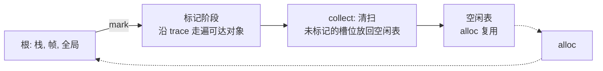

[第 9 篇](/posts/rust-by-pebble-09-interpreter-closures/)结尾，我写了两个测试证明一件有点丢人的事：只要全局环境里存了任何一个函数，这个函数就抓着它定义时的环境，环境又抓着这个函数，`Rc` 的引用计数永远降不到零，整个全局环境在解释器销毁后依然躺在堆上。`Weak` 能治其中一种环，治不了"闭包存进它自己捕获的环境"这种一般形态。C++ 程序员对此毫不陌生，`shared_ptr` 的老毛病。治本的办法是不再数引用，改成从根出发走一遍，没走到的就是垃圾。这一篇我们从零写这个走一遍的东西。

> [!NOTE] 本篇检查点
> 这一篇我们写完 `pebble-gc`：一个对对象类型泛型的标记清除（mark-sweep）回收器 `Heap<O>`，外加一个用 `unsafe` 写的 bump arena。涉及的 Rust 特性：泛型结构体与 `impl<O: GcObject>`、`&mut dyn FnMut` 闭包 trait 对象、`Option::take`、`Cell<bool>` 内部可变性、显式工作表代替递归、外部 crate（`rand` 作为 dev-dependency）、`BTreeSet`/`VecDeque`/`HashSet`，以及 `unsafe`、`MaybeUninit`、裸指针、`ptr::copy_nonoverlapping`、`slice::from_raw_parts_mut`、`// SAFETY:` 注释。上一篇：[字节码编译器](/posts/rust-by-pebble-10-bytecode-macros/)。这个 crate 不依赖任何别的 Pebble crate，所以做完它，`pebble-gc` 就和仓库里 `tutorial-v1` 标签上的版本逐字节一致。

## 要解决什么问题

先把"跟踪式回收"说成一句话：**从一组根（roots）出发，沿着对象之间的引用走一遍，走到的标记为活，没标记的全部回收。** 想象仓库盘点：你从门口（根）出发，每走到一个货架就贴一张"已盘"的标签，再顺着货架上的指引单走向下一个货架；盘点结束，没贴标签的货架整排清走。环不是问题，贴了标签的货架不会再走第二次。

所以一个回收器要回答三个问题：

1. 对象存在哪里，怎么引用它？（句柄）
2. 一个对象怎么告诉回收器"我引用了谁"?（`trace`）
3. 谁来决定根是什么，什么时候回收？（嵌入方，也就是第 12 篇的 VM）

这个 crate 的设计是：`Heap<O>` 对 `O` 泛型，`O` 实现 `GcObject` 来汇报自己的子引用；回收分两步，嵌入方先对每个根调用 `heap.mark(root)`，再调用 `heap.collect()` 清扫。回收器自己不知道什么是栈，什么是全局变量：根是嵌入方的事。



## 建 crate

在你的 workspace 根目录（第 1 篇建的那个）：

```bash
cargo new --lib crates/pebble-gc
```

根 `Cargo.toml` 里的 `members = ["crates/*"]` 会自动把它收进来。把 `crates/pebble-gc/Cargo.toml` 整个换成：

```toml
[package]
name = "pebble-gc"
description = "A mark-sweep garbage collector written with raw pointers and unsafe."
version.workspace = true
edition.workspace = true
rust-version.workspace = true
authors.workspace = true
license.workspace = true
repository.workspace = true

[dependencies]

[dev-dependencies]
rand.workspace = true

[lints]
workspace = true
```

`[dev-dependencies]` 是只给测试、示例、基准用的依赖，不会链接进库本身。`rand.workspace = true` 的意思是版本号去根 `Cargo.toml` 的 `[workspace.dependencies]` 里找，所以给那一段加两行（其余行保持你已有的样子）：

```toml
[workspace.dependencies]
pebble-gc = { path = "crates/pebble-gc", version = "0.1.0" }
rand = "0.10"
```

`pebble-gc` 那一行暂时没有人用，但 `tutorial-v1` 上的根 `Cargo.toml` 本来就列着它，第 12 篇的 VM 会通过它依赖这个 crate。

还要建一个空文件，后面会往里写 arena，先让 `pub mod bump;` 有地方可指：

```bash
touch crates/pebble-gc/src/bump.rs
```

## 句柄：用下标，不用指针

C 程序员的第一反应是：对象在堆上，引用就是指针。但在 Rust 里，"一个对象被很多地方引用，还会互相引用成环"恰好是借用检查器最不愿意看到的形状，用裸指针表达只能 `unsafe`。第 8 篇我们已经看过一个答案：`Rc<RefCell<..>>`，代价是引用计数和环。

这一篇用第三种办法，也是游戏引擎和 ECS 里的老手艺：**对象放在一个 `Vec` 里，引用就是下标。** 下标是个整数，可以随便复制，不涉及借用，不涉及生命周期，全程安全代码。

先把 `cargo new` 生成的 `src/lib.rs` 清空（里面有一个 `add` 函数和一个测试，我们不要）。

写 `crates/pebble-gc/src/lib.rs`。先从文件开头开始：crate 文档、一个 `use`、一个模块声明。这段文档比较长，因为它是整个 crate 的使用说明，而且里面的 `# Example` 会被 `cargo test` 当成 doc test 编译运行：

```rust
//! A precise mark-sweep garbage collector plus a small bump arena for one-shot
//! allocations ([`bump`]).
//!
//! The collector is generic over the [`GcObject`] trait, so an embedder such as
//! the Pebble VM plugs in its own object enum and decides how each object
//! reports its child references. The heap owns a flat table of slots; an
//! embedder allocates with [`Heap::alloc`] and keeps the returned [`GcRef`]
//! handles in its own roots (value stack, globals, temporaries). Collection is
//! split into two embedder-driven phases:
//!
//! 1. Mark every root: `heap.mark(root)` for each handle the embedder still
//!    holds. Marking follows the children reported by [`GcObject::trace`]
//!    transitively.
//! 2. Sweep: `heap.collect()` returns every unmarked slot to the free list and
//!    clears the mark bits, ready for the next cycle.
//!
//! [`Heap::mark`] only needs `&self`, so roots can be marked through a shared
//! reference; the mark bits live in [`Cell`]s inside the heap. There is no
//! global collector state and no `Drop`-based collection: reclamation happens
//! only when the embedder calls [`Heap::collect`].
//!
//! # Example
//!
//! ```
//! use pebble_gc::{GcObject, GcRef, Heap};
//!
//! /// A list-like object: it traces the references it holds.
//! struct Node(Vec<GcRef>);
//!
//! impl GcObject for Node {
//!     fn trace(&self, mark: &mut dyn FnMut(GcRef)) {
//!         for &child in &self.0 {
//!             mark(child);
//!         }
//!     }
//! }
//!
//! let mut heap: Heap<Node> = Heap::new();
//! let kept = heap.alloc(Node(vec![]));
//! let garbage = heap.alloc(Node(vec![]));
//!
//! heap.mark(kept);
//! heap.collect();
//!
//! assert_eq!(heap.live_count(), 1);
//! assert!(heap.is_alive(kept));
//! assert!(!heap.is_alive(garbage));
//! ```

use core::cell::Cell;

pub mod bump;
```

`//!` 是给"外层条目"写的文档注释（这里外层是整个 crate），`///` 是给紧随其后的条目写的。写成 `` [`Heap::alloc`] `` 这样的方括号链接叫 intra-doc link，`cargo doc` 会把它解析成链接，写错了会报警告。`use core::cell::Cell;` 先放着，几节以后就用上。

接下来是句柄本身，把它追加在 `pub mod bump;` 后面：

```rust
/// A handle to a live object inside a [`Heap`].
///
/// `GcRef` is a plain `u32` slot index and is `Copy`, so embedders can store
/// handles on their own stacks and in registers without touching the heap. A
/// handle only means something to the [`Heap`] that produced it, and it becomes
/// *dangling* once its slot is returned by [`Heap::free`] or reclaimed by
/// [`Heap::collect`]; [`Heap::is_alive`] tests for that without panicking.
#[derive(Clone, Copy, PartialEq, Eq, Hash, Debug)]
pub struct GcRef(u32);

impl GcRef {
    /// The underlying slot index of this handle.
    pub const fn index(self) -> u32 {
        self.0
    }

    /// Rebuilds a handle from a slot index.
    ///
    /// The index must have come from [`GcRef::index`]; forging one for a slot
    /// that is not live produces a dangling handle.
    pub const fn from_index(index: u32) -> Self {
        Self(index)
    }
}
```

这是第 1 篇学过的元组结构体 newtype，`Copy` 也是第 1 篇的"和 C 结构体一样按位复制"。字段 `u32` 没有 `pub`，所以外部代码造不出随便的句柄，只能通过 `from_index` 这个明说"你要对后果负责"的口子（测试和嵌入方需要它）。

`u32` 而不是 `usize`，是因为 `Option<GcRef>` 之类的东西会因此更小，下标也不需要 64 位。我在实验里量过几个尺寸（`~/rust-lab/src/bin/ch11_sizes.rs`）：

```text
$ cargo run --quiet --bin ch11_sizes
GcRef                 = 4 bytes
*const u8             = 8 bytes
Object                = 48 bytes
Option<Object>        = 48 bytes
Cell<bool>            = 1 bytes
Option<Box<Object>>   = 8 bytes
```

<details>
<summary>完整源码：ch11_sizes.rs</summary>

```rust
use std::mem::size_of;

#[derive(Clone, Copy)]
#[allow(dead_code)]
struct GcRef(u32);

#[allow(dead_code)]
enum Object {
    Str(String),
    List(Vec<GcRef>),
    Closure { name: String, captured: Vec<GcRef> },
}

fn main() {
    println!("GcRef                 = {} bytes", size_of::<GcRef>());
    println!("*const u8             = {} bytes", size_of::<*const u8>());
    println!("Object                = {} bytes", size_of::<Object>());
    println!("Option<Object>        = {} bytes", size_of::<Option<Object>>());
    println!("Cell<bool>            = {} bytes", size_of::<std::cell::Cell<bool>>());
    println!("Option<Box<Object>>   = {} bytes", size_of::<Option<Box<Object>>>());
}
```

</details>

句柄 4 字节，裸指针 8 字节。另外有一个值得记住的数字：`Option<Object>` 和 `Object` 一样大，都是 48 字节。`Option` 没有多出标签，因为 `Object` 自己的判别标签只用了 3 个取值，`None` 借用了一个没用到的取值（Rust 管这叫 niche 优化；我没有拆开布局确认到底借的是哪一个，这是我的推断）。后面我们的槽位是 `Vec<Option<O>>`，"这个槽位空着"这件事是免费的。

### 下标句柄的代价

句柄是安全的，不代表句柄永远指向对的东西。下标指向"第 k 个槽位"，槽位被释放后再被复用，旧句柄就悄悄指向了新对象，没有任何 UB，也没有任何 panic。我用真正的 `Heap`（等你写完这一章再跑）做了一个实验。它需要依赖你的 `pebble-gc`，所以不放在 `rust-lab` 里，而是单独建一个小 crate：`cargo new ~/lab-ch11-gc`，在它的 `Cargo.toml` 的 `[dependencies]` 下加一行 `pebble-gc = { path = "<你的 workspace>/crates/pebble-gc" }`，把下面的完整源码放进 `src/main.rs`（完整版在 [`lab/lab-ch11-gc`](https://github.com/bfmhno3/pebble/tree/tutorial-v1/lab/lab-ch11-gc)，在那个目录里运行即可）：

```text
$ cargo run --quiet --bin lab-ch11-gc
alive after free: false
old == new: true
old now reads as "second"
```

<details>
<summary>完整源码：src/main.rs</summary>

```rust
// An index handle can dangle without any memory unsafety: it just points at
// whatever lives in that slot now.
use pebble_gc::{GcObject, GcRef, Heap};

#[derive(Debug)]
struct Name(&'static str);

impl GcObject for Name {
    fn trace(&self, _mark: &mut dyn FnMut(GcRef)) {}
}

fn main() {
    let mut heap: Heap<Name> = Heap::new();
    let old = heap.alloc(Name("first"));
    heap.free(old);
    println!("alive after free: {}", heap.is_alive(old));

    let new = heap.alloc(Name("second"));
    println!("old == new: {}", old == new);
    println!("old now reads as {:?}", heap.get(old).0);
}
```

</details>

`old` 释放之后 `is_alive` 说它死了，但新对象立刻复用了同一个槽位，`old == new` 为 `true`。这就是 C 里的 use-after-free 的"安全版本"：不会崩，但会读到别人的数据。防御办法是给句柄加一个代数（generation）计数，槽位每次复用就加一，句柄里记着自己出生时的代数。这是练习 1，我们这一版不做，因为 VM 只在指令边界上回收，栈和帧里的句柄全部是根，不会悬空。设计成"只要嵌入方守规矩就够用"是个明确的取舍，文档里也写了。

## 对象怎么汇报自己的引用

回收器不知道 `O` 是什么，所以需要一个 trait 让对象自己说出引用了谁。接着写：

```rust
/// A heap-managed object that can report its child references.
///
/// The collector calls [`GcObject::trace`] once per slot while marking, passing
/// a callback that records one child reference. An implementation must report
/// every live [`GcRef`] it owns, and nothing else: a reference it fails to
/// report may be swept while still in use, and one it invents may keep garbage
/// alive forever.
pub trait GcObject {
    /// Reports each child reference to `mark`, so the collector can mark it.
    fn trace(&self, mark: &mut dyn FnMut(GcRef));
}
```

参数 `mark: &mut dyn FnMut(GcRef)` 值得停一下。它读作"一个可变借用，指向某个实现了 `FnMut(GcRef)` 的闭包"。`dyn` 是第 8 篇讲过的 trait 对象：运行时通过虚表调用，和 C++ 的虚函数一个原理。为什么不写成泛型 `fn trace<F: FnMut(GcRef)>(&self, mark: F)`？那也可以（带来的是每个闭包类型各编译一份），我选 `dyn` 是为了让 trait 保持简单、`trace` 只编译一份，代价是每汇报一个子引用多一次间接调用。我没有为它测过时间，很可能在这里无关紧要。

`FnMut` 是第 9 篇讲过的"会修改自己捕获的状态的闭包"。待会儿 `mark` 传进来的闭包要往 `pending` 这个 `Vec` 里 push，所以必须是 `FnMut`。

## Heap：一个泛型结构体

现在是主角。先看结构和 `new`（接着追加）：

```rust
/// A mark-sweep heap over a flat table of slots, generic over the object type.
///
/// Freed slots are recycled: the slot table grows to the peak number of
/// simultaneously live objects, not to the total number of allocations ever
/// performed.
#[derive(Debug)]
pub struct Heap<O: GcObject> {
    slots: Vec<Option<O>>,
    free: Vec<u32>,
    marked: Vec<Cell<bool>>,
    allocations_since_gc: usize,
}

impl<O: GcObject> Heap<O> {
    /// Creates an empty heap with no slots allocated.
    pub fn new() -> Self {
        Self {
            slots: Vec::new(),
            free: Vec::new(),
            marked: Vec::new(),
            allocations_since_gc: 0,
        }
    }
```

这个 `impl` 块没有收尾，后面的方法都往里放，最后我们会补上闭合的 `}`。

四个字段：

- `slots: Vec<Option<O>>`：槽位表。`Some(object)` 是活对象，`None` 是空槽。
- `free: Vec<u32>`：空槽的下标栈。`alloc` 先从这里弹，弹不出来才扩容。C 里叫 free list。
- `marked: Vec<Cell<bool>>`：每个槽位一个标记位。为什么是 `Cell<bool>` 不是 `bool`，下一节用编译器的报错说话。
- `allocations_since_gc`：自上次回收以来分配了多少次，嵌入方拿它决定什么时候该回收。

`Heap<O: GcObject>` 是**泛型结构体**：`O` 是类型参数，冒号后面是约束，"O 必须实现 `GcObject`"。对 C++ 程序员：这是 `template <typename O> requires GcObject<O> struct Heap`，只不过 Rust 的约束是 trait 而且在定义处就检查，而不是等实例化后在模板深处报一屏错误。和 C++ 模板一样，Rust 泛型是单态化的：`Heap<Node>` 和 `Heap<VmObject>` 在编译后是两份独立的机器码，没有运行时开销。

`impl<O: GcObject> Heap<O>` 里的第一个 `<O: GcObject>` 是"为所有满足约束的 O 实现"，第二个 `Heap<O>` 是被实现的类型。约束需要在 `struct` 和 `impl` 两处各写一遍，这是 Rust 的老规矩。

`#[derive(Debug)]` 在泛型结构体上会自动生成 `impl<O: GcObject + Debug> Debug for Heap<O>`：只有 `O` 自己能打印时，`Heap<O>` 才能打印。

### alloc、get、get_mut、free

继续往 `impl` 里追加（缩进 4 个空格，放在 `new` 后面）：

```rust
    /// Allocates `object` and returns a handle to it.
    ///
    /// A slot on the free list is reused if one is available; otherwise the
    /// slot table grows by one entry.
    ///
    /// # Panics
    ///
    /// Panics if the heap would need more than `u32::MAX` slots.
    pub fn alloc(&mut self, object: O) -> GcRef {
        self.allocations_since_gc += 1;
        if let Some(index) = self.free.pop() {
            let slot = &mut self.slots[index as usize];
            debug_assert!(slot.is_none(), "free list contained an occupied slot");
            *slot = Some(object);
            self.marked[index as usize].set(false);
            GcRef(index)
        } else {
            let index = u32::try_from(self.slots.len()).expect("heap outgrew its u32 slot index");
            self.slots.push(Some(object));
            self.marked.push(Cell::new(false));
            GcRef(index)
        }
    }
```

几个第 1 篇到第 8 篇的老朋友：`if let` 解开 `Option`；`debug_assert!` 只在 debug 构建检查；`u32::try_from(usize)` 是可能失败的转换，`expect` 失败时 panic 并带上消息（第 7 篇讲过 `unwrap`/`expect` 什么时候可以用：这里是"不可能发生，发生了就是 bug"，并且文档里有 `# Panics` 一节写明）。`*slot = Some(object)` 把 `object` **移动**进槽位。`object` 从此归 `Heap` 所有，调用者拿到的只是一个 `GcRef`。

接下来读写：

```rust
    /// Returns a shared reference to the object behind `r`.
    ///
    /// # Panics
    ///
    /// Panics if `r` is out of range or points to a slot that is currently
    /// free, i.e. a dangling handle. Use [`Heap::is_alive`] to check first.
    pub fn get(&self, r: GcRef) -> &O {
        self.slots
            .get(r.0 as usize)
            .and_then(|slot| slot.as_ref())
            .unwrap_or_else(|| panic!("GcRef({}) does not point to a live object", r.0))
    }

    /// Returns a mutable reference to the object behind `r`.
    ///
    /// # Panics
    ///
    /// Panics under the same conditions as [`Heap::get`].
    pub fn get_mut(&mut self, r: GcRef) -> &mut O {
        self.slots
            .get_mut(r.0 as usize)
            .and_then(|slot| slot.as_mut())
            .unwrap_or_else(|| panic!("GcRef({}) does not point to a live object", r.0))
    }
```

`slots.get(i)` 返回 `Option<&Option<O>>`（下标越界得 `None`），`and_then(|slot| slot.as_ref())` 把里层的 `&Option<O>` 变成 `Option<&O>` 并压平，`unwrap_or_else` 在 `None` 时才执行 panic 闭包（闭包是惰性的，`unwrap_or(panic!(..))` 会不管三七二十一先 panic）。

两个签名的借用关系是这一整套设计的核心：`get(&self, r) -> &O`，返回的引用借用整个 `Heap`；`get_mut(&mut self, ..) -> &mut O` 借用整个 `Heap` 的独占。第 2 篇说过"别名 XOR 可变"。落到这里就是：你拿着一个 `&mut O` 的时候，不能再 `alloc`（`alloc` 可能让 `slots` 重新分配，`&mut O` 就悬空了，这正是 C++ 里 `vector` push 之后旧指针失效的 bug），编译器直接拒绝。句柄 `GcRef` 因为是 `Copy` 整数，不受这个限制，所以对象之间互相引用时用句柄，需要读写内容时才临时借出引用。

再来 `free`：

```rust
    /// Returns the slot behind `r` to the free list.
    ///
    /// Any mark bit on the slot is cleared, so the slot is immediately
    /// reusable by [`Heap::alloc`].
    ///
    /// # Panics
    ///
    /// Panics if `r` is out of range or already free, which usually means the
    /// embedder double-freed or used a dangling handle.
    pub fn free(&mut self, r: GcRef) {
        let index = r.0 as usize;
        assert!(
            self.slots
                .get_mut(index)
                .and_then(|slot| slot.take())
                .is_some(),
            "GcRef({}) does not point to a live object",
            r.0
        );
        self.marked[index].set(false);
        self.free.push(r.0);
    }
```

`Option::take()` 是这一节的新朋友：它把 `Option` 里的值拿走，原位置留下 `None`，返回原值。这就是第 2 篇那个 `mem::take` 的 `Option` 特化版：不能直接把 `O` 从 `&mut Option<O>` 里"移出来"（会留下一个被移走的洞，和 C++ 的 moved-from 对象不同，Rust 不允许有这种半死状态），`take` 用 `None` 填上洞。这里还顺手利用了 `take` 的返回值做断言：取出来是 `None` 说明槽位本来就是空的，即重复释放。被取出的 `O` 在语句结束时被丢弃（`Drop`），它拥有的 `String`、`Vec` 随之释放。

可以先 `cargo check -p pebble-gc` 看看到现在为止有没有拼写错误。（它会抱怨 `impl` 没闭合，因为我们还没写完；先把下面的内容追加完再检查也可以。）

## 标记：为什么 mark 只要 &self

现在是回收器的心脏。我先给你看我最初写的版本，也就是你可能会写的版本：递归，标记位用普通的 `Vec<bool>`。`~/rust-lab/src/bin/ch11_cell_naive.rs`：

```rust
fn mark(&mut self, r: GcRef) {
    if self.marked[r.0 as usize] {
        return;
    }
    self.marked[r.0 as usize] = true;
    self.get(r).trace(&mut |child| self.mark(child));
}
```

```text
$ cargo build --bin ch11_cell_naive
error[E0500]: closure requires unique access to `*self` but it is already borrowed
  --> src/bin/ch11_cell_naive.rs:24:32
   |
24 |         self.get(r).trace(&mut |child| self.mark(child));
   |         ----        -----      ^^^^^^^ ---- second borrow occurs due to use of `*self` in closure
   |         |           |          |
   |         |           |          closure construction occurs here
   |         |           first borrow later used by call
   |         borrow occurs here
For more information about this error, try `rustc --explain E0500`.
```

<details>
<summary>完整源码：ch11_cell_naive.rs</summary>

```rust
// First attempt at `mark`: recursion, with the mark bits in a plain Vec<bool>.
#[derive(Clone, Copy)]
struct GcRef(u32);

trait GcObject {
    fn trace(&self, mark: &mut dyn FnMut(GcRef));
}

struct Heap<O: GcObject> {
    slots: Vec<Option<O>>,
    marked: Vec<bool>,
}

impl<O: GcObject> Heap<O> {
    fn get(&self, r: GcRef) -> &O {
        self.slots[r.0 as usize].as_ref().unwrap()
    }

    fn mark(&mut self, r: GcRef) {
        if self.marked[r.0 as usize] {
            return;
        }
        self.marked[r.0 as usize] = true;
        self.get(r).trace(&mut |child| self.mark(child));
    }
}

struct Node(Vec<GcRef>);

impl GcObject for Node {
    fn trace(&self, mark: &mut dyn FnMut(GcRef)) {
        for &child in &self.0 {
            mark(child);
        }
    }
}

fn main() {
    let mut heap = Heap { slots: vec![Some(Node(vec![]))], marked: vec![false] };
    heap.mark(GcRef(0));
}
```

</details>

（完整输出还有一行 `error: could not compile`，我省掉了。）它说的事情很直白：`self.get(r)` 借出了 `&O`，这个借用要一直活到 `trace` 调用结束；而闭包里的 `self.mark(child)` 需要 `&mut self`。你在读一个对象的同时要修改整个堆，这在 C++ 里也许会通过（然后在 `vector` 重新分配时爆炸），在 Rust 里直接拒绝。

办法一：不要递归。用一个局部的工作表（worklist）`pending: Vec<GcRef>`，闭包只往这个局部变量里 push，不碰 `self`。这样 `&mut self` 版本其实**能编译**（`ch11_cell_roots.rs` 里的 `Heap::mark` 就是这样，它编译通过了）。所以 `Cell` 不是被"逼出来"的，这一点我想说清楚，免得你以为借用检查器非要它不可。

那为什么还用 `Cell`？因为问题出在调用者。`mark(&mut self)` 要求调用者手里没有任何对堆的借用。这是个设计选择：让根的枚举可以一边持有对堆的共享借用一边调用 `mark`，比如"凡是被钉住的对象都是根"（`ch11_cell_roots.rs`）：

```rust
for (r, node) in heap.iter() {
    if node.pinned {
        heap.mark(r);
    }
}
```

```text
$ cargo build --bin ch11_cell_roots
error[E0502]: cannot borrow `heap` as mutable because it is also borrowed as immutable
  --> src/bin/ch11_cell_roots.rs:58:13
   |
56 |     for (r, node) in heap.iter() {
   |                      -----------
   |                      |
   |                      immutable borrow occurs here
   |                      immutable borrow later used here
57 |         if node.pinned {
58 |             heap.mark(r);
   |             ^^^^^^^^^^^^ mutable borrow occurs here
For more information about this error, try `rustc --explain E0502`.
```

<details>
<summary>完整源码：ch11_cell_roots.rs</summary>

```rust
// Second attempt: no recursion (a worklist), mark bits still a plain Vec<bool>.
// Marking now compiles on its own. Trouble starts at the caller, which picks
// roots by looking at the heap it is about to mark.
#[derive(Clone, Copy)]
struct GcRef(u32);

trait GcObject {
    fn trace(&self, mark: &mut dyn FnMut(GcRef));
}

struct Heap<O: GcObject> {
    slots: Vec<Option<O>>,
    marked: Vec<bool>,
}

impl<O: GcObject> Heap<O> {
    fn mark(&mut self, root: GcRef) {
        let mut pending = vec![root];
        while let Some(current) = pending.pop() {
            let index = current.0 as usize;
            let Some(object) = self.slots[index].as_ref() else { continue };
            if std::mem::replace(&mut self.marked[index], true) {
                continue;
            }
            object.trace(&mut |child| pending.push(child));
        }
    }

    fn iter(&self) -> impl Iterator<Item = (GcRef, &O)> {
        self.slots
            .iter()
            .enumerate()
            .filter_map(|(i, slot)| slot.as_ref().map(|o| (GcRef(i as u32), o)))
    }
}

struct Node {
    pinned: bool,
    children: Vec<GcRef>,
}

impl GcObject for Node {
    fn trace(&self, mark: &mut dyn FnMut(GcRef)) {
        for &child in &self.children {
            mark(child);
        }
    }
}

fn main() {
    let mut heap = Heap {
        slots: vec![Some(Node { pinned: true, children: vec![] })],
        marked: vec![false],
    };
    // Every pinned object is a root.
    for (r, node) in heap.iter() {
        if node.pinned {
            heap.mark(r);
        }
    }
}
```

</details>

`heap.iter()` 持有堆的共享借用，而 `mark` 想要独占。可是"标记"在逻辑上并不修改堆里的对象，它只是翻转一个旁路的标记位。这正是**内部可变性**（interior mutability）的用武之地：把标记位放进 `Cell<bool>`，`mark` 就能以 `&self` 签名工作。`ch11_cell.rs` 里换成 `Cell` 之后同样的调用者编译通过，运行结果：

```text
$ cargo run --quiet --bin ch11_cell
[true, true, false]
```

<details>
<summary>完整源码：ch11_cell.rs</summary>

```rust
// The fix: mark bits in `Cell<bool>`, so `mark` takes `&self`.
use std::cell::Cell;

#[derive(Clone, Copy)]
struct GcRef(u32);

trait GcObject {
    fn trace(&self, mark: &mut dyn FnMut(GcRef));
}

struct Heap<O: GcObject> {
    slots: Vec<Option<O>>,
    marked: Vec<Cell<bool>>,
}

impl<O: GcObject> Heap<O> {
    fn mark(&self, root: GcRef) {
        let mut pending = vec![root];
        while let Some(current) = pending.pop() {
            let index = current.0 as usize;
            let Some(object) = self.slots[index].as_ref() else { continue };
            if self.marked[index].replace(true) {
                continue;
            }
            object.trace(&mut |child| pending.push(child));
        }
    }

    fn iter(&self) -> impl Iterator<Item = (GcRef, &O)> {
        self.slots
            .iter()
            .enumerate()
            .filter_map(|(i, slot)| slot.as_ref().map(|o| (GcRef(i as u32), o)))
    }
}

struct Node {
    pinned: bool,
    children: Vec<GcRef>,
}

impl GcObject for Node {
    fn trace(&self, mark: &mut dyn FnMut(GcRef)) {
        for &child in &self.children {
            mark(child);
        }
    }
}

fn main() {
    let heap = Heap {
        slots: vec![
            Some(Node { pinned: true, children: vec![GcRef(1)] }),
            Some(Node { pinned: false, children: vec![] }),
            Some(Node { pinned: false, children: vec![] }),
        ],
        marked: vec![Cell::new(false), Cell::new(false), Cell::new(false)],
    };
    for (r, node) in heap.iter() {
        if node.pinned {
            heap.mark(r);
        }
    }
    let marks: Vec<bool> = heap.marked.iter().map(Cell::get).collect();
    println!("{marks:?}");
}
```

</details>

槽位 0 是被钉住的根，它引用槽位 1，所以 0 和 1 被标记，槽位 2 没有。

### Cell 是什么

`Cell<T>` 是 `RefCell` 的更简单的亲戚（`RefCell` 第 8 篇讲过）。区别：

| | `RefCell<T>` | `Cell<T>` |
| --- | --- | --- |
| 怎么读写 | 借出 `Ref`/`RefMut` 引用 | 整个值拷进拷出，从不借出引用 |
| 运行时检查 | 有，借用冲突 panic | 没有，也不需要 |
| 额外空间 | 一个借用计数 | 没有（上面量过：`Cell<bool>` 1 字节） |
| 适用 | 任意 `T` | 小的、`Copy` 的值 |

因为 `Cell` 从不把引用借给外人，不会出现"我读着你改了"的情形，所以不需要运行时检查。`replace(true)` 一次性写入新值并返回旧值，等价于 C 里的 test-and-set。C++ 对照：`mutable bool` 成员加上 `const` 方法，语言层面允许 `const` 方法修改它。Rust 的 `Cell` 是把这个后门做成一个明确的类型，而且和 `RefCell` 一样**不是** `Sync`（不能跨线程共享，第 14 篇讲）。

### 显式工作表

`mark` 的实现。接着追加：

```rust
    /// Marks `root` and everything reachable from it, transitively.
    ///
    /// Marking is idempotent: a slot that is already marked is not traced
    /// again, so repeated roots and cycles terminate. The traversal keeps an
    /// explicit worklist instead of recursing, so arbitrarily deep object
    /// graphs cannot overflow the native stack.
    ///
    /// # Panics
    ///
    /// Panics if `root` is out of range. A handle to a freed slot is ignored,
    /// since it can no longer name a reachable object.
    pub fn mark(&self, root: GcRef) {
        let mut pending = vec![root];
        while let Some(current) = pending.pop() {
            let index = current.0 as usize;
            let Some(object) = self.slots[index].as_ref() else {
                continue;
            };
            if self.marked[index].replace(true) {
                continue;
            }
            object.trace(&mut |child| pending.push(child));
        }
    }
```

逐行读：`while let Some(current) = pending.pop()` 是第 4 篇的老句式，工作表空了就结束。`let ... else { continue; }` 是第 3 篇的 let-else：槽位是空的（指向已释放对象的句柄）就跳过。`replace(true)` 返回的旧值如果是 `true` 就说明已经走过，跳过，这一句保证了每个对象最多被追踪一次，环于是不会造成死循环。最后 `object.trace(&mut |child| pending.push(child))` 把闭包借给 `trace`，闭包只捕获局部的 `pending`，和 `self` 没有借用冲突。

用不用递归，还有一个独立于借用检查器的理由。我写了个最小的递归 `mark_recursive`（`ch11_deep_recursion.rs`），让它标记一个链表式的嵌套：

```text
$ cargo build --quiet --bin ch11_deep_recursion
$ ./target/debug/ch11_deep_recursion 10000
marked 10001 objects at depth 10000
$ ./target/debug/ch11_deep_recursion 20000 test-thread

thread '<unknown>' (66495) has overflowed its stack
fatal runtime error: stack overflow, aborting
$ ./target/debug/ch11_deep_recursion 50000

thread 'main' (66502) has overflowed its stack
fatal runtime error: stack overflow, aborting
```

<details>
<summary>完整源码：ch11_deep_recursion.rs</summary>

```rust
// Why `mark` keeps a worklist: a recursive marker dies on a deep list.
use std::cell::Cell;

#[derive(Clone, Copy)]
struct GcRef(u32);

trait GcObject {
    fn trace(&self, mark: &mut dyn FnMut(GcRef));
}

struct Heap<O: GcObject> {
    slots: Vec<Option<O>>,
    marked: Vec<Cell<bool>>,
}

impl<O: GcObject> Heap<O> {
    fn mark_recursive(&self, r: GcRef) {
        let index = r.0 as usize;
        if self.marked[index].replace(true) {
            return;
        }
        self.slots[index].as_ref().unwrap().trace(&mut |child| self.mark_recursive(child));
    }
}

struct Node(Option<GcRef>);

impl GcObject for Node {
    fn trace(&self, mark: &mut dyn FnMut(GcRef)) {
        if let Some(child) = self.0 {
            mark(child);
        }
    }
}

fn run() {
    let depth: u32 = std::env::args().nth(1).map_or(10_000, |s| s.parse().unwrap());
    let mut slots = vec![Some(Node(None))];
    for i in 1..=depth {
        slots.push(Some(Node(Some(GcRef(i - 1)))));
    }
    let marked = (0..slots.len()).map(|_| Cell::new(false)).collect();
    let heap = Heap { slots, marked };
    heap.mark_recursive(GcRef(depth));
    println!("marked {} objects at depth {depth}", heap.marked.iter().filter(|m| m.get()).count());
}

fn main() {
    // `cargo test` runs each test on a thread with a 2 MiB stack; the main
    // thread usually gets 8 MiB. Pick one with the second argument.
    if std::env::args().nth(2).as_deref() == Some("test-thread") {
        std::thread::Builder::new().stack_size(2 * 1024 * 1024).spawn(run).unwrap().join().unwrap();
    } else {
        run();
    }
}
```

</details>

`test-thread` 参数表示在一个 2 MiB 栈的线程里跑（`cargo test` 给每个测试线程的默认大小），否则在 8 MiB 的主线程里跑。debug 构建里 10,000 层居然没事，2 MiB 栈上 20,000 层就崩，8 MiB 的主线程 50,000 层崩。（崩的时候是 `abort`：进程直接被杀，不是 panic，`catch_unwind` 也拦不住。）Pebble 程序里的嵌套深度是用户可以控制的，所以回收器不能把"别人写的数据有多深"变成"我的栈有多深"。显式工作表把深度挪到堆上：`pending` 是一个 `Vec`，它能长到内存耗尽为止。

> [!WARNING] 实话实说
> 仓库里的测试 `deeply_nested_lists_survive` 用的深度是 10,000。上面的实验说明，在 debug 构建里一个递归标记器其实也能撑过 10,000 层，所以这个测试单靠深度**并不能**把递归实现和工作表实现区分开。我没有去改它（它在标签里就是这样），但如果你要它真的守住这条回归，把循环里的 `10_000` 改成 `100_000`，断言里的 `10_001` 同步改成 `100_001`。

## 清扫、查询，以及剩下的方法

标记之后，清扫：

```rust
    /// Sweeps every slot that is not marked, then clears all mark bits.
    ///
    /// The embedder must have marked its roots (via [`Heap::mark`]) before
    /// calling this. After the sweep the heap is ready for the next mark phase.
    pub fn collect(&mut self) {
        for index in 0..self.slots.len() {
            if self.marked[index].get() {
                self.marked[index].set(false);
            } else if self.slots[index].is_some() {
                let slot = u32::try_from(index).expect("heap outgrew its u32 slot index");
                self.free(GcRef(slot));
            }
        }
        self.allocations_since_gc = 0;
    }
```

这里是下标循环，不是 `for slot in &mut self.slots`，因为循环体里要调用 `self.free(..)`，它需要 `&mut self` 整个借用，和迭代器对 `self.slots` 的借用冲突。又是同一条规矩。标记过的槽位：清掉标记位留给下一轮；没标记且还占着的：`free` 回空闲表。`collect(&mut self)` 要独占，这也是个有用的保证：清扫时没有任何人手里还拿着对堆的借用。

最后是几个查询方法，加上 `Default`：

```rust
    /// Whether `r` names a slot that currently holds an object.
    ///
    /// Unlike [`Heap::get`], this never panics: an out-of-range or freed handle
    /// simply reports `false`.
    pub fn is_alive(&self, r: GcRef) -> bool {
        self.slots
            .get(r.0 as usize)
            .is_some_and(|slot| slot.is_some())
    }

    /// Number of occupied slots, i.e. objects not yet swept.
    pub fn live_count(&self) -> usize {
        self.slots.len() - self.free.len()
    }

    /// Number of object slots the heap can hold without reallocating its
    /// tables.
    pub fn capacity(&self) -> usize {
        self.slots.capacity()
    }

    /// Estimated total bytes occupied by the live slots.
    ///
    /// This is `live_count() * size_of::<O>()`: the inline size of each object
    /// as stored in its slot. Memory a `GcObject` owns indirectly, such as a
    /// `String` buffer or a `Vec`'s heap block, is not counted, so treat this
    /// as an estimate for deciding when to collect rather than an exact
    /// allocator figure.
    pub fn bytes_allocated(&self) -> usize {
        self.live_count() * core::mem::size_of::<O>()
    }

    /// Number of allocations performed since the last [`Heap::collect`].
    ///
    /// An embedder can use this to trigger collection after a fixed number of
    /// allocations.
    pub fn allocations_since_gc(&self) -> usize {
        self.allocations_since_gc
    }
}

impl<O: GcObject> Default for Heap<O> {
    fn default() -> Self {
        Self::new()
    }
}
```

第一个 `}` 终于闭合了 `impl<O: GcObject> Heap<O>`。`is_alive`、`live_count`、`capacity`、`allocations_since_gc` 都是一两行的访问器，逻辑没有新东西；`bytes_allocated` 是 `live_count() * size_of::<O>()` 的估算，文档里写得很诚实：它不算 `String` 缓冲区这类间接内存。这五个方法你照抄即可，理由是它们既不涉及借用难点，也不涉及本篇的新概念，读文档注释就够了。

`Default` 的实现是为了 clippy。工作区的 lint 设置了 `clippy::all = "warn"`，我把它删掉跑了一遍 `cargo clippy -p pebble-gc`：

```text
warning: you should consider adding a `Default` implementation for `Heap<O>`
...
   = note: `-W clippy::new-without-default` implied by `-W clippy::all`
```

（我没有抄全这条警告。第一行是 clippy 的标题，中间是它指出的 `new` 的源码片段。）规则的意思很实际："有无参的 `new`，就应该有 `Default`"，这样 `#[derive(Default)]` 的外层结构体、`unwrap_or_default` 之类的泛型代码才能用上它。

到这里可以先检查一下：

```bash
cargo check -p pebble-gc
```

## 测试：让一个随机图来审判

测试模块比实现更能说明回收器在做什么。我们要的"模拟对象"是个 enum，形状和第 12 篇 VM 里的对象相仿：字符串、列表、闭包。接在 `lib.rs` 末尾写模块头：

```rust
#[cfg(test)]
mod tests {
    use super::{GcObject, GcRef, Heap};
    use rand::prelude::*;

    /// A concrete heap object for the tests, mirroring the shapes the Pebble
    /// runtime will plug in: strings, lists and closures.
    #[derive(Clone, PartialEq, Eq, Debug)]
    enum TestObject {
        Str(String),
        List(Vec<GcRef>),
        Closure { name: String, captured: Vec<GcRef> },
    }

    impl GcObject for TestObject {
        fn trace(&self, mark: &mut dyn FnMut(GcRef)) {
            match self {
                TestObject::Str(_) => {}
                TestObject::List(items) => {
                    for &child in items {
                        mark(child);
                    }
                }
                TestObject::Closure { captured, .. } => {
                    for &child in captured {
                        mark(child);
                    }
                }
            }
        }
    }

    fn list(heap: &mut Heap<TestObject>, children: &[GcRef]) -> GcRef {
        heap.alloc(TestObject::List(children.to_vec()))
    }
```

`use rand::prelude::*;` 引入外部 crate `rand`。你在第 6、7 篇已经加过外部依赖，这次放在 `[dev-dependencies]` 里：只有测试编译它。`rand` 来自 crates.io（Rust 的官方包仓库，你在 C++ 里用 vcpkg/Conan 做的事）。第一次 `cargo test` 时 Cargo 会下载并编译它，并把解析出的确切版本写进 `Cargo.lock`。`GcObject` 的实现里，`match self` 的三个分支正是"这个对象引用了谁"：字符串没有子引用，列表和闭包把自己持有的句柄逐个汇报。`TestObject::Closure { captured, .. }` 里的 `..` 是"其余字段我不关心"。

接着要加进来的测试，分写和抄两种。**抄**的：从 [`crates/pebble-gc/src/lib.rs`](https://github.com/bfmhno3/pebble/blob/tutorial-v1/crates/pebble-gc/src/lib.rs) 里把 `alloc_get_and_get_mut`、`freed_slots_are_reused`、`mark_traces_children_transitively`、`collect_without_roots_frees_everything` 四个测试，按这个顺序紧跟在 `list` 函数后面粘贴；再把 `is_alive_tracks_slots` 粘在后面说的 `unreachable_cycles_are_collected` 之后。它们各自只验证一个简单的断言（分配取回、槽位复用、传递标记、无根全清、`is_alive` 的行为），没有新的 Rust 概念，逐行读即可。位置和顺序也属于逐字节比对的内容。

**写**的先来两个：

```rust
    #[test]
    fn deeply_nested_lists_survive() {
        let mut heap: Heap<TestObject> = Heap::new();
        let mut current = heap.alloc(TestObject::Str("bottom".into()));
        for _ in 0..10_000 {
            current = list(&mut heap, &[current]);
        }

        // The worklist marker must handle this depth without recursing.
        heap.mark(current);
        heap.collect();

        assert_eq!(heap.live_count(), 10_001);
    }

    #[test]
    fn unreachable_cycles_are_collected() {
        let mut heap: Heap<TestObject> = Heap::new();
        let a = list(&mut heap, &[]);
        let b = list(&mut heap, &[a]);
        // Close the cycle: a -> b -> a. Neither is rooted.
        match heap.get_mut(a) {
            TestObject::List(items) => items.push(b),
            other => panic!("expected a list, got {other:?}"),
        }

        heap.collect();

        assert_eq!(heap.live_count(), 0, "an unreachable cycle is swept");
        assert_eq!(heap.bytes_allocated(), 0);
        assert!(!heap.is_alive(a));
    }
```

第二个是整个 crate 存在的理由：`a -> b -> a`，谁也不在根里，`Rc` 会永远留着它们，这里 `live_count()` 变成 0。两个测试放在 `collect_without_roots_frees_everything` 之后，它们中间没有别的东西，然后是抄来的 `is_alive_tracks_slots`。

再写 `#[should_panic]` 测试，放在 `is_alive_tracks_slots` 之后：

```rust
    #[test]
    #[should_panic(expected = "does not point to a live object")]
    fn getting_a_freed_reference_panics() {
        let mut heap: Heap<TestObject> = Heap::new();
        let r = heap.alloc(TestObject::Str("gone".into()));
        heap.free(r);
        let _ = heap.get(r);
    }
```

### 一个不认识实现的裁判

最后是最有价值的测试：随机图 oracle。我们生成随机有向图（边可以向前也可以向后，所以环很常见），随机挑一些节点做根，让堆标记+清扫，然后和一个**用另一种方法**算出来的可达集合对比。"另一种方法"很重要：实现里用的是 `Vec` 当栈的深度优先，所以裁判改用 `VecDeque` 做广度优先，再用 `BTreeSet` 去重：这样两边不共享任何代码和遍历顺序，同时算错的概率很低。

```rust
    #[test]
    fn randomised_reachability_matches_sweep() {
        use std::collections::{BTreeSet, VecDeque};

        let mut rng = rand::rng();
        for _ in 0..200 {
            let n = rng.random_range(1..40usize);

            // A random directed graph. Edges may point forward or backward, so
            // cycles are common.
            let mut edges: Vec<Vec<usize>> = Vec::with_capacity(n);
            for _ in 0..n {
                let degree = rng.random_range(0..=3);
                let mut children = Vec::with_capacity(degree);
                for _ in 0..degree {
                    children.push(rng.random_range(0..n));
                }
                edges.push(children);
            }

            let mut heap: Heap<TestObject> = Heap::new();
            for children in &edges {
                let refs: Vec<GcRef> = children
                    .iter()
                    .map(|&child| GcRef::from_index(child as u32))
                    .collect();
                heap.alloc(TestObject::List(refs));
            }

            let roots: Vec<usize> = (0..n).filter(|_| rng.random_bool(0.3)).collect();
            for &root in &roots {
                heap.mark(GcRef::from_index(root as u32));
            }

            // Expected survivors: everything reachable from the roots.
            let mut reachable = BTreeSet::new();
            let mut queue: VecDeque<usize> = roots.iter().copied().collect();
            while let Some(node) = queue.pop_front() {
                if reachable.insert(node) {
                    queue.extend(edges[node].iter().copied());
                }
            }

            heap.collect();

            let live: Vec<usize> = (0..n).filter(|&i| heap.slots[i].is_some()).collect();
            let expected: Vec<usize> = reachable.into_iter().collect(); // already sorted
            assert_eq!(live, expected, "the sweep kept the wrong objects");
            assert_eq!(heap.live_count(), expected.len());
            for &i in &expected {
                assert!(heap.is_alive(GcRef::from_index(i as u32)));
            }
        }
    }
}
```

最后那个 `}` 闭合 `mod tests`。几个细节：

- `heap.slots[i]` 是私有字段，但测试模块是 crate 内部的子模块，可以访问。第 2 篇讲过的"私有只到模块边界"在这里体现成：单元测试住在被测代码里面，可以看内部；集成测试（`tests/` 目录）只能用公开 API。
- `reachable.insert(node)` 返回 `bool`：是不是新插入。这让"去重 + 判断是否第一次到达"变成一次调用，和 `Cell::replace` 异曲同工。
- `BTreeSet` 对迭代顺序有保证（有序），`into_iter().collect()` 得到的就是排好序的 `Vec`。我在实验里并排试了三个同类容器（`ch11_collections.rs`）：

```text
$ cargo run --quiet --bin ch11_collections
insert 5: hash new? true  tree new? true
insert 1: hash new? true  tree new? true
insert 5: hash new? false  tree new? false
insert 3: hash new? true  tree new? true
insert 1: hash new? false  tree new? false
tree (sorted): {1, 3, 5}
hash (sorted by us): [1, 3, 5]
pop_front = Some(0), rest = [1, 2]
```

<details>
<summary>完整源码：ch11_collections.rs</summary>

```rust
use std::collections::{BTreeSet, HashSet, VecDeque};

fn main() {
    let items = [5, 1, 5, 3, 1];

    let mut hash: HashSet<i32> = HashSet::new();
    let mut tree: BTreeSet<i32> = BTreeSet::new();
    for item in items {
        println!("insert {item}: hash new? {}  tree new? {}", hash.insert(item), tree.insert(item));
    }
    println!("tree (sorted): {:?}", tree);
    let mut from_hash: Vec<_> = hash.into_iter().collect();
    from_hash.sort();
    println!("hash (sorted by us): {from_hash:?}");

    let mut queue: VecDeque<i32> = VecDeque::new();
    queue.push_back(1);
    queue.push_back(2);
    queue.push_front(0);
    let front = queue.pop_front();
    println!("pop_front = {front:?}, rest = {queue:?}");
}
```

</details>

`HashSet`、`BTreeSet` 的 `insert` 返回值语义相同；区别是前者无序（对应 `std::unordered_set`）、后者有序（对应 `std::set`，红黑树换成了 B 树）；`VecDeque` 对应 `std::deque`，`push_front`/`pop_front` 都是 O(1)。我们这里选 `BTreeSet` 是因为想要排好序的结果直接 `assert_eq!`。（我写第一版时用的是 `Vec<bool>` 再配 `Vec` 当栈，后来换成这一版。语义一样，但现在裁判和实现不再用同一种遍历，更像裁判。）

一个我没处理的小事：`rand::rng()` 没有固定种子，所以这个测试每次跑的图都不一样。好处是跑得越多覆盖越广，坏处是如果哪天它失败了，你没法重放同一张图。我认为在这个规模下可以接受；要重放的话该换成带种子的随机数生成器，这是一个很自然的练习。

## 第一个检查点：安全的部分

`bump.rs` 现在还是空的，所以先跑一次，看安全代码这一半：

```text
$ cargo test -p pebble-gc
...
running 9 tests
test tests::alloc_get_and_get_mut ... ok
test tests::collect_without_roots_frees_everything ... ok
test tests::getting_a_freed_reference_panics - should panic ... ok
test tests::freed_slots_are_reused ... ok
test tests::mark_traces_children_transitively ... ok
test tests::is_alive_tracks_slots ... ok
test tests::unreachable_cycles_are_collected ... ok
test tests::deeply_nested_lists_survive ... ok
test tests::randomised_reachability_matches_sweep ... ok

test result: ok. 9 passed; 0 failed; 0 ignored; 0 measured; 0 filtered out; finished in 0.01s
```

（后面还跟着 crate 文档里那个 doc test，`1 passed`；最终完整输出在文末的检查点里。）到这里 `pebble-gc` 的 `Heap` 用了 0 行 `unsafe`。第 12 篇的 VM 会拿它存放所有对象。

## unsafe：第一次签字担保

文件里还剩一个模块 `bump`。它是一个"一次性分配"的 arena（bump allocator）：预先要一大块字节，分配就是把一个偏移量往前推；不能单个释放，只能整个 `reset`。在编译器和 Web 服务器里，"请求一来分配一堆小东西，请求结束全部丢掉"的场景特别适合这种分配器。实话：Pebble 里目前没有任何地方用到它。VM 的对象都在 `Heap<O>` 里。`BumpArena` 在这个仓库里的存在，是为了有一个足够小、能把 `unsafe` 讲清楚的真实例子。

先说一件重要的事：**这个 arena 完全可以用安全代码写**。我把它写出来了（`ch11_bump_safe.rs`）：

```rust
fn alloc_bytes(&mut self, bytes: &[u8]) -> &mut [u8] {
    let start = self.offset;
    let end = start + bytes.len();
    self.offset = end;
    let slot = &mut self.buffer[start..end];
    slot.copy_from_slice(bytes);
    slot
}

fn alloc_str(&mut self, s: &str) -> &mut str {
    let bytes = self.alloc_bytes(s.as_bytes());
    std::str::from_utf8_mut(bytes).expect("copied from a &str")
}
```

```text
$ cargo run --quiet --bin ch11_bump_safe
PEB
ble
```

<details>
<summary>完整源码：ch11_bump_safe.rs</summary>

```rust
// The same arena without unsafe, to see what unsafe buys.
struct SafeArena {
    buffer: Vec<u8>,
    offset: usize,
}

impl SafeArena {
    fn with_capacity(bytes: usize) -> Self {
        Self { buffer: vec![0; bytes], offset: 0 }
    }

    fn alloc_bytes(&mut self, bytes: &[u8]) -> &mut [u8] {
        let start = self.offset;
        let end = start + bytes.len();
        self.offset = end;
        let slot = &mut self.buffer[start..end];
        slot.copy_from_slice(bytes);
        slot
    }

    fn alloc_str(&mut self, s: &str) -> &mut str {
        let bytes = self.alloc_bytes(s.as_bytes());
        std::str::from_utf8_mut(bytes).expect("copied from a &str")
    }
}

fn main() {
    let mut arena = SafeArena::with_capacity(16);
    let a = arena.alloc_str("peb");
    a.make_ascii_uppercase();
    println!("{a}");
    let b = arena.alloc_str("ble");
    println!("{b}");
}
```

</details>

它用 `Vec<u8>` 当缓冲区，下标自带越界检查，`from_utf8_mut` 带校验。它比 `unsafe` 版本短，还更安全。那 `unsafe` 版本换来了什么？只有两件小事：缓冲区在语义上不需要先初始化（`MaybeUninit`），`alloc_str` 不用再扫一遍字节做 UTF-8 校验（明明刚从 `&str` 拷出来）。我没有为它们量过时间；在这个规模下大概可以忽略。所以说实话，这是教学用的例子，不是性能优化。真实世界里一个 `unsafe` 块值不值得写，标准是你量过的数字。

安全版本还替我们验证了一件事，这件事在 `unsafe` 版本里同样成立：

```rust
let a = arena.alloc_bytes(b"one");
let b = arena.alloc_bytes(b"two");
println!("{a:?} {b:?}");
```

```text
$ cargo build --bin ch11_arena_alias
error[E0499]: cannot borrow `arena` as mutable more than once at a time
  --> src/bin/ch11_arena_alias.rs:22:13
   |
21 |     let a = arena.alloc_bytes(b"one");
   |             ----- first mutable borrow occurs here
22 |     let b = arena.alloc_bytes(b"two");
   |             ^^^^^ second mutable borrow occurs here
23 |     println!("{a:?} {b:?}");
   |                - first borrow later used here
```

<details>
<summary>完整源码：ch11_arena_alias.rs</summary>

```rust
// The arena's promise, tested against the borrow checker: a second allocation
// while the first reference is alive must not compile.
struct SafeArena {
    buffer: Vec<u8>,
    offset: usize,
}

impl SafeArena {
    fn alloc_bytes(&mut self, bytes: &[u8]) -> &mut [u8] {
        let start = self.offset;
        let end = start + bytes.len();
        self.offset = end;
        let slot = &mut self.buffer[start..end];
        slot.copy_from_slice(bytes);
        slot
    }
}

fn main() {
    let mut arena = SafeArena { buffer: vec![0; 16], offset: 0 };
    let a = arena.alloc_bytes(b"one");
    let b = arena.alloc_bytes(b"two");
    println!("{a:?} {b:?}");
}
```

</details>

`alloc_bytes(&mut self, ..) -> &mut [u8]`：返回的引用的生命周期被绑定到 `&mut self` 的借用上（第 4 篇讲的省略规则：输出引用的生命周期取自 `&mut self`）。只要 `a` 还活着，就不能再分配，更不能 `reset`。C++ 里一个 arena 返回 `char*`，调用者就算在 `reset` 之后还拿着旧指针，编译器也不会吭声。Rust 里，**函数签名本身就是安全论证的一部分**。接下来的 `unsafe` 实现换了内脏，但签名一个字没改，所以这个保证原样继承。

### unsafe 到底解锁了什么

`unsafe` 不关掉借用检查器，也不关掉类型检查。它只解锁五件事，其余规则一切照旧：

1. 解引用裸指针
2. 调用 `unsafe fn`
3. 读写 `static mut`
4. 实现 `unsafe trait`
5. 读取 `union` 的字段

我把五件事各写了一行，放在一个能编译的文件里（`ch11_unsafe_five.rs`）：

```text
$ cargo run --quiet --bin ch11_unsafe_five
deref: 7
call: 7
static mut: 1
union: 0x3f800000
```

<details>
<summary>完整源码：ch11_unsafe_five.rs</summary>

```rust
// The five things `unsafe` unlocks, one line each.
static mut COUNTER: u32 = 0;

union IntOrFloat {
    i: u32,
    f: f32,
}

unsafe trait Zeroable {}
unsafe impl Zeroable for u32 {}

unsafe fn first_byte(p: *const u8) -> u8 {
    unsafe { *p }
}

fn needs_zeroable<T: Zeroable>() {}

fn main() {
    needs_zeroable::<u32>();
    let bytes = [7u8, 8, 9];
    unsafe {
        // 1. dereference a raw pointer
        println!("deref: {}", *bytes.as_ptr());
        // 2. call an unsafe function
        println!("call: {}", first_byte(bytes.as_ptr()));
        // 3. read or write a mutable static
        COUNTER += 1;
        println!("static mut: {}", *(&raw const COUNTER));
        // 4. (unsafe trait: see the `unsafe impl` above)
        // 5. read a union field
        let u = IntOrFloat { f: 1.0 };
        println!("union: {:#x}", u.i);
    }
}
```

</details>

第四件事（`unsafe impl Zeroable for u32`）没有输出：它只是一句"我保证这个类型满足 trait 文档里的额外条件"。标准库里最有名的两个 `unsafe trait` 是 `Send` 和 `Sync`，第 13、14 篇会真的用到。`static mut` 和 `union` 留到第 13 篇，Pebble 本身不会用它们，第 13 篇会说明为什么。

为了证明第一条不是空话，我写了一个最短的反例（`ch11_unsafe_basic.rs`）：

```rust
let x = 42u32;
let p = &x as *const u32;
println!("{}", *p);
```

```text
$ cargo build --bin ch11_unsafe_basic
error[E0133]: dereference of raw pointer is unsafe and requires unsafe block
 --> src/bin/ch11_unsafe_basic.rs:4:20
  |
4 |     println!("{}", *p);
  |                    ^^ dereference of raw pointer
  |
  = note: raw pointers may be null, dangling or unaligned; they can violate aliasing rules and cause data races: all of these are undefined behavior
```

<details>
<summary>完整源码：ch11_unsafe_basic.rs</summary>

```rust
fn main() {
    let x = 42u32;
    let p = &x as *const u32;
    println!("{}", *p);
}
```

</details>

注意：**创建**裸指针（`&x as *const u32`）是安全的，**解引用**才不安全。`unsafe { *p }` 之后输出 `42`（`ch11_unsafe_basic_ok.rs`）。C 里没有这条分界：所有指针随时可以解引用。

### UB：C 程序员熟悉的那个词

Rust 的"安全代码不会引发 UB"是这门语言最重要的承诺。UB（undefined behavior，未定义行为）和 C 里是同一个意思：有符号溢出、越界读写、读未初始化内存、违反严格别名规则、解引用空指针，这些在 C 里"编译通过，运行时爱怎样怎样"。Rust 的安全子集里它们要么编译不过，要么在运行时 panic 或有定义地回绕（第 1 篇的溢出：debug 构建 panic，release 构建回绕）。进了 `unsafe` 块，你就是在对编译器说："这一块里的 UB 由我负责排除。"如果你错了，后果和 C 里一样，没有 panic，没有报错，可能"偶尔能跑"。

所以 `unsafe` 的工程纪律是：**块要小；每个块前面写一条 `// SAFETY:` 注释，论证为什么这里不会 UB；把 unsafe 包在一个安全的函数签名后面，让调用者无从犯错。** 我们马上就会看到这三点。

### MaybeUninit 与裸指针

arena 的缓冲区是 `Vec<MaybeUninit<u8>>`。`MaybeUninit<T>` 是"可能还没初始化的 `T`"：它不允许你直接读，必须先 `write` 再 `assume_init`，`assume_init` 是 `unsafe` 的，因为"这里确实已经初始化了"是你的担保。实验 `ch11_maybeuninit.rs`：

```text
$ cargo run --quiet --bin ch11_maybeuninit
size_of::<u8>()               = 1
size_of::<MaybeUninit<u8>>()  = 1
size_of::<MaybeUninit<u64>>() = 8
Ok("ok")
```

<details>
<summary>完整源码：ch11_maybeuninit.rs</summary>

```rust
use std::mem::{size_of, MaybeUninit};

fn main() {
    println!("size_of::<u8>()               = {}", size_of::<u8>());
    println!("size_of::<MaybeUninit<u8>>()  = {}", size_of::<MaybeUninit<u8>>());
    println!("size_of::<MaybeUninit<u64>>() = {}", size_of::<MaybeUninit<u64>>());

    // A buffer that does not claim to contain valid bytes yet.
    let mut buffer: Vec<MaybeUninit<u8>> = vec![MaybeUninit::uninit(); 4];
    buffer[0].write(b'o');
    buffer[1].write(b'k');
    // SAFETY: indices 0 and 1 were initialised on the two lines above.
    let ok = unsafe { [buffer[0].assume_init(), buffer[1].assume_init()] };
    println!("{:?}", std::str::from_utf8(&ok));
}
```

</details>

大小和内部类型一样，没有额外的"是否已初始化"标记，编译器只是不再假设里面有合法的值。为什么这个很重要：在 Rust 里，哪怕只是"读一个未初始化的 `u8` 变量"也是 UB，不能因为"反正是字节"就放过；据我所知 C 对 `unsigned char` 有特殊照顾，Rust 没有这个例外。所以"手里有一块还没写过的字节缓冲区"这个概念，在 Rust 里必须用 `MaybeUninit` 来表达。

裸指针 `*const T`/`*mut T` 和 C 指针最像：可以为空、可以悬空、没有生命周期。同一个实验目录里的 `ch11_raw_ptr.rs` 做了 arena 里用到的全部动作：

```text
$ cargo run --quiet --bin ch11_raw_ptr
null? false  null_mut? true
[80, 69, 66, 66, 76, 69]
PEBBLE
[0, 80, 69, 66, 66, 76, 69, 0]
checked: Err(Utf8Error { valid_up_to: 0, error_len: Some(1) })
```

<details>
<summary>完整源码：ch11_raw_ptr.rs</summary>

```rust
use std::{ptr, slice};

fn main() {
    let mut storage = [0u8; 8];
    let base: *mut u8 = storage.as_mut_ptr();
    println!("null? {}  null_mut? {}", base.is_null(), ptr::null_mut::<u8>().is_null());

    let source = b"pebble";
    // SAFETY: both ranges are in bounds (6 <= 8) and do not overlap.
    let view = unsafe {
        ptr::copy_nonoverlapping(source.as_ptr(), base.add(1), source.len());
        slice::from_raw_parts_mut(base.add(1), source.len())
    };
    view.make_ascii_uppercase();
    println!("{view:?}");
    println!("{}", std::str::from_utf8(view).unwrap());
    println!("{storage:?}");

    // `str::from_utf8` checks; the unchecked version trusts you.
    let bad = vec![0xffu8, 0xfe];
    println!("checked: {:?}", std::str::from_utf8(&bad));
}
```

</details>

对应的核心代码（完整文件里还有输出语句）：

```rust
let mut storage = [0u8; 8];
let base: *mut u8 = storage.as_mut_ptr();
let source = b"pebble";
let view = unsafe {
    ptr::copy_nonoverlapping(source.as_ptr(), base.add(1), source.len());
    slice::from_raw_parts_mut(base.add(1), source.len())
};
```

三个函数：

- `base.add(1)`：指针算术，和 C 的 `p + 1` 一样按元素大小前进。它本身是 `unsafe` 的，因为越过了分配的边界就是 UB。
- `ptr::copy_nonoverlapping(src, dst, n)`：就是 `memcpy`，名字里写明"不重叠"这个前提；有重叠要用 `ptr::copy`（`memmove`）。前提不成立是 UB。
- `slice::from_raw_parts_mut(ptr, len)`：把"指针加长度"变回一个带借用语义的 `&mut [T]`。这是裸指针世界回到安全世界的出口，从这里开始借用检查器重新接管。

输出验证了"贴着数组 1 号位置写了 6 个字节，首尾两个槽位保持 0"。最后一行是 `str::from_utf8` 对非法字节的反应：返回 `Err` 而不是 UB。它的 `unchecked` 兄弟 `from_utf8_unchecked_mut` 跳过这个检查，你必须自己保证字节合法，这正是 `alloc_str` 里的那一行。

### 写 bump.rs

现在我们写 `crates/pebble-gc/src/bump.rs`。文件开头是模块文档和几个 `use`（文档里的 `# Alignment` 一节说明这个 arena 只适合对齐为 1 的数据）：

```rust
//! A tiny bump (arena) allocator built on raw pointers.
//!
//! The arena owns one flat byte buffer and hands out slices from the front by
//! advancing an offset. Individual allocations can never be freed; the whole
//! arena is rewound at once with [`BumpArena::reset`]. In exchange, allocation
//! is a bounds check, a pointer bump and a `memcpy`, and deallocation is free.
//!
//! # Alignment
//!
//! Every allocation starts at the arena's current offset, which is only
//! advanced by whole bytes. The effective alignment is therefore
//! `align_of::<u8>()`, i.e. 1, which is exactly what byte strings and
//! consequently `str` need. This arena is not suitable for values with a
//! stricter alignment without adding an alignment-aware bump.

use core::mem::MaybeUninit;
use core::ptr;
use core::slice;
```

结构体和构造函数：

```rust
/// A bump arena: a fixed-size byte buffer handed out from the front.
///
/// Returned references borrow the arena mutably, so the borrow checker
/// guarantees that a second allocation cannot invalidate an outstanding
/// reference and that [`BumpArena::reset`] cannot run while one is alive.
pub struct BumpArena {
    buffer: Vec<MaybeUninit<u8>>,
    offset: usize,
}

impl BumpArena {
    /// Creates an arena owning `bytes` of storage.
    pub fn with_capacity(bytes: usize) -> Self {
        Self {
            buffer: vec![MaybeUninit::uninit(); bytes],
            offset: 0,
        }
    }
```

`vec![MaybeUninit::uninit(); bytes]` 能用是因为 `MaybeUninit<u8>` 是 `Copy`，`vec!` 需要克隆元素。我没有检查生成的汇编里它是不是真的省掉了清零，所以不替它声称性能优势；这里用 `MaybeUninit` 的原因是语义上的：这块内存里不存在合法的 `u8`。

字符串的版本只是字节版本的一层包装：

```rust
    /// Copies `s` into the arena and returns the copy.
    ///
    /// # Panics
    ///
    /// Panics if the arena does not have enough free space left.
    pub fn alloc_str(&mut self, s: &str) -> &mut str {
        let bytes = self.alloc_bytes(s.as_bytes());
        // SAFETY: `alloc_bytes` copied the exact bytes of `s`, which is valid
        // UTF-8, so the returned byte slice is still valid UTF-8.
        unsafe { core::str::from_utf8_unchecked_mut(bytes) }
    }
```

`// SAFETY:` 注释的格式是社区约定：每个 `unsafe` 块前一条，论证"为什么这里满足前提"。注释写不出来的时候，通常说明这个 `unsafe` 不该存在。

核心函数：

```rust
    /// Copies `bytes` into the arena and returns the copy.
    ///
    /// # Panics
    ///
    /// Panics if the arena does not have enough free space left.
    pub fn alloc_bytes(&mut self, bytes: &[u8]) -> &mut [u8] {
        let start = self.offset;
        let end = start
            .checked_add(bytes.len())
            .expect("bump arena size overflowed usize");
        assert!(
            end <= self.buffer.len(),
            "bump arena capacity of {} bytes exceeded",
            self.buffer.len()
        );
        self.offset = end;

        // SAFETY: `start..end` was just checked to be inside `self.buffer`, and
        // `MaybeUninit<u8>` has the same layout and alignment (1) as `u8`, so
        // the cast keeps the pointer properly aligned and in bounds.
        // `copy_nonoverlapping` is sound because `bytes` is an external slice
        // that cannot alias the arena. The returned range is not handed out
        // again: `offset` only moves forward, and `reset` needs `&mut self`, so
        // it cannot run while the returned reference is alive.
        unsafe {
            let base = self.buffer.as_mut_ptr().cast::<u8>();
            let destination = base.add(start);
            ptr::copy_nonoverlapping(bytes.as_ptr(), destination, bytes.len());
            slice::from_raw_parts_mut(destination, bytes.len())
        }
    }
```

把这个 SAFETY 注释当成清单逐条看：

1. **在界内**：`end <= self.buffer.len()` 的 `assert!` 在 `unsafe` 之前，所以 `base.add(start)` 和写入 `bytes.len()` 个字节都落在缓冲区里。`checked_add` 防止 `start + len` 绕回（第 1 篇的溢出）。
2. **对齐与布局**：`MaybeUninit<u8>` 和 `u8` 布局相同，`cast::<u8>()` 只是改指针的类型标签。
3. **不重叠**：`bytes` 是外部传进来的切片，而 arena 的缓冲区是我们独占的 `Vec`，两者不可能是同一块内存。
4. **不重复发出**：`offset` 只前进，所以这一段字节不会第二次发出去；`reset` 需要 `&mut self`，而返回的引用借用着 `self`，所以它们不能同时存在。

这四条里最重要的是第四条，它不靠"小心"，靠签名和借用检查器。

这里还有一件有意思的事：`assert!` 是真的 `assert!`，不是 `debug_assert!`。它在 release 构建里也在。理由写在练习 3 里：去掉这个检查就是缓冲区溢出。

三个小访问器和 `reset`，闭合 `impl`：

```rust
    /// Number of bytes handed out so far.
    pub fn used(&self) -> usize {
        self.offset
    }

    /// Total number of bytes the arena owns.
    pub fn capacity(&self) -> usize {
        self.buffer.len()
    }

    /// Rewinds the arena, freeing every allocation at once.
    ///
    /// The bytes are not zeroed, and previously returned references cannot be
    /// used afterwards because `reset` borrows the arena mutably.
    pub fn reset(&mut self) {
        self.offset = 0;
    }
}
```

`reset` 是安全函数，没有 `unsafe`：它只是把偏移量设回 0，内存还在，没有 UB。唯一的危险是"旧引用还被使用"，这由 `&mut self` 排除。

`unsafe fn` 的写法这里没出现，因为我们把所有 `unsafe` 都封进了安全函数里。但工作区的 `Cargo.toml` 里有一条 lint：`unsafe_op_in_unsafe_fn = "warn"`。它管的是另一种情形：在一个 `unsafe fn` **里面**直接做不安全操作而不套 `unsafe` 块。我写了个最小例子（`ch11_unsafe_fn_lint.rs`）：

```rust
unsafe fn first_byte(p: *const u8) -> u8 {
    *p
}
```

```text
$ cargo build --bin ch11_unsafe_fn_lint
warning[E0133]: dereference of raw pointer is unsafe and requires unsafe block
 --> src/bin/ch11_unsafe_fn_lint.rs:2:5
  |
2 |     *p
  |     ^^ dereference of raw pointer
  |
  = note: raw pointers may be null, dangling or unaligned; they can violate aliasing rules and cause data races: all of these are undefined behavior
note: an unsafe function restricts its caller, but its body is safe by default
 --> src/bin/ch11_unsafe_fn_lint.rs:1:1
  |
1 | unsafe fn first_byte(p: *const u8) -> u8 {
  | ^^^^^^^^^^^^^^^^^^^^^^^^^^^^^^^^^^^^^^^^
...
  = note: `#[warn(unsafe_op_in_unsafe_fn)]` (part of `#[warn(rust_2024_compatibility)]`) on by default
```

（2024 edition 里这条 lint 本来就是 warn，工作区的 `unsafe_op_in_unsafe_fn = "warn"` 那一行只是把它写明。）

<details>
<summary>完整源码：ch11_unsafe_fn_lint.rs</summary>

```rust
unsafe fn first_byte(p: *const u8) -> u8 {
    *p
}

fn main() {
    let bytes = [7u8, 8, 9];
    println!("{}", unsafe { first_byte(bytes.as_ptr()) });
}
```

</details>

`unsafe fn` 的 `unsafe` 是对**调用者**的警告（"你调用我要满足前提"），函数体里想做不安全操作仍然需要自己的 `unsafe` 块、自己的 SAFETY 论证。老版本的 Rust 里整个函数体默认是 unsafe 的，2024 edition 把它改了。第 13 篇的 FFI 声明和 `unsafe extern "C"` 块会大量用到这个。

最后是 bump 的四个测试，全部写出来（每个都很短）：

```rust
#[cfg(test)]
mod tests {
    use super::BumpArena;

    #[test]
    fn allocates_str_and_bytes() {
        let mut arena = BumpArena::with_capacity(64);
        {
            let text = arena.alloc_str("hello");
            assert_eq!(&*text, "hello");
            text.make_ascii_uppercase();
            assert_eq!(&*text, "HELLO");
        }
        {
            let bytes = arena.alloc_bytes(&[1, 2, 3]);
            assert_eq!(bytes, &[1, 2, 3]);
        }

        assert_eq!(arena.used(), 8);
        assert_eq!(arena.capacity(), 64);
    }

    #[test]
    fn reset_reuses_storage() {
        let mut arena = BumpArena::with_capacity(16);
        let start = arena.alloc_bytes(b"0123456789").as_ptr() as usize;
        assert_eq!(arena.used(), 10);

        arena.reset();
        assert_eq!(arena.used(), 0);

        let again = arena.alloc_bytes(b"abcdefghij");
        assert_eq!(again, b"abcdefghij");
        assert_eq!(again.as_ptr() as usize, start, "storage is reused verbatim");
    }

    #[test]
    fn allocations_do_not_overlap() {
        let mut arena = BumpArena::with_capacity(32);
        let (first_start, first_len) = {
            let first = arena.alloc_bytes(b"aaaa");
            (first.as_ptr() as usize, first.len())
        };
        let (second_start, second_len) = {
            let second = arena.alloc_str("bbbbbb");
            (second.as_ptr() as usize, second.len())
        };

        let first_end = first_start + first_len;
        let second_end = second_start + second_len;
        assert!(
            first_end <= second_start || second_end <= first_start,
            "allocations overlap: {first_start}..{first_end} vs {second_start}..{second_end}"
        );
    }

    #[test]
    #[should_panic(expected = "capacity")]
    fn over_capacity_panics() {
        let mut arena = BumpArena::with_capacity(4);
        arena.alloc_bytes(b"12345");
    }
}
```

注意 `allocates_str_and_bytes` 里那两对花括号：它们把 `text` 和 `bytes` 的借用范围画出来，读起来一目了然。严格说它们不是必需的：我把花括号去掉试过（放在一个临时测试里），照样编译通过、测试通过，因为第 2 篇讲的 NLL 让借用在最后一次使用处就结束，不必等到作用域末尾。花括号只是风格。

### Miri 和这个 arena

对写 `unsafe` 的人，正经的下一步是用 Miri（Rust 的 MIR 解释器）跑测试：它能在解释执行时检查越界、未初始化读、别名违规，是测 `unsafe` 的标准工具。**我这台机器上没有装 Miri，所以我没有跑过它**，上面的 SAFETY 论证是我读出来的，不是工具验出来的。你的环境里如果装了，`cargo +nightly miri test -p pebble-gc` 是一个值得做的练习；如果它报错，我愿意相信它而不是相信我的注释。

## 检查点

在你的 workspace 根目录：

```bash
cargo test -p pebble-gc
```

这是我在自己的重建目录里的真实输出（省略编译行）：

```text
running 13 tests
test bump::tests::over_capacity_panics - should panic ... ok
test bump::tests::reset_reuses_storage ... ok
test bump::tests::allocates_str_and_bytes ... ok
test bump::tests::allocations_do_not_overlap ... ok
test tests::alloc_get_and_get_mut ... ok
test tests::collect_without_roots_frees_everything ... ok
test tests::freed_slots_are_reused ... ok
test tests::getting_a_freed_reference_panics - should panic ... ok
test tests::is_alive_tracks_slots ... ok
test tests::mark_traces_children_transitively ... ok
test tests::unreachable_cycles_are_collected ... ok
test tests::deeply_nested_lists_survive ... ok
test tests::randomised_reachability_matches_sweep ... ok

test result: ok. 13 passed; 0 failed; 0 ignored; 0 measured; 0 filtered out; finished in 0.01s

   Doc-tests pebble_gc

running 1 test
test crates/pebble-gc/src/lib.rs - (line 24) ... ok

test result: ok. 1 passed; 0 failed; 0 ignored; 0 measured; 0 filtered out; finished in 0.00s
```

13 个单元测试加 1 个 doc test（来自 crate 文档里的 `# Example`）。测试名字顺序不由我们决定（每次运行线程调度不同），你的顺序可能和我的不同，通过数量一致即可。再跑 `cargo clippy -p pebble-gc --all-targets -- -D warnings` 与 `cargo fmt --all --check`，我这边都没有输出任何警告。

完成了以下这些文件，它们应该和标签 `tutorial-v1` 逐字节相同：

- [`crates/pebble-gc/Cargo.toml`](https://github.com/bfmhno3/pebble/blob/tutorial-v1/crates/pebble-gc/Cargo.toml)
- [`crates/pebble-gc/src/lib.rs`](https://github.com/bfmhno3/pebble/blob/tutorial-v1/crates/pebble-gc/src/lib.rs)
- [`crates/pebble-gc/src/bump.rs`](https://github.com/bfmhno3/pebble/blob/tutorial-v1/crates/pebble-gc/src/bump.rs)

比对方式（`~/pebble-tag` 是 tag 的本地克隆，在你的 workspace 根目录运行）：

```bash
for f in Cargo.toml src/lib.rs src/bump.rs; do
  diff <(git -C ~/pebble-tag show tutorial-v1:crates/pebble-gc/$f) crates/pebble-gc/$f && echo "$f ok"
done
```

没有中间状态文件：这一篇的 crate 是一次写完的。

### 实验清单

这一篇用到的实验文件都在仓库的 `lab/` 目录里（[`lab/rust-lab`](https://github.com/bfmhno3/pebble/tree/tutorial-v1/lab/rust-lab)）。`git clone` 到 `~/pebble-tag` 的话，它们就在 `~/pebble-tag/lab/rust-lab`，用 `cd ~/pebble-tag/lab/rust-lab` 运行（也可以把这个目录拷到 `~/rust-lab`）。`lab-ch11-gc` 是独立的小 crate，在 `lab/lab-ch11-gc/` 里，用路径依赖指向仓库里的 `crates/pebble-gc`，命令已写出完整目录。

| 文件 | 命令 | 结果 |
| --- | --- | --- |
| [`ch11_sizes.rs`](https://github.com/bfmhno3/pebble/blob/tutorial-v1/lab/rust-lab/src/bin/ch11_sizes.rs) | `cargo run --quiet --bin ch11_sizes` | 运行，首行 `GcRef                 = 4 bytes` |
| [`main.rs`](https://github.com/bfmhno3/pebble/blob/tutorial-v1/lab/lab-ch11-gc/src/main.rs) | `cd ~/pebble-tag/lab/lab-ch11-gc && cargo run --quiet --bin lab-ch11-gc` | 运行，首行 `alive after free: false`（后面是 `old == new: true`） |
| [`ch11_cell_naive.rs`](https://github.com/bfmhno3/pebble/blob/tutorial-v1/lab/rust-lab/src/bin/ch11_cell_naive.rs) | `cargo build --bin ch11_cell_naive` | 编译失败：E0500 |
| [`ch11_cell_roots.rs`](https://github.com/bfmhno3/pebble/blob/tutorial-v1/lab/rust-lab/src/bin/ch11_cell_roots.rs) | `cargo build --bin ch11_cell_roots` | 编译失败：E0502 |
| [`ch11_cell.rs`](https://github.com/bfmhno3/pebble/blob/tutorial-v1/lab/rust-lab/src/bin/ch11_cell.rs) | `cargo run --quiet --bin ch11_cell` | 运行，输出 `[true, true, false]` |
| [`ch11_deep_recursion.rs`](https://github.com/bfmhno3/pebble/blob/tutorial-v1/lab/rust-lab/src/bin/ch11_deep_recursion.rs) | `cargo run --quiet --bin ch11_deep_recursion` | 不带参数运行，输出 `marked 10001 objects at depth 10000`（文章里 20000 层、50000 层的栈溢出要传参数，见上文） |
| [`ch11_collections.rs`](https://github.com/bfmhno3/pebble/blob/tutorial-v1/lab/rust-lab/src/bin/ch11_collections.rs) | `cargo run --quiet --bin ch11_collections` | 运行，首行 `insert 5: hash new? true  tree new? true` |
| [`ch11_bump_safe.rs`](https://github.com/bfmhno3/pebble/blob/tutorial-v1/lab/rust-lab/src/bin/ch11_bump_safe.rs) | `cargo run --quiet --bin ch11_bump_safe` | 运行，首行 `PEB` |
| [`ch11_arena_alias.rs`](https://github.com/bfmhno3/pebble/blob/tutorial-v1/lab/rust-lab/src/bin/ch11_arena_alias.rs) | `cargo build --bin ch11_arena_alias` | 编译失败：E0499 |
| [`ch11_unsafe_five.rs`](https://github.com/bfmhno3/pebble/blob/tutorial-v1/lab/rust-lab/src/bin/ch11_unsafe_five.rs) | `cargo run --quiet --bin ch11_unsafe_five` | 运行，首行 `deref: 7` |
| [`ch11_unsafe_basic.rs`](https://github.com/bfmhno3/pebble/blob/tutorial-v1/lab/rust-lab/src/bin/ch11_unsafe_basic.rs) | `cargo build --bin ch11_unsafe_basic` | 编译失败：E0133 |
| [`ch11_unsafe_basic_ok.rs`](https://github.com/bfmhno3/pebble/blob/tutorial-v1/lab/rust-lab/src/bin/ch11_unsafe_basic_ok.rs) | `cargo run --quiet --bin ch11_unsafe_basic_ok` | 运行，输出 `42` |
| [`ch11_maybeuninit.rs`](https://github.com/bfmhno3/pebble/blob/tutorial-v1/lab/rust-lab/src/bin/ch11_maybeuninit.rs) | `cargo run --quiet --bin ch11_maybeuninit` | 运行，首行 `size_of::<u8>()               = 1` |
| [`ch11_raw_ptr.rs`](https://github.com/bfmhno3/pebble/blob/tutorial-v1/lab/rust-lab/src/bin/ch11_raw_ptr.rs) | `cargo run --quiet --bin ch11_raw_ptr` | 运行，首行 `null? false  null_mut? true` |
| [`ch11_unsafe_fn_lint.rs`](https://github.com/bfmhno3/pebble/blob/tutorial-v1/lab/rust-lab/src/bin/ch11_unsafe_fn_lint.rs) | `cargo run --quiet --bin ch11_unsafe_fn_lint` | 运行，输出 `7`，编译时有警告 `warning[E0133]: dereference of raw pointer is unsafe and requires unsafe block` |
| [`generation.rs`](https://github.com/bfmhno3/pebble/blob/tutorial-v1/lab/lab-ch11-gc/src/bin/generation.rs) | `cd ~/pebble-tag/lab/lab-ch11-gc && cargo run --quiet --bin generation` | 运行（练习 1），首行 `old == new: false` |

## 练习

**练习 1（讨论）**：给 `GcRef` 加一个代数计数，让上面实验里的"旧句柄读到新对象"变成可检测的。

<details>
<summary>参考答案</summary>

把 `GcRef` 从 `u32` 改成两个字段 `index`、`generation`，每个槽位也记一个代数，`free` 时代数加一，`get` 时先比较代数。我在实验里写了一个最小版本（和上面的 `lab-ch11-gc` 同一个小 crate，放在 [`src/bin/generation.rs`](https://github.com/bfmhno3/pebble/blob/tutorial-v1/lab/lab-ch11-gc/src/bin/generation.rs)，不依赖 `pebble-gc`）：

```rust
// Exercise 1: a generation counter makes stale handles detectable.
#[derive(Clone, Copy, PartialEq, Eq, Debug)]
struct GcRef {
    index: u32,
    generation: u32,
}

struct Slot<O> {
    generation: u32,
    object: Option<O>,
}

struct Heap<O> {
    slots: Vec<Slot<O>>,
    free: Vec<u32>,
}

impl<O> Heap<O> {
    fn new() -> Self {
        Self { slots: Vec::new(), free: Vec::new() }
    }

    fn alloc(&mut self, object: O) -> GcRef {
        if let Some(index) = self.free.pop() {
            let slot = &mut self.slots[index as usize];
            slot.object = Some(object);
            GcRef { index, generation: slot.generation }
        } else {
            self.slots.push(Slot { generation: 0, object: Some(object) });
            GcRef { index: self.slots.len() as u32 - 1, generation: 0 }
        }
    }

    fn free(&mut self, r: GcRef) {
        let slot = &mut self.slots[r.index as usize];
        assert_eq!(slot.generation, r.generation, "stale handle");
        slot.object = None;
        slot.generation += 1;
        self.free.push(r.index);
    }

    fn get(&self, r: GcRef) -> Option<&O> {
        let slot = self.slots.get(r.index as usize)?;
        if slot.generation == r.generation { slot.object.as_ref() } else { None }
    }
}

fn main() {
    let mut heap = Heap::new();
    let old = heap.alloc("first");
    heap.free(old);
    let new = heap.alloc("second");
    println!("old == new: {}", old == new);
    println!("old reads as {:?}", heap.get(old));
    println!("new reads as {:?}", heap.get(new));
    println!("size_of::<GcRef>() = {}", std::mem::size_of::<GcRef>());
}
```

`alloc` 复用空槽时把槽位的当前代数写进新句柄；`get` 里 `if slot.generation == r.generation { slot.object.as_ref() } else { None }`。运行结果：

```text
$ cargo run --quiet --bin generation
old == new: false
old reads as None
new reads as Some("second")
size_of::<GcRef>() = 8
```

旧句柄不再等于新句柄，读它得到 `None`。代价也在输出里：句柄从 4 字节变成 8 字节。我们没这么做，是因为 VM 保证所有句柄都在栈或帧里被当作根，不会悬空；但如果将来要把句柄交给用户代码（比如暴露成 Pebble 里的弱引用），代数计数就是正确的做法。

</details>

**练习 2**：解释为什么 `mark` 永远不递归，并用实验数字支持你的回答。

<details>
<summary>参考答案</summary>

递归标记每深一层就多一个栈帧，而被标记的数据结构的深度由 Pebble 程序决定，不由回收器决定。上面的 `ch11_deep_recursion` 实验里，递归标记器在 2 MiB 栈的线程上 20,000 层就崩了（`has overflowed its stack`，进程被 abort），在 8 MiB 的主线程上 50,000 层崩；而工作表 `Vec<GcRef>` 住在堆上，上限是内存。附带的还有一个借用检查器的理由：递归版本要在闭包里调用 `self.mark`，和 `self.get(r)` 的借用冲突（上面的 E0500）。要注意的是，这个 crate 里的 `deeply_nested_lists_survive` 用的是 10,000 层，实验表明这个深度在 debug 构建里递归实现也能过，所以这条测试对"不递归"这件事的约束其实很弱，要加强它应该把循环里的 `10_000` 调到 `100_000` 以上，断言里的 `10_001` 同步改。

</details>

**练习 3**：如果 `alloc_bytes` 里去掉那条 `assert!(end <= self.buffer.len(), ..)`，UB 具体在哪里发生？

<details>
<summary>参考答案</summary>

`self.offset = end` 之后进入 `unsafe` 块：`base.add(start)` 可以指到缓冲区之外（`add` 的安全前提就是结果必须落在同一个分配里，所以仅仅计算出越界指针在严格意义上就已经违反了前提），然后 `ptr::copy_nonoverlapping` 往 `Vec` 的分配之外写 `bytes.len()` 个字节，这就是堆缓冲区溢出，和 C 里 `memcpy` 越界写一样，可能覆盖相邻分配的数据、破坏分配器的元数据，也可能碰巧"没事"。`from_raw_parts_mut` 紧接着又造出一个指向越界内存的 `&mut [u8]`。这段 SAFETY 注释里的第一条论证就是"`start..end` 刚刚检查过在缓冲区内"，删掉 `assert!` 后注释就变成了谎话，这是 SAFETY 注释的价值：它让谎话有迹可查。我没有跑这个越界版本：UB 的行为不可预期，不适合拿来当"演示输出"。

</details>

---

到这里，Pebble 有了两套可以并存的内存管理：树遍历解释器靠 `Rc<RefCell<Env>>`，会泄漏那种环；`pebble-gc` 靠下标句柄和标记清除，环不是问题。但 `pebble-gc` 目前只是一个没人调用的库。下一篇我们写栈式虚拟机，让它的 `VmObject` 实现 `GcObject`，让栈、调用帧和全局表充当根，把这个回收器接到一台真的机器上，同时回答第 9 篇留下的那个问题：一个函数把自己存进自己的环境之后，到底会不会被回收。我已经看过那个测试量出来的数字（2 个对象），但先别急着知道它是怎么来的。下一篇是[栈式虚拟机：GC 根、两个后端与 Criterion](/posts/rust-by-pebble-12-vm-backends/)。
