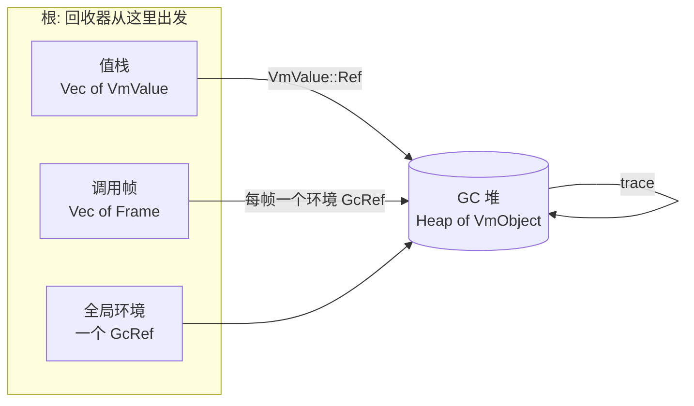

前三篇我们造了三个互不相干的零件：一张线性的字节码清单（[第 10 篇](/posts/rust-by-pebble-10-bytecode-macros/)），一个会找出环的垃圾回收器（[第 11 篇](/posts/rust-by-pebble-11-gc-unsafe/)），还有一个会泄漏环的树遍历解释器（[第 9 篇](/posts/rust-by-pebble-09-interpreter-closures/)）。这一篇把它们拼起来：一台读字节码、把对象放在 GC 堆上的虚拟机。拼完之后有两个自然的问题，我都拿真实的数字回答了。第一个：它快多少？`fib(20)` 在树遍历解释器上是 7.76 ms，在 VM 上是 5.00 ms，快 1.55 倍。不是 10 倍，甚至不到 2 倍。第二个：它们算出来的东西一样吗？不一样，而且我手里有五个现成的程序。

> [!NOTE] 本篇检查点
> 这一篇我们写完 `pebble-vm`（栈式虚拟机，GC 根，14 个测试）和 `pebble-bench`（共享的基准程序，Criterion 基准，差分测试），给 `pebble-macros` 加上第三种过程宏 `#[differential]`（属性宏），并把命令行升到第四版：`Backend` trait、`run --vm`、`bench` 子命令。涉及的 Rust 特性：`Copy` 的值枚举与句柄、GC 根与借用冲突、静态分发与动态分发、关联常量、泛型关联类型（GAT）、dyn 兼容性（E0038）、属性宏（`ItemFn`、`format_ident!`）、Criterion。上一篇：[手写垃圾回收器](/posts/rust-by-pebble-11-gc-unsafe/)。做完之后 `pebble-vm`、`pebble-bench`、`pebble-macros` 与 `tutorial-v1` 标签逐字节一致。

## 要解决什么问题

字节码已经有了。第 10 篇的反汇编器能把 `fib` 打印成一张清单，但没有任何东西执行它。执行的办法是教科书式的：一个循环，每圈取一条指令，用一个 `match` 分派，操作一个**值栈**。`1 + 2` 编译成 `Const 1, Const 2, Add`：前两条各压一个数，`Add` 弹出两个、压回一个和。

麻烦在对象。数字、布尔、`nil` 可以直接放在栈上，但字符串、列表、映射、闭包的环境不行：它们的大小不固定，会被多处引用，还会互相引用成环。第 9 篇我们用 `Rc<RefCell<..>>` 放这些东西，付出的代价是环泄漏。这一次它们放进第 11 篇的 `Heap<VmObject>`，栈上只保存 `GcRef` 句柄。所以 VM 有三块内存：



三个箭头指向堆的东西就是**根**。第 11 篇说过，回收器自己不知道什么是栈，根是嵌入方的事。这一篇我们就是嵌入方，所以"哪些东西是根"这个问题得由我们答对，答错的后果在后面的实验里有真实的 panic。

## 建 crate

在 workspace 根目录（你的是 `~/pebble`）：

```bash
cargo new --lib crates/pebble-vm
```

把 `crates/pebble-vm/Cargo.toml` 整个换成：

```toml
[package]
name = "pebble-vm"
description = "A stack-based virtual machine for Pebble bytecode."
version.workspace = true
edition.workspace = true
rust-version.workspace = true
authors.workspace = true
license.workspace = true
repository.workspace = true

[dependencies]
pebble-span.workspace = true
pebble-diag.workspace = true
pebble-bytecode.workspace = true
pebble-gc.workspace = true
pebble-value.workspace = true

[dev-dependencies]
pebble-parser.workspace = true

[lints]
workspace = true
```

五个正常依赖：`span`（报错要位置）、`diag`、`bytecode`（输入）、`gc`（堆）、`value`（`RuntimeError`、`Output`、内建函数名表）。`pebble-parser` 只在测试里把字符串变成 AST，放在 `[dev-dependencies]`，和第 10 篇的 `pebble-bytecode` 一样。

根 `Cargo.toml` 要多三样东西。在 `[workspace.dependencies]` 里，给内部 crate 那段加一行 `pebble-vm`，给外部那段加 `criterion`（本篇后面的基准要用；第 11 篇你已经加过 `pebble-gc` 和 `rand`）：

```toml
[workspace.dependencies]
# --- internal crates ---------------------------------------------------------
pebble-span = { path = "crates/pebble-span", version = "0.1.0" }
pebble-diag = { path = "crates/pebble-diag", version = "0.1.0" }
pebble-lexer = { path = "crates/pebble-lexer", version = "0.1.0" }
pebble-ast = { path = "crates/pebble-ast", version = "0.1.0" }
pebble-macros = { path = "crates/pebble-macros", version = "0.1.0" }
pebble-parser = { path = "crates/pebble-parser", version = "0.1.0" }
pebble-value = { path = "crates/pebble-value", version = "0.1.0" }
pebble-interp = { path = "crates/pebble-interp", version = "0.1.0" }
pebble-bytecode = { path = "crates/pebble-bytecode", version = "0.1.0" }
pebble-gc = { path = "crates/pebble-gc", version = "0.1.0" }
pebble-vm = { path = "crates/pebble-vm", version = "0.1.0" }

# --- external ----------------------------------------------------------------
anyhow = "1"
clap = { version = "4", features = ["derive", "wrap_help"] }
criterion = { version = "0.8", features = ["html_reports"] }
proc-macro2 = "1"
quote = "1"
rand = "0.10"
rustyline = "18"
syn = { version = "3", features = ["full"] }
```

最后在文件末尾追加两段 profile（第 15 篇细讲它们，这里先说一句理由：`cargo bench` 默认用的 `bench` profile 继承 `release`，而 `release` 里的 `lto = "thin"` 和 `codegen-units = 1` 会让编译器做更激进的优化，我们的数字是在这个设置下量的，你要复现就得有同样的设置）：

```toml
[profile.release]
lto = "thin"
codegen-units = 1

[profile.bench]
inherits = "release"
```

## 值和对象：Copy 的枚举，加一个句柄

写 `crates/pebble-vm/src/lib.rs`。从文件开头开始：属性、crate 文档、`use`，然后是栈上的值：

```rust
#![forbid(unsafe_code)]
//! A stack-based virtual machine for Pebble bytecode.
//!
//! The VM is the second backend. Where the tree-walker in `pebble-interp` walks
//! the AST with `Rc<RefCell<..>>` environments (and therefore leaks recursive
//! closures through reference cycles), the VM allocates its runtime objects on
//! the [`pebble_gc::Heap`], so cycles are collectable.
//!
//! The value stack holds [`VmValue`]s. Scalars are inline; everything with a
//! dynamic shape (strings, lists, maps, environments, closures) is a
//! [`GcRef`] index into the heap. Before each instruction the VM may collect;
//! the roots are the value stack, every live frame's environment, and the
//! globals.

use std::rc::Rc;

use pebble_bytecode::{Chunk, Compiled, Constant, FunctionProto, Opcode};
use pebble_gc::{GcObject, GcRef, Heap};
use pebble_span::Span;
use pebble_value::{Output, RuntimeError, Stdout};

/// A VM value.
///
/// `Copy`, so pushing one around never clones a heap object; the heap object
/// lives behind the [`GcRef`].
#[derive(Copy, Clone, PartialEq, Debug)]
pub enum VmValue {
    Nil,
    Bool(bool),
    Int(i64),
    Float(f64),
    /// A reference to a heap object.
    Ref(GcRef),
}

impl VmValue {
    fn is_truthy(self) -> bool {
        !matches!(self, VmValue::Nil | VmValue::Bool(false))
    }

    fn as_ref(self) -> Option<GcRef> {
        match self {
            VmValue::Ref(reference) => Some(reference),
            _ => None,
        }
    }
}
```

这段有几处值得停一下。

**`#![forbid(unsafe_code)]`**：这个 crate 里一行 `unsafe` 都不允许。第 11 篇的 GC 在内部用了 `unsafe`（bump arena），但 `Heap` 的接口是安全的，所以嵌入它的 VM 可以保持全安全。这就是 `unsafe` 的正确用法：把它关在小盒子里，盒子的接口是安全的。

**`VmValue` 是 `Copy`**。五个变体：`Nil`、`Bool`、`Int`、`Float`，外加 `Ref(GcRef)`：一个指向堆对象的句柄。因为 `GcRef` 本身是 `Copy`（一个 `u32` 下标，第 11 篇），整个枚举也能是 `Copy`。这件事的好处是**每一次入栈出栈都不涉及所有权**：`let a = self.stack.pop()` 之后 `a` 随便用几次，不会有"值被移走"的问题。C++ 里最接近的东西是一个 `std::variant<std::monostate, bool, int64_t, double, GcRef>`，所有成员都是平凡类型，所以整个 variant 可以 `memcpy`。我在一个临时测试里量了大小：

```text
size_of::<VmValue>()  = 16
size_of::<VmObject>() = 32
size_of::<Frame>()    = 24
```

16 字节：8 字节放 `i64`/`f64`，8 字节放判别标签和对齐填充。（`GcRef` 只有 4 字节，所以没有任何变体需要超过 8 字节的载荷。）

**`PartialEq` 但没有 `Eq`**：因为有 `f64`，`NaN != NaN`，不能承诺自反性。这是第 4 篇的老话题。这里 `PartialEq` 的用处很具体：第四版命令行里 `value != VmValue::Nil` 要用它。

**`is_truthy` 和 `as_ref`**：两个没有 `pub` 的小方法，注意 `fn is_truthy(self)` 拿的是 `self` 而不是 `&self`：因为 `VmValue` 是 `Copy`，按值传递和按引用传递一样便宜，还省得写解引用。`matches!(self, VmValue::Nil | VmValue::Bool(false))` 是第 7 篇的老朋友。Pebble 的真值规则是：只有 `nil` 和 `false` 是假的，`0` 和 `""` 都是真的。

接着是堆里的对象：

```rust
/// A heap-allocated VM object.
pub enum VmObject {
    /// An immutable string.
    Str(String),
    /// A mutable list.
    List(Vec<VmValue>),
    /// A map, stored as insertion-ordered key/value pairs and searched linearly.
    Map(Vec<(VmValue, VmValue)>),
    /// A function value: a prototype plus the environment it closed over.
    Closure {
        proto: Rc<FunctionProto>,
        env: GcRef,
    },
    /// A frame of bindings with a link to the enclosing frame.
    Env {
        parent: Option<GcRef>,
        slots: Vec<(String, VmValue)>,
    },
    /// A builtin function, identified by name.
    Native(&'static str),
}
```

六种对象，每种都对应第 9 篇树遍历解释器里的某个 `Rc<RefCell<..>>`：

- `Str`、`List`、`Map`：字符串、列表、映射。映射是按插入顺序存的键值对数组，**线性查找**。（`HashMap` 需要给 `VmValue` 实现 `Hash`，而 `Hash` 对列表键要看堆里的内容，句柄自己做不到：第 8 篇的 `MapKey` 那一套在这里行不通。这是我偷的一个懒，代价是 O(n) 查找，后面量性能时它不是主要问题。）
- `Closure { proto, env }`：一个函数原型加上它定义时所在的环境。`proto` 是 `Rc<FunctionProto>`，和第 10 篇字节码里的常量是同一份：原型是**不可变**的，不会引用 `GcRef`，所以不会成环，用 `Rc` 共享它是安全的，也不需要被回收器追踪。`env` 是 `GcRef`，指向堆上的一个 `Env` 对象。
- `Env { parent, slots }`：一帧变量绑定，加一条指向外层的链。`slots` 是 `Vec<(String, VmValue)>`：名字加值的数组，同样线性查找。第 8 篇的 `Env` 是 `HashMap`，这里换成了数组，因为大多数环境只有几个名字，数组扫一遍比哈希快，这是个真实的权衡，不过后面你会看到全局环境不属于"几个名字"的情况。
- `Native(&'static str)`：内建函数，只记名字。`&'static str` 来自第 8 篇的 `builtin_names()`，那些名字活在整个程序的生命周期里，所以引用可以直接存进对象。

然后是 `GcObject` 实现，也就是每个对象告诉回收器"我引用了谁"：

```rust
impl GcObject for VmObject {
    fn trace(&self, mark: &mut dyn FnMut(GcRef)) {
        match self {
            VmObject::Str(_) | VmObject::Native(_) => {}
            VmObject::List(items) => {
                for item in items {
                    if let VmValue::Ref(reference) = item {
                        mark(*reference);
                    }
                }
            }
            VmObject::Map(entries) => {
                for (key, value) in entries {
                    if let VmValue::Ref(reference) = key {
                        mark(*reference);
                    }
                    if let VmValue::Ref(reference) = value {
                        mark(*reference);
                    }
                }
            }
            VmObject::Closure { env, .. } => mark(*env),
            VmObject::Env { parent, slots } => {
                if let Some(parent) = parent {
                    mark(*parent);
                }
                for (_, value) in slots {
                    if let VmValue::Ref(reference) = value {
                        mark(*reference);
                    }
                }
            }
        }
    }
}
```

`trace` 的参数 `mark: &mut dyn FnMut(GcRef)` 是第 11 篇的 trait 对象闭包：回收器给我们一个回调，我们对每个子引用调用一次。这个 `match` 是**穷尽**的，所以将来给 `VmObject` 加第七个变体时，编译器会逼你来这里，想清楚新对象引用不引用别的对象。这是 `trace` 唯一不可以写错的地方：漏标一个子引用，那个子对象在下一次回收时就会被释放，而一个活着的对象里还留着指向它的句柄。

`VmObject::Env` 这一支里 `if let Some(parent) = parent { mark(*parent); }`：`parent` 的类型是 `&Option<GcRef>`（因为 `match self` 里 `self` 是引用，默认绑定模式把字段变成引用），`if let Some(parent) = parent` 里的 `parent` 于是是 `&GcRef`，所以要 `*parent`。这是第 5 篇讲 `match self` 绑定模式时的同一个现象。

## 帧和 Vm 本体

接着往下写：调用帧、`Vm` 结构体、它的构造函数：

```rust
/// One activation record.
struct Frame {
    proto: Rc<FunctionProto>,
    env: GcRef,
    ip: usize,
}

/// The virtual machine.
pub struct Vm {
    heap: Heap<VmObject>,
    stack: Vec<VmValue>,
    frames: Vec<Frame>,
    globals: GcRef,
    out: Box<dyn Output>,
    max_frames: usize,
    gc_threshold: usize,
}

impl Default for Vm {
    fn default() -> Self {
        Self::new()
    }
}
```

`Frame` 记录三件事：我在执行哪个函数（`proto`），我的变量环境是堆上哪个对象（`env`），我执行到第几条指令（`ip`，instruction pointer）。`Vm` 把全部状态放在一个结构体里：堆、值栈、帧栈、全局环境、输出、两个阈值。**调用栈在这里是一个 `Vec<Frame>`**，不是 Rust 的函数调用栈。这一点我们后面再谈，它的后果比看上去大。

`out: Box<dyn Output>` 是第 8 篇的 trait 对象：`print` 往哪里写由嵌入方决定（命令行写标准输出，测试写缓冲区）。`max_frames` 是递归深度上限，`gc_threshold` 是"自上次回收以来允许分配多少个对象才触发下一次回收"。

`impl Default for Vm` 是 clippy 要求的：有一个无参 `new()` 就该有 `Default`，和第 9 篇的 `Interpreter` 一样。

接着是 `impl Vm` 的开头：构造函数和几个访问器。注意这里**不写右花括号**，后面所有方法都放进同一个 `impl` 块，最后才闭合：

```rust
impl Vm {
    /// Creates a VM with default limits, printing to standard output.
    #[must_use]
    pub fn new() -> Self {
        Self::with_output(Box::new(Stdout))
    }

    /// Creates a VM with a custom output sink.
    #[must_use]
    pub fn with_output(out: Box<dyn Output>) -> Self {
        let mut heap = Heap::new();
        let globals = heap.alloc(VmObject::Env {
            parent: None,
            slots: Vec::new(),
        });
        for name in pebble_value::builtin_names() {
            let native = heap.alloc(VmObject::Native(name));
            if let VmObject::Env { slots, .. } = heap.get_mut(globals) {
                slots.push((name.to_string(), VmValue::Ref(native)));
            }
        }
        Self {
            heap,
            stack: Vec::new(),
            frames: Vec::new(),
            globals,
            out,
            max_frames: 256,
            gc_threshold: 1024,
        }
    }

    /// Sets the recursion limit.
    pub fn set_max_frames(&mut self, frames: usize) {
        self.max_frames = frames;
    }

    /// Sets how many allocations may accumulate before a collection.
    pub fn set_gc_threshold(&mut self, threshold: usize) {
        self.gc_threshold = threshold;
    }

    /// Number of live heap objects.
    #[must_use]
    pub fn heap_live(&self) -> usize {
        self.heap.live_count()
    }

    /// Estimated heap bytes.
    #[must_use]
    pub fn heap_bytes(&self) -> usize {
        self.heap.bytes_allocated()
    }
```

`with_output` 里有一件小事：全局环境先建好，然后对每个内建函数名各分配一个 `Native` 对象并塞进全局环境的槽位。`for name in pebble_value::builtin_names()` 用的就是第 8 篇那个 `-> impl Iterator<Item = &'static str>` 函数，我们的 VM 因此不再自己维护一份内建名字列表：新增一个内建函数，只要改 `pebble-value` 里的表一处。（仓库的历史里，VM 原来有一份独立的 `BUILTINS` 常量，两份列表迟早会不同步，所以我把它换成了这个函数。）

循环体里为什么是 `heap.alloc(...)` 之后再 `heap.get_mut(globals)`，而不是一步到位？两者都要 `&mut self.heap`，借用检查器不允许同时存在，所以必须分成两个语句。你会在这个文件里反复看到这个形状：**先从堆里读出你要的东西，让借用结束，再去分配或修改。** 后面它会咬我们一口。

这一段可以编译了。给 `impl Vm` 补上右花括号 `}`，然后：

```bash
cargo build -p pebble-vm
```

```text
warning: unused imports: `Chunk`, `Compiled`, `Constant`, and `Opcode`
  --> crates/pebble-vm/src/lib.rs:17:23
   |
17 | use pebble_bytecode::{Chunk, Compiled, Constant, FunctionProto, Opcode};
   |                       ^^^^^  ^^^^^^^^  ^^^^^^^^                 ^^^^^^
   |
   = note: `#[warn(unused_imports)]` (part of `#[warn(unused)]`) on by default

...
warning: `pebble-vm` (lib) generated 6 warnings (run `cargo fix --lib -p pebble-vm` to apply 3 suggestions)
    Finished `dev` profile [unoptimized + debuginfo] target(s) in 0.20s
```

只有警告，没有错误。每一条都是同一个意思："这个东西你定义了但还没用"，编译器在帮我们列出接下来要写什么。

## 主循环：run

`run` 是整个 VM 的心脏。我分四段写，每段只加一类指令。先是循环的骨架：

```rust
    /// Runs a compiled program and returns its value.
    ///
    /// # Errors
    /// Returns a [`RuntimeError`] for any type error, undefined name, arity
    /// mismatch, or recursion-limit breach.
    pub fn run(&mut self, compiled: &Compiled) -> Result<VmValue, RuntimeError> {
        self.stack.clear();
        self.frames.clear();
        self.frames.push(Frame {
            proto: Rc::clone(&compiled.main),
            env: self.globals,
            ip: 0,
        });

        loop {
            if self.frames.is_empty() {
                return Ok(self.stack.pop().unwrap_or(VmValue::Nil));
            }
            if self.heap.allocations_since_gc() > self.gc_threshold {
                self.collect_garbage();
            }

            let frame_index = self.frames.len() - 1;
            let proto = Rc::clone(&self.frames[frame_index].proto);
            let ip = self.frames[frame_index].ip;

            if ip >= proto.chunk.len() {
                // Falling off the end of a chunk returns its top-of-stack.
                self.frames.pop();
                let result = self.stack.pop().unwrap_or(VmValue::Nil);
                if self.frames.is_empty() {
                    return Ok(result);
                }
                self.stack.push(result);
                continue;
            }

            let instruction = proto.chunk.code()[ip];
            self.frames[frame_index].ip = ip + 1;
            let span = proto.chunk.span_at(ip);

            match instruction {
```

逐块看。

**初始化**：清空栈和帧，压入主程序的帧，环境是全局环境。`Rc::clone(&compiled.main)` 是第 8 篇的 `Rc`：增加一个引用计数，不复制函数原型。

**每圈的第一件事：看要不要回收**。`allocations_since_gc() > gc_threshold` 就调用 `collect_garbage`。注意回收只发生在**这个位置**：两条指令之间。我们稍后专门谈为什么。

**取指**：
```rust
let proto = Rc::clone(&self.frames[frame_index].proto);
```
为什么要克隆一个 `Rc` 出来，而不是直接借 `self.frames[frame_index].proto`？因为后面的 `match` 里要调用 `self.pop(span)`、`self.call(count, span)` 这类 `&mut self` 方法，如果这里还握着一个指向 `self.frames` 的借用，借用检查器会拒绝。克隆 `Rc` 是一次非原子的计数加一（第 8 篇：不是 `Arc`，没有原子指令），把"proto 的所有权"从 `self` 里摘出来变成一个局部变量。这是一次小小的性能代价，换取借用检查器满意。我怀疑它在热循环里不是免费的，后面量性能时会回来。

`proto.chunk.code()[ip]` 取出的 `Opcode` 是 `Copy` 的（第 10 篇：8 字节），所以 `let instruction = ...` 是一份值拷贝，之后随便用。紧接着 `ip + 1` 先写回帧里：**先递增再执行**，这样跳转指令只要覆盖 `ip` 就行，其他指令什么都不用管。

**执行到末尾**：如果 `ip >= proto.chunk.len()`，函数"掉出了末尾"，等于隐式返回栈顶（或者 `nil`）。第 10 篇我们在跳转目标里提过，"跳到末尾之后"是合法的，这里就是兑现。

现在是 `match instruction`。第一批：常量和名字。

```rust
                Opcode::Const(index) => self.push_constant(&proto.chunk, index, span)?,
                Opcode::Nil => self.stack.push(VmValue::Nil),
                Opcode::True => self.stack.push(VmValue::Bool(true)),
                Opcode::False => self.stack.push(VmValue::Bool(false)),
                Opcode::Pop => {
                    self.stack.pop();
                }
                Opcode::DefineName(index) => {
                    let name = self.constant_name(&proto.chunk, index);
                    let value = self.stack.pop().unwrap_or(VmValue::Nil);
                    self.define(name, value);
                }
                Opcode::GetName(index) => {
                    let name = self.constant_name(&proto.chunk, index);
                    let value = self.lookup(&name).ok_or_else(|| {
                        RuntimeError::new(span, format!("undefined variable `{name}`"))
                    })?;
                    self.stack.push(value);
                }
                Opcode::SetName(index) => {
                    let name = self.constant_name(&proto.chunk, index);
                    let value = *self.stack.last().unwrap_or(&VmValue::Nil);
                    if !self.assign(&name, value) {
                        return Err(RuntimeError::new(
                            span,
                            format!("cannot assign to undefined variable `{name}`"),
                        ));
                    }
                }
                Opcode::MakeClosure(index) => {
                    let Constant::Function(proto_of_closure) =
                        &proto.chunk.constants()[index as usize]
                    else {
                        return Err(RuntimeError::new(span, "malformed closure constant"));
                    };
                    let env = self.frames[frame_index].env;
                    let reference = self.heap.alloc(VmObject::Closure {
                        proto: Rc::clone(proto_of_closure),
                        env,
                    });
                    self.stack.push(VmValue::Ref(reference));
                }
```

`Opcode::Const(index) => self.push_constant(&proto.chunk, index, span)?,` 这一行有一个 Rust 细节：`?` 之后整个表达式的类型是 `()`，所以这个 arm 的值是 `()`，和别的 arm 一致。而 `Opcode::Pop => { self.stack.pop(); }` 要写成块，因为 `Vec::pop` 返回 `Option<VmValue>`，加分号把它丢掉才得到 `()`。

`GetName` 里 `ok_or_else(|| RuntimeError::new(...))`：`lookup` 返回 `Option`，`ok_or_else` 把 `None` 变成 `Err`，然后 `?` 把错误冒泡出 `run`。`ok_or_else` 的参数是个闭包，只有在 `None` 时才会调用：如果你写 `ok_or(RuntimeError::new(...))`，错误值（包括 `format!` 出来的字符串）每次查找都会先构造一遍，白白浪费。这是 `_else` 系列函数存在的全部理由。

`MakeClosure(index)` 里是个 `let ... else`（第 3 篇）：常量池里第 `index` 个必须是 `Constant::Function`，否则返回一个 `malformed closure constant` 错误。成功时，我们从**当前帧**拿 `env`，把"原型加环境"打包成一个 `Closure` 对象放上堆：这就是第 9 篇那个 `Function::new(.., Rc::clone(env))` 的字节码版本，只是 `Rc<RefCell<Env>>` 变成了 `GcRef`。

第二批：算术、比较和逻辑。

```rust
                Opcode::Add => self.binary_add(span)?,
                Opcode::Sub => self.binary_numeric(span, "-", i64::checked_sub, |a, b| a - b)?,
                Opcode::Mul => self.binary_numeric(span, "*", i64::checked_mul, |a, b| a * b)?,
                Opcode::Div => self.binary_div(span)?,
                Opcode::Rem => self.binary_rem(span)?,
                Opcode::Neg => {
                    let value = self.pop(span)?;
                    let result = match value {
                        VmValue::Int(inner) => inner
                            .checked_neg()
                            .map(VmValue::Int)
                            .ok_or_else(|| self.overflow(span))?,
                        VmValue::Float(inner) => VmValue::Float(-inner),
                        other => {
                            return Err(RuntimeError::new(
                                span,
                                format!("cannot negate {}", self.type_name(other)),
                            ));
                        }
                    };
                    self.stack.push(result);
                }
                Opcode::Not => {
                    let value = self.pop(span)?;
                    self.stack.push(VmValue::Bool(!value.is_truthy()));
                }
                Opcode::Equal => {
                    let rhs = self.pop(span)?;
                    let lhs = self.pop(span)?;
                    let equal = self.value_equal(lhs, rhs);
                    self.stack.push(VmValue::Bool(equal));
                }
                Opcode::NotEqual => {
                    let rhs = self.pop(span)?;
                    let lhs = self.pop(span)?;
                    let equal = self.value_equal(lhs, rhs);
                    self.stack.push(VmValue::Bool(!equal));
                }
                Opcode::Less | Opcode::LessEqual | Opcode::Greater | Opcode::GreaterEqual => {
                    let ordering = self.binary_compare(span)?;
                    use std::cmp::Ordering;
                    let result = match instruction {
                        Opcode::Less => ordering == Ordering::Less,
                        Opcode::LessEqual => ordering != Ordering::Greater,
                        Opcode::Greater => ordering == Ordering::Greater,
                        Opcode::GreaterEqual => ordering != Ordering::Less,
                        _ => unreachable!(),
                    };
                    self.stack.push(VmValue::Bool(result));
                }
```

四则运算全部交给辅助方法（稍后复制），`binary_numeric` 的两个函数指针参数 `i64::checked_sub` 和 `|a, b| a - b` 是第 8 篇的内容：不捕获任何东西的闭包可以强转成 `fn` 指针。`Neg` 里 `checked_neg` 对 `i64::MIN` 返回 `None`（因为 `-i64::MIN` 装不下），所以 `-x` 也会报"integer overflow"而不是悄悄回绕。

比较那一支值得多看一眼：

```rust
Opcode::Less | Opcode::LessEqual | Opcode::Greater | Opcode::GreaterEqual => {
    let ordering = self.binary_compare(span)?;
    use std::cmp::Ordering;
    let result = match instruction {
        ...
        _ => unreachable!(),
    };
```

一个或模式匹配四条指令，里面再按 `instruction` 分一次。内层的 `_ => unreachable!()` 是我对这段代码最不满意的地方：编译器没法证明另外那些指令不会进来，所以我用一个"不可能"的 arm 把它堵住。更干净的做法是四个独立的 arm，各自调用一个小函数，代价是多写几行。我留着它，是因为它是一个诚实的例子：**穷尽匹配并不是免费的午餐**，当你用或模式把几个分支合在一起之后，你就把一部分检查责任从编译器手里拿回了自己手里。

`use std::cmp::Ordering;` 写在块中间也是合法的：`use` 声明是一个"项"，可以出现在任何块里，作用域就是那个块。

第三批：跳转、调用、返回。

```rust
                Opcode::Jump(target) => self.frames[frame_index].ip = target as usize,
                Opcode::JumpIfFalse(target) => {
                    let value = self.pop(span)?;
                    if !value.is_truthy() {
                        self.frames[frame_index].ip = target as usize;
                    }
                }
                Opcode::JumpIfFalseKeep(target) => {
                    let value = *self.stack.last().unwrap_or(&VmValue::Nil);
                    if value.is_truthy() {
                        self.stack.pop();
                    } else {
                        self.frames[frame_index].ip = target as usize;
                    }
                }
                Opcode::JumpIfTrueKeep(target) => {
                    let value = *self.stack.last().unwrap_or(&VmValue::Nil);
                    if value.is_truthy() {
                        self.frames[frame_index].ip = target as usize;
                    } else {
                        self.stack.pop();
                    }
                }
                Opcode::Call(count) => self.call(count, span)?,
                Opcode::Return => {
                    let value = self.stack.pop().unwrap_or(VmValue::Nil);
                    self.frames.pop();
                    if self.frames.is_empty() {
                        return Ok(value);
                    }
                    self.stack.push(value);
                }
```

三条跳转，每一条都只有一两行，这就是第 10 篇花了那么多功夫回填的回报：`Jump(target)` 的全部实现就是 `self.frames[frame_index].ip = target as usize`。`JumpIfFalseKeep` 和 `JumpIfTrueKeep` 是第 10 篇 `and`/`or` 的短路形式：真值时（对 `and`）弹掉栈顶继续，假值时**保留**栈顶并跳转，所以 `nil or 3` 的结果是 `3`，`1 and 2` 的结果是 `2`：和 Python、Lua 一样，逻辑运算符返回操作数而不是布尔。

`Call(count)` 把一切交给 `self.call`。`Return` 弹出返回值，**弹掉当前帧**，再把返回值压回栈顶，交给调用者的帧继续。如果弹掉之后帧栈空了，说明主程序结束，直接返回。

第四批：集合和下标，然后闭合 `loop`、`match` 和 `run`：

```rust
                Opcode::BuildList(count) => {
                    let items = self.stack.split_off(self.stack.len() - count as usize);
                    let reference = self.heap.alloc(VmObject::List(items));
                    self.stack.push(VmValue::Ref(reference));
                }
                Opcode::BuildMap(count) => {
                    let flat = self
                        .stack
                        .split_off(self.stack.len() - (count as usize * 2));
                    let mut entries = Vec::with_capacity(count as usize);
                    let mut iter = flat.into_iter();
                    while let (Some(key), Some(value)) = (iter.next(), iter.next()) {
                        entries.push((key, value));
                    }
                    let reference = self.heap.alloc(VmObject::Map(entries));
                    self.stack.push(VmValue::Ref(reference));
                }
                Opcode::Index => {
                    let index = self.pop(span)?;
                    let container = self.pop(span)?;
                    let result = self.index_value(container, index, span)?;
                    self.stack.push(result);
                }
                Opcode::SetIndex => {
                    let value = self.pop(span)?;
                    let index = self.pop(span)?;
                    let container = self.pop(span)?;
                    self.set_index_value(container, index, value, span)?;
                    self.stack.push(value);
                }
            }
        }
    }
```

`BuildList(count)` 用的是 `self.stack.split_off(self.stack.len() - count as usize)`：把栈顶 `count` 个值一次拆成新的 `Vec`。这一行里有个借用小花招：`self.stack.split_off(...)` 要 `&mut self.stack`，参数里又读 `self.stack.len()`。两者是对同一个字段的借用，这是第 7 篇讲过的**两阶段借用**：`&mut` 借用先"预约"，等参数求值完才真正激活，所以这样写合法。如果你把长度先放进一个局部变量，也一样对，只是多一行。

`BuildMap` 里 `while let (Some(key), Some(value)) = (iter.next(), iter.next())`：每圈从迭代器里取两个，元组模式一次解开。栈上 map 的布局是 `key1 value1 key2 value2 ...`，所以两个一对。

好了，`run` 写完了。给它编译一次：

```bash
cargo build -p pebble-vm
```

```text
error[E0599]: no method named `collect_garbage` found for mutable reference `&mut Vm` in the current scope
   --> crates/pebble-vm/src/lib.rs:204:22
    |
204 |                 self.collect_garbage();
    |                      ^^^^^^^^^^^^^^^ method not found in `&mut Vm`

error[E0599]: no method named `push_constant` found for mutable reference `&mut Vm` in the current scope
   --> crates/pebble-vm/src/lib.rs:227:46
    |
227 |                 Opcode::Const(index) => self.push_constant(&proto.chunk, index, span)?,
    |                                              ^^^^^^^^^^^^^ method not found in `&mut Vm`
...
error: could not compile `pebble-vm` (lib) due to 33 previous errors; 2 warnings emitted
```

33 个错误。每一个都是同一件事：`run` 调用了 `self.pop`、`self.call`、`self.lookup`...，而这些方法一个也不存在。我数了一下，一共是 18 种不同的缺失方法：

```bash
cargo build -p pebble-vm 2>&1 | grep '^error' | sort | uniq -c | sort -rn
```

```text
     12 error[E0599]: no method named `pop` found for mutable reference `&mut Vm` in the current scope
      3 error[E0599]: no method named `constant_name` found for mutable reference `&mut Vm` in the current scope
      2 error[E0599]: no method named `value_equal` found for mutable reference `&mut Vm` in the current scope
      2 error[E0599]: no method named `binary_numeric` found for mutable reference `&mut Vm` in the current scope
      1 error[E0599]: no method named `type_name` found for mutable reference `&mut Vm` in the current scope
      1 error[E0599]: no method named `set_index_value` found for mutable reference `&mut Vm` in the current scope
      1 error[E0599]: no method named `push_constant` found for mutable reference `&mut Vm` in the current scope
      1 error[E0599]: no method named `overflow` found for mutable reference `&mut Vm` in the current scope
      1 error[E0599]: no method named `lookup` found for mutable reference `&mut Vm` in the current scope
      1 error[E0599]: no method named `index_value` found for mutable reference `&mut Vm` in the current scope
      1 error[E0599]: no method named `define` found for mutable reference `&mut Vm` in the current scope
      1 error[E0599]: no method named `collect_garbage` found for mutable reference `&mut Vm` in the current scope
      1 error[E0599]: no method named `call` found for mutable reference `&mut Vm` in the current scope
      1 error[E0599]: no method named `binary_rem` found for mutable reference `&mut Vm` in the current scope
      1 error[E0599]: no method named `binary_div` found for mutable reference `&mut Vm` in the current scope
      1 error[E0599]: no method named `binary_compare` found for mutable reference `&mut Vm` in the current scope
      1 error[E0599]: no method named `binary_add` found for mutable reference `&mut Vm` in the current scope
      1 error[E0599]: no method named `assign` found for mutable reference `&mut Vm` in the current scope
      1 error: could not compile `pebble-vm` (lib) due to 33 previous errors; 2 warnings emitted
```

`pop` 出现 12 次，它是整个 VM 里被调用最多的方法。这份清单就是我们接下来的待办列表：**让编译器告诉你还差什么**，是 Rust 里写大函数时非常顺手的一种节奏（C++ 里你得等链接器报 undefined reference，而且只会报一个函数一次）。

## 补齐 run 要用的方法

按重要性，先写最小的三个：从栈里弹值、把常量池里的常量压栈、取常量池里的名字。把它们放在 `run` 的后面（还在同一个 `impl Vm` 里，一个空行隔开）：

```rust
    // --- helpers: stack, constants ---------------------------------------

    fn pop(&mut self, span: Span) -> Result<VmValue, RuntimeError> {
        self.stack
            .pop()
            .ok_or_else(|| RuntimeError::new(span, "internal error: value stack underflow"))
    }

    fn push_constant(&mut self, chunk: &Chunk, index: u32, span: Span) -> Result<(), RuntimeError> {
        match &chunk.constants()[index as usize] {
            Constant::Nil => self.stack.push(VmValue::Nil),
            Constant::Bool(value) => self.stack.push(VmValue::Bool(*value)),
            Constant::Int(value) => self.stack.push(VmValue::Int(*value)),
            Constant::Float(value) => self.stack.push(VmValue::Float(*value)),
            Constant::Str(value) => {
                let reference = self.heap.alloc(VmObject::Str(value.clone()));
                self.stack.push(VmValue::Ref(reference));
            }
            Constant::Function(_) => {
                return Err(RuntimeError::new(span, "function constant used as a value"));
            }
        }
        Ok(())
    }

    fn constant_name(&self, chunk: &Chunk, index: u32) -> String {
        match &chunk.constants()[index as usize] {
            Constant::Str(name) => name.clone(),
            _ => format!("<constant {index}>"),
        }
    }
```

`pop` 在栈空时返回一个 `RuntimeError`，而不是 `panic!`。栈下溢意味着**编译器**生成了坏的字节码，不是用户的错；但这是 VM，用户的程序是一个黑盒，我宁可让它带着一个"internal error"优雅地失败，也不让整个进程崩溃（比如 REPL 里一次错误不该杀死整个会话）。这是第 7 篇讨论过的取舍：`panic` 留给"程序逻辑自己的矛盾"，`Result` 留给"输入的问题"，这里两种都沾一点，我选了更保守的那一边。

`push_constant` 里有一件值得记住的事：`Constant::Str(value)` 这一支每次执行都 `value.clone()` 再 `heap.alloc`：**每次执行一个字符串字面量，都会在堆上新分配一个字符串对象**。`constant_name` 也是：它返回 `String`，每次调用都克隆一份名字。也就是说，`GetName` 每读一次变量，就分配一次内存。这是第 10 篇说过的"按名字找变量"的真实代价的一部分，我们等会儿有数字。

接着是环境的三个操作。定义、读取、赋值：

```rust
    // --- helpers: environments -------------------------------------------

    fn current_env(&self) -> GcRef {
        self.frames.last().map_or(self.globals, |frame| frame.env)
    }

    fn define(&mut self, name: String, value: VmValue) {
        let env = self.current_env();
        if let VmObject::Env { slots, .. } = self.heap.get_mut(env) {
            if let Some(slot) = slots.iter_mut().find(|(existing, _)| *existing == name) {
                slot.1 = value;
            } else {
                slots.push((name, value));
            }
        }
    }

    fn lookup(&self, name: &str) -> Option<VmValue> {
        let mut current = Some(self.current_env());
        while let Some(env) = current {
            let VmObject::Env { parent, slots } = self.heap.get(env) else {
                return None;
            };
            if let Some((_, value)) = slots.iter().find(|(existing, _)| existing == name) {
                return Some(*value);
            }
            current = *parent;
        }
        None
    }

    fn assign(&mut self, name: &str, value: VmValue) -> bool {
        let mut current = Some(self.current_env());
        while let Some(env) = current {
            if let VmObject::Env { parent, slots } = self.heap.get_mut(env) {
                if let Some(slot) = slots.iter_mut().find(|(existing, _)| existing == name) {
                    slot.1 = value;
                    return true;
                }
                current = *parent;
            } else {
                return false;
            }
        }
        false
    }
```

`lookup` 沿着 `parent` 链往上走，每一层在 `slots` 里线性扫一遍。`while let Some(env) = current` 加 `current = *parent` 是第 4 篇的 `while let` 模式。`let VmObject::Env { parent, slots } = self.heap.get(env) else { return None; };`：从堆里借出一个对象，如果不是 `Env` 就放弃。`define` 的行为值得注意：**如果当前环境里已经有同名绑定，就覆盖它**。这一条规则，加上"块不创建新环境"，就是后面"块级作用域"那个不一致的全部原因，先记在心里。

现在是 `call`，整个 VM 里最重要的函数之一。先看前半：

```rust
    // --- helpers: calls ---------------------------------------------------

    fn call(&mut self, count: u32, span: Span) -> Result<(), RuntimeError> {
        let count = count as usize;
        if self.stack.len() < count + 1 {
            return Err(RuntimeError::new(
                span,
                "internal error: call stack underflow",
            ));
        }
        let args = self.stack.split_off(self.stack.len() - count);
        let callee = self.pop(span)?;

        enum Target {
            Native(&'static str),
            Closure(Rc<FunctionProto>, GcRef),
        }

        let target = match callee.as_ref().map(|reference| self.heap.get(reference)) {
            Some(VmObject::Native(name)) => Target::Native(name),
            Some(VmObject::Closure { proto, env }) => Target::Closure(Rc::clone(proto), *env),
            _ => {
                return Err(RuntimeError::new(
                    span,
                    format!("{} is not callable", self.type_name(callee)),
                ));
            }
        };
```

**调用约定**：字节码编译器（第 10 篇）先压被调用者，再按顺序压每个参数，最后 `Call(n)`。所以栈顶是 `[.., callee, arg1, ..., argN]`。`split_off(len - count)` 先拆出 N 个参数，再 `pop` 一次得到被调用者。

然后一个有趣的细节：局部枚举 `Target`。它只在这个函数里用，所以直接定义在函数体里。为什么需要它？因为接下来要从堆里读被调用者的信息（是个内建函数，还是个闭包，闭包的话 `proto` 和 `env` 是什么），读完要**修改**堆（分配新环境），读和改不能同时发生。`Target` 就是"从堆里拷贝出的一份快照"：`Native(&'static str)` 的名字是 `'static` 引用，不借用堆；`Closure(Rc<FunctionProto>, GcRef)` 里 `Rc::clone` 是一份新的所有权，`GcRef` 是 `Copy`。拷贝出来之后，对 `self.heap` 的借用就结束了，后面可以随便改。

我当初没有这么写。最自然的写法是不要快照，直接在 `match` 里用借出来的引用，要什么拿什么：

```rust
if let Some(VmObject::Closure { proto, env }) =
    callee.as_ref().map(|reference| self.heap.get(reference))
{
    let slots = proto.params.iter().cloned().zip(args).collect();
    let new_env = self.heap.alloc(VmObject::Env { parent: Some(*env), slots });
    self.frames.push(Frame { proto: Rc::clone(proto), env: new_env, ip: 0 });
    return Ok(());
}
```

我把这段放进 `call` 里 `let callee = self.pop(span)?;` 的后面，编译：

```text
error[E0502]: cannot borrow `self.heap` as mutable because it is also borrowed as immutable
   --> crates/pebble-vm/src/lib.rs:480:27
    |
477 |               callee.as_ref().map(|reference| self.heap.get(reference))
    |                                   ----------- --------- first borrow occurs due to use of `self.heap` in closure
    |                                   |
    |                                   immutable borrow occurs here
...
480 |               let new_env = self.heap.alloc(VmObject::Env {
    |  ___________________________^
481 | |                 parent: Some(*env),
482 | |                 slots,
483 | |             });
    | |______________^ mutable borrow occurs here
484 |               self.frames.push(Frame {
485 |                   proto: Rc::clone(proto),
    |                                    ----- immutable borrow later used here

For more information about this error, try `rustc --explain E0502`.
error: could not compile `pebble-vm` (lib) due to 1 previous error
```

这是 Rust 最著名的错误之一，而且这次它**说得对**。`proto` 和 `env` 是指向 `self.heap` 里某个槽位的引用；`self.heap.alloc(..)` 可能让底层的 `Vec` 重新分配、搬家，那个槽位就换地方了，`proto` 和 `env` 就悬空了。C++ 里这是迭代器失效：在遍历 `std::vector` 的同时 `push_back`，标准说是未定义行为，实践中是偶发的崩溃。Rust 在编译期就把它拦下，代价是你必须改变代码的形状：**先把要用的东西拷出来，借用结束，再改。** `Target` 枚举就是这个形状。

（这条规矩在整个文件里反复出现。你很快会在 `index_value` 里再见到它，那里的"先拷出来"代价高得多，后面的性能一节会讲。）

后半是真正的调用：

```rust
        match target {
            Target::Native(name) => {
                let result = self.call_builtin(name, &args, span)?;
                self.stack.push(result);
            }
            Target::Closure(proto, env) => {
                if args.len() != proto.params.len() {
                    return Err(RuntimeError::new(
                        span,
                        format!(
                            "{} expects {} argument(s), got {}",
                            proto.display_name(),
                            proto.params.len(),
                            args.len()
                        ),
                    ));
                }
                if self.frames.len() >= self.max_frames {
                    return Err(RuntimeError::new(
                        span,
                        format!("call stack overflow (limit {})", self.max_frames),
                    ));
                }
                let slots = proto.params.iter().cloned().zip(args).collect();
                let new_env = self.heap.alloc(VmObject::Env {
                    parent: Some(env),
                    slots,
                });
                self.frames.push(Frame {
                    proto,
                    env: new_env,
                    ip: 0,
                });
            }
        }
        Ok(())
    }
```

内建函数：直接调用，把结果压栈。闭包：检查参数个数，检查帧数是否超过 `max_frames`，然后做三件事：用 `params.iter().cloned().zip(args).collect()` 把形参名和实参配成 `slots`（`zip` 把两个迭代器逐对合并，`collect` 到 `Vec<(String, VmValue)>`），在堆上分配一个以闭包的 `env` 为父的新环境，最后压入新帧。**注意没有递归**：`call` 只是往 `self.frames` 里 push 了一个帧就返回了，真正的执行由 `run` 的外层循环继续，下一圈会从新帧的第 0 条指令开始。

> [!NOTE] 为什么这值得强调
> 第 9 篇的树遍历解释器里，Pebble 的每一次函数调用对应一次 Rust 的函数调用（`call_value` → `run_function` → `execute_block` → `eval` → `call_value`...），所以递归深度受 Rust 栈大小限制，我们不得不给测试开一个大栈的线程。这个 VM 里 Pebble 的调用栈是一个 `Vec<Frame>`，Rust 栈的深度和 Pebble 的递归深度**无关**。`max_frames` 的 256 是一个策略，不是技术限制。

给 `impl Vm` 补上这些方法之后，再编译一次，看看还差什么：

```text
      2 error[E0599]: no method named `value_equal` found for mutable reference `&mut Vm` in the current scope
      2 error[E0599]: no method named `type_name` found for mutable reference `&mut Vm` in the current scope
      2 error[E0599]: no method named `binary_numeric` found for mutable reference `&mut Vm` in the current scope
      1 error[E0599]: no method named `set_index_value` found for mutable reference `&mut Vm` in the current scope
      1 error[E0599]: no method named `overflow` found for mutable reference `&mut Vm` in the current scope
      1 error[E0599]: no method named `index_value` found for mutable reference `&mut Vm` in the current scope
      1 error[E0599]: no method named `collect_garbage` found for mutable reference `&mut Vm` in the current scope
      1 error[E0599]: no method named `call_builtin` found for mutable reference `&mut Vm` in the current scope
      1 error[E0599]: no method named `binary_rem` found for mutable reference `&mut Vm` in the current scope
      1 error[E0599]: no method named `binary_div` found for mutable reference `&mut Vm` in the current scope
      1 error[E0599]: no method named `binary_compare` found for mutable reference `&mut Vm` in the current scope
      1 error[E0599]: no method named `binary_add` found for mutable reference `&mut Vm` in the current scope
      1 error: could not compile `pebble-vm` (lib) due to 15 previous errors
```

从 33 个错误减到了 15 个，缺的方法只剩两类：运算符和下标（`binary_add`、`binary_div`、`index_value`...）、内建函数和辅助（`call_builtin`、`type_name`、`value_equal`...），外加 `collect_garbage`。先做前者。

## 复制：运算符、下标、内建函数、显示

这些方法的共同点是：它们都在用上面已经讲过的东西，没有新的 Rust 知识。我们**复制**它们。把 `https://github.com/bfmhno3/pebble/blob/tutorial-v1/crates/pebble-vm/src/lib.rs` 的[第 531 行到第 1101 行](https://github.com/bfmhno3/pebble/blob/tutorial-v1/crates/pebble-vm/src/lib.rs#L531-L1101)（或者在 `~/pebble-tag` 里 `sed -n '531,1101p' ~/pebble-tag/crates/pebble-vm/src/lib.rs`）原样粘贴到 `call` 的后面，中间空一行。这一整块是：

- `call_builtin`：按名字分派 11 个内建函数的大 `match`（`print`、`len`、`type`、`str`、`int`、`float`、`range`、`push`、`keys`、`clock`、`assert`）。
- `expect_args`、`expect_int`、`allocate_string`：三个小辅助。
- `overflow`、`binary_add`、`binary_numeric`、`binary_div`、`binary_rem`、`binary_compare`：算术和比较，每个都是"弹两个，匹配类型对，压结果"。
- `is_number`、`as_f64`、`is_str`、`is_list`、`as_string`、`as_list`、`value_equal`、`type_name`：类型判断和相等。
- `index_value`、`set_index_value`、`resolve_index`：下标读写，支持负下标。
- `display` 和 `write_display`：把值渲染成字符串（`display` 是 `pub`，第四版命令行要用）。

我要指给你看三个地方，因为它们值得你读一遍，而不是只粘贴：

1. `call_builtin` 的 `match name { "print" => ..., "len" => ... }` 是**按字符串匹配**：每次调用内建函数，都要拿函数名和十一个字符串依次比较（编译器具体怎么优化这个 `match`，我没有去看生成的代码）。
2. `index_value` 开头那段 `// Snapshot the contents so the heap borrow ends before we allocate.`，对列表是 `items.clone()`：**读一次 `xs[i]`，把整个列表克隆一遍。** 这就是上面 E0502 那条规矩的昂贵版本。我是在分析基准数字的时候注意到它的，后面的性能一节里有一个实验。
3. `write_display` 里 `VmObject::Str(text) => out.push_str(text)`：字符串直接输出，**不加引号**，不管它是顶层的还是嵌在列表里的。树遍历解释器的 `Display` 在列表里会给字符串加引号。这是下面"两个后端不一致"一节的第一个例子。

## GC 根：什么时候可以回收

现在补上最后一个方法 `collect_garbage`，放在复制来的那一大块的后面，同时闭合 `impl Vm`：

```rust
    // --- garbage collection ----------------------------------------------

    /// Marks every root and sweeps.
    ///
    /// Called between instructions, the only point where every live value is
    /// reachable from the stack, a frame, or the globals.
    pub fn collect_garbage(&mut self) {
        for value in &self.stack {
            if let VmValue::Ref(reference) = value {
                self.heap.mark(*reference);
            }
        }
        for frame in &self.frames {
            self.heap.mark(frame.env);
        }
        self.heap.mark(self.globals);
        self.heap.collect();
    }
}
```

第 11 篇的 `Heap` 把回收分成两步：嵌入方对每个根调用 `mark`，然后调用 `collect`。VM 的根有三类：值栈里的每个 `Ref`、每个活动帧的环境、全局环境。就这些。

为什么**只在指令之间**回收？因为在一条指令的执行中间，有些活着的值**不在任何根里**：`call` 里刚 `split_off` 出来的 `args` 是个局部 `Vec`，`binary_add` 里弹出来的 `lhs` 和 `rhs` 是两个局部变量，它们引用的堆对象对回收器是不可见的。如果回收恰好发生在那时，这些对象会被当成垃圾释放，然后指令继续用着已经被释放的句柄。C++ 里写过精确 GC 的人都认识这个问题：它叫"根的完备性"，一般的解法有两种，要么维护一个"影子栈"（每个局部变量都注册一下），要么规定回收只发生在局部变量都已经落到根上的**安全点**。我们选后者，安全点就是 `run` 循环的开头：此时每个活着的值，要么在 `self.stack` 里，要么挂在某个帧的环境（或全局环境）下面。

这条规矩能成立，还有赖于第 11 篇里的一个设计：**`Heap::alloc` 自己从不触发回收**，它只是计数（`allocations_since_gc`）。"要不要回收"永远是 `run` 循环开头那一句 `if` 在决定。

我不想只凭论证说"根是完备的"，所以做了两个实验。第一个：把阈值改成 0，也就是自上次回收以来**只要分配过任何东西**，下一条指令之前就回收。这是一个压力模式，它把回收频率提到最高，任何缺失的根都会立刻暴露：

```text
test result: ok. 14 passed; 0 failed; 0 ignored; 0 measured; 0 filtered out; finished in 0.00s
test result: ok. 2 passed; 0 failed; 0 ignored; 0 measured; 0 filtered out; finished in 0.47s
test result: ok. 5 passed; 0 failed; 0 ignored; 0 measured; 0 filtered out; finished in 0.01s
test result: ok. 3 passed; 0 failed; 0 ignored; 0 measured; 0 filtered out; finished in 0.00s
test result: ok. 10 passed; 0 failed; 0 ignored; 0 measured; 0 filtered out; finished in 0.13s
```

`pebble-vm` 的 14 个测试、`pebble-bench` 的 2 个单元测试和 5 个差分测试（本篇后面才写）、`pebble-cli` 的 3 个单元测试和 10 个集成测试，在压力模式下全部通过（我是在临时副本里把 `Vm::with_output` 里的 `gc_threshold: 1024` 改成 `0` 跑的，跑完恢复）。

第二个实验是反过来的：故意漏掉一类根。我把 `collect_garbage` 里"标记每个帧的环境"那个 `for` 循环删掉，仍然是压力模式：

```text
test tests::closures_capture_their_environment ... FAILED
test tests::recursion_via_global_function ... FAILED
test tests::recursion_limit_is_enforced ... FAILED
GcRef(13) does not point to a live object
GcRef(13) does not point to a live object
GcRef(13) does not point to a live object
test result: FAILED. 11 passed; 3 failed; 0 ignored; 0 measured; 0 filtered out; finished in 0.00s
```

```text

thread 'tests::closures_capture_their_environment' (154722) panicked at crates/pebble-gc/src/lib.rs:161:32:
GcRef(13) does not point to a live object
note: run with `RUST_BACKTRACE=1` environment variable to display a backtrace
```

三个测试挂了，信息是第 11 篇 `Heap::get_mut` 里的 `GcRef(13) does not point to a live object`：VM 去读一个函数的环境，而那个环境已经被当成垃圾回收掉了。这就是"漏一个根"的真实后果：没有 UB（第 11 篇的句柄是下标，不是裸指针），没有悄悄的错误结果，是一个干净的 panic。这是句柄设计的好处。顺便注意，漏掉帧之后，**不压力模式**的测试大多还是通过的：阈值是 1024，小程序根本触发不了回收。这类 bug 如果没有压力模式，在小测试里一辈子也看不见。

## 测试，以及一个证明环会被回收的测试

文件末尾是测试模块。先写它的骨架：

```rust
#[cfg(test)]
mod tests {
    use super::*;
    use pebble_parser::parse;
    use pebble_value::Buffer;
    use std::cell::RefCell;

    struct Shared(Rc<RefCell<Buffer>>);

    impl Output for Shared {
        fn write_line(&mut self, line: &str) {
            self.0.borrow_mut().write_line(line);
        }
    }

    /// Compiles and runs, returning the VM (for `display`), its result, and the
    /// captured output.
    fn run_full(src: &str) -> Result<(Vm, VmValue, Vec<String>), String> {
        let shared = Rc::new(RefCell::new(Buffer::new()));
        let mut sources = pebble_span::SourceMap::new();
        let id = sources.add("<test>", src);
        let parsed = parse(id, src);
        if !parsed.is_ok() {
            return Err(parsed
                .diagnostics
                .iter()
                .map(|diagnostic| diagnostic.render(&sources))
                .collect::<Vec<_>>()
                .join("\n"));
        }
        let compiled = pebble_bytecode::compile(&parsed.program);
        if !compiled.is_ok() {
            return Err(compiled
                .diagnostics
                .iter()
                .map(|diagnostic| diagnostic.render(&sources))
                .collect::<Vec<_>>()
                .join("\n"));
        }
        let mut vm = Vm::with_output(Box::new(Shared(Rc::clone(&shared))));
        let value = vm
            .run(&compiled.compiled)
            .map_err(|error| error.diagnostic.render(&sources))?;
        let lines = shared.borrow().lines().to_vec();
        Ok((vm, value, lines))
    }

    fn run(src: &str) -> Result<VmValue, String> {
        run_full(src).map(|(_, value, _)| value)
    }

    fn run_display(src: &str) -> Result<String, String> {
        run_full(src).map(|(vm, value, _)| vm.display(value))
    }

    fn run_output(src: &str) -> Result<Vec<String>, String> {
        run_full(src).map(|(_, _, lines)| lines)
    }
```

`Shared(Rc<RefCell<Buffer>>)` 是第 9 篇测试里用过的同一个小技巧：`Vm` 拿走了 `Box<dyn Output>` 的所有权，而测试之后要读回输出，所以让输出对象和测试各持一份 `Rc<RefCell<Buffer>>`。`run_full` 把整个流水线串起来：解析、编译、运行，任何一步的诊断都渲染成字符串当作 `Err`，成功时返回 VM 本身（`display` 需要它）、结果值和捕获到的输出。后面三个函数是它的三个窄视图。

现在是 13 个"VM 的行为和树遍历解释器一致"的测试：`arithmetic_matches_the_tree_walker`、`variables_and_assignment`、`recursion_via_global_function`、`closures_capture_their_environment`、`lists_maps_and_indexing`、`strings_concatenate_and_index`、`control_flow_matches_the_tree_walker`、`while_loop_accumulates`、`print_reaches_the_output_sink`、`division_by_zero_is_an_error`、`arity_errors_are_reported`、`undefined_variables_are_reported`、`recursion_limit_is_enforced`。它们没有新概念，从 tag 的[第 1182 到 1300 行](https://github.com/bfmhno3/pebble/blob/tutorial-v1/crates/pebble-vm/src/lib.rs#L1182-L1300)复制过来，接在 `run_output` 的后面。

只有一条我想让你读：`recursion_limit_is_enforced` 把测试放进了一个 64 MiB 栈的线程里，注释说"VM 的递归在堆上，但 Rust 的帧不是"。上面那个"为什么这值得强调"的框说的恰恰是**这条注释过于谨慎了**：VM 的递归不消耗 Rust 栈。我写了一个临时测试来确认（放进测试模块，跑完删掉）：

```rust
#[test]
fn deep_recursion_on_the_default_thread() {
    let src = "fn down(n) { if n == 0 { return 0; } return 1 + down(n - 1); } down(100000);";
    let mut sources = pebble_span::SourceMap::new();
    let id = sources.add("<test>", src);
    let parsed = parse(id, src);
    let compiled = pebble_bytecode::compile(&parsed.program);
    let mut vm = Vm::with_output(Box::new(Buffer::new()));
    vm.set_max_frames(1_000_000);
    let value = vm.run(&compiled.compiled).unwrap();
    println!("result = {}", vm.display(value));
}
```

```text
    Finished `test` profile [unoptimized + debuginfo] target(s) in 0.86s
     Running unittests src/lib.rs (/tmp/ch12-stage-target/debug/deps/pebble_vm-32c6a9188a572458)

running 1 test
result = 100000
test tests::deep_recursion_on_the_default_thread ... ok

test result: ok. 1 passed; 0 failed; 0 ignored; 0 measured; 14 filtered out; finished in 0.56s
```

十万层递归，跑在 `cargo test` 默认的小栈线程上，没有问题。（对照第 9 篇：树遍历解释器在默认的 2 MiB 测试线程上，撑得过 128 层，撑不过 192 层。）所以那条 64 MiB 的线程是多余的保险，我把它留在了 tag 里，因为"多余但无害"不值得改动。

最后一个测试是我们自己写的，它证明回收器真的能回收一个环：

```rust
    #[test]
    fn garbage_collection_reclaims_cycles() {
        let src = "
            fn make() {
                fn inner() { return inner; }
                return 1;
            }
            make();
        ";
        let mut sources = pebble_span::SourceMap::new();
        let id = sources.add("<test>", src);
        let parsed = parse(id, src);
        let compiled = pebble_bytecode::compile(&parsed.program);
        let mut vm = Vm::with_output(Box::new(Buffer::new()));
        vm.set_gc_threshold(usize::MAX);
        vm.run(&compiled.compiled).unwrap();
        let before = vm.heap_live();
        vm.collect_garbage();
        let after = vm.heap_live();
        assert_eq!(
            before - after,
            2,
            "make's call env and `inner` form an unreachable cycle"
        );
        vm.collect_garbage();
        assert_eq!(vm.heap_live(), after);
    }
}
```

程序里 `make` 在自己的函数体里定义了一个内部函数 `inner`，`inner` 返回它自己。`inner` 这个闭包捕获的环境就是 `make` 这次调用的环境；而 `make` 的环境里存着 `inner`。一个环：环境引用闭包，闭包引用环境。`make()` 返回之后，没有任何根能走到它们。

`vm.set_gc_threshold(usize::MAX)` 关掉自动回收，让数字稳定。`run` 之后手动量：回收前的存活对象数，回收后的存活对象数，**差恰好是 2**：`make` 的调用环境和 `inner` 闭包，不多不少。再回收一次，数量不变（第二次没有东西可以回收）。
对比第 9 篇：那里我们用 `Weak` 证明了，树遍历解释器里存进环境的函数会让环境和函数互相拽住，永远不会释放（`top_level_functions_keep_globals_alive` 断言泄漏）；这里的测试断言回收。这是 Pebble 有两个后端的一个理由：它们执行同一个语言，却有两种相反的内存行为。

```bash
cargo test -p pebble-vm
```

```text
$ cargo test -p pebble-vm
    Finished `test` profile [unoptimized + debuginfo] target(s) in 0.07s
     Running unittests src/lib.rs (target/debug/deps/pebble_vm-32c6a9188a572458)

running 14 tests
test tests::arithmetic_matches_the_tree_walker ... ok
test tests::division_by_zero_is_an_error ... ok
test tests::control_flow_matches_the_tree_walker ... ok
test tests::arity_errors_are_reported ... ok
test tests::closures_capture_their_environment ... ok
test tests::garbage_collection_reclaims_cycles ... ok
test tests::print_reaches_the_output_sink ... ok
test tests::lists_maps_and_indexing ... ok
test tests::recursion_via_global_function ... ok
test tests::undefined_variables_are_reported ... ok
test tests::strings_concatenate_and_index ... ok
test tests::variables_and_assignment ... ok
test tests::while_loop_accumulates ... ok
test tests::recursion_limit_is_enforced ... ok

test result: ok. 14 passed; 0 failed; 0 ignored; 0 measured; 0 filtered out; finished in 0.00s

   Doc-tests pebble_vm

running 0 tests

test result: ok. 0 passed; 0 failed; 0 ignored; 0 measured; 0 filtered out; finished in 0.00s
```

14 个测试通过。

## 弄坏它，让编译器说话

最后再做一次实验，回到 `run` 里那个大 `match`。把 `Opcode::Return => { ... }` 那个 arm 整个删掉：

```text
error[E0004]: non-exhaustive patterns: `Opcode::Return` not covered
   --> crates/pebble-vm/src/lib.rs:226:19
    |
226 |             match instruction {
    |                   ^^^^^^^^^^^ pattern `Opcode::Return` not covered
    |
note: `Opcode` defined here
   --> crates/pebble-bytecode/src/lib.rs:26:1
    |
 26 | / opcode_set! {
 27 | |     /// One Pebble instruction.
 28 | |     ///
 29 | |     /// Variants with a `u32` operand index into the chunk's constant pool, or
 30 | |     /// name a jump target (an instruction index).
 31 | |     pub enum Opcode {
    | |___________________^
...
 89 |           Return,
    |           ------ not covered
    = note: the matched value is of type `Opcode`
    = note: this error originates in the macro `opcode_set` (in Nightly builds, run with -Z macro-backtrace for more info)
help: ensure that all possible cases are being handled by adding a match arm with a wildcard pattern or an explicit pattern as shown
    |
372 ~                 },
373 +                 Opcode::Return => todo!()
    |

For more information about this error, try `rustc --explain E0004`.
error: could not compile `pebble-vm` (lib) due to 1 previous error
```

编译器不只是说"漏了一个"，它还指给你看 `Return` 在 `opcode_set!` 的哪一行（第 89 行），还给了一个 `todo!()` 的修补建议。第 10 篇的练习里我们看过给 `Opcode` 加 `Dup` 时的同一条错误。这是第 10 篇用宏造 `Opcode` 枚举换来的回报：**每一条新指令都会强迫你在 VM 里实现它**，没有一个地方可以悄悄漏掉。C 的 `switch` 加 `-Wswitch` 也能做到类似的事，但它是个可以关掉的警告，这个是错误。

## 命令行第四版（上）：同一件事做两次

VM 写完，没有人调用它。`pebble run` 还只会走树遍历。我要的是 `pebble run --vm file.pebble`，外加一个 `pebble bench file.pebble`，后者在两个引擎上各跑若干遍并报告用时。

两个引擎要做的事情是一样的：把解析好的程序变成引擎能吃的东西（树遍历吃 AST 本身，VM 吃编译出的字节码），新建一个引擎，让它跑，把最后的值打印出来或者报错。C 程序员的第一反应大概是在 `run` 里写一个 `if args.vm { ... } else { ... }`，两边各抄一份流程，`bench` 里再抄一遍。三份几乎相同的代码，迟早有一份被改了而另两份没改。

更干净的做法是把"引擎"抽成一个接口。Rust 里接口是 trait，我们在第 3 篇已经认识了它。但这一次有一个真正的设计问题，在 Rust 里和在 C++ 里答案不一样：这个接口要用**静态分发**还是**动态分发**？

### 静态分发与动态分发

C++ 里你有两种办法：模板（编译期给每个具体类型生成一份代码）和虚函数（一份代码，通过 vtable 间接调用）。Rust 的 trait 同样支持这两种，语法上只差一个关键字。我写了一个实验，把两种方式放在一起，也量了指针的大小。把下面的内容写进 `~/rust-lab/src/bin/ch12_dispatch.rs`：

```rust
use std::mem::size_of;

trait Engine {
    fn name(&self) -> &'static str;
    fn run(&mut self) -> u32;
}

struct Fast(u32);
struct Slow;

impl Engine for Fast {
    fn name(&self) -> &'static str {
        "fast"
    }
    fn run(&mut self) -> u32 {
        self.0 += 1;
        self.0
    }
}

impl Engine for Slow {
    fn name(&self) -> &'static str {
        "slow"
    }
    fn run(&mut self) -> u32 {
        0
    }
}

// Static dispatch: the compiler writes one copy per concrete type.
fn run_static<E: Engine>(engine: &mut E) -> u32 {
    engine.run()
}

// Dynamic dispatch: one copy, the call goes through a vtable.
fn run_dynamic(engine: &mut dyn Engine) -> u32 {
    engine.run()
}

fn main() {
    let mut fast = Fast(41);
    let mut slow = Slow;
    println!("{} -> {}", fast.name(), run_static(&mut fast));
    println!("{} -> {}", slow.name(), run_static(&mut slow));

    let mut engines: Vec<Box<dyn Engine>> = vec![Box::new(Fast(0)), Box::new(Slow)];
    for engine in &mut engines {
        println!("{} -> {}", engine.name(), run_dynamic(engine.as_mut()));
    }

    println!("size_of::<&Fast>()       = {}", size_of::<&Fast>());
    println!("size_of::<&dyn Engine>() = {}", size_of::<&dyn Engine>());
    println!("size_of::<Fast>()        = {}", size_of::<Fast>());
    println!("size_of::<Slow>()        = {}", size_of::<Slow>());
}
```

```bash
cargo run --quiet --bin ch12_dispatch
```

```text
fast -> 42
slow -> 0
fast -> 1
slow -> 0
size_of::<&Fast>()       = 8
size_of::<&dyn Engine>() = 16
size_of::<Fast>()        = 4
size_of::<Slow>()        = 0
```

`run_static<E: Engine>(engine: &mut E)` 是泛型函数：编译器为每一个传进来的具体类型各生成一份机器码，这叫**单态化**（monomorphization），和 C++ 模板的实例化是一回事。调用直接绑定到具体的函数，可以内联。代价是代码体积：N 种类型，N 份函数。`run_dynamic(engine: &mut dyn Engine)` 只有一份机器码，调用 `engine.run()` 要先读 vtable 里的函数指针再间接跳转，不能内联。第 8 篇我们见过 `&dyn Output` 是 16 字节，这里再看一次：`&Fast` 是 8 字节（一个普通指针），`&dyn Engine` 是 16 字节（数据指针加 vtable 指针）。`Vec<Box<dyn Engine>>` 能把不同类型放在一个数组里，`Vec<E>` 做不到：这是动态分发唯一不可替代的能力，**异构集合**。

我们的命令行不需要异构集合。`run` 和 `bench` 在编译期就知道要用哪个引擎，没有"运行时才决定、放进一个数组里"的场合。所以选静态分发：每个引擎一份代码，没有 vtable。

### 一个 trait 要说清楚什么

两个引擎在细节上并不相同，trait 要把差异抽出来。我列了一下：

- 打印基准结果时要一个标签（`"tree-walker"`、`"vm"`）。这是一个**类型的属性**，不属于任何一个具体的值，所以用**关联常量**（associated const）：`const NAME: &'static str;`。C++ 里是 `static constexpr const char* name`。
- 树遍历执行的是**借来的 AST**（`&Program`），VM 执行的是**编译出来、拥有所有权的字节码**（`Compiled`）。同一个"准备"步骤，产物一个带生命周期，一个不带。

第二点就是**泛型关联类型**（GAT, generic associated type）存在的理由。先看如果没有它会怎样。我把 trait 写成关联类型不带生命周期的最朴素形式（`~/rust-lab/src/bin/ch12_gat_missing.rs`）：

```rust
// What if `Prepared` had no lifetime parameter?
trait Backend {
    type Prepared;

    fn prepare(source: &str) -> Self::Prepared;
}

struct TreeWalker;

impl Backend for TreeWalker {
    // The tree-walker wants to keep borrowing the program it was given.
    type Prepared = &str;

    fn prepare(source: &str) -> &str {
        source
    }
}

fn main() {}
```

```bash
cargo build --bin ch12_gat_missing
```

```text
error: missing lifetime in associated type
  --> src/bin/ch12_gat_missing.rs:12:21
   |
10 | impl Backend for TreeWalker {
   |     - you could add a lifetime on the impl block, if the trait or the self type could have one
11 |     // The tree-walker wants to keep borrowing the program it was given.
12 |     type Prepared = &str;
   |                     ^ this lifetime must come from the implemented type
   |
   = note: in the trait the associated type is declared without lifetime parameters, so using a borrowed type for them requires that lifetime to come from the implemented type

error: could not compile `rust-lab` (bin "ch12_gat_missing") due to 1 previous error
```

编译器说得很直白：trait 里 `Prepared` 声明时没有生命周期参数，所以实现里的 `&str` 的那个生命周期无处可来。关联类型是一个"每个实现者选一次"的类型，选的时候没有任何输入的生命周期可用。

解法是让关联类型自己带一个生命周期参数：`type Prepared<'p>;`。这就是 GAT。现在每次使用它的时候可以说"这一次借用多久"：`Self::Prepared<'_>`。`'_` 是第 4 篇的省略生命周期，规则也一样：输入里的借用决定输出里的生命周期。这个版本的实验（`~/rust-lab/src/bin/ch12_gat.rs`）：

```rust
// The working shape: a generic associated type, plus an associated const read
// through a type parameter.
trait Backend {
    const NAME: &'static str;
    type Prepared<'p>;

    fn prepare(source: &str) -> Self::Prepared<'_>;
    fn run(prepared: &Self::Prepared<'_>) -> usize;
}

struct Borrowing;
struct Owning;

impl Backend for Borrowing {
    const NAME: &'static str = "borrowing";
    type Prepared<'p> = &'p str;

    fn prepare(source: &str) -> &str {
        source
    }

    fn run(prepared: &&str) -> usize {
        prepared.len()
    }
}

impl Backend for Owning {
    const NAME: &'static str = "owning";
    type Prepared<'p> = Vec<char>;

    fn prepare(source: &str) -> Vec<char> {
        source.chars().collect()
    }

    fn run(prepared: &Vec<char>) -> usize {
        prepared.len()
    }
}

fn report<B: Backend>(source: &str) {
    let prepared = B::prepare(source);
    println!("{:<12} {}", format!("{}:", B::NAME), B::run(&prepared));
}

fn main() {
    let source = String::from("pebble");
    report::<Borrowing>(&source);
    report::<Owning>(&source);
}
```

```bash
cargo run --quiet --bin ch12_gat
```

```text
borrowing:   6
owning:      6
```

两个实现，一个 `type Prepared<'p> = &'p str;`（借用），一个 `type Prepared<'p> = Vec<char>;`（拥有，完全不用 `'p`）。同一个泛型函数 `report::<B: Backend>` 对两种都能用，而且读 `B::NAME` 时不需要任何值：关联常量可以通过**类型参数**直接读出来，`B::NAME` 在编译期就替换成对应类型的那个字符串。

### 为什么不能 `Box<dyn Backend>`

既然 trait 摆好了，有人（比如过去的我）会想：干脆让 `run` 接受一个 `Box<dyn Backend>`，在运行时按 `--vm` 选哪个，不是更简单？我试了（`~/rust-lab/src/bin/ch12_object_safety.rs`，是 `Backend` 的缩小版，没有 Pebble 的类型）：

```rust
// A miniature of the `Backend` trait from pebble-cli, without the Pebble types.
trait Backend {
    const NAME: &'static str;
    type Prepared<'p>;

    fn prepare(source: &str) -> Self::Prepared<'_>;
    fn with_output() -> Self;
    fn execute(&mut self, prepared: &Self::Prepared<'_>) -> Option<String>;
}

struct Echo;

impl Backend for Echo {
    const NAME: &'static str = "echo";
    type Prepared<'p> = &'p str;

    fn prepare(source: &str) -> &str {
        source
    }

    fn with_output() -> Self {
        Echo
    }

    fn execute(&mut self, prepared: &&str) -> Option<String> {
        Some(prepared.to_uppercase())
    }
}

fn main() {
    let backend: Box<dyn Backend> = Box::new(Echo);
    let _ = backend;
}
```

```bash
cargo build --bin ch12_object_safety
```

```text
error[E0038]: the trait `Backend` is not dyn compatible
  --> src/bin/ch12_object_safety.rs:31:26
   |
31 |     let backend: Box<dyn Backend> = Box::new(Echo);
   |                          ^^^^^^^ `Backend` is not dyn compatible
   |
note: for a trait to be dyn compatible it needs to allow building a vtable
      for more information, visit <https://doc.rust-lang.org/reference/items/traits.html#dyn-compatibility>
  --> src/bin/ch12_object_safety.rs:3:11
   |
 2 | trait Backend {
   |       ------- this trait is not dyn compatible...
 3 |     const NAME: &'static str;
   |           ^^^^ ...because it contains associated const `NAME`
 4 |     type Prepared<'p>;
   |          ^^^^^^^^ ...because it contains generic associated type `Prepared`
 5 |
 6 |     fn prepare(source: &str) -> Self::Prepared<'_>;
   |        ^^^^^^^ ...because associated function `prepare` has no `self` parameter
 7 |     fn with_output() -> Self;
   |        ^^^^^^^^^^^ ...because associated function `with_output` has no `self` parameter
   = help: consider moving `NAME` to another trait
   = help: consider moving `Prepared` to another trait
   = help: only type `Echo` implements `Backend`; consider using it directly instead.
help: consider turning `prepare` into a method by giving it a `&self` argument
   |
 6 |     fn prepare(&self, source: &str) -> Self::Prepared<'_>;
   |                ++++++
help: alternatively, consider constraining `prepare` so it does not apply to trait objects
   |
 6 |     fn prepare(source: &str) -> Self::Prepared<'_> where Self: Sized;
   |                                                    +++++++++++++++++
help: consider turning `with_output` into a method by giving it a `&self` argument
   |
 7 |     fn with_output(&self) -> Self;
   |                    +++++
help: alternatively, consider constraining `with_output` so it does not apply to trait objects
   |
 7 |     fn with_output() -> Self where Self: Sized;
   |                              +++++++++++++++++

For more information about this error, try `rustc --explain E0038`.
error: could not compile `rust-lab` (bin "ch12_object_safety") due to 1 previous error
```

`E0038`：`Backend` 不是 **dyn 兼容**（dyn compatible）的。这个概念在旧资料里叫"对象安全"（object safety），第 8 篇我们提前预告过，新版编译器改了名字，说的是同一件事：要给 trait 造 vtable，trait 里的每一项都得能通过一个已经存在的 `self` 值去调用。看编译器列出的原因：

- **关联常量 `NAME`**：vtable 是"每个类型一份"的，而 `dyn Backend` 擦掉了具体类型，你没法对一个 `dyn Backend` 问 `NAME` 是什么，因为它不属于任何一个值。
- **泛型关联类型 `Prepared`**：`dyn Backend` 这个类型要求把每个关联类型都固定下来，而 `Prepared<'p>` 随调用点的生命周期变化，没法固定。（编译器只说了"包含泛型关联类型"，这个解释是我自己的理解。）
- **没有 `self` 的函数 `prepare` 和 `with_output`**：vtable 里的函数都是通过某个值去调用的，"构造函数"没有值可用。编译器给了一个逃生口：加 `where Self: Sized`，把这两个方法从 vtable 里排除。但关联常量和 GAT 没有这样的出口，编译器的建议是"把 `NAME` 移到另一个 trait 里"。

所以这个 trait **天生**只能静态分发，这和我们前面做的选择是一致的，不是巧合：我们需要的那些东西（关联常量、关联类型、构造函数）全都是"在类型层面"的，而动态分发擦掉的恰好是类型。C++ 里同样如此：模板函数可以读 `T::name`，虚函数的基类指针不能。

### backend.rs：写出来

现在把它写成真的。新建 `crates/pebble-cli/src/backend.rs`，先是文件头文档、`use`、trait：

```rust
//! One trait over both execution engines.
//!
//! `pebble run` and `pebble bench` do the same three things with either
//! engine: turn the AST into something executable, build a fresh engine, run
//! it. [`Backend`] names those three steps so the command code is written once
//! and instantiated per engine (static dispatch, no `dyn`).

use pebble_ast::Program;
use pebble_bytecode::{Compiled, compile};
use pebble_diag::Diagnostic;
use pebble_interp::Interpreter;
use pebble_value::{Output, RuntimeError, Value};
use pebble_vm::{Vm, VmValue};

/// An execution engine for Pebble programs.
pub(crate) trait Backend {
    /// Label used by `pebble bench`.
    const NAME: &'static str;

    /// What the engine executes: the borrowed AST for the tree-walker, owned
    /// bytecode for the VM.
    type Prepared<'p>;

    /// Turns a parsed program into the engine's input, or reports why it cannot.
    fn prepare(program: &Program) -> Result<Self::Prepared<'_>, Vec<Diagnostic>>;

    /// Builds a fresh engine whose `print` goes to `out`.
    fn with_output(out: Box<dyn Output>) -> Self;

    /// Runs the program; `Ok(None)` when its final value is `nil`.
    fn execute(&mut self, prepared: &Self::Prepared<'_>) -> Result<Option<String>, RuntimeError>;
}
```

两个签名值得多看一眼。`fn prepare(program: &Program) -> Result<Self::Prepared<'_>, Vec<Diagnostic>>;`：返回值里的 `'_` 是省略的生命周期，省略规则（第 4 篇的规则 2）把它连到唯一的输入引用 `program` 上，意思是"产物最多活得和这个 `&Program` 一样久"。`fn with_output(out: Box<dyn Output>) -> Self;` 是一个**关联函数**（没有 `self`），C++ 的静态工厂函数；这里 `Box<dyn Output>` 是我们愿意付费的动态分发：输出对象每次启动一次，调用的是 `write_line`，无关紧要。

然后是第一个引擎，树遍历：

```rust
/// The tree-walking interpreter.
pub(crate) struct TreeWalker(Interpreter);

impl Backend for TreeWalker {
    const NAME: &'static str = "tree-walker";
    type Prepared<'p> = &'p Program;

    fn prepare(program: &Program) -> Result<&Program, Vec<Diagnostic>> {
        Ok(program)
    }

    fn with_output(out: Box<dyn Output>) -> Self {
        Self(Interpreter::with_output(out))
    }

    fn execute(&mut self, prepared: &&Program) -> Result<Option<String>, RuntimeError> {
        let value = self.0.interpret(prepared)?;
        // A script usually ends in a statement, so its value is `nil`;
        // printing that for every program would just be noise.
        Ok((!matches!(value, Value::Nil)).then(|| value.to_string()))
    }
}
```

`pub(crate) struct TreeWalker(Interpreter);` 是第 1 篇的元组结构体新类型。两个包装类型不是必须的：trait 在这个 crate 里是本地的，孤儿规则（第 3 篇）允许直接 `impl Backend for Interpreter`。我选择包装，是为了让"后端"这个概念在命令行这个 crate 里有自己的名字，而不是借用引擎类型的名字。我没有试过另一种，不确定哪种更好。

`type Prepared<'p> = &'p Program;`：树遍历的"准备"什么也不做，直接借用。`fn prepare(program: &Program) -> Result<&Program, Vec<Diagnostic>> { Ok(program) }`：实现里的签名可以比 trait 里写得更具体，`Self::Prepared<'_>` 就是 `&Program`。`execute(&mut self, prepared: &&Program)`：`&Self::Prepared<'_>` 展开成 `&&Program`，一个指向指针的指针，C 程序员对 `**p` 不陌生。`self.0.interpret(prepared)?` 里的 `prepared` 是 `&&Program`，`interpret` 要 `&Program`：第 5 篇的**解引用强制转换**把外层引用自动剥掉。

最后一行：

```rust
Ok((!matches!(value, Value::Nil)).then(|| value.to_string()))
```

`bool::then` 是个小东西：`true.then(|| x)` 得到 `Some(x)`，`false.then(...)` 得到 `None`，闭包只在 `true` 时才求值。所以整行是"值不是 `nil` 才渲染成字符串"，等价于一个四行的 `if`/`else`。

第二个引擎，VM：

```rust
/// The bytecode compiler plus the stack VM.
pub(crate) struct BytecodeVm(Vm);

impl Backend for BytecodeVm {
    const NAME: &'static str = "vm";
    type Prepared<'p> = Compiled;

    fn prepare(program: &Program) -> Result<Compiled, Vec<Diagnostic>> {
        let result = compile(program);
        if result.diagnostics.is_empty() {
            Ok(result.compiled)
        } else {
            Err(result.diagnostics)
        }
    }

    fn with_output(out: Box<dyn Output>) -> Self {
        Self(Vm::with_output(out))
    }

    fn execute(&mut self, prepared: &Compiled) -> Result<Option<String>, RuntimeError> {
        let value = self.0.run(prepared)?;
        Ok((value != VmValue::Nil).then(|| self.0.display(value)))
    }
}
```

`type Prepared<'p> = Compiled;`：VM 的产物拥有自己的数据，`'p` 根本没用上，这是合法的，GAT 的参数可以不用。`prepare` 调用第 10 篇的 `compile`，如果有诊断，把它们当 `Err` 返回，没有就交出字节码。`execute` 里 `(value != VmValue::Nil).then(|| self.0.display(value))`：这就是前面说的 `PartialEq` 的用处，要 `display` 是因为 VM 的值是个句柄，必须回到堆里才能渲染。

顺便说一件后面会用到的事：`Compiled` 里有 `Rc`（第 10 篇的 `Rc<FunctionProto>`），所以它不是 `Send`，不能被送到别的线程。第 14 篇我们做并行的 `check` 时会碰到它。

### commands.rs：写一次，实例化两次

打开 `crates/pebble-cli/src/commands.rs`。第四版把原来直接调用 `Interpreter` 的 `run` 换掉，新增 `bench`，加上三四个泛型小函数。先是文件头的 `use`：把 `use anyhow::Result;` 那一块换成（多了 `Duration`、`Instant`、`Program`、`Buffer`、`Stdout`、`Backend` 这几个，少了 `Interpreter` 和 `Value`，因为它们现在只在 `backend.rs` 里用）：

```rust
use std::time::{Duration, Instant};

use anyhow::Result;
use pebble_ast::{Program, pretty};
use pebble_bytecode::compile;
use pebble_lexer::tokenize;
use pebble_parser::parse as parse_program;
use pebble_value::{Buffer, Stdout};

use crate::backend::{Backend, BytecodeVm, TreeWalker};
use crate::cli::{BenchArgs, FileArgs, RunArgs};
use crate::sources::{self, Source};
```

然后把 `run` 整个换成：

```rust
/// `pebble run`: parse a file, then execute it on one of the two backends.
///
/// # Errors
/// Returns an error only for host-level failures such as an unreadable file.
pub(crate) fn run(args: &RunArgs) -> Result<u8> {
    let source = Source::load(&args.file)?;
    let parsed = parse_program(source.id, source.text());
    if sources::emit(&parsed.diagnostics, &source.map) {
        return Ok(1);
    }

    if args.ast {
        print!("{}", pretty(&parsed.program));
    }

    if args.vm {
        let Some(prepared) = prepare_or_report::<BytecodeVm>(&parsed.program, &source) else {
            return Ok(1);
        };
        if args.dump_bytecode {
            print!("{}", prepared.chunk().disassemble());
        }
        return Ok(execute::<BytecodeVm>(&prepared, &source, args.quiet));
    }

    if args.dump_bytecode {
        let Some(prepared) = prepare_or_report::<BytecodeVm>(&parsed.program, &source) else {
            return Ok(1);
        };
        print!("{}", prepared.chunk().disassemble());
    }
    let Some(prepared) = prepare_or_report::<TreeWalker>(&parsed.program, &source) else {
        return Ok(1);
    };
    Ok(execute::<TreeWalker>(&prepared, &source, args.quiet))
}
```

逻辑是：先解析，有错就报；`--ast` 先打印语法树；`--vm` 就走字节码，准备一次，要 `--dump-bytecode` 就打印反汇编，然后执行；没有 `--vm` 的话，如果给了 `--dump-bytecode`，**只**为了打印清单而编译一次，再走树遍历。每一条路径上编译最多发生一次。`prepared.chunk()` 是第 10 篇的 `Compiled::chunk`。

`prepare_or_report::<BytecodeVm>(...)` 里那个 `::<BytecodeVm>` 是第 4 篇的 turbofish：函数的类型参数 `B` 无法从实参推断出来（实参是 `&Program`，和 `B` 没关系），所以必须显式指定。`let Some(prepared) = ... else { return Ok(1); };` 是第 3 篇的 `let else`。

`tokens`、`parse`、`check` 三个函数不用改。在 `check` 的后面追加新的一大段：`bench`，以及它和 `run` 共用的四个泛型函数：

```rust
/// `pebble bench`: time both backends on the same file.
///
/// # Errors
/// Returns an error only for host-level failures such as an unreadable file.
pub(crate) fn bench(args: &BenchArgs) -> Result<u8> {
    let source = Source::load(&args.file)?;
    let parsed = parse_program(source.id, source.text());
    if sources::emit(&parsed.diagnostics, &source.map) {
        return Ok(1);
    }
    let Some(tree) = prepare_or_report::<TreeWalker>(&parsed.program, &source) else {
        return Ok(1);
    };
    let Some(bytecode) = prepare_or_report::<BytecodeVm>(&parsed.program, &source) else {
        return Ok(1);
    };

    let iterations = args.iters.max(1);
    let Some(tree_walker) = time::<TreeWalker>(&tree, iterations, &source) else {
        return Ok(1);
    };
    let Some(virtual_machine) = time::<BytecodeVm>(&bytecode, iterations, &source) else {
        return Ok(1);
    };

    report::<TreeWalker>(tree_walker, iterations);
    report::<BytecodeVm>(virtual_machine, iterations);
    Ok(0)
}

/// Prepares `program` for backend `B`, printing diagnostics on failure.
fn prepare_or_report<'p, B: Backend>(
    program: &'p Program,
    source: &Source,
) -> Option<B::Prepared<'p>> {
    match B::prepare(program) {
        Ok(prepared) => Some(prepared),
        Err(diagnostics) => {
            sources::emit(&diagnostics, &source.map);
            None
        }
    }
}

/// Runs a prepared program on a fresh `B` that prints to stdout, and returns
/// the exit code.
fn execute<B: Backend>(prepared: &B::Prepared<'_>, source: &Source, quiet: bool) -> u8 {
    let mut backend = B::with_output(Box::new(Stdout));
    match backend.execute(prepared) {
        Ok(value) => {
            if let Some(text) = value
                && !quiet
            {
                println!("{text}");
            }
            0
        }
        Err(error) => {
            sources::emit_runtime(&error, &source.map);
            1
        }
    }
}

/// Runs a prepared program `iterations` times on fresh engines and returns the
/// total time, or `None` after reporting a runtime error.
///
/// The backends print their own output; a buffer keeps the timings readable.
fn time<B: Backend>(
    prepared: &B::Prepared<'_>,
    iterations: u32,
    source: &Source,
) -> Option<Duration> {
    let start = Instant::now();
    for _ in 0..iterations {
        let mut backend = B::with_output(Box::new(Buffer::new()));
        if let Err(error) = backend.execute(prepared) {
            sources::emit_runtime(&error, &source.map);
            return None;
        }
    }
    Some(start.elapsed())
}

/// Prints one `pebble bench` result line.
fn report<B: Backend>(total: Duration, iterations: u32) {
    let total = millis(total);
    let per_iteration = total / f64::from(iterations);
    println!(
        "{:<12} {total:.3} ms over {iterations} iterations ({per_iteration:.3} ms/iteration)",
        format!("{}:", B::NAME)
    );
}

/// A duration in milliseconds, as a float.
fn millis(duration: Duration) -> f64 {
    duration.as_secs_f64() * 1000.0
}
```

这四个泛型函数是整套设计的回报：

- `prepare_or_report<'p, B: Backend>(program: &'p Program, source: &Source) -> Option<B::Prepared<'p>>`：这里生命周期要显式写出来，因为函数有两个输入引用（`program` 和 `source`），省略规则没法替我们选。`'p` 把返回的 `Prepared` 和 `program` 连在一起，和 `source` 无关。
- `execute<B: Backend>(prepared: &B::Prepared<'_>, ...)`：新建一个往标准输出打印的引擎，执行，渲染。`if let Some(text) = value && !quiet` 是第 10 篇的 let-chain（edition 2024）。
- `time<B>`：每次迭代新建一个引擎，输出重定向到 `Buffer`，免得 `print` 污染计时。
- `report<B>`：`format!("{}:", B::NAME)` 先拼出标签，`{:<12}` 左对齐到 12 格，这样 `"tree-walker:"` 恰好占满、`"vm:"` 后面补 9 个空格，两行的数字对齐。

`bench` 里调用的是 `time::<TreeWalker>(&tree, iterations, &source)`、`time::<BytecodeVm>(...)`。**同一个函数体，编译器生成两份**，一份内联 `TreeWalker` 的 `with_output`/`execute`，一份内联 `BytecodeVm` 的。`args.iters.max(1)` 防止 `--iters 0` 除以零（`f64::from(iterations)` 是从 `u32` 到 `f64` 的无损转换，第 8 篇的 `From`）。先把两个引擎都**准备**好再开始计时，所以编译的耗时不会混进 VM 的数字里，任何一个出错都在打印任何结果之前就退出。

### 命令行第四版（下）：其余的改动

剩下的改动都很小。`cli.rs`、`main.rs`、`Cargo.toml` 和测试，每个一两处：

```diff
@@ -21,5 +21,5 @@
 #[derive(Debug, Subcommand)]
 pub(crate) enum Command {
-    /// Execute a source file with the tree-walking interpreter.
+    /// Execute a source file on the tree-walker or the bytecode VM.
     Run(RunArgs),
     /// Start an interactive read-eval-print loop.
@@ -31,4 +31,6 @@
     /// Lex and parse a source file without running it.
     Check(FileArgs),
+    /// Time both backends on a source file.
+    Bench(BenchArgs),
 }
 
@@ -45,4 +47,7 @@
     /// The source file to execute.
     pub(crate) file: PathBuf,
+    /// Execute on the bytecode VM instead of the tree-walking interpreter.
+    #[arg(long)]
+    pub(crate) vm: bool,
     /// Print the parsed syntax tree before running.
     #[arg(long)]
@@ -55,2 +60,12 @@
     pub(crate) quiet: bool,
 }
+
+/// Arguments to `pebble bench`.
+#[derive(Debug, Args)]
+pub(crate) struct BenchArgs {
+    /// The source file to time.
+    pub(crate) file: PathBuf,
+    /// How many times to run the file on each backend.
+    #[arg(long, default_value_t = 5)]
+    pub(crate) iters: u32,
+}
```

`#[arg(long)] pub(crate) vm: bool` 让 clap 生成 `--vm` 开关。`#[arg(long, default_value_t = 5)]` 给 `--iters` 一个默认值。文档注释照旧变成帮助文字。

```diff
@@ -2,6 +2,6 @@
 //!
 //! This binary is the front door to the toolchain: it wires the lexer, the
-//! parser, the interpreter, and the diagnostics renderer together behind a
-//! handful of subcommands.
+//! parser, both execution backends, and the diagnostics renderer together
+//! behind a handful of subcommands.
 //!
 //! Exit codes follow the usual convention: `0` for success, `1` when the input
@@ -11,4 +11,5 @@
 #![forbid(unsafe_code)]
 
+mod backend;
 mod cli;
 mod commands;
@@ -30,4 +31,5 @@
         Command::Parse(args) => commands::parse(&args),
         Command::Check(args) => commands::check(&args),
+        Command::Bench(args) => commands::bench(&args),
     };
     match result {
```

```diff
@@ -22,4 +22,5 @@
 pebble-interp.workspace = true
 pebble-bytecode.workspace = true
+pebble-vm.workspace = true
 anyhow.workspace = true
 clap.workspace = true
```

测试里新增一条，也是这一版最重要的测试：同一个文件两个后端各跑一次，stdout 必须逐字节相同：

```diff
@@ -38,4 +38,17 @@
 
 #[test]
+fn the_vm_and_the_interpreter_agree() {
+    let interpreted = pebble_output(&["run", "examples/fib.pebble"]);
+    let compiled = pebble_output(&["run", "--vm", "examples/fib.pebble"]);
+
+    assert!(
+        interpreted.status.success(),
+        "interpreter failed: {interpreted:?}"
+    );
+    assert!(compiled.status.success(), "vm failed: {compiled:?}");
+    assert_eq!(interpreted.stdout, compiled.stdout);
+}
+
+#[test]
 fn run_reports_parse_errors_on_stderr() {
     pebble()
```

`sources.rs` 和 `repl.rs` 没有变化。回到命令行：

```bash
cargo test -p pebble-cli
```

```text
$ cargo test -p pebble-cli
    Finished `test` profile [unoptimized + debuginfo] target(s) in 0.06s
     Running unittests src/main.rs (target/debug/deps/pebble-f848d73f4f46c5f3)

running 3 tests
test repl::tests::arguments_are_kept_whole ... ok
test repl::tests::quit_has_a_short_form ... ok
test repl::tests::unknown_commands_are_rejected ... ok

test result: ok. 3 passed; 0 failed; 0 ignored; 0 measured; 0 filtered out; finished in 0.00s

     Running tests/cli.rs (target/debug/deps/cli-8a92629c34332c03)

running 10 tests
test check_is_silent_on_a_valid_file ... ok
test parse_prints_the_syntax_tree ... ok
test quiet_suppresses_the_final_value ... ok
test run_reports_parse_errors_on_stderr ... ok
test check_reports_compile_errors ... ok
test tokens_prints_one_line_per_token ... ok
test unknown_subcommands_are_usage_errors ... ok
test run_evaluates_fibonacci ... ok
test dump_bytecode_prints_the_listing ... ok
test the_vm_and_the_interpreter_agree ... ok

test result: ok. 10 passed; 0 failed; 0 ignored; 0 measured; 0 filtered out; finished in 0.09s
```

3 个单元测试加 10 个集成测试，比第 10 篇多了一个 `the_vm_and_the_interpreter_agree`。用真正的二进制跑：

```text
$ pebble run examples/fib.pebble
6765
$ pebble run --vm examples/fib.pebble
6765
$ pebble bench examples/fib.pebble --iters 20
tree-walker: 222.987 ms over 20 iterations (11.149 ms/iteration)
vm:          150.991 ms over 20 iterations (7.550 ms/iteration)
$ cargo run -q -p pebble-cli -- bench examples/fib.pebble --iters 20
tree-walker: 1016.535 ms over 20 iterations (50.827 ms/iteration)
vm:          619.305 ms over 20 iterations (30.965 ms/iteration)
```

两个后端对 `fib(20)` 都打印 `6765`。`bench` 的两行标签对得整整齐齐，这是 `{:<12}` 的功劳。数字本身是这一节我最想让你怀疑的东西：同样的命令（release 构建，20 遍），我刚才跑了一次，树遍历每遍 7.637 ms、VM 5.197 ms；上面这次是 11.149 ms 和 7.550 ms。同一台机器，同一个二进制，差了五成。两次的比例倒是稳定的（1.47 和 1.48），但绝对数字不能当真。debug 构建（最后两行）树遍历每遍 50.8 ms，VM 31.0 ms，慢了好几倍，这就是为什么基准一定要用 release。要拿到靠得住的数字，需要一个知道怎么对付噪声的工具，这是本篇后面 Criterion 的活。

## 两个后端放在一起：pebble-bench

现在有两个引擎了，一个自然的问题是它们对不对得上。第 10 篇的结尾我说过："证明这些指令顺序正确要靠执行它们的测试。这也是为什么第 12 篇要写一套差分测试：同一个程序在两个后端跑，结果必须一致。"差分测试（differential testing）的想法很朴素：你不需要知道正确答案是什么，你只需要有两个应该给出相同答案的实现，然后让它们对着跑。一个出错的时候，两个通常不会错得一样。

这套测试和基准要共用同一批程序和同一组入口函数，所以放进一个新的 crate，叫 `pebble-bench`：

```bash
cargo new --lib crates/pebble-bench
```

先把 `crates/pebble-bench/Cargo.toml` 换成下面这个，它还不完整（基准和差分测试用到的依赖我们到那里再加）：

```toml
[package]
name = "pebble-bench"
description = "Backend benchmarks: the tree-walking interpreter versus the bytecode VM."
version.workspace = true
edition.workspace = true
rust-version.workspace = true
authors.workspace = true
license.workspace = true
repository.workspace = true
publish = false

[lib]
bench = false

[dependencies]
pebble-span.workspace = true
pebble-diag.workspace = true
pebble-parser.workspace = true
pebble-value.workspace = true
pebble-interp.workspace = true
pebble-bytecode.workspace = true
pebble-vm.workspace = true
```

文件的最后，和别的 crate 一样，要有 `[lints]` 一段：

```toml
[lints]
workspace = true
```

两行不寻常的设置。`publish = false`：这个 crate 永远不发布到 crates.io，写上它之后 `cargo publish` 会直接拒绝。`[lib] bench = false`：不让 `cargo bench` 把库本身当成基准目标去跑。后面我们会用 Criterion 自己的 `main`（`harness = false`），而 Criterion 的命令行参数（比如 `--save-baseline`）会被 Rust 默认的测试框架拒绝；官方文档建议给同一个包里的库目标关掉 `bench`，免得两个框架撞在一起。（我的机器上这个 crate 的 `cargo bench` 没有这个问题，是因为我从一开始就关了；我没有试过不关会怎样。）

现在是 `src/lib.rs`。文件头文档、`use`、三个基准程序：

```rust
#![forbid(unsafe_code)]
//! Shared programs and helpers for benchmarking Pebble's two backends.
//!
//! The benchmark harness (`benches/backends.rs`) and the correctness test at
//! the bottom of this file both consume the same three programs and the same
//! entry points, so the numbers and the equivalence check can never drift
//! apart.
//!
//! Both backends write to an in-memory [`Buffer`] rather than standard output,
//! so a program that calls `print` cannot pollute the benchmark transcript.

use pebble_interp::Interpreter;
use pebble_span::SourceMap;
use pebble_value::Buffer;
use pebble_vm::Vm;

/// A recursive `fib(20)`: the classic call/depth benchmark.
pub const FIB: &str = r#"
fn fib(n) {
    if n < 2 { return n; }
    return fib(n - 1) + fib(n - 2);
}
fib(20);
"#;

/// Sums `0..100_000` with a `while` loop: raw statement/arithmetic throughput.
pub const LOOP_SUM: &str = r#"
let i = 0;
let sum = 0;
while i < 100000 {
    sum = sum + i;
    i = i + 1;
}
sum;
"#;

/// Builds a 1000-element list with `push`, then reads it back by index.
pub const COLLECTIONS: &str = r#"
let xs = [];
let i = 0;
while i < 1000 {
    push(xs, i);
    i = i + 1;
}
let total = 0;
let j = 0;
while j < 1000 {
    total = total + xs[j];
    j = j + 1;
}
total;
"#;
```

三个程序，三种负载。`FIB` 是递归调用（`fib(20)` 一共发生 21,891 次调用，后面会用到这个数字）。`LOOP_SUM` 是十万次 `while` 循环，每次三条语句：测"语句和算术的吞吐"。`COLLECTIONS` 往列表里 `push` 一千个元素，再按下标读回来：测分配和下标。

`pub const FIB: &str = r#"..."#;` 里的 `r#"` 是**原始字符串字面量**：里面的反斜杠和引号都不转义，不需要 `\"`，以 `"#` 结束，所以字符串里即使出现 `"` 也不会提前结束。C++11 也有 `R"(...)"`，是同一回事。

接着是三个入口。把程序编译成字节码：

```rust
/// Parses and compiles `src` to bytecode, panicking on any diagnostic.
///
/// # Panics
/// Panics with the rendered diagnostics if lexing, parsing, or compilation
/// reports an error. These programs are fixed constants, so a panic here means
/// the language or a backend changed incompatibly.
#[must_use]
pub fn compile_source(src: &str) -> pebble_bytecode::Compiled {
    let mut sources = SourceMap::new();
    let id = sources.add("<bench>", src);
    let parsed = pebble_parser::parse(id, src);
    if !parsed.diagnostics.is_empty() {
        panic_diagnostics(&sources, &parsed.diagnostics);
    }
    let result = pebble_bytecode::compile(&parsed.program);
    if !result.diagnostics.is_empty() {
        panic_diagnostics(&sources, &result.diagnostics);
    }
    result.compiled
}
```

`# Panics` 这一节是 Rust 文档的惯例（clippy 的 pedantic 组里有一条 `missing_panics_doc` 专门检查它，我们没开 pedantic，靠自觉）：只要函数可能 panic，就写下它在什么条件下 panic。这里 panic 是对的：这些程序是写死的常量，出了诊断说明语言或编译器被改坏了，而基准代码没有任何合理的方式"处理"这件事。

`#[must_use]` 我们在第 1 篇见过：忽略返回值几乎一定是个 bug。解释器和 VM 的入口：

```rust
/// Runs `src` on the tree-walking interpreter and returns the `Display` of the
/// program's final value.
///
/// # Panics
/// Panics on a parse or runtime error.
#[must_use]
pub fn run_interp(src: &str) -> String {
    let mut sources = SourceMap::new();
    let id = sources.add("<bench>", src);
    let parsed = pebble_parser::parse(id, src);
    if !parsed.diagnostics.is_empty() {
        panic_diagnostics(&sources, &parsed.diagnostics);
    }
    let mut interp = Interpreter::with_output(Box::new(Buffer::new()));
    let value = interp
        .interpret(&parsed.program)
        .unwrap_or_else(|error| panic!("interpreter error: {error}"));
    value.to_string()
}

/// Runs `src` on the bytecode VM and returns the rendered final value.
///
/// # Panics
/// Panics on a parse, compile, or runtime error.
#[must_use]
pub fn run_vm(src: &str) -> String {
    let compiled = compile_source(src);
    let mut vm = Vm::with_output(Box::new(Buffer::new()));
    let value = vm
        .run(&compiled)
        .unwrap_or_else(|error| panic!("vm error: {error}"));
    vm.display(value)
}
```

两个函数返回的都是 `String`，是最终值的**渲染结果**，不是 `Value` 也不是 `VmValue`。原因是这两种值类型根本不同：一个是 `Rc<RefCell<..>>` 构成的树，一个是堆句柄，没有可比较的公共类型。比较渲染后的字符串是最朴素的公共标准，也是整个差分测试里最弱的一环，下面"两个后端不一致"一节会回到这件事上。

两个后端都写入 `Buffer` 而不是标准输出，所以程序里的 `print` 不会弄脏基准的输出。`unwrap_or_else(|error| panic!("interpreter error: {error}"))` 是 `unwrap_or_else` 接一个**从不返回的闭包**：`panic!` 的类型是 `!`（never 类型），它能转成任何类型，所以闭包的返回类型可以是 `Value`。

最后一个辅助函数：

```rust
fn panic_diagnostics(sources: &SourceMap, diagnostics: &[pebble_diag::Diagnostic]) -> ! {
    let rendered = diagnostics
        .iter()
        .map(|diagnostic| diagnostic.render(sources))
        .collect::<Vec<_>>()
        .join("\n");
    panic!("pebble diagnostics:\n{rendered}");
}
```

`-> !` 是函数签名里的 never 类型：这个函数永远不返回。因为所有调用它的地方都是 `if ... { panic_diagnostics(..); }` 之后接着往下写，编译器知道那条路径没有后续，不需要伪造一个返回值。`diagnostics.iter().map(..).collect::<Vec<_>>().join("\n")` 是第 3 篇的 `render`。

测试：

```rust
#[cfg(test)]
mod tests {
    use super::{COLLECTIONS, FIB, LOOP_SUM, run_interp, run_vm};

    #[test]
    fn both_backends_agree() {
        for (name, src) in [
            ("fib", FIB),
            ("loop_sum", LOOP_SUM),
            ("collections", COLLECTIONS),
        ] {
            assert_eq!(
                run_interp(src),
                run_vm(src),
                "backends disagree on `{name}`"
            );
        }
    }

    #[test]
    fn programs_produce_the_expected_values() {
        assert_eq!(run_interp(FIB), "6765");
        assert_eq!(run_vm(FIB), "6765");
        assert_eq!(run_interp(LOOP_SUM), "4999950000");
        assert_eq!(run_vm(LOOP_SUM), "4999950000");
        assert_eq!(run_interp(COLLECTIONS), "499500");
        assert_eq!(run_vm(COLLECTIONS), "499500");
    }
}
```

第一个测试遍历三个程序并断言两个后端的渲染一致；第二个把三个期望值写死（`6765`、`4999950000`、`499500`），这样"两个后端一致但都错了"也会被抓住。`[(..), (..), (..)]` 是一个元组数组，`for (name, src) in [...]` 直接解构，第 4 篇的老技巧。

```bash
cargo test -p pebble-bench
```

```text
    Finished `test` profile [unoptimized + debuginfo] target(s) in 0.63s
     Running unittests src/lib.rs (/tmp/ch12-stage-target/debug/deps/pebble_bench-951f0937881af549)

running 2 tests
test tests::programs_produce_the_expected_values ... ok
test tests::both_backends_agree ... ok

test result: ok. 2 passed; 0 failed; 0 ignored; 0 measured; 0 filtered out; finished in 0.44s

   Doc-tests pebble_bench

running 0 tests

test result: ok. 0 passed; 0 failed; 0 ignored; 0 measured; 0 filtered out; finished in 0.00s
```

## 属性宏：`#[differential]`

基准程序只有三个，而差分测试想要的是**很多个**程序，每个都是独立的、名字有意义的测试，失败时能一眼看出是哪一个。最直接的写法是每个程序手写一个测试函数：

```rust
#[test]
fn closures_keep_private_state_backends_agree() {
    let src = r#"..."#;
    assert_eq!(run_interp(src), run_vm(src), "backends disagree on `closures_keep_private_state`");
}
```

每个都是同样的三行样板，改名字的时候三处都要改，比如函数名里的 `closures_keep_private_state`、断言消息里的 `closures_keep_private_state`。这是宏的典型用法。但我们想要的写法其实是：**一个返回程序文本的普通函数**，加一个标注，别的都不管：

```rust
#[differential]
fn closures_keep_private_state() -> &'static str {
    r#"..."#
}
```

这个形状天然是**属性宏**（attribute macro）：它附在一个项上，拿到这个项，吐出替换它的东西。前面我们已经见过两种过程宏，第 6 篇的**派生宏**（`#[derive(Spanned)]`，给结构体追加一个 `impl`）和第 10 篇的**函数式宏**（`opcode_set! { .. }`，像函数一样调用，吐出一个枚举）。属性宏是第三种，也是最灵活的一种：派生宏只能**追加**，属性宏可以**替换**整个项。

属性宏的签名有**两个**输入：

```rust
#[proc_macro_attribute]
pub fn differential(attr: TokenStream, item: TokenStream) -> TokenStream
```

`attr` 是属性括号里的内容（`#[differential(fast)]` 里的 `fast`；`#[differential]` 时为空），`item` 是它附着的整个项（我们的函数）。返回值**替换** `item`：所以如果你想保留原来的函数，必须自己把它再吐出来。这一点是属性宏和派生宏最大的差别，也是新手最容易漏的地方。

### 写它

在 `crates/pebble-macros/src/lib.rs` 里做三处改动。第一处是文件开头的 crate 文档：现在有三种宏了。把文件开头那 13 行 `//!` 文档（第 10 篇的版本，以括号注释 "(A third, **declarative** kind ..." 的最后一行结尾；不含后面的空行和 `use proc_macro::TokenStream;`）换成下面这 15 行：

```rust
//! Procedural macros for the Pebble toolchain.
//!
//! This crate must be a `proc-macro = true` crate: procedural macros run at
//! compile time, in the compiler's process, and speak in tokens. Three flavours
//! live here:
//!
//! * [`macro@Spanned`] - a **derive** macro that writes the boring
//!   `impl pebble_span::Spanned` for AST nodes.
//! * [`opcode_set`] - a **function-like** macro that turns a declarative list of
//!   opcodes into an enum plus a `name()` table.
//! * [`differential`] - an **attribute** macro that turns a function returning a
//!   Pebble program into a test comparing both backends.
//!
//! (A fourth, **declarative** kind, `macro_rules!`, lives next to the code
//! that uses it in `pebble-bytecode`.)
```

（对比第 10 篇的版本："So far two flavours" 变成了 "Three flavours"，列表里多了 `differential` 一项，最后的 "A third" 变成 "A fourth"。）第二处，`use` 行里多拿一个 `ItemFn`（`syn` 里"一个函数项"的类型），把原来的 `use syn::{...}` 那行换成：

```rust
use syn::{Data, DeriveInput, Fields, ItemEnum, ItemFn, parse_macro_input};
```

第三处：在文件末尾（`expand_opcodes` 的右花括号之后，空一行）追加属性宏本体：

````rust
/// Turns a function that returns a Pebble program into a test that runs it on both backends and compares the rendered results.
///
/// ```ignore
/// #[differential]
/// fn sums() -> &'static str {
///     "1 + 2;"
/// }
/// ```
///
/// expands to the function itself plus a `#[test] fn sums_backends_agree()`
/// that feeds the program to `pebble_bench::run_interp` and
/// `pebble_bench::run_vm` and asserts the two renderings are equal.
#[proc_macro_attribute]
pub fn differential(attr: TokenStream, item: TokenStream) -> TokenStream {
    let attr = TokenStream2::from(attr);
    let function = parse_macro_input!(item as ItemFn);
    match expand_differential(&attr, &function) {
        Ok(tokens) => tokens.into(),
        Err(error) => error.to_compile_error().into(),
    }
}

fn expand_differential(attr: &TokenStream2, function: &ItemFn) -> syn::Result<TokenStream2> {
    if !attr.is_empty() {
        return Err(syn::Error::new_spanned(
            attr,
            "`#[differential]` takes no arguments",
        ));
    }
    if !function.sig.inputs.is_empty() {
        return Err(syn::Error::new_spanned(
            &function.sig.inputs,
            "a `#[differential]` program takes no parameters",
        ));
    }

    let name = &function.sig.ident;
    let test_name = quote::format_ident!("{}_backends_agree", name);
    let label = name.to_string();

    Ok(quote! {
        #function

        #[test]
        fn #test_name() {
            let src = #name();
            assert_eq!(
                ::pebble_bench::run_interp(src),
                ::pebble_bench::run_vm(src),
                "backends disagree on `{}`",
                #label
            );
        }
    })
}
````

逐块看。入口函数 `differential` 和第 6 篇的 `derive_spanned` 完全同一个形状：把 `proc_macro::TokenStream` 转成 `proc_macro2::TokenStream`，用 `parse_macro_input!(item as ItemFn)` 把 `item` 解析成一个 `syn::ItemFn`（解析失败时这个宏会自己返回一个编译错误，我们不用管），然后把真正的活交给一个返回 `syn::Result<TokenStream2>` 的普通函数 `expand_differential`，出错就 `error.to_compile_error().into()`。这个两层结构我们在第 6 篇解释过：真正干活的函数不依赖 `proc_macro` 这个只能在宏里用的类型，将来可以单独测试。

`expand_differential` 先做两个检查。`attr` 不空，说明用户写了 `#[differential(fast)]` 之类，这个宏不接受参数。`function.sig.inputs` 不空，说明函数带了参数，我们没法给它提供实参。两种情况都用 `syn::Error::new_spanned(..., "...")` 造一个错误，**错误指向用户写的那几个 token**。

我想试一下两种错用，这需要 `pebble-bench` 的测试能用到 `pebble-macros`。先给 `crates/pebble-bench/Cargo.toml` 补一段 `[dev-dependencies]`，放在 `[dependencies]` 和 `[lints]` 之间。`pebble-macros` 是后面这些实验和差分套件要用的；`criterion` 是再下一节的基准要用的，顺手一起写上：

```toml
[dev-dependencies]
criterion.workspace = true
pebble-macros.workspace = true
```

然后把下面的文件放进一个临时测试文件，跑完删掉：

```rust
use pebble_macros::differential;

#[differential(fast)]
fn a() -> &'static str {
    "1;"
}

#[differential]
fn b(x: u32) -> &'static str {
    "2;"
}
```

```text
error: `#[differential]` takes no arguments
 --> crates/pebble-bench/tests/scratch.rs:3:16
  |
3 | #[differential(fast)]
  |                ^^^^

error: a `#[differential]` program takes no parameters
 --> crates/pebble-bench/tests/scratch.rs:9:6
  |
9 | fn b(x: u32) -> &'static str {
  |      ^^^^^^

error: could not compile `pebble-bench` (test "scratch") due to 2 previous errors
```

两个错误，各自精确地指在出错的 token 上（`fast`，和 `x: u32`），一次编译同时报告。这就是 `new_spanned` 的价值：你的宏的错误信息和 rustc 自己的错误一样好用。

检查通过之后，真正的展开是一个 `quote!`：

```rust
let name = &function.sig.ident;
let test_name = quote::format_ident!("{}_backends_agree", name);
let label = name.to_string();
```

`format_ident!` 用格式字符串**拼一个标识符**：`closures_keep_private_state` 变成 `closures_keep_private_state_backends_agree`。这是普通字符串拼接做不到的事，因为 `quote!` 里的 `#name` 插入的是 token，不是文本。`label` 是 `String`，在 `quote!` 里插进去会变成一个字符串字面量，用来在断言消息里点名。

然后是 `quote! { #function  #[test] fn #test_name() { ... } }`。第一项 `#function` 把原来那个函数原样吐出来（`ItemFn` 实现了 `ToTokens`，所以可以直接插值）：这就是上面说的"属性宏必须自己把原来的项再吐出来"。第二项是新增的测试函数。**路径写成 `::pebble_bench::run_interp`，前面有两个冒号**：宏生成的代码落在使用者的 crate 里，那里的名字解析不归我们管。`::` 开头的路径是"从 crate 根（外部 crate 名）开始"，不会被使用者在作用域里碰巧定义的同名东西抢走。

注意这个宏的 crate 里**没有** `pebble-bench` 这个依赖，生成的代码只是**提到**它的名字。`pebble-bench` 的测试依赖 `pebble-macros`，宏的展开结果又引用 `pebble-bench`，如果宏 crate 反过来也依赖 `pebble-bench`，两边就互相依赖了。我没有试 Cargo 会怎么处理这种环，也没有必要试：生成的代码只需要**提到**名字，不需要依赖。这个名字能解析，是因为展开后的代码落在 `pebble-bench` 自己的集成测试里，那里 `pebble_bench` 恰好就是被测的库。别的 crate 想用这个宏，必须自己也能引用到 `pebble_bench`。这是属性宏常见的一种隐含契约，写在 `# Examples` 的文档里比什么都有用。

最后是 `Cargo.toml`：宏 crate 的描述改成"derive + attribute"，并多一段 `[dev-dependencies]`：

```diff
@@ -1,5 +1,5 @@
 [package]
 name = "pebble-macros"
-description = "Procedural macros (derive only, so far) used across the Pebble crates."
+description = "Procedural macros (derive + attribute) used across the Pebble crates."
 version.workspace = true
 edition.workspace = true
@@ -17,4 +17,7 @@
 syn.workspace = true
 
+[dev-dependencies]
+pebble-span.workspace = true
+
 [lints]
 workspace = true
```

`pebble-span` 那一行是 tag 里就有的，我们没用到它（宏 crate 里的 `ignore` 文档示例不会被编译），留着只是为了和 tag 逐字节相同。

### 看看它展开成什么

宏最大的恐惧是"我不知道它到底生成了什么"。稳定版 rustc 没有 `cargo expand`，但有一个取巧的办法：`RUSTC_BOOTSTRAP=1` 让稳定版编译器接受 nightly 的 `-Zunpretty=expanded`。（这个环境变量本来是给 rustc 自己的开发者用的，拿来看展开是个好用的灰色手段，不要放进 CI。）先写一个最小的测试文件 `crates/pebble-bench/tests/scratch.rs`：

```rust
use pebble_macros::differential;

#[differential]
fn sums() -> &'static str {
    "1 + 2;"
}
```

```bash
RUSTC_BOOTSTRAP=1 cargo rustc -p pebble-bench --test scratch -- -Zunpretty=expanded
```

输出里（我删掉了和宏无关的部分，保留的行都是原样的）：

```text
fn sums() -> &'static str { "1 + 2;" }
...
fn sums_backends_agree() {
    let src = sums();
    match (&::pebble_bench::run_interp(src), &::pebble_bench::run_vm(src)) {
        (left_val, right_val) => {
            if !(*left_val == *right_val) {
                let kind = ::core::panicking::AssertKind::Eq;
                ::core::panicking::assert_failed(kind, &*left_val,
                    &*right_val,
                    ::core::option::Option::Some(format_args!("backends disagree on `{0}`",
                            "sums")));
            }
        }
    };
}
```

第一行 `fn sums()` 是我们原样吐回的函数；最后一个函数就是 `quote!` 里的那段，`assert_eq!` 已经被展开成 `match (&a, &b) { ... }`，消息里的 `{0}` 是 `#label` 变成的 `"sums"`。中间那一大堆 `test::TestDescAndFn` 是 `#[test]` 自己的展开：测试函数被登记到测试框架里。属性宏产生的 `#[test]` 和你手写的 `#[test]` 没有区别，因为宏展开发生在测试框架收集测试**之前**。

确认完了，把 `scratch.rs` 删掉。

### 差分测试套件

`pebble-bench` 的 `Cargo.toml` 里的 `[dev-dependencies]` 段，前面做错误实验时已经补过了（`pebble-macros` 在这一节用，`criterion` 是下一节的基准要用）。

新建 `crates/pebble-bench/tests/differential.rs`。`tests/` 下的每个文件是一个独立的集成测试 crate，会自动把被测的库（`pebble_bench`）链接进来。这就是前面展开里 `::pebble_bench::run_interp` 能解析的原因：

```rust
//! Differential tests: every program here runs on both the tree-walking
//! interpreter and the bytecode VM, and the two rendered results must match.
//!
//! Each function returns a Pebble program; `#[differential]` keeps the
//! function and adds a `#[test]` named `<function>_backends_agree`.

use pebble_macros::differential;

#[differential]
fn closures_keep_private_state() -> &'static str {
    r#"
fn make_counter() {
    let count = 0;
    return fn() {
        count = count + 1;
        return count;
    };
}
let next = make_counter();
[next(), next(), next()];
"#
}

#[differential]
fn recursion_and_arithmetic() -> &'static str {
    r#"
fn fib(n) {
    if n < 2 {
        return n;
    }
    return fib(n - 1) + fib(n - 2);
}
fib(15);
"#
}

#[differential]
fn loops_with_break_and_continue() -> &'static str {
    r#"
let i = 0;
let total = 0;
while i < 20 {
    i = i + 1;
    if i % 2 == 0 {
        continue;
    }
    if i > 15 {
        break;
    }
    total = total + i;
}
total;
"#
}

#[differential]
fn strings_and_negative_indexing() -> &'static str {
    r#"let s = "pebble"; s[-1] + s[0];"#
}

#[differential]
fn lists_are_shared_by_reference() -> &'static str {
    "let a = []; let b = a; push(b, 1); push(a, 2); a;"
}
```

五个程序，每个覆盖语言的一块：闭包的私有状态、递归和算术、`while` 里的 `break`/`continue`、字符串和负下标、列表按引用共享。每个都只是一个**返回字符串的函数**，一个 `#[differential]`，没有一行样板。

> [!NOTE] 为什么是五个，不是六个
> 我最初写的是六个。第六个是 `logical_operators_return_operands`，`[nil or 3, false or "x", 1 and 2];`，想证明 `or`/`and` 返回操作数而不是布尔值。结果它失败了，不是因为逻辑运算符，而是别的原因，下一节展开。我没有为了让它通过而去改任何一个后端，而是把这个程序从文件里删掉了。

```bash
cargo test -p pebble-bench
```

```text
$ cargo test -p pebble-bench
    Finished `test` profile [unoptimized + debuginfo] target(s) in 0.09s
     Running unittests src/lib.rs (target/debug/deps/pebble_bench-045df968f730d13b)

running 2 tests
test tests::both_backends_agree ... ok
test tests::programs_produce_the_expected_values ... ok

test result: ok. 2 passed; 0 failed; 0 ignored; 0 measured; 0 filtered out; finished in 0.58s

     Running tests/differential.rs (target/debug/deps/differential-145949794168dc6a)

running 5 tests
test lists_are_shared_by_reference_backends_agree ... ok
test strings_and_negative_indexing_backends_agree ... ok
test closures_keep_private_state_backends_agree ... ok
test loops_with_break_and_continue_backends_agree ... ok
test recursion_and_arithmetic_backends_agree ... ok

test result: ok. 5 passed; 0 failed; 0 ignored; 0 measured; 0 filtered out; finished in 0.01s

   Doc-tests pebble_bench

running 0 tests

test result: ok. 0 passed; 0 failed; 0 ignored; 0 measured; 0 filtered out; finished in 0.00s
```

2 个单元测试加 5 个差分测试。

性能留到本篇最后，现在先看那个被删掉的第六个程序。

## 两个后端并不一致

把第六个程序加回 `differential.rs`（末尾追加）：

```rust
#[differential]
fn logical_operators_return_operands() -> &'static str {
    r#"[nil or 3, false or "x", 1 and 2];"#
}
```

```text
    Finished `test` profile [unoptimized + debuginfo] target(s) in 14.19s
     Running tests/differential.rs (/tmp/ch12-stage-target/debug/deps/differential-145949794168dc6a)

running 6 tests
test lists_are_shared_by_reference_backends_agree ... ok
test logical_operators_return_operands_backends_agree ... FAILED
test strings_and_negative_indexing_backends_agree ... ok
test closures_keep_private_state_backends_agree ... ok
test loops_with_break_and_continue_backends_agree ... ok
test recursion_and_arithmetic_backends_agree ... ok

failures:

---- logical_operators_return_operands_backends_agree stdout ----

thread 'logical_operators_return_operands_backends_agree' (157257) panicked at crates/pebble-bench/tests/differential.rs:66:1:
assertion `left == right` failed: backends disagree on `logical_operators_return_operands`
  left: "[3, \"x\", 2]"
 right: "[3, x, 2]"
note: run with `RUST_BACKTRACE=1` environment variable to display a backtrace


failures:
    logical_operators_return_operands_backends_agree

test result: FAILED. 5 passed; 1 failed; 0 ignored; 0 measured; 0 filtered out; finished in 0.01s

error: test failed, to rerun pass `-p pebble-bench --test differential`
```

两边的第一个和第三个元素都是 `3` 和 `2`，逻辑运算符没问题。差别在中间那个元素：树遍历解释器渲染成 `"x"`（带引号），VM 渲染成 `x`（不带）。**同一个值，两种显示。** 这个差分测试的失败信息也值得看一眼：断言指向 `differential.rs:66:1`，是 `#[differential]` 属性本身所在的那一行，而不是宏内部。这是因为 `quote!` 生成的 token 默认带着 `Span::call_site()`，也就是宏被调用的位置。测试失败时你会被引到出问题的那个程序，而不是某个看不懂的宏内部。

这是**显示**上的不一致，不是语义上的，但差分测试并不关心：它比较的是渲染后的字符串。这件事教了我两点。一是 VM 的 `write_display`（我们在复制的那块里指给你看过的第 3 点）确实不给嵌套的字符串加引号；二是差分测试**自己的比较标准**限制了它能发现什么：它拿 `Display` 的结果当标准，所以 `Display` 里的差别和语义上的差别会混在一起。

更严重的是语义上的不一致。下面是我在写这篇文章时核实的另外四个。每一个我都在 tag 上亲自跑过。先在 workspace 根目录建一个 `scratch/` 目录，把下面每个输出里 `cat` 显示的那几行存成同名的 `.pebble` 文件；输出里的 `pebble` 指 `cargo build -p pebble-cli` 之后的 `target/debug/pebble`（或者用 `cargo run -q -p pebble-cli --` 代替它）。

**一、块级作用域。** 这个我们在第 9 篇预告过：

```text
$ cat scratch/scope.pebble
let x = 1;
if true {
    let x = 2;
}
print(x);
$ pebble run scratch/scope.pebble
1
$ pebble run --vm scratch/scope.pebble
2
```

树遍历解释器给每个块一个子环境，里层的 `let x = 2;` 只是在子环境里定义了一个新的 `x`，出了块就没了，外面的 `x` 还是 `1`。VM 每次函数调用只有一个环境（`define` 总是写到 `current_env()`，而块不创建新环境），里层的 `let x = 2;` 覆盖了外层同名的绑定，所以 `print(x)` 打印 `2`。这是一个**语言语义**上的分歧，不是显示问题。两个后端对"块"这个概念有不同的理解。

**二、嵌套的 `for`。** 第 10 篇的"两个我自己撞上的毛病"里已经详细讲过，原因是脱糖用的隐藏变量名 `" #iter"` 和 `" #idx"` 在两层循环里重名。这是同一份程序在两个后端上的真实输出：

```text
$ cat scratch/nested.pebble
for i in [1, 2] {
    for j in [10, 20] {
        print(i * j);
    }
}
$ pebble run scratch/nested.pebble
10
20
20
40
$ pebble run --vm scratch/nested.pebble
10
20
```

VM 少打了两行。

**三、遮蔽 `len`。** 同样是第 10 篇讲过的：`for` 的脱糖调用名为 `len` 的全局变量，用户定义了自己的 `len`，循环就坏了：

```text
$ cat scratch/shadow.pebble
let len = 3;
for x in [10, 20] {
    print(x);
}
$ pebble run scratch/shadow.pebble
10
20
$ pebble run --vm scratch/shadow.pebble
error[E2001]: int is not callable
 --> scratch/shadow.pebble:2:1
  |
2 | for x in [10, 20] {
  | ^^^^^^^^^^^^^^^^^^^
  |
```

**四、映射的键顺序。** 这个第 10 篇没有提到，是我这次新发现的。映射在树遍历解释器里是第 8 篇的 `HashMap`，迭代顺序**每次运行都可能不同**；在 VM 里是按插入顺序存的数组：

```text
$ cat scratch/order.pebble
let m = #{ "b": 1, "a": 2, "c": 3 };
print(keys(m));
$ pebble run scratch/order.pebble
["b", "c", "a"]
$ pebble run scratch/order.pebble
["b", "a", "c"]
$ pebble run scratch/order.pebble
["b", "a", "c"]
$ pebble run scratch/order.pebble
["b", "a", "c"]
$ pebble run --vm scratch/order.pebble
[b, a, c]
$ pebble run --vm scratch/order.pebble
[b, a, c]
```

树遍历解释器的四次运行里有一次是 `["b", "c", "a"]`，别的是 `["b", "a", "c"]`（这是 Rust 标准库 `HashMap` 默认的随机种子在起作用，它是为了防御哈希碰撞攻击；C++ 的 `unordered_map` 没有这个特性，但同样不承诺任何顺序）。VM 则始终是插入顺序。我最初还尝试过一个"构造映射再取 `keys`"的差分程序，**第一次跑它居然通过了**，因为随机顺序碰巧和插入顺序相同；再跑几次它就失败了，而且每次失败时解释器那一边的顺序都不一样（三个键有 6 种排列，碰巧通过的概率我估计是六分之一，没有统计过）。这是一类特别讨厌的测试：偶尔通过。

五个不一致（引号、块作用域、嵌套 `for`、`len` 遮蔽、映射顺序）里，块作用域和映射顺序是两个后端对语言规范的**不同选择**，而我们根本没有写过这份规范。嵌套 `for` 和 `len` 遮蔽才是明确的 bug。引号则是纯粹的呈现差异。差分测试做到了它该做的：把这些分歧逼了出来。它没法替你决定谁对。

所以我不会说"两个后端行为一致"。它们已知一致的范围，恰好就是这五个差分程序、`pebble-bench` 里那三个基准程序，加上 `fib(20)` 这个命令行测试。

## Criterion：量速度

现在回答开头的第一个问题：VM 到底快多少。

最朴素的办法是 `Instant::now()` 夹住一段代码，跑一遍，打印差值。刚才命令行的 `bench` 子命令就是这么做的，上面我们已经看到这个办法有多不可靠：同一个二进制，同一条命令，两次相差五成。原因有很多：CPU 频率在变，缓存是冷的，操作系统调度了别的进程。**单次计时测的是噪声。** 有人想过这个问题，写成了 Criterion：它先**预热**（warm up）几秒，然后收集一批样本，每个样本里运行足够多次迭代，最后用统计方法给出一个**置信区间**，并标出离群值。

先在 `crates/pebble-bench/Cargo.toml` 里，`[dev-dependencies]` 的后面、`[lints]` 之前，加上基准目标的声明：

```toml
[[bench]]
name = "backends"
harness = false
```

`harness = false` 的意思是：不要 Rust 默认的测试框架，这个目标自己带 `main`。Criterion 的 `criterion_main!` 宏生成这个 `main`。（第 10 篇我们写过 `macro_rules!` 的 `chunk!`；`criterion_group!` 和 `criterion_main!` 是同一类宏，只是别人写的。）然后创建 `crates/pebble-bench/benches/backends.rs`：

```rust
//! Criterion benchmarks comparing the tree-walking interpreter with the
//! bytecode VM on three workloads.
//!
//! Every workload runs both backends in the same benchmark group, so the
//! comparison is visible side by side in the report.

use std::time::Duration;

use criterion::{Criterion, criterion_group, criterion_main};

use pebble_bench::{COLLECTIONS, FIB, LOOP_SUM, run_interp, run_vm};

fn backends(c: &mut Criterion) {
    let programs = [
        ("fib", FIB),
        ("loop_sum", LOOP_SUM),
        ("collections", COLLECTIONS),
    ];

    for (name, src) in programs {
        let mut group = c.benchmark_group(name);
        group
            .sample_size(20)
            .measurement_time(Duration::from_secs(2));
        group.bench_function("interp", |b| b.iter(|| run_interp(src)));
        group.bench_function("vm", |b| b.iter(|| run_vm(src)));
        group.finish();
    }
}

criterion_group!(benches, backends);
criterion_main!(benches);
```

结构很短。`criterion_group!(benches, backends)` 把函数 `backends` 登记成一个叫 `benches` 的组，`criterion_main!(benches)` 生成 `main`，调用这个组。`backends` 里对每个程序建一个**基准组**，组里放两个基准：`"interp"` 和 `"vm"`，这样报告里同一个程序的两个结果挨在一起。`group.sample_size(20).measurement_time(Duration::from_secs(2))` 是一个链式调用的构造者风格（第 3 篇），把样本数从默认的 100 降到 20，把每个基准的测量时间设成 2 秒，在这台机器上这样整个基准套件不到一分钟就能跑完。`b.iter(|| run_interp(src))`：Criterion 会反复调用这个闭包，`|b| b.iter(|| ...)` 是一个闭包里套闭包，里层的闭包借用外层的 `src`（一个 `&str`，`Copy`）。

注意一件事：`run_interp(src)` 和 `run_vm(src)` 每次都**从源码字符串开始**，包括词法分析、解析，VM 这边还有编译。我稍后量了这部分前端的耗时，不到总时间的百分之一，所以不影响结论，但这是你读基准数字之前该知道的。

```bash
cargo bench -p pebble-bench
```

我用的是完整运行，没有加 `--quick`。release 构建（带 `lto = "thin"`）花了 43 秒，之后基准本身大约 45 秒，总共 88 秒。机器是 AMD Ryzen 7 PRO 6850U（16 个线程），rustc 1.95.0。输出很长，我节选了开头、一个带警告的片段和最后的结果：

```text
    Finished `bench` profile [optimized] target(s) in 43.22s
     Running benches/backends.rs (target/release/deps/backends-ec0e44154f3574a9)
...
Benchmarking fib/interp
Benchmarking fib/interp: Warming up for 3.0000 s
Benchmarking fib/interp: Collecting 20 samples in estimated 3.2567 s (420 iterations)
Benchmarking fib/interp: Analyzing
fib/interp              time:   [7.7474 ms 7.7636 ms 7.7845 ms]
Found 1 outliers among 20 measurements (5.00%)
  1 (5.00%) high mild
Benchmarking fib/vm
Benchmarking fib/vm: Warming up for 3.0000 s
Benchmarking fib/vm: Collecting 20 samples in estimated 2.1523 s (420 iterations)
Benchmarking fib/vm: Analyzing
fib/vm                  time:   [4.9480 ms 5.0018 ms 5.0753 ms]
Found 4 outliers among 20 measurements (20.00%)
  4 (20.00%) low mild
...
Benchmarking loop_sum/vm: Warming up for 3.0000 s

Warning: Unable to complete 20 samples in 2.0s. You may wish to increase target time to 3.8s, enable flat sampling, or reduce sample count to 10.
Benchmarking loop_sum/vm: Collecting 20 samples in estimated 3.8457 s (210 iterations)
Benchmarking loop_sum/vm: Analyzing
loop_sum/vm             time:   [17.887 ms 17.903 ms 17.926 ms]
```

读法：`time: [低 估计 高]`，中间那个是点估计，两头是置信区间的边界。区间很窄（`fib/interp` 是 7.7474 到 7.7845 ms，宽度不到百分之半），说明这次的噪声比我们前面手工计时小得多。`Found 4 outliers` 是 Criterion 在告诉你有几个样本明显偏离。`Warning: Unable to complete 20 samples in 2.0s` 是说 `loop_sum/vm` 每次迭代太慢，2 秒内收不齐 20 个样本，它自己把测量时间延长到了 3.8 秒。

六个结果：

```text
fib/interp              time:   [7.7474 ms 7.7636 ms 7.7845 ms]
fib/vm                  time:   [4.9480 ms 5.0018 ms 5.0753 ms]
loop_sum/interp         time:   [33.011 ms 33.273 ms 33.596 ms]
loop_sum/vm             time:   [17.887 ms 17.903 ms 17.926 ms]
collections/interp      time:   [769.52 µs 779.77 µs 788.51 µs]
collections/vm          time:   [676.86 µs 680.29 µs 685.15 µs]
```

整理成一张表（取中间的点估计）：

| 程序 | 树遍历 | VM | 树遍历 / VM |
|---|---|---|---|
| `fib(20)` | 7.7636 ms | 5.0018 ms | 1.55 |
| `loop_sum`（10 万次循环） | 33.273 ms | 17.903 ms | 1.86 |
| `collections`（1000 次 `push` 加 1000 次下标） | 779.77 µs | 680.29 µs | 1.15 |

**VM 更快，但是快 1.15 到 1.86 倍，不是传说中的"字节码 VM 比树遍历快一个数量级"。** 换算成每次函数调用：`fib(20)` 一共 21,891 次调用，树遍历每次约 355 ns，VM 约 228 ns。一次调用里发生的事情不多：一个比较、两次减法、一次加法、两次递归调用的准备。228 纳秒，按 4 GHz 粗估是大约 900 个周期（我没有测实际频率）。这个数字**慢得需要解释**。

### 为什么不是 10 倍

字节码 VM 比树遍历快，靠的是两件事：省掉对树的递归遍历（指令是线性数组，不用在指针之间跳），以及指令分派是一个紧凑的循环。这两样我们都有。但在 Lua 或者 CPython 里，更大的一块收益来自**编译期**就把变量名解析成了槽位下标，运行时的读变量是一次数组索引。我们没有做这件事：第 10 篇我说过，指令里没有"第几个局部变量"，运行时按名字找，并且说这是第 12 篇要量的。现在量。

我先排除一个嫌疑：前端。`run_interp` 和 `run_vm` 每次从源码开始，会不会是解析和编译把 VM 的数字拖慢了？我写了一个临时的小程序，用 `Instant` 把各阶段分开计时（放在 `crates/pebble-bench/examples/runonly.rs`，量完就删，不进 tag，它不是 Criterion，所以绝对数字只作参考，比较的是各阶段的数量级）：

```rust
use std::time::Instant;

use pebble_bench::{COLLECTIONS, FIB, LOOP_SUM, compile_source};
use pebble_interp::Interpreter;
use pebble_span::SourceMap;
use pebble_value::Buffer;
use pebble_vm::Vm;

fn time(label: &str, iterations: u32, mut body: impl FnMut()) {
    for _ in 0..iterations / 10 + 1 {
        body();
    }
    let start = Instant::now();
    for _ in 0..iterations {
        body();
    }
    let per = start.elapsed().as_secs_f64() * 1000.0 / f64::from(iterations);
    println!("{label:<24} {per:>9.4} ms");
}

fn main() {
    for (name, src, iterations) in [
        ("fib", FIB, 200),
        ("loop_sum", LOOP_SUM, 50),
        ("collections", COLLECTIONS, 2000),
    ] {
        let mut sources = SourceMap::new();
        let id = sources.add("<bench>", src);
        let parsed = pebble_parser::parse(id, src);
        let compiled = compile_source(src);

        time(&format!("{name}: parse"), iterations, || {
            let _ = pebble_parser::parse(id, src);
        });
        time(&format!("{name}: compile"), iterations, || {
            let _ = pebble_bytecode::compile(&parsed.program);
        });
        time(&format!("{name}: interp run"), iterations, || {
            let mut interp = Interpreter::with_output(Box::new(Buffer::new()));
            interp.interpret(&parsed.program).unwrap();
        });
        time(&format!("{name}: vm run"), iterations, || {
            let mut vm = Vm::with_output(Box::new(Buffer::new()));
            vm.run(&compiled).unwrap();
        });
        println!();
    }
}
```

```bash
cargo run --release -q -p pebble-bench --example runonly
```

```text
fib: parse                  0.0015 ms
fib: compile                0.0007 ms
fib: interp run             7.6040 ms
fib: vm run                 4.7703 ms

loop_sum: parse             0.0015 ms
loop_sum: compile           0.0006 ms
loop_sum: interp run       35.8668 ms
loop_sum: vm run           16.6299 ms

collections: parse          0.0032 ms
collections: compile        0.0011 ms
collections: interp run     0.7617 ms
collections: vm run         0.7698 ms
```

`fib` 的解析是 0.0015 ms、编译是 0.0007 ms，加起来约是运行时间的 0.05%。`collections` 最短，前端也只占 0.6%。所以前端不是答案：**那 5 毫秒确实花在 VM 执行上。** 顺带注意最后一行：`collections` 在这个手工计时里，VM（0.7698 ms）和树遍历（0.7617 ms）几乎一样快。

### 四个嫌疑

我有四个怀疑对象。前三个我能给出数字，第四个只是猜测。

**嫌疑一：按名字找变量。** 我往 VM 里临时塞了三个计数器（用 `AtomicUsize`，这是一个线程安全的计数器，第 13 篇细讲原子操作，这里当作"静态全局变量也能安全地改"的办法；`static mut` 要 `unsafe`，原子类型不要）：

```rust
use std::sync::atomic::{AtomicUsize, Ordering::Relaxed};
pub static LOOKUPS: AtomicUsize = AtomicUsize::new(0);
pub static COMPARES: AtomicUsize = AtomicUsize::new(0);
pub static ENVS: AtomicUsize = AtomicUsize::new(0);
// lookup(): LOOKUPS.fetch_add(1, Relaxed);
// 扫描槽位的 find 闭包里: COMPARES.fetch_add(1, Relaxed);
// call() 分配新环境之前: ENVS.fetch_add(1, Relaxed);
```

然后在一个临时的 `examples/counts.rs` 里把三个基准程序各跑一遍，打印计数器：

```text
fib: lookups=76618 name_compares=339309 call_envs=21891 heap_live_after=406
loop_sum: lookups=400002 name_compares=4900025 call_envs=0 heap_live_after=12
collections: lookups=10003 name_compares=130042 call_envs=0 heap_live_after=13
```

`loop_sum` 读了 400,002 次变量（十万次循环，每圈读 `i` 三次、`sum` 一次，再加上循环条件的最后一次检查和结尾的 `sum;`），扫描槽位时做了 4,900,025 次名字比较，**平均每次读变量比较 12.25 次字符串**。为什么这么多？因为全局环境是 `VmObject::Env`，它的槽位数组里**前 11 项是内建函数**（`with_output` 一开始塞进去的 `print`、`len`……），用户的 `i` 和 `sum` 排在第 12、13 位，每次读它们都得先把前面 11 个名字比一遍。这是我对数字的解释，我没有拆开统计每个名字各比较了多少次。树遍历的全局环境是 `HashMap`，读一次就是一次哈希加一次比较，没有这个问题。我在前面说"大多数环境只有几个名字，数组扫一遍比哈希快"，这句话对**全局环境不成立**。

加上我们前面指出的另一件事：`constant_name` 每次读变量都会克隆一个 `String`。`fib(20)` 一共 76,618 次 `lookup`，也就是至少 76,618 次小的堆分配，仅仅为了拿到一个名字。

**嫌疑二：每次调用分配一个环境。** `call_envs=21891`：`fib(20)` 恰好是 21,891 次调用，每次调用在 GC 堆上分配一个 `Env` 对象，里面是一个 `Vec` 加一个 `String`（形参名）。第 9 篇的树遍历解释器也要为每次调用分配 `Rc<RefCell<Env>>`，所以这一项不是 VM 相对树遍历的劣势，但它也不是 VM 的优势，是两者共有的成本。

**嫌疑三：集合里的分配。** 前面指给你看过 `index_value` 对列表做了 `items.clone()`。`collections` 程序里，读一次 `xs[j]` 就克隆一个 1000 个元素的 `Vec`，一千次读就是一百万次元素拷贝。我给这个函数临时加了一条快路径，在"克隆快照"那行注释之前：

```rust
if let VmObject::List(items) = self.heap.get(reference) {
    let position = self.resolve_index(items.len(), index, span)?;
    return Ok(items[position]);
}
```

这里 `items` 是对堆的**共享**借用，`resolve_index` 也只要 `&self`，两者不冲突；而且我们只读，读出来的是 `Copy` 的 `VmValue`，不需要在借用结束之后再改堆。所以这一支用不着前面那个"先拷出来"的规矩。重新跑 `runonly`：

```text
collections: parse          0.0032 ms
collections: compile        0.0011 ms
collections: interp run     0.7972 ms
collections: vm run         0.3771 ms
```

`collections` 在 VM 上从 0.7698 ms 降到 **0.3771 ms，快了一倍**，树遍历那一行（0.76 到 0.80）在噪声之内，没有变化。`pebble-vm` 的 14 个测试仍然全部通过。**这个改动我没有放进 tag**：这篇文章讲的是 tag 上的 VM，所以我把它留成了一个"你自己可以做的练习"。借用检查器让你"先拷出来再改"，是安全的；但在你只读不改的路径上，把拷贝省掉是你的责任，编译器不会替你发现这一点。

**嫌疑四：分派开销。** 每执行一条指令，`run` 都要做一次 `Rc::clone`（原型的引用计数加一，指令结束时减一）、一次 `chunk.code()[ip]` 的边界检查、一次 `chunk.span_at(ip)`、一次 `frames[frame_index]` 的边界检查，再加上 `match` 本身。我怀疑这些加起来在每条指令上要多花几个周期，但是我**没有量**。我也没有量安全的 Rust `enum` 分派和 C 里 `switch` 加计算跳转（computed goto）的差别。这是剩下的那部分差距的一个猜测，不是结论。

把四个嫌疑摆在一起，我的判断是：**这个 VM 慢，原因几乎全在语义设计上，而不是循环写得不够好。** 把名字解析成槽位下标，让 `Opcode::GetLocal(slot)` 变成一次数组索引，把全局内建函数放到另一个表里，是比任何分派优化都大的收益，据我所知这正是 Lua 和 CPython 的做法。这是第 12 篇的 VM 的延伸方向。我们没有走，因为那意味着要同时改编译器（第 10 篇）、VM（这一篇），还有闭包捕获的语义，而这个系列的目标是教 Rust，不是做出一个快的语言。

## 检查点

在 `/tmp/pebble-rebuild-12`（你的是 `~/pebble`）里运行：

```bash
cargo test -p pebble-vm
cargo test -p pebble-bench
cargo test -p pebble-cli
cargo clippy --workspace --all-targets -- -D warnings
cargo fmt --all --check
```

```text
$ cargo test -p pebble-vm
    Finished `test` profile [unoptimized + debuginfo] target(s) in 0.07s
     Running unittests src/lib.rs (target/debug/deps/pebble_vm-32c6a9188a572458)

running 14 tests
test tests::arithmetic_matches_the_tree_walker ... ok
test tests::division_by_zero_is_an_error ... ok
test tests::control_flow_matches_the_tree_walker ... ok
test tests::arity_errors_are_reported ... ok
test tests::closures_capture_their_environment ... ok
test tests::garbage_collection_reclaims_cycles ... ok
test tests::print_reaches_the_output_sink ... ok
test tests::lists_maps_and_indexing ... ok
test tests::recursion_via_global_function ... ok
test tests::undefined_variables_are_reported ... ok
test tests::strings_concatenate_and_index ... ok
test tests::variables_and_assignment ... ok
test tests::while_loop_accumulates ... ok
test tests::recursion_limit_is_enforced ... ok

test result: ok. 14 passed; 0 failed; 0 ignored; 0 measured; 0 filtered out; finished in 0.00s

   Doc-tests pebble_vm

running 0 tests

test result: ok. 0 passed; 0 failed; 0 ignored; 0 measured; 0 filtered out; finished in 0.00s
```

```text
$ cargo test -p pebble-bench
    Finished `test` profile [unoptimized + debuginfo] target(s) in 0.09s
     Running unittests src/lib.rs (target/debug/deps/pebble_bench-045df968f730d13b)

running 2 tests
test tests::both_backends_agree ... ok
test tests::programs_produce_the_expected_values ... ok

test result: ok. 2 passed; 0 failed; 0 ignored; 0 measured; 0 filtered out; finished in 0.58s

     Running tests/differential.rs (target/debug/deps/differential-145949794168dc6a)

running 5 tests
test lists_are_shared_by_reference_backends_agree ... ok
test strings_and_negative_indexing_backends_agree ... ok
test closures_keep_private_state_backends_agree ... ok
test loops_with_break_and_continue_backends_agree ... ok
test recursion_and_arithmetic_backends_agree ... ok

test result: ok. 5 passed; 0 failed; 0 ignored; 0 measured; 0 filtered out; finished in 0.01s

   Doc-tests pebble_bench

running 0 tests

test result: ok. 0 passed; 0 failed; 0 ignored; 0 measured; 0 filtered out; finished in 0.00s
```

```text
$ cargo test -p pebble-cli
    Finished `test` profile [unoptimized + debuginfo] target(s) in 0.06s
     Running unittests src/main.rs (target/debug/deps/pebble-f848d73f4f46c5f3)

running 3 tests
test repl::tests::arguments_are_kept_whole ... ok
test repl::tests::quit_has_a_short_form ... ok
test repl::tests::unknown_commands_are_rejected ... ok

test result: ok. 3 passed; 0 failed; 0 ignored; 0 measured; 0 filtered out; finished in 0.00s

     Running tests/cli.rs (target/debug/deps/cli-8a92629c34332c03)

running 10 tests
test check_is_silent_on_a_valid_file ... ok
test parse_prints_the_syntax_tree ... ok
test quiet_suppresses_the_final_value ... ok
test run_reports_parse_errors_on_stderr ... ok
test check_reports_compile_errors ... ok
test tokens_prints_one_line_per_token ... ok
test unknown_subcommands_are_usage_errors ... ok
test run_evaluates_fibonacci ... ok
test dump_bytecode_prints_the_listing ... ok
test the_vm_and_the_interpreter_agree ... ok

test result: ok. 10 passed; 0 failed; 0 ignored; 0 measured; 0 filtered out; finished in 0.09s
```

```text
$ cargo clippy --workspace --all-targets -- -D warnings
    Finished `dev` profile [unoptimized + debuginfo] target(s) in 0.15s
$ cargo fmt --all --check; echo "exit: $?"
exit: 0
```

`pebble-vm` 14 个测试，`pebble-bench` 2 个单元测试加 5 个差分测试，`pebble-cli` 3 个单元测试加 10 个集成测试，`pebble-macros` 仍然没有测试（它的"测试"是 `pebble-bench` 里这五个展开出来的 `#[test]`）。clippy 和 rustfmt 干净。

下面这些文件现在必须和 tag 逐字节相同：

- [`crates/pebble-vm/Cargo.toml`](https://github.com/bfmhno3/pebble/blob/tutorial-v1/crates/pebble-vm/Cargo.toml)
- [`crates/pebble-vm/src/lib.rs`](https://github.com/bfmhno3/pebble/blob/tutorial-v1/crates/pebble-vm/src/lib.rs)
- [`crates/pebble-bench/Cargo.toml`](https://github.com/bfmhno3/pebble/blob/tutorial-v1/crates/pebble-bench/Cargo.toml)
- [`crates/pebble-bench/src/lib.rs`](https://github.com/bfmhno3/pebble/blob/tutorial-v1/crates/pebble-bench/src/lib.rs)
- [`crates/pebble-bench/tests/differential.rs`](https://github.com/bfmhno3/pebble/blob/tutorial-v1/crates/pebble-bench/tests/differential.rs)
- [`crates/pebble-bench/benches/backends.rs`](https://github.com/bfmhno3/pebble/blob/tutorial-v1/crates/pebble-bench/benches/backends.rs)
- [`crates/pebble-macros/Cargo.toml`](https://github.com/bfmhno3/pebble/blob/tutorial-v1/crates/pebble-macros/Cargo.toml)
- [`crates/pebble-macros/src/lib.rs`](https://github.com/bfmhno3/pebble/blob/tutorial-v1/crates/pebble-macros/src/lib.rs)

此外，之前各篇的 `pebble-span`、`pebble-diag`、`pebble-lexer`、`pebble-ast`、`pebble-parser`、`pebble-value`、`pebble-interp`、`pebble-bytecode`、`pebble-gc`，以及 `examples/` 下的五个文件，以及 `crates/pebble-cli/src/sources.rs` 和 `crates/pebble-cli/src/repl.rs`，也都和 tag 相同。我对重建目录里的每一个都用 `diff` 比对过 tag：

```text
same  crates/pebble-vm/Cargo.toml
same  crates/pebble-vm/src/lib.rs
same  crates/pebble-bench/Cargo.toml
same  crates/pebble-bench/src/lib.rs
same  crates/pebble-bench/tests/differential.rs
same  crates/pebble-bench/benches/backends.rs
same  crates/pebble-macros/Cargo.toml
same  crates/pebble-macros/src/lib.rs
same  crates/pebble-cli/src/sources.rs
same  crates/pebble-cli/src/repl.rs
same  examples/closures.pebble
same  examples/collections.pebble
same  examples/errors.pebble
same  examples/fib.pebble
same  examples/hello.pebble
same  crates/pebble-span/Cargo.toml
same  crates/pebble-span/src/lib.rs
same  crates/pebble-diag/Cargo.toml
same  crates/pebble-diag/src/lib.rs
same  crates/pebble-lexer/Cargo.toml
same  crates/pebble-lexer/src/lib.rs
same  crates/pebble-ast/Cargo.toml
same  crates/pebble-ast/src/lib.rs
same  crates/pebble-parser/Cargo.toml
same  crates/pebble-parser/src/lib.rs
same  crates/pebble-value/Cargo.toml
same  crates/pebble-value/src/lib.rs
same  crates/pebble-interp/Cargo.toml
same  crates/pebble-interp/src/lib.rs
same  crates/pebble-bytecode/Cargo.toml
same  crates/pebble-bytecode/src/lib.rs
same  crates/pebble-gc/Cargo.toml
same  crates/pebble-gc/src/bump.rs
same  crates/pebble-gc/src/lib.rs
```

每一行都是 `same`，没有一行 `DIFF`。另外，`pebble-vm`、`pebble-macros`、`pebble-bench` 的 `src/lib.rs`，我还按文章里的顺序把每一段代码拼起来，再和 tag 比对，也是逐字节相同的（这一步是单独跑的，不在上面的输出里）。

**中间文件**（还不是最终版）：

- `crates/pebble-cli/` 下的全部八个文件（`Cargo.toml`、`src/` 下六个、`tests/cli.rs`）：第四版。相对第三版的改动就是上面的那几处：新增 `backend.rs`，`cli.rs` 多了 `--vm` 和 `bench`，`commands.rs` 的 `run` 重写并多了 `bench` 及四个泛型函数，`main.rs` 多一行 `mod backend;` 和一个 `Bench` 分支，`Cargo.toml` 多一个依赖，测试多一条。最终版多出来的东西：并行的 `check`（第 14 篇）、可选的 `repl` 特性（第 15 篇）。
- 根 `Cargo.toml`：现在列了 11 个内部 crate（多了 `pebble-gc` 和 `pebble-vm`），外部多了 `criterion` 和 `rand`，还多了两段 profile。最终版还有 `pebble-sys`、`pebble-nostd`、`pebble-net`、`pebble-cli`、`cc`、`tokio`（第 13 到 15 篇）。

### 实验清单

这一篇用到的实验文件都在仓库的 `lab/` 目录里（[`lab/rust-lab`](https://github.com/bfmhno3/pebble/tree/tutorial-v1/lab/rust-lab)）。`git clone` 到 `~/pebble-tag` 的话，它们就在 `~/pebble-tag/lab/rust-lab`，用 `cd ~/pebble-tag/lab/rust-lab` 运行（也可以把这个目录拷到 `~/rust-lab`）。这一篇的实验都只在 `rust-lab` 里，没有侧 crate。

| 文件 | 命令 | 结果 |
| --- | --- | --- |
| [`ch12_dispatch.rs`](https://github.com/bfmhno3/pebble/blob/tutorial-v1/lab/rust-lab/src/bin/ch12_dispatch.rs) | `cargo run --quiet --bin ch12_dispatch` | 运行，首行 `fast -> 42` |
| [`ch12_gat_missing.rs`](https://github.com/bfmhno3/pebble/blob/tutorial-v1/lab/rust-lab/src/bin/ch12_gat_missing.rs) | `cargo build --bin ch12_gat_missing` | 编译失败：`error: missing lifetime in associated type`（没有 E 编码） |
| [`ch12_gat.rs`](https://github.com/bfmhno3/pebble/blob/tutorial-v1/lab/rust-lab/src/bin/ch12_gat.rs) | `cargo run --quiet --bin ch12_gat` | 运行，首行 `borrowing:   6` |
| [`ch12_object_safety.rs`](https://github.com/bfmhno3/pebble/blob/tutorial-v1/lab/rust-lab/src/bin/ch12_object_safety.rs) | `cargo build --bin ch12_object_safety` | 编译失败：E0038 |

## 练习

**1. 让 VM 的 `let` 有块级作用域。**（讨论题）你会改哪几处？最容易漏掉什么？

<details>
<summary>参考答案</summary>

根因是 `define` 总是写进 `current_env()`，也就是当前帧的那一个环境，而 VM 里没有任何东西会为一个块创建新环境。要让它和树遍历一致，自然的设计是两条新指令：`EnterScope` 分配一个以当前帧环境为父的新 `Env`，并把它设为当前帧的环境；`ExitScope` 把帧环境换回它的父。编译器在每个块的开头和结尾各发射一条。

麻烦在**提前离开块**的路径。`return` 没问题，因为整个帧都会被弹掉。但 `break` 和 `continue` 会从嵌套的块里直接跳出去，跳过了它们结尾的 `ExitScope`。所以编译器必须知道，从当前位置到目标循环之间隔着几层块，在跳转之前发射相应数量的 `ExitScope`（第 10 篇的 `LoopCtx` 需要多记一个"进入循环时的作用域深度"）。漏掉它，循环里 `break` 之后，帧的环境就停在一个内层的子环境上，后面所有的 `let` 都会写错地方，而且最先暴露的是别的某个看起来毫不相关的测试。

闭包不用特别处理：`MakeClosure` 本来就是捕获 `frames[frame_index].env`，这时候它会捕获当时最内层的块环境，和树遍历解释器一致。代价是性能：每个块、每圈循环体都多一次堆分配，`loop_sum` 这类程序大概率会变慢。

我没有把这个设计实现出来，上面是我读代码得出的推断，不是跑出来的结论。

</details>

**2. 把引号的分歧修掉。**（只改 VM 的显示，让被删掉的第六个差分程序通过）

<details>
<summary>参考答案</summary>

树遍历解释器的 `write_value` 有一个 `quoted` 参数：顶层字符串不带引号，嵌在列表或映射里的字符串用 `{:?}` 带引号。VM 的 `write_display` 没有这个参数。给它加上，顶层传 `false`，递归时传 `true`，字符串那一支按它选择（以下是我实际跑的补丁，改的是 `crates/pebble-vm/src/lib.rs`）：

```diff
@@ -1042,11 +1042,11 @@
     #[must_use]
     pub fn display(&self, value: VmValue) -> String {
         let mut out = String::new();
-        self.write_display(&mut out, value, 0);
+        self.write_display(&mut out, value, 0, false);
         out
     }
 
-    fn write_display(&self, out: &mut String, value: VmValue, depth: usize) {
+    fn write_display(&self, out: &mut String, value: VmValue, depth: usize, quoted: bool) {
         const MAX_DEPTH: usize = 4;
         match value {
             VmValue::Nil => out.push_str("nil"),
@@ -1060,7 +1060,13 @@
                 }
             }
             VmValue::Ref(reference) => match self.heap.get(reference) {
-                VmObject::Str(text) => out.push_str(text),
+                VmObject::Str(text) => {
+                    if quoted {
+                        out.push_str(&format!("{text:?}"));
+                    } else {
+                        out.push_str(text);
+                    }
+                }
                 VmObject::List(items) => {
                     if depth >= MAX_DEPTH {
                         out.push_str("[...]");
@@ -1071,7 +1077,7 @@
                         if index > 0 {
                             out.push_str(", ");
                         }
-                        self.write_display(out, *item, depth + 1);
+                        self.write_display(out, *item, depth + 1, true);
                     }
                     out.push(']');
                 }
@@ -1085,9 +1091,9 @@
                         if index > 0 {
                             out.push_str(", ");
                         }
-                        self.write_display(out, *key, depth + 1);
+                        self.write_display(out, *key, depth + 1, true);
                         out.push_str(": ");
-                        self.write_display(out, *item, depth + 1);
+                        self.write_display(out, *item, depth + 1, true);
                     }
                     out.push('}');
                 }
```

然后把第六个程序加回 `differential.rs`：

```text
    Finished `test` profile [unoptimized + debuginfo] target(s) in 0.72s
     Running tests/differential.rs (/tmp/ch12-stage-target/debug/deps/differential-145949794168dc6a)

running 6 tests
test lists_are_shared_by_reference_backends_agree ... ok
test closures_keep_private_state_backends_agree ... ok
test logical_operators_return_operands_backends_agree ... ok
test strings_and_negative_indexing_backends_agree ... ok
test loops_with_break_and_continue_backends_agree ... ok
test recursion_and_arithmetic_backends_agree ... ok

test result: ok. 6 passed; 0 failed; 0 ignored; 0 measured; 0 filtered out; finished in 0.01s

test result: ok. 14 passed; 0 failed; 0 ignored; 0 measured; 0 filtered out; finished in 0.00s
```

六个差分测试全部通过，`pebble-vm` 的 14 个测试也仍然通过。映射键顺序的那个分歧不会因此消失：它需要你先决定哪一边对（要么给树遍历解释器换一个保持插入顺序的映射，要么承认顺序是未指定的，让 `keys` 返回排好序的结果），这是语言设计的决定，不是修一行显示的事。做完请把补丁还原，因为你的 `pebble-vm` 应该和 tag 相同。

</details>

**3. 给 `run` 加一个 `--backend` 选项，用枚举代替 `--vm` 开关。**（clap 的 `ValueEnum`）

<details>
<summary>参考答案</summary>

`clap` 的 `ValueEnum` 派生宏把一个枚举变成一个有限取值的命令行参数，变体名自动转成短横线风格（`TreeWalker` 变成 `tree-walker`），变体上的文档注释变成帮助文字。我实际改的是 `cli.rs` 和 `commands.rs`：

```diff
@@ -8,3 +8,3 @@
 
-use clap::{Args, Parser, Subcommand};
+use clap::{Args, Parser, Subcommand, ValueEnum};
 
@@ -48,5 +48,5 @@
     pub(crate) file: PathBuf,
-    /// Execute on the bytecode VM instead of the tree-walking interpreter.
-    #[arg(long)]
-    pub(crate) vm: bool,
+    /// Which engine executes the program.
+    #[arg(long, value_enum, default_value_t = BackendChoice::TreeWalker)]
+    pub(crate) backend: BackendChoice,
     /// Print the parsed syntax tree before running.
@@ -71 +71,10 @@
 }
+
+/// The engines `pebble run` can use.
+#[derive(Debug, Clone, Copy, PartialEq, Eq, ValueEnum)]
+pub(crate) enum BackendChoice {
+    /// The tree-walking interpreter.
+    TreeWalker,
+    /// The bytecode compiler plus the stack VM.
+    Vm,
+}
@@ -16,3 +16,3 @@
 use crate::backend::{Backend, BytecodeVm, TreeWalker};
-use crate::cli::{BenchArgs, FileArgs, RunArgs};
+use crate::cli::{BackendChoice, BenchArgs, FileArgs, RunArgs};
 use crate::sources::{self, Source};
@@ -34,3 +34,3 @@
 
-    if args.vm {
+    if args.backend == BackendChoice::Vm {
         let Some(prepared) = prepare_or_report::<BytecodeVm>(&parsed.program, &source) else {
```

`PartialEq` 是 `args.backend == BackendChoice::Vm` 要用的。测试里的 `--vm` 要改成 `--backend vm`：我没改之前，`the_vm_and_the_interpreter_agree` 失败了，信息是 `error: unexpected argument '--vm' found`；改完之后 `pebble-cli` 的 3 个单元测试和 10 个集成测试全部通过。真实运行：

```text
test result: ok. 3 passed; 0 failed; 0 ignored; 0 measured; 0 filtered out; finished in 0.00s
test result: ok. 10 passed; 0 failed; 0 ignored; 0 measured; 0 filtered out; finished in 0.09s
$ pebble run -h
Execute a source file on the tree-walker or the bytecode VM

Usage: pebble run [OPTIONS] <FILE>

Arguments:
  <FILE>  The source file to execute

Options:
      --backend <BACKEND>  Which engine executes the program [default: tree-walker] [possible
                           values: tree-walker, vm]
      --ast                Print the parsed syntax tree before running
      --dump-bytecode      Print the compiled bytecode disassembly before running
      --quiet              Do not print the program's final value
  -h, --help               Print help (see more with '--help')
$ pebble run --backend vm examples/fib.pebble
6765
$ pebble run --backend jit examples/fib.pebble
error: invalid value 'jit' for '--backend <BACKEND>'
  [possible values: tree-walker, vm]

For more information, try '--help'.
(exit 2)
```

填错取值时，clap 直接列出可选项并以 2 退出，这比手写一个 `String` 参数再自己匹配强得多。做完之后要还原，因为这个改动不在 tag 里。

</details>

---

两个后端都在了，差别也有了数字，而且大部分差距是我们自己的设计留下的。我最想做的下一个实验是顺着嫌疑一往下走：在编译期做一遍"名字到槽位"的静态分析，然后分别让树遍历解释器和 VM 吃它的结果。我的预测是两边都会快，VM 会快得更多，因为一条 `GetLocal(3)` 是一次数组索引，而一个树节点 `Var("i")` 要先找到那个字符串；但这是预测，不是数字，我没有做。

不过现在先把 Pebble 搁一搁。到目前为止，我们写的 Rust 几乎全是**安全**的，只有第 11 篇那个小小的 arena 例外。而真正的程序要和世界打交道：调用别人用 C 写的库，或者在没有操作系统的环境里运行。[下一篇](/posts/rust-by-pebble-13-ffi-nostd/)我们越过这条边界：用 `pebble-sys` 从 Rust 调一个 C 写的 arena，让一个 Rust 闭包被 C 回调，再用 `pebble-nostd` 把整个求值器放进一个没有 `std` 的世界里，用我们自己的分配器。`unsafe` 会比第 11 篇多得多，我会尽量让每一行都有理由。
