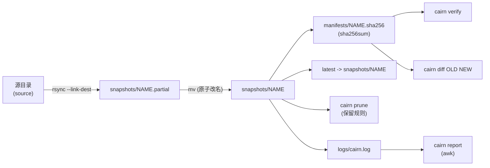
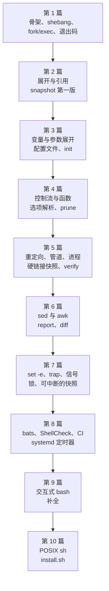
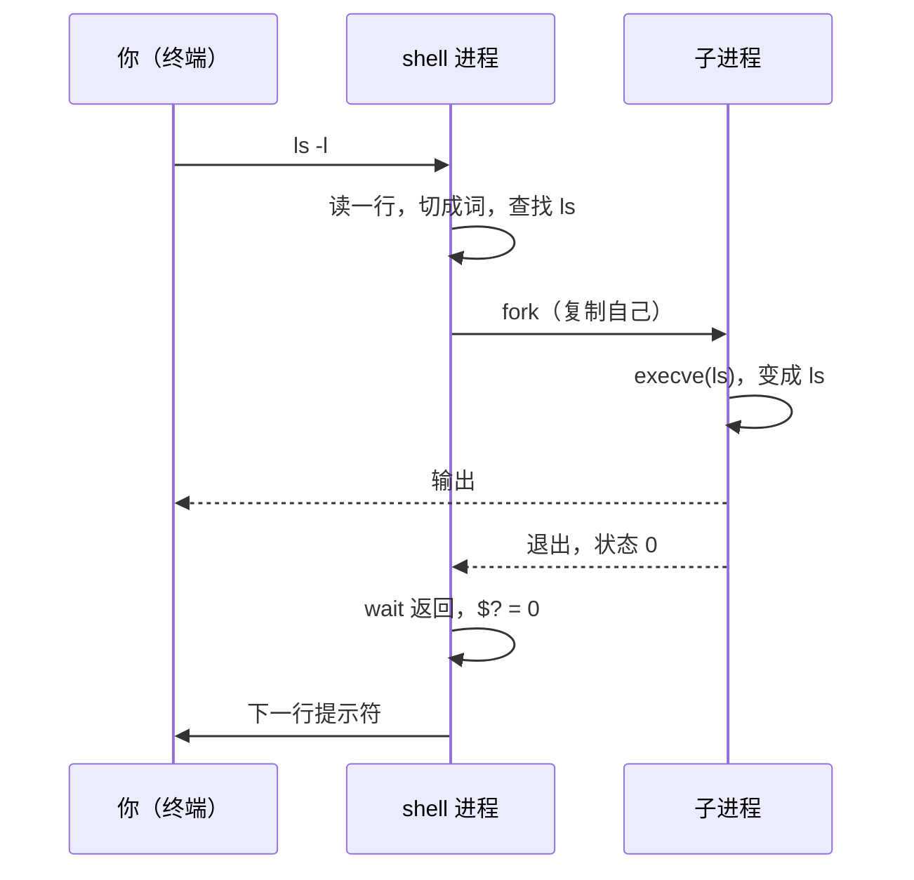

我一直觉得 shell 是一门老派的语言：语法靠历史包袱，引用规则靠运气，出错的方式比我会写的方式还多。可它也是几乎每台 Linux 机器、每个 CI 容器里都不用装就能用的语言，而且 1971 年写的 `sh` 和今天的 Bash 5.3 还在回答同一个问题：怎样把几个小程序接起来。所以我决定认真学一次，办法是写一个真实的工具，Cairn：一个用硬链接做增量快照的备份程序，全部用 Bash 写。下面是第 1 篇结束时它能做的全部事情：

```text
$ bin/cairn --version
cairn 0.1.0
$ bin/cairn frob; echo $?
cairn: error: unknown command 'frob'
cairn: error: run 'cairn --help' for usage
2
```

不多。但这三行已经用到了本篇要讲的全部机制：内核怎样读 `#!`，shell 怎样找到并启动一个程序，退出码 2 为什么是 2，错误信息为什么在 stderr 上。后面九篇，每一篇给它加一个能力，直到它能备份、校验、清理、报告，并且有测试和安装脚本。

> [!NOTE] 本篇检查点
> 这一篇结束时仓库里有 23 个被跟踪的文件（标签 `ch01`）：`bin/cairn`（66 行骨架，之后好几篇都会改它）、`lib/cairn/log.sh`（只有 `cairn::log::err` 和 `cairn::log::info`，第 4、5 篇会加函数）、`scripts/chapter.sh`（实验运行器，已经是最终版本）、`flake.nix`、`flake.lock`、`.envrc`、`.shellcheckrc`、`.gitignore`（这几个也是最终版本）、`Makefile`、`README.md`，外加 `lab/ch01/` 里的 11 个实验脚本和两份许可证。`make ch01` 通过：11 个实验里 3 个按设计以非零退出码结束，1 个只在宿主机上运行。
> 涉及的 Shell 特性：shebang 与 `execve`、可执行位、`PATH` 查找与 `hash`、内建命令与外部命令、`cd` 为什么必须是内建、`bash file`/`./file`/`source file` 的区别、退出码 0/1/2/126/127/128+n、`$?`、`&&`/`||`/`!`、`here-document`、`case`、`readonly`、`BASH_SOURCE`、函数、`main "$@"`，以及 Google Shell Style Guide 的第一批规则。
> 这是第 1 篇，没有前置章节。

## Cairn 长什么样

先把整个系统摆出来。Cairn 的名字来自登山路上的石堆：每个旅行者在上面再放一块石头，路就不会丢。每个快照是一块石头，新的石头靠在旧的上面（用硬链接），没变的文件不会再占一份磁盘。



箭头从左到右是一次 `cairn snapshot` 的数据流：rsync 把源目录同步进 `NAME.partial`，没变的文件以硬链接指向上一个快照；同步成功后一次 `mv` 把它变成正式快照（失败或被打断时，目录名里的 `.partial` 告诉后来的人它不完整）；然后写清单（每个文件一行 sha256），再把 `latest` 符号链接原子地切过去。`verify`、`diff`、`prune`、`report` 是读这些产物的四个命令。这一篇我们碰不到其中任何一个：只有最左边的壳。

十篇文章一篇一个主题，每一篇的 Shell 知识都是 Cairn 当时正好需要的：



## 这个系列怎么读

我定了几条规矩，因为我自己学任何东西时都踩过“看懂了但跑不起来”的坑。

**一章一个标签。** 仓库是 [`bfmhno3/cairn`](https://github.com/bfmhno3/cairn)，每一篇对应一个 git 标签，`ch01` 到 `ch10`。参考实现先克隆下来，之后每一篇的 `diff` 都用它（只做一次）：

```bash
git clone https://github.com/bfmhno3/cairn ~/cairn-ref
```

**你自己的仓库叫 `~/cairn`。** 你从空目录开始，一章一章长到和标签一样。第 1 篇你需要从 `ch01` 复制的只有七个“基础设施”文件：`flake.nix`、`flake.lock`、`.envrc`、`.gitignore`、`.shellcheckrc`、`Makefile`、`scripts/chapter.sh`。它们不是 Shell 知识，而是让后面所有命令都在同一个环境里跑的脚手架；`scripts/chapter.sh` 是例外，它是本系列的第一个真正的脚本，我们这一篇会逐段读它。`bin/cairn` 和 `lib/cairn/log.sh` 请自己敲（一共 100 行），实验脚本我建议至少敲前几个：错误信息是自己撞出来才记得住的。

**实验场是 `lab/chNN/`。** 每个实验是一个短脚本，开头有一行注释说它演示什么，`make ch01` 把本章所有实验各跑一遍，文件名约定：

- `*_fail.sh`：这个实验按设计以非零退出码结束，运行器会检查“确实失败了”。
- `*_host.sh`：只在宿主机上有意义（比如需要 `strace`），环境变量 `CI=true` 时被跳过。
- 其他实验必须以 0 退出。

每个实验在一个全新的临时目录里运行，路径放在环境变量 `LAB_TMP` 里，`bin/` 在 `PATH` 的最前面；标准输出、标准错误和退出码分别存到 `out/chNN/<名字>.stdout`、`.stderr`、`.status`。文章里贴的实验输出都从这些文件里来。实验里不会有任何在 `LAB_TMP` 之外破坏文件的命令，具有破坏性的演示会把命令换成一个打印参数的程序。

**真实输出。** 所有输出都是我在 Bash 5.3.15 下实际跑出来的，路径里的 `/home/bfmhno3/Projects/cairn` 是我的机器，你的会不同。

**检查点。** 每篇结尾有“检查点”：哪些文件必须和标签完全一致（用 `diff` 验证），哪些是以后还会改的中间版本，再加一张文件清单表，每个文件都链接到标签上的那一份。

下面是整个系列的地图：

| 章 | 标题 | 主要的 Shell 内容 |
| --- | --- | --- |
| 1 | [第一个脚本：shebang、fork/exec 与退出码](/posts/shell-by-cairn-01-first-script/) | shebang、`type`/`hash`、内建与外部命令、fork 与 exec、退出码、实验运行器 |
| 2 | 展开：bash 怎样把一行字拆成参数 | 展开顺序、引用、分词与 `IFS`、通配符、数组、`--` |
| 3 | 变量与参数展开：一门只有字符串的语言 | 环境变量、`declare`、参数展开运算符、关联数组、`set -u`、配置文件解析 |
| 4 | 控制流与函数：if 后面跟的是命令 | `if`/`[[`/`case`/循环、`read`、函数、算术、`getopts`、保留规则算法 |
| 5 | 重定向、管道与进程：用硬链接存 30 份快照 | 文件描述符、重定向、here-document、进程替换、管道、`&`/`wait`、`xargs -P`、硬链接 |
| 6 | 文本处理：sed、awk 与一份备份日志 | `printf`、`sort`、locale、`sed`、`awk`、`report` 与 `diff` |
| 7 | 出错时：set -e、trap 与信号 | `set -e` 及其例外、`trap`、信号、`flock`、可中断的快照 |
| 8 | 测试与工程化：bats、ShellCheck、shfmt 与定时运行 | bats、ShellCheck、shfmt、`bash -x`、kcov、CI、systemd 定时器 |
| 9 | 交互式 bash：启动文件、提示符、作业控制与补全 | 启动文件、提示符、历史、作业控制、readline、可编程补全 |
| 10 | POSIX sh：当你没有 bash 的时候 | POSIX、bashism、dash、`install.sh`、什么时候该换一门语言 |

读者假设：你写 C、C++、Rust 或 Python，每天用终端，但 shell 命令基本是复制来的。所以我不解释“文件是什么”，而是一上来讲机制：shell 做了什么，哪个进程在跑，为什么。拿别的语言做的对照只在旁白里出现一句。

## 装环境

我用 NixOS（26.05），内核 6.18.57，AMD Ryzen 7 PRO 6850U（16 个线程），30 GiB 内存。仓库里的 `flake.nix` 把整个系列要用的工具都钉在同一个 nixpkgs 版本上：

```text
$ nix develop
cairn dev shell: GNU bash, version 5.3.15(1)-release (x86_64-pc-linux-gnu), shellcheck 0.11.0, shfmt 3.13.1, Bats 1.14.0
```

这一行横幅来自 `flake.nix` 里的 `shellHook`。仓库根目录还有一个只含 `use flake` 的 `.envrc`，装了 direnv 的话进目录自动进入环境。工具清单（Bash、coreutils、findutils、rsync、ShellCheck、shfmt、bats、hyperfine、strace，以及后面几篇要用的 dash、yash、mksh、checkbashisms、kcov）都在 `flake.nix` 里，我不在这里复述。

没有 Nix 的话，你需要 Bash 5.3，加上上面这些工具。我只在 5.3.15 上跑过全部实验，别的版本某些措辞或行为可能不同，到时候以你自己的输出为准。

自己搭 `~/cairn` 的第一步：

```bash
mkdir -p ~/cairn/scripts ~/cairn/lab && cd ~/cairn
git init -b main
for f in flake.nix flake.lock .envrc .gitignore .shellcheckrc Makefile; do
  cp ~/cairn-ref/"${f}" .
done
cp ~/cairn-ref/scripts/chapter.sh scripts/
git add -A
nix develop
```

那个 `git add -A` 不是装饰：Nix 对 git 仓库里的 flake 只看已经被跟踪的文件，没有 `git add`，它看不到 `flake.nix`，`nix develop` 就起不来。我按这套步骤在一个空目录里搭过一遍，把 `lab/ch01`、`bin/cairn`、`lib/cairn/log.sh` 也复制进去之后，`make ch01` 的结果和标签里的一样。

## 一段简短的历史：回到 1971 年

先坐一次时间机器，问一个问题：1971 年的 shell 里，哪些东西今天还在，哪些已经反过来了？

我手边最好的材料是 Doug McIlroy 的《A Research UNIX Reader》，一份对研究版 Unix 手册各版本的带注释摘录（[PDF](https://www.cs.dartmouth.edu/~doug/reader.pdf)）。它说，Unix 手册第一版是 1971 年的，Ken Thompson 和 Dennis Ritchie 写了第一个 shell；这个 shell 的名字和大致形态来自 Multics，但为了塞进 8K 的用户空间，不得不“削到只剩基本功能”。Ritchie 的第一版手册本身也可以直接看：[第一版 Unix 程序员手册，日期 1971 年 11 月 3 日](https://www.nokia.com/bell-labs/about/dennis-m-ritchie/1stEdman.html)。

读 McIlroy 的注释，有三件事让我停下来，因为它们和我们今天面对的 shell 恰好反过来：

- 那个 shell 甚至没有地方做 `*` 的展开，所以通配符是交给一个外部程序 `glob` 完成的（McIlroy 说 `glob` 是用 B 语言写的，是主线 Unix 里第一个用高级语言写的程序）。第 2 篇会看到，今天通配符在 shell 里展开，而且正是这个决定带来了一整类引用陷阱。
- 流程控制也是外部程序：McIlroy 在第二版的条目下写到，`goto` 通过操纵标准输入给你一种“能编程”的错觉，`if` 也是一个单独的命令。今天 `if` 是一个关键字，`type -t if` 会告诉你 `keyword`，这一篇的 `type_tour.sh` 里能看到。
- shell 读命令的地方就是被它启动的程序读数据的地方，同一个标准输入。McIlroy 写道，这意味着命令和数据交错在“命令文件”里，没有办法标记嵌入数据的结尾，所以不能把东西管道进一个 shell 脚本。

然后是 Bourne。Stephen Bourne 的论文发表在 1978 年 7、8 月合刊的《Bell System Technical Journal》上（[《The UNIX Shell》，PDF](https://www.tuhs.org/Archive/Documentation/Papers/BSTJ/bstj57-6-1971.pdf)，文首注明稿件 1978 年 1 月 30 日收到）；这个 shell 随第七版 Unix 发行，McIlroy 的文章把 v7 定在 1979 年，并说“Bourne shell 几乎一夜之间把简单的旧 shell 挤了出去，之前一个 PWB shell 让 shell 编程变得有用，而 Bourne shell 让它成为 Unix 编程中必不可少的一部分”。Bourne shell 一次解决了上面说的那些问题（`goto` 和 `if` 被真正的语法取代，管道可以接进脚本），今天我们写的所有 `sh`、`bash` 脚本，从语法上说都是它的后代。

之后的路线我只引能核实的出处：

| 年份 | 事件 | 出处 |
| --- | --- | --- |
| 1971 | 第一版 Unix 程序员手册，里面有 Thompson 的 shell | [Ritchie 的页面](https://www.nokia.com/bell-labs/about/dennis-m-ritchie/1stEdman.html) |
| 1978 | Bourne 的论文《The UNIX Shell》发表 | [BSTJ 57(6)](https://www.tuhs.org/Archive/Documentation/Papers/BSTJ/bstj57-6-1971.pdf) |
| 1979 | 第七版 Unix 带着 Bourne shell | [McIlroy 的 Reader](https://www.cs.dartmouth.edu/~doug/reader.pdf) |
| 1983 | KornShell（ksh）的第一个版本，首个同时支持 emacs 和 vi 风格命令行编辑的 shell | [KSH-93 FAQ](http://www.kornshell.com/doc/faq.html) |
| 1988 | ksh88 被 System V Release 4 采用，并成为 POSIX shell 标准的源文档之一 | 同上 |
| 1989 年 6 月 | Brian Fox 发布 Bash 的测试版，“Bourne Again SHell”，GNU 版的 `sh`，吸收了 Korn shell 和 C shell 的扩展 | [GNU's Bulletin, vol. 1 no. 7](https://www.gnu.org/bulletins/bull7.html) |
| 1992 年 9 月 17 日 | IEEE 1003.2-1992（POSIX Part 2：Shell and Utilities）获批 | [IEEE SA](https://standards.ieee.org/ieee/1003.2/1408) |
| 2025 年 7 月 5 日 | Bash 5.3 发布 | [bug-bash 公告](https://lists.gnu.org/archive/html/bug-bash/2025-07/msg00005.html) |

C shell 我没有给年份，因为我没有找到一份我愿意引用的、写着日期的一手材料；它是 Bill Joy 在 Berkeley 写的，它的说明文档 [“An introduction to the C shell”](https://www.tuhs.org/cgi-bin/utree.pl?file=2BSD/doc/csh) 在 TUHS 的 2BSD 源码树里。Bash 的 [POSIX 模式](https://www.gnu.org/software/bash/manual/html_node/Bash-POSIX-Mode.html)那一节也说了 1003.2 的第一版是 1992 年出版的，和上表对得上。今天，我这台机器上 `bash --version` 的第一行是：

```text
$ bash --version | head -n 1
GNU bash, version 5.3.15(1)-release (x86_64-pc-linux-gnu)
```

5.3 的 15 号补丁，nixpkgs 里叫 `5.3p15`。从 1971 年那个塞进 8K 用户空间的 shell，到今天这个 Bash，要学的东西多了很多，但核心的那一圈没变：读一行，找到程序，启动它，等它结束。这就是下一节。

## shell 是什么：一个只会 fork 和 exec 的 REPL

我给 shell 找过的类比里最贴切的是电话总机的接线员。接线员自己不通话，她的工作是：听你说要找谁，把线插到对方的插孔上，然后等你们说完，再回来听下一个。shell 做的事和这个只差一个词：



shell 进程读一行，把它切成词，如果第一个词不是它自己的内建命令，就调 `fork` 复制出一个和自己一模一样的子进程；子进程马上调 `execve`，把自己整个换成目标程序；父进程调 `wait` 等子进程结束，拿到退出状态存进 `$?`，再读下一行。REPL（读、求值、打印、循环）里的“求值”几乎全是 fork 和 exec。

这个模型有两个直接的推论，这一篇后面各会用一节验证：

1. 子进程里发生的事不影响父进程。`cd` 在子进程里改工作目录，父进程毫无察觉。所以 `cd` 只能是 shell 内部的命令。
2. “找到程序”是 shell（或者 `env`）的责任，不是内核的，内核的 `execve` 只认一个路径。`PATH` 是 shell 的约定，不是内核的。

别的语言里你很少直接面对这个模型：Python 的 `subprocess.run` 在底下做类似的事，但你写的是 `["ls", "-l"]` 这样的列表。在 shell 里，这个模型就是语言本身。

## 内核怎么读 #!

你输入 `./script` 的时候，shell 是想 `execve("./script", ...)`，内核发现这不是一个 ELF 可执行文件，而是一个以 `#!` 开头的文本，于是把它交给 `fs/binfmt_script.c` 里的 `load_script`。我手上有 Linux 6.18 的源码（和 [`v6.18` 标签上的那份逐字节相同](https://github.com/torvalds/linux/blob/v6.18/fs/binfmt_script.c)），读它的几个片段。

先是门卫，第 40 到 42 行：

```c
	/* Not ours to exec if we don't start with "#!". */
	if ((bprm->buf[0] != '#') || (bprm->buf[1] != '!'))
		return -ENOEXEC;
```

`bprm->buf` 是内核在 `execve` 开始时读进来的文件开头，大小是 `BINPRM_BUF_SIZE`，定义在 `include/uapi/linux/binfmts.h` 第 19 行：256 字节。所以 shebang 这一行最长大约 256 字节，超过的部分内核看不见。

然后是解析，第 58 到 85 行（我删掉了中间的长注释，保留逻辑）：

```c
	buf_end = bprm->buf + sizeof(bprm->buf) - 1;
	i_end = strnchr(bprm->buf, sizeof(bprm->buf), '\n');
	/* ... 没有换行符时的截断处理 ... */
	/* Trim any trailing spaces/tabs from i_end */
	while (spacetab(i_end[-1]))
		i_end--;

	/* Skip over leading spaces/tabs */
	i_name = next_non_spacetab(bprm->buf+2, i_end);
	if (!i_name || (i_name == i_end))
		return -ENOEXEC; /* No interpreter name found */

	/* Is there an optional argument? */
	i_arg = NULL;
	i_sep = next_terminator(i_name, i_end);
	if (i_sep && (*i_sep != '\0'))
		i_arg = next_non_spacetab(i_sep, i_end);
```

这一段说的是：`#!` 后面先跳过空格和制表符，取到第一个空白之前是解释器路径（`i_name`），再往后跳过空白，**从那里一直到行尾都是同一个参数**（`i_arg`）。没有第二个、第三个参数。

最后是重组 `argv`，第 106 到 125 行：

```c
	retval = remove_arg_zero(bprm);
	if (retval)
		return retval;
	retval = copy_string_kernel(bprm->interp, bprm);
	/* ... */
	if (i_arg) {
		*((char *)i_sep) = '\0';
		retval = copy_string_kernel(i_arg, bprm);
		/* ... */
	}
	retval = copy_string_kernel(i_name, bprm);
```

原来的 `argv[0]`（`./script`）被移除，然后按相反的顺序压进去：脚本路径、可选的那个参数、解释器名字，最后第 132 行 `open_exec(i_name)` 打开解释器，内核重新开始执行。结果是 `./script a b` 变成了 `解释器 [参数] ./script a b`。注释里还写着为什么要反过来压：“because of how the user environment and arguments are stored”。

这个实现的一个后果，我在这台机器上验证了：既然 `i_arg` 是整行剩下的所有字符，`#!/usr/bin/env bash -x` 给 `env` 的就是一个叫 `bash -x` 的单个参数：

```text
$ printf '#!/usr/bin/env bash -x\necho hi\n' > /tmp/ex1 && chmod +x /tmp/ex1
$ /tmp/ex1; echo "rc=$?"
env: ‘bash -x’: No such file or directory
env: use -[v]S to pass options in shebang lines
rc=127
```

GNU `env` 非常体贴，直接告诉你该用 `-S`：`#!/usr/bin/env -S bash -x` 能工作，输出 `+ echo hi` 和 `hi`。但我们的规矩（后面的 Google 风格小节会讲）是另一条路：不在 shebang 里放任何选项，用脚本里的 `set` 命令。这样不依赖 `env -S`，也不依赖内核的这个怪癖。

### 在 NixOS 上，Google 的 shebang 会失败

Google Shell Style Guide 要求可执行脚本以 `#!/bin/bash` 开头。这条规则假设 `/bin/bash` 存在。我的机器不是这样：

```text
$ ls -l /bin/sh /usr/bin/env /bin/bash
ls: cannot access '/bin/bash': No such file or directory
lrwxrwxrwx 1 root root 73 Oct 30 20:37 /bin/sh -> /nix/store/pwxj9ycwqd117yra6czifh3xfx5p88lh-bash-interactive-5.3p9/bin/sh
lrwxrwxrwx 1 root root 66 Oct 30 20:37 /usr/bin/env -> /nix/store/bhv6xyvqw6gjs3j488gi1z6wdv18bdpa-coreutils-9.11/bin/env
```

NixOS 只保证 `/bin/sh` 和 `/usr/bin/env` 两个固定路径。照 Google 的规则写会发生什么，我在 Bash 里（我平时的登录 shell 是 zsh，这里为了拿到 Bash 自己的原话，开了一个 `bash`）跑了一遍：

```text
$ printf '#!/bin/bash\necho hi\n' > /tmp/x && chmod +x /tmp/x && /tmp/x
bash: /tmp/x: /bin/bash: bad interpreter: No such file or directory
$ echo $?
126
```

有意思的是 `bad interpreter` 这句话不是内核说的。我用 `strace` 看了一下 `bash -c /tmp/x`：

```text
$ strace -f -e trace=execve,openat,read -o trace.txt bash -c /tmp/x
$ grep -n -A2 'execve("/tmp/x"' trace.txt | cut -c1-130
63:172338 execve("/tmp/x", ["/tmp/x"], 0x5555556b6a90 /* 214 vars */) = -1 ENOENT (No such file or directory)
64-172338 openat(AT_FDCWD, "/tmp/x", O_RDONLY) = 3
65-172338 read(3, "#!/bin/bash\necho hi\n", 128) = 20
```

内核对一个明明存在的文件返回了 `ENOENT`（“没有这个文件”，指的其实是解释器，但错误码说不清是哪一个），Bash 收到之后自己打开 `/tmp/x`，读了开头的 `#!/bin/bash`，才拼出 `/bin/bash: bad interpreter`，然后以 126 退出。如果你在别的 shell 里试，原话可能不同，但内核给出的 `ENOENT` 是同一个。

所以 Cairn 的每一个可执行脚本用的是：

```bash
#!/usr/bin/env bash
```

`/usr/bin/env` 在 NixOS 上存在，它在 `PATH` 里找第一个叫 `bash` 的程序并执行它。代价有两个：一是多一次 `execve`（下面 strace 里会看到），二是你得到的是 `PATH` 里的第一个 bash，这对我们是好事（`nix develop` 把 Bash 5.3 放在 `PATH` 最前面）。这是对 Google 规则的一个有意的偏离：我把它写成了系列的明文规则，仓库的 README 里也写了。除此之外，其余规则按原样遵守。

### 实验：一个可执行脚本看到了什么

`lab/ch01/shebang_exec.sh` 是 Cairn 里第一个带可执行位的实验，它的全部内容是一行 shebang 加五行 `echo`：

```bash
#!/usr/bin/env bash
# Shows: what an executable script sees about itself. The kernel read the
# shebang, started env, which found bash on PATH.
echo "\$0           = $0"
echo "\$BASH        = ${BASH}"
echo "\$BASH_VERSION = ${BASH_VERSION}"
echo "\$\$           = $$"
echo "\$PPID        = ${PPID}"
```

运行器看到它有可执行位，就直接执行它（让内核去读 shebang）。输出：

```text
$ cat out/ch01/shebang_exec.stdout
$0           = /home/bfmhno3/Projects/cairn/lab/ch01/shebang_exec.sh
$BASH        = /nix/store/90nk33c4fkyg4x4dfk5cykqiryf2nlqq-bash-interactive-5.3p15/bin/bash
$BASH_VERSION = 5.3.15(1)-release
$$           = 108904
$PPID        = 108903
```

`$0` 是脚本的路径，因为内核把脚本路径放进了解释器的 `argv`，`bash` 把它记作 `$0`。`$BASH` 是真正在跑的那个 Bash 的完整路径，在 `/nix/store` 里，这说明 `env` 找到的是 `nix develop` 提供的 5.3 而不是别的。`$$` 是当前进程号，`$PPID` 是父进程号，差 1 是巧合吗？不是：运行器用 `timeout 300` 启动它，`timeout` 先于脚本被创建，进程号紧挨着。

## 三种运行脚本的方式

脚本有三种常见的运行方式，它们的差别是这一篇的第二个重点。

`lab/ch01/hello.sh` 只有一行有效内容，没有 shebang，也没有可执行位（`git ls-files -s` 里它是 `100644`）：

```bash
# shellcheck shell=bash
# Shows: a file without a shebang or exec bit still runs as `bash hello.sh`.
# The runner starts non-executable labs this way.
echo "hello from $0"
```

运行器对不可执行的实验做的是 `bash 路径`，所以：

```text
$ cat out/ch01/hello.stdout
hello from /home/bfmhno3/Projects/cairn/lab/ch01/hello.sh
```

这里的第一行 `# shellcheck shell=bash` 是给 ShellCheck 的指令：没有 shebang 的文件它没法猜测方言，所以这一行显式地告诉它。（Google 风格的“每个文件头部有注释”，我们在这些小实验里用 `# Shows:` 一行来满足。）

第二种是 `./file`，也就是让内核去执行。这要求文件有可执行位，否则：

```bash
# shellcheck shell=bash
# Shows: running a file without the exec bit as ./file fails with 126.
cd "${LAB_TMP}" || exit 1
printf 'echo hi\n' >plain
./plain
status=$?
echo "exit status: ${status}"
exit "${status}"
```

```text
$ cat out/ch01/no_exec_bit_fail.stdout out/ch01/no_exec_bit_fail.stderr
exit status: 126
/home/bfmhno3/Projects/cairn/lab/ch01/no_exec_bit_fail.sh: line 5: ./plain: Permission denied
```

执行位是内核检查的：`execve` 返回 `EACCES`，shell 把它翻译成 “Permission denied” 和退出码 126。`bad_interpreter_fail.sh` 是同一个机制的另一面：可执行位对了，解释器不存在：

```bash
# shellcheck shell=bash
# Shows: a shebang naming a missing interpreter makes exec fail (126).
printf '#!/nonexistent/bash\necho hi\n' >"${LAB_TMP}/x"
chmod +x "${LAB_TMP}/x"
"${LAB_TMP}/x"
status=$?
echo "exit status: ${status}"
exit "${status}"
```

```text
$ cat out/ch01/bad_interpreter_fail.stderr
/home/bfmhno3/Projects/cairn/lab/ch01/bad_interpreter_fail.sh: /tmp/nix-shell.iPJnWP/cairn-lab.U08QqE/x: /nonexistent/bash: bad interpreter: No such file or directory
```

这就是前一节宿主机上的那条消息，换成了一个故意写错的路径。注意每个实验结尾都把 `$?` 存进一个变量再 `exit "${status}"`：`$?` 每执行一条命令就被覆盖，`echo` 本身也会覆盖它，所以要先存。

第三种是 `source file`（或者点命令 `. file`）：不启动新进程，而是在当前 shell 里把文件的内容当命令读一遍。差别在哪里，`cd_in_child.sh` 用最直接的办法回答：

```bash
# shellcheck shell=bash
# Shows: `cd` in a child process does not move the parent; `source` runs
# in the current shell, so it does.
cd "${LAB_TMP}" || exit 1
echo "start:           ${PWD}"
bash -c 'cd /; echo "inside child:    ${PWD}"'
echo "after child:     ${PWD}"
echo 'cd /' >go_root.sh
# shellcheck source=/dev/null
source ./go_root.sh
echo "after source:    ${PWD}"
```

```text
$ cat out/ch01/cd_in_child.stdout
start:           /tmp/nix-shell.iPJnWP/cairn-lab.yag8wU
inside child:    /
after child:     /tmp/nix-shell.iPJnWP/cairn-lab.yag8wU
after source:    /
```

`bash -c 'cd /; ...'` 是一个子进程，它里面的 `cd` 生效了（`inside child: /`），但是回到父进程，工作目录没动。`source ./go_root.sh` 里同样一句 `cd /`，因为没有新进程，就改了当前 shell 的工作目录。进程的工作目录是进程自己的状态，子进程没有办法改父进程的。所以 `cd` 不可能是 `/bin/cd` 这样的外部程序（它们在子进程里跑，改了也白改）：它必须是 shell 自己的内建命令。这也是 `source` 存在的理由：`~/.bashrc` 里那些 `export` 和 `alias`，必须作用在你正在用的 shell 上。

顺带一提，这两个实验里的 `cd "${LAB_TMP}" || exit 1`：`cd` 可能失败，Google 的规则是“检查每个返回值”，而这里的 `|| exit 1` 是最短的写法。ShellCheck 对没有它的 `cd` 会给出 SC2164。

三种方式放在一起，差别是这样的：

| 方式 | 谁读 shebang | 新进程 | 需要可执行位 | `$0` | 对当前 shell 的影响 |
| --- | --- | --- | --- | --- | --- |
| `bash file` | 没人读，Bash 自己把文件当脚本 | 是 | 否 | `file` | 没有 |
| `./file` | 内核 | 是 | 是 | 你输入的路径 | 没有 |
| `source file` | 没人读，当前 shell 直接读 | 否 | 否，只要可读 | 当前 shell 的名字（后面 `BASH_SOURCE` 一节的 `who.sh` 例子里是 `bash`） | `cd`、变量、`exit` 全都作用在当前 shell 上 |

Cairn 的用户用的是第二种：`cairn snapshot`，所以 shebang 和可执行位必须对。运行器对 `hello.sh` 用的是第一种，因为它没必要为一个只有一行 `echo` 的文件去操心权限位。

## 找到程序：PATH、hash、内建与外部

“找到程序”这件事，shell 按一个固定顺序做。GNU Bash 手册的 [Command Search and Execution](https://www.gnu.org/software/bash/manual/bash.html#Command-Search-and-Execution) 一节写得很清楚：命令名里没有斜杠的时候，先找同名的 shell 函数，再找同名的内建命令，最后才在 `PATH` 的每个目录里找可执行文件，并且用一张哈希表记住找到的路径，免得下次再搜。名字里有斜杠，就不搜了，直接 `execve`。

`lab/ch01/type_tour.sh` 把这条链路每一环都问一遍。它只有 25 行，我整个贴出来：

```bash
# shellcheck shell=bash
# Shows: what `type`, `command -V` and `hash` say about common names.
# PATH is deduplicated first so that `type -a` lists each file once.
declare -A seen=()
new_path=''
IFS=: read -r -a dirs <<<"${PATH}"
for dir in "${dirs[@]}"; do
  if [[ -z "${seen[${dir}]:-}" ]]; then
    seen["${dir}"]=1
    new_path+="${new_path:+:}${dir}"
  fi
done
PATH="${new_path}"
type -a echo cd [ test printf true
echo '--- type -t'
for name in echo cd if ls ll; do
  printf '%-4s %s\n' "${name}" "$(type -t "${name}" || echo none)"
done
echo '--- command -V'
command -V cd ls
echo '--- hash'
hash -r
ls >/dev/null
ls >/dev/null
hash
```

前 13 行只是给 `PATH` 去重（我的 `PATH` 里有重复的目录，不去重的话 `type -a` 会把同一个文件列好几遍；用到的关联数组和 `${var:+...}` 第 3 篇再讲，现在先当它是个黑盒）。后面才是主角。输出：

```text
$ cat out/ch01/type_tour.stdout
echo is a shell builtin
echo is /nix/store/97d5ygrvqj55f4nx1x34wfdcc7qn11c0-coreutils-9.11/bin/echo
echo is /run/current-system/sw/bin/echo
cd is a shell builtin
[ is a shell builtin
[ is /nix/store/97d5ygrvqj55f4nx1x34wfdcc7qn11c0-coreutils-9.11/bin/[
[ is /run/current-system/sw/bin/[
test is a shell builtin
test is /nix/store/97d5ygrvqj55f4nx1x34wfdcc7qn11c0-coreutils-9.11/bin/test
test is /run/current-system/sw/bin/test
printf is a shell builtin
printf is /nix/store/97d5ygrvqj55f4nx1x34wfdcc7qn11c0-coreutils-9.11/bin/printf
printf is /run/current-system/sw/bin/printf
true is a shell builtin
true is /nix/store/97d5ygrvqj55f4nx1x34wfdcc7qn11c0-coreutils-9.11/bin/true
true is /run/current-system/sw/bin/true
--- type -t
echo builtin
cd   builtin
if   keyword
ls   file
ll   none
--- command -V
cd is a shell builtin
ls is /nix/store/97d5ygrvqj55f4nx1x34wfdcc7qn11c0-coreutils-9.11/bin/ls
--- hash
hits	command
   2	/nix/store/97d5ygrvqj55f4nx1x34wfdcc7qn11c0-coreutils-9.11/bin/ls
```

逐块读：

- `type -a` 列出一个名字的**所有**解释：`echo`、`printf`、`true`、`test`、`[` 既是内建命令，又各有一个同名的外部程序。内建排在前面，因为上面说的搜索顺序是函数、内建、`PATH`。`cd` 只有内建一行，没有 `/bin/cd`，和上一节的推理吻合。外部程序有两行，是因为 NixOS 里 `/run/current-system/sw/bin` 是一个指向 `/nix/store` 的符号链接农场，同一个文件有两个入口。
- `type -t` 只输出一个词，是在脚本里分类的好工具：`builtin`、`keyword`、`file`、`function`、`alias`，什么都不是的时候它退出 1 且不输出，所以我在后面接了 `|| echo none`。`if` 是 `keyword`，不是命令（回到前面的历史：早期研究版 Unix 里它是个独立的程序）。`ll` 是 `none`：我的交互式 shell 里 `ll` 是个别名，可这是非交互式的 `bash`，别名不展开，也不存在。第 9 篇会回来讲别名，以及为什么 Google 禁止在脚本里用它。
- `command -V` 在这里的输出和 `type` 一样。`command -v`/`-V` 是 POSIX 规定的写法，而 `type` 的 `-a`、`-t` 选项，据我所知是 Bash 的扩展，第 10 篇回到这个区别。
- `hash` 打印哈希表：先 `hash -r` 清空，再跑两次 `ls`，表里就有一行 `hits 2`，说明第一次搜了 `PATH`，第二次直接命中。这就是手册说的“用一张哈希表记住”。

你自己的程序要被找到，要么给全路径，要么放进 `PATH`。运行器做的是后者：它把 `${CAIRN_ROOT}/bin` 放在 `PATH` 最前面，所以实验里可以直接写 `cairn`。我手动试一遍：

```text
$ PATH="$PWD/bin:$PATH"
$ type cairn
cairn is /home/bfmhno3/Projects/cairn/bin/cairn
$ cairn --version
cairn 0.1.0
$ hash
hits	command
   1	/home/bfmhno3/Projects/cairn/bin/cairn
```

### 实验：命令没找到，是 127

`command_not_found_fail.sh` 只有三行有用的代码：

```bash
# shellcheck shell=bash
# Shows: a name that is not a builtin, function or file on PATH gives 127.
no_such_command_cairn
status=$?
echo "exit status: ${status}"
exit "${status}"
```

```text
$ cat out/ch01/command_not_found_fail.stdout out/ch01/command_not_found_fail.stderr
exit status: 127
/home/bfmhno3/Projects/cairn/lab/ch01/command_not_found_fail.sh: line 3: no_such_command_cairn: command not found
```

127 是“找不到”，126 是“找到了但不能执行”（前面的 `Permission denied` 和 `bad interpreter`）。这两个数字是手册定的：[Exit Status](https://www.gnu.org/software/bash/manual/bash.html#Exit-Status) 一节写着 “If a command is not found, the child process created to execute it returns a status of 127. If a command is found but is not executable, the return status is 126.”

### 实验：内建有多便宜

内建命令不创建进程，所以便宜；外部命令每次都是一次 fork 加一次 exec，所以贵。贵多少？`builtin_cost.sh` 量了一下，32 行，我整个贴出来，因为它同时是第一个用到 `EPOCHREALTIME`、函数和算术的脚本：

```bash
# shellcheck shell=bash
# Shows: a builtin call vs forking and exec'ing the external binary.
# 2000 calls each, median of 5 runs, in ms.
external="$(type -P true)"
median_us() {
  local -a times=()
  local start
  for _ in 1 2 3 4 5; do
    start="${EPOCHREALTIME/./}"
    "$@"
    times+=($((${EPOCHREALTIME/./} - start)))
  done
  printf '%s\n' "${times[@]}" | sort -n | sed -n 3p
}
run_builtin() {
  local i
  for ((i = 0; i < 2000; i++)); do
    true
  done
}
run_external() {
  local i
  for ((i = 0; i < 2000; i++)); do
    "${external}"
  done
}
b="$(median_us run_builtin)"
e="$(median_us run_external)"
printf 'builtin true:  %d.%d ms\n' "$((b / 1000))" "$((b % 1000 / 100))"
printf 'external true: %d.%d ms (%s)\n' \
  "$((e / 1000))" "$((e % 1000 / 100))" "${external}"
printf 'ratio: %d.%dx\n' "$((e / b))" "$((e * 10 / b % 10))"
```

`EPOCHREALTIME` 是 Bash 的一个特殊变量，每次引用都展开成自 Unix 纪元以来的秒数，带微秒精度的小数（见手册的 [Bash Variables](https://www.gnu.org/software/bash/manual/bash.html#Bash-Variables)）；`${EPOCHREALTIME/./}` 把小数点去掉，得到微秒整数，这样就能用纯整数算术做减法。`median_us` 把传给它的命令（这里是函数名）跑 5 次，记录每次的耗时，`sort -n | sed -n 3p` 取第 3 个，即中位数。`type -P true` 强制只在 `PATH` 里找文件，拿到外部 `true` 的绝对路径；写成 `"${external}"`，shell 就不会选内建了。

```text
$ cat out/ch01/builtin_cost.stdout
builtin true:  2.8 ms
external true: 2784.0 ms (/nix/store/97d5ygrvqj55f4nx1x34wfdcc7qn11c0-coreutils-9.11/bin/true)
ratio: 971.0x
```

2000 次内建 `true` 用了 2.8 ms，平均 1.4 微秒一次；2000 次外部 `true` 用了 2784.0 ms，平均 1.39 毫秒一次。比值 971.0。这个比值本身每次都不一样：分母只有几毫秒，抖动很大。我又连着跑了三次，得到 949.0x、730.8x、850.3x。所以别记 971，记“大约 700 到 1000 倍”：一次 fork 加 exec 在这台机器上大约是 1.4 毫秒，一次内建调用大约是一微秒多一点。

这个数字解释了 Google 风格里“能用内建就不要起外部命令”的原因，也预告了第 3 篇和第 6 篇会反复出现的主题：在循环里，每少一个外部进程，就快三个数量级。（但是，处理一个大文件时反过来：一个 `sed` 进程比一个 Bash 循环快得多。第 6 篇我会用数字说明这个平衡。）

## 看一次 fork 和 exec

前面说 shell 只会 fork 和 exec，我得证明。`strace` 可以把一个进程的系统调用打印出来，`-f` 跟随子进程。`lab/ch01/fork_exec_host.sh` 是这一篇唯一的宿主机实验（文件名以 `_host.sh` 结尾，因为它需要 `strace` 和 `ptrace` 权限，`CI=true` 的环境会跳过）：

```bash
# shellcheck shell=bash
# Shows: the execve calls behind `bash -c '/usr/bin/env true; echo hi'`.
# Host only: needs strace and ptrace permission.
strace -f -e trace=execve,clone,clone3 -o "${LAB_TMP}/trace" \
  bash -c '/usr/bin/env true; echo hi'
grep execve "${LAB_TMP}/trace" \
  | sed -E 's/^[0-9]+ +//; s/, 0x[0-9a-f]+ \/\* [0-9]+ vars \*\/\)/)/'
```

第二个命令把 `strace` 输出里每行的进程号和环境变量指针删掉，让它能读。输出：

```text
$ cat out/ch01/fork_exec_host.stdout
hi
execve("/nix/store/90nk33c4fkyg4x4dfk5cykqiryf2nlqq-bash-interactive-5.3p15/bin/bash", ["bash", "-c", "/usr/bin/env true; echo hi"]) = 0
execve("/usr/bin/env", ["/usr/bin/env", "true"]) = 0
execve("/home/bfmhno3/Projects/cairn/bin/true", ["true"]) = -1 ENOENT (No such file or directory)
execve("/nix/store/90nk33c4fkyg4x4dfk5cykqiryf2nlqq-bash-interactive-5.3p15/bin/true", ["true"]) = -1 ENOENT (No such file or directory)
execve("/nix/store/97d5ygrvqj55f4nx1x34wfdcc7qn11c0-coreutils-9.11/bin/true", ["true"]) = 0
```

第一行的 `hi` 是 `echo hi` 的输出。`execve` 一共五次：启动 Bash，启动 `env`，然后 `env` 试了三个候选路径去找 `true`，前两个是 `ENOENT`（运行器的 `bin/` 排在 `PATH` 最前面，其次是 Bash 自己的目录），第三个才是 coreutils 里的真身。这回答了前面的推论 2：**查找 `PATH` 的办法就是挨个目录试 `execve`，失败了换下一个**。（这是 `env` 的做法，Bash 自己也有类似的机制加哈希表。）

这个输出里我特意滤掉了 `clone`。不过滤的完整版本，来自我在 `nix develop` 里另跑的一次（这一次 `PATH` 里没有运行器加的 `cairn/bin`，所以 `env` 少试了一个目录）：

```text
$ strace -f -e trace=execve,clone,clone3,wait4,exit_group -o trace.txt bash -c '/usr/bin/env true; echo hi'
$ cat trace.txt
109239 execve("/nix/store/90nk33c4fkyg4x4dfk5cykqiryf2nlqq-bash-interactive-5.3p15/bin/bash", ["bash", "-c", "/usr/bin/env true; echo hi"], 0x7fffffff8468 /* 214 vars */) = 0
109239 clone(child_stack=NULL, flags=CLONE_CHILD_CLEARTID|CLONE_CHILD_SETTID|SIGCHLD, child_tidptr=0x7ffff7ec6a10) = 109243
109239 wait4(-1 <unfinished ...>
109243 execve("/usr/bin/env", ["/usr/bin/env", "true"], 0x5555556b6aa0 /* 214 vars */) = 0
109243 execve("/nix/store/90nk33c4fkyg4x4dfk5cykqiryf2nlqq-bash-interactive-5.3p15/bin/true", ["true"], 0x7fffffff8540 /* 214 vars */) = -1 ENOENT (No such file or directory)
109243 execve("/nix/store/97d5ygrvqj55f4nx1x34wfdcc7qn11c0-coreutils-9.11/bin/true", ["true"], 0x7fffffff8540 /* 214 vars */) = 0
109243 exit_group(0)                    = ?
109243 +++ exited with 0 +++
109239 <... wait4 resumed>, [{WIFEXITED(s) && WEXITSTATUS(s) == 0}], 0, NULL) = 109243
109239 --- SIGCHLD {si_signo=SIGCHLD, si_code=CLD_EXITED, si_pid=109243, si_uid=1000, si_status=0, si_utime=0, si_stime=0} ---
109239 wait4(-1, 0x7fffffff6f50, WNOHANG, NULL) = -1 ECHILD (No child processes)
109239 exit_group(0)                    = ?
109239 +++ exited with 0 +++
```

每一行开头的数字是进程号。

把这段和前面的序列图对一下：进程 109239 是 Bash，它 `clone`（Linux 上 `fork` 的实现，`flags` 里带着 `SIGCHLD`，意思是“子进程结束时给我发这个信号”）出 109243，然后立刻 `wait4`（`<unfinished ...>` 表示它阻塞在这里）。109243 先 `execve` 成 `/usr/bin/env`，`env` 没有再 fork，直接又 `execve` 成 `true`，这就是“exec 是替换，不是创建”：同一个进程号 109243 先后是 Bash 的副本、`env`、`true`。`true` 退出后，Bash 的 `wait4` 返回，内核给它发了 `SIGCHLD`（那一行 `--- SIGCHLD`，`si_status=0` 就是退出码），最后 `echo hi` 因为是内建，没有任何 `clone`。整个脚本一共一次 fork。

这就是第 7 篇会反复用到的结构：父进程怎么知道子进程的死活，靠的是 `wait4` 和 `SIGCHLD`；怎么知道是怎么死的，靠的是 `wait4` 返回的状态字，里面编码了“正常退出的码”或“被哪个信号杀死”。下一节就讲这个数字。

## 退出码

`lab/ch01/exit_status.sh` 把退出状态在 shell 里流动的所有基本方式过一遍，20 行：

```bash
# shellcheck shell=bash
# Shows: how exit statuses flow through $?, &&, ||, ! and exit.
true
echo "after true:  $?"
false
echo "after false: $?"
true && echo "&& ran after success"
false || echo "|| ran after failure"
false && echo "never printed"
echo "status of a skipped &&: $?"
! true
echo "! true gives: $?"
! false
echo "! false gives: $?"
bash -c 'exit 256'
echo "exit 256 gives: $?"
bash -c 'exit -1'
echo "exit -1 gives:  $?"
bash -c 'exit 300'
echo "exit 300 gives: $?"
```

```text
$ cat out/ch01/exit_status.stdout
after true:  0
after false: 1
&& ran after success
|| ran after failure
status of a skipped &&: 1
! true gives: 1
! false gives: 0
exit 256 gives: 0
exit -1 gives:  255
exit 300 gives: 44
```

按行读：

- `true` 给 0，`false` 给 1，`$?` 总是“上一条命令”的状态。
- `A && B` 只有 A 成功才执行 B，`A || B` 只有 A 失败才执行 B。第三个例子里 `false && echo ...` 没有打印，但整个表达式的状态是最后一个被执行的命令的状态，也就是 `false` 的 1。这个小细节后面在 `set -e` 的坑里会咬人。
- `!` 把状态取反：成功变失败，失败变成功。
- 最后三行是退出码的范围。进程的退出状态是 8 位的，所以 `exit 256` 是 0，`exit 300` 是 `300 - 256 = 44`，`exit -1` 是 255。手册在 [Exit Status](https://www.gnu.org/software/bash/manual/bash.html#Exit-Status) 里说 “Exit statuses fall between 0 and 255”，这就是原因：取模 256。

同一节手册还给出了本篇的几个约定数字。我把它们和 Cairn 打算怎么用放在一张表里：

| 退出码 | 含义（手册） | 在 Cairn 里 |
| --- | --- | --- |
| 0 | 成功 | 成功 |
| 1 | 一般失败，没有特殊含义 | 运行时失败 |
| 2 | 内建命令的用法错误 | 命令行用法错误（`unknown command`） |
| 126 | 找到了但不能执行 | 本篇的 `Permission denied`、`bad interpreter` |
| 127 | 命令没找到 | 本篇的 `command not found` |
| 128+n | 被信号 n 杀死 | 第 7 篇：130（SIGINT）、143（SIGTERM） |

最后一行我在这台机器上验证：

```text
$ bash -c 'sleep 30 & kill -TERM $!; wait $!; echo "TERM: $?"'
TERM: 143
$ bash -c 'sleep 30 & kill -KILL $!; wait $!; echo "KILL: $?"'
bash: line 1: 140630 Killed                     sleep 30
KILL: 137
```

SIGTERM 是 15，`128 + 15 = 143`；SIGKILL 是 9，`128 + 9 = 137`。（KornShell 93 用的是 256+n 而不是 128+n，它的 FAQ 里专门解释了：因为 128+n 和一个“正常退出码恰好是 128+n 的程序”分不开，这个约定因 shell 而异：[ksh93 FAQ](http://www.kornshell.com/doc/faq.html) 里的 “When I do echo 0, I am getting 267”。）Cairn 的完整退出码表，包括 3（配置或仓库错误）和 4（锁被占用），要到第 7 篇才完整。

## 第一个脚本：bin/cairn

前面所有的东西都是为这一刻准备的。`bin/cairn` 有 66 行。我分三段读。

### 头部、常量和库目录

```bash
#!/usr/bin/env bash
#
# cairn: incremental hard-link snapshot backups, written in Bash.
#
# Usage: cairn [OPTIONS] COMMAND [ARGS]
# Run `cairn --help` for the full text.

set -o nounset

readonly CAIRN_VERSION='0.1.0'

# 库目录: 环境变量优先, 否则相对于本脚本 (跟随符号链接) 的 ../lib/cairn。
CAIRN_LIB="${CAIRN_LIB:-$(dirname -- "$(readlink -f -- "${BASH_SOURCE[0]}")")/../lib/cairn}"
readonly CAIRN_LIB

# shellcheck source=../lib/cairn/log.sh
source "${CAIRN_LIB}/log.sh"
```

第一行是我们刚讲过的 shebang。接下来的注释块是 Google 风格要求的“每个文件以头部注释开头，说明这个文件做什么”。`set -o nounset` 让“使用未定义的变量”变成错误（第 3 篇细讲）；注意我现在**没有**加 `set -o errexit`，原因第 7 篇会给，但这一篇的练习 3 会让你亲眼看到后果。`readonly CAIRN_VERSION='0.1.0'`：常量用大写、放在文件顶部、加 `readonly`，这也是 Google 的规则。

`CAIRN_LIB` 那一行是整个文件里最难读的，我拆开：

- `${CAIRN_LIB:-默认值}`：如果环境变量 `CAIRN_LIB` 已设置且非空，就用它，否则用默认值。这给测试留一个后门：第 8 篇的 bats 测试会用它指向别处。
- `$(...)` 是命令替换：运行里面的命令，把标准输出换进来。这里嵌套了两层。
- `${BASH_SOURCE[0]}` 是“当前正在执行的这个文件的路径”。为什么不直接用 `$0`？因为当文件被 `source` 的时候 `$0` 还是那个 shell 的名字。我验证过：

```text
$ printf 'echo "0=$0 BASH_SOURCE=${BASH_SOURCE[0]}"\n' > /tmp/cx/who.sh
$ bash /tmp/cx/who.sh
0=/tmp/cx/who.sh BASH_SOURCE=/tmp/cx/who.sh
$ source /tmp/cx/who.sh
0=bash BASH_SOURCE=/tmp/cx/who.sh
```

- `readlink -f` 解析符号链接，返回真实路径；`dirname` 取目录部分；结果拼上 `/../lib/cairn`。两个命令里的 `--` 表示“选项到此为止，后面都是参数”，这样即使路径以 `-` 开头也不会被当成选项（第 2 篇会展开）。

为什么要费这么大劲？因为用户会把 `cairn` 用符号链接放进 `~/.local/bin`，真实脚本在别处，库跟着真实脚本走。我试了符号链接：

```text
$ ln -sf "$PWD/bin/cairn" /tmp/cx/cairn
$ /tmp/cx/cairn --version
cairn 0.1.0
```

如果只复制 `bin/cairn`，不带 `lib/`，会发生什么？

```text
$ mkdir -p /tmp/cy && cp bin/cairn /tmp/cy/cairn
$ /tmp/cy/cairn --version; echo "rc=$?"
/tmp/cy/cairn: line 17: /tmp/cy/../lib/cairn/log.sh: No such file or directory
cairn 0.1.0
rc=0
```

它报了错，然后**继续**，打印了版本号，退出码 0。`source` 找不到文件是个错误，但 Bash 默认不会因为一条命令失败而退出，我们没有 `set -e`。这是练习 3：怎么让它在缺库的时候就死掉。指定 `CAIRN_LIB` 的话同一份脚本就正常：`CAIRN_LIB="$PWD/lib/cairn" /tmp/cy/cairn --version` 无错误输出。

这条命令执行起来还有成本：`$(...)` 里的 `readlink` 和 `dirname` 都是外部命令，每个要一次 fork 加 exec。我用 strace 数了一下 `bin/cairn --version` 一共有多少次 `execve`：

```text
$ strace -f -e trace=execve -o t2.txt bin/cairn --version
cairn 0.1.0
$ sed -E 's/^[0-9]+ +//; s/, 0x[0-9a-f]+ \/\* [0-9]+ vars \*\/\)/)/' t2.txt | grep execve | cut -c1-200
execve("bin/cairn", ["bin/cairn", "--version"]) = 0
execve("/nix/store/90nk33c4fkyg4x4dfk5cykqiryf2nlqq-bash-interactive-5.3p15/bin/bash", ["bash", "bin/cairn", "--version"]) = 0
execve("/nix/store/97d5ygrvqj55f4nx1x34wfdcc7qn11c0-coreutils-9.11/bin/readlink", ["readlink", "-f", "--", "bin/cairn"]) = 0
execve("/nix/store/97d5ygrvqj55f4nx1x34wfdcc7qn11c0-coreutils-9.11/bin/dirname", ["dirname", "--", "/home/bfmhno3/Projects/cairn/bin"...]) = 0
```

四次 `execve`：第一次是内核读 `#!`，把 `bin/cairn` 换成 `env`（strace 只在 `execve` 调用上打印，所以你看到的是调用时的路径，而不是 `env`）；第二次是 `env` 找到 `bash`；然后是 `readlink` 和 `dirname`。我用 `hyperfine` 量了整个 `bin/cairn --version`：

```text
$ hyperfine -N --warmup 20 --runs 200 'bin/cairn --version'
Benchmark 1: bin/cairn --version
  Time (mean ± σ):      11.9 ms ±   2.8 ms    [User: 4.5 ms, System: 7.0 ms]
  Range (min … max):     6.6 ms …  16.4 ms    200 runs
```

平均 11.9 毫秒。拿上一节每次 exec 大约 1.4 毫秒来估算，四次 exec 差不多占掉一半，我猜（这两个数字是不同方法量的，我没有把它们严格对齐）。这没关系：备份工具不是每秒跑几千次的东西。但是它给了一个有用的直觉：**shell 脚本的“启动成本”是由它启动了多少个进程决定的**，而不是它有多少行。

行宽顺便承认一件事：第 13 行有 92 列，超过了 Google 规定的 80。我留着它，因为拆开要多两个临时变量，对这个只在启动时执行一次的表达式，我觉得更难读。ShellCheck 和 shfmt 都不检查列宽，这条规则只能靠人。

### 用法文本和 main

```bash
#######################################
# Print the usage text.
# Outputs:
#   Writes the text to stdout.
#######################################
usage() {
  cat <<'USAGE'
Usage: cairn [OPTIONS] COMMAND [ARGS]

Options:
  -h, --help     show this help and exit
      --version  print the version and exit

Commands:
  help           same as --help
USAGE
}

#######################################
# Entry point.
# Globals:
#   CAIRN_VERSION
# Arguments:
#   Command line arguments.
# Returns:
#   0 on success, 2 on usage errors.
#######################################
main() {
  if (($# == 0)); then
    usage >&2
    return 2
  fi
  case "$1" in
    -h | --help | help)
      usage
      ;;
    --version)
      printf 'cairn %s\n' "${CAIRN_VERSION}"
      ;;
    *)
      cairn::log::err "unknown command '$1'"
      cairn::log::err "run 'cairn --help' for usage"
      return 2
      ;;
  esac
}

main "$@"
```

这里有六个值得停下来的点：

1. **函数头注释。** 两个函数都有一个 `####` 框起来的注释，写着 `Globals:`、`Arguments:`、`Outputs:`、`Returns:`：用了哪些全局变量，接受哪些参数，往哪里输出，返回什么。这是 Google 的要求（每个非“又短又显然”的函数都要有）。写它的真正好处是迫使我回答一个 shell 里特别重要的问题：这个函数把东西打印到了 stdout 还是 stderr？
2. **here-document。** `cat <<'USAGE' ... USAGE` 把两行 `USAGE` 之间的文本作为 `cat` 的标准输入。开头的 `'USAGE'` 带了单引号，意思是文本里的 `$` 和反引号不展开，原样输出。（不带引号的版本会展开变量，第 5 篇讲 `<<`、`<<-`、`<<<`。）为什么不用一串 `echo`？因为 Google 说，长字符串要用 here-document 或者内嵌换行，而且这样帮助文字就是它看起来的样子，容易 review。
3. **`(($# == 0))`。** `(( ... ))` 是算术命令：表达式的值非零就返回 0（成功），所以 `(($# == 0))` 是“参数个数等于 0”。这是 Google 要求的数字比较方式，而不是 `[ $# -eq 0 ]`。`$#` 和 `$1`、`$@` 一样，不加花括号：特殊参数不需要。
4. **`usage >&2`。** `>&2` 把这条命令的标准输出重定向到标准错误（文件描述符 2）。同一个 `usage` 函数，`cairn --help` 正常调用时输出到 stdout（你可以 `cairn --help | less`），没有参数的时候输出到 stderr，因为这是个错误。Google 的规则是错误信息都去 STDERR，这样它们不会混进管道里。
5. **`case`。** 每个分支的模式后面是 `)`，命令缩进 2 格，`;;` 独占一行（只有一行命令的简短分支才能写成 `pattern) cmd ;;`）。`-h | --help | help)` 用 `|` 连接多个模式；`*)` 是兜底。这是 Google 的 case 格式，shfmt 的 `-ci` 选项会强制它。
6. **`main "$@"`。** 文件最后一行。Bash 是边读边执行的，所以先定义所有函数，最后调用 `main`，保证它调用的一切都已经存在；脚本的退出码就是最后一条命令的退出码，也就是 `main` 的返回值（`return 2` 变成进程退出码 2）。`"$@"` 把所有参数原样传过去，每个参数保持一个单独的词，哪怕它里面有空格，第 2 篇会讲到这件事为什么重要。

运行一下：

```text
$ bin/cairn --help
Usage: cairn [OPTIONS] COMMAND [ARGS]

Options:
  -h, --help     show this help and exit
      --version  print the version and exit

Commands:
  help           same as --help
$ bin/cairn frob 2>/dev/null; echo "rc=$?"
rc=2
$ bin/cairn 2>&1 >/dev/null | head -n 1
Usage: cairn [OPTIONS] COMMAND [ARGS]
```

第二条命令把 stderr 扔掉了，stdout 里什么都没有，退出码 2，因为错误信息都在 stderr。第三条里 `2>&1 >/dev/null` 的顺序很讲究：先让 stderr 指向当前的 stdout（管道），再把 stdout 扔掉，这样管道里只剩 stderr，也就是用法文本，证明无参数时它去了 stderr。重定向的顺序是第 5 篇的一个实验。

### 日志库

`lib/cairn/log.sh` 是 Cairn 里第一个被 `source` 的文件，34 行，整个贴出来：

```bash
# shellcheck shell=bash
# Logging helpers for cairn. Library: sourced by bin/cairn, not executed.
#
# All messages go to stderr so that stdout stays clean for data.

# 设为 1 时 cairn::log::info 不输出。
CAIRN_QUIET="${CAIRN_QUIET:-0}"

#######################################
# Print an error message to stderr.
# Arguments:
#   Message text.
# Outputs:
#   Writes "cairn: error: <message>" to stderr.
#######################################
cairn::log::err() {
  printf 'cairn: error: %s\n' "$*" >&2
}

#######################################
# Print an informational message to stderr unless quiet.
# Globals:
#   CAIRN_QUIET
# Arguments:
#   Message text.
# Outputs:
#   Writes "cairn: <message>" to stderr.
#######################################
cairn::log::info() {
  if [[ "${CAIRN_QUIET}" == 1 ]]; then
    return 0
  fi
  printf 'cairn: %s\n' "$*" >&2
}
```

- 它没有 shebang，也没有可执行位（`git ls-files -s` 里是 `100644`，而 `bin/cairn` 是 `100755`）：库是被 `source` 的，不是被执行的，Google 的规则是库以 `.sh` 结尾且不可执行。第一行的 `# shellcheck shell=bash` 因为没有 shebang 所以必须有。
- 函数名里的 `::` 是 Google 对库函数的命名规则：`包名::函数名`。Shell 只有一个全局的函数命名空间，没有模块，约定俗成的前缀是唯一的防撞办法。Bash 允许函数名里有 `::`（POSIX sh 不允许，第 10 篇的 `install.sh` 会受这件事影响）。`function` 关键字不写：Google 允许两种，但要求统一，我们选了更短的 `name() {`。
- `"$*"` 把所有参数用空格连成一个字符串，用在日志里恰好；转发参数时才是 `"$@"`。
- `printf` 而不是 `echo`：`printf` 的格式串固定，不会因为消息以 `-n` 开头就把它当选项吞掉。第 6 篇有个实验专门比较这两个。
- `[[ "${CAIRN_QUIET}" == 1 ]]`：`[[ ... ]]` 是 Bash 的条件表达式，Google 要求用它而不是 `[`。`[` 是个普通命令（我们在 `type_tour.sh` 里看到，它既是内建，也有同名的外部程序），它的参数和别的命令的参数一样要经过分词和展开；`[[` 是语法，不会。`==` 做字符串相等。我在这里写的是 `== 1`，而不是 `-eq 1`：`CAIRN_QUIET` 是个字符串，我们只关心它是不是那个字符。

### Google 规则，第一批，以及两个工具

这个系列自己定的规矩是：所有 Shell 代码遵守 [Google Shell Style Guide](https://google.github.io/styleguide/shellguide.html)，唯一的有意偏离是 shebang。到此为止在 `bin/cairn` 和 `log.sh` 里你已经见过这些规则：

| 规则 | 在哪里见到 | 我理解的原因 |
| --- | --- | --- |
| 文件头注释 | 每个文件的开头 | 读一个脚本时，先知道它是干什么的 |
| 函数头注释（`Globals`/`Arguments`/`Outputs`/`Returns`） | `usage`、`main`、`cairn::log::*` | 迫使你写清 stdout/stderr 和返回值 |
| 错误信息到 STDERR | `cairn::log::err` | stdout 留给数据，管道不被污染 |
| `main "$@"` 在最后一行 | `bin/cairn` 末尾 | 所有函数先定义；退出码就是 `main` 的返回值 |
| 2 空格缩进，不用制表符 | 所有文件 | 一致；`shfmt -i 2` 强制 |
| `[[ ]]`、`(( ))` | `cairn::log::info`、`main` | 语法而非命令，少一类引用坑 |
| `"${var}"` 加花括号，`$1`、`$#` 不加 | 全部 | 变量后紧跟字母时不会黏在一起；特殊参数没有这个问题 |
| 库函数 `包::函数`，小写加下划线 | `cairn::log::err` | 一个全局命名空间里的防撞前缀 |
| 常量大写加 `readonly`，放在文件顶部 | `CAIRN_VERSION`、`CAIRN_LIB` | 一眼看到全局状态 |
| 可执行文件不带扩展名放进 `PATH`，库以 `.sh` 结尾且不可执行 | `bin/cairn`、`lib/cairn/log.sh` | 调用者不该关心它是什么语言写的 |

还有一条我正在违反，`scripts/chapter.sh` 有 118 行。Google 的指南说，脚本一旦超过 100 行，或者逻辑复杂，就该考虑换成更结构化的语言。`wc -l` 的实际数字：

```text
$ wc -l bin/cairn lib/cairn/log.sh scripts/chapter.sh
  66 bin/cairn
  34 lib/cairn/log.sh
 118 scripts/chapter.sh
 218 total
```

第 10 篇里我会把这条规则放在 Cairn 的最终行数上，给一个诚实的判断：什么时候这个项目该换成 Rust 或 Python。我先预告结论：这条规则不是在批评 shell，而是在批评一个 shell 脚本长到没人敢改。

规则靠人记不住，所以有两个工具替我检查。`make lint` 先后跑 ShellCheck（静态分析，找出引用错误之类的常见坑）和 shfmt（格式化器）；`-i 2 -bn -ci` 三个选项把 Google 的格式规则翻译成 shfmt 能懂的话：`-i 2` 缩进 2 个空格，`-bn` 允许 `&&` 和 `|` 出现在续行行首，`-ci` 让 `case` 的分支缩进。我拿一个坏格式的输入看 shfmt 怎么说：

```text
$ printf 'if true;then\n    echo hi\nfi\n' | shfmt -i 2 -bn -ci -d
diff <standard input>.orig <standard input>
--- <standard input>.orig
+++ <standard input>
@@ -1,3 +1,3 @@
-if true;then
-    echo hi
+if true; then
+  echo hi
 fi
```

而在我们的仓库里：

```text
$ make -s lint; echo "rc=$?"
rc=0
```

`-s` 让 make 不打印它执行的命令，所以什么都没有，只有一个 `rc=0`：两个检查工具都没有话说。在 shell 的世界里，“沉默”就是通过。

## scripts/chapter.sh：第一个真正的脚本

`make ch01` 背后是 `scripts/chapter.sh`，118 行，比 `bin/cairn` 还长。它本身就是个值得读的脚本，因为它用到了一个脚本该有的全部零件：常量、辅助函数、一个干活的函数、一个 `main`。我读三段。

### 头部、常量和 err

```bash
#!/usr/bin/env bash
#
# Runs every lab script of one chapter inside a throwaway sandbox.
#
# Usage: scripts/chapter.sh chNN
#
# For each lab/chNN/*.sh (C-locale order) the script is run with the
# sandbox as working directory, and its stdout, stderr and exit status
# are saved under out/chNN/<stem>.{stdout,stderr,status}.
#   *_fail.sh  must exit non-zero, every other lab must exit 0
#   *_host.sh  is skipped when CI=true

set -o nounset
set -o pipefail

CAIRN_ROOT="$(cd -- "$(dirname -- "${BASH_SOURCE[0]}")/.." && pwd -P)"
readonly CAIRN_ROOT
```

`set -o pipefail` 先放一放（第 5 篇）。`CAIRN_ROOT` 那一行：`cd` 到脚本所在目录的上一层，再 `pwd -P` 打印物理路径（解析符号链接），整个包在 `$(...)` 里，所以 `cd` 发生在一个子 shell 里，不会改变脚本自己的工作目录。这正是 `cd_in_child.sh` 的教训的又一次应用。把声明和赋值拆成两行（`CAIRN_ROOT=...` 再 `readonly CAIRN_ROOT`）是为了不让 `readonly` 吞掉命令替换的退出状态，同类的规则第 3 篇会再碰到。

### run_lab：沙箱

```bash
run_lab() {
  local chapter="$1"
  local rel="$2"
  local stem="${rel##*/}"
  stem="${stem%.sh}"
  local out_dir="${CAIRN_ROOT}/out/${chapter}"
  local lab_tmp
  lab_tmp="$(mktemp -d "${TMPDIR:-/tmp}/cairn-lab.XXXXXX")" || return 1
  mkdir -p "${out_dir}"

  local status
  (
    cd "${lab_tmp}" || exit 1
    export CAIRN_ROOT
    export LAB_TMP="${lab_tmp}"
    export PATH="${CAIRN_ROOT}/bin:${PATH}"
    if [[ -x "${CAIRN_ROOT}/${rel}" ]]; then
      timeout 300 "${CAIRN_ROOT}/${rel}"
    else
      timeout 300 bash "${CAIRN_ROOT}/${rel}"
    fi
  ) >"${out_dir}/${stem}.stdout" 2>"${out_dir}/${stem}.stderr"
  status=$?
  printf '%d\n' "${status}" >"${out_dir}/${stem}.status"

  chmod -R u+w "${lab_tmp}"
  rm -rf "${lab_tmp}"
  return "${status}"
}
```

（原文件里这个函数前面还有一段函数头注释，这里略去。）这是整个文件最重要的 29 行：

- `local` 声明函数内的局部变量；Shell 里变量默认是全局的，函数里不写 `local` 就会污染调用者。`stem="${rel##*/}"` 和 `stem="${stem%.sh}"` 是参数展开：`##*/` 删掉最长的、以 `/` 结尾的前缀（相当于 `basename`），`%.sh` 删掉后缀。不起外部进程。第 3 篇会把这类运算符全部过一遍。
- 声明和赋值分开：`local lab_tmp` 一行，`lab_tmp="$(mktemp -d ...)" || return 1` 一行。如果写成 `local lab_tmp="$(mktemp ...)"`，`local` 命令自己的退出状态（总是 0）会盖掉 `mktemp` 的失败，错误就丢了。这条也是 Google 的规则，ShellCheck 的 SC2155 会抓它。
- **沙箱本身是一个子 shell：括号 `( ... )`。** 里面的 `cd`、`export` 都只影响这个括号里的进程，括号外的运行器不受任何影响。括号后面的两个重定向把子 shell 的 stdout 和 stderr 存进文件。
- `export` 让变量进入子进程的环境（第 3 篇）。`PATH` 前面加上 `${CAIRN_ROOT}/bin`，所以实验里可以直接用 `cairn`。
- `[[ -x 文件 ]]` 检查可执行位：有就让内核去读 shebang（`shebang_exec.sh` 走这条路），没有就 `bash 文件`（`hello.sh` 走这条路），也就是前面“三种运行方式”的前两种。
- `timeout 300` 给每个实验一个 5 分钟的上限，防止挂住。
- `status=$?`：括号这个整体的退出状态是里面最后一条命令的。必须马上存起来，因为下一条 `printf` 就会覆盖 `$?`。
- 最后 `chmod -R u+w` 再 `rm -rf`：有些实验会创建只读的文件，直接 `rm -rf` 会删不掉；`rm -rf` 的参数是 `mktemp` 刚创建的目录，不是别的东西，这点我特别小心。

### main：规则怎样落地

```bash
main() {
  if (($# != 1)) || [[ ! "$1" =~ ^ch[0-9]{2}$ ]]; then
    err "usage: scripts/chapter.sh chNN"
    return 2
  fi
  local chapter="$1"
  local lab_dir="${CAIRN_ROOT}/lab/${chapter}"
  if [[ ! -d "${lab_dir}" ]]; then
    err "no such chapter: ${chapter}"
    return 2
  fi

  local failed=0
  local file rel stem status expected
  while IFS= read -r file; do
    rel="lab/${chapter}/${file}"
    stem="${file%.sh}"
    if [[ "${file}" == *_host.sh && "${CI:-}" == true ]]; then
      printf 'skip %s (host only)\n' "${rel}"
      continue
    fi
    expected=ok
    [[ "${file}" == *_fail.sh ]] && expected=fail
    run_lab "${chapter}" "${rel}"
    status=$?
    if [[ "${expected}" == ok && "${status}" -eq 0 ]] \
      || [[ "${expected}" == fail && "${status}" -ne 0 ]]; then
      printf 'ok   %s\n' "${rel}"
    else
      printf 'FAIL %s (exit %d)\n' "${rel}" "${status}"
      tail -n 20 "${CAIRN_ROOT}/out/${chapter}/${stem}.stderr"
      failed=1
    fi
  done < <(cd "${lab_dir}" && LC_ALL=C find . -maxdepth 1 -name '*.sh' \
    -printf '%f\n' | LC_ALL=C sort)
  return "${failed}"
}
```

我略去了函数头注释，只贴函数体的 37 行。

- **参数检查。** `[[ ! "$1" =~ ^ch[0-9]{2}$ ]]` 用正则匹配（`=~`，扩展正则，右边不加引号）确认参数是 `ch` 加两个数字，防止有人传一个 `../../etc` 之类的东西进来拼出路径。检查失败就返回 2：命令行用法错误。在 `||` 的两侧，一边是算术命令，另一边是条件表达式，它们都是普通命令，只是语法。
- **`while IFS= read -r file; do ... done < <(...)`。** 一行一行读文件名。`IFS=` 清空分隔符（不然行首行尾的空白被吃掉），`-r` 禁止反斜杠转义，这两个是读行的固定写法（第 3 篇、第 4 篇细讲）。输入来自 `< <(...)`，进程替换：括号里的命令在另一个进程里跑，它的输出看起来像一个文件。为什么不写成 `find ... | while read ...`？因为管道右边的 `while` 在子 shell 里运行，里面对 `failed` 的修改出了循环就丢了，第 4 篇会用一个实验证明。Google 的“管道进 while”规则说的就是这个。
- **文件名的顺序。** 在 `find` 和 `sort` 前都写 `LC_ALL=C`：这样排序结果和 locale 无关，每台机器上的顺序一样，这个顺序也是输出里 `ok` 行的顺序。第 6 篇会用数字说明不同 locale 下的 `sort` 有多不同。
- **`[[ ... ]] && expected=fail`。** 一行里的条件赋值，`&&` 的右边只在左边成功时执行。
- **续行。** 判断成功与否的 `if` 条件太长，要换行时 `||` 放在**续行的行首**，缩进 2 格，这是 Google 和 shfmt `-bn` 共同要求的样子；行尾要有反斜杠。
- **规则落地。** 一个 `_host.sh` 在 `CI=true` 时被 `skip`；`_fail.sh` 必须非零退出；其他必须 0。所以 `make ch01` 里 `bad_interpreter_fail.sh` 输出 `ok`，意思是“它确实失败了”。

跑一遍：

```text
$ make ch01
bash scripts/chapter.sh ch01
ok   lab/ch01/bad_interpreter_fail.sh
ok   lab/ch01/builtin_cost.sh
ok   lab/ch01/cd_in_child.sh
ok   lab/ch01/command_not_found_fail.sh
ok   lab/ch01/ex_which_kind.sh
ok   lab/ch01/exit_status.sh
ok   lab/ch01/fork_exec_host.sh
ok   lab/ch01/hello.sh
ok   lab/ch01/no_exec_bit_fail.sh
ok   lab/ch01/shebang_exec.sh
ok   lab/ch01/type_tour.sh
```

这是 `CI` 没设置时的输出。如果你的环境里设了 `CI=true`（比如 CI 容器），`fork_exec_host.sh` 会被跳过：

```text
$ CI=true make ch01 | grep -v '^ok'
bash scripts/chapter.sh ch01
skip lab/ch01/fork_exec_host.sh (host only)
```

用法错误也走同一套规则：

```text
$ bash scripts/chapter.sh; echo "rc=$?"
chapter.sh: usage: scripts/chapter.sh chNN
rc=2
$ bash scripts/chapter.sh ch99; echo "rc=$?"
chapter.sh: no such chapter: ch99
rc=2
```

`Makefile` 只有 22 行，但是它做了三件值得一提的事：

```make
ifndef CAIRN_BUSYBOX
$(error run inside nix develop)
endif

CHAPTERS := $(notdir $(wildcard lab/ch*))
SHELL_FILES = $(shell shfmt -f bin lib scripts lab tests completions install.sh 2>/dev/null)

.PHONY: chapters lint ci clean $(CHAPTERS)

$(CHAPTERS):
	bash scripts/chapter.sh $@

chapters: $(CHAPTERS)

lint:
	shellcheck $(SHELL_FILES)
	shfmt -i 2 -bn -ci -d $(SHELL_FILES)

ci: lint chapters

clean:
	rm -rf out
```

开头检查一个只有 `nix develop` 会设置的环境变量 `CAIRN_BUSYBOX`（`flake.nix` 的 `shellHook` 里 `export` 的），不在开发环境里就直接报错，免得你在缺少这些工具的环境里得到一堆让人困惑的错误；`$(CHAPTERS)` 是一条模式规则，让 `make ch01`、`make ch02` 都能工作而不用一个个写；`SHELL_FILES` 让 `shfmt -f` 自己去目录里找 shell 脚本（`bin/cairn` 没有扩展名也被找到了，所以它看的是 shebang），所以以后新增的文件不需要改 Makefile。

## 三件让我意外的事

写这一篇之前，我对 shell 的印象是“语法古怪的胶水”。写完之后，我对这三件事的看法变了，因为它们都不在语法里：

**shebang 不是 shell 的功能。** 我一直以为 `#!` 是 Bash 的某种特性，实际上解析它的是内核的 `load_script`，shell 只是调了一次 `execve`，连 `bad interpreter` 这句话都是 Bash 在内核说“没有这个文件”之后自己补的。这也解释了为什么 `#!/usr/bin/env bash -x` 会以那种方式失败：不是 Bash 不懂，是 `env` 收到了一个叫 `bash -x` 的程序名。

**“能用内建就别起进程”不是风格偏好，是三个数量级。** 我原来把它当成 Google 指南里“看起来合理”的一条。量了之后，它是 1.4 微秒对 1.39 毫秒。而 `bin/cairn --version` 光为了找到自己的库目录就付了两次 fork，我猜 11.9 毫秒里有不小的一份是这个（没有单独量过）。这个数字会跟着我们走完后面九篇。

**没有 `set -e` 的脚本，会带着一个缺失的库继续往下跑，还以 0 退出。** 我知道 `set -e` 有很多坑（第 7 篇我会把六个坑全列出来），但是我低估了“不加”的代价。我的猜测是，shell 默认继续往下走，是因为它的第一职责是交互：你敲错一行，不该杀死你的会话。脚本继承了这个默认，而脚本不是会话。

## 检查点

在 `~/cairn` 下：

```bash
make ch01
make -s lint
```

`make ch01` 应当打印这 11 行（`CI` 没设置的情况）：

```text
bash scripts/chapter.sh ch01
ok   lab/ch01/bad_interpreter_fail.sh
ok   lab/ch01/builtin_cost.sh
ok   lab/ch01/cd_in_child.sh
ok   lab/ch01/command_not_found_fail.sh
ok   lab/ch01/ex_which_kind.sh
ok   lab/ch01/exit_status.sh
ok   lab/ch01/fork_exec_host.sh
ok   lab/ch01/hello.sh
ok   lab/ch01/no_exec_bit_fail.sh
ok   lab/ch01/shebang_exec.sh
ok   lab/ch01/type_tour.sh
```

`make -s lint` 什么都不输出，退出码 0。

**必须和标签一致的文件：** `flake.nix`、`flake.lock`、`.envrc`、`.gitignore`、`.shellcheckrc`、`scripts/chapter.sh`，以及 `lab/ch01/` 下全部 11 个实验脚本。它们已经是最终版本，以后不会再变。一次验证它们：

```bash
for f in flake.nix flake.lock .envrc .gitignore .shellcheckrc \
  scripts/chapter.sh lab/ch01/*.sh; do
  diff <(git -C ~/cairn-ref show ch01:"${f}") "${f}" && echo "same ${f}"
done
```

每个文件应当打印一行 `same ...`（共 17 行），不打印 diff。`diff` 只比内容，不比权限位，下面三个文件在标签里有可执行位，你的副本要 `chmod +x`：

```text
$ git -C ~/cairn-ref ls-tree -r ch01 | grep '^100755' | cut -f2
bin/cairn
lab/ch01/shebang_exec.sh
scripts/chapter.sh
```

**中间版本（后面的章节会继续改）：**

- [`bin/cairn`](https://github.com/bfmhno3/cairn/blob/ch01/bin/cairn)：现在是 66 行的骨架，只认 `--version`、`--help`/`help`，没有 `errexit`。第 3 篇加 `-c`/`--config` 和 `init`，第 4 篇写完整的选项解析和命令分发，第 7 篇加 `errexit`、`ERR` 陷阱和锁。你手敲的版本不必和我的一致到每个注释，行为要一致。
- [`lib/cairn/log.sh`](https://github.com/bfmhno3/cairn/blob/ch01/lib/cairn/log.sh)：现在只有 `cairn::log::err` 和 `cairn::log::info`。第 4 篇加 `warn` 和 `debug`，第 5 篇加写日志文件的 `cairn::log::file`。
- [`Makefile`](https://github.com/bfmhno3/cairn/blob/ch01/Makefile)：现在的 `ci` 是 `lint` 加 `chapters`。第 8 篇加 `test` 和 `coverage`，第 10 篇加 `install`。
- [`README.md`](https://github.com/bfmhno3/cairn/blob/ch01/README.md)：每当仓库多出一个顶层目录，“Layout”一节就会更新；章节表现在已经填好了。

### 文件清单

这一篇的所有文件都在仓库里，链接指向标签 `ch01` 上的那一份。实验需要沙箱目录，所以它们的命令都是 `make ch01`；`hello.sh`、`exit_status.sh`、`type_tour.sh`、`builtin_cost.sh` 和 `ex_which_kind.sh` 也可以直接 `bash lab/ch01/<名字>`。`LICENSE-MIT` 和 `LICENSE-APACHE` 是许可证文本，不在表里。结果列是我在 Bash 5.3.15 下实际跑出来的。

| 文件 | 命令 | 结果 |
| --- | --- | --- |
| [`.envrc`](https://github.com/bfmhno3/cairn/blob/ch01/.envrc) | `cat .envrc` | 一行：`use flake` |
| [`.gitignore`](https://github.com/bfmhno3/cairn/blob/ch01/.gitignore) | `cat .gitignore` | 忽略 `out/`、`.direnv/`、`result` 等 5 项 |
| [`.shellcheckrc`](https://github.com/bfmhno3/cairn/blob/ch01/.shellcheckrc) | `shellcheck bin/cairn` | 被 ShellCheck 自动读取：`source-path=SCRIPTDIR`、`external-sources=true`；无输出，退出码 0 |
| [`Makefile`](https://github.com/bfmhno3/cairn/blob/ch01/Makefile) | `make ch01` | 退出码 0，11 行 `ok` |
| [`README.md`](https://github.com/bfmhno3/cairn/blob/ch01/README.md) | `-` | 章节表、布局、实验约定；不是脚本 |
| [`bin/cairn`](https://github.com/bfmhno3/cairn/blob/ch01/bin/cairn) | `bin/cairn --version` | 退出码 0，输出 `cairn 0.1.0`；`bin/cairn frob` 退出码 2 |
| [`flake.lock`](https://github.com/bfmhno3/cairn/blob/ch01/flake.lock) | `-` | 把 nixpkgs 钉在 `56c02bc00adcf003215cc4bd996d6efaf4cff188`；被 `nix develop` 读取 |
| [`flake.nix`](https://github.com/bfmhno3/cairn/blob/ch01/flake.nix) | `nix develop` | 退出码 0，打印 `cairn dev shell: GNU bash, version 5.3.15(1)-release ...` |
| [`lib/cairn/log.sh`](https://github.com/bfmhno3/cairn/blob/ch01/lib/cairn/log.sh) | `-` | 被 `bin/cairn` 引用，不单独运行 |
| [`scripts/chapter.sh`](https://github.com/bfmhno3/cairn/blob/ch01/scripts/chapter.sh) | `bash scripts/chapter.sh ch01` | 退出码 0，11 行 `ok`；不带参数，退出码 2：`chapter.sh: usage: scripts/chapter.sh chNN` |
| [`lab/ch01/bad_interpreter_fail.sh`](https://github.com/bfmhno3/cairn/blob/ch01/lab/ch01/bad_interpreter_fail.sh) | `make ch01` | 退出码 126（按设计失败）；stdout `exit status: 126`，stderr 里是 `bad interpreter: No such file or directory` |
| [`lab/ch01/builtin_cost.sh`](https://github.com/bfmhno3/cairn/blob/ch01/lab/ch01/builtin_cost.sh) | `bash lab/ch01/builtin_cost.sh` | 退出码 0；`builtin true:  2.8 ms`、`external true: 2784.0 ms`、`ratio: 971.0x`（每次不同，我跑了四次，在 730.8x 到 971.0x 之间） |
| [`lab/ch01/cd_in_child.sh`](https://github.com/bfmhno3/cairn/blob/ch01/lab/ch01/cd_in_child.sh) | `make ch01` | 退出码 0；最后一行 `after source:    /` |
| [`lab/ch01/command_not_found_fail.sh`](https://github.com/bfmhno3/cairn/blob/ch01/lab/ch01/command_not_found_fail.sh) | `make ch01` | 退出码 127（按设计失败）；stderr 里是 `command not found` |
| [`lab/ch01/ex_which_kind.sh`](https://github.com/bfmhno3/cairn/blob/ch01/lab/ch01/ex_which_kind.sh) | `bash lab/ch01/ex_which_kind.sh ls cd nosuchthing type` | 退出码 0；第一行 `ls                 file`，练习 1 |
| [`lab/ch01/exit_status.sh`](https://github.com/bfmhno3/cairn/blob/ch01/lab/ch01/exit_status.sh) | `bash lab/ch01/exit_status.sh` | 退出码 0；第一行 `after true:  0`，最后一行 `exit 300 gives: 44` |
| [`lab/ch01/fork_exec_host.sh`](https://github.com/bfmhno3/cairn/blob/ch01/lab/ch01/fork_exec_host.sh) | `make ch01` | 退出码 0；5 行 `execve`，`CI=true` 时跳过 |
| [`lab/ch01/hello.sh`](https://github.com/bfmhno3/cairn/blob/ch01/lab/ch01/hello.sh) | `bash lab/ch01/hello.sh` | 退出码 0，输出 `hello from lab/ch01/hello.sh` |
| [`lab/ch01/no_exec_bit_fail.sh`](https://github.com/bfmhno3/cairn/blob/ch01/lab/ch01/no_exec_bit_fail.sh) | `make ch01` | 退出码 126（按设计失败）；stderr 里是 `./plain: Permission denied` |
| [`lab/ch01/shebang_exec.sh`](https://github.com/bfmhno3/cairn/blob/ch01/lab/ch01/shebang_exec.sh) | `make ch01` | 退出码 0；`$BASH_VERSION = 5.3.15(1)-release`；单独运行要先 `chmod +x` |
| [`lab/ch01/type_tour.sh`](https://github.com/bfmhno3/cairn/blob/ch01/lab/ch01/type_tour.sh) | `bash lab/ch01/type_tour.sh` | 退出码 0；第一行 `echo is a shell builtin`，最后一行是 `hash` 的 `ls` 命中数 2 |

## 练习

**1.** 写一个脚本，对命令行上的每个名字打印它是别名、关键字、函数、内建命令还是文件，没找到就打印 `missing`。不给参数时用 `ls cd if type` 加一个你自己定义的函数名做演示。提示：`type -t`。

<details>
<summary>参考答案</summary>

这就是 `lab/ch01/ex_which_kind.sh`：

```bash
# shellcheck shell=bash
# Exercise solution: classify each argument as alias, keyword, function,
# builtin or file with `type -t`.
# Usage: ex_which_kind.sh NAME...
if (($# == 0)); then
  set -- ls cd if type ex_demo_function
fi
ex_demo_function() { :; }
for name in "$@"; do
  kind="$(type -t "${name}")" || kind=missing
  printf '%-18s %s\n' "${name}" "${kind}"
done
```

`type -t` 对没找到的名字不输出任何东西并且退出 1，所以把它放在 `kind="$(...)" || kind=missing` 里：命令替换失败，才赋值 `missing`。`set -- ...` 是在没有参数时给 `$@` 填一个默认值（`set --` 会重置位置参数，第 10 篇会讲它是 POSIX shell 里仅有的“数组”）。运行器不带参数运行它：

```text
$ cat out/ch01/ex_which_kind.stdout
ls                 file
cd                 builtin
if                 keyword
type               builtin
ex_demo_function   function
```

带参数运行，其中一个名字不存在：

```text
$ bash lab/ch01/ex_which_kind.sh ls cd nosuchthing type
ls                 file
cd                 builtin
nosuchthing        missing
type               builtin
```

</details>

**2.** 预测这三条命令的退出码，然后检查：`bash -c 'exit 300'`、`bash -c 'exit -1'`、`bash -c 'exit 256'`。

<details>
<summary>参考答案</summary>

分别是 44、255、0。`exit_status.sh` 里就有这三条：

```text
exit 256 gives: 0
exit -1 gives:  255
exit 300 gives: 44
```

退出状态只有 8 位，超出的部分被丢掉，相当于对 256 取模：`300 - 256 = 44`；`-1` 是 255；`256` 正好是 0。这有个实际后果：如果你想用退出码传递数量（“有 300 个文件不同”），超过 255 的部分会绕回，也许绕回 0，让调用者以为一切正常。

</details>

**3.** 把 `bin/cairn` 单独复制到别的目录，不带 `lib/`，运行它。你会发现它报错，却仍然打印了版本号，退出码 0。只改一行，让它在找不到库时就失败。

<details>
<summary>参考答案</summary>

`source` 找不到文件是一条普通命令失败，没有 `set -e` 的脚本不会因此停止。最小的修改是把失败变成显式的退出：

```bash
source "${CAIRN_LIB}/log.sh" || exit 1
```

我把复制出来的脚本这一行改掉再跑：

```text
$ bin/cairn --version; echo "rc=$?"
bin/cairn: line 17: /tmp/cz/bin/../lib/cairn/log.sh: No such file or directory
rc=1
```

注意 Google 的规则是“检查每个返回值”，正是 `|| exit 1` 这种写法。第 7 篇会给脚本加上 `set -o errexit`，并列出它不生效的六种情况，到时你会明白为什么 Google 仍然要求显式检查返回值。这个改动我没有放进 `ch01`：库缺失在这里是“你把它复制坏了”的场景，我想让这个练习自己把问题说清楚。

</details>

**4.** 文件 `f` 里只有一行 `exit 3`。比较 `bash -c 'source ./f; echo not reached'` 和 `bash -c 'bash ./f; echo "reached, child gave $?"'`，并用“进程”解释区别。

<details>
<summary>参考答案</summary>

```text
$ bash -c 'source ./f; echo not reached'; echo "rc=$?"
rc=3
$ bash -c 'bash ./f; echo "reached, child gave $?"'
reached, child gave 3
```

`source` 在当前 shell 里执行文件的内容，里面的 `exit 3` 让这个 shell 本身退出，后面的 `echo` 不会执行，整条命令的退出码是 3。`bash ./f` 起了一个子进程，`exit 3` 只让子进程退出，父进程拿到 3，然后继续。这和 `cd_in_child.sh` 是同一个道理：`source` 没有新的进程，它做的任何事都作用在你自己身上。所以不要往 `~/.bashrc` 里 `source` 一个会 `exit` 的东西。

</details>

## 下一篇

这一篇里所有命令的参数都很规矩：没有空格，没有星号，没有以 `-` 开头的文件名。Cairn 的下一步是真的去复制文件，而用户的目录里会有一个叫 `with space.txt` 的文件、一个叫 `-rf` 的文件、一个名字里带换行的文件。第 2 篇，展开：bash 怎样把一行字拆成参数，我会造一个这样的目录，让 `cairn snapshot` 的第一个版本去备份它，再看 `"$@"` 这四个字符为什么一个都不能少，以及两起真实的、因为一行没打引号的 `rm` 删掉了用户文件的事故。到第 10 篇，我们会回到今天留下的那个问题：一个越写越长的 shell 脚本，什么时候该换一门语言。
