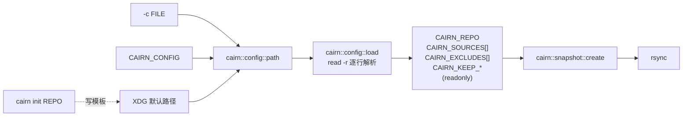

我以前一直觉得，`$(basename "$p")` 和 `${p##*/}` 只是同一件事的两种写法，前者好读，后者是老手炫技。这一篇我把它们各跑了 10000 遍，输入都是同一个路径，结果让我重新排了一遍优先级：

```text
$ cat out/ch03/builtin_vs_basename.stdout
${p##*/}:         36.3 ms
$(basename "$p"): 16790.1 ms
ratio: 462x
```

差了 462 倍，原因不神秘：`${p##*/}` 全程发生在 shell 进程内部，`$(basename "$p")` 每次都要 `fork` 加 `execve` 一个叫 `basename` 的程序（下面会用 `strace` 数一遍）。而 `${p##*/}` 只是 Bash 参数展开运算符里的一个。这一篇我们把它们学完，顺便用它们写出 Cairn 第一份配置文件的读取代码：仓库在哪、备份哪些目录、排除什么，从一个文本文件读进 shell 变量，而且读的过程里不执行文件里的任何一个字符。

> [!NOTE] 本篇检查点
> 这一篇结束时仓库（标签 `ch03`）有 52 个被跟踪的文件，比 `ch02` 多 15 个：`lib/cairn/config.sh`（155 行，配置解析，已经是最终版本）、`lib/cairn/repo.sh`（57 行，只有 `init` 和 `check`，第 4 篇会加函数）、`lab/ch03/` 里的 13 个实验脚本（已经是最终版本）；另有三个旧文件被修改：`bin/cairn`（74 行长到 177 行，多了 `-c`/`--config` 和 `init`，之后还会改）、`lib/cairn/snapshot.sh`（54 行长到 85 行，改成读配置，第 5 和第 7 篇还会改）和 `README.md`（`Layout` 里一行，也还会改）。`make ch03` 通过：13 个实验全部按预期退出，没有一个需要宿主机，整套大约 85 秒，几乎全花在 `builtin_vs_basename.sh` 上。
> 涉及的 Shell 特性：一切皆字符串、Shell 变量与环境变量及单向继承、动态作用域与 `local`、`declare` 的各种属性、全部参数展开运算符、索引数组与关联数组、`set -u`、`printf -v`、`printf %q`、`${var@Q}`、nameref、`IFS= read -r`、`[[ =~ ]]` 与 `BASH_REMATCH`、`readonly`，以及 [Google Shell 风格指南](https://google.github.io/styleguide/shellguide.html)里关于命名、常量、`local` 和“声明与命令替换分开写”的规则。
> 前置：[第 2 篇：展开：bash 怎样把一行字拆成参数](/posts/shell-by-cairn-02-expansion-and-quoting/)。

## 动手清单

你自己的 `~/cairn` 从第 2 篇的状态出发，这一篇要做这几件事，每件在下面的哪一节出现都会指出来：

- 新建 `lib/cairn/config.sh` 和 `lib/cairn/repo.sh`：配置解析和仓库标记。
- 改 `bin/cairn`：`-c`/`--config`/`--config=` 三种写法、`init` 命令；改 `lib/cairn/snapshot.sh`：不带参数的 `snapshot` 改读配置，一个参数是用法错误，两个以上参数仍走第 2 篇的老形式。
- 新建 `lab/ch03/` 下的 13 个实验。`make ch03` 全部跑一遍。

如果你想直接从参考仓库复制，这样就行（假设 `~/cairn-ref` 已经拉到了标签，见下面的检查点一节；文件列表用第 2 篇的 `mapfile` 读进数组，每个文件名一个元素）：

```bash
git -C ~/cairn-ref fetch --tags
cd ~/cairn
mkdir -p lab/ch03
mapfile -t files < <(git -C ~/cairn-ref diff --name-only ch02 ch03)
for f in "${files[@]}"; do
  git -C ~/cairn-ref show ch03:"${f}" >"${f}"
done
```

我不建议整个照抄：`lab/ch03/` 的前几个脚本很短，手敲一遍，错误信息才是你自己撞出来的。`bin/cairn` 在你的 `~/cairn` 里已经有可执行位，`>` 重定向只改内容、不动权限，所以不用再 `chmod`。

## 全貌

这一章的数据流只有一条线，从配置文件到 `rsync` 的参数：



配置路径有三个来源，优先级从高到低；`load` 逐行读文件，把结果放进一组只读的全局变量；`snapshot` 只认这组全局变量；`init` 负责在配置不存在时写出第一份模板。这条线上的每一个箭头，都靠 shell 的变量机制实现，所以我们先把变量本身讲透，再回来看代码。

## 一切都是字符串

C、Rust、Python 里，变量有类型，赋值是把一个有类型的值放进一个有类型的槽。Shell 里只有三种东西：字符串、字符串的数组、字符串到字符串的映射。没有整数，没有布尔，没有浮点数。`5` 是一个字符串，恰好只有一个字符：

```text
$ bash -c 'n=5; declare -p n'
declare -- n="5"
$ bash -c 'x=1; y=2; echo $x+$y; echo $((x + y)); echo "${x}${y}"'
1+2
3
12
$ bash -c 'declare -i i=3; i=i*2; echo "$i"; j=3; j=j*2; echo "$j"'
6
j*2
```

`declare -p`（后面会专门讲）打印变量的定义：`--` 表示没有任何属性，值是 `"5"`。第二行里，`$x+$y` 就是三个字符串拼起来，`+` 在这里没有任何含义。`$(( ))` 才是算术：它先把里面的名字展开成字符串，再把字符串当数字解释，结果再变回一个字符串。`"${x}${y}"` 是 `12`，因为这里根本没有“加”这回事，只有拼接。所谓整数，是 *某些运算* 把字符串读成数字，不是变量的性质。`declare -i` 会给变量加一个让赋值走算术的属性，第三条命令是它的效果：`i=i*2` 把右边当算术，得到 6，而没有这个属性的 `j=j*2` 就是字符串 `j*2`，下面细看。

赋值的语法也和别的语言不一样，我第一次写 shell 就被它咬了一口：

```text
$ bash -c 'n = 5; echo "n=[${n-unset}]"'
bash: line 1: n: command not found
n=[unset]
```

`n = 5` 是三个词，shell 会把第一个词当命令名。赋值必须是一个词，`name=value`，等号两边不能有空格。这条规则后面你会反复用到：配置文件里 `key = value` 可以带空格，那是我们自己的语法，由我们自己的解析器处理；到了 shell 里，同样的文本就是一个命令加两个参数。

变量有“没设置”和“设置成空”两种状态，它们不同：

```text
$ bash -c 'unset x; x=; [[ -v x ]] && echo "x is set (to empty)"; unset x; [[ -v x ]] || echo "x is unset"'
x is set (to empty)
x is unset
```

`[[ -v x ]]` 问的是“这个名字存在吗”，和值无关。后面的 `${x-default}` 与 `${x:-default}` 的区别就建立在这两种状态上。

最后，`PATH`、`IFS`、`HOME`、`PWD` 这些 shell 自己要查的东西，也只是普通变量。第 1 篇说 `PATH` 是 shell 的约定，不是内核的，现在可以验证：

```text
$ bash -c 'PATH=/nonexistent ls; echo "status $?"'
bash: line 1: ls: command not found
status 127
```

`NAME=value command` 这种前缀写法让 `NAME` 只对这一条命令生效（下一节细讲），而 shell 在查找 `ls` 时用的就是这个临时的 `PATH`，所以找不到，退出码 127。手册把这些概念放在 [Shell Parameters](https://www.gnu.org/software/bash/manual/html_node/Shell-Parameters.html) 一节：参数是存值的东西，变量是有名字的参数，另外还有位置参数 (`$1`) 和特殊参数 (`$?`, `$@`)。第 2 篇里的 `"$@"` 是特殊参数，这一篇的主角是变量。

## 两种变量：shell 变量和环境变量

同样叫变量，shell 里有两种，几乎所有“为什么我的变量在脚本里看不见”的问题，都出在把它们当成一种。`lab/ch03/env_vs_shell.sh` 用子进程当探针：

```bash
child_sees() {
  bash -c 'printf "child sees LAB_V=%s\n" "${LAB_V-<unset>}"'
}

LAB_V=shell_only
echo "parent sets LAB_V=${LAB_V} (not exported)"
child_sees

export LAB_V
echo '--- after export LAB_V'
child_sees
# ...
```

`child_sees` 启动一个新的 `bash`，让它报告 `LAB_V` 是什么。`${LAB_V-<unset>}` 是“没设置就用 `<unset>`”，我们稍后会系统地讲。运行器把输出放在 `out/ch03/env_vs_shell.stdout`：

```text
$ cat out/ch03/env_vs_shell.stdout
parent sets LAB_V=shell_only (not exported)
child sees LAB_V=<unset>
--- after export LAB_V
child sees LAB_V=shell_only
--- the child changes its copy, the parent keeps its own
child now: changed_in_child
parent still: shell_only
--- VAR=x cmd: lives only for that one command
inside:  LAB_P=prefix
outside: LAB_P=<unset>
--- the kernel view: /proc/<pid>/environ of a child
LAB_P=prefix
LAB_V=shell_only
```

第 1 篇里，shell 启动程序的最后一步是 `execve(path, argv, envp)`。`envp` 就是环境，一个 `NAME=value` 字符串的数组，由内核在 `execve` 时放进新进程的地址空间。Shell 自己有一张变量表，其中被标记为 *导出* 的那部分，会在每次 `fork` 加 `execve` 时写成 `envp` 交给子进程。没有标记的，子进程看不到：上面第一次 `child_sees` 打印的就是 `<unset>`。

我给这个机制找的类比是复印机。子进程拿到的是环境的一份复印件：你可以在复印件上随便涂改 (`child now: changed_in_child`)，原件不会变 (`parent still: shell_only`)；复印之后你再改原件，已经启动的子进程手里的那份也不会变。继承是单向的，一次性的，按值的。

这也解释了 `VAR=x cmd` 前缀：它只修改 *这一条命令* 的那份复印件，shell 自己的变量表没动，所以 `outside: LAB_P=<unset>`。

最后一段输出是内核的视角。`LAB_P=prefix sleep 30 &` 启动一个后台进程，`$!` 是它的进程号，`/proc/<pid>/environ` 是内核保存的、这个进程启动时收到的环境，用 NUL 分隔（第 2 篇的 `find -print0` 也是这个原因：NUL 不可能出现在文件名和环境变量里，是安全的分隔符），所以要 `tr '\0' '\n'` 才能读。脚本里有一个小循环在等 `LAB_P=` 出现，我猜是因为 `fork` 之后、`execve` 之前，子进程还是 shell 的一个副本，`environ` 里是父进程的环境；等 `execve` 完成，才变成 `sleep` 的。输出里 `LAB_V=shell_only` 也在，因为脚本前面已经 `export` 了它，`sleep` 的环境是导出变量加上那个前缀。

Cairn 有两个从环境读的输入：`CAIRN_CONFIG` 和 `CAIRN_NOW`（第 2 篇用过它让快照名可复现）。命令行上写 `CAIRN_NOW=20261101T000000Z cairn snapshot`，就是用前缀给 `cairn` 这一个进程的复印件加一行。而 `-c` 选项的值我们不放进环境，`bin/cairn` 开头有这样几行（`set -o nounset` 从第 1 篇起就在第 8 行，这一章新增的只有 `CAIRN_CONFIG_OPT` 和它的注释）：

```bash
set -o nounset

readonly CAIRN_VERSION='0.1.0'

# -c/--config 的值; 空表示未给出。
CAIRN_CONFIG_OPT=''
```

`CAIRN_CONFIG_OPT` 是一个普通的 shell 变量，没有 `export`，所以 `cairn` 启动的 `rsync` 看不到它。这是有意的：环境是复印给每个后代的，没必要的变量不该放进去。Google 指南说常量和导出变量写成 `UPPER_SNAKE_CASE`、在文件顶部声明；`CAIRN_VERSION` 是 `readonly`，`CAIRN_CONFIG_OPT` 是会被选项解析改写的普通全局，所以没有 `readonly`，但也放在顶部。（`set -o nounset` 那一行我们在 `set -u` 一节再讲。）手册的 [Environment](https://www.gnu.org/software/bash/manual/html_node/Environment.html) 一节是官方的说法。

## 动态作用域：函数看得见调用者的 local

`lab/ch03/dynamic_scope.sh` 是整个实验目录里很短的一个，全文 25 行，去掉开头 3 行注释后是：

```bash
show() {
  echo "  show sees x=${x}"
}

outer() {
  local x=outer_local
  echo 'outer: local x=outer_local, calling show'
  show
}

middle() {
  local x=middle_local
  outer
  echo "middle after outer: x=${x}"
}

x=global
echo 'top level: x=global, calling show'
show
outer
middle
echo "top level at the end: x=${x}"
```

`show` 写在文件最上面，写的时候，它旁边只有全局的 `x`。如果你写 C、Rust 或 Python，你的预测会是：`show` 永远打印 `global`。

```text
$ cat out/ch03/dynamic_scope.stdout
top level: x=global, calling show
  show sees x=global
outer: local x=outer_local, calling show
  show sees x=outer_local
outer: local x=outer_local, calling show
  show sees x=outer_local
middle after outer: x=middle_local
top level at the end: x=global
```

从 `outer` 里调用时，`show` 看到的是 `outer_local`。这就是 *动态作用域*：一个名字指向什么，由 *谁在调用我* 决定，而不是由我写在哪里决定。Bash 的 `local` 做的事可以这样想：进入函数时，把这个名字当前的值压到一个栈上，在函数里给它一个新值；函数返回时弹栈，把旧值放回去。在这期间，任何被它调用的函数按名字查找，找到的都是栈顶的这个新值。手册对 `local` 的说法是，局部变量只对这个函数和它调用的命令可见。C 和 Python 是词法作用域，名字的含义看它在源码里的位置；Bash 是动态的，名字的含义看调用栈。

它有两个让人不舒服的后果。第一个：不写 `local`，赋值就写进了调用者的变量，甚至全局：

```text
$ bash -c 'f() { local k=outer; g; echo "f: ${k}"; }; g() { k=changed_by_g; }; f; echo "global: ${k-<unset>}"'
f: changed_by_g
global: <unset>
```

`g` 没有声明 `k`，它按名字找到了 `f` 的局部变量，把它改掉了；全局的 `k` 根本没被碰过。这不是 bug，是语言的规则，但它说明了 Google 指南那条“函数内的变量一律用 `local`”为什么不是洁癖：不写 `local`，你的函数就是在偷偷改调用者的状态，而且你没法从函数签名上看出来。Cairn 里每个函数都先 `local` 再用，这一章的 `cairn::config::load` 就是例子。

第二个后果是反过来的：你的函数里一个 `local` 变量，可能挡住调用者想让你写的那个同名变量，练习 3 会让你亲手撞上它。

## declare：给字符串加上行为

变量的“类型”在 Bash 里是 *属性*，由 `declare`（也叫 `typeset`，两者都是内建命令）添加。`lab/ch03/declare_attrs.sh` 把常用的几个依次打了一遍。手册的 [Bash Builtins](https://www.gnu.org/software/bash/manual/html_node/Bash-Builtins.html) 一节有 `declare` 的完整选项表，这里是我们会用到的：

| 选项 | 含义 | 在哪里用 |
| --- | --- | --- |
| `-i` | 整数：赋值时按算术求值 | 这一节 |
| `-r` | 只读，不能再赋值，也不能 `unset` | `CAIRN_*` 全局 |
| `-a` / `-A` | 索引数组 / 关联数组 | `config.sh` 里的 `local -a` |
| `-l` / `-u` | 赋值时转小写 / 大写 | 这一节 |
| `-n` | nameref：这个名字是另一个变量的别名 | `printf -v` 一节 |
| `-x` | 导出，等价于 `export` | 这一节 |
| `-g` | 在函数里声明全局变量 | 这一节 |
| `-p` | 打印变量的定义 | 到处 |

先是 `-i`：

```bash
echo '--- -i integer: assignments are arithmetic'
declare -i n=2+3
echo "n=${n}"
n+=1
echo "n+=1 gives ${n}"
n=abc
echo "n=abc gives ${n}"
declare -p n
```

```text
--- -i integer: assignments are arithmetic
n=5
n+=1 gives 6
n=abc gives 0
declare -i n="0"
```

`2+3` 变成了 `5`，`n+=1` 是加法而不是追加字符串（普通变量上 `+=` 是追加，`5` 追加 `1` 是 `51`）。最有意思的是 `n=abc`：算术求值里，裸的 `abc` 是一个变量名，没有设置的变量按 0 算，所以 `n` 变成 `0`，而且没有任何报错。这是 `-i` 让我不放心的原因：它把一个拼写错误悄悄变成了数字 0。另一个坑是前导 0：算术里 `010` 是八进制的 8，`08` 不是合法的八进制数，这是第一条命令的报错，第三条命令里 `010` 就是 8：

```text
$ bash -c 'echo $((08))'
bash: line 1: 08: value too great for base (error token is "08")
$ bash -c 'echo $((10#08)) $((10#0012))'
8 12
$ bash -c 'echo $((010))'
8
```

`10#` 前缀强制按十进制解释。记住这个，配置解析里读 `keep_last = 08` 的时候我们会用到它。

然后是 `-r`。只读变量赋值会出错，为了不让整个实验脚本被它终止，实验在子 shell 里做，并且把错误信息收进一个变量：

```bash
where_stripped() {
  [[ "$1" =~ line\ [0-9]+:\ (.*) ]] && echo "${BASH_REMATCH[1]}" || echo "$1"
}
# ...
echo '--- -r readonly: a second assignment fails (run in a subshell)'
declare -r pi=3
msg="$(
  (
    pi=4
    echo 'not reached: the subshell aborts on the assignment'
  ) 2>&1
)"
where_stripped "${msg}"
echo "pi is still ${pi}"
declare -p pi
```

`where_stripped` 的作用是把 `.../declare_attrs.sh: line N: ` 这种带路径和行号的前缀去掉，因为路径每台机器都不一样；`[[ =~ ]]` 和 `BASH_REMATCH` 我们在配置解析里正式讲。输出：

```text
--- -r readonly: a second assignment fails (run in a subshell)
pi: readonly variable
pi is still 3
declare -r pi="3"
```

第二行的 `echo 'not reached'` 没有出现：非交互的 shell 里给只读变量赋值，会直接终止当前这个（子）shell。`unset` 它和用 `declare +r` 去掉只读属性都会被拒绝：

```text
$ bash -c 'readonly A=1; unset A; echo "status $?"'
bash: line 1: unset: A: cannot unset: readonly variable
status 1
$ bash -c 'declare -r R=1; declare +r R; echo "status $?"'
bash: line 1: declare: R: readonly variable
status 1
```

只读是单向的，直到进程结束。这正是我们要的：配置读进来之后，`CAIRN_REPO` 在整个进程生命周期里不能被任何一行代码改掉。

接着是数组和大小写：

```text
--- -a indexed array
count=4 second='sour cherry'
declare -a fruits=([0]="apple" [1]="sour cherry" [2]="fig" [3]="plum")
--- -A associative array
plum is blue, keys: apple fig plum 
--- -l / -u change the case on assignment
lower=mixed upper=MIXED
```

`declare -p fruits` 的输出可以直接复制回 shell 里重新创建这个数组，这是 `-p` 的设计目的。注意 `second='sour cherry'`：数组元素可以含空格，这是它们比“一个用空格分隔的字符串”可靠的地方（第 2 篇的结论）。下一节专门讲数组。

最后是 `-n` 和 `-x`：

```text
--- -n nameref: another name for a variable
target=changed_via_alias
declare -n alias_name="target"
--- -x export
child sees LAB_EXPORTED=yes
declare -x LAB_EXPORTED="yes"
```

`declare -n alias_name=target` 让 `alias_name` 成为 `target` 的别名，给它赋值就是给 `target` 赋值。`declare -x` 就是 `export`，所以子进程看得见，`declare -p` 里多出的 `-x` 也是这个意思。

两个和位置有关的细节。在函数里，`declare` 和 `local` 一样，让变量成为函数的局部；要在函数里创建全局变量，得显式写 `declare -g`：

```text
$ bash -c 'f() { declare y=1; }; f; echo "[${y-unset}]"; g() { declare -g z=1; }; g; echo "[${z-unset}]"'
[unset]
[1]
```

另一个：`declare -p` 对不存在的变量会报错并返回 1，所以它也可以拿来测“有没有这个变量”，只是 `[[ -v name ]]` 更直接：

```text
$ bash -c 'declare -p nosuch; echo "status $?"'
bash: line 1: declare: nosuch: not found
status 1
```

## 参数展开：${...} 里的运算符

到目前为止，我们见过的 `${name}` 只是在做“取值”。花括号的真正用处是：里面可以放运算符，对值做删除、替换、截取、转换。Bash 手册把它们都列在 [Shell Parameter Expansion](https://www.gnu.org/software/bash/manual/html_node/Shell-Parameter-Expansion.html) 一节，一共有十来类。`lab/ch03/param_expansion.sh` 把它们对着同一个路径过了一遍：

```bash
path=/home/me/docs/report.final.tar.gz
ref=path
cfg_alpha=1
cfg_beta=2
other=3
name_with_quote="it's"

printf '%-26s %s\n' EXPRESSION RESULT
row 'path' "${path}"
row '${path#*/}' "${path#*/}"
row '${path##*/}' "${path##*/}"
# ...
```

`row` 是一个两行的辅助函数，按列打印 `表达式 结果`（脚本里的 `# shellcheck disable=SC2016` 是因为表达式字符串里的 `${...}` 故意放在单引号里，不让 shell 展开）。完整的输出：

```text
$ cat out/ch03/param_expansion.stdout
EXPRESSION                 RESULT
path                       /home/me/docs/report.final.tar.gz
${path#*/}                 home/me/docs/report.final.tar.gz
${path##*/}                report.final.tar.gz
${path%.*}                 /home/me/docs/report.final.tar
${path%%.*}                /home/me/docs/report
${path/me/you}             /hoyou/me/docs/report.final.tar.gz
${path//o/0}               /h0me/me/d0cs/rep0rt.final.tar.gz
${path/#\/home/HOME}       HOME/me/docs/report.final.tar.gz
${path/%gz/zip}            /home/me/docs/report.final.tar.zip
${path^^}                  /HOME/ME/DOCS/REPORT.FINAL.TAR.GZ
${upper,,}                 /home/me/docs/report.final.tar.gz
${path:0:5}                /home
${path: -9}                al.tar.gz
${path:6:2}                me
${#path}                   33
${!cfg_*}                  cfg_alpha cfg_beta
${!ref}                    /home/me/docs/report.final.tar.gz
${path@Q}                  '/home/me/docs/report.final.tar.gz'
${name_with_quote@Q}       'it'\''s'
```

我们一类一类看。

### 去掉前缀和后缀：# ## % %%

`#` 从开头删，`%` 从结尾删；写一个删最短匹配，写两个删最长匹配。我的记法是看键盘（美式布局）：`#` 是 Shift+3，在 `$` (Shift+4) 的左边，所以它管左边（前缀）；`%` 是 Shift+5，在右边，管后缀。匹配用的是 *通配符* 模式（第 2 篇的 `*`、`?`、`[...]`），不是正则表达式。

```text
$ bash -c 's=report.final.tar.gz; echo "${s%.*} | ${s%%.*} | ${s#*.} | ${s##*.}"'
report.final.tar | report | final.tar.gz | gz
```

`${s%.*}` 从结尾删掉最短的、符合 `.*` 的后缀，也就是最后一个点和后面的东西，去掉 `.gz`。`${s%%.*}` 删最长的，从 *第一个* 点开始全删，剩下 `report`。`#*.` 和 `##*.` 是镜像：删到第一个点为止，或者删到最后一个点为止，后者留下的正是扩展名 `gz`。

`basename` 和 `dirname` 在这里都有对应写法：`${p##*/}` 是 `basename`，`${p%/*}` 是 `dirname`：

```text
$ bash -c 'p=/a/b.c/d; echo "${p%/*} | ${p##*/} | ${p#/}"'
/a/b.c | d | a/b.c/d
```

它们和外部命令不完全等价，有两处我踩过：

```text
$ bash -c 'p=a/b/; echo "[$(basename "$p")] [${p##*/}]"'
[b] []
$ bash -c 'p=file; echo "[${p%/*}] [${p##*/}]"'
[file] [file]
```

路径以 `/` 结尾时，`basename` 先去掉结尾的斜杠，得到 `b`，而 `${p##*/}` 删到最后一个 `/`，剩下空串。路径里没有 `/` 时，`${p%/*}` 什么也删不掉，返回整个字符串，而 `dirname file` 会返回 `.`。所以替换成参数展开之前，要先想好输入长什么样。练习 1 里的 `strip_ext` 就是这样一个被边界情况逼出来的函数。

### 查找替换：/ // /# /%

```text
$ bash -c 'path=/home/me/docs; echo "${path/me/you}"'
/hoyou/me/docs
```

我是故意挑了这个例子，`/me/` 才是我想替换的目录，但 `me` 第一次出现是在 `home` 的里面。`${var/pat/repl}` 只替换第一处匹配，`${var//pat/repl}` 替换全部。`/#` 和 `/%` 要求匹配必须出现在开头或结尾：

```text
$ bash -c 'path=/home/me/docs; echo "${path/#\/home/HOME} ${path/%docs/files}"'
HOME/me/docs /home/me/files
```

模式也可以是字符类，这是用参数展开去掉空白或字符的常见写法：

```text
$ bash -c 's="hello world"; echo "${s//[aeiou]/}"'
hll wrld
$ bash -c 's="hello world"; echo "${s//[[:space:]]/_}"'
hello_world
```

还有一个我没想到的变化：替换串里的 `&` 现在代表“匹配到的那段文本”，和 `sed` 的 `s/x/[&]/` 一样。

```text
$ bash -c 's="hello world"; echo "${s/o/[&]}|${s//o/[&]}|${s//o/[\&]}"'
hell[o] world|hell[o] w[o]rld|hell[&] w[&]rld
$ bash -c 'shopt patsub_replacement'
patsub_replacement  	on
```

这是 `patsub_replacement` 这个 shell 选项，在 Bash 5.3 里默认是开的（我没有去查它是哪个版本引入的，这里的输出是 5.3.15 的）。想要一个字面的 `&`，前面加反斜杠。如果你有一个旧脚本把 `&` 当普通字符，换到新版本可能行为变了。

### 大小写：^ ^^ , ,,

```text
$ bash -c 's="hello world"; echo "${s^}|${s^^}|${s^^[aeiou]}"'
Hello world|HELLO WORLD|hEllO wOrld
$ bash -c 's="Hello World"; echo "${s,,}|${s,}|${s@U}|${s@u}|${s@L}"'
hello world|hello World|HELLO WORLD|Hello World|hello world
```

单个符号只处理第一个字符，两个符号处理全部；后面可以跟一个模式，只改匹配的字符（`${s^^[aeiou]}` 只大写元音）。`@U`、`@u`、`@L` 是同一件事的另一种写法，后面讲 `@` 运算符时会再见到。这组运算符让 `tr '[:upper:]' '[:lower:]'` 在脚本里基本没有出场的理由。

### 截取：${var:offset:length}

```text
$ bash -c 's="hello world"; echo "${s:3}|${s:3:4}|${s: -3}|${s:(-3)}|${s:-3}"'
lo world|lo w|rld|rld|hello world
```

偏移从 0 开始。偏移可以是负数，从结尾数，但是 *必须* 在冒号和负号之间留一个空格（或者把它放进括号）。原因在最后一个结果里：`${s:-3}` 不是“从倒数第三个字符开始”，而是第一类运算符 `${var:-word}`，“`s` 没设置或为空就用 3”，因为 `s` 是设置了的，结果就是 `s` 自己。我第一次写 `${s:-3}` 的时候完全没发现，它从不报错，只是静默地给你整个字符串。

对位置参数和数组，`:offset:length` 按元素计数：

```text
$ bash -c 'set -- a b c d; echo "${@:2}|${@:2:2}|${*: -1}"'
b c d|b c|d
```

### 长度和间接：${#var} ${!var}

`${#path}` 是字符数 (33)，`${#a[@]}` 是数组元素个数。这里有个常见的坑：

```text
$ bash -c 'a=(x "y z" w); echo "${#a[@]}|${#a}|${#a[1]}|${!a[@]}"'
3|1|3|0 1 2
```

`${#a}` 是 `${#a[0]}`，第一个元素的长度（`x` 是 1），不是元素个数；`${#a[1]}` 是 `y z` 的长度，3；`${!a[@]}` 是所有下标。

`${!name}`（没有后缀）是 *间接*：先取 `name` 的值，把它当作另一个变量的名字，再取那个变量的值：

```text
$ bash -c 'ref=target; target=hi; echo "${!ref}"'
hi
$ bash -c 'cfg_a=1; cfg_b=2; other=3; echo "${!cfg_*}"'
cfg_a cfg_b
```

`${!prefix*}`（还有 `${!prefix@}`）展开成所有以 `prefix` 开头的 *变量名*，没有值。注意它和 `${!ref}` 是两个东西：区别在于花括号里有没有 `*` 或 `@`，以及后面是不是 `[@]`。`param_expansion.sh` 里的 `${!ref}` 返回 `/home/me/docs/report.final.tar.gz`，因为 `ref=path`。间接是一种“用变量名当数据”的手段，几乎总是可以用数组或关联数组做得更清楚。

### 默认值：- := ? +

这一族有八个运算符，规律很简单，看下表就能记住。`lab/ch03/defaults.sh` 对 *没设置*、*设置成空*、*有值* 三种状态各打了一遍：

```bash
unset unset_v
empty_v=''
set_v=value
# ...
printf '%-18s %-10s %-10s %-10s\n' '${v-dflt}' \
  "[${unset_v-dflt}]" "[${empty_v-dflt}]" "[${set_v-dflt}]"
printf '%-18s %-10s %-10s %-10s\n' '${v:-dflt}' \
  "[${unset_v:-dflt}]" "[${empty_v:-dflt}]" "[${set_v:-dflt}]"
# ...
```

每一行 `printf` 对同一个表达式分别代入三个变量，下面是运行器收集的输出：

```text
$ cat out/ch03/defaults.stdout
EXPRESSION         unset      empty      set       
${v-dflt}          [dflt]     []         [value]   
${v:-dflt}         [dflt]     [dflt]     [value]   
${v+alt}           []         [alt]      [alt]     
${v:+alt}          []         []         [alt]     
--- := assigns the default as well
a=[fallback] b=[fallback]
afterwards a=[fallback] b=[fallback]
--- :? aborts with a message (run in subshells)
unset_v: needs a value
empty_v: needs a value
no abort with ?: empty_v is set
```

不带冒号的版本只看“有没有设置”，带冒号的版本把“设置成空”也算作缺失。`-` 和 `:-` 在一行里的区别，是中间那一列：`${v-dflt}` 对空变量返回空，`${v:-dflt}` 返回 `dflt`。

- `${v:-word}`：缺失就 *用* `word`，不改变 `v`。最常见的写法，比如 `${XDG_CONFIG_HOME:-${HOME}/.config}`（下面 `cairn::config::path` 里就是它）。
- `${v:=word}`：缺失就用 `word`，并且 *赋值给* `v`，输出里的 `afterwards a=[fallback]` 就是证据。
- `${v:?message}`：缺失就打印 `v: message` 并 *终止* shell（非交互时）。第 2 篇的 Steam 事故里，`${STEAMROOT:?}` 就是这个运算符。
- `${v:+word}`：*有值* 才用 `word`，否则展开成空。典型用途是有条件地加参数：

```text
$ bash -c 'v=set; echo "[${v:+--flag=${v}}]"; unset v; echo "[${v:+--flag=${v}}]"'
[--flag=set]
[]
```

这两个 `:?` 的例子，实验是放进子 shell 里跑的（因为它们会终止 shell），我在命令行上直接复现一下它们的原话：

```text
$ bash -c 'unset v; : "${v:?needs a value}"; echo not reached'
bash: line 1: v: needs a value
$ bash -c ': "${1:?usage: prog FILE}"'
bash: line 1: 1: usage: prog FILE
```

第二个是写脚本时检查参数个数的惯用写法。冒号 `:` 是一个什么也不做的内建命令，这里的作用是让 shell 展开那串东西，然后丢掉结果，只留下“缺失就终止”的副作用。

### 变换：${var@X}

`@` 后面跟一个字母，是陆续加入 Bash 的一族“变换”，每个字母做一件事：

| 运算符 | 结果 |
| --- | --- |
| `${v@Q}` | 把值加上引号，使 shell 能原样读回 |
| `${v@E}` | 把值里的反斜杠序列 (`\n`, `\t`) 按 `$'...'` 的规则展开 |
| `${v@P}` | 把值当提示符字符串展开（第 9 篇再用） |
| `${v@A}` | 一条能重建这个变量的赋值语句 |
| `${v@a}` | 变量的属性字母（`i`、`x`、`a`、`A` 等） |
| `${v@U}` `${v@u}` `${v@L}` | 全大写、首字母大写、全小写 |
| `${v@K}` `${v@k}` | 关联数组的键和值，打印成 `键 "值"` 一对一对的形式 |

```text
$ bash -c 'x=1; echo "${x@A}"'
x='1'
$ bash -c 'declare -ix y=2; echo "${y@a}"'
ix
$ bash -c 'v="a\\nb"; echo "${v@Q}"; echo "${v@E}"'
'a\nb'
a
b
$ bash -c 'declare -A m=([a]=1); echo "${m[@]@K}"'
a "1" 
```

`param_expansion.sh` 里最后两行展示了 `@Q`：`${name_with_quote@Q}` 把 `it's` 变成 `'it'\''s'`，这是 shell 里表示“字符串里含一个单引号”的标准写法：结束单引号，写一个转义的单引号，再重新开始单引号。

### 数组上的展开

上面所有运算符都可以用在 `"${array[@]}"` 上，对 *每个元素* 分别生效，结果仍然是同样数量的词：

```text
$ bash -c 'a=(x y z); echo "${a[@]/#/--exclude=}"'
--exclude=x --exclude=y --exclude=z
$ bash -c 'a=(x "y z"); printf "<%s>\n" "${a[@]/#/--exclude=}"'
<--exclude=x>
<--exclude=y z>
$ bash -c 'a=(); set -- "${a[@]/#/--exclude=}"; echo "argc=$#"'
argc=0
$ bash -c 'a=(report.txt notes.md); echo "${a[@]%.*}"'
report notes
```

`${a[@]/#/--exclude=}` 的意思是：对每个元素做“在开头 (`/#`) 把空串替换成 `--exclude=`”，就是给每个元素加上前缀。第二个例子说明元素里的空格没有被破坏（`<--exclude=y z>` 还是一个词），第三个说明空数组展开成零个词，一个 `--exclude=` 都不会多出来。这一行就是 `cairn::snapshot::create` 里把配置里的排除模式变成 `rsync` 参数的做法，下面“snapshot 读配置”一节会看到。

还有 `"${a[*]}"`，把所有元素用 `IFS` 的第一个字符粘成 *一个* 词：

```text
$ bash -c 'a=(x "y z" w); echo "${a[*]}"; IFS=,; echo "${a[*]}"'
x y z w
x,y z,w
```

这是第 2 篇 `"$*"` 的数组版本，用来拼出一个逗号分隔的字符串这类需要一个词的场合。

## 数组：索引的和关联的

数组你已经在第 2 篇里把它当 `argv` 用过了。这一篇多两件事：关联数组，以及“声明”这个动作。`lab/ch03/assoc_arrays.sh` 用一个关联数组数单词：

```bash
text='the cat saw the dog and the dog saw the cat'

declare -A count=()
read -r -a words <<<"${text}"
for word in "${words[@]}"; do
  count[${word}]=$((${count[${word}]:-0} + 1))
done

echo "words: ${#words[@]}, distinct: ${#count[@]}"
for word in "${!count[@]}"; do
  printf '%s %d\n' "${word}" "${count[${word}]}"
done | sort
# ...
```

`read -r -a words <<<"${text}"` 把一行文本按 `IFS`（默认是空白）拆成数组（`<<<` 是 here-string，把一个字符串作为标准输入，第 5 篇讲重定向时再回来）；`count[${word}]` 以单词为键；`${count[${word}]:-0}` 是“这个键还没有就当 0”，所以第一次遇到某个词，加一后变成 1，不需要先初始化。

```text
$ cat out/ch03/assoc_arrays.stdout
words: 11, distinct: 5
and 1
cat 2
dog 2
saw 2
the 4
--- membership and removal
cat is a key
bird is not a key
after unset: 4 keys
--- indexed arrays
slice [*]:1:3 -> b c d
last element -> e
sparse: indices 0 1 2 3 4 9, count 6
```

11 个词，5 个不同的词，`the` 出现 4 次。`for word in "${!count[@]}"` 遍历所有键，我把它的输出交给了 `sort`，因为我没有在手册里找到关联数组遍历顺序的承诺。我在我的机器上看到的是：

```text
$ bash -c 'declare -A m=([a]=1 [b]=2 [c]=3 [d]=4 [e]=5); echo "${!m[@]}"'
e d c b a
```

反着来的，而且换一个 Bash 版本就可能变。永远不要依赖它。

后半段的几个操作：`[[ -v count[cat] ]]` 判断键是否存在（`-v` 也能用在带下标的名字上）；`unset 'count[cat]'` 删除一个键，括号要加引号，否则 `count[cat]` 是一个通配符模式，可能匹配当前目录里叫 `counta`、`countc` 或 `countt` 的文件（第 2 篇的通配符）；索引数组可以有洞，`list[9]=z` 之后下标是 `0 1 2 3 4 9`，个数是 6。删一个元素也一样，不会让后面的元素前移：

```text
$ bash -c 'a=(1 2 3); unset "a[1]"; declare -p a'
declare -a a=([0]="1" [2]="3")
```

所以“用下标 0 到 `${#a[@]}-1` 遍历数组”只对没有洞的数组成立，遍历数组请用 `"${a[@]}"` 或 `"${!a[@]}"`。

关联数组必须先声明。如果你忘了，Bash 不会报错，它会把它当成索引数组，而下标里的 `apple` 要算术求值：

```text
$ bash -c 'm[apple]=1; m[fig]=2; declare -p m'
declare -a m=([0]="2")
$ bash -c 'declare -A m; m[apple]=1; m[fig]=2; declare -p m'
declare -A m=([apple]="1" [fig]="2" )
```

`apple` 是一个没设置的变量名，算术里等于 0，`fig` 也是 0，所以两次赋值都写进了 `m[0]`，第二次覆盖了第一次。有 `set -u` 的话，这个错误会现形：

```text
$ bash -c 'set -u; m[apple]=1; echo done'
bash: line 1: apple: unbound variable
```

这是 `set -u` 的另一个用处，下一节讲它。

## set -u：把拼写错误变成错误

`lab/ch03/nounset_fail.sh` 是故意会失败的实验（文件名以 `_fail` 结尾，运行器要求它以非零退出）：

```bash
set -o nounset

target_dir=/tmp/some/dir
echo "without set -u, \$tpyo would be empty; with it: abort"
echo "safe use with a default: [${tpyo:-}]"
# BAD: the name is misspelled on purpose.
# shellcheck disable=SC2154
echo "rm -rf ${tpyo}/cache"
echo "never printed ${target_dir}"
```

```text
$ cat out/ch03/nounset_fail.stdout out/ch03/nounset_fail.stderr
without set -u, $tpyo would be empty; with it: abort
safe use with a default: []
/home/bfmhno3/Projects/cairn/lab/ch03/nounset_fail.sh: line 11: tpyo: unbound variable
```

`set -o nounset`（缩写 `set -u`）让 shell 把“展开一个没设置的变量”当作错误：打印 `unbound variable`，终止脚本。没有它，`${tpyo}` 就是空串，`rm -rf ${tpyo}/cache` 就是 `rm -rf /cache`。这个例子里我把 `rm` 换成了 `echo`，第 2 篇里的 Steam 事故是它没换时的样子。

`set -u` 不是魔法，几件事要知道：

- `${tpyo:-}` 是明确的“我知道它可能没设置，空串就行”，不受 `set -u` 影响；`${v-}`、`${v+x}`、`[[ -v v ]]` 也不触发。
- Bash 5.3 里，空数组的 `"${a[@]}"` 不触发：

  ```text
  $ bash -c 'set -u; a=(); echo "${#a[@]}"; echo "[${a[@]}]"; echo ok'
  0
  []
  ok
  $ bash -c 'set -u; echo "[${1:-}] [${undefined-}]"; echo after'
  [] []
  after
  $ bash -c 'set -u; unset v; [[ -v v ]] && echo set || echo notset; echo "[${v+set}]"'
  notset
  []
  ```

  这正是 `bin/cairn` 能安全地在 `set -o nounset` 下展开 `"${CAIRN_EXCLUDES[@]/#/--exclude=}"` 的原因：一个没有 `exclude` 行的配置，让数组为空，展开成零个词，不会报错。`lab/ch03/config_precedence.sh` 的五个用例都没有 `exclude`，它们都通过了，就是这条路径的证据。

- 位置参数 `$1` 也受它管：`cairn` 的 `cmd_snapshot` 里用 `(($# >= 2))` 先数，再用 `"$@"`；检查参数用 `${1:-}` 或者 `$#`，不要裸写 `$1`。
- 有两个小怪癖，是我跑出来的：脚本文件里，`unbound variable` 让 shell 以退出码 1 结束；用 `bash -c` 跑同样的代码，退出码是 127。我没有去读源码找原因，推测是 `-c` 路径走了不同的错误处理，这里只记录观察：

  ```text
  $ bash -c 'printf "set -u\necho \"\$tpyo\"\n" >/tmp/cairn-demo/nu.sh; bash /tmp/cairn-demo/nu.sh; echo "file: $?"; bash -c "set -u; echo \"\$tpyo\""; echo "-c: $?"'
  /tmp/cairn-demo/nu.sh: line 2: tpyo: unbound variable
  file: 1
  bash: line 1: tpyo: unbound variable
  -c: 127
  ```

`set -u` 的位置也有讲究：它只影响 *设置之后* 执行的代码，所以 `bin/cairn` 把 `set -o nounset` 放在 `source` 各个库 *之前*（第 8 行），让库里的函数也受它管。同时这也带来一个小代价：库里用到的、可能没设置的变量，一律要写成 `${CAIRN_NOW:-}` 这样（`cairn::snapshot::name` 里就有一处）。

## 把值写进变量：printf -v、%q、@Q 与 nameref

函数在 shell 里只有退出码一个“返回值”，要把结果交出去，常见做法是让函数把结果打印到标准输出，再用 `$(...)` 捕获。这有一个代价：每个 `$(...)` 是一个子 shell，也就是一次 `fork`（上面 `basename` 的 462 倍里就有它的份）。它还有另一个代价，子 shell 里的赋值全部丢失：

```text
$ bash -c 'load() { x=1; }; out="$(load)"; echo "x=${x-<unset>}"; load; echo "x=${x-<unset>}"'
x=<unset>
x=1
```

`cairn::config::load` 的任务正是设置一批全局变量，所以它 *不能* 在 `$(...)` 里被调用：`bin/cairn` 里是直接写 `cairn::config::load "$(cairn::config::path)" || return`（路径用 `$(...)` 取，`load` 本身不用）。

当一个函数既要把结果交给调用者，又不想付出子 shell 的代价时，Bash 有两个办法。第一个是 `printf -v`，它的作用是“把格式化的结果写进一个变量，而不是打印”：

```text
$ bash -c 'printf -v msg "%s has %d items" list 3; echo "${msg}"'
list has 3 items
$ bash -c 'printf -v "arr[2]" "%s" hi; declare -p arr'
declare -a arr=([2]="hi")
```

`-v` 后面的名字可以是变量，也可以是带下标的数组元素，而且名字本身可以来自另一个变量：`printf -v "${key}" ...`，这是 `config.sh` 里用的（下面解析器一节）。

第二个办法是 nameref，前面 `declare -n` 见过。在函数里用 `local -n`，让函数里的一个名字成为调用者变量的别名，函数里改它，就是改调用者的：

```text
$ bash -c 'fill() { local -n arr=$1; arr=(one two); }; fill list; declare -p list'
declare -a list=([0]="one" [1]="two")
```

`fill list` 把名字 `list` 作为字符串传进去，`arr` 成了它的别名，数组 `list` 就被函数填满了。它的代价来自动态作用域：如果调用者传进来的名字恰好和函数里的别名同名，别名指向了自己：

```text
$ bash -c 'set_out() { local -n out=$1; out=filled; }; out=x; set_out out; echo "status $?"'
bash: line 1: local: warning: out: circular name reference
bash: line 1: warning: out: circular name reference
bash: line 1: warning: out: maximum nameref depth (8) exceeded
status 0
```

三条警告，退出码还是 0。传出参数的函数里，局部变量名要起得不容易撞车（`_cl_lines` 这种，练习 3 会用）。Cairn 现在没有用 nameref，`config.sh` 用的是 `printf -v`。另一个需要注意的是 `unset`：对 nameref 直接 `unset`，删的是 *它指向的变量*，要删别名本身得 `unset -n`：

```text
$ bash -c 'target=original; declare -n ref=target; unset ref; echo "[${target-unset}]"'
[unset]
$ bash -c 'target=original; declare -n ref=target; unset -n ref; echo "[${target-unset}]"'
[original]
```

手册在 [Shell Parameters](https://www.gnu.org/software/bash/manual/html_node/Shell-Parameters.html) 一节讲 nameref。

另一类需要的是反过来：把一个值 *安全地打印* 成 shell 能读回来的样子，用在错误信息、日志、拼出另一条要被 shell 解释的命令（比如 `ssh host "..."`）时。`printf '%q'` 和 `${var@Q}` 就是干这个的：

```text
$ bash -c 'printf "%q\n" "a b" "x;y" "\$(rm -rf /)" ""'
a\ b
x\;y
\$\(rm\ -rf\ /\)
''
$ bash -c 'v="\$(rm -rf /)"; echo "${v@Q}"'
'$(rm -rf /)'
```

两者的风格不同：`%q` 给每个特殊字符前面加反斜杠，`@Q` 用单引号把整个值包起来，含单引号时写成 `'\''`；空串都变成 `''`，不会像没有引号时那样消失。（含换行时 `%q` 会用 `$'...'` 的形式。）它们都是 Bash 的扩展，POSIX `sh` 里没有，第 10 篇会回到这件事。Cairn 目前的错误信息里路径是直接打印的；到第 5 篇加日志、第 7 篇加锁时，路径里的特殊字符会开始变得重要。

## 配置文件长什么样

`cairn init` 写出的配置文件是这样的，我在一个沙箱目录里跑了一遍：先把 `bin` 放进 `PATH`，再把 `XDG_CONFIG_HOME` 指到沙箱里，免得改到我自己的配置：

```text
$ export PATH="${PWD}/bin:${PATH}"
$ cd /tmp/cairn-demo
$ export XDG_CONFIG_HOME="${PWD}/xdg"
```

`cairn init repo` 创建仓库，并在配置文件不存在时写出模板：

```text
$ cairn init repo
cairn: wrote /tmp/cairn-demo/xdg/cairn/cairn.conf
$ cat xdg/cairn/cairn.conf
# cairn configuration: one "key = value" per line.

# Where the snapshots live (required, once).
repo = /tmp/cairn-demo/repo

# A directory to back up (required, repeatable, absolute path).
# source = /home/you/Documents

# An rsync exclude pattern (optional, repeatable).
# exclude = *.tmp

# How many of the newest snapshots to keep (at least 1).
keep_last = 5

# How many days to keep one snapshot of (0 disables).
keep_daily = 7

# How many weeks to keep one snapshot of (0 disables).
keep_weekly = 4
$ find repo | sort
repo
repo/cairn.repo
repo/logs
repo/manifests
repo/snapshots
$ cat repo/cairn.repo
cairn-repo 1
```

三件事。`init` 先建了仓库：一个 `cairn.repo` 标记文件（内容 `cairn-repo 1`）和三个子目录 `snapshots/`、`manifests/`、`logs/`，后两个这一章还用不上。然后因为 `xdg/cairn/cairn.conf` 不存在，写了模板，并提示 `cairn: wrote ...`。最后，模板里 `repo =` 是 `init` 刚刚创建的那个仓库的绝对路径，`source` 和 `exclude` 被注释掉了，因为 `init` 没法替你决定要备份什么。

语法就是一行一个 `key = value`：键是 `repo`（必需，只能出现一次）、`source`（必需，可以重复，绝对路径）、`exclude`（可选，可以重复，直接交给 `rsync` 的 `--exclude=`）、`keep_last`（至少 1）、`keep_daily`、`keep_weekly`（后三个这一章只读不用，第 4 篇开始用）。空行和以 `#` 开头的行被忽略。值是等号后面去掉首尾空白的 *字面文本*，不处理引号，唯一的例外是以 `~/` 开头的值，它会被换成 `${HOME}/`。

这是我给自己定的最小语法，它的好处是：能用一个百来行的函数读出来，而且读的过程中没有任何东西会被 shell 解释。

## repo.sh：init 和 check

`lib/cairn/repo.sh` 有两个函数。`init` 创建仓库，我先把它的一部分贴出来：

```bash
cairn::repo::init() {
  local dir
  dir="$(realpath -m -- "$1")" || return 1
  if [[ -e "${dir}/cairn.repo" ]]; then
    cairn::log::info "${dir} is already a cairn repository"
    return 0
  fi
  if [[ -e "${dir}" ]]; then
    local entry=''
    if [[ -d "${dir}" ]]; then
      entry="$(find "${dir}" -mindepth 1 -print -quit)" || return 1
    else
      entry="${dir}"
    fi
    if [[ -n "${entry}" ]]; then
      cairn::log::err "${dir} exists and is not empty"
      return 3
    fi
  fi
  mkdir -p -- "${dir}/snapshots" "${dir}/manifests" "${dir}/logs" \
    || return 1
  printf 'cairn-repo 1\n' >"${dir}/cairn.repo" || return 1
  printf '%s\n' "${dir}"
}
```

第一行 `local dir`，第二行 `dir="$(realpath ...)"`：Google 指南要求声明和命令替换分开写，下一节有实验。`realpath -m` 的 `-m` 是“路径不存在也没关系”，因为 `init` 的目标通常还不存在；`--` 是第 2 篇讲的选项结束符。

三种结果：目录里已经有 `cairn.repo` 就只打印一条信息、返回 0；目录存在而且非空就报错、返回 3；其余情况创建三个子目录和标记文件，并把解析好的绝对路径打印到标准输出，给调用者 `cmd_init` 去写配置。

```text
$ cairn init repo; echo "status $?"
cairn: /tmp/cairn-demo/repo is already a cairn repository
status 0
$ cairn init repo 2>/dev/null; echo "status $?"
status 0
$ mkdir full; touch full/x; cairn init full; echo "status $?"
cairn: error: /tmp/cairn-demo/full exists and is not empty
status 3
```

重复 `init` 是幂等的：第二次打印 `already a cairn repository`，退出码 0；注意这句话走标准错误，`2>/dev/null` 之后第二次调用什么也不输出。这是 `cairn::log::info` 的行为，它写 `stderr`，因为“正常的输出”要留给命令的结果，这一点第 5 篇讲重定向时会用上。非空目录则是退出码 3，`config` 或仓库问题的专用码。

另一个函数 `check` 只有一件事：

```bash
cairn::repo::check() {
  local dir="$1"
  if [[ ! -f "${dir}/cairn.repo" ]]; then
    cairn::log::err \
      "${dir} is not a cairn repository (run 'cairn init ${dir}')"
    return 3
  fi
}
```

它拦住一类很糟的事故：配置里的 `repo` 写错了，指向一个别的目录，而 `snapshot` 在那里默默创建 `snapshots/...`。没有标记文件，就什么也不做。

## 读配置：IFS= read -r

现在是这一章的主角，`cairn::config::load`。开头先把常量放在文件顶部，这是 Google 指南对常量的要求（`readonly`，`UPPER_SNAKE_CASE`，声明在顶部）：

```bash
# 一行配置: 键, 可选空白, 等号, 可选空白, 非空的值。
readonly CAIRN_LINE_RE='^([^[:space:]=]+)[[:space:]]*=[[:space:]]*(.+)$'
# 默认值; 配置文件里的键可以覆盖它们。
readonly CAIRN_DEFAULT_KEEP_LAST=5
readonly CAIRN_DEFAULT_KEEP_DAILY=7
readonly CAIRN_DEFAULT_KEEP_WEEKLY=4
```

然后是函数的开头：

```bash
cairn::config::load() {
  local file="$1"
  if [[ ! -f "${file}" ]]; then
    cairn::log::err "no config file at ${file} (run 'cairn init REPO' first)"
    return 3
  fi

  local repo=''
  local keep_last="${CAIRN_DEFAULT_KEEP_LAST}"
  local keep_daily="${CAIRN_DEFAULT_KEEP_DAILY}"
  local keep_weekly="${CAIRN_DEFAULT_KEEP_WEEKLY}"
  local -a sources=()
  local -a excludes=()
  local line key value
  local n=0
```

重点是：*所有* 状态都先放在函数的局部变量里 (`local`, `local -a`)，解析完、验证完才一次性写到全局的 `CAIRN_*`。所以只要中途任何一行出错，全局变量一个都不会被碰：调用者不会看到一份“读了一半”的配置。

接下来是循环。它的第一行就是这一节的标题：

```bash
  while IFS= read -r line || [[ -n "${line}" ]]; do
    ((++n))
```

`read` 读一行放进变量 `line`。三处细节，每一处都有故事。

第一，`IFS=`。`read` 默认会用 `IFS`（空白）去掉行首行尾的空白。`IFS= read`（给 `read` 这一条命令的环境里把 `IFS` 设成空，这是前面讲的前缀赋值）让它什么都不去掉。第二，`-r`，不加它，反斜杠是转义字符，会被吃掉。三种组合各跑一遍：

```text
$ bash -c 'printf "%s\n" "  a\\b  " | { IFS= read -r l; printf "<%s>\n" "${l}"; }'
<  a\b  >
$ bash -c 'printf "%s\n" "  a\\b  " | { read -r l; printf "<%s>\n" "${l}"; }'
<a\b>
$ bash -c 'printf "%s\n" "  a\\b  " | { IFS= read l; printf "<%s>\n" "${l}"; }'
<  ab  >
```

第一行是我们要的：保留前导空白，保留反斜杠，连行尾的两个空格也保留，原样的一行。第二行去掉了首尾空白，第三行吃掉了反斜杠，`a\b` 成了 `ab`。我们要自己决定怎么处理空白（下面会用参数展开去掉），所以用 `IFS= read -r`。这是读一行文本的标准写法，记成一个固定短语：没有理由不写。

第三，`|| [[ -n "${line}" ]]`。如果文件最后一行没有换行符，`read` 虽然把内容读进了 `line`，却返回非零（因为它没读到换行就遇到了文件尾）：

```text
$ bash -c 'printf "no newline" | { IFS= read -r l; echo "status $?  <${l}>"; }'
status 1  <no newline>
$ bash -c 'printf "no newline" | { IFS= read -r l || [[ -n "${l}" ]]; echo "status $?  <${l}>"; }'
status 0  <no newline>
```

没有这个后缀，一个末尾没有换行的配置文件，最后一行会被悄悄丢掉：`read` 的退出码是 1，循环结束了，`line` 里却还有内容。有了它，“读失败，但 `line` 非空”就继续进入循环体。当循环真正结束（没有更多内容）时，`read` 失败而且 `line` 是空的，两个条件都假，循环退出。

`while` 本身是下一篇的内容（第 4 篇讲循环和 `read`），这里先当作固定句式用。

`((++n))` 是行号计数，写成前置自增有原因：

```text
$ bash -c 'n=0; ((n++)); echo "n++ gives status $?"; n=0; ((++n)); echo "++n gives status $?"'
n++ gives status 1
++n gives status 0
```

`((expr))` 的退出状态在 `expr` 为 0 时是 1。`n++` 的值是自增 *之前* 的 0，所以第一次返回 1；`++n` 的值是自增之后的 1。这一章没有 `set -e`，所以暂时不会出事，但第 7 篇开始它会：Google 指南特意提醒不要写裸的 `(( i++ ))`，我宁愿现在就养成习惯。

读到一行之后，先去掉首尾空白，而且不用 `sed` 或 `xargs`，只用参数展开：

```bash
    # 去掉首尾空白, 全部用参数展开, 不起子进程。
    line="${line#"${line%%[![:space:]]*}"}"
    line="${line%"${line##*[![:space:]]}"}"
```

这两行乍一看像猫在键盘上走过，拆开它：

```text
$ bash -c 'line="   key = value   "; a="${line%%[![:space:]]*}"; echo "<${a}>"; b="${line#"${a}"}"; echo "<${b}>"; c="${b##*[![:space:]]}"; echo "<${c}>"; echo "<${b%"${c}"}>"'
<   >
<key = value   >
<   >
<key = value>
```

内层 `${line%%[![:space:]]*}` 删掉最长的、从第一个“不是空白的字符”开始的后缀，剩下的就是前导空白（`a`，三个空格）。外层 `${line#"${a}"}` 再把这个前导空白当作前缀删掉；注意内部的 `"${a}"` 加了引号，让它按字面文本匹配，不当通配符模式。结尾同理，只是镜像：`${b##*[![:space:]]}` 删掉最长的、以最后一个非空白字符结尾的前缀，剩下的是尾部空白，再用 `%` 当后缀删掉。整个过程没有启动任何外部程序。

然后跳过空行和注释，再用正则把一行拆成键和值：

```bash
    if [[ -z "${line}" || "${line}" == '#'* ]]; then
      continue
    fi
    if [[ ! "${line}" =~ ${CAIRN_LINE_RE} ]]; then
      cairn::log::err "${file}:${n}: expected 'key = value'"
      return 3
    fi
    key="${BASH_REMATCH[1]}"
    value="${BASH_REMATCH[2]}"
```

`[[ ... =~ ... ]]` 是 Bash 的正则匹配（POSIX 扩展正则）；匹配成功后，整个匹配和每个括号捕获组都在数组 `BASH_REMATCH` 里：

```text
$ bash -c 'line="repo = /srv/x y"; re="^([^[:space:]=]+)[[:space:]]*=[[:space:]]*(.+)$"; [[ "${line}" =~ ${re} ]] && declare -p BASH_REMATCH'
declare -a BASH_REMATCH=([0]="repo = /srv/x y" [1]="repo" [2]="/srv/x y")
$ bash -c 'line="repo = /srv/x y"; [[ "${line}" =~ "^([^[:space:]=]+)" ]] && echo quoted-match || echo quoted-no-match'
quoted-no-match
```

`BASH_REMATCH[0]` 是整个匹配，`[1]` 是第一个括号（键），`[2]` 是第二个括号（值，里面的空格保留）。第二条命令是一个坑：正则如果写成带引号的字面量，引号里的内容按 *字面文本* 匹配，不再是正则，所以 `"^([^[:space:]=]+)"` 匹配不上任何东西。这就是为什么 `CAIRN_LINE_RE` 要放进一个变量，并且在 `[[ =~ ]]` 里 *不加引号* 地展开：`${CAIRN_LINE_RE}`。（仓库里就是这么写的，`make lint` 的 ShellCheck 是安静的。）

值里的 `~/` 单独处理：

```bash
    if [[ "${value}" =~ ^~/(.*)$ ]]; then
      value="${HOME}/${BASH_REMATCH[1]}"
    fi
```

配置文件里的 `~` 不会被 shell 展开，因为它根本没经过 shell，所以这里我们手动做一次，而且只做这一种：

```text
$ bash -c 'printf "repo = ~/r\nsource = /a\n" >/tmp/cairn-demo/t.conf; source lib/cairn/log.sh; source lib/cairn/config.sh; HOME=/home/me; cairn::config::load /tmp/cairn-demo/t.conf; declare -p CAIRN_REPO'
declare -r CAIRN_REPO="/home/me/r"
```

接着按键分派：

```bash
    case "${key}" in
      repo)
        if [[ -n "${repo}" ]]; then
          cairn::log::err "${file}:${n}: repo given more than once"
          return 3
        fi
        repo="${value}"
        ;;
      source)
        if [[ "${value}" != /* ]]; then
          cairn::log::err "${file}:${n}: source must be an absolute path"
          return 3
        fi
        sources+=("${value}")
        ;;
      exclude) excludes+=("${value}") ;;
```

`case` 是第 4 篇的内容，这里它做的事一看就懂：`repo` 只能出现一次（第二次报错，信息里有行号），`source` 必须以 `/` 开头，数组追加用 `+=(...)`，`exclude` 没有限制。再下面是数字键：

```bash
      keep_last | keep_daily | keep_weekly)
        if [[ ! "${value}" =~ ^[0-9]{1,9}$ ]]; then
          cairn::log::err "${file}:${n}: ${key} must be a non-negative integer"
          return 3
        fi
        # printf -v 把结果写进名字为 ${key} 的变量, 即上面的 local。
        printf -v "${key}" '%d' "$((10#${value}))"
        ;;
```

三个键共用一个分支。`^[0-9]{1,9}$` 限定最多 9 位数字，这样 `$(( ))` 里不会溢出，也拒绝了负数、小数和 `soon`。`$((10#${value}))` 里的 `10#` 就是前面讲过的：没有它，配置里写 `keep_last = 08` 会变成“`08` 不是合法的八进制数”的算术错误。最后 `printf -v "${key}"`：`${key}` 是 `keep_last`、`keep_daily` 或 `keep_weekly` 之一，`printf -v` 把结果写进同名变量，而函数开头刚好 `local` 声明过它们，所以写进去的就是函数的局部变量。这就是前面“动态作用域”的正面用法：同一个机制，让三个键共用一行代码，而不用写三个分支（`eval` 在 Google 指南里是禁用的，这里用不着）。

最后两个：

```bash
      *)
        cairn::log::err "${file}:${n}: unknown key '${key}'"
        return 3
        ;;
    esac
  done <"${file}"
```

未知的键直接拒绝，拼写错误不会被默默吞掉（`keep_lats = 3` 比一个静默忽略的 3 更有用）。`done <"${file}"` 是重定向，把文件接到整个 `while` 的标准输入上。第 5 篇会讲，这里重要的是它让 `while` 在 *当前* shell 里运行；如果写成 `cat "${file}" | while ...`，循环会在一个子 shell 里，里面设置的 `repo`、`sources` 全部丢失，这是前面 `load` 在 `$(...)` 里赋值全部丢失那个例子的变体。Google 指南说得更直接：不要把管道接到 `while` 里。

循环结束，验证必需项和范围，才把结果发布到全局：

```bash
  if [[ -z "${repo}" ]]; then
    cairn::log::err "${file}: missing required key 'repo'"
    return 3
  fi
  # ...
  CAIRN_REPO="${repo}"
  CAIRN_SOURCES=("${sources[@]}")
  CAIRN_EXCLUDES=("${excludes[@]}")
  CAIRN_KEEP_LAST="${keep_last}"
  CAIRN_KEEP_DAILY="${keep_daily}"
  CAIRN_KEEP_WEEKLY="${keep_weekly}"
  readonly CAIRN_REPO CAIRN_SOURCES CAIRN_EXCLUDES
  readonly CAIRN_KEEP_LAST CAIRN_KEEP_DAILY CAIRN_KEEP_WEEKLY
}
```

`# ...` 是我省略的另外两个检查（`source` 一个也没有、`keep_last` 小于 1）。上面的 `local` 变量在函数返回时消失，而全局变量留下来，并且立刻成为 `readonly`。`CAIRN_EXCLUDES=("${excludes[@]}")` 在 `nounset` 下对一个空的 `excludes` 也安全（前面验证过）。这个函数前面有一行 `# shellcheck disable=SC2034 # the globals are used by the other libraries`：ShellCheck 在这个文件里看不见谁读这些全局变量，所以会说它们“赋值了却没用到”。这是一条有理由的豁免，理由写在同一行里。

我把整个函数跑了一遍，看它到底留下了什么：

```text
$ bash -c 'printf "repo = /r\nsource = /s\nexclude = *.tmp\nkeep_last = 08\n" >/tmp/cairn-demo/c1.conf; source lib/cairn/log.sh; source lib/cairn/config.sh; cairn::config::load /tmp/cairn-demo/c1.conf; declare -p CAIRN_REPO CAIRN_SOURCES CAIRN_EXCLUDES CAIRN_KEEP_LAST CAIRN_KEEP_DAILY CAIRN_KEEP_WEEKLY'
declare -r CAIRN_REPO="/r"
declare -ar CAIRN_SOURCES=([0]="/s")
declare -ar CAIRN_EXCLUDES=([0]="*.tmp")
declare -r CAIRN_KEEP_LAST="8"
declare -r CAIRN_KEEP_DAILY="7"
declare -r CAIRN_KEEP_WEEKLY="4"
```

`keep_last = 08` 变成了 `"8"`；没写的 `keep_daily` 和 `keep_weekly` 是默认的 7 和 4；两个数组是 `-ar`，只读的索引数组。想在后面改它们，shell 直接拒绝：

```text
$ bash -c 'source lib/cairn/log.sh; source lib/cairn/config.sh; cairn::config::load /tmp/cairn-demo/c1.conf; CAIRN_KEEP_LAST=9; echo "status $?"'
bash: line 1: CAIRN_KEEP_LAST: readonly variable
```

没有 `status` 那行，因为赋值直接终止了这个 shell，和前面的 `declare -r` 实验一样。

## 为什么配置是解析的，不是 source 的

最省事的读配置办法是把它写成 shell 语法：`repo=/srv/backup`，然后 `source cairn.conf`，一行代码，所有变量都进来了。第 1 篇说 `source` 是在当前 shell 里把文件的每一行当命令执行，所以这一行代码的真实含义是：配置文件里能写什么，`cairn` 就能执行什么。`lab/ch03/source_injection.sh` 把这件事做了一遍：

```bash
conf="${LAB_TMP}/evil.conf"
cat >"${conf}" <<'CONF'
# a "config" written in shell syntax
export repo=$(touch "$LAB_TMP/pwned")
CONF
export LAB_TMP

echo '--- source evil.conf'
# BAD: sourcing a config file executes whatever it contains.
# shellcheck disable=SC1090
source "${conf}"
if [[ -e "${LAB_TMP}/pwned" ]]; then
  echo 'source ran the command: pwned was created'
# ...
```

`<<'CONF'` 是 here-document，分隔符加了引号，所以里面的 `$(...)` 不会在写文件的时候就被展开，文件里的内容是原样的两行。然后 `source` 它，再看沙箱里有没有出现 `pwned` 文件：

```text
$ cat out/ch03/source_injection.stdout
--- source evil.conf
source ran the command: pwned was created
--- cairn -c evil.conf snapshot
cairn: error: $LAB_TMP/evil.conf:2: expected 'key = value'
exit status: 3
pwned does not exist: the line was data, not code
```

`touch` 跑了。我用 `touch` 是因为它无害，换成任何命令都一样，包括 `rm`。后半段，同一份文本交给 `cairn -c`，它拒绝这个文件：第 2 行不符合 `key = value`，退出码 3，`pwned` 没有被创建。

有一个细节值得说清楚，因为我自己一开始也想错了。为什么实验里注入的是 `export repo=$(touch ...)`，而不是更直接的 `repo=$(touch ...)`？`export` 前缀有两个作用：它是合法的 shell 语法，所以 `source` 会执行命令替换；而对我们的解析器来说，`export repo=...` 中，`export` 后面跟的是空白，不是 `=`，正则 `^([^[:space:]=]+)[[:space:]]*=` 匹配不上，所以拒绝的信息是确定的 `expected 'key = value'`。如果注入的是不带 `export` 的 `repo=$(touch ...)`，它在我们的语法里 *是* 一行合法的 `key=value`，会被接受，而且当作字面文本：

```text
$ printf 'repo=$(touch %s/pwned2)\nsource = %s/src\n' "${PWD}" "${PWD}" >inj.conf
$ cairn -c inj.conf snapshot; echo "status $?"
cairn: error: $(touch /tmp/cairn-demo/pwned2) is not a cairn repository (run 'cairn init $(touch /tmp/cairn-demo/pwned2)')
status 3
$ ls pwned2
ls: cannot access 'pwned2': No such file or directory
```

`repo` 的值就是 `$(touch /tmp/cairn-demo/pwned2)` 这串字面字符，没有别的含义。它是一个以 `$` 开头的奇怪目录名，`cairn` 问“这是仓库吗？”，没有 `cairn.repo`，所以报错；`touch` 没有跑，`pwned2` 不存在。解析器并没有“识别”攻击，它是 *根本没有把这段文本交给 shell*。这才是“解析而不是 source”的意思：安全不来自黑名单，来自文本只被当作数据。

代价是我们自己要写解析器，也自己实现想要的少数功能（`~/`、默认值、重复键）。对一个备份工具，这是一笔好买卖：备份工具往往由 cron 或 systemd 定时用你的身份运行，任何能改动配置文件的人或程序，若配置被 `source`，就等于能以你的身份执行命令。

## 错误怎么报：九种坏配置

解析器的每一条 `return 3` 都对应一条错误信息。`lab/ch03/config_errors.sh` 为九种情形各写了一个坏配置，最后一种是仓库标记缺失，用 `cairn -c FILE snapshot` 跑一遍，并比较信息和退出码。核心是一个小函数：

```bash
# check_case LABEL EXPECTED_MESSAGE CONFIG_FILE
check_case() {
  local label="$1"
  local want="$2"
  local conf="$3"
  local got status
  got="$(cairn -c "${conf}" snapshot 2>&1 >/dev/null)"
  status=$?
  ((++total))
  printf '%-16s exit %d  %s\n' "${label}" "${status}" \
    "${got//"${LAB_TMP}"/\$LAB_TMP}"
  if ((status == expected_status)) && [[ "${got}" == "${want}" ]]; then
    ((++rejected))
  else
    printf '  expected: %s\n' "${want//"${LAB_TMP}"/\$LAB_TMP}" >&2
  fi
}
```

`local got status` 声明，下一行才赋值：命令替换的结果和它的退出码都要，所以必须分开写，下一节会讲。`2>&1 >/dev/null` 的顺序很关键：先让标准错误指向“当前的标准输出”（命令替换的管道），再把标准输出指向 `/dev/null`，结果是只捕获 `stderr`（第 5 篇细讲）。`"${got//"${LAB_TMP}"/\$LAB_TMP}"` 是前面的 `//` 替换：把随机的沙箱路径换成固定的 `$LAB_TMP`，让输出可复现。九种情形：

```text
$ cat out/ch03/config_errors.stdout
no file          exit 3  cairn: error: no config file at $LAB_TMP/absent.conf (run 'cairn init REPO' first)
no equals        exit 3  cairn: error: $LAB_TMP/syntax.conf:2: expected 'key = value'
unknown key      exit 3  cairn: error: $LAB_TMP/unknown.conf:2: unknown key 'colour'
relative source  exit 3  cairn: error: $LAB_TMP/relative.conf:2: source must be an absolute path
not an integer   exit 3  cairn: error: $LAB_TMP/notnum.conf:3: keep_daily must be a non-negative integer
keep_last zero   exit 3  cairn: error: $LAB_TMP/zero.conf: keep_last must be at least 1
missing repo     exit 3  cairn: error: $LAB_TMP/norepo.conf: missing required key 'repo'
missing source   exit 3  cairn: error: $LAB_TMP/nosource.conf: missing required key 'source'
no repo marker   exit 3  cairn: error: $LAB_TMP/plain is not a cairn repository (run 'cairn init $LAB_TMP/plain')
rejected: 9 of 9 cases
```

九个坏配置，九个都以 3 退出，信息一字不差。格式统一：`cairn: error: <文件>:<行号>: <问题>`，有行号的错误指向出错的那一行，缺必需键之类没有具体行的错误只写文件名。（实验之外我手工试了第十种，`repo` 写了两次，也一样被拒绝：）

```text
$ printf 'repo = %s/repo\nrepo = %s/other\nsource = %s/src\n' "${PWD}" "${PWD}" "${PWD}" >dup.conf
$ cairn -c dup.conf snapshot; echo "status $?"
cairn: error: dup.conf:2: repo given more than once
status 3
```

所有错误走 `cairn::log::err`，写到标准错误，最终由 `main` 的返回值变成进程的退出码（`main "$@"` 是脚本最后一条命令，它的返回值就是脚本的退出码）。退出码 3 是“配置或仓库的问题”，2 是“命令行用错了”，1 是运行时失败，这套约定从第 1 篇起就在定。

还有一件事要如实说：解析器不处理引号。值是等号后面的字面文本：

```text
$ printf 'repo = %s/repo\nsource = "%s/src"\n' "${PWD}" "${PWD}" >q.conf
$ cairn -c q.conf snapshot; echo "status $?"
cairn: error: q.conf:2: source must be an absolute path
status 3
```

`source = "/tmp/..."` 带了引号，值以 `"` 开头，所以不是绝对路径，被拒绝。对 `exclude = "*.tmp"`，引号会作为模式的一部分原样保留（`declare -p CAIRN_EXCLUDES` 里是 `"\"*.tmp\""`），这会让 `rsync` 去排除一个名字带引号的文件，也就是什么也不排除。这是这个语法的一个棱角，我选择在文档里说清楚，而不是在解析器里悄悄地多做一件事（练习 4 请你想想，如果要做，应该怎么做）。

## 选项和优先级

配置文件在哪，有三种指法，优先级从高到低：命令行的 `-c`/`--config`，环境变量 `CAIRN_CONFIG`，XDG 默认路径。这个优先级在 `cairn::config::path` 里只有两行：

```bash
cairn::config::path() {
  local default="${XDG_CONFIG_HOME:-${HOME}/.config}/cairn/cairn.conf"
  printf '%s\n' "${CAIRN_CONFIG_OPT:-${CAIRN_CONFIG:-${default}}}"
}
```

第一行是嵌套的 `:-`：`XDG_CONFIG_HOME` 没设置或为空，就用 `${HOME}/.config`，[XDG 基础目录规范](https://specifications.freedesktop.org/basedir/latest/)正是这么规定的。第二行是三层 `:-`：最外层是命令行选项的值，空的话看环境变量，再空的话看默认路径。一个 `${a:-${b:-${c}}}` 就是一条优先级链，而这一章前面讲过的 `:-` 和 `-` 的区别，在这里决定了一个细节：

在一个 `init` 过、`source` 已经补好的沙箱里（做法见下面“cairn init 和 cairn snapshot”一节），先用环境变量里的 `CAIRN_NOW` 建两个快照，再用 `-c ""` 建第三个，最后列出仓库：

```text
$ CAIRN_NOW=20261101T000000Z cairn snapshot
20261101T000000Z
$ CAIRN_NOW=20261101T020000Z cairn snapshot
20261101T020000Z
$ CAIRN_NOW=20261101T030000Z cairn -c "" snapshot
20261101T030000Z
$ ls repo/snapshots
20261101T000000Z
20261101T020000Z
20261101T030000Z
```

`-c ""` 给了一个空字符串，`:-` 把空当作缺失，于是默默地用了默认路径的配置（`20261101T030000Z` 出现在 `repo/snapshots` 里）。如果换成 `-`，空字符串就会被当作路径，然后报 `no config file at `。我觉得对一个备份工具，“空”被当作“没给”更安全，但这是一个选择，不是必然。

选项的解析写在 `bin/cairn` 的 `main` 里：

```bash
  while (($# > 0)); do
    case "$1" in
      -h | --help)
        usage
        return 0
        ;;
      --version)
        printf 'cairn %s\n' "${CAIRN_VERSION}"
        return 0
        ;;
      -c | --config)
        if (($# < 2)); then
          usage_error "option '$1' requires an argument"
          return
        fi
        CAIRN_CONFIG_OPT="$2"
        shift 2
        ;;
      --config=*)
        CAIRN_CONFIG_OPT="${1#--config=}"
        shift
        ;;
      --)
        shift
        break
        ;;
      -*)
        usage_error "unknown option '$1'"
        return
        ;;
      *) break ;;
    esac
  done
```

`--config=*` 是一个 `case` 的通配符模式，匹配之后用 `${1#--config=}` 删掉前缀，取出等号后面的值，这是前面讲的“去前缀”的实际用途。`shift 2` 一次丢掉选项和它的值。这个手写的循环只够用到 `-c` 这一章，第 4 篇会把它换成完整的选项解析（所有选项，以及 `getopts` 的取舍）。五种来源各跑一遍，`lab/ch03/config_precedence.sh` 的核心是：

```bash
make_config flag "${LAB_TMP}/flag.conf"
make_config env "${LAB_TMP}/env.conf"
make_config xdg "${LAB_TMP}/xdg/cairn/cairn.conf"
export XDG_CONFIG_HOME="${LAB_TMP}/xdg"
unset CAIRN_CONFIG

run_case 'XDG default only' xdg 20261101T000001Z cairn snapshot
run_case 'CAIRN_CONFIG set' env 20261101T000002Z \
  env CAIRN_CONFIG="${LAB_TMP}/env.conf" cairn snapshot
run_case '-c FILE and CAIRN_CONFIG' flag 20261101T000003Z \
  env CAIRN_CONFIG="${LAB_TMP}/env.conf" \
  cairn -c "${LAB_TMP}/flag.conf" snapshot
# ...
```

三个配置分别指向三个不同的仓库 (`repo_flag`, `repo_env`, `repo_xdg`)，每个用例看快照最终出现在哪个仓库里，就知道哪个配置被选中了。`env CAIRN_CONFIG=... cairn` 是用 `env` 命令给 `cairn` 加一个环境变量，作用和 `CAIRN_CONFIG=... cairn` 一样，只是它可以放在函数的参数里。结果：

```text
$ cat out/ch03/config_precedence.stdout
XDG default only                   -> repo_xdg
CAIRN_CONFIG set                   -> repo_env
-c FILE and CAIRN_CONFIG           -> repo_flag
--config FILE                      -> repo_flag
--config=FILE                      -> repo_flag
```

`-c` 胜过环境变量，环境变量胜过默认路径，三种写法的 `-c` 等价。再试几个命令行上的错误输入，错误都是退出码 2（用法错误）而配置错误是 3：

```text
$ cairn snapshot x; echo "status $?"
cairn: error: snapshot takes no arguments
cairn: error: run 'cairn --help' for usage
status 2
$ cairn -c; echo "status $?"
cairn: error: option '-c' requires an argument
cairn: error: run 'cairn --help' for usage
status 2
$ cairn -c /nonexistent snapshot; echo "status $?"
cairn: error: no config file at /nonexistent (run 'cairn init REPO' first)
status 3
$ cairn -x snapshot; echo "status $?"
cairn: error: unknown option '-x'
cairn: error: run 'cairn --help' for usage
status 2
$ cairn --config="${XDG_CONFIG_HOME}/cairn/cairn.conf" --version
cairn 0.1.0
```

## cairn init 和 cairn snapshot

`init` 命令在 `bin/cairn` 里是一个包装 `cairn::repo::init` 的函数：

```bash
cmd_init() {
  local dir
  dir="$(cairn::repo::init "$1")" || return
  if [[ -z "${dir}" ]]; then
    return 0
  fi
  local config
  config="$(cairn::config::path)" || return 1
  if [[ -e "${config}" ]]; then
    return 0
  fi
  mkdir -p -- "$(dirname -- "${config}")" || return 1
  cairn::config::template "${dir}" >"${config}" || return 1
  cairn::log::info "wrote ${config}"
}
```

`cairn::repo::init` 的标准输出被捕获进 `dir`：只有 *新建* 了仓库才会打印路径，已经存在的仓库它返回 0 但什么也不打印（信息走 `stderr`）。所以 `dir` 为空，就说明“没新建，也就不要碰配置”，直接返回。新建了，才去看配置在不在，不在才写模板。`cairn::config::template` 里是一个 here-document，分隔符没有加引号，让 `$1` 和 `${CAIRN_DEFAULT_KEEP_LAST}` 在里面被展开：

```bash
cairn::config::template() {
  cat <<EOF2
# cairn configuration: one "key = value" per line.

# Where the snapshots live (required, once).
repo = $1
# ...
EOF2
}
```

here-document 第 5 篇会专门讲。`init` 的 `config` 路径来自 `cairn::config::path`，所以 `cairn -c /some/file init repo` 会把模板写到 `/some/file`，`-c` 对 `init` 也有效。

不带参数的 `snapshot` 读配置；一个参数是用法错误；两个或更多参数仍然走第 2 篇的老形式（下面解释为什么留着它）：

```bash
cmd_snapshot() {
  if (($# >= 2)); then
    cairn::snapshot::create_adhoc "$@"
    return
  fi
  if (($# == 1)); then
    usage_error 'snapshot takes no arguments'
    return
  fi
  cairn::config::load "$(cairn::config::path)" || return
  cairn::snapshot::create
}
```

先看最后两行（没有参数的那条路径）：加载配置，然后 `cairn::snapshot::create`。后者是这样的：

```bash
cairn::snapshot::create() {
  cairn::repo::check "${CAIRN_REPO}" || return
  local name
  name="$(TZ=UTC cairn::snapshot::name)" || return 2
  local dest="${CAIRN_REPO}/snapshots/${name}"
  if [[ -e "${dest}" ]]; then
    cairn::log::err "snapshot ${name} already exists"
    return 1
  fi
  local -a rsync_args=(
    --archive --relative
    "${CAIRN_EXCLUDES[@]/#/--exclude=}"
    -- "${CAIRN_SOURCES[@]}" "${dest}/"
  )
  if ! rsync "${rsync_args[@]}"; then
    cairn::log::err 'rsync failed'
    return 1
  fi
  printf '%s\n' "${name}"
}
```

第一件事是检查仓库标记，上一节说过。`TZ=UTC cairn::snapshot::name` 是前缀赋值用在函数调用上，`TZ` 只在这次调用里是 `UTC`，所以快照名永远是 UTC 时间，不管你的机器在哪个时区：

```text
$ bash -c 'f() { echo "${V-unset}"; }; V=1 f; echo "${V-unset}"'
1
unset
```

`rsync_args` 是一个数组，第 2 篇的结论：参数列表放数组。`"${CAIRN_EXCLUDES[@]/#/--exclude=}"` 就是上一节讲的“每个元素加前缀”，排除模式 `*.tmp` 变成 `--exclude=*.tmp`，没有排除就是零个词。`--` 之后的所有东西都是路径，不会被当成选项（第 2 篇的 `--`）。

我在沙箱里把它整个跑了一遍：`init` 写出的模板里 `source` 那一行是注释掉的，所以第一次 `snapshot` 是失败的：

```text
$ cairn snapshot; echo "status $?"
cairn: error: /tmp/cairn-demo/xdg/cairn/cairn.conf: missing required key 'source'
status 3
```

这是 `init` 的设计：它写出的模板必须由你补上 `source`，补之前，`snapshot` 拒绝运行，而不是备份一个空列表。然后补上，并带一条排除规则：

```text
$ mkdir -p src/docs src/cache
$ echo a >src/docs/a.txt; echo b >src/cache/b.tmp; echo c >src/docs/c.tmp
$ printf 'source = %s\nexclude = *.tmp\n' "${PWD}/src" >>xdg/cairn/cairn.conf
$ grep -v '^#' xdg/cairn/cairn.conf | grep .
repo = /tmp/cairn-demo/repo
keep_last = 5
keep_daily = 7
keep_weekly = 4
source = /tmp/cairn-demo/src
exclude = *.tmp
$ CAIRN_NOW=20261101T000000Z cairn snapshot
20261101T000000Z
$ find repo/snapshots -type f | sort
repo/snapshots/20261101T000000Z/tmp/cairn-demo/src/docs/a.txt
```

我造了三个文件，`a.txt`、`b.tmp` 和 `c.tmp`；排除规则 `*.tmp` 生效了，快照里只有 `a.txt`。（`--relative` 保留了来源的完整路径，所以快照里是 `tmp/cairn-demo/src/docs/a.txt`，第 2 篇讲过。）`CAIRN_NOW` 让快照名可预期。

再用 `cairn snapshot` 带两个参数，就是第 2 篇的老入口：

```text
$ CAIRN_NOW=20261101T010000Z cairn snapshot repo2 src; echo "status $?"
20261101T010000Z
status 0
$ find repo2 -type f | sort
repo2/snapshots/20261101T010000Z/src/cache/b.tmp
repo2/snapshots/20261101T010000Z/src/docs/a.txt
repo2/snapshots/20261101T010000Z/src/docs/c.tmp
```

这一段是实话实说的兼容代码。第 2 篇的实验都在用 `cairn snapshot REPO SOURCE...`，如果这一章直接把它删掉，`make ch02` 就会失败。所以 `cmd_snapshot` 在有两个以上参数时，转给 `cairn::snapshot::create_adhoc`，它是第 2 篇那个版本原样保留下来的，不读配置、不检查仓库标记（输出里能看到：`repo2` 不是一个用 `init` 建出来的仓库，它照样成功了）；只有一个参数是用法错误；没有参数才是新的行为。这是一个疙瘩：同一个命令有两种形态，行为还不一样，我只是为了让旧实验继续通过才留着它，本章的新代码一行也不依赖它。我在这一章的标签上重新跑了 `bash scripts/chapter.sh ch02`（`make ch02` 做的就是这件事），12 个实验仍然全部通过。

## Google 的几条规矩，和一个 462 倍

这一章里 Google 指南的规则一直在出场，我把它们和它们背后的理由放在一起。

**命名和位置。** 函数和变量用 `lower_snake_case`，库函数用 `包名::函数名` (`cairn::config::load`)，常量和导出的变量用 `UPPER_SNAKE_CASE` 并且在文件顶部声明 (`CAIRN_LINE_RE`, `CAIRN_VERSION`)，能 `readonly` 的就 `readonly`。理由就是前面讲的：Bash 没有命名空间，所有全局名字共用一张表，`cairn::` 这个前缀是你唯一的隔离手段；`readonly` 把一个常量变成不可能被不小心覆盖的东西。

**函数里的变量一律 `local`。** 理由是动态作用域那一节，一个没有 `local` 的赋值，会写进调用链上某个你没想过的变量。

**声明和命令替换分开写。** `lab/ch03/local_cmdsub.sh` 全文只有 19 行，去掉开头三行注释之后就是这些：

```bash
bad() {
  # BAD: the status of `false` is lost.
  # shellcheck disable=SC2155
  local x="$(false)"
  echo "bad:  status after local x=\"\$(false)\" is $?"
}

# shellcheck disable=SC2034 # x is only there to carry the status
good() {
  local x
  x="$(false)"
  echo "good: status after x=\"\$(false)\" is $?"
}

bad
good
```

```text
$ cat out/ch03/local_cmdsub.stdout
bad:  status after local x="$(false)" is 0
good: status after x="$(false)" is 1
```

`local x="$(false)"` 是一条命令：`local`。它的退出码是 `local` 自己的（成功，0），不是 `$(false)` 的 1，命令替换失败的信息被它盖住了。分成两条，`x="$(false)"` 是一个纯赋值，整条语句的退出码就是命令替换的退出码。ShellCheck 对前一种写法报 SC2155，所以这里 `# BAD` 旁边有一个 `disable`；`repo.sh` 里的 `local dir` 加 `dir="$(realpath ...)" || return 1` 用的是后一种写法。

**优先用内建命令，不要为一次字符串操作起一个进程。** 这就是开头那个数字。`lab/ch03/builtin_vs_basename.sh` 对同一个路径各调 10000 次，每种测 5 轮，取中位数：

```bash
median_us() {
  local -a times=()
  local start
  for _ in 1 2 3 4 5; do
    start="${EPOCHREALTIME/./}"
    "$@"
    times+=($((${EPOCHREALTIME/./} - start)))
  done
  printf '%s\n' "${times[@]}" | sort -n | sed -n 3p
}
# ...
```

`EPOCHREALTIME` 是 Bash 提供的变量，当前时间，秒数后面带六位微秒：

```text
$ bash -c 'echo "${EPOCHREALTIME}"'
1793463097.293672
```

`${EPOCHREALTIME/./}` 用刚学的替换去掉小数点，变成微秒整数，相减得到耗时，计时本身不需要任何外部程序（只有最后挑中位数的 `sort` 和 `sed` 是外部的，它们在计时区间之外）。两个被测函数是：

```bash
# shellcheck disable=SC2034 # the result is deliberately thrown away
run_expansion() {
  local i
  local base
  for ((i = 0; i < 10000; i++)); do
    base="${p##*/}"
  done
}

# shellcheck disable=SC2034 # the result is deliberately thrown away
run_basename() {
  local i
  local base
  for ((i = 0; i < 10000; i++)); do
    base="$(basename "${p}")"
  done
}
```

`SC2034` 是“变量赋值了没人用”，这里的结果被故意丢弃，所以有这两条豁免。结果在开头那块里：36.3 ms 对 16790.1 ms，462 倍。换算成每次调用，`${p##*/}` 是大约 3.6 微秒，`$(basename "$p")` 是大约 1.7 毫秒。

我没有止步于一个比值，用 `strace` 数了 `execve`：

```text
$ bash -c 'strace -f -c -e trace=execve -o /tmp/cairn-demo/st1.txt bash -c "for i in {1..1000}; do b=\$(basename \"\$0\"); done" /home/me/docs/report.final.tar.gz; awk "/execve\$/ {print \"execve calls:\", \$4}" /tmp/cairn-demo/st1.txt'
execve calls: 1001
```

```text
$ bash -c 'strace -f -c -e trace=execve -o /tmp/cairn-demo/st2.txt bash -c "for i in {1..1000}; do b=\${0##*/}; done" /home/me/docs/report.final.tar.gz; awk "/execve\$/ {print \"execve calls:\", \$4}" /tmp/cairn-demo/st2.txt'
execve calls: 1
```

1000 次循环，`basename` 版本有 1001 次 `execve`，多出的那一次是 `bash` 自己；展开版本只有 1 次，也就是 `bash` 自己。比值就是这么来的：每一次 `basename` 是一个 `fork`、一个 `execve`、动态链接器加载 `libc`、`basename` 做完那一点点事、`exit`、`wait`。

这个数字要诚实地看。第一，它是噪声很大的：我把同一个脚本又单独跑了一遍 (`bash lab/ch03/builtin_vs_basename.sh`)，输出是这样：

```text
$ bash lab/ch03/builtin_vs_basename.sh
${p##*/}:         35.3 ms
$(basename "$p"): 16800.3 ms
ratio: 475x
```

比值从 462 变成了 475，差大约 3%：`basename` 一侧是 16.79 秒和 16.80 秒，几乎一样，晃动主要来自分母，也就是只有三十几毫秒的展开一侧，差 1 毫秒就是 3%。我不会拿它去做断言，实验本身也不做。第二，它是 *最坏情况*：循环体里什么都没有，只有这一件事。你的脚本里 `basename` 调用一次的代价是大约 1.7 毫秒，一个只跑一次的脚本里完全可以接受；它在循环里、在 `find ... -exec` 里、在每个文件调一次的场合才会变成数量级的差别，这是第 4 篇的话题。第三，前面提到的两处不等价（结尾的斜杠、没有斜杠）仍然成立，所以“换成展开”不是机械替换，要看输入。

## 几件让我意外的事

- `${s:-3}` 不是“从倒数第三个开始”，而是默认值运算符；它永远不报错，只是静默地给你整个字符串。
- `declare -i n=abc` 不报错，`n` 是 0。我更喜欢 `[[ =~ ^[0-9]+$ ]]` 先检查，而不是依赖 `-i`。
- 空数组在 Bash 5.3 的 `set -u` 下可以展开。我以为这里会炸。
- `unset ref` 在 nameref 上删的是目标变量，要 `unset -n`。
- 同一个 `unbound variable`，脚本文件里退出码是 1，`bash -c` 里是 127。我不知道为什么。
- 我自己写的配置语法里，`exclude = "*.tmp"` 的引号是模式的一部分。这个语法只有一个百来行的解析函数，但它仍然有棱角。
- 替换串里的 `&` 在 Bash 5.3 里默认就是“匹配到的文本”，`${s/o/[&]}` 和 `sed` 的行为一样。我以前写的 `&` 都是当普通字符用的。

## 检查点

先把参考仓库更新到带 `ch03` 标签的状态（你在第 1 篇克隆过 `~/cairn-ref`，只需要拉标签）：

```bash
git -C ~/cairn-ref fetch --tags
```

在 `~/cairn` 下：

```bash
make ch03
make -s lint
```

`make ch03` 应当打印这 14 行（有没有设 `CI` 都一样，这一章没有只在宿主机上跑的实验），整套大约 85 秒，几乎都花在 `builtin_vs_basename.sh` 的 5 × 10000 次 `basename` 上，你的机器上不用奇怪它慢：

```text
bash scripts/chapter.sh ch03
ok   lab/ch03/assoc_arrays.sh
ok   lab/ch03/builtin_vs_basename.sh
ok   lab/ch03/config_errors.sh
ok   lab/ch03/config_precedence.sh
ok   lab/ch03/declare_attrs.sh
ok   lab/ch03/defaults.sh
ok   lab/ch03/dynamic_scope.sh
ok   lab/ch03/env_vs_shell.sh
ok   lab/ch03/ex_strip_ext.sh
ok   lab/ch03/local_cmdsub.sh
ok   lab/ch03/nounset_fail.sh
ok   lab/ch03/param_expansion.sh
ok   lab/ch03/source_injection.sh
```

`nounset_fail.sh` 前面是 `ok`，因为运行器的规则是：文件名以 `_fail` 结尾的实验 *必须* 以非零退出，它退出码 1，所以是 `ok`。`make -s lint` 什么都不输出（ShellCheck 0.11.0 和 `shfmt -i 2 -bn -ci -d` 都安静）：

```text
$ make -s lint; echo "lint exit $?"
lint exit 0
```

再亲手跑一遍从 `init` 到 `snapshot` 的最短路径。我在 `/tmp/cairn-check` 下做的，你换成任何一个空目录都行，命令执行时 `cairn` 要在 `PATH` 里（`export PATH="${PWD}/bin:${PATH}"` 在 `~/cairn` 下执行一次）：

```text
$ mkdir /tmp/cairn-check && cd /tmp/cairn-check
$ export XDG_CONFIG_HOME="${PWD}/xdg"
$ cairn init repo
cairn: wrote /tmp/cairn-check/xdg/cairn/cairn.conf
$ mkdir src && echo hi >src/a.txt
$ printf 'source = %s/src\n' "${PWD}" >>xdg/cairn/cairn.conf
$ CAIRN_NOW=20261101T000000Z cairn snapshot
20261101T000000Z
$ find repo/snapshots -type f
repo/snapshots/20261101T000000Z/tmp/cairn-check/src/a.txt
```

**必须和标签一致的文件：** `lib/cairn/config.sh`，以及 `lab/ch03/` 下全部 13 个实验脚本。它们已经是最终版本。一次验证新的这 14 个：

```bash
for f in lib/cairn/config.sh lab/ch03/*.sh; do
  diff <(git -C ~/cairn-ref show ch03:"${f}") "${f}" && echo "same ${f}"
done
```

每个文件应当打印一行 `same ...`，共 14 行，不打印 diff：

```text
same lib/cairn/config.sh
same lab/ch03/assoc_arrays.sh
same lab/ch03/builtin_vs_basename.sh
same lab/ch03/config_errors.sh
same lab/ch03/config_precedence.sh
same lab/ch03/declare_attrs.sh
same lab/ch03/defaults.sh
same lab/ch03/dynamic_scope.sh
same lab/ch03/env_vs_shell.sh
same lab/ch03/ex_strip_ext.sh
same lab/ch03/local_cmdsub.sh
same lab/ch03/nounset_fail.sh
same lab/ch03/param_expansion.sh
same lab/ch03/source_injection.sh
```

第 1、2 篇列的那些最终文件（`flake.nix`、`.shellcheckrc`、`scripts/chapter.sh`、`scripts/make_tree.sh`、`lab/ch01/`、`lab/ch02/` 等）这一章没有碰。`diff` 不比较权限位，标签里有可执行位的文件还是那四个，`lib/cairn/config.sh` 和 `lib/cairn/repo.sh` 是库，不可执行（Google 指南：库以 `.sh` 结尾，不带可执行位）：

```text
$ git -C ~/cairn-ref ls-tree -r ch03 | grep ^100755 | cut -f2
bin/cairn
lab/ch01/shebang_exec.sh
scripts/chapter.sh
scripts/make_tree.sh
```

**中间版本（后面的章节会继续改）：**

- [`bin/cairn`](https://github.com/bfmhno3/cairn/blob/ch03/bin/cairn)：现在是 177 行。`-c`/`--config` 的选项循环是手写的、只认这一个选项，第 4 篇换成完整的选项解析和命令分发；第 7 篇加 `errexit`、`ERR` 陷阱和锁。
- [`lib/cairn/repo.sh`](https://github.com/bfmhno3/cairn/blob/ch03/lib/cairn/repo.sh)：现在是 57 行，只有 `cairn::repo::init` 和 `cairn::repo::check`，第 4 篇加 `cairn::repo::snapshots` 和 `cairn::repo::latest`。
- [`lib/cairn/snapshot.sh`](https://github.com/bfmhno3/cairn/blob/ch03/lib/cairn/snapshot.sh)：现在是 85 行，读配置、检查仓库标记、`rsync` 一份完整拷贝，还留着 `cairn::snapshot::create_adhoc`；没有硬链接，没有 `.partial`，没有锁。第 5 和第 7 篇会继续改它。
- [`README.md`](https://github.com/bfmhno3/cairn/blob/ch03/README.md)：`Layout` 一节里 `lib/cairn/` 那一行多了 `(log, config, repo, snapshot)`，以后每多一个顶层目录或库它还会更新。

### 文件清单

这一篇新增或修改的 18 个文件 (`git diff --name-only ch02 ch03`) 都在这里，链接指向标签 `ch03` 上的那一份。实验需要沙箱目录和 `CAIRN_ROOT`，所以它们的命令都是 `make ch03`。结果列是我在 Bash 5.3.15 下实际跑出来的，实验的退出码和运行器的期望一致（`nounset_fail.sh` 例外地是非零）；计时类的数字每次会不同。

| 文件 | 命令 | 结果 |
| --- | --- | --- |
| [`README.md`](https://github.com/bfmhno3/cairn/blob/ch03/README.md) | `-` | `Layout` 里 `lib/cairn/` 一行多了 `(log, config, repo, snapshot)`；不是脚本 |
| [`bin/cairn`](https://github.com/bfmhno3/cairn/blob/ch03/bin/cairn) | `bin/cairn snapshot` | 配置里没有 `source` 时退出码 3，`cairn: error: <配置路径>: missing required key 'source'`；`bin/cairn snapshot x` 退出码 2；`bin/cairn init REPO` 退出码 0 |
| [`lab/ch03/assoc_arrays.sh`](https://github.com/bfmhno3/cairn/blob/ch03/lab/ch03/assoc_arrays.sh) | `make ch03` | 退出码 0；`words: 11, distinct: 5`，`the 4`，最后一行 `sparse: indices 0 1 2 3 4 9, count 6` |
| [`lab/ch03/builtin_vs_basename.sh`](https://github.com/bfmhno3/cairn/blob/ch03/lab/ch03/builtin_vs_basename.sh) | `make ch03` | 退出码 0；`${p##*/}` 36.3 ms，`$(basename "$p")` 16790.1 ms，`ratio: 462x`（单独再跑一次是 475x，不做断言） |
| [`lab/ch03/config_errors.sh`](https://github.com/bfmhno3/cairn/blob/ch03/lab/ch03/config_errors.sh) | `make ch03` | 退出码 0；九种坏配置都是 `exit 3`，最后一行 `rejected: 9 of 9 cases`；有一种不符就退出码 1 |
| [`lab/ch03/config_precedence.sh`](https://github.com/bfmhno3/cairn/blob/ch03/lab/ch03/config_precedence.sh) | `make ch03` | 退出码 0；`XDG default only -> repo_xdg`，`CAIRN_CONFIG set -> repo_env`，其余三行都是 `repo_flag` |
| [`lab/ch03/declare_attrs.sh`](https://github.com/bfmhno3/cairn/blob/ch03/lab/ch03/declare_attrs.sh) | `make ch03` | 退出码 0；`n=abc gives 0`，`pi: readonly variable`，`declare -n alias_name="target"` |
| [`lab/ch03/defaults.sh`](https://github.com/bfmhno3/cairn/blob/ch03/lab/ch03/defaults.sh) | `make ch03` | 退出码 0；`${v:-dflt}` 一行是 `[dflt] [dflt] [value]`，`unset_v: needs a value` |
| [`lab/ch03/dynamic_scope.sh`](https://github.com/bfmhno3/cairn/blob/ch03/lab/ch03/dynamic_scope.sh) | `make ch03` | 退出码 0；从 `outer` 调用时 `show sees x=outer_local`，最后一行 `top level at the end: x=global` |
| [`lab/ch03/env_vs_shell.sh`](https://github.com/bfmhno3/cairn/blob/ch03/lab/ch03/env_vs_shell.sh) | `make ch03` | 退出码 0；未导出时子进程 `child sees LAB_V=<unset>`，导出后 `shell_only`，`/proc/<pid>/environ` 里有 `LAB_P=prefix` |
| [`lab/ch03/ex_strip_ext.sh`](https://github.com/bfmhno3/cairn/blob/ch03/lab/ch03/ex_strip_ext.sh) | `bash lab/ch03/ex_strip_ext.sh` | 退出码 0；`archive.tar.gz -> archive.tar`，`.bashrc -> .bashrc`，练习 1 |
| [`lab/ch03/local_cmdsub.sh`](https://github.com/bfmhno3/cairn/blob/ch03/lab/ch03/local_cmdsub.sh) | `make ch03` | 退出码 0；`bad:  status ... is 0`，`good: status ... is 1` |
| [`lab/ch03/nounset_fail.sh`](https://github.com/bfmhno3/cairn/blob/ch03/lab/ch03/nounset_fail.sh) | `make ch03` | 退出码 1（符合预期）；stderr `line 11: tpyo: unbound variable`，`never printed` 那一行没有打印 |
| [`lab/ch03/param_expansion.sh`](https://github.com/bfmhno3/cairn/blob/ch03/lab/ch03/param_expansion.sh) | `make ch03` | 退出码 0；20 行表格，`${path##*/}` 是 `report.final.tar.gz`，`${path@Q}` 是 `'/home/me/docs/report.final.tar.gz'` |
| [`lab/ch03/source_injection.sh`](https://github.com/bfmhno3/cairn/blob/ch03/lab/ch03/source_injection.sh) | `make ch03` | 退出码 0；`source ran the command: pwned was created`，`cairn` 对同一文本退出码 3 |
| [`lib/cairn/config.sh`](https://github.com/bfmhno3/cairn/blob/ch03/lib/cairn/config.sh) | `-` | 被 `bin/cairn` 引用；`cairn -c FILE snapshot` 对九种坏配置都退出码 3 |
| [`lib/cairn/repo.sh`](https://github.com/bfmhno3/cairn/blob/ch03/lib/cairn/repo.sh) | `-` | 被 `bin/cairn` 引用；`cairn init REPO` 重复执行退出码 0，非空目录退出码 3 |
| [`lib/cairn/snapshot.sh`](https://github.com/bfmhno3/cairn/blob/ch03/lib/cairn/snapshot.sh) | `-` | 被 `bin/cairn` 引用；`cairn snapshot` 无参数时读配置，打印快照名 |

## 练习

**1.** 写一个函数 `strip_ext`，只用参数展开去掉文件名的最后一个扩展名：`report.txt` 变成 `report`，`archive.tar.gz` 变成 `archive.tar`。两个边界：以点开头的文件名 (`.bashrc`) 没有扩展名；目录名里的点不算（`dir.d/noext` 保持不变）。

<details>
<summary>参考答案</summary>

我的答案是 [`lab/ch03/ex_strip_ext.sh`](https://github.com/bfmhno3/cairn/blob/ch03/lab/ch03/ex_strip_ext.sh)：

```bash
strip_ext() {
  local dir=''
  local base="$1"
  if [[ "$1" == */* ]]; then
    dir="${1%/*}/"
    base="${1##*/}"
  fi
  local stem="${base%.*}"
  if [[ -z "${stem}" || "${stem}" == "${base}" ]]; then
    stem="${base}"
  fi
  printf '%s%s\n' "${dir}" "${stem}"
}
```

```text
$ bash -c 'bash lab/ch03/ex_strip_ext.sh'
report.txt         -> report
archive.tar.gz     -> archive.tar
.bashrc            -> .bashrc
noext              -> noext
dir.d/file.c       -> dir.d/file
dir.d/noext        -> dir.d/noext
with space.md      -> with space
/a/b.c/d           -> /a/b.c/d
```

先把路径拆成目录和文件名：`${1%/*}/` 是目录部分（带斜杠），`${1##*/}` 是文件名。只在文件名上去后缀，这样 `dir.d/noext` 里的点就碰不到了。`${base%.*}` 删掉最后一个点以及后面的内容；如果 `base` 里没有点，`%.*` 什么也删不掉，`stem` 等于 `base`；如果 `base` 是 `.bashrc`，删完变成空串。所以“`stem` 为空，或者和 `base` 一样”这两种情况，都保留 `base` 原样。带空格的 `with space.md` 也没有问题，因为每个展开都加了引号。这个函数没有处理以斜杠结尾的输入（`a.d/` 的 `base` 是空串），我没有给它写规则。

</details>

**2.** 先预测，再验证：`a=(x "y z" w)`、`s=report.tar.gz` 的前提下，下面这些命令各打印什么，每个 `<...>` 是一个参数：

```bash
printf '<%s>\n' "${a[@]:1}"
printf '<%s>\n' "${a[*]:1}"
printf '<%s>\n' "${#a[1]}" "${s%%.*}" "${s#*.}" "${a[-1]^^}" "${nothing:-none}" "${s:-nothing}"
```

<details>
<summary>参考答案</summary>

```text
$ bash -c 'a=(x "y z" w); printf "<%s>\n" "${a[@]:1}"; printf "<%s>\n" "${a[*]:1}"'
<y z>
<w>
<y z w>
$ bash -c 'a=(x "y z" w); s=report.tar.gz; printf "<%s>\n" "${#a[1]}" "${s%%.*}" "${s#*.}" "${a[-1]^^}" "${nothing:-none}" "${s:-nothing}"'
<3>
<report>
<tar.gz>
<W>
<none>
<report.tar.gz>
```

`"${a[@]:1}"` 是从下标 1 开始的剩余元素，每个元素一个词：`y z` 和 `w`。`"${a[*]:1}"` 是同样的元素，但粘成 *一个* 词（`@` 与 `*` 的区别，和第 2 篇的 `"$@"` 与 `"$*"` 一样）。`${#a[1]}` 是 `y z` 的长度，3，因为空格也算一个字符。`${s%%.*}` 删最长的 `.*`，剩下 `report`；`${s#*.}` 删到第一个点，剩下 `tar.gz`；`${a[-1]^^}` 是最后一个元素转大写；`${nothing:-none}` 因为 `nothing` 没设置，用默认值 `none`；`${s:-nothing}` 因为 `s` 有值，所以还是 `report.tar.gz`，默认值不会被用到。

</details>

**3.** 写一个函数 `count_lines NAME FILE`，把 `FILE` 的行数写进调用者指定名字的变量 `NAME`，不使用 `$(...)` 或 `echo`。写完试试 `count_lines lines f.txt`，也就是让调用者的变量刚好叫 `lines`，看看会发生什么。

<details>
<summary>参考答案</summary>

用 `mapfile` 把文件读进数组，数组长度用 `printf -v` 写到调用者的变量。第一个版本里数组叫 `lines`，是 `count_lines_bad`；第二个版本换了一个不容易撞的名字：

```bash
# BAD: the local `lines` hides a caller variable of the same name.
count_lines_bad() {
  local lines
  mapfile -t lines <"$2" || return
  printf -v "$1" '%d' "${#lines[@]}"
}

count_lines() {
  local _cl_lines
  mapfile -t _cl_lines <"$2" || return
  printf -v "$1" '%d' "${#_cl_lines[@]}"
}
```

我把它们和调用的代码存成了一个脚本，跑出来是这样：

```text
$ bash -c 'bash /tmp/cairn-demo/ex3.sh'
bad,  total=[3]
bad,  lines=[unset]
good, total=[3]
good, lines=[3]
```

`count_lines_bad total ...` 没有问题，`total` 是 3。但 `count_lines_bad lines ...` 让调用者的变量也叫 `lines`，`printf -v lines` 找到的是函数里那个 `local lines`（动态作用域，最近的一个），把 3 写进了局部变量，函数返回时它就消失了，调用者的 `lines` 还是没设置。这个 bug 不会有任何报错，只是“结果不见了”。改成 `_cl_lines` 之后就好了。这也是为什么我觉得传出参数的函数是 Bash 里最脆弱的一类：它们的正确性依赖于一个调用者看不到的名字。需要这么做的函数，要么起一个带前缀的局部名，要么干脆让函数把结果打印出来，让调用者去付 `$(...)` 的代价。

</details>

**4.** `exclude = "*.tmp"` 被读进来之后，`CAIRN_EXCLUDES` 里的值是什么？如果想让解析器去掉值两端的一对双引号，应该改 `cairn::config::load` 的哪里？改完 `source = "/tmp/a b"` 又会怎样？

<details>
<summary>参考答案</summary>

前面已经看到了，值是带着引号的字面文本 `"*.tmp"`（`declare -p` 里是 `"\"*.tmp\""`）。要去掉外层的一对引号，应该在 `key`、`value` 取出之后、处理 `~/` 之前加一段：

```bash
    if [[ "${value}" =~ ^\"(.*)\"$ ]]; then
      value="${BASH_REMATCH[1]}"
    fi
```

我在一份 `config.sh` 的拷贝上加了这几行（没有改仓库里的文件），用同一份配置再读一遍：

```text
$ bash -c 'printf "repo = /r\nsource = \"/tmp/a b\"\nexclude = \"*.tmp\"\n" >/tmp/cairn-demo/q3.conf; source lib/cairn/log.sh; source /tmp/cairn-demo/config_q.sh; cairn::config::load /tmp/cairn-demo/q3.conf; declare -p CAIRN_SOURCES CAIRN_EXCLUDES'
declare -ar CAIRN_SOURCES=([0]="/tmp/a b")
declare -ar CAIRN_EXCLUDES=([0]="*.tmp")
```

`source` 的值变成了 `/tmp/a b`，含空格，也通过了绝对路径检查，`exclude` 的引号也不见了。拷贝通过了 ShellCheck 和 `shfmt`。我没有把它放进 Cairn：加了它，就没法表示“一个字面上以引号开头的值”了，而且“值就是等号后面的字面文本”这句话的例外会再多一条。这是语法设计的取舍，没有标准答案；我倾向于不加，让文档里的一句话保持成立。

</details>

**5.** 不运行脚本，预测下面这个脚本的四行输出。`c` 里没有 `local`。

```bash
a() {
  local v=a
  b
  echo "a: ${v}"
}

b() {
  local v=b
  c
  echo "b: ${v}"
}

c() {
  v=c
  echo "c: ${v}"
}

v=top
a
echo "top: ${v}"
```

<details>
<summary>参考答案</summary>

```text
$ bash -c 'bash /tmp/cairn-demo/ex5.sh'
c: c
b: c
a: a
top: top
```

调用链是 `a` 到 `b` 到 `c`。`c` 里的 `v=c` 没有 `local`，按名字找，栈上最近的 `v` 是 `b` 的局部变量，于是 `b` 的 `v` 被改成了 `c`：`c` 自己打印 `c: c`，返回到 `b` 之后 `b: c`。`a` 的局部变量 `v` 在更下面，没人碰过它，仍然是 `a`；全局的 `v` 更没人碰过，还是 `top`。这和前面的 `dynamic_scope.sh` 是同一件事，反着来读。

</details>

## 下一篇

配置能读了，仓库能建了，`snapshot` 能备份了，但是 Cairn 还只会做一件事：每次都把整个来源完整拷贝一份，而且它读进来的 `keep_last`、`keep_daily`、`keep_weekly` 三个数字谁也没用。一个备份工具迟早要回答：这么多快照里，该留哪几个，删哪几个？这是一道要写下来才算数的算法题，而写它需要的是我们到现在为止绕着走的那些东西：`if` 到底在判断什么（它后面跟的是一条命令，不是表达式）、`case`、循环、函数的参数和返回值、算术，还有把这一章手写的那个选项循环换成一个像样的。第 4 篇，控制流与函数：if 后面跟的是命令，我们让 `cairn list` 列出快照，用 `keep_*` 写出保留规则，再让 `cairn prune` 在 `-n` 下告诉你它会删什么；我猜写完你会觉得，这一章的 `while IFS= read -r` 只是循环的开胃菜。
