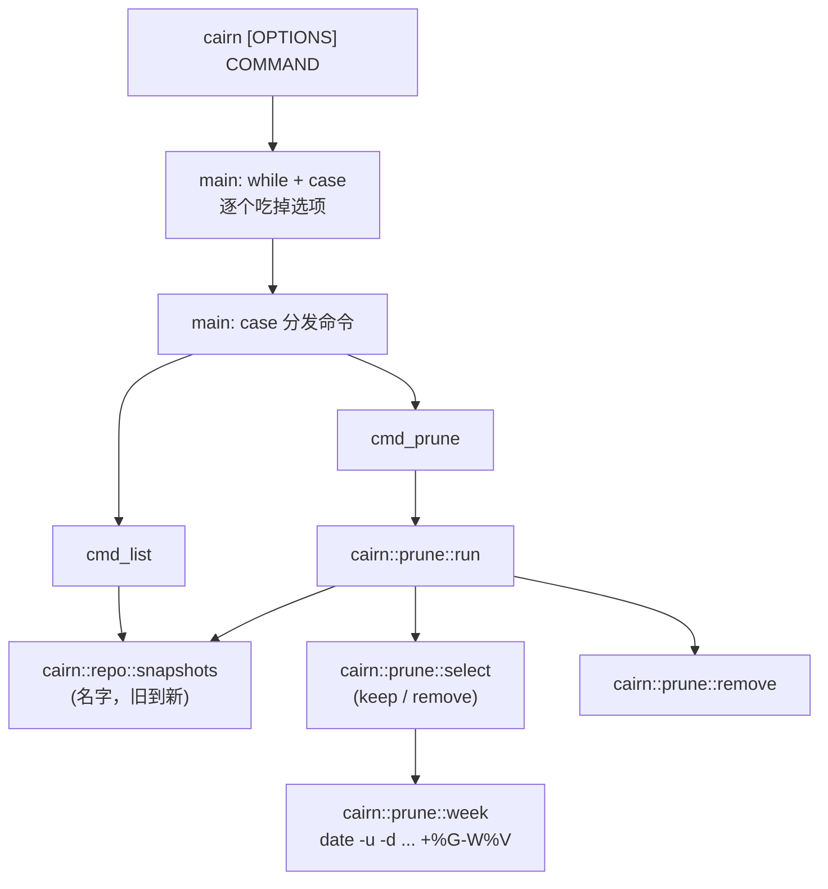
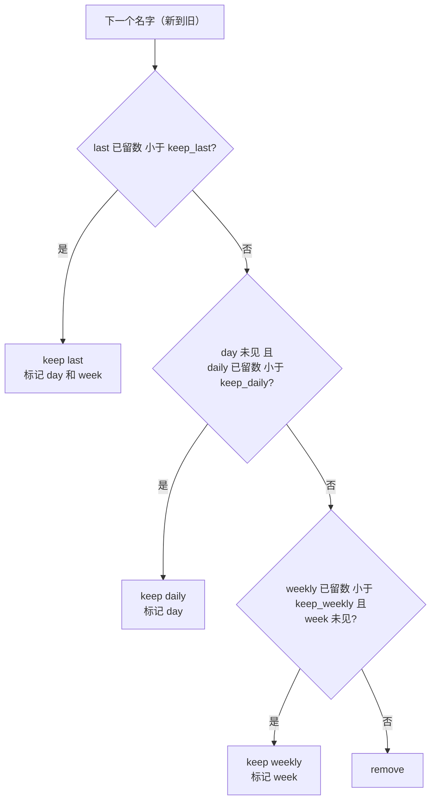

这一篇要把 `if`、`case`、四种循环、函数、算术和日期一口气学完，再用它们写出 Cairn 里第一段真正像“算法”的代码：给定 60 个快照名，按三个数字决定留谁删谁，我跑出来是留 14 个、删 46 个。而几乎所有内容，都是从“`if` 到底在判断什么”里长出来的。先看一个结果，它没有报错，没有警告，`[[ 22 > 4 ]]` 是 false，`if` 后面的分支安静地走向了 `else`，因为 `if` 后面跟的不是表达式，是一条命令，`if` 只看它的退出码：

```text
$ cat out/ch04/lexical_compare.stdout
[[ 22 > 4 ]]  false (string order: "2" sorts before "4")
(( 22 > 4 ))  true
[[ 22 -gt 4 ]] true
```

> [!NOTE] 本篇检查点
> 这一篇结束时仓库（标签 `ch04`）有 68 个被跟踪的文件，比 `ch03` 多 16 个：新增 `lib/cairn/prune.sh`（135 行，保留策略，还不是最终版本：第 5 篇会让它写日志，第 7 篇会让它加锁）和 `lab/ch04/` 里的 15 个实验脚本（已经是最终版本）；另有四个旧文件被修改：`bin/cairn`（177 行长到 242 行，多了 `-n`/`-v`/`-q`、`list` 和 `prune` 两个命令，之后还会改）、`lib/cairn/log.sh`（34 行长到 64 行，多了 `warn` 和 `debug`，第 5 篇还会加 `cairn::log::file`）、`lib/cairn/repo.sh`（57 行长到 99 行，多了 `snapshots` 和 `latest`，已经是最终版本）和 `README.md`（`Layout` 里一行，也还会改）。`make ch04` 通过：15 个实验全部按预期退出，没有一个需要宿主机，整套大约 16 秒。
> 涉及的 Shell 特性：退出码是唯一的布尔值、`if`/`elif`/`else`、`test` 与 `[` 与 `[[` 与 `(( ))`、`case` 与 glob 模式、`for`/`while`/`until`/`select`、`break N` 与 `continue`、`IFS= read -r`、`cmd | while` 的子 shell 陷阱与 `< <(cmd)`、`readarray`、`shopt -s lastpipe`、函数的参数、`local`、`return` 与 `FUNCNAME`、递归、整数算术与它的边界、`date -u -d`、`%G-W%V`、`printf '%(...)T'`、`getopts` 与手写选项循环，以及 [Google Shell 风格指南](https://google.github.io/styleguide/shellguide.html)里关于控制流、`case`、“Pipes to While”和算术的规则。
> 前置：[第 3 篇：变量与参数展开：一门只有字符串的语言](/posts/shell-by-cairn-03-variables-and-parameters/)。

## 动手清单

你自己的 `~/cairn` 从第 3 篇的状态出发，这一篇要做这几件事，每件在下面的哪一节出现都会指出来：

- 新建 `lib/cairn/prune.sh`：`cairn::prune::select`（纯函数，名字进，决定出）、`cairn::prune::run`（执行决定）。见“保留策略”一节。
- 改 `lib/cairn/repo.sh` 和 `lib/cairn/log.sh`：`cairn::repo::snapshots`、`cairn::repo::latest`、`cairn::log::warn`、`cairn::log::debug`。见“Cairn 里的控制流”一节。
- 改 `bin/cairn`：选项循环加上 `-n`、`-v`、`-q`，命令分发加上 `list` 和 `prune`，`usage` 列出每一个已实现的命令。
- 新建 `lab/ch04/` 下的 15 个实验。`make ch04` 全部跑一遍。

如果你想直接从参考仓库复制，这样就行（假设 `~/cairn-ref` 已经拉到了标签，见下面的检查点一节；文件列表照第 2 篇的办法用 `mapfile` 读进数组）：

```bash
git -C ~/cairn-ref fetch --tags
cd ~/cairn
mkdir -p lab/ch04
mapfile -t files < <(git -C ~/cairn-ref diff --name-only ch03 ch04)
for f in "${files[@]}"; do
  git -C ~/cairn-ref show ch04:"${f}" >"${f}"
done
```

我还是不建议整个照抄：前面几个实验只有十来行，手敲一遍，`unary operator expected` 才是你自己撞出来的。

## 全貌

这一章的代码只有一条主线：命令行走过选项循环，落进 `case` 分发，`list` 和 `prune` 最后都落到同一个函数 `cairn::repo::snapshots` 上；`prune` 再把名字交给 `cairn::prune::select` 做决定：



写这些函数需要的东西，到现在为止都在绕着走：`if` 判断的是什么，`case` 的模式是什么语言，函数怎么返回一个值，整数算术到哪里会出错，日期怎么在不 `fork` 的前提下拿到。所以和第 3 篇一样，先把语言讲透，每一节用一个 `lab/ch04/` 里的实验把结论钉住，再回到代码。

## if 后面跟的是命令

先看 `lab/ch04/if_is_command.sh`：

```bash
printf 'alpha\nbeta\n' >"${LAB_TMP}/words.txt"

if grep -q beta "${LAB_TMP}/words.txt"; then
  echo 'grep -q beta: status 0, then-branch'
fi
if ! grep -q gamma "${LAB_TMP}/words.txt"; then
  echo 'grep -q gamma: status 1, ! turns it into success'
fi

# if 测试的是整个命令列表的最后一条命令。
if
  echo 'side effect'
  false
then
  echo 'not reached'
else
  echo 'the list ends with false, so else runs'
fi

echo '--- type -a [ ---'
type -a [ | awk '!seen[$0]++' | head -n 2
```

```text
$ cat out/ch04/if_is_command.stdout
grep -q beta: status 0, then-branch
grep -q gamma: status 1, ! turns it into success
side effect
the list ends with false, so else runs
--- type -a [ ---
[ is a shell builtin
[ is /nix/store/97d5ygrvqj55f4nx1x34wfdcc7qn11c0-coreutils-9.11/bin/[
```

`if` 的语法是 `if 命令列表; then 命令列表; [elif ...;] [else ...;] fi`。shell 先运行 `if` 和 `then` 之间的整个列表，取**最后一条命令**的退出码：0 走 `then`，非 0 走 `else`。第三个例子把这一点推到极端，列表里有两条命令，`echo` 的输出照常出现，最后一条 `false` 决定了去向。[第 1 篇](/posts/shell-by-cairn-01-first-script/)讲过退出码是进程留给父进程的一个 0 到 255 的整数，这里它扮演了 shell 里**唯一的布尔值**：没有 `true` 和 `false` 这两种类型，只有“成功的命令”和“失败的命令”。[手册里的退出状态一节](https://www.gnu.org/software/bash/manual/bash.html#Exit-Status)写的就是这个约定。

我对这个设计的理解是一个海关的比方：`if` 是只认盖章的关员，它不看你箱子里装了什么（表达式的值），只看上一个窗口给你盖的是 0 还是别的数字。比方到此为止，后面都用技术词汇。

`!` 把一条流水线的退出码取反：0 变 1，非 0 变 0，所以 `if ! grep -q gamma ...` 读作“如果 grep 没找到”。`grep -q` 的 `-q` 让它不打印、找到第一个匹配就退出，我们只想要退出码。

### `[` 是一个命令，`[[` 是关键字

最后两行的 `type -a [` 值得停一下。`[` 不是语法，是一个命令：Bash 把它做成了内建，但磁盘上还躺着一个同名的可执行文件 `/nix/store/.../bin/[`。`type` 能区分命令的种类：

```text
$ type if '[[' test '['
if is a shell keyword
[[ is a shell keyword
test is a shell builtin
[ is a shell builtin
```

`if` 和 `[[` 是**关键字**，由 shell 的解析器直接处理；`test` 和 `[` 是**内建命令**，和 `echo` 一样：先经过全部展开，再把结果当作参数交给命令。所以 `[` 后面必须有空格，最后那个 `]` 只是 `[` 的最后一个参数，不是括号：

```text
$ bash -c '[ 1 = 1]'; echo "status $?"
bash: line 1: [: missing `]'
status 2
```

`1]` 被当作一个词，`[` 没等到自己的收尾参数，报错退出，退出码是 2。有意思的是这个 2：`test` 的约定是 0 为真，1 为假，2 为“你写错了”。（我猜磁盘上保留 `/…/bin/[` 是为了让不用 Bash 的程序也能调用它，比如 `find -exec [ ... ] \;`，这是我的推测，没有去查。）

实验里的 `awk '!seen[$0]++'` 是因为我的 `type -a [` 其实会打印六行：

```text
$ type -a [
[ is a shell builtin
[ is /nix/store/97d5ygrvqj55f4nx1x34wfdcc7qn11c0-coreutils-9.11/bin/[
[ is /nix/store/97d5ygrvqj55f4nx1x34wfdcc7qn11c0-coreutils-9.11/bin/[
[ is /nix/store/97d5ygrvqj55f4nx1x34wfdcc7qn11c0-coreutils-9.11/bin/[
[ is /nix/store/97d5ygrvqj55f4nx1x34wfdcc7qn11c0-coreutils-9.11/bin/[
[ is /run/current-system/sw/bin/[
```

同一个目录在 `PATH` 里出现了几次（我猜是开发 shell 一层一层往 `PATH` 前面加目录），`type -a` 每次都照实打印。实验用 `awk` 去重，只留下“内建”和“第一个磁盘上的 `[`”这两行，才能保证读者的输出和我的一样长。

### `&&` 和 `||` 不是 if/else

既然一切都是退出码，`cmd1 && cmd2 || cmd3` 看起来就像三元表达式。它不是：

```text
$ true && false || echo 'c ran'
c ran
```

`true` 成功，所以运行 `&&` 后面的 `false`；`false` 失败，所以 `||` 后面的命令也运行了，两个分支都走了。一旦 `cmd2` 可能失败，就老老实实写 `if`。Google 指南在[控制流一节](https://google.github.io/styleguide/shellguide.html#s5.4-control-flow)要求 `; then` 和 `; do` 写在 `if`/`for`/`while` 同一行，`else` 独占一行，`fi` 和 `done` 与开头的关键字垂直对齐；这套写法到后面讲循环时再回来看。

## test、`[` 和 `[[`

`if` 经常配着“测试”用，测试有四种写法：

| 写法 | 是什么 | 适合 |
| --- | --- | --- |
| `test EXPR`、`[ EXPR ]` | 内建命令，参数经过完整展开 | 必须兼容 POSIX `sh` 的脚本 |
| `[[ EXPR ]]` | 关键字，自己解析里面的词，不做分词和路径名展开 | 字符串、文件、模式、正则测试 |
| `(( EXPR ))` | 关键字，整数算术，结果非 0 则退出码为 0 | 数值比较和计数 |
| 任意命令 | `grep -q`、`cmp -s`、`rsync` ... | 想知道“它成功了没有” |

Google 指南的[测试一节](https://google.github.io/styleguide/shellguide.html#s6.3-tests)首选 `[[ ... ]]`，理由写得很直白：括号里面不发生路径名展开和分词，并且支持模式和正则匹配。`lab/ch04/test_vs_dbl_bracket.sh` 把前两条各跑一遍：

```bash
x=''

echo "--- [ \$x = y ] with x empty ---"
# BAD: unquoted expansion vanishes, `[` sees only `= y ]`.
# shellcheck disable=SC2086
[ $x = y ]
echo "status $?"

echo "--- [[ \${x} == y ]] with x empty ---"
if [[ ${x} == y ]]; then
  echo 'equal'
else
  echo 'not equal, no error'
fi
```

```text
$ cat out/ch04/test_vs_dbl_bracket.stdout
--- [ $x = y ] with x empty ---
status 2
--- [[ ${x} == y ]] with x empty ---
not equal, no error
--- pattern vs quoted RHS ---
report.txt == *.txt   : true (pattern)
report.txt == "*.txt" : false (literal asterisk)
unquoted ${star}: true (pattern again)
$ cat out/ch04/test_vs_dbl_bracket.stderr
/home/bfmhno3/Projects/cairn/lab/ch04/test_vs_dbl_bracket.sh: line 9: [: =: unary operator expected
```

[第 2 篇](/posts/shell-by-cairn-02-expansion-and-quoting/)讲过，没有加引号的 `$x` 在 `x` 为空时整个消失，`[ $x = y ]` 到达 `[` 的时候只剩 `= y ]`：`[` 看到的第一个参数是 `=`，它想把 `=` 当一元运算符用，于是抱怨“`=` 后面缺东西”，退出码 2。`[[ ${x} == y ]]` 没有这个问题，因为 `[[` 是关键字，在展开之前就已经知道 `==` 左边有一个词，哪怕展开之后它是空的。

输出的后半截是模式匹配。`[[ ]]` 里 `==` 右边的**不带引号**的部分是 glob 模式（`*.txt` 匹配 `report.txt`），带引号就是字面量（`"*.txt"` 只匹配那五个字符）。把模式放进变量 `star='*.txt'` 再不带引号地用，它又是模式了，所以实验里那一行要写 `# shellcheck disable=SC2053` 并标 `# BAD`：ShellCheck 担心你想要的是字面量。想要字面比较就加引号 `"${star}"`，想要模式就保持裸露并在注释里写清楚。

其余几个测试运算符我不逐个讲，[手册的 Bash 条件表达式](https://www.gnu.org/software/bash/manual/bash.html#Bash-Conditional-Expressions)一节有完整的表。Cairn 里最常用的是这几个：

- `-z "${s}"` 和 `-n "${s}"`：字符串为空、不为空。Google 要求显式写 `-z`/`-n`，不要写 `[[ "${s}" ]]`。
- `-e`、`-f`、`-d`：路径存在、是普通文件、是目录。`cairn::repo::check` 用 `[[ ! -f "${dir}/cairn.repo" ]]` 判断仓库标记文件。
- `[[ a && b ]]`、`[[ a || b ]]`、`[[ ! a ]]`：在一对 `[[ ]]` 里组合条件，`&&` 和 `||` 是关键字语法的一部分，不是两个命令的连接。

## `>` 不是大于

回到开头的 `[[ 22 > 4 ]]`。`lab/ch04/lexical_compare.sh` 的前半部分：

```bash
# BAD: > in [[ ]] is a string comparison.
# shellcheck disable=SC2071,SC2050
if [[ 22 > 4 ]]; then
  echo '[[ 22 > 4 ]]  true'
else
  echo '[[ 22 > 4 ]]  false (string order: "2" sorts before "4")'
fi
if ((22 > 4)); then
  echo '(( 22 > 4 ))  true'
else
  echo '(( 22 > 4 ))  false'
fi
```

输出已经在开头给过了。[手册](https://www.gnu.org/software/bash/manual/bash.html#Conditional-Constructs)对 `[[` 里的 `<` 和 `>` 只说了一句：“按当前 locale 的字典序比较”。字符串 `"22"` 的第一个字符 `2` 排在 `4` 前面，所以 `22 > 4` 为假。数值比较有两条正路：`[[ 22 -gt 4 ]]`，或者干脆用算术命令 `(( 22 > 4 ))`。Google 指南的[算术一节](https://google.github.io/styleguide/shellguide.html#s6.9-arithmetic)选了后者：数值比较别用 `[[ ]]`，用 `(( ))`。

那 `[ 22 > 4 ]` 呢？`[` 是普通命令，所以 `>` 在 `[` 看见它之前，就已经被 shell 当成了重定向：

```text
$ cd /tmp/cairn-check/redir
$ [ 22 > 4 ]; echo "status $?"; ls
status 0
4
```

退出码是 0，目录里多了一个叫 `4` 的空文件。`[` 收到的参数是单独一个 `22`，“单个非空字符串为真”，同时 `> 4` 在 shell 层面悄悄创建了文件。这是我这一篇里最喜欢的陷阱：它既给出“正确”的答案，又留下一个难以解释的文件。

还有一个 `[[` 里的细节：`-gt` 这类数值运算符的两边**会被当作算术表达式求值**，所以变量名可以裸写。

```text
$ a=7; [[ a -gt 4 ]] && echo 'a -gt 4 is true'
a -gt 4 is true
```

没有 `$`，`a` 也被解析成了变量 `a` 的值。它能工作，但我不会这样写；读者看到 `[[ a -gt 4 ]]` 没法一眼分辨出 `a` 是变量还是字符。

## 正则：`=~` 和 `BASH_REMATCH`

`[[ ]]` 里还有一个运算符是 `=~`，右边是 [POSIX 扩展正则表达式](https://www.gnu.org/software/bash/manual/bash.html#Conditional-Constructs)。第 3 篇的配置解析器已经用过它；`lab/ch04/regex_match.sh` 把规则讲全：

```bash
name='20261031T090000Z'

if [[ "${name}" =~ ^([0-9]{4})([0-9]{2})([0-9]{2})T ]]; then
  echo "whole match : ${BASH_REMATCH[0]}"
  echo "year        : ${BASH_REMATCH[1]}"
  echo "month       : ${BASH_REMATCH[2]}"
  echo "day         : ${BASH_REMATCH[3]}"
fi

# 正则放进变量: 不加引号, 空白和特殊字符不会被 shell 再解释。
re='^[0-9]{8}T[0-9]{6}Z$'
if [[ "${name}" =~ ${re} ]]; then
  echo 'variable regex: match'
fi

# 加引号后右边变成字面量。
# BAD: quoted RHS.
# shellcheck disable=SC2076
if [[ "${name}" =~ "${re}" ]]; then
  echo 'quoted regex: match'
else
  echo 'quoted regex: no match (taken literally)'
fi
```

```text
$ cat out/ch04/regex_match.stdout
whole match : 20261031T
year        : 2026
month       : 10
day         : 31
variable regex: match
quoted regex: no match (taken literally)
```

匹配成功以后，整个匹配和每个括号捕获的子串放在数组 `BASH_REMATCH` 里，下标 0 是整个匹配，1 起是捕获组。规则和 `==` 的模式一模一样：**不带引号才是正则，带引号变字面量**。所以最稳妥的写法是把正则存进变量，用时不加引号：`[[ "${name}" =~ ${re} ]]`。这样括号、空格和 `$` 都不会先被 shell 再解释一遍。Cairn 里的用户是 `lib/cairn/snapshot.sh` 校验 `CAIRN_NOW` 的那行：

```bash
    if [[ ! "${CAIRN_NOW}" =~ ^[0-9]{8}T[0-9]{6}Z$ ]]; then
```

正则很短，没必要存变量。

## case：模式是 glob，不是正则

`lab/ch04/case_patterns.sh` 是一个小分类器：

```bash
classify() {
  case "$1" in
    -h | --help) echo "$1: help" ;;
    --config=*) echo "$1: config, value ${1#--config=}" ;;
    -[a-z]) echo "$1: one short option" ;;
    [0-9]*) echo "$1: starts with a digit" ;;
    '') echo '(empty): empty string' ;;
    *.tmp | *.bak) echo "$1: junk file" ;;
    *) echo "$1: anything else" ;;
  esac
}

for arg in -h --help --config=a.conf -v 42abc '' notes.tmp x.bak other; do
  classify "${arg}"
done
```

```text
$ cat out/ch04/case_patterns.stdout
-h: help
--help: help
--config=a.conf: config, value a.conf
-v: one short option
42abc: starts with a digit
(empty): empty string
notes.tmp: junk file
x.bak: junk file
other: anything else
```

`case WORD in PATTERN) 命令 ;; ... esac` 把 `WORD` 依次和每个模式比较，第一个匹配的分支运行，然后结束，**不会继续往下掉**（Bash 有 `;&` 和 `;;&` 可以掉下去，Google 指南的[case 一节](https://google.github.io/styleguide/shellguide.html#s5.5-case-statement)明确说要避免，我们的 `lab` 和仓库一个都没用）。要点有这几个：

- 模式是 glob，也就是 `*`、`?`、`[a-z]` 这一类，和文件名展开用的是同一种语言，不是正则。`-[a-z]` 匹配“减号加一个小写字母”。
- `|` 在一个分支里放多个备选：`-h | --help`、`*.tmp | *.bak`。
- 顺序有意义：`42abc` 先撞上 `[0-9]*` 就不会再走到别处，所以通配得最宽的 `*)` 一定放最后。
- `case` 的 `WORD` 不会分词，也不会路径名展开，所以 `case "$1" in` 里的引号其实不是必须的；我仍然写上，是因为第 2 篇的习惯：每一次展开都加引号，不用判断“这里需要不需要”。

Google 对 `case` 的版式有四条：备选项缩进 2 个空格；一行能写完的写成 `模式) 命令 ;;`，右括号后和 `;;` 前各一个空格；写不完的把模式、命令、`;;` 各占一行；模式前面不加左括号。`bin/cairn` 里的命令分发把两种都用上了：

```bash
  case "${command}" in
    help) usage ;;
    init)
      if (($# != 1)); then
        usage_error 'usage: cairn init REPO'
        return
      fi
      cmd_init "$1"
      ;;
    snapshot) cmd_snapshot "$@" ;;
    list) cmd_list "$@" ;;
    prune) cmd_prune "$@" ;;
    *) usage_error "unknown command '${command}'" ;;
  esac
```

`init` 要先检查参数个数，写不进一行，于是展开；其余命令各占一行，一眼能看出命令和函数的对应关系。这一章加的只有 `list` 和 `prune` 两行，把两个新命令挂上去。

## 四种循环

`lab/ch04/loops.sh` 把循环形式过一遍。我只摘有代表性的几段：

```bash
echo '--- for in ---'
for word in alpha 'two words' gamma; do
  echo "[${word}]"
done

echo '--- C-style for ---'
for ((i = 0; i < 3; i++)); do
  echo "i=${i}"
done

echo '--- while ---'
n=3
while ((n > 0)); do
  echo "n=${n}"
  n=$((n - 1))
done

echo '--- until ---'
n=0
until ((n >= 3)); do
  echo "n=${n}"
  ((n += 1))
done
```

```bash
echo '--- break 2 ---'
for a in 1 2 3; do
  for b in 1 2 3; do
    if ((a * b == 4)); then
      echo "found a=${a} b=${b}, leaving both loops"
      break 2
    fi
    echo "a=${a} b=${b}"
  done
done
```

```text
$ cat out/ch04/loops.stdout
--- for in ---
[alpha]
[two words]
[gamma]
--- C-style for ---
i=0
i=1
i=2
--- while ---
n=3
n=2
n=1
--- until ---
n=0
n=1
n=2
--- continue ---
odd 1
odd 3
odd 5
--- break 2 ---
a=1 b=1
a=1 b=2
a=1 b=3
a=2 b=1
found a=2 b=2, leaving both loops
```

- `for x in 词表`：词表经过全部展开之后一个词一个词地赋给 `x`。`'two words'` 加了引号，所以是一个词。Google 指南建议遍历参数时把 `in "$@"` 写出来，虽然省略它效果一样，“为了清晰”。
- `for ((初始; 条件; 步进))`：算术 `for`，三段都是算术表达式，和 C 一样。头部的 `i++` 不受后面算术一节讲的“表达式为 0 就失败”的影响，因为这里没人看它的退出码。
- `while 命令列表`：命令成功就继续。`while ((n > 0))` 和 `while read -r line` 是同一种东西：条件是命令。
- `until` 是 `while` 取反，到条件成功时停。
- `continue` 跳到下一轮，`break N` 一口气跳出 N 层循环，`break 2` 同时离开了两个 `for`，所以 `a=2 b=3` 和 `a=3` 都没有出现。
- `select`（交互式菜单）我没有放进实验，因为它读 stdin 并把菜单打印到 stderr；快速看一眼：

  ```text
  $ select x in a b c; do echo "got ${x}"; break; done <<<'2'
  1) a
  2) b
  3) c
  #? got b
  ```

Google 还有一条细节：循环变量在函数里要先 `local`，否则它会漏进全局。`cairn::repo::snapshots` 是这条规则的实例，同时用到了 `for`、`continue` 和 `[[ ]]`：

```bash
cairn::repo::snapshots() {
  local LC_COLLATE=C
  local path name
  for path in "$1"/snapshots/*; do
    if [[ ! -d "${path}" ]]; then
      continue
    fi
    name="${path##*/}"
    if [[ "${name}" == *.partial ]]; then
      continue
    fi
    printf '%s\n' "${name}"
  done
}
```

逐行读：`local LC_COLLATE=C` 把排序规则固定为 C locale，函数返回时恢复；`"$1"/snapshots/*` 是一个路径名展开，结果按 `LC_COLLATE` 排序，快照名是定长的 UTC 时间戳，C locale 下按字节排序就是按时间排序，这是整个 `list` 的“旧到新”保证。我没有找到会让别的 locale 排错的例子，大概没有，但这一行不花钱，也不必依赖运气。仓库为空时，`snapshots/*` 找不到匹配，glob 原样留下，`[[ ! -d ]]` 把它挡掉，`continue` 进入下一轮（也就没有下一轮）：

```text
$ export XDG_CONFIG_HOME="${PWD}/xdg2"
$ cairn init repo2
cairn: wrote /tmp/cairn-check/xdg2/cairn/cairn.conf
$ printf 'source = %s/src\n' "${PWD}" >>xdg2/cairn/cairn.conf
$ cairn list; echo "list status $?"
list status 0
```

以 `.partial` 结尾的目录是还没做完的快照，后面的章节会产生它们，现在先让 `list` 跳过。

## 逐行读文件

`lab/ch04/read_lines.sh` 是第 3 篇配置解析器那个惯用法的单独版本：

```bash
printf '  indented\\back\\slash\nlast no newline' >"${LAB_TMP}/in.txt"

echo '--- plain read ---'
# BAD: strips leading blanks, eats backslashes.
# shellcheck disable=SC2162
while read line; do
  echo "[${line}]"
done <"${LAB_TMP}/in.txt"

echo '--- IFS= read -r ---'
while IFS= read -r line; do
  echo "[${line}]"
done <"${LAB_TMP}/in.txt"

echo '--- IFS= read -r || [[ -n line ]] ---'
while IFS= read -r line || [[ -n "${line}" ]]; do
  echo "[${line}]"
done <"${LAB_TMP}/in.txt"
```

```text
$ cat out/ch04/read_lines.stdout
--- plain read ---
[indentedbackslash]
--- IFS= read -r ---
[  indented\back\slash]
--- IFS= read -r || [[ -n line ]] ---
[  indented\back\slash]
[last no newline]
```

同一份输入，三种写法三种结果。裸 `read line` 先用 `IFS` 去掉行首的空白，再把反斜杠当作转义（`\b` 变成 `b`），所以第一行变成 `indentedbackslash`，而且读不到最后一行；`IFS= read -r` 关掉这两件事，第一行完整了；但最后一行 `last no newline` 没有结尾换行，`read` 读到它就失败（返回非 0）、`while` 就停了，数据其实已经放进了 `line`。第三种在失败后再检查一次 `line` 非空，把它捡回来。这个观察会用在以后每个读文件的循环里；`while` 的条件是 `||` 连起来的一条命令列表，仍然只看最后那条的退出码，和上面 `if` 的规则一样。

## 管道进 while：子 shell 陷阱

`lab/ch04/pipe_while.sh` 说的是另一个更隐蔽的问题：

```bash
echo '--- cmd | while ---'
count=0
# BAD: the loop body is a subshell, so count stays 0.
# shellcheck disable=SC2030
printf 'a\nb\nc\n' | while read -r _; do
  ((count += 1))
done
# shellcheck disable=SC2031
echo "count after pipe: ${count}"

echo '--- while ... done < <(cmd) ---'
count=0
while read -r _; do
  ((count += 1))
done < <(printf 'a\nb\nc\n')
echo "count: ${count}"

echo '--- readarray ---'
readarray -t lines < <(printf 'a\nb\nc\n')
echo "count: ${#lines[@]}"

echo '--- shopt -s lastpipe ---'
# lastpipe 只在作业控制关闭时生效 (脚本默认如此)。
shopt -s lastpipe
count=0
printf 'a\nb\nc\n' | while read -r _; do
  ((count += 1))
done
echo "count: ${count}"
```

```text
$ cat out/ch04/pipe_while.stdout
--- cmd | while ---
count after pipe: 0
--- while ... done < <(cmd) ---
count: 3
--- readarray ---
count: 3
--- shopt -s lastpipe ---
count: 3
```

三行输入，计数器却是 0。原因在[手册讲命令执行环境的那一节](https://www.gnu.org/software/bash/manual/bash.html#Command-Execution-Environment)：流水线里的每个命令都在**子 shell** 里运行（除非 `lastpipe` 打开，后面说），子 shell 是 shell 进程的一份拷贝，它里面对变量的修改永远不会回到父 shell。这个循环确实数到了 3，只是数在拷贝里。可以直接看到这个拷贝的进程号和我们不同：

```text
$ echo x | { [[ $BASHPID != $$ ]] && echo 'subshell: BASHPID differs from $$'; }
subshell: BASHPID differs from $$
```

`$$` 永远是最初那个 shell 的进程号，`$BASHPID` 是“当前这个 shell 进程”的进程号，在子 shell 里两者不同。

Google 指南把这件事单独列为一条规则，[“Pipes to While”](https://google.github.io/styleguide/shellguide.html#s6.8-pipes-to-while)：用进程替换或 `readarray` 代替管道进 `while`。实验里两个解法都在：

- `done < <(cmd)`：`<(cmd)` 是进程替换，shell 把 `cmd` 放在另一个进程里，把它的输出当作一个文件名交给 `<` 重定向。`cmd` 在子进程里跑，但 `while` 循环留在当前 shell。
- `readarray -t lines < <(cmd)`：一次把所有行读进数组，之后用 `for` 遍历，循环里干什么都不影响读入。这也是 `cairn::prune::run` 采用的写法（下一节讲到）。
- `shopt -s lastpipe`：让流水线的**最后一个**命令留在当前 shell，循环里改的变量就保住了。它还有一个条件：[手册](https://www.gnu.org/software/bash/manual/bash.html#The-Shopt-Builtin)写的是“作业控制不活跃时”才生效；脚本默认没有作业控制，所以实验里能用，按手册的说法，交互式终端里它不会生效。我只验证了脚本里的行为，交互式的那一半没有试过。

顺便一提，管道本身没有错。`cairn list | wc -l` 里的管道只传数据，没人要从 `wc` 那边拿变量回来。出问题的只有“循环体里要修改外面的变量”这一种用法。

## 函数：参数、`local` 和两条返回通道

`lab/ch04/functions.sh` 的第一半把函数的基本事实摆出来：

```bash
is_even() {
  (($1 % 2 == 0))
}
double() {
  echo "$(($1 * 2))"
}
if is_even 4; then
  echo 'is_even 4: status 0 (success)'
fi
is_even 3
echo "is_even 3: status $?"
echo "double 21 prints: $(double 21)"

x='global'
shadow() {
  local x='local'
  echo "inside: ${x}"
}
shadow
echo "outside: ${x}"

outer() {
  inner
}
inner() {
  echo "FUNCNAME: ${FUNCNAME[*]}"
}
outer
```

```text
$ cat out/ch04/functions.stdout
is_even 4: status 0 (success)
is_even 3: status 1
double 21 prints: 42
inside: local
outside: global
FUNCNAME: inner outer main
fact_sub 15 = 1307674368000
fact_var 15 = 1307674368000
fact_sub (subshell): 213.3 ms for 20 x fact 15
fact_var (variable): 1.5 ms for 20 x fact 15
ratio: 138.0x
```

先看前六行。[函数](https://www.gnu.org/software/bash/manual/bash.html#Shell-Functions)就是一个起了名字的命令列表，定义之后和别的命令没有区别：它有退出码，能放在 `if` 后面，能进管道。几条规则：

- **参数**：没有形参声明。函数里用位置参数 `$1`、`$2`……、`$#` 和 `"$@"`，和脚本本身的命令行参数完全一样；`shift` 对函数自己的参数起作用。`$0` 仍然是脚本名，不是函数名。
- **返回有两条通道，用途不同**。`return N` 设置退出码（只有 0 到 255），不带参数的 `return` 返回上一条命令的退出码；数据走 stdout，调用方用 `$(...)` 接。`is_even` 回答“是不是”，所以用退出码，函数体就是一条算术命令 `(($1 % 2 == 0))`，它的退出码自然成为函数的；`double` 回答“是多少”，所以 `echo`。这是一条值得形成肌肉记忆的约定：状态回答“成功了吗”，stdout 回答“结果是什么”。
- **`return` 的范围是 0 到 255**。超出的部分被截断，不会报错：

  ```text
  $ f() { return 256; }; f; echo "status $?"
  status 0
  $ g() { return 3; }; g; echo "status $?"
  status 3
  ```

- **`local`** 把变量的作用域限制在函数及其调用的函数里，输出的 `inside: local` 和 `outside: global` 是证明。第 3 篇讲过 Bash 的作用域是**动态**的：`local` 的变量对被调用的函数仍然可见，所以“局部”的意思是“函数返回时恢复”，不是“别人看不见”。
- **`FUNCNAME`** 是一个数组，当前调用栈从内到外：`inner outer main`。最后的 `main` 是最外层（脚本顶层）的名字，不对应任何一个我们写的函数。

### 函数名里的 `::`

Cairn 的库函数叫 `cairn::prune::select`、`cairn::repo::snapshots`。冒号对 Bash 是合法的函数名字符，Google 指南的[命名一节](https://google.github.io/styleguide/shellguide.html#s7.1-function-names)要求库函数用 `package::function` 的形式，这样 `source` 进来的库不会撞名，`declare -F` 也能按前缀列出来：

```text
$ source lib/cairn/prune.sh
$ declare -F | cut -d' ' -f3 | grep '^cairn::prune'
cairn::prune::remove
cairn::prune::run
cairn::prune::select
cairn::prune::week
```

函数定义的写法：名字加 `()`，大括号和名字在同一行，不写 `function` 关键字。每个库函数在定义前有一段头部注释，写明用到的全局变量 `Globals:`、参数 `Arguments:`、输出 `Outputs:` 和返回值 `Returns:`，这是 Google 的[函数注释一节](https://google.github.io/styleguide/shellguide.html#s4.2-function-comments)。这一篇引用的库函数为了省篇幅都省略了这段头部注释，完整的在仓库对应的文件里。

### 递归与它的价格

`functions.sh` 的后半是阶乘，同一个算法写了两遍：

```bash
fact_sub() {
  if (($1 <= 1)); then
    echo 1
  else
    local prev
    prev="$(fact_sub $(($1 - 1)))"
    echo "$(($1 * prev))"
  fi
}
fact_var() {
  if (($1 <= 1)); then
    result=1
  else
    fact_var $(($1 - 1))
    result=$(($1 * result))
  fi
}
```

`fact_sub` 用 stdout 返回，每一层递归是一次命令替换，也就是一次 `fork`；`fact_var` 把结果放进全局变量 `result`，没有 `fork`。两个函数都算出了 `15! = 1307674368000`。计时部分是 `median_us` 把 `fact 15` 跑 20 遍，取 5 次的中位数：

```text
fact_sub (subshell): 213.3 ms for 20 x fact 15
fact_var (variable): 1.5 ms for 20 x fact 15
ratio: 138.0x
```

138 倍，是 `make ch04` 里的一次运行。这类数字每次都会晃：我又单独跑了三次 `functions.sh`，比值是 107.8、132.3、136.3 倍，量级不变，具体数字不是常数。把 213.3 ms 除以 20 遍得到每遍 10.7 ms，每遍有 14 次命令替换，所以一次替换大约 0.76 ms。这是 shell 里递归和“用 `$(...)` 当返回值”的真实价格：**每一层 `$(...)` 是一次进程复制**。

这不意味着永远不要用 `$(...)` 返回值。`cairn::prune::select` 里每个名字调用一次 `week="$(cairn::prune::week "${name}")"`，那是一次子 shell 加一次 `date`，量级是毫秒，而且我们要的就是 `date` 的输出。但在**循环体里、被调用上千次**的小函数上，换成全局变量（或第 3 篇讲过的 `local -n` nameref、`printf -v`）能省下两个数量级。

另一件事：变量 `FUNCNEST` 默认没有设置；[手册](https://www.gnu.org/software/bash/manual/bash.html#Bash-Variables)说它设为大于 0 的数才会限制函数嵌套层数，超过就中止当前命令：

```text
$ bash -c 'FUNCNEST=10; r() { r; }; r'; echo "exit $?"
bash: line 1: r: maximum function nesting level exceeded (10)
exit 1
```

我没有试过不设 `FUNCNEST` 把一个无限递归函数跑到终止，我猜它会一直吃内存，直到被系统杀掉。

## 算术：整数，64 位，到此为止

`lab/ch04/arith.sh` 把整数算术的形状和边界一次打印出来。摘几行：

```bash
echo "\$((3 + 4 * 2))       = $((3 + 4 * 2))"
echo "\$((16#ff))          = $((16#ff))"
echo "\$((7 / 2))          = $((7 / 2))  (integer division, no floats)"
echo "\$((-7 / 2))         = $((-7 / 2))  (truncates toward zero)"
echo "\$((2 ** 63))        = $((2 ** 63))  (wraps to the minimum)"
echo "\$((2 ** 64))        = $((2 ** 64))  (wraps to 0)"

# 10 进制陷阱: 前导 0 表示八进制。
echo "\$((010))            = $((010))  (octal)"
echo "\$((10#08))          = $((10#08))  (forced decimal)"

i=0
# BAD: ((i++)) is 0 when i is 0, so its status is 1 (fatal under set -e).
((i++))
echo "((i++)) with i=0 returned status $? (the value 0 is 'false')"
echo "i is now ${i}"
```

```text
$ cat out/ch04/arith.stdout
$((3 + 4 * 2))       = 11
$((16#ff))          = 255
$((2#1010))         = 10
$((7 / 2))          = 3  (integer division, no floats)
$((-7 / 2))         = -3  (truncates toward zero)
$((-7 % 3))         = -1
$((2 ** 62))        = 4611686018427387904
$((2 ** 63))        = -9223372036854775808  (wraps to the minimum)
$((2 ** 63 - 1))    = 9223372036854775807  (maximum)
$((2 ** 64))        = 0  (wraps to 0)
$((010))            = 8  (octal)
$((10#08))          = 8  (forced decimal)
((i++)) with i=0 returned status 1 (the value 0 is 'false')
i is now 1
```

算术在 shell 里有三种入口，它们求值的规则相同（C 风格的运算符和优先级，变量名不加 `$` 也行，运算符的完整列表在[手册的 Shell Arithmetic 一节](https://www.gnu.org/software/bash/manual/bash.html#Shell-Arithmetic)），区别在于结果去哪：

- `$(( expr ))` 是一次展开，结果是一个字符串，放进命令行任何位置。
- `(( expr ))` 是一个命令，没有输出，只有退出码，表达式非 0 则 0（成功），为 0 则 1（失败）。[手册](https://www.gnu.org/software/bash/manual/bash.html#Conditional-Constructs)写得清楚：“如果表达式的值非零，返回状态为 0；否则为 1”。赋值、自增、`if (( ... ))`、`while (( ... ))` 都用它。
- `declare -i n` 让之后每次给 `n` 赋值都按算术求值。

它的边界在输出里一目了然：

- **只有整数**。`7 / 2` 是 3，`-7 / 2` 是 -3（向 0 截断），`-7 % 3` 是 -1（余数跟着被除数的符号）。要小数，换 `awk`。
- **64 位有符号，会回绕，没有溢出错误**。`2 ** 63` 变成最小值 -9223372036854775808，`2 ** 64` 回绕到 0。Cairn 要处理的数字（快照个数、天数）离这个边界很远。
- **前导 0 表示八进制**。`$((010))` 是 8；`$((08))` 更糟，它直接报错：

  ```text
  $ bash -c 'echo $((08))'
  bash: line 1: 08: value too great for base (error token is "08")
  ```

  从 `date +%d` 之类的输出拿到 `08` 直接做算术，就会撞上这个。`$((10#08))` 用 `10#` 前缀强制十进制，得到 8。`16#ff` 和 `2#1010` 是同一种前缀语法，基数可以是 2 到 64。
- **表达式为 0，命令就失败**。最后两行是这一节我最想让你记住的：`((i++))` 在 `i` 为 0 时求值得 0（后自增返回旧值），所以 `(( ))` 的退出码是 1，尽管 `i` 确实增加了。在默认的 shell 里没人注意；一旦 `set -e`，脚本会静默退出：

  ```text
  $ bash -c 'set -e; i=0; ((i++)); echo reached'; echo "exit $?"
  exit 1
  $ bash -c 'set -e; i=0; ((i += 1)); echo reached'; echo "exit $?"
  reached
  exit 0
  ```

第一条没有打印 `reached`，也没有任何错误信息；第二条 `((i += 1))` 的值是 1，非 0，所以平安无事。Google 的[算术一节](https://google.github.io/styleguide/shellguide.html#s6.9-arithmetic)专门警告了这一点，并要求 `(( ... ))` 或 `$(( ... ))`，不要用 `let`、`expr`、`$[ ]`。`cairn::prune::select` 里所有计数都写成 `((n_last += 1))`，永远不会算出 0；第 7 篇我们给 Cairn 加上 `errexit` 的时候，这个选择会救我们一次。同样的原因，`loops.sh` 的 `while` 循环里我写的是 `n=$((n - 1))`，而不是 `((n -= 1))`：后者在 `n` 从 1 减到 0 的那一轮会返回 1，开了 `errexit` 就会让脚本退出。

## 日期：`date`、`%G` 和 `printf '%(...)T'`

保留策略需要两件和日期有关的事：把快照名解析成 ISO 周，和在脚本里拿当前时间。先看 `date`。

```text
$ date -u -d '20261031 09:00:00' +%G-W%V
2026-W44
$ date -u -d '20261031T090000Z' +%G-W%V
date: invalid date ‘20261031T090000Z’
```

`date -u -d STRING` 把一个人类可读的时间串解析出来，`-u` 保证按 UTC 理解，`+FORMAT` 决定怎么打印。快照名 `20261031T090000Z` 是紧凑格式，GNU `date` 不认，所以 `cairn::prune::week` 要把它拆成 `YYYYMMDD HH:MM:SS`：`${name:0:8}` 是日期，`${name:9:2}`、`${name:11:2}`、`${name:13:2}` 是时、分、秒（子串展开，第 3 篇讲过）。

格式串 `%G-W%V` 值得解释。ISO 8601 的周：周一开始，第 1 周是包含当年第一个星期四的那一周。结果是一年的头几天可能属于去年的第 52 或 53 周，最后几天可能属于明年的第 1 周。`%G` 是“ISO 周所属的年”，`%V` 是周数，两个必须一起用，换成日历年份 `%Y` 会在年底出错：

```text
$ date -u -d '2026-12-31' +%G-W%V
2026-W53
$ date -u -d '2027-01-01' +%G-W%V
2026-W53
$ date -u -d '2027-01-01' +%Y-W%V
2027-W53
```

2027 年 1 月 1 日和 2026 年 12 月 31 日属于同一个 ISO 周（2026 年第 53 周），`%G` 给出一致的 `2026-W53`；`%Y` 给出 `2027-W53`，一个不存在的周。对于保留策略，这意味着跨年的一周只会被留一份，而不是两份。

### 不 `fork` 的时间：`printf '%(...)T'`

要拿“现在”或者格式化一个时间戳，Bash 有内建办法：`printf '%(FORMAT)T' 时间戳`。时间戳 `-1` 表示现在，`-2` 表示 shell 启动的时间。`cairn::snapshot::name` 和实验里造快照名都用它：

```text
$ printf '%(%Y-%m-%d %H:%M)T\n' 0
1969-12-31 16:00
$ TZ=UTC printf '%(%Y-%m-%d %H:%M)T\n' 0
1970-01-01 00:00
```

第一行是我的机器（`date +%Z` 打印 `PDT`）本地时区下的 1970-01-01 00:00 UTC，第二行用 `TZ=UTC` 前缀固定时区；所以实验里要写 `export TZ=UTC`，否则文件名会跟着机器时区变。顺便一个我没想到的细节：把 `TZ=UTC` 单独写一行、不加 `export`，`printf` 不理它：

```text
$ (TZ=UTC; printf '%(%Y-%m-%d %H:%M)T\n' 0)
1969-12-31 16:00
```

我猜是内建 `printf` 靠环境变量里的 `TZ` 调用 `tzset`，没有导出的 shell 变量不在环境里。这是推测，没有读 Bash 的源码确认。

`lab/ch04/date_cost.sh` 比较了两种拿时间的写法：

```bash
run_date() {
  local i now
  for ((i = 0; i < 1000; i++)); do
    now="$(date +%s)"
  done
  : "${now}"
}
run_printf() {
  local i now
  for ((i = 0; i < 1000; i++)); do
    printf -v now '%(%s)T' -1
  done
  : "${now}"
}
```

```text
$ cat out/ch04/date_cost.stdout
1000 x $(date +%s): 1694.5 ms
1000 x printf '%(%s)T': 36.1 ms
ratio: 46.8x
```

`median_us` 和上一个实验是同一个计时函数。1000 次 `$(date +%s)` 要 1694.5 ms，每次 1.7 ms；1000 次 `printf -v now '%(%s)T' -1` 只要 36.1 ms，47 倍。第 1 篇和第 3 篇的内建对外部命令是数百倍的差距，这次差距小一些，因为 `printf` 内建本身也要查时区和格式化。这是 `make ch04` 里的一次运行；我又单独跑了三次，比值是 44.7、47.6、46.8 倍。

那为什么 `cairn::prune::week` 不用 `printf '%(%G-W%V)T'`？它可以：`printf '%(%G-W%V)T' "$(date -u -d ... +%s)"` 里面那个 `date`（命令替换里的那个）才是需要的，因为 `printf` 的时间参数必须是秒数，从 `YYYYMMDD HH:MM:SS` 字符串变成秒数的那一步，只有 `date -d` 能做。要全部用内建，就要自己写日期到秒的换算，我没有写。代价可以量出来：

```text
$ export CAIRN_ROOT=~/cairn
$ strace -f -e trace=execve -o strace.out bash select_cost.sh
$ grep -c 'execve(".*/date"' strace.out
22
```

`select_cost.sh` 是我为这一节写的 18 行脚本，造 60 个每日名字，调一次 `cairn::prune::select 3 7 4`，用 `EPOCHREALTIME` 计时：

```bash
#!/usr/bin/env bash
#
# Time one cairn::prune::select over 60 daily names (3/7/4).

# shellcheck source=/dev/null
source "${CAIRN_ROOT:?}/lib/cairn/prune.sh"
export TZ=UTC

first="$(date -u -d '2026-09-02 03:00:00' +%s)"
names=()
for ((i = 0; i < 60; i++)); do
  printf -v name '%(%Y%m%dT%H%M%SZ)T' "$((first + i * 86400))"
  names+=("${name}")
done

start="${EPOCHREALTIME/./}"
cairn::prune::select 3 7 4 "${names[@]}" >/dev/null
echo "select: $(((${EPOCHREALTIME/./} - start) / 1000)) ms"
```

22 次 `date`，其中 1 次是脚本开头算 `first` 的，剩下 **21 次**属于 `select`。不用 `strace` 直接运行五次，耗时是 56、57、56、52、55 ms（每次都是新进程里的第一次调用）。每次约 2.6 ms，其中 `date` 的 `fork`/`exec` 大约占 1.7 ms（上一个实验里 `$(date +%s)` 的每次代价），21 次大约是 36 ms，我猜大部分时间花在 `fork`/`exec` 上。一个备份工具每次 `prune` 付这点钱，我觉得可以接受。

## getopts 和手写选项循环

Bash 有一个内建命令 `getopts` 专门解析选项。`lab/ch04/getopts_demo.sh` 把它能做的和不能做的各演一遍：

```bash
parse() {
  local OPTIND=1 opt
  while getopts ':c:nv' opt; do
    case "${opt}" in
      c) echo "  -c with value '${OPTARG}'" ;;
      n) echo '  -n' ;;
      v) echo '  -v' ;;
      :) echo "  -${OPTARG} needs an argument" ;;
      \?) echo "  unknown option -${OPTARG}" ;;
    esac
  done
  shift $((OPTIND - 1))
  echo "  rest: $*"
}

echo 'parse -n -c my.conf list'
parse -n -c my.conf list
echo 'parse -nvc my.conf list   (bundled short options)'
parse -nvc my.conf list
echo 'parse --config my.conf list'
parse --config my.conf list
echo 'parse --config=my.conf list'
parse --config=my.conf list
```

```text
$ cat out/ch04/getopts_demo.stdout
parse -n -c my.conf list
  -n
  -c with value 'my.conf'
  rest: list
parse -nvc my.conf list   (bundled short options)
  -n
  -v
  -c with value 'my.conf'
  rest: list
parse --config my.conf list
  unknown option --
  -c with value 'onfig'
  rest: my.conf list
parse --config=my.conf list
  unknown option --
  -c with value 'onfig=my.conf'
  rest: list
```

`getopts ':c:nv' opt` 的格式串里，`c:` 表示 `-c` 带一个参数（放进 `OPTARG`），开头的冒号让 `getopts` 自己不打印错误，错误交给 `:` 和 `?` 两个分支。每调用一次吐出一个选项到 `opt`，`OPTIND` 指向下一个待处理的参数。两个细节：

- 它**只认单字符选项**，但能处理合并写法：`-nvc my.conf` 被拆成 `-n`、`-v`、`-c my.conf`。
- `--config` 不是它的选项。看输出的后半：`--config` 被拆成 `-`（未知选项）、再拆成 `-c`，参数 `onfig`；`rest` 把 `my.conf` 当作普通参数。`--config=my.conf` 同理。`-c` 照常吃下了 `onfig`，没有哪一步让脚本失败；要是没有 `\?` 那个分支，你的 `--config` 就在悄悄被读错。

所以 Cairn 用的是手写的循环。理由不复杂：我给 Cairn 定的选项是 `-c FILE`、`--config FILE`、`--config=FILE`、`-n`/`--dry-run`、`-v`/`--verbose`、`-q`/`--quiet`、`-h`/`--help`、`--version`，其中 `--version` 和 `--config=FILE` 压根没有对应的短选项；写进 crontab 或者 systemd 单元的命令行里，`cairn --dry-run prune` 在半年后仍然看得懂（读它的人多半是半年后的我），`cairn -n prune` 不一定。外部命令 `getopt`（util-linux 里的，我的 `PATH` 里就有）带 `--longoptions`，能解析长选项，但选项一共才六个，手写的循环 45 行，不值得再引入一层外部程序。

## Cairn 里的控制流

现在回到仓库，把这一章的代码读一遍。`bin/cairn` 里的 `main` 是整个程序的骨架：先把选项吃掉，再分发命令。选项循环是上面所有东西的合体，一个 `while` 套一个 `case`：

```bash
main() {
  if (($# == 0)); then
    usage >&2
    return 2
  fi
  while (($# > 0)); do
    case "$1" in
      -h | --help)
        usage
        return 0
        ;;
      # ...
      -n | --dry-run)
        CAIRN_DRY_RUN=1
        shift
        ;;
      -v | --verbose)
        CAIRN_VERBOSE=1
        shift
        ;;
      -q | --quiet)
        CAIRN_QUIET=1
        shift
        ;;
      -c | --config)
        if (($# < 2)); then
          usage_error "option '$1' requires an argument"
          return
        fi
        CAIRN_CONFIG_OPT="$2"
        shift 2
        ;;
      --config=*)
        CAIRN_CONFIG_OPT="${1#--config=}"
        shift
        ;;
      --)
        shift
        break
        ;;
      -*)
        usage_error "unknown option '$1'"
        return
        ;;
      *) break ;;
    esac
  done
  # ...
}
```

省略的是 `--version` 一支，和 `-h` 同样是打印后 `return 0`。这一章新写的是 `-n`、`-v`、`-q` 三支；`-h`、`--version`、`-c`/`--config`/`--config=`、`--` 和“未知选项”在第 3 篇已经有了，这一节是把它们为什么这样写讲清楚。读法：

- `while (($# > 0))` 是“还有参数就继续”。每个分支负责**吃掉自己的那几个词**：只有一个词的开关写 `shift`，`-c FILE` 用掉两个词写 `shift 2`，`--config=FILE` 只有一个词，从里面把值切出来：`${1#--config=}`（前缀删除，第 3 篇）。
- 分支顺序和上面 `case` 一节说的一样，范围小的在前。`-c` 缺参数时先检查 `$# < 2`，否则 `shift 2` 会在只剩一个词时失败。
- `--` 的意思是“选项到此为止”，`shift` 掉它，`break` 离开循环，后面的词原样当命令：`cairn -- -v` 的 `-v` 因此是一个**命令名**。`-*` 抓住所有别的以减号开头的词，报未知选项；`*` 抓住第一个不以减号开头的词，也就是命令，`break`。
- `usage_error` 打印两行错误，`return 2`；调用处写的是一个不带参数的 `return`，前面函数一节说过，它返回上一条命令的退出码，也就是 2。
- 脚本的最后一条命令是 `main "$@"`，所以 `main` 的返回值就是进程的退出码，`return 0` 和 `return 2` 直接成为 `cairn` 的退出码。

这些规则的效果可以逐条跑出来：

```text
$ cairn --bogus list
cairn: error: unknown option '--bogus'
cairn: error: run 'cairn --help' for usage
$ cairn -nv list
cairn: error: unknown option '-nv'
cairn: error: run 'cairn --help' for usage
$ cairn -c
cairn: error: option '-c' requires an argument
cairn: error: run 'cairn --help' for usage
$ cairn -- -v
cairn: error: unknown command '-v'
cairn: error: run 'cairn --help' for usage
$ cairn list -v
cairn: error: list takes no arguments
cairn: error: run 'cairn --help' for usage
```

五条的退出码都是 2。`-nv`（合并写法）和 `list -v`（选项放在命令后面）这两个，是我们这个手写循环相对于 `getopts` 的代价：合并写法不认，选项必须放在命令前面。这是我给 Cairn 定的命令行形状，所以接受。

选项被吃完以后，剩下的第一个词是命令。命令分发的 `case` 在前面讲过了，这里看新的两个命令函数和它们共用的 `load_repo`：

```bash
load_repo() {
  cairn::config::load "$(cairn::config::path)" || return
  cairn::repo::check "${CAIRN_REPO}"
}

cmd_list() {
  if (($# != 0)); then
    usage_error 'list takes no arguments'
    return
  fi
  load_repo || return
  cairn::repo::snapshots "${CAIRN_REPO}"
}

cmd_prune() {
  if (($# != 0)); then
    usage_error 'prune takes no arguments'
    return
  fi
  load_repo || return
  cairn::prune::run
}
```

三处用的是同一个模式：`cmd || return`，命令失败就把它的退出码原样交给调用者，不用 `if`。`load_repo` 本身只有两行，第一行失败就不会走到第二行，所以 `3`（配置或仓库错误）会一路冒到 `main`，最后成为 `cairn` 的退出码：

```text
$ cairn -c /nonexistent list; echo "exit $?"
cairn: error: no config file at /nonexistent (run 'cairn init REPO' first)
exit 3
```

`cairn::repo::snapshots` 在上面讲循环时已经看过。它的搭档 `cairn::repo::latest` 把输出收进数组，取最后一个：

```bash
cairn::repo::latest() {
  local -a names
  readarray -t names < <(cairn::repo::snapshots "$1")
  if ((${#names[@]} == 0)); then
    return 1
  fi
  printf '%s\n' "${names[-1]}"
}
```

两条返回通道在这里同时出现：stdout 给名字，退出码 1 表示“没有快照”。`${names[-1]}` 是数组的最后一个元素（负下标从末尾数）。`readarray` 从进程替换里读，也是“Pipes to While”那条规则的应用。

```text
$ source lib/cairn/log.sh; source lib/cairn/repo.sh
$ mkdir empty
$ cairn::repo::latest repo; echo "status $?"
20261020T030000Z
status 0
$ cairn::repo::latest empty; echo "status $?"
status 1
```

最后是 `lib/cairn/log.sh` 的两个新函数：

```bash
cairn::log::warn() {
  printf 'cairn: warning: %s\n' "$*" >&2
}

cairn::log::debug() {
  if [[ "${CAIRN_VERBOSE}" != 1 ]]; then
    return 0
  fi
  printf 'cairn: debug: %s\n' "$*" >&2
}
```

```text
$ source lib/cairn/log.sh
$ cairn::log::warn 'something odd'
cairn: warning: something odd
$ cairn::log::debug 'hidden'
$ CAIRN_VERBOSE=1 cairn::log::debug 'shown'
cairn: debug: shown
```

`-v` 设置的就是 `CAIRN_VERBOSE`，`debug` 只在它为 1 时才输出；`warn` 无条件输出。这两个函数本章还没有调用者（`grep` 一下 `bin` 和 `lib` 可以确认），它们先放在这里，等第 7 篇清理残留的 `.partial` 时才会用到 `warn`。`-q` 设置 `CAIRN_QUIET`，只影响 `info`；它不会让 `prune` 闭嘴，后面会看到。

## 保留策略：写一个算法

一个备份工具迟早要回答：这么多快照，留哪些，删哪些。Cairn 的规则是三个数字：`keep_last`、`keep_daily`、`keep_weekly`，第 3 篇的配置已经把它们读进了 `CAIRN_KEEP_LAST` 等全局变量，默认是 5、7、4。规则本身是这样：**从最新往最旧**走一遍所有快照名，对每一个依次问：

1. 已经留下的 `last` 少于 `keep_last` 个吗？是：留，原因 `last`，并且把它的**日期**和 **ISO 周**都标记为“已见”。
2. 它的日期还没被标记，并且已留下的 `daily` 少于 `keep_daily` 个吗？是：留，原因 `daily`，标记日期。
3. 已留下的 `weekly` 少于 `keep_weekly` 个，并且它的 ISO 周还没被标记吗？是：留，原因 `weekly`，标记周。
4. 否则删。



`lib/cairn/prune.sh` 把它写成两个函数：`cairn::prune::select` 是**纯函数**（名字进，`keep`/`remove` 决定出，不碰仓库），`cairn::prune::run` 才去执行决定。这样做的好处是 `select` 能脱离仓库测试：给它 60 个捏出来的名字，几十毫秒就出结果。看 `select` 的开头：

```bash
cairn::prune::select() {
  local keep_last="$1"
  local keep_daily="$2"
  local keep_weekly="$3"
  shift 3
  local -A seen_day=()
  local -A seen_week=()
  local -i n_last=0 n_daily=0 n_weekly=0
  local i name day week
  for ((i = $#; i >= 1; i--)); do
    name="${!i}"
    day="${name:0:8}"
    # ...
  done
}
```

三个参数取走以后 `shift 3`，剩下的位置参数就是快照名，按旧到新排列。算法要从新到旧走，所以用算术 `for` 从 `$#` 倒数到 1，`${!i}` 是间接展开：取名字存在 `i` 里的那个参数（第 3 篇的 `${!var}`；这里 `i` 是 2，就取 `$2`）。

```text
$ set -- a b c; i=2; echo "${!i}"
b
```

`local -A seen_day=()` 声明关联数组，键是日期或周，值只用来表示“出现过”；`local -i` 让三个计数器是整数。

循环体是上面四个问题的直译。第一问：

```bash
    if ((n_last < keep_last)); then
      week="$(cairn::prune::week "${name}")" || return 1
      seen_day["${day}"]=1
      seen_week["${week}"]=1
      ((n_last += 1))
      printf 'keep %s last\n' "${name}"
      continue
    fi
```

`last` 要标记周，所以这里就必须调 `date`；`|| return 1` 是“`date` 不认这个名字就整个 `select` 失败”。第二问：

```bash
    if [[ -z "${seen_day[${day}]:-}" ]] && ((n_daily < keep_daily)); then
      seen_day["${day}"]=1
      ((n_daily += 1))
      printf 'keep %s daily\n' "${name}"
      continue
    fi
```

`${seen_day[${day}]:-}` 的 `:-` 不是装饰。`bin/cairn` 开着 `set -o nounset`，关联数组里没有的键读出来就是“未绑定变量”：

```text
$ bash -c 'declare -A a=(); set -u; echo "${a[k]}"'
bash: line 1: a[k]: unbound variable
```

加上 `:-`（“未设置或为空则取空”），`-z` 才能做它该做的判断。`&&` 连接的两个测试一个是 `[[ ]]`，一个是 `(( ))`，因为条件的两半一个是字符串、一个是整数。第三问：

```bash
    if ((n_weekly < keep_weekly)); then
      week="$(cairn::prune::week "${name}")" || return 1
      if [[ -z "${seen_week[${week}]:-}" ]]; then
        seen_week["${week}"]=1
        ((n_weekly += 1))
        printf 'keep %s weekly\n' "${name}"
        continue
      fi
    fi
    printf 'remove %s\n' "${name}"
```

先查配额再调 `date`：`weekly` 配额用完之后，剩下的所有名字都不再 `fork`，这就是 60 个名字只用了 21 次 `date` 的原因（前面算过）。最后一行是第四问的答案：前三个 `if` 都没有 `continue` 出去，就删。

最后看一次 `cairn::prune::week`，它是整个文件里唯一和日期打交道的地方：

```bash
cairn::prune::week() {
  local name="$1"
  date -u -d "${name:0:8} ${name:9:2}:${name:11:2}:${name:13:2}" \
    +%G-W%V
}
```

### 把 60 个名字走一遍

`lab/ch04/prune_select.sh` 生成 2026-09-02 到 2026-10-31 每天 03:00 UTC 的 60 个快照名，用 3/7/4 调一次 `select`，把输出和实验里写死的期望清单逐行比较，不一致就退出 1。构造名字的部分：

```bash
first="$(date -u -d '2026-09-02 03:00:00' +%s)"
names=()
for ((i = 0; i < 60; i++)); do
  printf -v name '%(%Y%m%dT%H%M%SZ)T' "$((first + i * 86400))"
  names+=("${name}")
done

actual="$(cairn::prune::select 3 7 4 "${names[@]}")" || exit 1
echo "names: ${#names[@]}"
for kind in last daily weekly; do
  echo "keep ${kind}: $(grep -c " ${kind}\$" <<<"${actual}")"
done
echo "keep total: $(grep -c '^keep' <<<"${actual}")"
echo "remove: $(grep -c '^remove' <<<"${actual}")"
```

```text
$ cat out/ch04/prune_select.stdout
names: 60
keep last: 3
keep daily: 7
keep weekly: 4
keep total: 14
remove: 46
matches the expected list
```

60 个里留 14 个：3 个 `last`，7 个 `daily`，4 个 `weekly`，正好是三个配额各用满；删 46 个。把全部 60 个名字（新到旧）的判断过程展开成表，连续同类的几天合并成一行，名字取日期部分，周和星期用 `date -u -d` 算出来：

| 日期 (2026) | 星期 | ISO 周 | 决定 | 为什么 |
| --- | --- | --- | --- | --- |
| 10-31 | 六 | W44 | keep last | 第 1 个 last，标记 10-31 和 W44 |
| 10-30 | 五 | W44 | keep last | 第 2 个 last |
| 10-29 | 四 | W44 | keep last | 第 3 个 last，`keep_last` 用完 |
| 10-28 | 三 | W44 | keep daily | 日期未见，第 1 个 daily |
| 10-27、10-26 | 二、一 | W44 | keep daily | 各是新的一天，第 2、3 个 daily |
| 10-25 到 10-22 | 日到四 | W43 | keep daily | 第 4 到第 7 个 daily，`keep_daily` 用完 |
| 10-21 | 三 | W43 | keep weekly | daily 配额没了；W43 没被 last 或 weekly 标记过，第 1 个 weekly |
| 10-20、10-19 | 二、一 | W43 | remove | W43 已被 10-21 标记 |
| 10-18 | 日 | W42 | keep weekly | W42 未见，第 2 个 weekly |
| 10-17 到 10-12 | 六到一 | W42 | remove | 6 个，W42 已见 |
| 10-11 | 日 | W41 | keep weekly | 第 3 个 weekly |
| 10-10 到 10-05 | 六到一 | W41 | remove | 6 个，W41 已见 |
| 10-04 | 日 | W40 | keep weekly | 第 4 个 weekly，`keep_weekly` 用完 |
| 10-03 到 09-02 | 六到三 | W40 到 W36 | remove | 32 个，三个配额都用完了 |

删的数目：2 + 6 + 6 + 32 = 46，和实验一致。有两个观察：

- 没被 `daily` 占满的几周 (W42, W41, W40)，活下来的都是**周日**。因为 ISO 周从周一开始，从新往旧走，一个周里最先遇到的就是周日，它第一个撞上“这周没被标记”。
- 10-21（周三）被当作 `weekly` 留下，尽管 10-22（周四，`daily`）和它同属 W43。原因是 `daily` 留下的快照只标记**日期**，不标记周；只有 `last` 和 `weekly` 才标记周。我按上面四步的字面意思实现，`daily` 不标记周。我猜这么设计的用意是让 `weekly` 的配额去补 `daily` 窗口之外的历史，不过 10-21 和 10-22 同周这件事，第一眼看会觉得浪费了一个名额。

### 真的删一遍：`cairn::prune::run`

`select` 只做决定，`run` 去执行：

```bash
cairn::prune::run() {
  cairn::repo::check "${CAIRN_REPO}" || return
  local -a names decisions
  readarray -t names < <(cairn::repo::snapshots "${CAIRN_REPO}")
  readarray -t decisions < <(
    cairn::prune::select "${CAIRN_KEEP_LAST}" "${CAIRN_KEEP_DAILY}" \
      "${CAIRN_KEEP_WEEKLY}" "${names[@]}"
  )
  local line action name reason
  local status=0
  for line in "${decisions[@]}"; do
    read -r action name reason <<<"${line}"
    case "${action}" in
      keep)
        if [[ "${CAIRN_VERBOSE}" == 1 ]]; then
          printf 'keep %s (%s)\n' "${name}" "${reason}"
        fi
        ;;
      remove)
        if [[ "${CAIRN_DRY_RUN}" == 1 ]]; then
          printf 'would remove %s\n' "${name}"
        elif cairn::prune::remove "${name}"; then
          printf 'removed %s\n' "${name}"
        else
          cairn::log::err "cannot remove ${name}"
          status=1
        fi
        ;;
    esac
  done
  return "${status}"
}
```

两次 `readarray` 都从进程替换读；`read -r action name reason <<<"${line}"` 把一行 `keep NAME last` 按空白拆进三个变量（`remove` 行只有两个词，`reason` 为空）；`case` 按动作分发；`-n` 时只打印 `would remove`，`-v` 时多打印 `keep NAME (reason)`；删除失败就记下状态、继续删后面的，最后用 `return "${status}"` 交回。它还没有写日志（第 5 篇加 `cairn::log::file`），也没有加锁（第 7 篇）。

真正删的 `cairn::prune::remove` 只有三行：

```bash
cairn::prune::remove() {
  local name="$1"
  chmod -R u+w -- "${CAIRN_REPO}/snapshots/${name}" || return 1
  rm -rf -- "${CAIRN_REPO}/snapshots/${name}" || return 1
  rm -f -- "${CAIRN_REPO}/manifests/${name}.sha256"
}
```

为什么先 `chmod -R u+w`？快照用 `rsync --archive` 保留了来源的权限位，来源里有只读目录，快照里就有，而只读目录里的文件 `rm -rf` 删不掉：

```text
$ mkdir -p ro/sub && touch ro/sub/f && chmod 555 ro/sub
$ rm -rf ro; echo "status $?"
rm: cannot remove 'ro/sub/f': Permission denied
status 1
```

先把写权限补回来，再删。最后一行的 `rm -f` 用来清理 `manifests/` 里对应的校验清单；这个目录现在是空的（manifest 要到第 5 篇才开始写），`-f` 对不存在的文件不报错。

### 60 个快照，真的跑一遍

`lab/ch04/prune_demo.sh` 在沙箱里建一个仓库，用 `CAIRN_NOW` 造 60 个每日快照（来源只有一个文件），然后分别跑 `cairn -v -n prune`（只汇报）、`cairn prune`（真删），数仓库里的快照数：

```bash
cairn -c "${conf}" init "${repo}" 2>/dev/null || exit 1
printf 'source = %s\n' "${src}" >>"${conf}"
first="$(date -u -d '2026-09-02 03:00:00' +%s)"
for ((i = 0; i < 60; i++)); do
  printf -v now '%(%Y%m%dT%H%M%SZ)T' "$((first + i * 86400))"
  CAIRN_NOW="${now}" cairn -c "${conf}" snapshot >/dev/null || exit 1
done

echo "before: $(cairn -c "${conf}" list | wc -l) snapshots"
echo '--- cairn -v -n prune (first 20 lines) ---'
cairn -c "${conf}" -v -n prune | head -n 20
echo "after dry run: $(cairn -c "${conf}" list | wc -l) snapshots"
cairn -c "${conf}" prune | wc -l | xargs echo 'removed lines:'
echo "after prune: $(cairn -c "${conf}" list | wc -l) snapshots"
cairn -c "${conf}" list | head -n 3
```

```text
$ cat out/ch04/prune_demo.stdout
before: 60 snapshots
--- cairn -v -n prune (first 20 lines) ---
keep 20261031T030000Z (last)
keep 20261030T030000Z (last)
keep 20261029T030000Z (last)
keep 20261028T030000Z (last)
keep 20261027T030000Z (last)
keep 20261026T030000Z (daily)
keep 20261025T030000Z (daily)
keep 20261024T030000Z (daily)
keep 20261023T030000Z (daily)
keep 20261022T030000Z (daily)
keep 20261021T030000Z (daily)
keep 20261020T030000Z (daily)
keep 20261019T030000Z (weekly)
keep 20261018T030000Z (weekly)
would remove 20261017T030000Z
would remove 20261016T030000Z
would remove 20261015T030000Z
would remove 20261014T030000Z
would remove 20261013T030000Z
would remove 20261012T030000Z
after dry run: 60 snapshots
removed lines: 44
after prune: 16 snapshots
20261004T030000Z
20261011T030000Z
20261018T030000Z
```

### 一个我没有修的洞

`select` 在遇到 `date` 不认识的名字时返回 1。但 `run` 是通过**进程替换**读它的输出的：

```bash
  readarray -t decisions < <(
    cairn::prune::select "${CAIRN_KEEP_LAST}" "${CAIRN_KEEP_DAILY}" \
      "${CAIRN_KEEP_WEEKLY}" "${names[@]}"
  )
```

进程替换里命令的退出码，`readarray` 拿不到，它只管自己读成功了没有。后果是这样的：在一个有 20 个正常快照的仓库里（正常情况下该删 6 个），我放进一个叫 `junk` 的目录：

```text
$ mkdir repo/snapshots/junk
$ cairn -n prune; echo "exit $?"
date: invalid date ‘junk ::’
exit 0
$ cairn list | wc -l
21
```

`cairn::repo::snapshots` 把 `junk` 当成一个快照名交给了 `select`（C locale 下 `j` 排在数字后面，它是“最新的”，第一个就被拿去问 `date`），`date` 打印一行错误，`select` 返回 1，`decisions` 是空数组，循环一次都不走，`prune` 以 0 退出：该删的 6 个一个没删，退出码还说一切正常。对一个备份工具来说这是最坏的一种失败：它假装成功了。Google 指南的[检查返回值](https://google.github.io/styleguide/shellguide.html#s8.1-checking-return-values)一条在这里没有被满足。我把它留在这里没有修，因为它是练习 5 的题目，`ch04` 标签里的代码就是这个样子。

## Google 的几条规矩

这一章用到的 Google 规则，和它们在仓库里的位置：

- [控制流](https://google.github.io/styleguide/shellguide.html#s5.4-control-flow)：`; then` 和 `; do` 与 `if`/`for`/`while` 同一行，`else` 单独一行，`fi`、`done` 与开头对齐，循环变量在函数里先 `local`。`make lint` 里的 `shfmt -i 2 -bn -ci -d` 会替你检查缩进（`-ci` 让 `case` 的备选项缩进，`-bn` 让续行的 `|` 和 `&&` 放在行首）。
- [case](https://google.github.io/styleguide/shellguide.html#s5.5-case-statement)：备选项缩进 2，单行写 `模式) 命令 ;;`，多行时 `;;` 独占一行，不加左括号，不用 `;&` 和 `;;&`。`bin/cairn` 的两个 `case` 是例子。
- [Pipes to While](https://google.github.io/styleguide/shellguide.html#s6.8-pipes-to-while)：用 `readarray` 或进程替换，不用 `cmd | while`。仓库里三处：`cairn::repo::latest` 一处，`cairn::prune::run` 两处。
- [算术](https://google.github.io/styleguide/shellguide.html#s6.9-arithmetic)：只用 `(( ))` 和 `$(( ))`，不用 `let`、`expr`、`$[ ]`；数值比较不用 `[[ ]]`；小心表达式算出 0。`((n_last += 1))` 永远不会算出 0。
- [测试](https://google.github.io/styleguide/shellguide.html#s6.3-tests)：`[[ ]]` 而不是 `[`；`-z`/`-n` 显式写出来。
- [函数名](https://google.github.io/styleguide/shellguide.html#s7.1-function-names)与[函数注释](https://google.github.io/styleguide/shellguide.html#s4.2-function-comments)：库函数 `package::function`，头部注释四段；`local` 声明函数变量。

## 检查点

先把参考仓库更新到带 `ch04` 标签的状态（你在第 1 篇克隆过 `~/cairn-ref`，只需要拉标签）：

```bash
git -C ~/cairn-ref fetch --tags
```

在 `~/cairn` 下：

```bash
make ch04
make -s lint
```

`make ch04` 应当打印这 16 行（有没有设 `CI` 都一样，这一章没有只在宿主机上跑的实验），整套大约 16 秒：

```text
bash scripts/chapter.sh ch04
ok   lab/ch04/arith.sh
ok   lab/ch04/case_patterns.sh
ok   lab/ch04/date_cost.sh
ok   lab/ch04/ex_countdown.sh
ok   lab/ch04/functions.sh
ok   lab/ch04/getopts_demo.sh
ok   lab/ch04/if_is_command.sh
ok   lab/ch04/lexical_compare.sh
ok   lab/ch04/loops.sh
ok   lab/ch04/pipe_while.sh
ok   lab/ch04/prune_demo.sh
ok   lab/ch04/prune_select.sh
ok   lab/ch04/read_lines.sh
ok   lab/ch04/regex_match.sh
ok   lab/ch04/test_vs_dbl_bracket.sh
```

`make -s lint` 什么都不输出（ShellCheck 0.11.0 和 `shfmt -i 2 -bn -ci -d` 都安静）：

```text
$ make -s lint; echo "lint exit $?"
lint exit 0
```

再亲手把这一章的命令跑一遍。我在 `/tmp/cairn-check` 下做的，你换成任何一个空目录都行，`cairn` 要在 `PATH` 里（`export PATH="${PWD}/bin:${PATH}"` 在 `~/cairn` 下执行一次）。先建仓库、写 20 个快照（10 月 1 日到 20 日，每天 03:00 UTC）：

```text
$ mkdir /tmp/cairn-check && cd /tmp/cairn-check
$ export XDG_CONFIG_HOME="${PWD}/xdg"
$ cairn init repo
cairn: wrote /tmp/cairn-check/xdg/cairn/cairn.conf
$ mkdir src && echo hi >src/a.txt
$ printf 'source = %s/src\n' "${PWD}" >>xdg/cairn/cairn.conf
$ for d in {1..20}; do
>   printf -v now '202610%02dT030000Z' "${d}"
>   CAIRN_NOW="${now}" cairn snapshot >/dev/null || echo FAIL
> done
$ cairn list | head -n 3
20261001T030000Z
20261002T030000Z
20261003T030000Z
$ cairn list | wc -l
20
```

默认的保留策略是 5/7/4。20 天的数据，最新 5 个是 `last`（16 到 20 日），再往前 7 个是 `daily`（9 到 15 日），然后 8 日是 W41 的 `weekly`（10 月 8 日是周四；`daily` 只标记日期、不标记周，所以 9 到 11 日的三个 `daily` 没有占用 W41），4 日是 W40 的周日，其余 6 个该删。先用 `-n` 看，列表不变：

```text
$ cairn -n prune
would remove 20261007T030000Z
would remove 20261006T030000Z
would remove 20261005T030000Z
would remove 20261003T030000Z
would remove 20261002T030000Z
would remove 20261001T030000Z
$ cairn list | wc -l
20
```

`-v` 多打印每个被留下的和原因（`-n` 仍然不删）：

```text
$ cairn -v -n prune
keep 20261020T030000Z (last)
keep 20261019T030000Z (last)
keep 20261018T030000Z (last)
keep 20261017T030000Z (last)
keep 20261016T030000Z (last)
keep 20261015T030000Z (daily)
keep 20261014T030000Z (daily)
keep 20261013T030000Z (daily)
keep 20261012T030000Z (daily)
keep 20261011T030000Z (daily)
keep 20261010T030000Z (daily)
keep 20261009T030000Z (daily)
keep 20261008T030000Z (weekly)
would remove 20261007T030000Z
would remove 20261006T030000Z
would remove 20261005T030000Z
keep 20261004T030000Z (weekly)
would remove 20261003T030000Z
would remove 20261002T030000Z
would remove 20261001T030000Z
$ cairn -q -n prune | wc -l
6
```

`-q` 之后仍然是 6 行，上面说过了。真删：

```text
$ cairn prune
removed 20261007T030000Z
removed 20261006T030000Z
removed 20261005T030000Z
removed 20261003T030000Z
removed 20261002T030000Z
removed 20261001T030000Z
$ cairn list | wc -l
14
$ cairn list
20261004T030000Z
20261008T030000Z
20261009T030000Z
20261010T030000Z
20261011T030000Z
20261012T030000Z
20261013T030000Z
20261014T030000Z
20261015T030000Z
20261016T030000Z
20261017T030000Z
20261018T030000Z
20261019T030000Z
20261020T030000Z
$ cairn prune; echo "exit $?"
exit 0
```

再跑一次什么也不删，退出码仍是 0：`prune` 是幂等的。

**必须和标签一致的文件：** `lib/cairn/repo.sh`，以及 `lab/ch04/` 下全部 15 个实验脚本。它们已经是最终版本。一次验证这 16 个：

```bash
for f in lib/cairn/repo.sh lab/ch04/*.sh; do
  diff <(git -C ~/cairn-ref show ch04:"${f}") "${f}" && echo "same ${f}"
done
```

每个文件应当打印一行 `same ...`，共 16 行，不打印 diff：

```text
same lib/cairn/repo.sh
same lab/ch04/arith.sh
same lab/ch04/case_patterns.sh
same lab/ch04/date_cost.sh
same lab/ch04/ex_countdown.sh
same lab/ch04/functions.sh
same lab/ch04/getopts_demo.sh
same lab/ch04/if_is_command.sh
same lab/ch04/lexical_compare.sh
same lab/ch04/loops.sh
same lab/ch04/pipe_while.sh
same lab/ch04/prune_demo.sh
same lab/ch04/prune_select.sh
same lab/ch04/read_lines.sh
same lab/ch04/regex_match.sh
same lab/ch04/test_vs_dbl_bracket.sh
```

前三篇列的最终文件（`flake.nix`、`scripts/chapter.sh`、`lib/cairn/config.sh`、`lab/ch01/` 到 `lab/ch03/` 等）这一章没有碰。`diff` 不比较权限位，标签里有可执行位的文件还是那四个，新增的库 `lib/cairn/prune.sh` 和实验脚本都不可执行（库以 `.sh` 结尾且不带可执行位，实验由 `scripts/chapter.sh` 用 `bash` 调用）：

```text
$ git -C ~/cairn-ref ls-tree -r ch04 | grep ^100755 | cut -f2
bin/cairn
lab/ch01/shebang_exec.sh
scripts/chapter.sh
scripts/make_tree.sh
```

**中间版本（后面的章节会继续改）：**

- [`bin/cairn`](https://github.com/bfmhno3/cairn/blob/ch04/bin/cairn)：现在是 242 行。选项循环本身已经完整，但 `cmd_list` 只打印名字，第 5 篇给 `list` 加 `FILES` 列，第 6 篇加 `SIZE` 列；`verify`、`diff`、`report` 命令后面各自加进 `case`；第 7 篇加 `errexit`、`ERR` 陷阱和锁。
- [`lib/cairn/log.sh`](https://github.com/bfmhno3/cairn/blob/ch04/lib/cairn/log.sh)：现在是 64 行，有 `err`、`info`、`warn`、`debug`；第 5 篇加 `cairn::log::file`。
- [`lib/cairn/prune.sh`](https://github.com/bfmhno3/cairn/blob/ch04/lib/cairn/prune.sh)：现在是 135 行；`select` 已经是最终形态，`run` 还没有日志（第 5 篇）和锁（第 7 篇）。
- [`README.md`](https://github.com/bfmhno3/cairn/blob/ch04/README.md)：`Layout` 一节里 `lib/cairn/` 那一行多了 `prune`，以后每多一个顶层目录或库它还会更新。

### 文件清单

这一篇新增或修改的 20 个文件 (`git diff --name-only ch03 ch04`) 都在这里，其中 16 个是新增，链接指向标签 `ch04` 上的那一份。实验需要沙箱目录和 `CAIRN_ROOT`，所以它们的命令都是 `make ch04`（`ex_countdown.sh` 不依赖沙箱，可以直接跑）。结果列是我在 Bash 5.3.15 下实际跑出来的，所有实验的退出码都是 0；计时类的数字每次会不同。

| 文件 | 命令 | 结果 |
| --- | --- | --- |
| [`README.md`](https://github.com/bfmhno3/cairn/blob/ch04/README.md) | `-` | `Layout` 里 `lib/cairn/` 一行变成 `(log, config, repo, snapshot, prune)`；不是脚本 |
| [`bin/cairn`](https://github.com/bfmhno3/cairn/blob/ch04/bin/cairn) | `bin/cairn --version` | 退出码 0，输出 `cairn 0.1.0`；`bin/cairn --bogus list` 退出码 2，`cairn: error: unknown option '--bogus'`；`bin/cairn list extra` 退出码 2 |
| [`lab/ch04/arith.sh`](https://github.com/bfmhno3/cairn/blob/ch04/lab/ch04/arith.sh) | `make ch04` | 退出码 0；`$((2 ** 63))` 是 `-9223372036854775808`，最后一行 `i is now 1` |
| [`lab/ch04/case_patterns.sh`](https://github.com/bfmhno3/cairn/blob/ch04/lab/ch04/case_patterns.sh) | `make ch04` | 退出码 0；9 行，第一行 `-h: help`，最后一行 `other: anything else` |
| [`lab/ch04/date_cost.sh`](https://github.com/bfmhno3/cairn/blob/ch04/lab/ch04/date_cost.sh) | `make ch04` | 退出码 0；`$(date +%s)` 1694.5 ms，`printf '%(%s)T'` 36.1 ms，`ratio: 46.8x`（再跑三次是 44.7x 到 47.6x，不做断言） |
| [`lab/ch04/ex_countdown.sh`](https://github.com/bfmhno3/cairn/blob/ch04/lab/ch04/ex_countdown.sh) | `bash lab/ch04/ex_countdown.sh` | 退出码 0；`3`、`2`、`1`、`liftoff`，`abc` 和 `0` 都是状态 2，练习 1 |
| [`lab/ch04/functions.sh`](https://github.com/bfmhno3/cairn/blob/ch04/lab/ch04/functions.sh) | `make ch04` | 退出码 0；`FUNCNAME: inner outer main`，`fact_sub 15 = 1307674368000`，`ratio: 138.0x`（再跑三次是 107.8x 到 136.3x） |
| [`lab/ch04/getopts_demo.sh`](https://github.com/bfmhno3/cairn/blob/ch04/lab/ch04/getopts_demo.sh) | `make ch04` | 退出码 0；`--config my.conf` 那段是 `unknown option --` 和 `-c with value 'onfig'` |
| [`lab/ch04/if_is_command.sh`](https://github.com/bfmhno3/cairn/blob/ch04/lab/ch04/if_is_command.sh) | `make ch04` | 退出码 0；`the list ends with false, so else runs`，`type -a [` 的两行是 `[ is a shell builtin` 和 `[ is /nix/store/.../bin/[` |
| [`lab/ch04/lexical_compare.sh`](https://github.com/bfmhno3/cairn/blob/ch04/lab/ch04/lexical_compare.sh) | `make ch04` | 退出码 0；`[[ 22 > 4 ]]  false`，`(( 22 > 4 ))  true`，`[[ 22 -gt 4 ]] true` |
| [`lab/ch04/loops.sh`](https://github.com/bfmhno3/cairn/blob/ch04/lab/ch04/loops.sh) | `make ch04` | 退出码 0；最后一行 `found a=2 b=2, leaving both loops` |
| [`lab/ch04/pipe_while.sh`](https://github.com/bfmhno3/cairn/blob/ch04/lab/ch04/pipe_while.sh) | `make ch04` | 退出码 0；`count after pipe: 0`，其余三种写法都是 `count: 3` |
| [`lab/ch04/prune_demo.sh`](https://github.com/bfmhno3/cairn/blob/ch04/lab/ch04/prune_demo.sh) | `make ch04` | 退出码 0；`before: 60 snapshots`，`after dry run: 60 snapshots`，`removed lines: 44`，`after prune: 16 snapshots` |
| [`lab/ch04/prune_select.sh`](https://github.com/bfmhno3/cairn/blob/ch04/lab/ch04/prune_select.sh) | `make ch04` | 退出码 0；`keep total: 14`，`remove: 46`，`matches the expected list`；与期望清单不符则退出码 1 |
| [`lab/ch04/read_lines.sh`](https://github.com/bfmhno3/cairn/blob/ch04/lab/ch04/read_lines.sh) | `make ch04` | 退出码 0；三种写法分别输出 1、1、2 行，最后一行 `[last no newline]` |
| [`lab/ch04/regex_match.sh`](https://github.com/bfmhno3/cairn/blob/ch04/lab/ch04/regex_match.sh) | `make ch04` | 退出码 0；`year        : 2026`，`variable regex: match`，`quoted regex: no match (taken literally)` |
| [`lab/ch04/test_vs_dbl_bracket.sh`](https://github.com/bfmhno3/cairn/blob/ch04/lab/ch04/test_vs_dbl_bracket.sh) | `make ch04` | 退出码 0；`[ $x = y ]` 的状态是 2，stderr 里是 `[: =: unary operator expected` |
| [`lib/cairn/log.sh`](https://github.com/bfmhno3/cairn/blob/ch04/lib/cairn/log.sh) | `-` | 被 `bin/cairn` 引用；`CAIRN_VERBOSE=1 cairn::log::debug shown` 在 stderr 打印 `cairn: debug: shown` |
| [`lib/cairn/prune.sh`](https://github.com/bfmhno3/cairn/blob/ch04/lib/cairn/prune.sh) | `-` | 被 `bin/cairn` 引用；`cairn -n prune` 在 20 个快照的仓库里打印 6 行 `would remove`，不删除任何东西 |
| [`lib/cairn/repo.sh`](https://github.com/bfmhno3/cairn/blob/ch04/lib/cairn/repo.sh) | `-` | 被 `bin/cairn` 引用；`cairn list` 在同一个仓库里打印 20 行名字，空仓库打印空，退出码 0 |

## 练习

**1.** 写一个函数 `countdown N`，打印 N 到 1，最后打印 `liftoff`。`N` 不是正整数时往 stderr 写一条错误，返回 2。

<details>
<summary>参考答案</summary>

我的答案是 [`lab/ch04/ex_countdown.sh`](https://github.com/bfmhno3/cairn/blob/ch04/lab/ch04/ex_countdown.sh)：

```bash
countdown() {
  if [[ ! "$1" =~ ^[1-9][0-9]*$ ]]; then
    echo "countdown: not a positive integer: $1" >&2
    return 2
  fi
  local n
  for ((n = $1; n >= 1; n--)); do
    echo "${n}"
  done
  echo 'liftoff'
}

countdown 3
countdown abc
echo "status for abc: $?"
countdown 0
echo "status for 0: $?"
```

```text
$ bash -c 'bash lab/ch04/ex_countdown.sh' 2>&1
3
2
1
liftoff
countdown: not a positive integer: abc
status for abc: 2
countdown: not a positive integer: 0
status for 0: 2
```

一条正则就够了：`^[1-9][0-9]*$` 要求第一位是 1 到 9，后面随便几位数字，所以空串、`abc`、`0`、负数都过不了。它同时拒绝前导 0，这是有意的：`countdown` 的 `$1` 要进 `for ((n = $1; ...))` 的算术里，而算术里 `08` 不是 8（前面“算术”一节看过：`010` 是八进制的 8，`08` 直接报错），所以我宁可把带前导 0 的输入挡在门外，用法错误返回 2，也不让它进算术。我跑了 `08` 和 `010`，都是状态 2：

```text
$ bash -c 'source <(sed -n "/^countdown()/,/^}/p" lab/ch04/ex_countdown.sh); countdown 08; echo "status $?"; countdown 010; echo "status $?"' 2>&1
countdown: not a positive integer: 08
status 2
countdown: not a positive integer: 010
status 2
```

返回 2 是 Cairn 的约定：2 表示用法错误。

</details>

**2.** 下面两条命令，一条退出码是 0，一条是 1。为什么？`[ -f ]` 呢？

```bash
f=''; [ -f $f ]; echo "status $?"
f=''; [[ -f ${f} ]]; echo "status $?"
```

<details>
<summary>参考答案</summary>

```text
$ f=''; [ -f $f ]; echo "status $?"
status 0
$ f=''; [[ -f ${f} ]]; echo "status $?"
status 1
$ [ -f ]; echo "status $?"
status 0
```

`$f` 没有引号，空串在展开之后整个消失，`[ -f $f ]` 到 `[` 的时候只剩一个参数 `-f`。`[` 对“只有一个参数”的规则是：这个参数是非空字符串就为真，`-f` 是非空字符串，所以是 0；`[ -f ]` 和第一条是同一条命令。`[[ -f ${f} ]]` 是关键字，在展开之前就知道 `-f` 是一元运算符、后面跟着一个操作数，操作数展开成空串，空路径当然不是文件，退出码 1。这是写 `[[ ]]` 加引号的最直接理由：测试 `-f` 的字符串不为空，不等于测试到了文件。

</details>

**3.** 写一个脚本，数一个流里以 `#` 开头的行有多少，分别用 `cmd | while` 和 `< <(cmd)` 实现，看看计数器。

<details>
<summary>参考答案</summary>

```bash
#!/usr/bin/env bash
#
# Exercise 3: count the comment lines of a stream, with and without
# the pipe-to-while trap.

count=0
# BAD: the loop runs in a subshell, so count stays 0.
# shellcheck disable=SC2030
printf '# a\nb\n# c\n' | grep '^#' | while IFS= read -r _; do
  ((count += 1))
done
# shellcheck disable=SC2031
echo "pipe:    ${count}"

count=0
while IFS= read -r _; do
  ((count += 1))
done < <(printf '# a\nb\n# c\n' | grep '^#')
echo "procsub: ${count}"
```

```text
$ bash /tmp/cairn-demo/ex3.sh
pipe:    0
procsub: 2
```

输入里有两行注释，管道版本数出 0。`grep` 的输出管进了 `while`，`while` 在子 shell 里数到 2，然后子 shell 退出，把 `count` 一起带走；进程替换版本的 `while` 留在当前 shell，`grep` 才是被放进子进程的那个。

</details>

**4.** 用 `cairn::prune::select 1 0 5` 处理 `20261224T030000Z`、`20261231T030000Z`、`20270101T030000Z` 三个名字。如果 `cairn::prune::week` 用的是 `%Y-W%V`，结果会怎样？

<details>
<summary>参考答案</summary>

```bash
#!/usr/bin/env bash
#
# Exercise 4: what %G buys across New Year.

# shellcheck source=/dev/null
source "${CAIRN_ROOT:?}/lib/cairn/prune.sh"
export TZ=UTC

names=(20261224T030000Z 20261231T030000Z 20270101T030000Z)

echo '--- %G-W%V (cairn::prune::week) ---'
cairn::prune::select 1 0 5 "${names[@]}"

# BAD: the calendar year %Y puts 2027-01-01 into a week that does not exist.
cairn::prune::week() {
  date -u -d "${1:0:8} ${1:9:2}:${1:11:2}:${1:13:2}" +%Y-W%V
}
echo '--- %Y-W%V ---'
cairn::prune::select 1 0 5 "${names[@]}"
```

```text
$ CAIRN_ROOT=~/cairn bash /tmp/cairn-demo/ex4.sh
--- %G-W%V (cairn::prune::week) ---
keep 20270101T030000Z last
remove 20261231T030000Z
keep 20261224T030000Z weekly
--- %Y-W%V ---
keep 20270101T030000Z last
keep 20261231T030000Z weekly
keep 20261224T030000Z weekly
```

2026-12-31 和 2027-01-01 属于同一个 ISO 周 `2026-W53`。`1 0 5` 里最新的 1 月 1 日作为 `last` 标记了这一周，12 月 31 日就不再需要一个 `weekly` 名额，被删。换成 `%Y`，1 月 1 日被算成 `2027-W53`，12 月 31 日算 `2026-W53`，两个“周”互不相识，12 月 31 日又拿走一个 `weekly`：同一个日历周被留了两份。第二个函数覆盖了 `source` 进来的同名函数，这是 Bash 函数没有命名空间的又一个证据，也是库函数要写 `cairn::prune::` 前缀的理由。

</details>

**5.** 让 `cairn prune` (`cairn::prune::run`) 在 `select` 失败时不要假装成功。先想想 `readarray -t decisions < <(cmd)` 为什么拿不到 `cmd` 的退出码，然后把 `select` 的输出换一种方式接住。

<details>
<summary>参考答案</summary>

`< <(cmd)` 里 `cmd` 的退出码属于另一个进程，`readarray` 只知道自己读到了 EOF。把输出放进命令替换的结果，退出码就在 `$()` 本身上，可以直接用 `||` 检查，再用 here-string 喂给 `readarray`：

```bash
#!/usr/bin/env bash
#
# Exercise 5: a select wrapper that does not lose the status of
# cairn::prune::select.

# shellcheck source=/dev/null
source "${CAIRN_ROOT:?}/lib/cairn/prune.sh"

#######################################
# Run cairn::prune::select and count its decision lines.
# Arguments:
#   Same as cairn::prune::select.
# Outputs:
#   Writes the number of decision lines to stdout.
# Returns:
#   1 if cairn::prune::select fails.
#######################################
count_decisions() {
  local text
  local -a decisions
  text="$(cairn::prune::select "$@")" || return 1
  [[ -n "${text}" ]] && readarray -t decisions <<<"${text}"
  echo "${#decisions[@]}"
}

count_decisions 1 1 1 20261001T000000Z
echo "status $?"
count_decisions 1 1 1 20261001T000000Z junk
echo "status $?"
count_decisions
echo "status $?"
```

```text
$ CAIRN_ROOT=~/cairn bash /tmp/cairn-demo/ex5.sh
1
status 0
date: invalid date ‘junk ::’
status 1
0
status 0
```

好名字：一行决定，状态 0。`junk`：`date` 的错误照常出现，`count_decisions` 这回返回了 1。没有名字：`select` 什么也不输出，`text` 是空串，数出 0 个决定。`[[ -n "${text}" ]] &&` 那一行不能省：我第一次写的是无条件的 `readarray -t decisions <<<"${text}"`，同样的空输入它数出来是 1，不是 0，因为 here-string 总会在末尾补一个换行，`readarray` 就读到一个空元素。照这个办法改 `cairn::prune::run`：`decisions_text="$(cairn::prune::select ...)" || return`，再 `readarray -t decisions <<<"${decisions_text}"`。这里有一个声明与赋值分开写（`local text` 一行，赋值一行）的规则在起作用：第 3 篇讲过，`local x="$(cmd)"` 会吃掉 `cmd` 的退出码。代价是整个输出先放进一个变量，对 60 行文本来说不要紧。

</details>

## 下一篇

`cairn list` 能列名字了，`cairn prune` 能按三个数字删快照了，但是它们面对的快照都是 `snapshot` 命令用 `rsync` 一次完整拷贝出来的：一份快照就是一整份数据，三十天的备份就是三十份完整的拷贝。让 `rsync` 只存变化的部分，其余用硬链接指回上一份快照，才是 Cairn 真正要做的事；而硬链接、`.partial` 目录、日志文件、清单文件，每一样都要求我们先弄明白 shell 怎么处理文件描述符、重定向、管道里的并发进程，以及 `find -print0 | xargs -0 -P` 为什么是对的。下一篇是第 5 篇，[重定向、管道与进程：用硬链接存 30 份快照](/posts/shell-by-cairn-05-redirection-pipes-processes/)，我们让第二份快照只占变化的那部分；我猜到那时 `cairn::prune::remove` 里的 `chmod -R u+w` 会惹点麻烦：权限位存在 inode 里，所有指向同一个 inode 的快照共享它。
