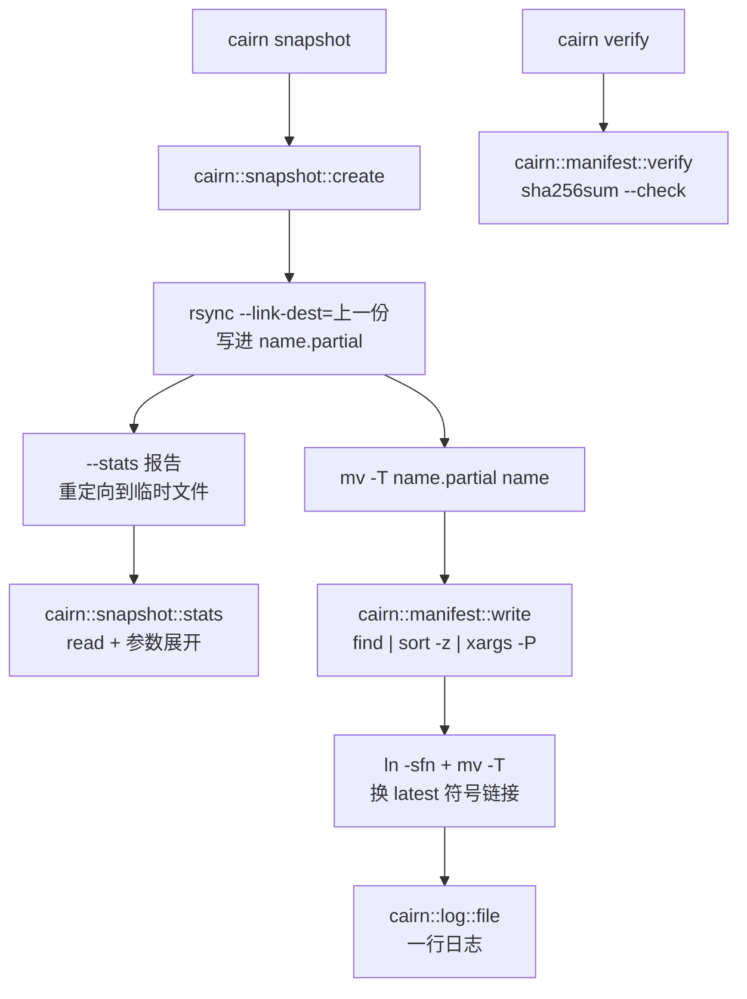
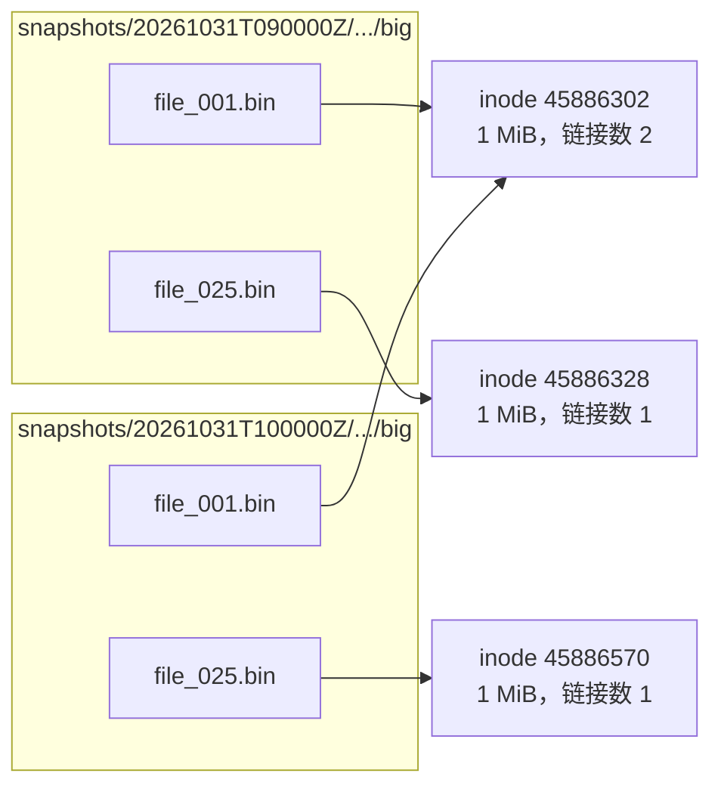

这一篇开始，Cairn 的快照不再是一整份拷贝：30 份快照加起来，我这台机器上只占 83,980,288 字节，而一份快照本身是 52,498,432 字节，30 份完整拷贝本来该是 1,574,952,960 字节。靠的是硬链接，而要把硬链接、`.partial` 目录、日志、清单文件这些东西接起来，需要先弄明白 shell 怎么处理文件描述符、重定向和管道里的并发进程。下面这个块是整件事的结果：30 份快照，每份 58 个文件，第 2 份起每天只换一个 1 MiB 的文件：

```text
$ cairn list | sed -n '1,3p;$p'
NAME               FILES
20261001T030000Z         58
20261002T030000Z         58
20261030T030000Z         58
$ du -s --block-size=1 repo/snapshots/20261001T030000Z | cut -f1
52498432
$ du -s --block-size=1 repo/snapshots | cut -f1
83980288
$ cairn verify
ok 20261030T030000Z (58 files)
```

> [!NOTE] 本篇检查点
> 这一篇结束时仓库（标签 `ch05`）有 84 个被跟踪的文件，比 `ch04` 多 16 个：新增 `lib/cairn/manifest.sh`（94 行，写入和校验清单；`cairn::manifest::diff` 第 6 篇才加，所以还不是最终版本）和 `lab/ch05/` 里的 15 个实验脚本（已经是最终版本）；另有五个旧文件被修改：`bin/cairn`（242 行长到 275 行，多了 `verify` 命令，`list` 多了 `FILES` 列，以后还会改）、`lib/cairn/log.sh`（64 行长到 84 行，多了 `cairn::log::file`，已经是最终版本）、`lib/cairn/snapshot.sh`（85 行长到 198 行，`cairn::snapshot::create` 换成了硬链接版本，`discard` 只给目录加 `u+w`，第 7 篇还要加锁和信号处理）、`README.md`（目录布局里补上了 `manifest`，已经是最终版本）和 `lab/ch04/prune_demo.sh`（`list` 多了一行表头，数行数时要跳过它，已经是最终版本）。`make ch05` 通过：15 个实验全部按预期退出（其中 `verify_tamper_fail.sh` 按设计以退出码 1 结束），没有一个需要宿主机，整套大约 16 秒。
> 涉及的 Shell 特性：文件描述符与继承、`exec` 重定向与 `{fd}>`、重定向的顺序、here-document 与 here-string、进程替换、管道是并发进程、`SIGPIPE`、`PIPESTATUS` 与 `pipefail`、子 shell 与 `{ }` 组、`&`/`wait`/`$!`、`xargs -0 -P`、`find -print0`、`sort -z`、命名管道，以及 [Google Shell 风格指南](https://google.github.io/styleguide/shellguide.html)里关于管道换行、`PIPESTATUS`、错误信息写 stderr 的规则。
> 前置：[第 4 篇：控制流与函数：if 后面跟的是命令](/posts/shell-by-cairn-04-control-flow-and-functions/)。

## 动手清单

你自己的 `~/cairn` 从第 4 篇的状态出发，这一篇要做这几件事，每件在哪一节出现都会指出来：

- 新建 `lib/cairn/manifest.sh`：`cairn::manifest::write`、`cairn::manifest::count`、`cairn::manifest::verify`。见“清单：管道、子 shell 和 PIPESTATUS”一节。
- 改 `lib/cairn/log.sh`：加 `cairn::log::file`。见“日志行”一节。
- 改 `lib/cairn/snapshot.sh`：`cairn::snapshot::create` 换成 `.partial` 加 `mv`、[`--link-dest`](https://download.samba.org/pub/rsync/rsync.1.html#opt--link-dest)、`--stats` 解析、符号链接原子切换的版本，`cairn::snapshot::discard` 只给目录加 `u+w`。见“cairn::snapshot::create”一节。
- 改 `bin/cairn`：加 `verify` 命令，`list` 多一列 `FILES`。
- 新建 `lab/ch05/` 下的 15 个实验，改 `lab/ch04/prune_demo.sh`，在 `README.md` 的目录布局里补上 `manifest`。`make ch05` 全部跑一遍。

直接从参考仓库复制的话，写法和前几篇一样：

```bash
git -C ~/cairn-ref fetch --tags
cd ~/cairn
mkdir -p lab/ch05
mapfile -t files < <(git -C ~/cairn-ref diff --name-only ch04 ch05)
for f in "${files[@]}"; do
  git -C ~/cairn-ref show ch05:"${f}" >"${f}"
done
```

我还是不建议整个照抄：`2>&1 >f` 和 `>f 2>&1` 的区别，自己敲错一次比读十遍都深。

## 全貌

这一章的代码只有一条主线：`cairn snapshot` 让 rsync 把变化的文件写进 `<name>.partial`，其余文件用硬链接指回上一份快照；rsync 的统计报告落在临时文件里，解析出文件数和字节数；`.partial` 改名成正式名字，并行算出清单，原子地换掉 `latest` 符号链接，最后写一行日志：



这一串代码里每一行都在使用同一批机制：谁打开了哪个文件描述符、谁的 stdout 接到了谁的 stdin、哪些进程同时在跑。所以和前几篇一样，先把机制讲透，每一节用一个 `lab/ch05/` 里的实验钉住结论，再回到代码。

## 文件描述符：一张进程里的小表

对内核来说，一个进程打开的每个文件、管道、终端、套接字都只是一个小整数，叫文件描述符 (file descriptor, fd)。`open` 返回当前最小的空闲编号；0、1、2 是约定：stdin、stdout、stderr。shell 的重定向没有任何魔法：fork 出子进程以后、exec 之前，shell 在子进程里 `open` 文件再用 `dup2` 把它放到想要的编号上，然后 exec。fd 表会跨过 `fork` 和 `exec` 一直保留下来，这就是“继承”，管道和重定向都建立在它上面。

`lab/ch05/fd_basics.sh` 先看一个子进程的 fd 表。`ls -l /proc/self/fd` 里的 `self` 是 `ls` 自己：

```bash
echo '--- fds 0-3 of a child ls (3 is the directory ls is reading) ---'
# 0/1/2 继承自 shell, 3 是 ls 自己打开的 /proc/self/fd。
# shellcheck disable=SC2012
ls -l /proc/self/fd | awk 'NR > 1 && $9 <= 3 {print $9, $10, $11}' \
  | sed -e 's/pipe:.*/pipe/' -e 's#/proc/[0-9]*/fd#/proc/<pid>/fd#' \
    -e 's#-> /\(home\|tmp\|nix\).*#-> (a file)#'
```

```text
--- fds 0-3 of a child ls (3 is the directory ls is reading) ---
0 -> pipe
1 -> pipe
2 -> (a file)
3 -> /proc/<pid>/fd
```

1 是管道，因为 `ls` 的 stdout 接着 `awk`；2 是一个文件，运行器把 stderr 存进了 `out/ch05/fd_basics.stderr`；0 也是管道，是从运行器继承来的，我没有追查它具体接在哪里；3 是 `ls` 自己为了读目录打开的。一个命令继承了什么，取决于 shell 在 exec 之前把表摆成了什么样。

不带命令的 `exec` 有另一个用途：它不启动任何进程，只让重定向对当前 shell 永久生效。`exec 3>file` 打开 fd 3 并留着，之后的 `>&3` 都写进去，`exec 3>&-` 关闭它：

```bash
echo '--- exec 3>file: fd 3 stays open in the shell ---'
exec 3>"${LAB_TMP}/fd3.txt"
echo 'written through fd 3' >&3
echo 'written again' >&3
exec 3>&-
cat "${LAB_TMP}/fd3.txt"

echo '--- {fd}>file: bash picks the number ---'
exec {log_fd}>"${LAB_TMP}/log_fd.txt"
echo "bash chose fd ${log_fd}"
echo 'via the variable' >&"${log_fd}"
exec {log_fd}>&-
cat "${LAB_TMP}/log_fd.txt"
```

```text
--- exec 3>file: fd 3 stays open in the shell ---
written through fd 3
written again
--- {fd}>file: bash picks the number ---
bash chose fd 10
via the variable
```

`exec {log_fd}>file` 里的 `{log_fd}` 让 bash 自己找一个空闲编号放进变量，我这里是 10：bash 从 10 开始分配，0 到 9 留给手写的 `3>`、`4>`，不会和它们撞车。自己手写一个数字的话，你得保证它没被别人占了；用 `{var}` 就没有这个问题，这也是第 7 篇里锁文件用 `exec {lock_fd}>` 的原因。

继承的实验在最后：

```bash
echo '--- inheritance: a child sees fd 3, a closed fd is gone ---'
exec 3>"${LAB_TMP}/inherit.txt"
bash -c 'echo "child writes to inherited fd 3" >&3'
bash -c 'for n in 0 1 2 3; do
  [[ -e /proc/self/fd/${n} ]] && printf "%s " "${n}"
done; echo'
exec 3>&-
bash -c 'echo "after closing: writing to fd 3" >&3' 2>&1 \
  | sed 's/^bash: line [0-9]*: /bash: /'
cat "${LAB_TMP}/inherit.txt"
```

```text
--- inheritance: a child sees fd 3, a closed fd is gone ---
0 1 2 3 
bash: 3: Bad file descriptor
child writes to inherited fd 3
```

子进程（又一个 `bash -c`）看到 0 1 2 3 四个 fd，往继承来的 3 里写的那一行最后出现在文件里（`cat` 在最后才跑）；shell 关掉 3 以后再起一个子进程，往 3 写就是 `Bad file descriptor`。这里没有“传递文件名”这回事，传递的是已经打开的文件。

`exec` 重定向还有一个更省事的用法：整个脚本只写一次，之后所有输出都进日志。先把原来的 stdout 和 stderr 存到 fd 3 和 4，再整体改道，最后恢复：

```text
$ exec 3>&1 4>&2
$ exec >>run.log 2>&1
$ echo "to the log"
$ echo "err to the log" >&2
$ exec 1>&3 2>&4 3>&- 4>&-
$ echo "back on the terminal"
back on the terminal
$ cat run.log
to the log
err to the log
```

（这里每行 `$` 是我在一个脚本里按顺序写下的命令，不是交互式输入；两个 `echo` 的输出在 `exec` 改道期间进了 `run.log`，所以屏幕上什么都没出现。）`n<>file` 是读写同时打开，同一个 fd 既能读又能写，偏移量共享：`exec 3<>rw.txt; echo hello >&3; exec 3<&-` 之后 `cat rw.txt` 得到 `hello`。Cairn 自己不需要它，`exec` 改道的主要用途是第 7 篇的锁文件。

## 重定向：从左到右，一次一个 dup2

下面是 Bash 里最常用的几种写法，`n` 和 `m` 是 fd 编号 ([Redirections](https://www.gnu.org/software/bash/manual/bash.html#Redirections))：

| 写法 | 含义 |
| --- | --- |
| `< f` | 以只读打开 `f`，放在 fd 0 |
| `> f` | 以写打开 `f`，先截断，放在 fd 1 |
| `>> f` | 追加打开 |
| `2> f` | 和 `> f` 一样，只是放在 fd 2 |
| `&> f` | stdout 和 stderr 都放进 `f`（Bash 的简写） |
| `n>&m` | 让 fd `n` 成为 fd `m` 的副本 (`dup2`) |
| `n>&-` | 关闭 fd `n` |
| `n<>f` | 以读写打开，放在 fd `n` |
| `>\| f` | 同 `>`，但在 `set -o noclobber` 下也强制覆盖 |
| `<<`、`<<<` | here-document、here-string，下一节 |
| `cmd1 \|& cmd2` | `cmd1 2>&1 \| cmd2` 的简写 |

关键是顺序：重定向严格按从左到右处理，每一条在处理的当时才计算右边的 fd 指向哪里。`lab/ch05/redirect_order.sh` 把 `>f 2>&1` 和 `2>&1 >f` 放在一起：

```bash
noisy() {
  echo 'to stdout'
  echo 'to stderr' >&2
}

echo '--- noisy >f 2>&1 ---'
noisy >"${LAB_TMP}/a.txt" 2>&1
echo "file a.txt:"
cat "${LAB_TMP}/a.txt"

echo '--- noisy 2>&1 >f (stderr goes where stdout used to go) ---'
# 外层大括号 2>&1 把它的 stderr 也收进变量, 方便区分"文件"和"屏幕"。
screen="$({ noisy 2>&1 >"${LAB_TMP}/b.txt"; } 2>&1)"
```

```text
--- noisy >f 2>&1 ---
file a.txt:
to stdout
to stderr
--- noisy 2>&1 >f (stderr goes where stdout used to go) ---
file b.txt:
to stdout
screen:
to stderr
```

`>f 2>&1`：先把 fd 1 指向 `f`，再让 fd 2 成为 fd 1 的副本，两个都进文件。`2>&1 >f`：先让 fd 2 成为“此刻的 fd 1”（也就是屏幕，或者管道）的副本，再把 fd 1 改指 `f`，于是 stderr 仍然在屏幕上，只有 stdout 进了文件。`>&` 读作“复制”，不读作“指向”：fd 2 从此和 fd 1 的旧目标无关了。

这个顺序也能写出一个很有用的把戏：只让 stderr 进管道。管道是在所有重定向之前接好的，所以 `3>&1 1>&2 2>&3` 能交换两个流（`3>&-` 把临时的 3 关掉）：

```text
$ swap() { echo out; echo err >&2; }
$ swap 3>&1 1>&2 2>&3 3>&- | sed 's/^/via pipe: /'
out
via pipe: err
```

`out` 本来是 stdout，现在直接落在屏幕上；`err` 本来是 stderr，现在进了管道被 `sed` 加上前缀。第 1 篇里的 `bin/cairn 2>&1 >/dev/null | head -n 1`（只看 stderr）用的是同一个顺序。

另外几个行为，`redirect_order.sh` 后半段逐个钉住了：

```text
--- &> and |& are shorthands ---
file c.txt:
to stdout
to stderr
noisy |& wc -l: 2
--- >> appends, > truncates ---
lines after > then >>: 2
lines after another >: 1
--- the classic mistake: reading and truncating the same file ---
bytes left in e.txt: 0
```

最后一个是经典错误：`sort e.txt >e.txt`。重定向由 shell 在启动 `sort` 之前就做完了，`>` 当场把文件截成 0 字节，`sort` 读到的是空文件。没有命令有机会“先读后写”。想原地改文件，要么用命令自带的原地选项（`sort -o e.txt e.txt`，`sort` 会先读完才打开输出），要么写临时文件再改名，这是本篇后面 `.partial` 和清单文件的写法。我手头验证了这两种：

```text
$ printf 'b\na\n' >f.txt
$ sort -o f.txt f.txt; paste -sd, f.txt
a,b
$ printf 'b\na\n' >g.txt
$ sort g.txt >g.txt.tmp && mv -T g.txt.tmp g.txt; paste -sd, g.txt
a,b
```

还有一条保护：`set -o noclobber` 以后，`>` 遇到已存在的文件就拒绝，要覆盖得写 `>|`：

```text
$ set -o noclobber
$ echo one >f.txt
$ echo two >f.txt; echo "status $?"
bash: f.txt: cannot overwrite existing file
status 1
$ echo two >|f.txt; echo "status $?"
status 0
```

Cairn 不用 `noclobber`，但这一章的清单和日志都用了“先写临时文件，再 `mv`”来换取同样的安全。

Google 风格指南在 [STDOUT vs STDERR](https://google.github.io/styleguide/shellguide.html#s3.1-stdout-vs-stderr) 一节要求所有错误信息写到 stderr，并建议用一个函数打印。Cairn 在第 1 篇起就是这样：`cairn::log::err` 的实现是 `>&2`，上面的 `swap` 里 `echo err >&2` 是同一件事。

## here-document 和 here-string

重定向还有两种“输入来自脚本本身”的写法。`<<` 开头的是 [here-document](https://www.gnu.org/software/bash/manual/bash.html#Here-Documents)：从下一行起到只含分隔符的那一行为止，作为这条命令的 stdin。第 1 篇的 `usage()` 和第 3 篇 `cairn init` 写出的配置模板都是它。`lab/ch05/heredoc.sh` 把几种变体放在一起：

```bash
name='cairn'

echo '--- unquoted delimiter: expands ---'
cat <<EOT
name is ${name}
sum is $((1 + 2))
home is \$HOME (escaped)
EOT

echo '--- quoted delimiter: literal ---'
cat <<'EOT'
name is ${name}
sum is $((1 + 2))
EOT
```

```text
--- unquoted delimiter: expands ---
name is cairn
sum is 3
home is $HOME (escaped)
--- quoted delimiter: literal ---
name is ${name}
sum is $((1 + 2))
```

分隔符没有引号时，正文里的 `${name}`、`$(( ))`、`$(cmd)` 都会展开，`\$` 保留字面量的 `$`；分隔符加上任意引号（`'EOT'`、`"EOT"` 或者 `\EOT`），正文就一个字符都不动。规则很简单：你要写的是模板还是脚本，决定了要不要引号。

第二个变体是缩进。`<<-` 会去掉正文每一行开头的制表符（只有制表符，空格不算），这样 here-document 可以跟着代码缩进：

```bash
echo '--- <<- strips leading tabs ---'
if true; then
  cat <<-EOT
	indented with a tab, printed flush left
	  two spaces after the tab survive
	EOT
fi

echo '--- plain << keeps every space and tab ---'
if true; then
  cat <<EOT
  indented with two spaces, printed as is
EOT
fi
```

这里的缩进是真正的制表符（Markdown 里看不出来，源文件里能看出来）：

```text
--- <<- strips leading tabs ---
indented with a tab, printed flush left
  two spaces after the tab survive
--- plain << keeps every space and tab ---
  indented with two spaces, printed as is
```

第一段的结束行 `EOT` 前面也是制表符，也被认出来了；普通的 `<<` 里，结束行必须顶格，否则就是正文。这是本站 `docs/code-style.md` 里“缩进用 2 个空格，从不用制表符”唯一的例外：`<<-` 的正文。空格缩进的 `<<-` 不会被剥掉，这是新手最常见的一次踩坑（我猜也是 `<<-` 很少有人用的原因）。

here-document 本质是个重定向，它把正文喂给 stdin：

```text
--- a here-document is a redirection: it feeds stdin ---
3
--- into a variable ---
[first
second]
```

`wc -l <<EOT` 数出 3 行；`read -r -d '' text <<EOT` 把正文整个读进变量（`-d ''` 让 `read` 读到 NUL 为止，也就是读完整个输入）。这是个小技巧，但 Google 风格指南的建议更朴素：长字符串用 here-document，或者在字符串里嵌换行，让一行不超过 80 列。

here-string `<<<` 是一个单词版本：把一个字符串加上换行符作为 stdin，不需要子 shell。`lab/ch05/herestring.sh`：

```bash
echo '--- read with <<< keeps the variables ---'
read -r first second rest <<<'alpha beta gamma delta'
echo "first=${first} second=${second} rest=${rest}"

echo '--- echo | read loses them (subshell) ---'
unset first
# BAD: read runs in a subshell, first is not set afterwards.
# shellcheck disable=SC2030
echo 'alpha beta' | read -r first _
# shellcheck disable=SC2031
echo "first after pipe: '${first:-}'"
```

```text
--- read with <<< keeps the variables ---
first=alpha second=beta rest=gamma delta
--- echo | read loses them (subshell) ---
first after pipe: ''
```

这是第 4 篇“管道进 while”那个子 shell 陷阱的原型：`read` 在管道右边的子 shell 里设置了变量，管道一结束，变量跟着子 shell 消失。`<<<` 没有管道，`read` 就在当前 shell 里运行。后半段还有三个小结果：

```text
--- <<< adds a trailing newline ---
4
3
--- grep a variable without echo ---
1
--- splitting on a custom IFS ---
user=root uid=0
```

`wc -c <<<'abc'` 是 4，`printf 'abc' | wc -c` 是 3：`<<<` 总会补一个换行。第 4 篇里的 `readarray -t decisions <<<"${text}"` 对空输入数出 1 个元素，原因就是这个换行。`IFS=: read -r user _ uid _ <<<'root:x:0:0:root'` 里的 `IFS=:` 只对这一条 `read` 生效（命令前面的赋值是临时环境），是拆分一行字段最轻的办法。

## 进程替换：把命令的输出当成文件名

有些命令只收文件名，不收 stdin，`diff` 就是：比较两个命令的输出得先各存一个临时文件。[进程替换](https://www.gnu.org/software/bash/manual/bash.html#Process-Substitution) `<(cmd)` 让 bash 启动 `cmd`，把它的 stdout 接到一个管道上，再把这个管道在 `/dev/fd/N` 下的路径当作参数展开出来。`lab/ch05/process_subst.sh`：

```bash
echo '--- what <(true) expands to ---'
echo <(true)

echo '--- two substitutions, two numbers ---'
echo <(true) <(true)

echo '--- diff of two command outputs ---'
diff <(printf 'a\nb\nc\n') <(printf 'a\nx\nc\n')
echo "diff exit status: $?"
```

```text
--- what <(true) expands to ---
/dev/fd/62
--- two substitutions, two numbers ---
/dev/fd/62 /dev/fd/61
--- diff of two command outputs ---
2c2
< b
---
> x
diff exit status: 1
```

`echo` 看到的只是一个字符串 `/dev/fd/62`。编号是 bash 选的，我这里是 62，下一个是 61（不同的 bash 版本和环境下数字会不同，很多文档里写的是 63）。`ls -l <(true)` 的第一个字符是 `l`，因为 `/dev/fd/62` 本身是符号链接，指向一个管道；管道读一次就没了，所以进程替换的路径不能 `seek`，也不能打开两次。

输出方向是 `>(cmd)`，常和 `tee` 一起用：`echo hello | tee >(tr '[:lower:]' '[:upper:]' >file) >/dev/null`，实验里最后得到 `HELLO`。注意 `tr` 是 bash 的子进程，bash 不会等它：实验里要 `sleep 0.2`，否则 `cat` 可能先于 `tr` 写完。这也是练习 1 的主题。

Cairn 里进程替换出现在两个地方。一个是第 4 篇起就在用的 `readarray -t names < <(cairn::repo::snapshots ...)`（`<` 加 `<(...)` 是“把命令的输出当 stdin”，Google 风格指南因此建议用它代替“管道进 while”）；另一个在 `cairn::snapshot::create` 里，下面会读到。

进程替换有一个代价，放在“Google 的几条规矩”那一节里讲：里面那条命令的退出状态，外面拿不到。

## 管道里的每一段都是一个进程

[管道](https://www.gnu.org/software/bash/manual/bash.html#Pipelines) `cmd1 | cmd2 | cmd3` 不是 `cmd1` 跑完再跑 `cmd2`。bash 先创建管道，一次 fork 出所有进程，各自把 stdout 和 stdin 接上，然后同时运行；数据在内核的管道缓冲区里流过，缓冲区满了写者就阻塞，空了读者就阻塞。`lab/ch05/pipeline_procs.sh` 的第一个实验数进程：

```bash
echo '--- every stage is its own process ---'
# shellcheck disable=SC2216
sleep 1 | sleep 1 | sleep 1 &
# 三个 sleep 同时在跑, 它们的父进程是这个 shell。
sleep 0.2
pids="$(pgrep -P "$$" -x sleep | wc -l)"
echo "sleep processes started by this shell: ${pids}"
wait
```

```text
--- every stage is its own process ---
sleep processes started by this shell: 3
```

3 个 `sleep` 进程，都是这个 shell 的直接子进程，同一时刻都活着。它们是怎么连起来的，可以直接看 fd 表：我在 `sleep 3 | sleep 3 &` 运行的时候，对两个进程分别看 fd 0 到 2（`/proc/<pid>/fd`，同第一节）：

```text
pid 405241:
  0 -> /dev/null
  1 -> pipe:[444307]
  2 -> pipe:[358995]
pid 405242:
  0 -> pipe:[444307]
  1 -> pipe:[358995]
  2 -> pipe:[358995]
```

第一个进程的 stdout 和第二个进程的 stdin 是同一个管道，编号 444307：这就是 `|` 的全部含义，一个管道的两端分别放进两个进程的 fd 表。（第一个进程的 stdin 是 `/dev/null`，因为后台作业不读终端；两个 stderr 都是 358995，是我这里的输出又接到了别的管道上，与这条管道无关。）所以整条管道的耗时是最慢一段的耗时，不是各段之和：

```text
$ time (sleep 1 | sleep 1 | sleep 1)

real	0m1.003s
```

1.003 秒。（对比：三个命令顺序执行是 3 秒，“`&`、`wait` 和 `$!`”那一节的 `background_wait.sh` 量过。）

### SIGPIPE

并发带来一个问题：读者先走了怎么办？`yes` 无休止地输出 `y`，`head -n 1` 读一行就退出。这时 `yes` 再写管道，内核发现没有人在读了，给它发 `SIGPIPE`，默认动作是终止进程，于是整条命令很快结束：

```bash
echo '--- yes | head -n 1 ---'
yes | head -n 1
echo "PIPESTATUS: ${PIPESTATUS[*]}"
echo "128 + SIGPIPE($(kill -l PIPE)) = $((128 + $(kill -l PIPE)))"
```

```text
--- yes | head -n 1 ---
y
PIPESTATUS: 141 0
128 + SIGPIPE(13) = 141
```

`PIPESTATUS` 是个数组，记着最近一条管道里每一段的退出状态：`yes` 是 141，`head` 是 0。141 就是 128 加信号编号 13 (`SIGPIPE`)：被信号杀死的进程，shell 报告 128 加信号编号。第 7 篇会专门讲这个约定。

### `$?`、`PIPESTATUS` 和 `pipefail`

`$?` 只看最后一段：

```bash
echo '--- $? only sees the last stage ---'
yes | head -n 1 >/dev/null
echo "\$? = $?"

echo '--- pipefail off: false | true ---'
false | true
echo "\$? = $?, PIPESTATUS = ${PIPESTATUS[*]}"

echo '--- pipefail on ---'
set -o pipefail
false | true
echo "\$? = $?, PIPESTATUS = ${PIPESTATUS[*]}"
yes | head -n 1 >/dev/null
echo "yes | head: \$? = $?"
set +o pipefail
```

```text
--- $? only sees the last stage ---
$? = 0
--- pipefail off: false | true ---
$? = 0, PIPESTATUS = 1 0
--- pipefail on ---
$? = 1, PIPESTATUS = 1 0
yes | head: $? = 141
```

`yes | head` 实际上有一段被信号杀了，`$?` 却是 0。`set -o pipefail` 让整条管道的状态变成“最后一个非零的状态”：`false | true` 变成 1，`yes | head` 变成 141。注意最后一行：开了 `pipefail` 以后，一个“完全正常”的 `yes | head -n 1` 也失败了。这是第 7 篇要接着讲的坑，这一章先记住：`pipefail` 不是免费的。

最后一个实验提醒一件容易忘记的事：

```text
--- save PIPESTATUS at once: the next command overwrites it ---
first: 1 0
second: 0
```

`echo "first: ${PIPESTATUS[*]}"` 本身是一条命令，它跑完以后 `PIPESTATUS` 被它的状态（一个 0）盖掉了，所以第二行只剩 `0`。Google 风格指南在 [Checking Return Values](https://google.github.io/styleguide/shellguide.html#s8.1-checking-return-values) 里说得很具体：只关心整条管道成不成功，可以直接检查各个元素；要按出错的位置做不同的处理，就在管道结束后立即把数组存进另一个变量，因为 `[` 也是命令，也会冲掉 `PIPESTATUS`：

```bash
tar -cf - ./* | ( cd "${DIR}" && tar -xf - )
return_codes=( "${PIPESTATUS[@]}" )
```

后面的 `cairn::manifest::write` 就是这条规矩的实例。

## 子 shell 和花括号组

两种成组写法长得很像，行为很不同：`( ... )` 在 fork 出来的子 shell 里运行，`{ ...; }` 在当前 shell 里运行。`lab/ch05/subshell_vs_group.sh` 用 `$$` 和 `$BASHPID` 把区别钉住：

```bash
echo "main:  \$\$=$$ BASHPID=${BASHPID}"

echo '--- ( ): a subshell ---'
# shellcheck disable=SC2030
(
  echo "inside: \$\$=$$ BASHPID=${BASHPID}"
  var=changed
  cd /
)
# shellcheck disable=SC2031
echo "after: var='${var:-unset}' pwd is still ${PWD##*/}"

echo '--- { }: a group in the same shell ---'
{
  echo "inside: \$\$=$$ BASHPID=${BASHPID}"
  var=changed
}
echo "after: var='${var}'"
```

```text
main:  $$=392468 BASHPID=392468
--- ( ): a subshell ---
inside: $$=392468 BASHPID=392469
after: var='unset' pwd is still cairn-lab.0qejNh
--- { }: a group in the same shell ---
inside: $$=392468 BASHPID=392468
after: var='changed'
```

`$$` 永远是主 shell 的 PID（所以子 shell 里它还是 392468），`$BASHPID` 是当前正在运行的那个 shell 自己的 PID：子 shell 里是 392469。子 shell 里的 `var=changed` 和 `cd /` 都随它消失，主 shell 的 `var` 没设，也还在原目录。花括号组什么都没隔离，`var` 变了。

那为什么还要用花括号？因为它是个“一组命令共用一个重定向”的容器：

```text
--- a group can share one redirection ---
2
```

`{ echo one; echo two; } >file` 只打开一次文件。后面几行也是一回事：

```text
--- cmd substitution and pipelines also fork ---
in $(...): 392471
right side of a pipe: 392473
--- exit in a subshell leaves the parent alone ---
status of (exit 7): 7
```

`$( )` 和管道的每一段都在子 shell 里（PID 都不是主 shell 的）；`(exit 7)` 只退出子 shell，主 shell 拿到状态 7 继续。Cairn 在两处用括号：`cairn::manifest::write` 里的 `( set -o pipefail; cd ...; find ... )`，和 `cairn::manifest::verify` 里的 `(cd -- "${dir}" && sha256sum --check --quiet)`，目的一样：`cd` 只影响括号里的进程，主 shell 的当前目录不被改。

## `&`、`wait` 和 `$!`

命令后面的 `&` 让 shell 不等它：fork 之后立刻返回，`$!` 是刚启动的后台进程的 PID，[`wait`](https://www.gnu.org/software/bash/manual/bash.html#Job-Control-Builtins) 阻塞到后台作业结束，并且返回其中某个作业的退出状态。`lab/ch05/background_wait.sh`：

```bash
echo '--- sequential: three sleeps ---'
start="$(now_ms)"
sleep 1
sleep 1
sleep 1
echo "wall: $(($(now_ms) - start)) ms (expect about 3000)"

echo '--- parallel: three sleeps with & and wait ---'
start="$(now_ms)"
sleep 1 &
echo "first pid: $!"
sleep 1 &
sleep 1 &
wait
echo "wall: $(($(now_ms) - start)) ms (expect about 1000)"
```

```text
--- sequential: three sleeps ---
wall: 3013 ms (expect about 3000)
--- parallel: three sleeps with & and wait ---
first pid: 392090
wall: 1006 ms (expect about 1000)
```

顺序执行 3,013 ms，三个 `sleep 1 &` 加一个 `wait` 是 1,006 ms：差不多正好 3 倍。`now_ms` 用的是 `$EPOCHREALTIME`（bash 5 起的变量，微秒精度），不 fork 任何进程，所以测量本身几乎没有开销。

`wait PID` 等某一个，`wait` 的返回值就是那个作业的退出状态；`$!` 总是最近一个：

```text
--- $! is the last background job ---
waited for 392094, status 0
--- wait returns the status of the job ---
status: 5
```

`(exit 5) & wait $!` 拿到 5。`wait -n` 等“任意一个”，`-p 变量名`（需要 bash 5.1 或更新的版本，`nix develop` 里是 5.3.15）把先结束的那个作业的 PID 存进变量：

```bash
echo '--- wait -n: first to finish ---'
# 放进子 shell: 前面的 wait 已经收走过别的作业，wait -n 会拿到旧的结果。
(
  sleep 0.6 &
  slow=$!
  sleep 0.1 &
  fast=$!
  wait -n -p done_pid
  if [[ "${done_pid}" == "${fast}" ]]; then
    echo 'wait -n returned the short job first'
  fi
  wait "${slow}"
  echo "slow job finished too: $?"
)
```

```text
--- wait -n: first to finish ---
wait -n returned the short job first
slow job finished too: 0
```

那行注释是个真实的教训。这个实验的第一版没有那层括号，我自己跑了十来遍，`wait -n returned the short job first` 那一行时有时无：前面的三个 `sleep 1 &` 是被一条不带参数的 `wait` 收走的，之后的 `wait -n` 有一部分次数返回的是其中最后一个旧作业的 PID，而不是新启动的 `fast`。我没有去读 bash 的作业表代码，我猜是 bash 还记着“最近一个已经结束、但没被 `wait -n` 报告过的作业”。放进括号以后，子 shell 的作业表是空的，结果稳定。以后写 `wait -n` 的循环，最稳的办法是拿着一份明确的 PID 列表，或者像这样在一个全新的子 shell 里做。

## NUL 分隔：`find -print0`、`sort -z`、`xargs -0 -P`

文件名里可以有除了 `/` 和 NUL 之外的任何字节，包括换行。一切“一行一个文件名”的管道都在这里出错。`lab/ch05/find_print0.sh` 用第 2 篇的夹具目录（里面有一个名字带换行的文件）数文件：

```bash
echo '--- find . -type f | wc -l ---'
find . -type f | wc -l

printf '%s\n' '--- find . -type f -print0 | tr -cd "\0" | wc -c ---'
find . -type f -print0 | tr -cd '\0' | wc -c
```

```text
--- find . -type f | wc -l ---
9
--- find . -type f -print0 | tr -cd "\0" | wc -c ---
8
```

`find | wc -l` 说有 9 个文件，实际只有 8 个：带换行的那个被数成了两行。`-print0` 用 NUL 结尾每个名字，数 NUL 的个数是精确的。喂给下一个命令也一样：

```text
--- the name with a newline, shown with %q ---
'./new'$'\n''line.txt'
--- sort -z keeps names whole ---
./-rf|./.hidden|./nested/a/b/c.txt|./new~line.txt|./plain.txt|./star*.txt|./with space.txt|./中文.md|
--- xargs without -0: one printed line per argument it saw ---
10
--- xargs -0: one argument per file ---
8
```

`sort -z` 按 NUL 分隔排序，名字没被拆开（我用 `tr '\0\n' '|~'` 把 NUL 显示成 `|`、换行显示成 `~`）；`xargs` 不加 `-0` 时，它按空白和换行拆词，8 个文件被拆成了 10 个参数：`with space.txt` 拆成两个，`new\nline.txt` 也拆成两个，8 加 2 等于 10；加上 `-0` 才是 8。这就是 `find -print0 | sort -z | xargs -0` 总是成套出现的原因：三个命令都要同意“分隔符是 NUL”，缺一个就全错。

`xargs` 另一个用途是并行。`-P N` 同时跑 N 个子进程，`-n K` 每个子进程最多拿 K 个参数，`-r` 在输入为空时不运行命令（GNU 的行为；`xargs` 默认会跑一次不带参数的命令）。`lab/ch05/xargs_parallel.sh` 用 200 个 1 MiB 的随机文件（`make_tree.sh --big 200`，加上夹具里原有的 8 个，一共 208 个）算哈希。文件数我也用刚才的办法数，不用 `find | wc -l`，不然带换行的那个名字会让数字变成 209：

```bash
echo "regular files: $(find . -type f -print0 | tr -cd '\0' | wc -c)," \
  "nproc: ${jobs}"

hash_all() {
  find . -type f -print0 \
    | xargs -0 -r -P "$1" -n 4 sha256sum >/dev/null
}
```

```text
regular files: 208, nproc: 16
-P 1:        706 ms
-P 16:       108 ms
speedup: 6.5x
--- same hashes either way ---
manifests are identical after sort -k 2
```

每种取 3 次的中位数（`EPOCHREALTIME` 做微秒差，先预热一次页缓存，排除磁盘读取）：`-P 1` 706 ms，`-P 16` 108 ms，加速 6.5 倍（再跑几次会在这个数附近波动，所以实验不做断言）。机器有 16 个线程却没到 16 倍，我猜原因有三个：每批 4 个文件只算 4 MiB，起进程的开销不可忽略；16 个线程不是 16 个核（这是一颗 8 核 16 线程的移动端 CPU）；还有内存带宽。我没有分别量。

“manifests are identical after sort -k 2”：并行时各个 `sha256sum` 谁先写完不确定，输出的行序每次不一样，所以并行的结果必须再 `sort -k 2`，按路径排好才可比较，下面的清单代码里你会看到同样的最后一步。实验里比较的就是两条这样的管道，放不下一行所以一段一行（Google 的排版规则）：

```bash
a="$(
  find . -type f -print0 \
    | xargs -0 -P 1 -n 4 sha256sum \
    | LC_ALL=C sort -k 2 \
    | sha256sum
)"
```

“谁先写完不确定”可以直接看到：让六个任务各睡不同长的时间（参数就是睡眠秒数，彼此至少差 0.1 秒，不会打平），并行度 3，输出顺序就是完成顺序：

```text
$ printf '%s\0' 0.6 0.2 0.5 0.1 0.4 0.3 | xargs -0 -n 1 -P 3 sh -c 'sleep "$1"; echo "$1"' _ | paste -sd' '
0.2 0.1 0.5 0.6 0.4 0.3
```

我连跑了 6 次，6 次都是这个顺序，和输入顺序 `0.6 0.2 0.5 0.1 0.4 0.3` 不一样：先睡完的先出来，空出来的名额再给后面的任务。我没有对它做任何事，顺序只是几个 `sleep` 谁先醒。真实的 `sha256sum` 批次也是这样，只是差别藏在毫秒里。

## 命名管道：有名字的管道

命名管道 (FIFO) 是“有名字的管道”，`lab/ch05/fifo.sh` 用来说明：管道不是一种数据结构，是一对打开的 fd。

```text
file type character: fifo
--- a writer in the background, a reader in the foreground ---
line one
line two
writer status: 0
--- the open() of the writer blocks until a reader shows up ---
writer is still blocked after 0.5 s, nobody reads yet
late
--- the fifo itself stays empty on disk ---
size: 0 bytes
--- a fifo between two commands, like a pipe with a name ---
a
b
c
```

`mkfifo` 创建出的文件类型是 `fifo`，大小始终是 0；写者的 `open` 会一直阻塞，直到有人来读（实验里 0.5 秒以后它还卡着）；数据只经过内核，从不落盘。`<(cmd)` 在内部做的就是类似的事。

## 硬链接和 inode

到这里终于可以谈快照本身了。我只用一个比喻：图书馆的卡片目录。一本书只有一个书架位置，目录里可以有多张卡片都指向它；文件系统里，书架位置是 inode（存数据块位置、权限、所有者、时间戳和链接计数），目录项是卡片（一个名字加一个 inode 编号）。`ln a b` 加一张新卡片，`rm a` 抽掉一张，链接计数降到 0 才会真正把书扔掉。比喻到此为止，下面是真的：

```text
$ echo hi >a
$ ln a b
$ ls -li a b
45489345 -rw-r--r-- 2 bfmhno3 users 3 Nov  1 11:57 a
45489345 -rw-r--r-- 2 bfmhno3 users 3 Nov  1 11:57 b
$ rm a
$ stat -c '%h links %n' b
1 links b
$ cat b
hi
```

`a` 和 `b` 的 inode 编号相同，链接计数是 2；删掉 `a` 以后数据还在，计数变 1。注意：权限、所有者、修改时间全都存在 inode 里，所有名字共享，改任何一个名字的权限，另一个名字也变了。这一点后面会咬我们一口。

Cairn 的快照目录里，没有变化的文件就是指向上一份快照同一个 inode 的另一个名字。rsync 的 `--link-dest=DIR` 做的就是这个：对每个要传的文件，先看 `DIR` 里相同路径的文件和源文件是否“一样”（默认的判断标准是大小和修改时间都相同，不是内容），一样就在目标目录里 `link` 一个新名字，不拷贝数据；不一样才拷贝。

画出来，两份快照共享一个 inode，另一个文件各自一份（文件名和编号是下面 `hardlinks.sh` 实际跑出来的，没变的 `file_001.bin` 和改过的 `file_025.bin`）：



`lab/ch05/hardlinks.sh` 用 50 MiB 的树 (`make_tree.sh --big 50`) 做两份快照，两份之间只改一个 1 MiB 的文件：

```bash
first="$(CAIRN_NOW=20261031T090000Z cairn -q -c "${conf}" snapshot)" \
  || exit 1
# 只改一个 1 MiB 的文件。大小不变时 rsync 靠 mtime 判断，
# 所以先让 mtime 越过当前这一秒。
sleep 1.1
head -c 1048576 /dev/urandom >"${src}/big/file_025.bin"
second="$(CAIRN_NOW=20261031T100000Z cairn -q -c "${conf}" snapshot)" \
  || exit 1
```

```text
--- link count and inode of two files in both snapshots ---
file_001.bin: 2 links, inode 45886302|2 links, inode 45886302
file_025.bin: 1 links, inode 45886328|1 links, inode 45886570
--- how many big files share an inode with the first snapshot ---
49 of 50 are hard links
```

没变的 `file_001.bin`：两份快照里同一个 inode，链接数 2。改过的 `file_025.bin`：两个不同的 inode，各自链接数 1。50 个大文件里 49 个是硬链接。

那一行 `sleep 1.1` 是有原因的，而且是 rsync 的一个值得记住的行为。我第一次跑这个实验，没有这行等待，连续几次输出都是 `50 of 50 are hard links`：第二份快照里的 `file_025.bin` 还是旧内容。文件刚创建不到一秒，我就用同样大小的新数据覆盖了它，而 rsync 默认只比较大小和修改时间，两样都一样，它就认为文件没变，硬链接了过去。我拆开量了几次，每次记下改写前后的 mtime、两份快照里是否共享 inode：

```text
mtime before 1793505387.858174072 after 1793505388.282174087; shared inode: no; snap2 matches src: yes
mtime before 1793505389.026174115 after 1793505389.463174131; shared inode: yes; snap2 matches src: no
mtime before 1793505390.204174159 after 1793505390.635174175; shared inode: yes; snap2 matches src: no
```

第一行改写前后跨过了整秒（387 到 388），rsync 重新拷贝了；后两行前后都落在同一秒里（389 和 389，390 和 390，差几百毫秒），rsync 没有拷贝，第二份快照里是过期的内容（我用 `cmp` 对过）。所以我的结论是它按整秒比较，这是观察，不是读源码得来的。真实世界里这种情况很少见（文件在一秒内被同样大小地改写两次），但这是用“大小加 mtime”做变化检测的固有边界：要内容级的保证，要用 rsync 的 `--checksum`，代价是每个文件都要读一遍。

磁盘占用是这样的：

```text
--- du -s --block-size=1, one snapshot at a time ---
first alone:   52502528 bytes
second alone:  52502528 bytes (every link counts)
--- du over both in one call: shared inodes are counted once ---
first:  52502528 bytes
second: 1089536 bytes (only what the first does not have)
both together: 53592064 bytes
second / first: 2.1%
both / (2 x first): 51.0%
```

`du` 每次调用只数一个 inode 一次。单独对每份快照跑 `du`，两份都是 52,502,528 字节；把两个目录放进同一次 `du` 里，第二份只多出 1,089,536 字节，是第一份的 2.1%，两份加起来是 53,592,064 字节，比 2 份完整拷贝省了将近一半。多出来的字节里，1,048,576 是那个 1 MiB 的新文件，剩下的 40,960 我猜是第二份快照自己的目录（目录不能硬链接，每份快照都有一套），我没有逐个数。`cairn list` 的 `SIZE` 列（第 6 篇）用的就是这个办法，一次 `du` 列出所有快照，所以每一行是“这份快照新增的空间”。

这一篇开头的 30 份快照是同一个机制拉长：我用 `make_tree.sh --big 50` 建 50 个 1 MiB 的文件加夹具，第 2 份起每份换掉一个文件，用 `touch -d` 把新文件的 mtime 往后拨（理由见上一段）：

```bash
#!/usr/bin/env bash
# Build 30 snapshots, changing one 1 MiB file per day.
base="$(date +%s)"
for ((i = 1; i <= 30; i++)); do
  if ((i > 1)); then
    f="$(printf 'src/big/file_%03d.bin' "${i}")"
    head -c 1048576 /dev/urandom >"${f}"
    touch -d "@$((base + 100 * i))" "${f}"
  fi
  printf -v now '202610%02dT030000Z' "${i}"
  CAIRN_NOW="${now}" cairn -q snapshot >/dev/null || exit 1
done
```

结果是开头那个块：第一份 52,498,432 字节，30 份一共 83,980,288 字节，是一份的 1.60 倍，而不是 30 倍。50 MiB 的底，加 29 个 1 MiB 的新文件，再加每份快照自己那一套目录。

## 硬链接的另一面：改一个，全都变

硬链接省空间，代价是“名字之间没有隔离”：数据在 inode 里，通过任何一个名字写进去，所有名字都看到。快照是只读的备份，没有人该去写它，可是磁盘坏了、手滑了、某个程序以为自己在改一份副本，都会写进去。我造一个这样的场景：两份快照共享 `a.txt`（只改了 `b.txt`），往第一份的 `a.txt` 里追加一个字符，然后三次校验：

```text
$ cairn verify 20261031T090000Z
./tmp/p5t/src/a.txt: FAILED
sha256sum: WARNING: 1 computed checksum did NOT match
cairn: error: snapshot 20261031T090000Z failed verification
exit 1
$ cairn verify 20261031T100000Z
./tmp/p5t/src/a.txt: FAILED
sha256sum: WARNING: 1 computed checksum did NOT match
cairn: error: snapshot 20261031T100000Z failed verification
exit 1
$ cairn verify
./tmp/p5t/src/a.txt: FAILED
sha256sum: WARNING: 1 computed checksum did NOT match
cairn: error: snapshot 20261031T100000Z failed verification
exit 1
```

两份快照同时坏了，因为它们根本是同一份数据。这一点要看清楚：硬链接快照里，“30 份快照”不是 30 份独立的备份。它们对付的是“我删错了文件”，对付不了“存储介质出了问题”；后一种要靠第二份仓库，放在另一块盘或者另一台机器上。`cairn verify` 的价值在这里：至少它让坏了这件事被发现，而不是在你最需要的那天才发现。（顺便，我删掉清单再看 `cairn list`：那一份的 `FILES` 显示 `-`，`cairn verify` 报 `no manifest for 20261031T100000Z`，退出码 1，和代码里的两个分支一致。）

## 原子改名

一份快照要么完整存在，要么不存在，不能是“拷到一半”。办法是先写到 `<name>.partial`，等所有事情都做完，再用一次 `rename(2)` 把它改成正式名字：同一个文件系统里的 `rename` 是原子的，别的进程要么看到旧名字，要么看到新名字，看不到中间状态。`mv -T` 在同一个文件系统里就是一次 `rename` 系统调用，我用 `strace` 确认过：

```text
$ strace -e trace=rename,renameat,renameat2 mv -T latest.tmp latest
renameat2(AT_FDCWD, "latest.tmp", AT_FDCWD, "latest", RENAME_NOREPLACE) = -1 EEXIST (File exists)
renameat(AT_FDCWD, "latest.tmp", AT_FDCWD, "latest") = 0
```

`mv` 先试了一次不覆盖的 `renameat2`（目标存在，EEXIST），再用 `renameat` 完成改名，后一个是原子地替换。`-T` 的意思是“目标当作普通文件名，不是目录”，对符号链接尤其重要。`latest` 是指向目录的符号链接，如果不加 `-T`：

```text
$ mv latest.tmp latest
$ readlink latest
snapshots/v1
$ ls snapshots/v1
latest.tmp
```

`mv` 看到目标 `latest` 是一个（指向）目录的名字，就把 `latest.tmp` 搬进了目录 `snapshots/v1` 里面，`latest` 完全没动，退出码还是 0。加上 `-T` 才对：

```text
$ mv -T latest.tmp latest
$ readlink latest
snapshots/v2
```

`ln -sfn` 里的 `-n` 是同一个道理：没有 `-n`，`ln -sf snapshots/v1 latest` 会进入 `latest` 指向的目录，在里面建一个叫 `v1` 的链接，`latest` 本身不变（我跑过，`ls snapshots/v2` 里多了一个 `v1`）。Cairn 的写法是先 `ln -sfn` 创建 `latest.tmp`，再 `mv -T latest.tmp latest`，这样 `latest` 永远指向一份完整的快照。（我用 `strace` 看到，这台机器上的 GNU coreutils 9.11 里 `ln -sfn` 自己也是“先建临时符号链接，再 rename”，但我没有查更老的版本是不是一样，所以不依赖它。）

## `cairn::snapshot::create`

现在可以读代码了。`lib/cairn/snapshot.sh` 里 `cairn::snapshot::create` 是 `ch05` 的核心，前半段在准备参数。名字、仓库路径、已存在检查都是前几篇的老样子；新的是 rsync 的参数数组：

```bash
  local -a rsync_args=(--archive --relative --delete --numeric-ids --stats)
  local previous
  if previous="$(cairn::repo::latest "${repo}")"; then
    rsync_args+=("--link-dest=${repo}/snapshots/${previous}")
  fi
  if [[ -n "${CAIRN_BWLIMIT:-}" ]]; then
    rsync_args+=("--bwlimit=${CAIRN_BWLIMIT}")
  fi
  if [[ "${CAIRN_DRY_RUN}" == 1 ]]; then
    rsync_args+=(--dry-run)
  fi
  rsync_args+=(
    "${CAIRN_EXCLUDES[@]/#/--exclude=}"
    -- "${CAIRN_SOURCES[@]}" "${partial}/"
  )
```

`previous` 是上一份快照的名字（第 4 篇的 `cairn::repo::latest`，它按名字排序、不看 `latest` 符号链接，也跳过 `*.partial`）；有上一份才加 `--link-dest`。`CAIRN_BWLIMIT` 单位是 KiB/s，用来限速，演示和测试用。`"${CAIRN_EXCLUDES[@]/#/--exclude=}"` 是第 3 篇的“对数组每个元素加前缀”。

数组展开以后，rsync 最终看到的命令行是什么，用 `bash -x` 看最直接（第 2 篇的 `set -x` 是同一个机制；我把沙箱路径缩成了 `<d>`）：

```text
$ CAIRN_BWLIMIT=2000 CAIRN_NOW=20261031T110000Z bash -x "$(command -v cairn)" snapshot 2>&1 | grep -E '^\+ rsync '
+ rsync --archive --relative --delete --numeric-ids --stats --link-dest=<d>/repo/snapshots/20261031T100000Z --bwlimit=2000 -- <d>/src <d>/repo/snapshots/20261031T110000Z.partial/
```

`--link-dest` 指向上一份 (`...T100000Z`)，目标是 `...T110000Z.partial/`，源目录前面有 `--`，防止以 `-` 开头的路径被当成选项（第 2 篇讲过 `--`；指南里同一类的规则是通配符写成 `./*`）。

接下来是这一章最有意思的两行：

```bash
  # rsync 的 --stats 报告写进临时文件, 屏幕上只留它的警告和错误。
  local stats_file
  stats_file="$(mktemp)" || return 1
  local start="${SECONDS}"
  rsync "${rsync_args[@]}" >"${stats_file}"
  local rc=$?
```

`>"${stats_file}"` 只重定向 stdout，stderr 没动：rsync 的错误信息直接出现在终端，而 `--stats` 的统计报告（它是写到 stdout 的）落进临时文件，不会淹没终端。`rc=$?` 要紧挨着 `rsync`，中间不能插别的命令，否则 `$?` 就被冲掉了。rsync 仍然在前台运行（第 7 篇才会把它放到后台去处理信号）。

然后处理 rsync 的退出码：

```bash
  if ((rc == 24)); then
    cairn::log::warn 'some files vanished during the snapshot'
  elif ((rc != 0)); then
    rm -f -- "${stats_file}"
    if [[ "${CAIRN_DRY_RUN}" != 1 ]]; then
      cairn::snapshot::discard "${partial}"
      cairn::log::file ERROR snapshot "name=${name}" status=failed \
        "rsync_exit=${rc}"
    fi
    cairn::log::err "rsync failed with exit ${rc}"
    return 1
  fi
```

24 的意思是“有些源文件在传输过程中消失了”：备份正在被使用的目录时这是常态，不该让整份快照失败，只警告一声。其他非零都是失败：删掉临时文件和 `.partial`，写一行 `ERROR` 日志，报错，退出码 1。我分别验证了这两条路径。源目录不存在时 rsync 退出 23：

```text
$ CAIRN_NOW=20261031T130000Z cairn -c conf.bad snapshot; echo "exit $?"
rsync: [sender] link_stat "/tmp/cairn-check05/nosuchdir" failed: No such file or directory (2)
rsync error: some files/attrs were not transferred (see previous errors) (code 23) at main.c(1356) [sender=3.4.4]
cairn: error: rsync failed with exit 23
exit 1
$ ls repo/snapshots
20261031T090000Z
20261031T100000Z
20261031T110000Z
20261031T120000Z
$ tail -n 1 repo/logs/cairn.log
2026-11-01T11:57:11+0800 ERROR snapshot name=20261031T130000Z status=failed rsync_exit=23
```

前两行是 rsync 自己写到 stderr 的，没有被重定向吃掉；快照目录里没有留下 `.partial`；日志里有一行 `ERROR`（这一段在另一个沙箱 `/tmp/cairn-check05` 里，已经有四份快照）。24 我用一个假的 `rsync` 包装脚本触发：跑真的 rsync，然后 `exit 24`，放在 `PATH` 最前面（`${PATH#*:}` 去掉第一个目录，也就是它自己，才找得到真的那个）：

```bash
#!/usr/bin/env bash
# Pretend rsync: run the real one, then report "some files vanished".
real="$(PATH="${PATH#*:}" command -v rsync)"
"${real}" "$@"
exit 24
```

然后：

```text
$ PATH="${PWD}/fake:${PATH}" CAIRN_NOW=20261031T140000Z cairn -c xdg/cairn/cairn.conf snapshot; echo "exit $?"
cairn: warning: some files vanished during the snapshot
cairn: snapshot 20261031T140000Z: 4 files, 0 bytes transferred in 0 s
20261031T140000Z
exit 0
```

警告一行，快照照样建成，退出码 0。

再下来是解析统计报告和收尾：

```bash
  local files bytes
  read -r files bytes < <(cairn::snapshot::stats "${stats_file}")
  rm -f -- "${stats_file}"
```

`read` 在当前 shell 里运行，`< <(...)` 把 `cairn::snapshot::stats` 的输出作为它的 stdin：这就是前面那几节用到的重定向加进程替换，而不是 `cairn::snapshot::stats ... | read`（那样 `files` 和 `bytes` 会随子 shell 消失）。`cairn::snapshot::stats` 是个小解析器：

```bash
  local line
  local files=0
  local bytes=0
  while IFS= read -r line; do
    case "${line}" in
      'Number of files: '*'reg: '*)
        line="${line#*reg: }"
        files="${line%%[^0-9,]*}"
        files="${files//,/}"
        ;;
      'Total transferred file size: '*)
        line="${line#*: }"
        bytes="${line%% *}"
        bytes="${bytes//,/}"
        ;;
    esac
  done <"$1"
  printf '%s %s\n' "${files}" "${bytes}"
```

`done <"$1"` 把整个 `while` 循环的 stdin 接到统计文件上，是一个循环共用一个重定向的例子。要解析的两行 rsync 是这样写的（我对着样例目录跑 `rsync --stats --dry-run` 抓出来的）：

```text
Number of files: 9 (reg: 5, dir: 4)
Total transferred file size: 3,145,742 bytes
```

第一行用 `${line#*reg: }` 去掉到 `reg: ` 为止的前缀，得到 `5, dir: 4)`，再用 `${line%%[^0-9,]*}` 从第一个“不是数字也不是逗号”的字符起删掉后缀，剩下 `5`；第二行取 `: ` 之后、第一个空格之前的部分，再用 `${bytes//,/}` 去掉千分位逗号，得到 `3145742`。没有 `sed`、没有 `awk`，不 fork 任何进程（第 6 篇会说什么时候该 fork）。这些参数展开运算符都是第 3 篇的。

`-n` 干跑到这里就结束，打印 `would create <name>`，什么都不改。真的建快照继续往下：

```bash
  if ! mv -T -- "${partial}" "${final}"; then
    cairn::snapshot::discard "${partial}"
    cairn::log::err "cannot rename ${name}.partial"
    return 1
  fi
  if ! cairn::manifest::write "${repo}" "${name}"; then
    cairn::log::file ERROR snapshot "name=${name}" status=failed
    cairn::log::err "cannot write the manifest of ${name}"
    return 1
  fi
  # 先建临时符号链接再 rename: latest 始终指向一个完整的快照。
  if ! ln -sfn "snapshots/${name}" "${repo}/latest.tmp" \
    || ! mv -T -- "${repo}/latest.tmp" "${repo}/latest"; then
    cairn::log::err 'cannot update the latest link'
    return 1
  fi
```

顺序是：`.partial` 改名成正式快照，写清单，换 `latest` 的指向。每一步都检查返回值（Google 风格指南“Checking Return Values”那条）。最后一条 `||` 的续行是 Google 的写法：`||` 在新行开头，缩进 2 格，“Google 的几条规矩”一节再说。

`cairn::snapshot::discard` 里有一个小细节：删除之前先给目录加上 `u+w`，因为源目录里有只读目录时，rsync 会把只读权限一起复制过来，不先加上写权限就删不掉。注意只给目录加，不是 `chmod -R`：`.partial` 里没变的文件是指向上一份快照的硬链接，递归地改权限会改到上一份快照。这是我第一版写错的地方，“两个同样写法的洞”那一节会把旧写法和新写法的结果都跑出来：

```bash
cairn::snapshot::discard() {
  find "$1" -type d -exec chmod u+w -- {} + 2>/dev/null
  rm -rf -- "$1"
}
```

### 日志行

`cairn::log::file` 是 `lib/cairn/log.sh` 里新加的函数：

```bash
cairn::log::file() {
  local level="$1"
  local event="$2"
  shift 2
  printf '%(%Y-%m-%dT%H:%M:%S%z)T %s %s %s\n' -1 \
    "${level}" "${event}" "$*" >>"${CAIRN_REPO}/logs/cairn.log"
}
```

`printf '%(...)T' -1` 是第 4 篇的不 fork 的时间戳，`>>` 追加。`"$*"` 把所有 `KEY=VALUE` 参数用空格拼成一个字符串（第 2 篇的引号规则：这里要的就是拼起来，所以用 `*` 不用 `@`）。快照成功以后在 `create` 的最后写一行：

```bash
  local seconds=$((SECONDS - start))
  cairn::log::file INFO snapshot "name=${name}" status=ok \
    "files=${files}" "bytes=${bytes}" "seconds=${seconds}"
  cairn::log::info "snapshot ${name}: ${files} files," \
    "${bytes} bytes transferred in ${seconds} s"
  printf '%s\n' "${name}"
```

stderr 一行（`-q` 时不显示），日志一行，stdout 只打印名字，让 `name="$(cairn snapshot)"` 这种用法保持可用，前面的 `hardlinks.sh` 就是这么用的。`seconds` 的来源 `SECONDS` 是 bash 自己的整秒计时器。我用 `CAIRN_BWLIMIT=512` 把一个 1 MiB 的变化文件限到 512 KiB/s，让快照故意慢下来：

```text
$ time CAIRN_BWLIMIT=512 CAIRN_NOW=20261031T150000Z cairn snapshot
cairn: snapshot 20261031T150000Z: 5 files, 1048576 bytes transferred in 3 s
20261031T150000Z

real	0m2.089s
$ tail -n 1 repo/logs/cairn.log
2026-11-01T11:57:21+0800 INFO snapshot name=20261031T150000Z status=ok files=5 bytes=1048576 seconds=3
```

真实耗时 2.089 秒，日志里写的是 3：`SECONDS` 是按“整秒边界”数的，开始和结束各落在不同的秒里就多算一秒，精度是正负 1 秒。日志里的整秒够用，我就没有换成微秒精度的 `EPOCHREALTIME`，但这个偏差得记着：`seconds=0` 的意思是“不到 1 秒”，不是“零秒”。

## 清单：管道、子 shell 和 PIPESTATUS

每份快照旁边有一个 `manifests/<name>.sha256`：每个普通文件一行 `sha256sum` 输出。`cairn::manifest::write` 把前面所有机制放在一个函数里：

```bash
cairn::manifest::write() {
  local repo="$1"
  local name="$2"
  local dir="${repo}/snapshots/${name}"
  local out="${repo}/manifests/${name}.sha256"
  local tmp="${out}.tmp"
  local jobs="${CAIRN_JOBS:-$(nproc)}"
  (
    # 子 shell 里的管道没有 PIPESTATUS 可传出来, 用 pipefail 压成一个状态。
    set -o pipefail
    cd -- "${dir}" || exit 1
    find . -type f -print0 \
      | LC_ALL=C sort -z \
      | xargs -0 -r -P "${jobs}" -n 64 sha256sum
  ) \
    | LC_ALL=C sort -k 2 >"${tmp}"
  local -a status=("${PIPESTATUS[@]}")
  if ((status[0] != 0 || status[1] != 0)); then
    rm -f -- "${tmp}"
    return 1
  fi
  mv -T -- "${tmp}" "${out}"
}
```

这个函数几乎每一行都是这一篇讲过的东西：

- 括号里是子 shell：`cd` 不影响函数外面的当前目录。里面是一条三段的管道，每段一个进程，并发运行；`find -print0 | sort -z | xargs -0 -P` 全程 NUL 分隔，文件名里有换行也不会错；`xargs -P "${jobs}" -n 64` 同时跑 `jobs` 个 `sha256sum`，每个拿 64 个文件。`CAIRN_JOBS` 默认是 `nproc`。
- 管道的排版是 Google 的规则 ([Pipelines](https://google.github.io/styleguide/shellguide.html#s5.3-pipelines))：一行放得下就放一行；放不下就一段一行，`|` 放在新行的开头，缩进 2 格，用 `\` 续行。`xargs` 那一行最后没有 `\`，因为括号结束了。括号后面的那个 `\` 和缩进的 `| LC_ALL=C sort -k 2` 是同一个规则的另一层：括号整体是外层管道的第一段。
- 括号里的管道没有办法把每一段的状态传出去：子 shell 只有一个退出状态。所以在子 shell 里 `set -o pipefail`，让这个状态是三段里最后一个非零的那个；`cd ... || exit 1` 失败也一样让子 shell 非零。
- 括号之外是 `( ... ) | sort -k 2 >tmp` 这条二段管道，用 `PIPESTATUS` 取两段的状态，并且立刻存进数组 `status`：`local -a status=("${PIPESTATUS[@]}")` 就是上面引用的 Google 的写法。`(( status[0] != 0 || status[1] != 0 ))` 是第 4 篇的算术判断。
- 所有结果写进 `${out}.tmp`，成功才 `mv -T` 改名：清单永远不会是半个文件。最后的 `sort -k 2` 让并行造成的乱序变得有序（“NUL 分隔”一节的 `xargs_parallel.sh` 就是在验证这件事）。

这份清单的内容是什么样子，在检查点里能看到。读取它的是 `cairn::manifest::verify`：

```bash
  if ! (cd -- "${dir}" && sha256sum --check --quiet) <"${manifest}"; then
    cairn::log::err "snapshot ${name} failed verification"
    return 1
  fi
  local count
  count="$(cairn::manifest::count "${repo}" "${name}")" || return 1
  printf 'ok %s (%s files)\n' "${name}" "${count}"
```

`<"${manifest}"` 写在括号后面：重定向作用于整个子 shell，`sha256sum` 继承到它作为 stdin（继承，回到第一节）。`--check` 从 stdin 读清单，`--quiet` 只报失败；因为 `cd` 进了快照目录，清单里的相对路径 `./tmp/...` 就能找到文件。`cairn::manifest::count` 数清单行数（`wc -l <"${manifest}"`，重定向而不是 `cat |`，也不让 `wc` 打印文件名）。`cairn list` 的 `FILES` 列用的是它：

```bash
  printf '%-18s %s\n' NAME FILES
  local name count
  while IFS= read -r name; do
    count="$(cairn::manifest::count "${CAIRN_REPO}" "${name}")" || count='-'
    printf '%-18s %8s\n' "${name}" "${count}"
  done < <(cairn::repo::snapshots "${CAIRN_REPO}")
```

`while ... done < <(...)` 是第 4 篇的结构。`cairn::manifest::count` 失败（没有清单）就显示 `-`，不让 `list` 死掉。

## 跑一遍

我在 `/tmp/cairn-check` 下一个空目录里做的：一个很小的源目录（`a.txt`、`docs/n.txt` 和一个 1 MiB 的随机文件 `big.bin`），建两份快照，中间改一下 `a.txt`。你换成任何空目录都行，`cairn` 要在 `PATH` 里。

```text
$ cairn init repo
cairn: wrote /tmp/cairn-check/xdg/cairn/cairn.conf
$ CAIRN_NOW=20261031T090000Z cairn snapshot
cairn: snapshot 20261031T090000Z: 3 files, 1048588 bytes transferred in 0 s
20261031T090000Z
$ CAIRN_NOW=20261031T100000Z cairn snapshot
cairn: snapshot 20261031T100000Z: 3 files, 8 bytes transferred in 0 s
20261031T100000Z
$ cairn list
NAME               FILES
20261031T090000Z          3
20261031T100000Z          3
```

第一份传了 1,048,588 字节（1 MiB 加两个小文件），第二份只传了 8 字节：`a.txt` 从 `hello` 变成 `changed`，8 个字节；`big.bin` 和 `docs/n.txt` 都是硬链接。看 inode：

```text
$ find repo/snapshots -name big.bin -exec stat -c '%h links, inode %i, %n' {} +
2 links, inode 45776902, repo/snapshots/20261031T090000Z/tmp/cairn-check/src/big.bin
2 links, inode 45776902, repo/snapshots/20261031T100000Z/tmp/cairn-check/src/big.bin
$ find repo/snapshots -name a.txt -exec stat -c '%h links, inode %i, %n' {} +
1 links, inode 45776901, repo/snapshots/20261031T090000Z/tmp/cairn-check/src/a.txt
1 links, inode 45776913, repo/snapshots/20261031T100000Z/tmp/cairn-check/src/a.txt
```

这就是上面那张图的原始数据。路径里有 `tmp/cairn-check/src` 是因为 `--relative`：源目录的绝对路径原样放进快照里。再看仓库本身：

```text
$ ls -l repo
total 16
-rw-r--r-- 1 bfmhno3 users   13 Nov  1 12:00 cairn.repo
lrwxrwxrwx 1 bfmhno3 users   26 Nov  1 12:00 latest -> snapshots/20261031T100000Z
drwxr-xr-x 2 bfmhno3 users 4096 Nov  1 12:00 logs
drwxr-xr-x 2 bfmhno3 users 4096 Nov  1 12:00 manifests
drwxr-xr-x 4 bfmhno3 users 4096 Nov  1 12:00 snapshots
$ cat repo/logs/cairn.log
2026-11-01T12:00:52+0800 INFO snapshot name=20261031T090000Z status=ok files=3 bytes=1048588 seconds=0
2026-11-01T12:00:52+0800 INFO snapshot name=20261031T100000Z status=ok files=3 bytes=8 seconds=0
```

`latest` 指向最新一份，日志每份一行（时间戳后面的 `+0800` 是我这台机器的时区）。然后是 `verify`：

```text
$ cairn verify
ok 20261031T100000Z (3 files)
$ cairn verify 20261031T090000Z
ok 20261031T090000Z (3 files)
$ cairn verify nosuch
cairn: error: no snapshot named nosuch
exit 1
```

不带名字校验 `latest`（这里的“最新”来自 `cairn::repo::latest`，和 `link-dest` 用同一个函数）；名字不存在是退出码 1。`-n` 干跑什么也不改：

```text
$ cairn -n snapshot
would create 20261101T040052Z
$ ls repo/snapshots
20261031T090000Z
20261031T100000Z
```

最后一个实验把校验的失败路径跑一遍。`lab/ch05/verify_tamper_fail.sh` 建一份快照，往快照里的文件末尾追加 `x` 和一个换行，一共 2 个字节（实验输出里的标题写的是 a byte，不严谨），再 `cairn verify`：

```bash
echo '--- after appending a byte to plain.txt inside the snapshot ---'
echo x >>"${repo}/snapshots/${name}/${src#/}/plain.txt"
cairn -c "${conf}" verify
status=$?
echo "cairn verify exit status: ${status}"
exit "${status}"
```

```text
--- before tampering ---
ok 20261031T090000Z (8 files)
--- after appending a byte to plain.txt inside the snapshot ---
./tmp/nix-shell.hS8hRx/cairn-lab.1ZE2F6/src/plain.txt: FAILED
cairn verify exit status: 1
```

stderr 里是：

```text
sha256sum: WARNING: 1 computed checksum did NOT match
cairn: error: snapshot 20261031T090000Z failed verification
```

退出码 1，加一行 `FAILED`。（`FAILED` 那一行里的 `nix-shell.hS8hRx/cairn-lab.1ZE2F6` 是沙箱的随机目录，你的会不同。）这个实验的文件名以 `_fail.sh` 结尾，所以运行器要求它以非零退出，才算通过。

## 两个同样写法的洞：一个修了，一个没修

第 4 篇结尾我猜到，这一章硬链接会让 `chmod -R u+w` 惹点麻烦。这个写法在仓库里出现了两次：第 4 篇的 `cairn::prune::remove`，和这一章的 `cairn::snapshot::discard`。我写 `discard` 的时候，原先以为它是安全的，理由是 `.partial` 里的文件还没有任何其他名字。这个理由是错的：`--link-dest` 正是把没变的文件在 `.partial` 里做成指向上一份快照的硬链接，所以 `.partial` 里的名字和上一份快照里的名字是同一个 inode。`lab/ch05/discard_modes.sh` 把这件事跑出来：第 1 份快照里有一个 `0444` 的文件，第 2 份加一个不存在的源目录，rsync 以 23 退出，`cairn` 丢弃 `.partial`，然后看第 1 份里那个文件的权限变没变：

```bash
first="$(CAIRN_NOW=20261031T090000Z cairn -q -c "${conf}" snapshot)" \
  || exit 1
file="${repo}/snapshots/${first}/${src#/}/locked.txt"
before="$(stat -c '%a' "${file}")"
echo "mode in snapshot 1 before: ${before}"

echo '--- snapshot 2 with a source that does not exist ---'
printf 'source = %s\n' "${LAB_TMP}/missing" >>"${conf}"
CAIRN_NOW=20261031T100000Z cairn -q -c "${conf}" snapshot 2>/dev/null
echo "cairn snapshot exit status: $?"

after="$(stat -c '%a' "${file}")"
echo "mode in snapshot 1 after:  ${after}"
```

我从仓库里拷了一份到 `/tmp`，把 `discard` 改回最初的 `chmod -R u+w -- "$1" 2>/dev/null` 再跑，这是旧写法的结果：

```text
mode in snapshot 1 before: 444
--- snapshot 2 with a source that does not exist ---
cairn snapshot exit status: 1
mode in snapshot 1 after:  644
mode CHANGED
```

一次失败的快照，把上一份快照里一个只读文件的权限改成了 `644`：权限在 inode 里，`.partial` 里那个名字和第 1 份里的名字是同一个 inode，`chmod -R u+w` 把两个都改了。内容没变，`cairn verify` 发现不了。现在的写法只给目录加 `u+w`：

```bash
cairn::snapshot::discard() {
  find "$1" -type d -exec chmod u+w -- {} + 2>/dev/null
  rm -rf -- "$1"
}
```

删除一个文件只需要对它所在的目录有写权限，不需要对文件有；目录不能有第二个硬链接，每份快照里的目录都是自己的 inode，改它们的权限不会碰到别的快照。同一个实验，在仓库里的版本上 `make ch05` 跑出来：

```text
mode in snapshot 1 before: 444
--- snapshot 2 with a source that does not exist ---
cairn snapshot exit status: 1
mode in snapshot 1 after:  444
mode unchanged
partial left behind: 0
```

`cairn::prune::remove` 里是同一个洞，而且我没有修它。源目录里放一个 `0444` 的只读文件，建两份快照（两份共享这个 inode），把保留策略调成只留最新 1 份，`prune` 掉旧的那份：

```text
$ stat -c '%A %h %n' repo/snapshots/*/"${PWD#/}"/src/ro.txt
-r--r--r-- 2 repo/snapshots/20261030T090000Z/tmp/p5chmod/src/ro.txt
-r--r--r-- 2 repo/snapshots/20261031T090000Z/tmp/p5chmod/src/ro.txt
$ cairn prune
removed 20261030T090000Z
$ stat -c '%A %h %n' repo/snapshots/*/"${PWD#/}"/src/ro.txt
-rw-r--r-- 1 repo/snapshots/20261031T090000Z/tmp/p5chmod/src/ro.txt
$ stat -c '%A %n' src/ro.txt
-r--r--r-- src/ro.txt
```

被留下的那份快照里的 `ro.txt` 变成了 `-rw-r--r--`：要删除的快照里那个名字和留下的快照里的名字是同一个 inode，`chmod -R u+w` 把两个都改了。内容没变，`cairn verify` 不会发现；源文件仍是 `-r--r--r--`。修法和 `discard` 现在的一样，只给目录加 `u+w`，练习 4 就是写出它。我没有在这一章的仓库里改 `prune.sh`，让它保留在标签里，原因是第 4 篇已经把那个文件标成了最终版本。

还有两处我知道但没有修：

- 清单写失败时，快照目录已经改名了，`cairn::snapshot::create` 返回 1，但目录留在原地，没有清单。下一次 `cairn list` 那一行 `FILES` 会是 `-`，`cairn verify` 会报 `no manifest for <name>`。我选择了“留下一份可疑的快照并报错”，而不是删掉一份已经成功拷贝的快照。
- rsync 还在前台运行，Ctrl-C 会留下 `.partial` 目录。第 7 篇处理。

## Google 的几条规矩

这一章落到仓库里的 Google 规则，和我当时为什么服气：

- **管道一行放不下，就一段一行，`|` 在新行开头，缩进 2 格。** 原因写在指南里：这样一眼能分清“一条管道”和“一条很长的命令”。`cairn::manifest::write` 里三段管道就是例子；如果 `|` 留在行尾，`xargs` 那一行读起来像是前一行的参数。
- **用 `PIPESTATUS` 检查管道，并且马上存起来。** `local -a status=("${PIPESTATUS[@]}")` 紧跟在管道之后。中间插进任何命令（包括 `[`），数组就被冲掉了。上面 `first: 1 0` 和 `second: 0` 那一对输出就是这条规矩的证据。
- **错误信息写 stderr，通过一个函数。** `cairn::log::err` 是 `>&2`，rsync 自己的错误也不在 `--stats` 的重定向里。
- **喂循环用进程替换，不用管道进 `while`。** `read -r files bytes < <(...)` 和 `readarray < <(...)` 都是它。注意一个后果：进程替换里那条命令的退出状态你拿不到。我试了几种写法：

  ```text
  $ cat <(false); echo "cat <(false): $?"
  cat <(false): 0
  $ read -r a b < <(false); echo "read < <(false): $? a='${a:-}'"
  read < <(false): 1 a=''
  $ read -r a b < <(echo 1 2; exit 3); echo "read < <(echo 1 2; exit 3): $? a=${a} b=${b}"
  read < <(echo 1 2; exit 3): 0 a=1 b=2
  ```

  `cat <(false)` 成功；`read` 那一行的 1 是因为读到了空输入 (EOF)，不是因为 `false`；最后一行里命令输出了数据又以 3 退出，`read` 照样是 0。所以 `cairn::snapshot::stats` 失败会被悄悄吞掉，只剩 `files=0`、`bytes=0` 这两个默认值。它读的是一个本地临时文件，我认为不会失败，但要知道这里没有保护。

- **声明和赋值分开。** `local stats_file` 一行，`stats_file="$(mktemp)" || return 1` 一行（第 3 篇讲过原因）；`local rc=$?` 是例外，它读的是 `$?` 而不是命令替换的结果，所以安全。
- **`<<-` 的缩进是制表符，除了它，仓库里只有 `Makefile` 的配方用制表符（`make` 要求）。** 我用 `git grep -lP '\t'` 查过，只有 `Makefile` 和 `lab/ch05/heredoc.sh` 两个文件里有制表符。

`make -s lint` 已经在检查点里：`shellcheck` 和 `shfmt -i 2 -bn -ci -d` 对这一章的所有文件都安静。

## 检查点

先把参考仓库更新到带 `ch05` 标签的状态：

```bash
git -C ~/cairn-ref fetch --tags
```

在 `~/cairn` 下：

```bash
make ch05
make -s lint
```

`make ch05` 应当打印这 16 行（有没有设 `CI` 都一样，这一章没有只在宿主机上跑的实验），整套大约 16 秒：

```text
bash scripts/chapter.sh ch05
ok   lab/ch05/background_wait.sh
ok   lab/ch05/discard_modes.sh
ok   lab/ch05/ex_tee_both.sh
ok   lab/ch05/fd_basics.sh
ok   lab/ch05/fifo.sh
ok   lab/ch05/find_print0.sh
ok   lab/ch05/hardlinks.sh
ok   lab/ch05/heredoc.sh
ok   lab/ch05/herestring.sh
ok   lab/ch05/pipeline_procs.sh
ok   lab/ch05/process_subst.sh
ok   lab/ch05/redirect_order.sh
ok   lab/ch05/subshell_vs_group.sh
ok   lab/ch05/verify_tamper_fail.sh
ok   lab/ch05/xargs_parallel.sh
```

`make -s lint` 什么都不输出（ShellCheck 0.11.0 和 `shfmt -i 2 -bn -ci -d` 都安静）：

```text
$ make -s lint; echo "lint exit $?"
lint exit 0
```

`lab/ch04/prune_demo.sh` 改过，所以 `make ch04` 也应当还是 15 个 `ok`（我重跑过，约 16 秒）。“跑一遍”一节的所有命令都可以在一个空目录里照抄；`cairn` 要在 `PATH` 里（`export PATH="${PWD}/bin:${PATH}"` 在 `~/cairn` 下执行一次）。

**必须和标签一致的文件**（已经是最终版本，每个都用 `diff` 对照）：

```bash
for f in lib/cairn/log.sh lab/ch04/prune_demo.sh lab/ch05/*.sh; do
  if diff <(git -C ~/cairn-ref show ch05:"${f}") "${f}" >/dev/null; then
    echo "same ${f}"
  else
    echo "DIFF ${f}"
  fi
done
```

应当打印 17 行 `same ...`（我对着标签跑过，没有一行是 `DIFF`）：`lib/cairn/log.sh`、`lab/ch04/prune_demo.sh` 和 `lab/ch05/` 里的 15 个脚本。前四篇列的最终文件（`flake.nix`、`scripts/chapter.sh`、`lib/cairn/config.sh`、`lib/cairn/repo.sh`、`lib/cairn/prune.sh`、`lab/ch01/` 到 `lab/ch04/` 等）这一章没有碰（`lab/ch04/prune_demo.sh` 除外）。`diff` 不比较权限位，标签里有可执行位的文件还是那四个，新增的库和实验脚本都不可执行：

```text
$ git -C ~/cairn-ref ls-tree -r ch05 | grep ^100755 | cut -f2
bin/cairn
lab/ch01/shebang_exec.sh
scripts/chapter.sh
scripts/make_tree.sh
```

**中间版本（后面的章节会继续改）：**

- [`bin/cairn`](https://github.com/bfmhno3/cairn/blob/ch05/bin/cairn)：现在是 275 行。`cmd_list` 有 `FILES` 列，第 6 篇加 `SIZE` 列；`diff`、`report` 命令后面各自加进 `case`；第 7 篇加 `errexit`、`ERR` 陷阱和锁。
- [`lib/cairn/snapshot.sh`](https://github.com/bfmhno3/cairn/blob/ch05/lib/cairn/snapshot.sh)：现在是 198 行。`cairn::snapshot::create` 除了信号以外已经是最终形态；第 7 篇加锁、清理旧的 `.partial`，并让 rsync 在后台运行，用 `trap` 处理 INT 和 TERM。
- [`lib/cairn/manifest.sh`](https://github.com/bfmhno3/cairn/blob/ch05/lib/cairn/manifest.sh)：现在是 94 行。`write`、`count`、`verify` 已经是最终形态；第 6 篇加 `cairn::manifest::diff`。

### 文件清单

这一篇新增或修改的 21 个文件 (`git diff --name-only ch04 ch05`) 都在这里，其中 16 个是新增，链接指向标签 `ch05` 上的那一份。实验需要沙箱目录和 `CAIRN_ROOT`，所以命令都是 `make ch05`（`ex_tee_both.sh` 的函数不依赖沙箱，但它用 `LAB_TMP`，所以也走 `make ch05`）。结果列是我在 Bash 5.3.15 下实际跑出来的；计时类的数字每次会不同。

| 文件 | 命令 | 结果 |
| --- | --- | --- |
| [`README.md`](https://github.com/bfmhno3/cairn/blob/ch05/README.md) | `-` | 目录布局里 `lib/cairn/` 那一行多了 `manifest` |
| [`bin/cairn`](https://github.com/bfmhno3/cairn/blob/ch05/bin/cairn) | `cairn verify` | 退出码 0，输出 `ok 20261031T100000Z (3 files)`；`cairn verify nosuch` 退出码 1，`cairn: error: no snapshot named nosuch`；`cairn list` 第一行是 `NAME               FILES` |
| [`lab/ch04/prune_demo.sh`](https://github.com/bfmhno3/cairn/blob/ch05/lab/ch04/prune_demo.sh) | `make ch04` | 退出码 0；`before: 60 snapshots`，`removed lines: 44`，`after prune: 16 snapshots`，`list` 的第一行是表头 |
| [`lab/ch05/background_wait.sh`](https://github.com/bfmhno3/cairn/blob/ch05/lab/ch05/background_wait.sh) | `make ch05` | 退出码 0；顺序 3013 ms，`&` 加 `wait` 1006 ms，`status: 5`，`wait -n returned the short job first` |
| [`lab/ch05/discard_modes.sh`](https://github.com/bfmhno3/cairn/blob/ch05/lab/ch05/discard_modes.sh) | `make ch05` | 退出码 0；`mode in snapshot 1 before: 444`，`after:  444`，`mode unchanged`，`partial left behind: 0` |
| [`lab/ch05/ex_tee_both.sh`](https://github.com/bfmhno3/cairn/blob/ch05/lab/ch05/ex_tee_both.sh) | `make ch05` | 退出码 0；`out.txt` 里是 `a line on stdout`，`err.txt` 里是 `a line on stderr`，练习 1 |
| [`lab/ch05/fd_basics.sh`](https://github.com/bfmhno3/cairn/blob/ch05/lab/ch05/fd_basics.sh) | `make ch05` | 退出码 0；`bash chose fd 10`，子进程看到 `0 1 2 3`，关闭后写 fd 3 报 `Bad file descriptor` |
| [`lab/ch05/fifo.sh`](https://github.com/bfmhno3/cairn/blob/ch05/lab/ch05/fifo.sh) | `make ch05` | 退出码 0；`file type character: fifo`，`size: 0 bytes`，写者在 0.5 s 后仍被阻塞 |
| [`lab/ch05/find_print0.sh`](https://github.com/bfmhno3/cairn/blob/ch05/lab/ch05/find_print0.sh) | `make ch05` | 退出码 0；`find \| wc -l` 是 9，数 NUL 是 8，不带 `-0` 的 `xargs` 是 10，带 `-0` 是 8 |
| [`lab/ch05/hardlinks.sh`](https://github.com/bfmhno3/cairn/blob/ch05/lab/ch05/hardlinks.sh) | `make ch05` | 退出码 0；`49 of 50 are hard links`，第二份新增 1089536 字节，`second / first: 2.1%` |
| [`lab/ch05/heredoc.sh`](https://github.com/bfmhno3/cairn/blob/ch05/lab/ch05/heredoc.sh) | `make ch05` | 退出码 0；`sum is 3` 与 `sum is $((1 + 2))`，`<<-` 去掉制表符，最后是 `[first` 换行 `second]` |
| [`lab/ch05/herestring.sh`](https://github.com/bfmhno3/cairn/blob/ch05/lab/ch05/herestring.sh) | `make ch05` | 退出码 0；`first=alpha second=beta rest=gamma delta`，管道里 `read` 之后 `first after pipe: ''`，`wc -c` 是 4 与 3 |
| [`lab/ch05/pipeline_procs.sh`](https://github.com/bfmhno3/cairn/blob/ch05/lab/ch05/pipeline_procs.sh) | `make ch05` | 退出码 0；`sleep processes started by this shell: 3`，`PIPESTATUS: 141 0`，开 `pipefail` 后 `yes \| head: $? = 141` |
| [`lab/ch05/process_subst.sh`](https://github.com/bfmhno3/cairn/blob/ch05/lab/ch05/process_subst.sh) | `make ch05` | 退出码 0；`echo <(true)` 是 `/dev/fd/62`，`diff` 状态 1，最后 `HELLO` |
| [`lab/ch05/redirect_order.sh`](https://github.com/bfmhno3/cairn/blob/ch05/lab/ch05/redirect_order.sh) | `make ch05` | 退出码 0；`>f 2>&1` 文件里两行，`2>&1 >f` 文件里一行，`bytes left in e.txt: 0` |
| [`lab/ch05/subshell_vs_group.sh`](https://github.com/bfmhno3/cairn/blob/ch05/lab/ch05/subshell_vs_group.sh) | `make ch05` | 退出码 0；子 shell 里 `$$` 不变而 `BASHPID` 不同，`var='unset'` 对 `var='changed'`，`status of (exit 7): 7` |
| [`lab/ch05/verify_tamper_fail.sh`](https://github.com/bfmhno3/cairn/blob/ch05/lab/ch05/verify_tamper_fail.sh) | `make ch05` | 退出码 1（按设计），`ok ... (8 files)` 之后一行 `FAILED`，`cairn verify exit status: 1` |
| [`lab/ch05/xargs_parallel.sh`](https://github.com/bfmhno3/cairn/blob/ch05/lab/ch05/xargs_parallel.sh) | `make ch05` | 退出码 0；208 个文件，`-P 1` 706 ms，`-P 16` 108 ms，`speedup: 6.5x`（再跑会在这个数附近波动，不做断言） |
| [`lib/cairn/log.sh`](https://github.com/bfmhno3/cairn/blob/ch05/lib/cairn/log.sh) | `-` | 被 `bin/cairn` 引用；`cairn::log::file INFO snapshot name=x` 在 `logs/cairn.log` 追加一行 |
| [`lib/cairn/manifest.sh`](https://github.com/bfmhno3/cairn/blob/ch05/lib/cairn/manifest.sh) | `-` | 被 `bin/cairn` 引用；`manifests/<name>.sha256` 里每个文件一行 |
| [`lib/cairn/snapshot.sh`](https://github.com/bfmhno3/cairn/blob/ch05/lib/cairn/snapshot.sh) | `cairn snapshot` | 被 `bin/cairn` 引用；第二份快照只传 8 字节，`CAIRN_BWLIMIT=512` 把 1 MiB 的变化限成约 2 秒，`rsync` 退出 23 时 `cairn: error: rsync failed with exit 23`、退出码 1 |

## 练习

**1.** 写一个函数 `tee_both OUT ERR CMD...`：运行命令，把 stdout 存进 `OUT`、stderr 存进 `ERR`，两个流同时还在终端上各自显示（stdout 在 stdout，stderr 在 stderr）。

<details>
<summary>参考答案</summary>

我的答案是 [`lab/ch05/ex_tee_both.sh`](https://github.com/bfmhno3/cairn/blob/ch05/lab/ch05/ex_tee_both.sh)：

```bash
tee_both() {
  local out="$1"
  local err="$2"
  shift 2
  "$@" > >(tee "${out}") 2> >(tee "${err}" >&2)
}
```

`> >(tee "${out}")` 是“把 stdout 重定向到一个进程替换”：`>` 加上 `>(...)` 展开成的 `/dev/fd/N`，中间那个空格是必须的，不然就成了 `>>`。第二个 `tee` 自己的 stdout 重定向到 stderr (`>&2`)，这样终端上 stderr 的内容仍然在 stderr 里。两个 `tee` 都是 bash 的子进程，bash 不等它们，所以实验里要 `sleep 0.3` 再去读文件。输出：

```text
a line on stdout
--- out.txt ---
a line on stdout
--- err.txt ---
a line on stderr
--- what the terminal got on stderr ---
a line on stderr
```

第一行 `a line on stdout` 是终端上的 stdout；最后一块是我把实验里的 stderr 另存起来看到的“终端 stderr”。

</details>

**2.** 下面这条命令的输出和退出状态是什么？为什么？

```bash
{ echo a; echo b >&2; } 2>&1 >/dev/null | wc -l
```

<details>
<summary>参考答案</summary>

输出 `1`。从左到右：花括号组外的重定向先让 fd 2 成为 fd 1 的副本，而此刻 fd 1 是管道（管道先于所有重定向接好），再把 fd 1 改成 `/dev/null`。所以 `a` 进了 `/dev/null`，`b` 进了管道，`wc -l` 数到 1 行：

```text
$ { echo a; echo b >&2; } 2>&1 >/dev/null | wc -l
1
```

退出状态：`wc` 成功，管道状态是 0；`PIPESTATUS` 是 `0 0`。如果把两个重定向顺序换过来 (`>/dev/null 2>&1`)，两个流都进 `/dev/null`，`wc -l` 得到 0。

</details>

**3.** `false | true | false` 之后，`$?` 和 `PIPESTATUS` 各是什么？怎样让这条管道的状态等于 `PIPESTATUS[0]`（第一段的状态）而不是最后一段？

<details>
<summary>参考答案</summary>

`$?` 是 1（最后一段 `false`），`PIPESTATUS` 是 `1 0 1`：

```text
$ false | true | false; echo "${PIPESTATUS[*]}"
1 0 1
```

要拿第一段的状态，不能靠 `$?`。最直接的办法是紧跟着把数组存下来，再取元素：`false | true | false; status=("${PIPESTATUS[@]}")`，然后用 `${status[0]}`。`set -o pipefail` 给的是“最后一个非零”，这里还是最后一个 `false` 的 1，不是第一段的；想区分哪一段失败，只有 `PIPESTATUS`。

</details>

**4.** 修 `cairn::prune::remove`，让它不再改变被保留快照里文件的权限。写出新的函数，并说明为什么只给目录加 `u+w` 就够。

<details>
<summary>参考答案</summary>

只给目录加写权限：

```bash
cairn::prune::remove() {
  local name="$1"
  local dir="${CAIRN_REPO}/snapshots/${name}"
  find "${dir}" -type d -exec chmod u+w -- {} + || return 1
  rm -rf -- "${dir}" || return 1
  rm -f -- "${CAIRN_REPO}/manifests/${name}.sha256"
}
```

删除一个目录项（包括只读文件的名字）需要对**所在的目录**有写权限，不需要对文件本身有；所以只要目录可写，只读文件也能删。目录不能有第二个硬链接，每份快照里的目录都是自己的 inode，改它们的权限不会影响别的快照。这就是这一章里 `cairn::snapshot::discard` 已经用上的写法（“两个同样写法的洞”那一节），`prune` 只是照着它改。我把这个版本 `source` 进来，覆盖原来的函数，在和上面相同的场景里调用 `cairn::prune::run`（源目录有一个 `0444` 文件，再把旧快照整个 `chmod -R a-w`，让它真的需要目录的写权限才能删）：

```text
$ cairn::prune::run
removed 20261030T090000Z
$ stat -c '%A %h %n' repo/snapshots/*/"${PWD#/}"/src/ro.txt
-r--r--r-- 1 repo/snapshots/20261031T090000Z/tmp/p5chmod/src/ro.txt
```

留下的 `ro.txt` 还是 `-r--r--r--`，链接数从 2 降到 1。这个函数用 `shellcheck` 和 `shfmt -i 2 -bn -ci -d` 检查过，都没有输出。

</details>

**5.** `cairn::snapshot::stats` 在统计文件读不了的时候也返回 0，调用者拿到 `0 0`。让它能失败，并且让调用者发现。

<details>
<summary>参考答案</summary>

问题有两层。第一层：`done <"$1"` 打不开文件，`while` 这条命令失败了，但函数的返回值是最后一条命令，也就是后面的 `printf`，它成功。我先在原函数上确认：

```text
$ cairn::snapshot::stats /nonexistent; echo "original on a missing file: status $?"
lib/cairn/snapshot.sh: line 49: /nonexistent: No such file or directory
0 0
original on a missing file: status 0
```

所以函数里要 `done <"$1" || return 1`。第二层：调用者用的是 `read -r files bytes < <(...)`，“Google 的几条规矩”一节说过，进程替换里的状态拿不到。改成命令替换，声明和赋值分开：

```bash
local stats
stats="$(cairn::snapshot::stats "${stats_file}")" || return 1
read -r files bytes <<<"${stats}"
```

这里同时用上了 `||` 和 here-string：命令替换的状态在 `||` 左边能看到，`read` 又在当前 shell 里运行。我把改过的函数放进一个小脚本里，两种输入各跑一遍：

```text
failed as it should, status 1
files=5 bytes=3145742
```

前一行是读 `/nonexistent`（stderr 里还有 bash 自己的 `No such file or directory`），后一行是一个有 rsync 报告两行的文件。我没有把这个改动放进仓库：`ch05` 标签保持原样，它只是一道练习。

</details>

## 下一篇

`cairn snapshot` 现在能把 30 份快照存成一份多一点的空间，`cairn verify` 能发现哪怕只多出两个字节的篡改，`logs/cairn.log` 里每次快照一行。但这些日志和清单现在只是躺在那里：我想知道每天存了多少、哪些文件变了、平均花几秒，答案都在这两种文本里，要靠 `sort`、`sed` 和 `awk` 取出来。下一篇是第 6 篇，文本处理：sed、awk 与一份备份日志，我们会写 `cairn report` 和 `cairn diff`，并且把 `cairn list` 的 `SIZE` 列补上；我猜到那时候最麻烦的不是 awk 的语法，而是 `sha256sum` 对带空格的文件名的输出格式，以及 `sed -i` 悄悄换掉 inode 这件事，在一个满是硬链接的仓库里意味着什么。
