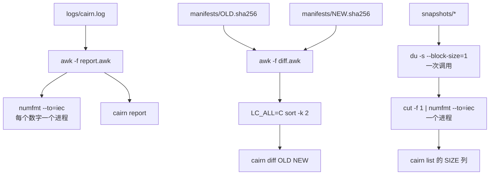

三十份快照、十天、一次失败，Cairn 把这些都记在了 `logs/cairn.log` 的 31 行里；我想知道的只是每天存了多少、哪一次失败了、`cairn list` 里每一份到底占了多少磁盘。这一篇给 Cairn 补上 `cairn report`、`cairn diff`，以及 `cairn list` 的 `SIZE` 列。代码本身只有两个小小的 awk 程序（71 行和 43 行），围着它们的是 shell 里最老的那批文本工具。先看那 31 行日志变成了什么：

```text
$ cairn list | sed -n '1,3p;$p'
NAME               FILES     SIZE
20261020T030000Z         43     2.2M
20261020T110000Z         43     1.1M
20261029T190000Z         43     1.1M
$ cairn report | sed -n '1,6p'
snapshots    31
ok           30
failed       1
interrupted  0
bytes        32M
seconds      avg 0.0 max 0
```

> [!NOTE] 本篇检查点
> 这一篇结束时仓库（标签 `ch06`）有 98 个被跟踪的文件，比 `ch05` 多 14 个：新增 `lib/cairn/report.awk`（71 行）、`lib/cairn/diff.awk`（43 行）和 `lab/ch06/` 里的 12 个实验脚本；仓库保留的就是这一版，其中 `diff.awk` 有一个旧清单为空时的洞，这一版没有修，洞和修法放在练习 4 里；另有四个旧文件被修改：`bin/cairn`（275 行长到 328 行，多了 `diff` 和 `report` 命令，`list` 多了 `SIZE` 列，以后还会改）、`lib/cairn/manifest.sh`（94 行长到 132 行，多了 `cairn::manifest::diff`，已经是最终版本）、`lib/cairn/repo.sh`（99 行长到 131 行，多了 `cairn::repo::sizes`，已经是最终版本）和 `README.md`（目录布局里 `lib/cairn/` 拆成 `*.sh` 与 `*.awk` 两行，以后还会加内容）。`make ch06` 通过：12 个实验全部以退出码 0 结束，没有一个需要宿主机，整套大约 73 秒（`builtin_vs_sed.sh` 一个就占了大半，它要把“每行调一次 `sed`”的循环跑 5 遍）。
> 涉及的 Shell 特性：`echo` 与 `printf`、`cut`/`tr`/`paste`/`wc`/`head`/`tail`、`sort`/`uniq`、locale 与 `LC_ALL=C`、`comm`/`join`、`sed`（含 `-i` 与 inode）、`awk` 作为一门小语言、按位置而不是按字段解析、`numfmt`，以及 [Google Shell 风格指南](https://google.github.io/styleguide/shellguide.html)里的[“内建命令优先于外部命令”](https://google.github.io/styleguide/shellguide.html#builtin-commands-vs-external-commands)和[管道换行](https://google.github.io/styleguide/shellguide.html#pipelines)两条规则。
> 前置：[第 5 篇：重定向、管道与进程：用硬链接存 30 份快照](/posts/shell-by-cairn-05-redirection-pipes-processes/)。

这一篇的所有输出来自这台机器：Linux 6.18.59，Bash 5.3.15，GNU awk 5.4.1，GNU sed 4.10，GNU coreutils 9.11，rsync 3.4.4，开发 shell 里 `LANG=en_US.UTF-8`。日志里的时间戳带着我这台机器的时区 (`-0700`)，后面你会看到它们没有进入报告：报告的日期取自快照的名字。

## 动手清单

你自己的 `~/cairn` 从第 5 篇的状态出发，这一篇要做这几件事，每件在哪一节出现都会指出来：

- 新建 `lib/cairn/report.awk`。见“report.awk 逐行”一节。
- 新建 `lib/cairn/diff.awk`，在 `lib/cairn/manifest.sh` 里加 `cairn::manifest::diff`。见“diff.awk 逐行”一节。
- 在 `lib/cairn/repo.sh` 里加 `cairn::repo::sizes`。见“cairn list 的 SIZE 列”一节。
- 改 `bin/cairn`：加 `diff` 和 `report` 两个命令，`list` 多一列 `SIZE`。
- 新建 `lab/ch06/` 下的 12 个实验，在 `README.md` 的目录布局里补上 `*.awk`。`make ch06` 全部跑一遍。

直接从参考仓库复制的话，写法和前几篇一样：

```bash
git -C ~/cairn-ref fetch --tags
cd ~/cairn || exit 1
mkdir -p lab/ch06
mapfile -t files < <(git -C ~/cairn-ref diff --name-only ch05 ch06)
for f in "${files[@]}"; do
  git -C ~/cairn-ref show ch06:"${f}" >"${f}"
done
```

这一次我更不建议整个照抄：awk 程序短，但每一行都值得自己敲一遍，`FNR == NR` 少打一个等号会发生什么，比读我的解释记得牢。

## 全貌

三个命令，三条管线。`cairn report` 把日志交给 `report.awk`；`cairn diff` 把两份清单交给 `diff.awk`，再用 `sort` 排序；`cairn list` 的 `SIZE` 列来自一次 `du` 加一次 `numfmt`：



这条线上的每一个环节都是一个独立的小程序，粘合它们的只有管道和文本。所以这一篇的顺序和前几篇相反：先把这些小程序一个个认一遍，每个用 `lab/ch06/` 里的一个实验钉住结论，再回头读 `report.awk` 和 `diff.awk`，那时候它们应该已经没有什么新东西了。

## echo 还是 printf

先从最小的问题开始。前五篇里 Cairn 一直在用 `printf '%s\n'`，从来没有解释过为什么不用 `echo`。我数了一下：

```text
$ grep -rnw echo bin lib | wc -l
0
$ grep -rn 'printf' bin lib | wc -l
37
```

`bin/` 和 `lib/` 下面没有一处 `echo`，37 行 `printf`。理由在 `lab/ch06/echo_vs_printf.sh` 里。实验的 `show` 函数把标准输入交给 `od -An -c`，这样空白和换行都看得见：

```bash
show() { od -An -c | sed 's/^ *//'; }

echo '--- echo -n: no trailing newline ---'
echo -n hi | show
echo hi | show

echo '--- echo -e: bash only decodes escapes when asked ---'
# BAD: the point of the lab is that echo does not decode \t here.
# shellcheck disable=SC2028
echo 'a\tb' | show
echo -e 'a\tb' | show
```

```text
--- echo -n: no trailing newline ---
h   i
h   i  \n
--- echo -e: bash only decodes escapes when asked ---
a   \   t   b  \n
a  \t   b  \n
```

`echo -n hi` 少一个换行，这是预期。第二组是 [`echo` 内建命令](https://www.gnu.org/software/bash/manual/bash.html#Bash-Builtins)的 `-e`：不加 `-e`，Bash 的 `echo 'a\tb'` 把反斜杠和 `t` 原样输出（`od` 里是 `\` 和 `t` 两个字符）；加了才解码成制表符。这个行为还能被 [`xpg_echo`](https://www.gnu.org/software/bash/manual/bash.html#The-Shopt-Builtin) 这个 shell 选项改掉：实验在子 shell 里 `shopt -s xpg_echo`，同一行 `echo 'a\tb'` 就输出了制表符（下面第二组代码末尾，输出里的 `a  \t   b  \n` 那一行）。同一个命令，输出取决于一个你看不见的开关，这是我不想在脚本里用它的第一个理由。第二个理由更糟：

```bash
echo "--- x=-n; echo \"\${x}\": the data is taken for an option ---"
x=-n
echo "${x}" | show
printf '%s\n' "${x}" | show

echo '--- echo -- does not help in bash: it is printed ---'
echo -- hi | show

echo '--- the same lines with POSIX mode xpg_echo ---'
(
  shopt -s xpg_echo
  # BAD: same as above, xpg_echo makes echo decode \t by itself.
  # shellcheck disable=SC2028
  echo 'a\tb' | show
)
```

```text
--- x=-n; echo "${x}": the data is taken for an option ---
-   n  \n
--- echo -- does not help in bash: it is printed ---
-   -       h   i  \n
--- the same lines with POSIX mode xpg_echo ---
a  \t   b  \n
```

`x=-n; echo "${x}"` 根本没有输出：`echo` 看到第一个参数是 `-n`，把它当成了选项，输出是零字节，所以 `od` 什么也没打印，上面那一段里 `echo` 对应的行不存在。紧接着的 `printf '%s\n' "${x}"` 格式串是写死的，数据永远只是数据，输出了 `-n` 和换行。再下面一行是 `echo -- hi`：在 Bash 里 `--` 不结束选项，它被原样打印出来。最后是上面说的 `xpg_echo` 子 shell，输出和 `echo -e` 那一行一样。如果变量里装的是用户输入或文件名，`echo "${var}"` 就是一个等着被人利用的小洞。

POSIX 的 [echo 页面](https://pubs.opengroup.org/onlinepubs/9799919799/utilities/echo.html)在 APPLICATION USAGE 里写得很直接：除非避开转义序列、并且第一个参数不是 `-` 后面只跟 `e`、`E`、`n` 的形式，否则 `echo` 没法在所有 POSIX 系统上可移植地使用；它还说新程序应当用 `printf`。第 10 篇我会在几个不同的 shell 里把 `echo 'a\nb'` 跑一遍，这里只看 Bash。

`printf` 有两个值得单独说的行为：

```bash
echo '--- printf reuses its format for extra arguments ---'
printf '%s\n' one two three
printf '%s=%s\n' a 1 b 2 c 3
printf '<%s>' x y z
printf '\n'

echo '--- printf with too few arguments: empty string and 0 ---'
# BAD: too few arguments on purpose.
# shellcheck disable=SC2183
printf '[%s] [%d]\n'

echo '--- printf %q quotes for reuse in the shell ---'
printf '%q\n' 'with space' "it's" $'tab\there'
```

```text
--- printf reuses its format for extra arguments ---
one
two
three
a=1
b=2
c=3
<x><y><z>
--- printf with too few arguments: empty string and 0 ---
[] [0]
--- printf %q quotes for reuse in the shell ---
with\ space
it\'s
$'tab\there'
```

格式串会被**重复使用**，直到参数用完：`printf '%s=%s\n' a 1 b 2 c 3` 一次调用打印三行。这让 `printf '%s\n' "${array[@]}"` 成了“每个元素一行”的标准写法，前几篇里的 `median` 函数就是这么用的。参数不够时，`%s` 当空串，`%d` 当 0，不报错，所以参数个数要自己负责（那一行的 `# BAD` 就是为此）。最后 `%q` 把字符串变成可以重新喂给 shell 的形式，第 2 篇用它来看文件名里的怪字符。

## cut、tr、paste、wc、head、tail

这六个命令一起放在 `lab/ch06/cut_tr.sh` 里。它先写一个四行的“表格”：

```bash
cat >table.txt <<'EOF'
alice,30,berlin
bob,25,paris
carol,41,rome
dave,25,oslo
EOF

echo '--- cut -d, -f1,3: fields ---'
cut -d, -f1,3 table.txt
echo '--- cut -d, -f2- : from field 2 to the end ---'
cut -d, -f2- table.txt
echo '--- cut -c1-3: characters 1 to 3 ---'
cut -c1-3 table.txt
echo '--- cut --complement -d, -f2 ---'
cut --complement -d, -f2 table.txt
```

```text
--- cut -d, -f1,3: fields ---
alice,berlin
bob,paris
carol,rome
dave,oslo
--- cut -d, -f2- : from field 2 to the end ---
30,berlin
25,paris
41,rome
25,oslo
--- cut -c1-3: characters 1 to 3 ---
ali
bob
car
dav
--- cut --complement -d, -f2 ---
alice,berlin
bob,paris
carol,rome
dave,oslo
```

`cut -d, -f1,3` 按单个分隔符切字段，`-f2-` 是“第 2 个到最后一个”，`--complement` 取反。要记住 `cut` 的分隔符只能是**一个字符**，也不会把连续的分隔符合并，这点和 awk 的默认行为正好相反，“awk 是一门小语言”一节会用到。`-c1-3` 按字符取：

```text
$ printf '中文字\n' | cut -c1-2
中文
$ printf '中文字\n' | cut -b1-3
中
```

在 UTF-8 的 locale 里，`cut -c1-2` 取了“中文”两个字符（6 个字节），`-b1-3` 取了 3 个字节，正好是“中”。字节还是字符，取决于 locale，这个话题在“locale：LC_ALL=C 到底在省什么”一节单独讲。

`tr` 是字符到字符的映射，不是字符串替换：

```bash
echo '--- tr: translate, delete, squeeze ---'
echo 'Hello World' | tr '[:lower:]' '[:upper:]'
echo 'Hello World' | tr -d 'lo'
echo 'a   b    c' | tr -s ' '
echo 'a:b:c' | tr ':' '\n'
echo '--- tr -c: complement of the set (keep only digits) ---'
echo 'tel: 030-1234' | tr -cd '0-9\n'
```

```text
--- tr: translate, delete, squeeze ---
HELLO WORLD
He Wrd
a b c
a
b
c
--- tr -c: complement of the set (keep only digits) ---
0301234
```

`tr -d 'lo'` 删的是 `l` 和 `o` 这两个字符，不是子串 `lo`，所以 `Hello World` 变成了 `He Wrd`。`-s` 把重复的字符压成一个；`-c` 取补集，`tr -cd '0-9\n'` 的意思是“删掉除数字和换行以外的所有字符”。`tr '[:lower:]' '[:upper:]'` 对 ASCII 没问题，但我试了一下 `é`：

```text
$ printf 'é\n' | tr '[:lower:]' '[:upper:]'
é
$ printf 'é\n' | awk '{ print toupper($0), length($0) }'
É 1
$ printf 'é\n' | LC_ALL=C awk '{ print toupper($0), length($0) }'
é 2
```

`tr` 把 `é` 原样还给了我，`awk` 的 `toupper` 在 UTF-8 下得到了 `É`（长度 1），在 C locale 下 `é` 是 2 个字节，长度 2，`toupper` 什么也没做。我猜 GNU `tr` 是逐字节处理的，所以对非 ASCII 字母无能为力；要处理它们，用 awk 或者 `sed`。

接下来是 `paste` 和 `wc`：

```bash
echo '--- paste: columns side by side, or one line ---'
cut -d, -f1 table.txt >names.txt
cut -d, -f2 table.txt >ages.txt
paste names.txt ages.txt
paste -d: names.txt ages.txt
paste -sd, names.txt

echo '--- wc: lines, words, bytes ---'
wc -l <table.txt
wc -w <table.txt
wc -c <table.txt
echo '--- wc -m vs wc -c on a Chinese line (UTF-8 locale) ---'
printf '中文\n' | LC_ALL=en_US.UTF-8 wc -m
printf '中文\n' | wc -c
```

```text
--- paste: columns side by side, or one line ---
alice	30
bob	25
carol	41
dave	25
alice:30
bob:25
carol:41
dave:25
alice,bob,carol,dave
--- wc: lines, words, bytes ---
4
4
56
--- wc -m vs wc -c on a Chinese line (UTF-8 locale) ---
3
7
```

`paste` 把几个文件按行拼成列，默认用制表符，`-d:` 换分隔符，`-s` 把一个文件拼成一行（`paste -sd,` 是“用逗号连成一行”的标准写法，`locale_sort.sh` 里用它把结果压成一行）。`wc -l <table.txt` 里的重定向很重要：`wc -l table.txt` 会把文件名也打印出来，从标准输入读就只有数字。最后两行是 `wc -m` 和 `wc -c` 数同一行 `中文\n`：3 个字符，7 个字节（每个汉字 3 字节，加一个换行）。把 locale 换成 C，`wc -m` 就没有字符的概念了，数出来也是 7：

```text
$ printf '中文\n' | LC_ALL=C wc -m
7
```

`head` 和 `tail` 最后：

```bash
echo '--- head and tail ---'
head -n 2 table.txt
tail -n 2 table.txt
echo '--- tail -n +3: from line 3 on; head -n -1: all but the last ---'
tail -n +3 table.txt
head -n -1 table.txt
```

```text
--- head and tail ---
alice,30,berlin
bob,25,paris
carol,41,rome
dave,25,oslo
--- tail -n +3: from line 3 on; head -n -1: all but the last ---
carol,41,rome
dave,25,oslo
alice,30,berlin
bob,25,paris
carol,41,rome
```

`tail -n +3` 是“从第 3 行开始”，`head -n -1` 是“去掉最后一行”（这是 GNU 扩展，BSD 的 `head` 不认负数；我手边没有 BSD，所以这句话是从手册读来的，没有验证）。`ex_top_extensions.sh` 在练习 1 里会把这些命令串起来。

## sort 和 uniq

`lab/ch06/sort_uniq.sh` 用一张六行的销售表：

```bash
cat >sales.txt <<'EOF'
north 10 apple
south 9 pear
east 10 fig
west 100 apple
north 9 fig
south 10 apple
EOF

echo '--- plain sort: compares whole lines as text ---'
sort sales.txt
echo '--- sort -k2 : key runs from field 2 to the END of the line ---'
sort -k2 sales.txt
echo '--- sort -k2,2n : field 2 only, numeric ---'
sort -k2,2n sales.txt
echo '--- sort -k2,2n -k1,1r : ties broken by name, reversed ---'
sort -k2,2n -k1,1r sales.txt
echo '--- sort -s -k2,2n : stable, ties keep input order ---'
sort -s -k2,2n sales.txt
```

```text
--- plain sort: compares whole lines as text ---
east 10 fig
north 10 apple
north 9 fig
south 10 apple
south 9 pear
west 100 apple
--- sort -k2 : key runs from field 2 to the END of the line ---
west 100 apple
north 10 apple
south 10 apple
east 10 fig
north 9 fig
south 9 pear
--- sort -k2,2n : field 2 only, numeric ---
north 9 fig
south 9 pear
east 10 fig
north 10 apple
south 10 apple
west 100 apple
--- sort -k2,2n -k1,1r : ties broken by name, reversed ---
south 9 pear
north 9 fig
south 10 apple
north 10 apple
east 10 fig
west 100 apple
--- sort -s -k2,2n : stable, ties keep input order ---
south 9 pear
north 9 fig
north 10 apple
east 10 fig
south 10 apple
west 100 apple
```

`sort` 的键 (key) 是整个 `sort` 里最容易写错的地方。`-k2` 的意思是“从第 2 个字段**开始，一直到行尾**”，所以第二段输出里整行 `10 apple` 和 `100 apple` 都参与了比较；`-k2,2` 才是“只看第 2 个字段”，再加上排序类型 `n` (numeric) 才得到真正按数字排序的 `-k2,2n`。没有第二个键时，平局由 `sort` 退回到“整行比较”来决定：第三段里三个 `10` 开头的行是按整行的字典序排的。`-k2,2n -k1,1r` 是两个键：先按第 2 个字段数字升序，再按第 1 个字段逆序打破平局。`-s` 则关掉整行比较这个退路，保持输入里的原顺序：对比第四段和第五段，`north 10 apple`、`south 10 apple` 和 `east 10 fig` 的相对顺序不同。

再看第二段的顺序：`west 100 apple` 排在了 `north 10 apple` **前面**。这既不是按数字（100 应该在 10 后面），也不是我熟悉的字节序（空格 0x20 小于数字，`10 apple` 应该先）。同样的命令在 C locale 下会得到另一个结果：

```text
$ printf '%s\n' 'north 10 apple' 'west 100 apple' 'east 10 fig' 'north 9 fig' >sales.txt
$ LC_ALL=C sort -k2 sales.txt
north 10 apple
east 10 fig
west 100 apple
north 9 fig
$ LC_ALL=en_US.UTF-8 sort -k2 sales.txt
west 100 apple
north 10 apple
east 10 fig
north 9 fig
```

C locale 下 `north 10 apple` 在前，`west 100 apple` 在后；在 `en_US.UTF-8` 下 `west 100 apple` 在最前。我猜 glibc 的排序规则在第一轮比较里忽略空格，所以 `100apple` 对 `10apple`，第 3 个字符 `0` 小于 `a`；C locale 里空格 (0x20) 小于 `0` (0x30)，`10 apple` 先。下面“locale：LC_ALL=C 到底在省什么”一节要展开这个话题；这里只想让你看到：同一份 `sort` 命令，输出取决于环境变量。

后半段：

```bash
echo '--- -t: a field separator other than blanks ---'
cat >passwd.txt <<'EOF'
root:x:0:0:root:/root:/bin/bash
daemon:x:1:1:daemon:/usr/sbin:/usr/sbin/nologin
bob:x:1000:1000:Bob:/home/bob:/bin/bash
EOF
sort -t: -k3,3nr passwd.txt | cut -d: -f1,3

echo '--- uniq needs sorted input: only neighbours collapse ---'
printf 'a\nb\na\n' | uniq
printf 'a\nb\na\n' | sort | uniq
echo '--- sort | uniq -c | sort -rn : frequency table ---'
cut -d' ' -f3 sales.txt \
  | sort \
  | uniq -c \
  | sort -rn
echo '--- sort -u and uniq -d ---'
cut -d' ' -f3 sales.txt | sort -u
cut -d' ' -f3 sales.txt | sort | uniq -d
```

```text
--- -t: a field separator other than blanks ---
bob:1000
daemon:1
root:0
--- uniq needs sorted input: only neighbours collapse ---
a
b
a
a
b
--- sort | uniq -c | sort -rn : frequency table ---
      3 apple
      2 fig
      1 pear
--- sort -u and uniq -d ---
apple
fig
pear
apple
fig
```

`-t:` 换字段分隔符，`-k3,3nr` 是“第 3 个字段，数字，逆序”：`bob` (1000)、`daemon` (1)、`root` (0)。`uniq` 只合并**相邻**的重复行，所以 `a b a` 不排序的话原样输出，排了序才是 `a b`。`sort | uniq -c | sort -rn` 是我写过次数最多的 shell 管道之一，它是一个频率表：先排序让相同的行相邻，`uniq -c` 数每组多少行，再按次数从大到小排。这条管道在这一篇的练习 1 和练习 3 里还会出现。`sort -u` 等于 `sort | uniq`，`uniq -d` 只打印重复过的行。

这里的管道用了 Google 指南的[“一段一行，`|` 在新行开头”](https://google.github.io/styleguide/shellguide.html#pipelines)格式：这条管道放不下一行，所以每一段占一行；放得下的 (`sort | uniq -d`) 就留在一行。

## locale：LC_ALL=C 到底在省什么

前五篇里我写了很多次 `LC_ALL=C sort`，第 1 篇说“结果和 locale 无关”，第 2 篇说排序规则取决于 locale，但从来没有量过它值多少。`lab/ch06/locale_sort.sh` 先看顺序，再看时间。顺序的部分：

```bash
printf '%s\n' banana Apple apple Banana cherry 中文 文本 _tmp 10 9 \
  >mixed.txt

echo '--- LC_ALL=C ---'
LC_ALL=C sort mixed.txt | paste -sd' '
echo '--- LC_ALL=en_US.UTF-8 ---'
LC_ALL=en_US.UTF-8 sort mixed.txt | paste -sd' '
```

```text
--- LC_ALL=C ---
10 9 Apple Banana _tmp apple banana cherry 中文 文本
--- LC_ALL=en_US.UTF-8 ---
10 9 apple Apple banana Banana cherry _tmp 中文 文本
```

十行里有数字、大小写字母、下划线开头的 `_tmp`、两组汉字。C locale 按字节比较：数字（0x30 起）在大写字母（0x41 起）前面，下划线 (0x5F) 夹在大写和小写之间，小写字母（0x61 起）之后是汉字（UTF-8 的第一个字节是 0xE4、0xE6，`中文` 在 `文本` 前）。`en_US.UTF-8` 的结果是字典式的：`apple` 在 `Apple` 前面，`banana` 在 `Banana` 前面，`_tmp` 被排到了 `cherry` 之后，因为下划线在第一轮比较里被忽略了，`_tmp` 当成 `tmp` 看待（又是“我猜”：这是从输出反推的，我没去读 glibc 的排序表）。汉字最后。

我没法给你演示拼音排序：这台机器能用的 locale 只有四个，当前的 `LANG` 是 `en_US.UTF-8`：

```text
$ locale -a
C
C.utf8
en_US.utf8
POSIX
$ locale | head -n 2
LANG=en_US.UTF-8
LC_CTYPE="en_US.UTF-8"
```

没有 `zh_CN.UTF-8`，所以“中文”和“文本”在两种 locale 下顺序相同，并不代表中文 locale 下也相同。

决定用哪套规则的是环境变量。POSIX 的[环境变量一章](https://pubs.opengroup.org/onlinepubs/9799919799/basedefs/V1_chap08.html#tag_08_02)写得很清楚：`LC_ALL` 的优先级高于所有其他 `LC_*` 变量和 `LANG`。所以脚本里要固定行为，写 `LC_ALL=C`，不要写 `LC_COLLATE=C`：后者会被用户设置的 `LC_ALL` 盖掉。

然后是时间。实验造了 1,000,000 行随机单词，每个函数跑 5 次取中位数：

```bash
echo '--- 1,000,000 lines of random words ---'
awk 'BEGIN {
  srand(1)
  for (i = 0; i < 1000000; i++) {
    printf "%c%c%c%c%c%d\n", 97 + int(rand() * 26) - 32 * (i % 3 == 0),
      97 + int(rand() * 26), 97 + int(rand() * 26),
      97 + int(rand() * 26), 97 + int(rand() * 26), int(rand() * 1000)
  }
}' >big.txt
wc -l <big.txt

median_ms() {
  local -a times=()
  local start
  for _ in 1 2 3 4 5; do
    start="${EPOCHREALTIME/./}"
    "$@" >/dev/null
    times+=($((${EPOCHREALTIME/./} - start)))
  done
  local mid
  mid="$(printf '%s\n' "${times[@]}" | sort -n | sed -n 3p)"
  echo "$((mid / 1000))"
}
sort_c() { LC_ALL=C sort big.txt; }
sort_utf8() { LC_ALL=en_US.UTF-8 sort big.txt; }
c="$(median_ms sort_c)"
u="$(median_ms sort_utf8)"
echo "LC_ALL=C:           ${c} ms"
echo "LC_ALL=en_US.UTF-8: ${u} ms"
printf 'ratio: %d.%dx\n' "$((u / c))" "$((u * 10 / c % 10))"
```

```text
--- 1,000,000 lines of random words ---
1000000
LC_ALL=C:           148 ms
LC_ALL=en_US.UTF-8: 339 ms
ratio: 2.2x
```

这一次 `make ch06` 里是 148 ms 对 339 ms，约 2.3 倍（339/148 = 2.29，实验脚本按截断打印 `2.2x`）。为了看稳不稳，我把这个实验另外单独跑了两次：150 ms 对 351 ms（351/150 = 2.34，约 2.3 倍）和 154 ms 对 346 ms（346/154 = 2.25，约 2.2 倍）。所以大概是 2.2 到 2.3 倍，排序规则比较一个字符比字节比较贵得多（我猜是因为每次比较都要查排序表，没有测）。

这个差距在 Cairn 里有多大？清单是 `sort -k 2` 排的，我造了 300,000 行 sha256sum 格式的清单：

```text
$ awk 'BEGIN { for (i = 0; i < 300000; i++) printf "%064x  ./dir/file %d.txt\n", i, i }' >old.sha256
$ awk 'BEGIN { for (i = 0; i < 300000; i++) printf "%064x  ./dir/file %d.txt\n", (i % 300 == 0 ? i + 1 : i), i }' >new.sha256
$ wc -l old.sha256 new.sha256
  300000 old.sha256
  300000 new.sha256
  600000 total
$ TIMEFORMAT='%3R s'
for i in 1 2 3; do printf 'C     '; time LC_ALL=C sort -k 2 old.sha256 >/dev/null; done
C     0.060 s
C     0.064 s
C     0.062 s
$ for i in 1 2 3; do printf 'UTF-8 '; time LC_ALL=en_US.UTF-8 sort -k 2 old.sha256 >/dev/null; done
UTF-8 0.218 s
UTF-8 0.214 s
UTF-8 0.211 s
$ for i in 1 2 3; do printf 'C     '; time LC_ALL=C awk -f "${CAIRN_ROOT}/lib/cairn/diff.awk" old.sha256 new.sha256 >/dev/null; done
C     0.981 s
C     0.973 s
C     0.968 s
$ for i in 1 2 3; do printf 'UTF-8 '; time LC_ALL=en_US.UTF-8 awk -f "${CAIRN_ROOT}/lib/cairn/diff.awk" old.sha256 new.sha256 >/dev/null; done
UTF-8 1.060 s
UTF-8 1.066 s
UTF-8 1.075 s
```

`sort -k 2` 在 C locale 下 0.060 到 0.064 s，`en_US.UTF-8` 下 0.211 到 0.218 s，大约 3.5 倍。`diff.awk` 受 locale 的影响小得多：0.968 到 0.981 s 对 1.060 到 1.075 s，大约 1.1 倍；那 1 秒主要花在 awk 自己的哈希表上。所以 `LC_ALL=C` 在 Cairn 里首先是为了顺序确定（两台机器上 `cairn diff` 输出的顺序一样），其次才是为了快。

## comm 和 join

`comm` 和 `join` 都有同一个前提：两个输入必须按同一种规则排好序。`lab/ch06/comm_join.sh` 用两份文件列表来演示 `comm`，这正是 `cairn diff` 要做的事，只是手工版：

```bash
printf '%s\n' a.txt b.txt c.txt d.txt >old.list
printf '%s\n' b.txt c.txt e.txt >new.list

echo '--- comm: three columns (only old, only new, both) ---'
comm old.list new.list
echo '--- comm -23: only in old (deleted) ---'
comm -23 old.list new.list
echo '--- comm -13: only in new (added) ---'
comm -13 old.list new.list
echo '--- comm -12: in both ---'
comm -12 old.list new.list

echo '--- comm on unsorted input: --check-order makes it an error ---'
printf '%s\n' b a \
  | comm --check-order - old.list 2>&1 >/dev/null \
  | sed 's/^comm: //'
```

```text
--- comm: three columns (only old, only new, both) ---
a.txt
		b.txt
		c.txt
d.txt
	e.txt
--- comm -23: only in old (deleted) ---
a.txt
d.txt
--- comm -13: only in new (added) ---
e.txt
--- comm -12: in both ---
b.txt
c.txt
--- comm on unsorted input: --check-order makes it an error ---
file 1 is not in sorted order
```

`comm` 输出三列（用制表符缩进）：只在第一个文件里的、只在第二个文件里的、两边都有的。`-1 -2 -3` 分别隐藏一列，所以 `comm -23` 就是“只在旧的里”（被删的文件），`comm -13` 是“只在新的里”（新增的），`comm -12` 是交集。输入没排序会怎样？实验里用 `--check-order` 把它变成错误：`file 1 is not in sorted order`。三种模式我另外对一对没排序的小文件并排试了一次：

```text
$ printf '%s\n' b a >u.txt; printf '%s\n' a.txt b.txt >o.txt
$ comm u.txt o.txt; printf 'exit %d\n' "$?"
	a.txt
b
comm: file 1 is not in sorted order
a
	b.txt
comm: input is not in sorted order
exit 1
$ comm --check-order u.txt o.txt; printf 'exit %d\n' "$?"
	a.txt
b
comm: file 1 is not in sorted order
exit 1
$ comm --nocheck-order u.txt o.txt; printf 'exit %d\n' "$?"
	a.txt
b
a
	b.txt
exit 0
```

不加选项，`comm` 一路读完，沿途报告“没排序”，最后以 1 退出；`--check-order` 在第一处错误就停下；`--nocheck-order` 什么也不说，照样给出一份看起来正常的输出，退出码 0。最后这个是最危险的，因为错误的输出和对的输出长得一样。

`join` 是“按键合并两个文件”，也就是关系数据库里说的 inner join：

```bash
echo '--- join: match lines of two files on a key field ---'
cat >size.txt <<'EOF'
a.txt 10
b.txt 20
c.txt 30
EOF
cat >owner.txt <<'EOF'
a.txt alice
c.txt carol
d.txt dave
EOF
join size.txt owner.txt
echo '--- join -a1: keep unmatched lines of the first file ---'
join -a1 size.txt owner.txt
echo '--- join -v2: only the unmatched lines of the second ---'
join -v2 size.txt owner.txt
```

```text
--- join: match lines of two files on a key field ---
a.txt 10 alice
c.txt 30 carol
--- join -a1: keep unmatched lines of the first file ---
a.txt 10 alice
b.txt 20
c.txt 30 carol
--- join -v2: only the unmatched lines of the second ---
d.txt dave
```

默认按每行的第一个字段（以空白分隔）做键，只输出两边都有的键；`-a1` 保留第一个文件里没匹配的行，`-v2` 只输出第二个文件里没匹配的行。实验最后还有一个 `-t,` 换分隔符、`-1 2 -2 1` 指定两个文件各自键所在字段的例子，我没有放进来。`join` 和 `comm` 一样依赖排序。

那为什么 `cairn diff` 不直接用 `comm` 和 `join`？清单的每一行是 `<64 位十六进制>  <路径>`，路径里可以有空格，而 `join` 默认按空白切字段；`comm` 比较的是整行，要先把清单按整行排序（清单本身是按路径 `sort -k 2` 排的，不是整行），而且“改过的文件”在整行比较里同时出现在“只在旧的里”和“只在新的里”，还得再做一次交集。练习 2 里我用 `comm` 写了一遍，你会看到它要三次 `comm` 加一堆排序。awk 的数组天然就是这个查找表，“diff.awk 逐行”一节再回来。

## sed

`grep` 这一篇不讲：搜索那件事我在[另一篇](/posts/grep-ripgrep-search-guide/)里写过，模式、正则方言、常用选项、管道里的 `grep` 和退出状态都在那里。`sed` 是 `grep` 再往前一步：不只是找到匹配的行，还能改它。

`sed` 的工作方式是一个循环（[手册里叫执行周期](https://www.gnu.org/software/sed/manual/sed.html#Execution-Cycle)）：读一行进模式空间，对它执行脚本里的每条命令，自动打印模式空间，再读下一行。`-n` 关掉自动打印，这时只有显式的 `p` 才输出。`lab/ch06/sed_tour.sh` 先看[替换命令 `s`](https://www.gnu.org/software/sed/manual/sed.html#The-_0022s_0022-Command)：

```bash
echo '--- s///: first match per line, then g for every match ---'
echo 'a-b-c-d' | sed 's/-/+/'
echo 'a-b-c-d' | sed 's/-/+/g'
echo 'a-b-c-d' | sed 's/-/+/2'
echo '--- another delimiter, and & for the whole match ---'
echo '/usr/local/bin' | sed 's|/usr/local|/opt|'
echo 'cat' | sed 's/.*/[&]/'
```

```text
--- s///: first match per line, then g for every match ---
a+b-c-d
a+b+c+d
a-b+c-d
--- another delimiter, and & for the whole match ---
/opt/bin
[cat]
```

`s/-/+/` 只换每行的第一处；加 `g` 换所有；加数字 `2` 换第 2 处。分隔符不一定是 `/`：路径里全是斜杠时换成 `|` 能少写一堆反斜杠。右边的 `&` 代表整个匹配。再看[地址](https://www.gnu.org/software/sed/manual/sed.html#sed-addresses)：命令前面写的部分，决定这条命令对哪些行生效。

```bash
echo '--- -n and p: print only matching lines ---'
sed -n '/ta/p' poem.txt
echo '--- a line number, last line, and a range ---'
sed -n '2p' poem.txt
sed -n '$p' poem.txt
sed -n '2,4p' poem.txt
echo '--- range between two patterns, and d to delete ---'
sed -n '/beta/,/delta/p' poem.txt
sed '2,4d' poem.txt
echo '--- first,~step and 0~2 (GNU): every second line ---'
sed -n '0~2p' poem.txt
```

```text
--- -n and p: print only matching lines ---
beta two
delta four
--- a line number, last line, and a range ---
beta two
epsilon five
beta two
gamma three
delta four
--- range between two patterns, and d to delete ---
beta two
gamma three
delta four
alpha one
epsilon five
--- first,~step and 0~2 (GNU): every second line ---
beta two
delta four
```

地址可以是正则（`/ta/`，所有包含 `ta` 的行，`beta` 和 `delta`）、[行号](https://www.gnu.org/software/sed/manual/sed.html#Numeric-Addresses) (`2`)、最后一行 (`$`)，也可以是两个地址组成的[范围](https://www.gnu.org/software/sed/manual/sed.html#Range-Addresses)（`2,4` 或 `/beta/,/delta/`，后者从第一个匹配的行到下一个匹配第二个模式的行）。`d` 删除，`2,4d` 保留了 `alpha one` 和 `epsilon five`。`0~2` 是 GNU 的 `first~step` 语法，从 0 开始每隔 2 行，也就是所有偶数行。

`-E` 打开[扩展正则](https://www.gnu.org/software/sed/manual/sed.html#BRE-vs-ERE)，括号变成捕获组，`\1`、`\2` 引用它们（[反向引用](https://www.gnu.org/software/sed/manual/sed.html#Back_002dreferences-and-Subexpressions)）：

```bash
echo '--- -E and groups: swap the two words ---'
sed -E 's/^([a-z]+) ([a-z]+)$/\2 \1/' poem.txt
echo '--- -E with alternation and a counted repeat ---'
echo 'ab123 cd4567' | sed -E 's/[0-9]{3,}/<&>/g'
echo 'foo bar' | sed -E 's/(foo|bar)/X/g'
```

```text
--- -E and groups: swap the two words ---
one alpha
two beta
three gamma
four delta
five epsilon
--- -E with alternation and a counted repeat ---
ab<123> cd<4567>
X X
```

`s/^([a-z]+) ([a-z]+)$/\2 \1/` 把每行的两个词调换位置。`[0-9]{3,}` 是“至少 3 个数字”，所以 `ab123 cd4567` 里两串数字都被 `<>` 括起来。不加 `-E`，同样的括号和花括号要写成 `\(`、`\{`，我一般选 `-E`。第 1 篇和第 3 篇的 `median_us` 里已经用过 `sed -n 3p`（取第 3 行），它就是上面的“行号加 `p`”，没有什么别的。

### sed -i：悄悄换掉 inode

`sed -i` 是我见过最容易“看起来没问题”的命令。[`-i`](https://www.gnu.org/software/sed/manual/sed.html#Command_002dLine-Options) 把结果写回原文件，不用再 `> tmp && mv tmp file`。实验的后半段看它的 inode：

```bash
echo '--- sed -i: the inode changes ---'
echo data >orig
ln orig linked
printf 'before: orig inode %s, linked inode %s, links %s\n' \
  "$(stat -c %i orig)" "$(stat -c %i linked)" "$(stat -c %h orig)"
sed -i 's/data/changed/' orig
printf 'after:  orig inode %s, linked inode %s, links %s\n' \
  "$(stat -c %i orig)" "$(stat -c %i linked)" "$(stat -c %h orig)"
echo "orig:   $(cat orig)"
echo "linked: $(cat linked)"
echo '--- a redirect keeps the inode: both names see the change ---'
echo data >orig2
ln orig2 linked2
before="$(stat -c %i orig2)"
sed 's/data/changed/' orig2 >orig2.new
cat orig2.new >orig2
after="$(stat -c %i orig2)"
echo "inode before ${before}, after ${after}, linked2: $(cat linked2)"
```

```text
--- sed -i: the inode changes ---
before: orig inode 45352188, linked inode 45352188, links 2
after:  orig inode 45352189, linked inode 45352188, links 1
orig:   changed
linked: data
--- a redirect keeps the inode: both names see the change ---
inode before 45352190, after 45352190, linked2: changed
```

`orig` 和 `linked` 是同一个 inode 的两个名字（链接数 2）。`sed -i` 之后，`orig` 的 inode 从 45352188 变成了 45352189，`linked` 还是 45352188，链接数变成 1，`linked` 的内容还是旧的 `data`：两个名字被悄悄分开了。后一段用重定向把结果写回 `orig2`，inode 没变，两个名字看到同样的新内容。（inode 号每次不同，数字只有“变没变”有意义。）

`sed -i` 为什么会换 inode？我用 `strace` 看了一眼它真正做了什么：

```text
$ printf 'data\n' >orig
$ strace -e trace=rename sed -i 's/data/changed/' orig 2>&1 | grep -v '^+++'
rename("./sedQgZ6jx", "orig")           = 0
```

它在同一个目录里创建了一个随机名字的临时文件 (`./sedQgZ6jx`)，把结果写进去，最后用 `rename` 盖在原名字上。这和第 5 篇“原子改名”一节里 `mv -T` 是同一个手法，好处是读者要么看到旧文件、要么看到新文件；代价是原来的 inode 被丢开了。

放进 Cairn 的场景里就是这样：快照里的大多数文件是硬链接，同一个 inode 有 30 个名字。假如我手一滑，对快照里的一个文件跑了 `sed -i`。我在三份快照的小仓库里试了：

```text
$ printf 'alpha\n' >src/a.txt; printf 'beta\n' >src/b.txt
$ cairn init repo >/dev/null; printf 'source = %s\n' "${PWD}/src" >>"${XDG_CONFIG_HOME}/cairn/cairn.conf"
cairn: wrote /tmp/cairn-ina/xdg/cairn/cairn.conf
$ for h in 09 10 11; do CAIRN_NOW="20261031T${h}0000Z" cairn -q snapshot; done
20261031T090000Z
20261031T100000Z
20261031T110000Z
$ stat -c '%h links, inode %i, %n' repo/snapshots/*/"${PWD#/}"/src/a.txt
3 links, inode 45352381, repo/snapshots/20261031T090000Z/tmp/cairn-ina/src/a.txt
3 links, inode 45352381, repo/snapshots/20261031T100000Z/tmp/cairn-ina/src/a.txt
3 links, inode 45352381, repo/snapshots/20261031T110000Z/tmp/cairn-ina/src/a.txt
$ sed -i 's/alpha/ALPHA/' repo/snapshots/20261031T100000Z/"${PWD#/}"/src/a.txt
$ stat -c '%h links, inode %i, %n' repo/snapshots/*/"${PWD#/}"/src/a.txt
2 links, inode 45352381, repo/snapshots/20261031T090000Z/tmp/cairn-ina/src/a.txt
1 links, inode 45352398, repo/snapshots/20261031T100000Z/tmp/cairn-ina/src/a.txt
2 links, inode 45352381, repo/snapshots/20261031T110000Z/tmp/cairn-ina/src/a.txt
$ for n in 20261031T090000Z 20261031T100000Z 20261031T110000Z; do cairn verify "${n}" 2>&1 | grep -v '^sha256sum'; done
ok 20261031T090000Z (2 files)
./tmp/cairn-ina/src/a.txt: FAILED
cairn: error: snapshot 20261031T100000Z failed verification
ok 20261031T110000Z (2 files)
```

前两条命令是建仓库：三份快照，`src/a.txt` 里是 `alpha`。`sed -i` 之后，中间那份快照里的 `a.txt` 有了自己的 inode（链接数 1），另外两份还指着原来的 inode（链接数 2），`cairn verify` 只在被改的那一份上报了 `FAILED`：被改的快照坏了，另外两份没事。换一种写法：把 `sed` 的输出存到临时文件，再 `cat` 回去，也就是实验后半段那种“保持 inode”的写法（同样的仓库，换一个目录重建，建仓库的命令一样，不重复）：

```text
$ f="repo/snapshots/20261031T100000Z/${PWD#/}/src/a.txt"; sed 's/alpha/ALPHA/' "${f}" >new.tmp; cat new.tmp >"${f}"
$ stat -c '%h links, inode %i, %n' repo/snapshots/*/"${PWD#/}"/src/a.txt
3 links, inode 45352454, repo/snapshots/20261031T090000Z/tmp/cairn-inb/src/a.txt
3 links, inode 45352454, repo/snapshots/20261031T100000Z/tmp/cairn-inb/src/a.txt
3 links, inode 45352454, repo/snapshots/20261031T110000Z/tmp/cairn-inb/src/a.txt
$ for n in 20261031T090000Z 20261031T100000Z 20261031T110000Z; do cairn verify "${n}" 2>&1 | grep -v '^sha256sum'; done
./tmp/cairn-inb/src/a.txt: FAILED
cairn: error: snapshot 20261031T090000Z failed verification
./tmp/cairn-inb/src/a.txt: FAILED
cairn: error: snapshot 20261031T100000Z failed verification
./tmp/cairn-inb/src/a.txt: FAILED
cairn: error: snapshot 20261031T110000Z failed verification
```

三份快照里的 `a.txt` 仍是同一个 inode（链接数 3），内容却全变了，`cairn verify` 在三份快照上都报了 `FAILED`。所以对硬链接仓库，“不换 inode”的就地写法才是更危险的那个：一次写入，所有快照一起变；`sed -i` 的“换 inode”反而把伤害关在了一个快照里。当然两种都是损坏了备份，我没有把它们当成可以接受的做法，只是想弄清楚各自的后果。快照里的文件不该被任何命令就地修改；[第 5 篇](/posts/shell-by-cairn-05-redirection-pipes-processes/)“两个同样写法的洞：一个修了，一个没修”一节里的 `chmod -R u+w` 那个洞，也是同一类问题：硬链接让一个 inode 有很多名字，改一处就波及所有名字。

## awk 是一门小语言

`awk` 的程序是一串“模式 `{` 动作 `}`”规则：对输入的每一条[记录](https://www.gnu.org/software/gawk/manual/gawk.html#Records)（默认一行），依次检查每条规则的模式，匹配就执行动作。记录被自动切成[字段](https://www.gnu.org/software/gawk/manual/gawk.html#Fields)：`$1`、`$2`……，`$0` 是整行，`NF` 是字段个数，`NR` 是到目前为止读了多少条记录。`lab/ch06/awk_tour.sh` 是一页纸的导览：

```bash
cat >sales.txt <<'EOF'
north 10 apple
south 9 pear
east 10 fig
west 100 apple
north 9 fig
EOF

echo "--- fields: \$1 and \$3, whole line \$0 ---"
awk '{ print $3, $1 }' sales.txt
echo '--- NR and NF ---'
awk '{ print NR, NF, $NF }' sales.txt
echo '--- a pattern selects lines; no action means print ---'
awk '$2 > 9' sales.txt
awk '/apple/ { print $1 }' sales.txt
awk 'NR == 2, NR == 3' sales.txt
```

```text
--- fields: $1 and $3, whole line $0 ---
apple north
pear south
fig east
apple west
fig north
--- NR and NF ---
1 3 apple
2 3 pear
3 3 fig
4 3 apple
5 3 fig
--- a pattern selects lines; no action means print ---
north 10 apple
east 10 fig
west 100 apple
north
west
south 9 pear
east 10 fig
```

模式可以是表达式 (`$2 > 9`)、正则 (`/apple/`) 或者[范围](https://www.gnu.org/software/gawk/manual/gawk.html#Ranges) (`NR == 2, NR == 3`)。省略动作等于 `{ print }`，省略模式等于“每一行”。注意 `$2 > 9` 是按数字比的：`north 9 fig` 没有被选中，`west 100 apple` 被选中了，而不是按字符串比出 `100 < 9`。这是 awk 的一个微妙之处，后面“类型”一段单独讲。

下一组：分隔符、`BEGIN`/`END`、关联数组：

```bash
echo '--- -F: another field separator ---'
echo 'root:x:0:0:root:/root:/bin/bash' | awk -F: '{ print $1, $NF }'
echo 'a,b;c' | awk -F'[,;]' '{ print $2, $3 }'
echo '--- BEGIN and END: sum and average ---'
awk 'BEGIN { print "start" }
  { sum += $2 }
  END { print "sum", sum, "avg", sum / NR }' sales.txt
echo '--- associative array: total per fruit ---'
awk '{ total[$3] += $2 } END { for (k in total) print k, total[k] }' \
  sales.txt | sort
```

```text
--- -F: another field separator ---
root /bin/bash
b c
--- BEGIN and END: sum and average ---
start
sum 138 avg 27.6
--- associative array: total per fruit ---
apple 110
fig 19
pear 9
```

`-F:` 把字段分隔符改成冒号；`-F'[,;]'` 的参数是个正则，逗号和分号都算。默认的分隔符不一样：一个或多个空白（空格和制表符），行首行尾的空白忽略，所以 `a    b` 是两个字段。这和“cut、tr、paste、wc、head、tail”一节里 `cut -d' '` 的“一个分隔符一个字段”相反，所以 `cut` 和 `awk` 切同一行可能得到不同的字段号。

[`BEGIN` 和 `END`](https://www.gnu.org/software/gawk/manual/gawk.html#Using-BEGIN_002fEND) 是两个特殊的模式：`BEGIN` 在读入第一条记录之前执行一次，`END` 在读完最后一条之后执行一次，这时候 `NR` 就是总行数，所以 `sum / NR` 是平均值（138 除以 5，27.6）。[关联数组](https://www.gnu.org/software/gawk/manual/gawk.html#Arrays)（键可以是任意字符串）是 awk 最重要的数据结构：`total[$3] += $2` 按水果名累加，`END` 里 `for (k in total)` 遍历。遍历的顺序是**未定义**的，实验里用管道 `| sort` 把顺序固定下来，`report.awk` 里也有同样的处理。

最后一组：

```bash
echo '--- printf: formatted columns ---'
awk '{ printf "%-6s|%5d|%s\n", $1, $2, $3 }' sales.txt
echo '--- -v: pass a shell value into awk (not by splicing it in) ---'
min=10
awk -v min="${min}" '$2 >= min { print $1, $2 }' sales.txt
echo '--- assignments are numbers or strings by use ---'
awk 'BEGIN { x = "10"; y = 9; print (x > y), ("10" > "9") }'
echo "--- modify a field: \$0 is rebuilt with OFS ---"
awk 'BEGIN { OFS = "," } { $1 = toupper($1); print }' sales.txt
echo '--- uninitialised variables are 0 or "" ---'
awk 'BEGIN { print n + 1, "[" s "]" }'
```

```text
--- printf: formatted columns ---
north |   10|apple
south |    9|pear
east  |   10|fig
west  |  100|apple
north |    9|fig
--- -v: pass a shell value into awk (not by splicing it in) ---
north 10
east 10
west 100
--- assignments are numbers or strings by use ---
0 0
--- modify a field: $0 is rebuilt with OFS ---
NORTH,10,apple
SOUTH,9,pear
EAST,10,fig
WEST,100,apple
NORTH,9,fig
--- uninitialised variables are 0 or "" ---
1 []
```

`printf` 和 shell 里的几乎一样（`%-6s` 左对齐、`%5d` 右对齐），这是 `report.awk` 把表格对齐的办法。[`-v`](https://www.gnu.org/software/gawk/manual/gawk.html#Assignment-Options) 把 shell 变量当成 awk 变量传进去：`-v min="${min}"`。我更想强调的是它的反面：不要把 shell 变量拼进 awk 程序的文本里 (`awk "\$2 >= ${min}"`)，那样引号和特殊字符会被 shell 先处理一遍，而且值本身变成了程序的一部分；用 `-v` 的话值永远只是值。

接下来是类型。awk 没有声明，变量的类型由用法决定，[比较的规则](https://www.gnu.org/software/gawk/manual/gawk.html#Typing-and-Comparison)有点绕：字段、`getline` 读进来的内容、命令行变量，只要“看起来像数字”就是数字字符串，比较时按数字；而字符串常量和函数返回的字符串（比如 `substr(...)`）永远是字符串，按字符串比。实验里 `x = "10"; y = 9; print (x > y)` 输出 0：`x` 是字符串常量，整个比较变成了字符串比较，`"10"` 排在 `"9"` 前面，所以 `x > y` 为假；`("10" > "9")` 同理。我在这里踩过一次，所以“report.awk 逐行”一节里你会看到 `kv["seconds"] + 0 > max_secs` 那个 `+ 0`，它的用处下面用 `substr` 再演示一遍。

倒数第二组：修改字段 (`$1 = toupper($1)`) 会让 awk 用 `OFS`（输出字段分隔符，实验里设成逗号）重新拼出 `$0`，所以输出里的空格变成了逗号。最后一组：没有初始化的变量，数字上下文里是 0，字符串上下文里是空串，所以 `n + 1` 是 1，`"[" s "]"` 是 `[]`。这个性质让 `report.awk` 里的 `total++`、`bytes +=` 不需要先写 `total = 0`。

## 按位置切，不要按字段

第 5 篇的清单是 `sha256sum` 的输出。`awk` 默认按空白切字段，而路径里可以有空格。`lab/ch06/awk_fields_spaces.sh` 把这件事摊开：

```bash
printf 'space\n' >'with space.txt'
printf 'plain\n' >plain.txt
sha256sum plain.txt 'with space.txt' >sums.txt
cat sums.txt

echo "--- \$2: right for plain.txt, wrong for 'with space.txt' ---"
awk '{ print "[" $2 "]" }' sums.txt
echo "--- \$0 with the 64 + 2 characters cut off by position ---"
awk '{ print "[" substr($0, 67) "]" }' sums.txt
echo '--- the hash by position ---'
awk '{ print substr($0, 1, 64) }' sums.txt
echo '--- the same with field splitting on two blanks only ---'
awk -F'  ' '{ print "[" $2 "]" }' sums.txt
```

```text
dacf36547c7774a0a170806363b5d412991fbc0d6260b2c00b1d3a80a816c23f  plain.txt
9d39745403e5faf662463b32d613eedf45037d0180983ae8bc87f538cf0c9653  with space.txt
--- $2: right for plain.txt, wrong for 'with space.txt' ---
[plain.txt]
[with]
--- $0 with the 64 + 2 characters cut off by position ---
[plain.txt]
[with space.txt]
--- the hash by position ---
dacf36547c7774a0a170806363b5d412991fbc0d6260b2c00b1d3a80a816c23f
9d39745403e5faf662463b32d613eedf45037d0180983ae8bc87f538cf0c9653
--- the same with field splitting on two blanks only ---
[plain.txt]
[with space.txt]
```

`plain.txt` 的行 `$2` 是对的，`with space.txt` 的行 `$2` 只剩 `with`。`substr($0, 67)` 取“第 67 个字符起的所有字符”，两行都对：[`sha256sum` 的格式](https://www.gnu.org/software/coreutils/manual/html_node/sha2-utilities.html)是固定的，64 位十六进制、两个空格（第一个是分隔，第二个标记文本模式）、然后是路径，所以路径从第 67 个字符开始。

最后一行 `awk -F'  '`（两个空格）也得到了正确的结果，而且更短；但它依赖路径里没有两个连续的空格，这是个更隐蔽的假设。按位置取，不对文件名的内容作任何假设。

还有第三种情况：路径里有反斜杠或换行。

```bash
echo '--- a path with a newline: sha256sum escapes it and starts with \ ---'
printf 'x\n' >$'new\nline.txt'
sha256sum $'new\nline.txt' | cut -c1-1,66-
sha256sum $'new\nline.txt' \
  | awk '{ skip = (substr($0, 1, 1) == "\\")
    print "[" substr($0, 67 + skip) "]" }'
```

```text
--- a path with a newline: sha256sum escapes it and starts with \ ---
\  new\nline.txt
[new\nline.txt]
```

`sha256sum` 对这样的文件名会在行首加一个 `\`，并且把路径里的换行写成 `\n`、把反斜杠写成 `\\`。第一条命令用 `cut -c1-1,66-` 把第 1 个字符和第 66 个字符起的部分切出来：`\`、两个空格、转义后的路径 `new\nline.txt`，说明哈希从第 2 个字符开始，路径多了一个字符：从第 68 个字符起。所以解析一行的规则是：

- 行首是 `\`：哈希在第 2 到 65 个字符，路径从第 68 个字符起，路径是转义过的。
- 否则：哈希在第 1 到 64 个字符，路径从第 67 个字符起。

最后一条命令就是这条规则：`skip` 是 0 或 1，哈希是 `substr($0, 1 + skip, 64)`，路径是 `substr($0, 67 + skip)`。`diff.awk` 里的 `parse` 函数和它一模一样。我没有把转义还原回真实的路径：两份清单里同一个文件的转义形式相同，比较时够用了，而且 `cairn diff` 输出的这一行也会带着那个反斜杠 n，这是个我接受的小丑陋。

## 内建，还是外部进程

Google 指南里有一条[内建命令优先](https://google.github.io/styleguide/shellguide.html#builtin-commands-vs-external-commands)：“在调用 shell 内建命令和启动一个独立进程之间选择时，选内建。”理由是内建更高效、更健壮、更可移植，特别是和 `sed` 之类比较的时候。我一直照做，所以量一下它对不对。

`lab/ch06/builtin_vs_sed.sh` 把同一件事写成三种形式：5000 行 `banana N a-a-a`，把每个 `a` 换成 `A`：

```bash
builtin_loop() {
  local line
  while IFS= read -r line; do
    printf '%s\n' "${line//a/A}"
  done <lines.txt
}
sed_per_line() {
  local line
  while IFS= read -r line; do
    printf '%s\n' "${line}" | sed 's/a/A/g'
  done <lines.txt
}
sed_once() {
  sed 's/a/A/g' lines.txt
}
```

第一种：循环里用参数展开 `${line//a/A}`。第二种：循环里每行起一个 `sed`。第三种：不循环，一个 `sed` 处理整个文件。测量函数的写法和第 1 篇的 `median_us` 一样（跑 5 次取中位数，只不过这次保留微秒，打印时再换成毫秒）：

```bash
t_builtin="$(median_us builtin_loop)"
t_per_line="$(median_us sed_per_line)"
t_once="$(median_us sed_once)"
ms() { printf '%d.%d' "$(($1 / 1000))" "$(($1 % 1000 / 100))"; }
echo "builtin loop, \${line//a/A}:  $(ms "${t_builtin}") ms"
echo "loop calling sed per line: $(ms "${t_per_line}") ms"
echo "one sed over the file:     $(ms "${t_once}") ms"
printf 'sed per line / builtin loop: %d.%dx\n' \
  "$((t_per_line / t_builtin))" "$((t_per_line * 10 / t_builtin % 10))"
printf 'builtin loop / one sed:      %d.%dx\n' \
  "$((t_builtin / t_once))" "$((t_builtin * 10 / t_once % 10))"
```

```text
5000
builtin loop, ${line//a/A}:  43.6 ms
loop calling sed per line: 12470.2 ms
one sed over the file:     5.4 ms
sed per line / builtin loop: 285.5x
builtin loop / one sed:      8.0x
```

5000 行：内建循环 43.6 ms，每行一个 `sed` 12,470.2 ms，一个 `sed` 处理整个文件 5.4 ms。第二种比第一种慢约 286 倍（12,470.2 / 43.6 = 286.0），第一种又比第三种慢约 8 倍（43.6 / 5.4 = 8.07）。脚本自己打印的是 `285.5x` 和 `8.0x`：`ms()` 把毫秒截断成一位小数来显示，比值却是拿没有截断的微秒数做整数除法再截断出来的，所以和用屏幕上的毫秒数手算差一点点。为了看稳不稳，我把这个实验单独又跑了两次：43.9 ms、12,575.5 ms、5.6 ms（脚本打印 `286.2x` 和 `7.8x`）；45.3 ms、12,545.3 ms、5.3 ms（脚本打印 `276.8x` 和 `8.4x`）。三次的比值都在 277 到 286 倍和 7.8 到 8.4 倍之间。

12,470.2 ms 除以 5000，每行 2.5 ms，这是 `fork`、`exec` `sed`、`sed` 自己的启动、一个管道和一次 `wait` 的代价；43.6 ms 除以 5000，每行 8.7 微秒，是 Bash 读一行、做一次参数展开、打印的代价。它们是两个数量级的东西。打个比方：每行起一个 `sed`，就像想问一个问题就给同事打一通电话，要拨号、等接通、说完、挂断；内建的参数展开是转头问旁边的人；一次 `sed` 处理整个文件是把整份稿子一次性交给同事，他自己在手里翻完。

所以这条规则有两半。上半句没错：在一个循环里，每一圈都起一个进程，和内建比是约 286 倍的差距，应当换成内建。第 1 篇[量过最小的一对](/posts/shell-by-cairn-01-first-script/)：一次外部 `true` 是 1.39 ms，这里一次 `sed` 加一个管道是 2.5 ms，没什么意外。但下半句同样真：循环本身就是个问题。内建循环每行 8.7 微秒，一个 `sed` 每行大约 1.1 微秒，行数越多，差距越明显。我又跑了 200,000 行：

```text
$ seq 1 200000 | awk '{ print "banana " $1 " a-a-a" }' >lines200k.txt
$ TIMEFORMAT='%3R s'
time while IFS= read -r line; do printf '%s\n' "${line//a/A}"; done <lines200k.txt >/dev/null
1.702 s
$ time sed 's/a/A/g' lines200k.txt >/dev/null
0.121 s
```

200,000 行，内建循环 1.702 s，一个 `sed` 0.121 s，差距涨到 14 倍。Google 指南里这条规则的本意，我猜是针对“在一个选择里选内建或外部”的情形：做同一件小事，能用 `${string/#foo/bar}` 就别 `echo "${string}" | sed`。如果处理对象是一个大文件，正确的做法不是“选内建”，而是让一个外部进程一次性处理整个文件，让循环发生在 `sed` 或 `awk` 内部。所以我的规则是：这件事每个输入只做一次、并且在 shell 的循环里，就用内建；输入是一个大文件或一个流，就找一个能一口气处理整个流的工具。

Cairn 里两种都有。`cairn::config::load` 读配置文件时一行一行地 `read`、再用参数展开去掉空白，那几十行的循环是内建的；`cairn::manifest::write` 用 `find | sort | xargs sha256sum`，没有一个 shell 循环去算每个文件的哈希。`report.awk` 本身就是后者：一次 `awk` 处理整份日志。Cairn 自己也没有处处遵守这条规则：`cairn::prune::week` 对每个快照名起一个 `date` 来算 ISO 周数，一个名字一个进程，我没有找到不起 `date` 的办法。

## 一份有 31 行的日志

`cairn report` 吃的是第 5 篇开始写的 `logs/cairn.log`：每个快照结束时由 `cairn::log::file` 追加一行，格式是 `<时间戳> <级别> <事件> <KEY=VALUE ...>`。我要的是 10 天里每天 3 份、共 30 份成功的快照，外加一次失败，所以写了一个脚本来造它（`CAIRN_NOW` 给每份快照一个固定的名字，第 5 篇用过）。这是我自己的脚本，不在仓库里：

```bash
#!/usr/bin/env bash
#
# Build a demo repository: 30 snapshots over 10 days, then one failed run.
# Usage: bash demo_repo.sh   (cairn must be on PATH)

readonly ROOT=/tmp/cairn-demo6

rm -rf "${ROOT}"
mkdir -p "${ROOT}/src/docs"
cd "${ROOT}" || exit 1
export XDG_CONFIG_HOME="${ROOT}/xdg"

for i in {1..40}; do
  printf 'file %d\n' "${i}" >"src/f${i}.txt"
done
printf 'notes\n' >'src/docs/with space.txt'
head -c 1048576 /dev/urandom >src/big.bin
cairn init repo
printf 'source = %s\n' "${ROOT}/src" >>"${XDG_CONFIG_HOME}/cairn/cairn.conf"

n=0
for day in {20..29}; do
  for hour in 03 11 19; do
    n=$((n + 1))
    head -c 1048576 /dev/urandom >src/daily.bin
    # Same size and same mtime second would hide the change from rsync.
    touch -d "@$((1790000000 + n * 60))" src/daily.bin
    CAIRN_NOW="202610${day}T${hour}0000Z" cairn -q snapshot >/dev/null
  done
done

# A config whose only source does not exist: rsync exits 23.
sed '/^source = /d' "${XDG_CONFIG_HOME}/cairn/cairn.conf" >bad.conf
printf 'source = %s\n' "${ROOT}/gone" >>bad.conf
CAIRN_NOW=20261024T200000Z cairn -q -c bad.conf snapshot
printf 'failed run exit: %d\n' "$?"
```

每份快照之前，脚本把 `daily.bin` 换成一份新的 1 MiB 随机数据：`big.bin` 和 41 个小文件（40 个 `f*.txt` 加 `with space.txt`）始终不变，会被硬链接。`touch -d` 那一行是个教训：如果新旧文件大小相同、修改时间又落在同一秒，rsync 的快速检查（比较大小和修改时间）会认为它没变，那一份快照就一个字节都不传。我第一次没有加这一行，日志里第二份快照就是 `bytes=0`。最后一段把配置里的 `source` 换成一个不存在的目录，rsync 以 23 退出。运行它：

```text
$ bash demo_repo.sh
cairn: wrote /tmp/cairn-demo6/xdg/cairn/cairn.conf
rsync: [sender] link_stat "/tmp/cairn-demo6/gone" failed: No such file or directory (2)
rsync error: some files/attrs were not transferred (see previous errors) (code 23) at main.c(1356) [sender=3.4.4]
cairn: error: rsync failed with exit 23
failed run exit: 1
```

后面所有命令都在这个目录里跑，`XDG_CONFIG_HOME` 要设成它的 `xdg`，`CAIRN_ROOT` 指向你的 `~/cairn`（`${CAIRN_ROOT}/lib/cairn/report.awk` 就是仓库里那个文件）。先看日志本身：

```text
$ head -n 2 repo/logs/cairn.log
2026-11-01T00:45:41-0700 INFO snapshot name=20261020T030000Z status=ok files=43 bytes=2097469 seconds=0
2026-11-01T00:45:41-0700 INFO snapshot name=20261020T110000Z status=ok files=43 bytes=1048576 seconds=0
$ grep ERROR repo/logs/cairn.log
2026-11-01T00:45:44-0700 ERROR snapshot name=20261024T200000Z status=failed rsync_exit=23
$ wc -l <repo/logs/cairn.log
31
```

31 行：30 行 `INFO ... status=ok`，1 行 `ERROR ... status=failed`，后者没有 `files=`、`bytes=`、`seconds=`，只有 `rsync_exit=23`。时间戳是我这台机器的本地时间，落在 `2026-11-01`，而快照的名字是我用 `CAIRN_NOW` 编出来的 `20261020` 到 `20261029`：这就是为什么报告里的日期必须取自快照的名字，而不是日志的时间戳。

仓库里还有一个更小的版本，`lab/ch06/report_demo.sh`，`make ch06` 跑的就是它。它和我的 `demo_repo.sh` 做同一件事（10 天、每天 3 份、一次失败），区别在数据：每份快照新增一个文件，第 `n` 份的大小是 `n * 1000` 字节的零，最后三个断言把计数钉死在 31、30、1：

```bash
n=0
for day in 20 21 22 23 24 25 26 27 28 29; do
  for hour in 09 13 17; do
    n=$((n + 1))
    # 每个快照新增一个文件, 大小随 n 增长, 字节数因此可预期。
    head -c "$((n * 1000))" /dev/zero >"${src}/file_${n}.dat"
    CAIRN_NOW="202610${day}T${hour}0000Z" \
      cairn -q -c "${conf}" snapshot >/dev/null || exit 1
  done
  # (24 日这天再用指向不存在目录的配置跑一次: 那次失败, 并打印退出码)
done

echo '--- cairn report ---'
cairn -c "${conf}" report | tee report.out
grep -qx 'snapshots    31' report.out || exit 1
grep -qx 'ok           30' report.out || exit 1
grep -qx 'failed       1' report.out || exit 1
echo '--- cairn report on an empty repository ---'
cairn -c "${LAB_TMP}/empty.conf" report
```

`make ch06` 把它的输出存在 `out/ch06/report_demo.stdout`，包括最后那份空仓库的全零报告：

```text
failed snapshot attempt exit status: 1
--- the log: snapshot lines, and the failure ---
31
ERROR snapshot name=20261024T200000Z status=failed rsync_exit=23
--- cairn report ---
snapshots    31
ok           30
failed       1
interrupted  0
bytes        455K
seconds      avg 0.1 max 1

DAY         SNAPSHOTS  BYTES
2026-10-20  3          5.9K
2026-10-21  3          15K
2026-10-22  3          24K
2026-10-23  3          33K
2026-10-24  3          42K
2026-10-25  3          50K
2026-10-26  3          59K
2026-10-27  3          68K
2026-10-28  3          77K
2026-10-29  3          85K
--- cairn report on an empty repository ---
snapshots    0
ok           0
failed       0
interrupted  0
bytes        0
seconds      avg 0.0 max 0

DAY         SNAPSHOTS  BYTES
```

这里的数字和我自己的 `demo_repo.sh` 对不上（`455K` 对 `32M`），原因是两个脚本要证明的东西不同。实验要的是断言：文件小、内容是零、大小由 `n` 决定，所以字节数事先能算出来（1000 乘以 1 到 30 的和是 465,000 字节，除以 1024 向上取整是 `455K`），跑得快，也不依赖磁盘上的随机数据。我的 `demo_repo.sh` 要的是能看出 `numfmt` 的取整和硬链接的效果：每份换一个 1 MiB 的随机 `daily.bin`，字节数到了 `M` 级，`4.1M` 那个取整的例子才会出现，后面 `cairn list` 的 `SIZE` 列也才有可比的数字。`seconds` 那一行是计时，两边都不做断言。

## report.awk 逐行

`lib/cairn/report.awk` 一共 71 行，下面按构造一块一块读。头部的注释说清了规范：只看 `snapshot` 事件；`status=` 是 `ok`、`failed` 或 `interrupted`；每天的表只数成功的快照。

### iec：每个数字一个 numfmt

```awk
# Turn a byte count into 1024-based units (1.5K, 20M) with numfmt.
function iec(n,    cmd, out) {
  cmd = "numfmt --to=iec " n
  out = ""
  cmd | getline out
  close(cmd)
  return out
}
```

`iec(n, cmd, out)` 的参数表里有三个名字，但调用时只传一个：awk 的函数没有局部变量声明，约定是在参数表里多写几个，调用者不传，它们就成了这个函数的局部变量（[变量作用域](https://www.gnu.org/software/gawk/manual/gawk.html#Variable-Scope)）；惯例是在真参数和局部名字之间多空几格，让人一眼看出分界。`cmd | getline out` 是 [`getline` 的管道形式](https://www.gnu.org/software/gawk/manual/gawk.html#Getline_002fPipe)：启动 `cmd`，读它输出的一行放进 `out`。`close(cmd)` 释放这个管道（也等 `numfmt` 退出）。试一下：

```text
$ awk 'BEGIN { cmd = "numfmt --to=iec 1048576"; cmd | getline out; close(cmd); print "[" out "]" }'
[1.0M]
```

`numfmt --to=iec 1048576` 是 `1.0M`。这个写法有一个不太好看的后果：每次调用 `iec` 都启动一个 `numfmt` 进程。报告里有 1 个总数和 10 个日期行，所以应该是 11 个进程。我用 `strace` 数了一遍 `execve`：

```text
$ strace -f -e trace=execve -o numfmt.trace cairn report >/dev/null
$ grep -c 'execve("[^"]*/numfmt"' numfmt.trace
11
```

11 次，和算出来的一样。这和“内建，还是外部进程”一节的结论正好矛盾：每个数字起一个进程，是 `builtin_vs_sed.sh` 里最慢的那种写法。它值得吗？`cairn report` 整个跑下来多久：

```text
$ TIMEFORMAT='%3R s'
for i in 1 2 3; do time cairn report >/dev/null; done
0.069 s
0.068 s
0.066 s
```

三次 0.066 到 0.069 s，11 个 `numfmt` 并不是瓶颈：这份日志只有 31 行，日期表只有 10 行。我当时的理由大概有两个：`cairn list` 的 `SIZE` 也用 `numfmt --to=iec`，两处的取整规则一致（这一点在“numfmt”一节你会看到，它并不显然）；而自己用 `printf` 在 awk 里实现 1024 进制的缩写，是一段要测试、要维护的代码。如果这个循环要处理十万行，它就该换成别的办法，比如一次 `numfmt` 读所有数字，像“cairn list 的 SIZE 列”一节里的 `cairn::repo::sizes` 那样。

### parse_pairs：把 KEY=VALUE 变成数组

```awk
# Split fields 4..NF at the first "=" into kv["key"] = "value".
function parse_pairs(    i, eq) {
  delete kv
  for (i = 4; i <= NF; i++) {
    eq = index($i, "=")
    if (eq > 1) {
      kv[substr($i, 1, eq - 1)] = substr($i, eq + 1)
    }
  }
}
```

日志行的前三个字段是时间戳、级别和事件，第 4 个字段起都是 `KEY=VALUE`。`parse_pairs` 从第 4 个字段开始，`index($i, "=")` 返回第一个 `=` 的位置（找不到是 0），`eq > 1` 排除了没有等号和等号开头的字段；`substr($i, 1, eq - 1)` 是键，`substr($i, eq + 1)` 是值。因为只切第一个 `=`，值里还可以有等号。开头的 `delete kv` 清空整个数组，免得上一行的键漏进这一行（失败那一行没有 `bytes`，如果不清空，它会看到上一行的）。`kv` 是全局的：awk 的函数不能返回数组，这是最简单的办法。我把函数抽出来，在第一行日志上单独跑：

```text
$ sed -n '/^function parse_pairs/,/^}/p' "${CAIRN_ROOT}/lib/cairn/report.awk" >pp.awk
$ printf '%s\n' 'NR == 1 { parse_pairs(); for (k in kv) print k, kv[k] }' >>pp.awk
$ head -n 1 repo/logs/cairn.log | awk -f pp.awk | sort
bytes 2097469
files 43
name 20261020T030000Z
seconds 0
status ok
```

### 主规则：一个模式，一个动作

```awk
$3 == "snapshot" {
  parse_pairs()
  total++
  status = kv["status"]
  if (status == "ok") {
    ok++
    bytes += kv["bytes"]
    secs += kv["seconds"]
    if (kv["seconds"] + 0 > max_secs) {
      max_secs = kv["seconds"] + 0
    }
    name = kv["name"]
    day = substr(name, 1, 4) "-" substr(name, 5, 2) "-" substr(name, 7, 2)
    day_count[day]++
    day_bytes[day] += kv["bytes"]
  } else if (status == "failed") {
    failed++
  } else if (status == "interrupted") {
    interrupted++
  }
}
```

`$3 == "snapshot"` 是模式，只有第三个字段是 `snapshot` 的行才会进入动作（`prune` 之类的事件被忽略）。`total++` 对没有初始化的变量自增，第一次之前它是 0；到 `END` 里 `failed` 和 `interrupted` 如果一次也没有出现，它们还是未初始化的，`printf "%d"` 会把它们打印成 0：

```text
$ awk 'BEGIN { printf "%d|%s|\n", x, x }'
0||
```

`bytes += kv["bytes"]` 里，`kv["bytes"]` 是字符串 `"2097469"`，加法把它转成数字；转换遇到不是数字的尾部时取前面能转的部分（`"3x"` 是 3）：

```text
$ awk 'BEGIN { s = "12"; t += s; t += "3x"; print t, "10" + 0, "abc" + 0 }'
15 10 0
```

`kv["seconds"] + 0 > max_secs` 里的 `+ 0` 不是多余的。`kv["seconds"]` 来自 `substr`，是个字符串，不是“数字字符串”；字符串对数字比较时，按字符串比，`"10" > "9"` 是假。用 `substr` 造一个例子：

```text
$ awk 'BEGIN { a = substr("x=10", 3); b = substr("x=9", 3); print (a > b), (a + 0 > b + 0) }'
0 1
```

第一个 0 是字符串比较的结果，第二个 1 是 `+ 0` 之后数字比较的结果。少了 `+ 0`，一次耗时 10 秒的快照在 `max_secs` 里会输给耗时 9 秒的。

日期：`substr(name, 1, 4) "-" substr(name, 5, 2) "-" substr(name, 7, 2)`，字符串拼接就是把表达式并排写，不需要运算符：

```text
$ awk 'BEGIN { name = "20261020T030000Z"; print substr(name, 1, 4) "-" substr(name, 5, 2) "-" substr(name, 7, 2) }'
2026-10-20
```

`day_count[day]++` 和 `day_bytes[day] += ...` 第一次碰到某个 `day` 时，数组元素自动创建，初始值是 0。这里还有一个结构上的细节：失败的快照只数进 `failed`，不进 `day_count`，所以表里每天 3 份、10 天共 30，而上面的 `snapshots` 是 31：`snapshots` 数的是所有 `snapshot` 事件，表数的是成功的。我没有把它改成一致，因为这个格式规定如此。

### END：打印

```awk
END {
  printf "%-13s%d\n", "snapshots", total
  printf "%-13s%d\n", "ok", ok
  printf "%-13s%d\n", "failed", failed
  printf "%-13s%d\n", "interrupted", interrupted
  printf "%-13s%s\n", "bytes", iec(bytes + 0)
  printf "%-13savg %.1f max %d\n", "seconds", (ok ? secs / ok : 0), max_secs
  printf "\n%-12s%-11s%s\n", "DAY", "SNAPSHOTS", "BYTES"
```

`END` 里先把汇总打印出来。`%-13s` 把标签左对齐、补到 13 个字符（`snapshots` 9 个字符加 4 个空格），这就是报告里数字对齐的来源。`(ok ? secs / ok : 0)` 是三元表达式，只在 `ok` 不为 0 时才做除法。在一份空日志上：

```text
$ awk 'END { printf "avg %.1f\n", (ok ? secs / ok : 0) }' /dev/null
avg 0.0
$ awk 'END { printf "avg %.1f\n", secs / ok }' /dev/null; printf 'exit %d\n' "$?"
awk: cmd. line:1: fatal: division by zero attempted
exit 2
```

有保护是 `avg 0.0`；没有保护，gawk 报 `division by zero attempted`，退出码 2，什么报告也不会有。`max_secs` 没初始化，`%d` 打印 0。`bytes` 那一行用 `iec(bytes + 0)`：`+ 0` 让 `bytes` 在没有数据时变成数字 0，而不是空串，因为 `numfmt --to=iec ''` 会报 `numfmt: invalid number: ‘’`，退出码 2（我试过）。

```awk
  # 日期是 YYYY-MM-DD, 字符串升序就是时间升序; 用管道交给 sort。
  # sort 直接写 stdout, 所以先 fflush, 免得表头排到行的后面。
  fflush()
  for (day in day_count) {
    printf "%-12s%-11d%s\n", day, day_count[day], iec(day_bytes[day]) \
      | "LC_ALL=C sort"
  }
  close("LC_ALL=C sort")
}
```

每天一行的表是最麻烦的一段。`for (day in day_count)` 的遍历顺序没有定义：

```text
$ awk 'BEGIN { for (d = 20; d <= 24; d++) a["2026-10-" d] = 1; for (k in a) print k }'
2026-10-24
2026-10-20
2026-10-21
2026-10-22
2026-10-23
```

`2026-10-24` 出现在最前面，所以不能直接打印。注释里的办法是把每一行用管道交给 `sort`（`printf ... | "LC_ALL=C sort"`：输出重定向到一个命令，gawk 启动它，所有写进去的行都送到它的标准输入）。日期是 `YYYY-MM-DD`，字符串升序就是时间升序。`close("LC_ALL=C sort")` 关闭管道并等 `sort` 把结果写完，这样表一定在 awk 退出之前出现。

那 `fflush()` 呢？注释说“`sort` 直接写 stdout，所以先 `fflush`，免得表头排到行的后面”：awk 的标准输出在不是终端时是缓冲的，如果表头还留在缓冲里，`sort` 的输出就会先到。我把 `fflush()` 那一行删掉，用 `| cat` 让输出不是终端，对照一下。开发 shell 里还带着 BusyBox 1.37.0（环境变量 `CAIRN_BUSYBOX` 指向它），它有自己的 awk，所以我顺便把整份报告和 `diff.awk` 也交给它跑了一遍：

```text
$ sed '/^  fflush()$/d' "${CAIRN_ROOT}/lib/cairn/report.awk" >no_fflush.awk
$ awk -f no_fflush.awk repo/logs/cairn.log | cat | sed -n '8,9p'
DAY         SNAPSHOTS  BYTES
2026-10-20  3          4.1M
$ "${CAIRN_BUSYBOX}" awk -f no_fflush.awk repo/logs/cairn.log | cat | sed -n '8,9p'
DAY         SNAPSHOTS  BYTES
2026-10-20  3          4.1M
$ "${CAIRN_BUSYBOX}" awk -f "${CAIRN_ROOT}/lib/cairn/report.awk" repo/logs/cairn.log | diff - <(cairn report) && printf 'same report\n'
same report
$ M=repo/manifests
"${CAIRN_BUSYBOX}" awk -f "${CAIRN_ROOT}/lib/cairn/diff.awk" "${M}/20261029T110000Z.sha256" "${M}/20261029T190000Z.sha256"
M ./tmp/cairn-demo6/src/daily.bin
```

去掉 `fflush()` 以后，gawk 和 BusyBox 的 awk 都没有改变顺序，表头仍然在行的前面；BusyBox 的 awk 对整份报告和 `diff.awk` 给出的结果和 gawk 一模一样。gawk 下它不是必需的，我用 `strace` 看了一个最小的例子：

```text
$ strace -f -e trace=write,execve awk 'BEGIN{print "header"; print "row" | "sort"; close("sort")}' | cat
execve(".../gawk-5.4.1/bin/awk", ...) = 0
write(1, "header\n", 7)         = 7
write(4, "row\n", 4)            = 4
execve("/bin/sh", ["sh", "-c", "sort"], ...) = 0
write(1, "row\n", 4)            = 4
```

`write(1, "header\n", 7)` 出现在启动 `sh -c sort` 的 `execve` 之前：gawk 在启动管道里的命令之前先把自己的标准输出写掉了，这就是上面不需要 `fflush()` 的原因（输出里的路径和 `strace` 的进程号我做了省略）。所以我没有找到一个真正需要它的 awk；它是保险，不是我测出来的需求。POSIX 的 [awk 页面](https://pubs.opengroup.org/onlinepubs/9799919799/utilities/awk.html)（Issue 8，IEEE Std 1003.1-2024）里，`fflush([expression])` 不带参数或参数是空串时，写出所有打开的文件、管道和标准输出，页面注明这是 Austin Group 缺陷 634 加进去的；gawk 的 [I/O 函数](https://www.gnu.org/software/gawk/manual/gawk.html#I_002fO-Functions)里也有它，这是它在别的 awk 上也能用的依据。这两个以外的实现（mawk、macOS 自带的）我没有试过，不下结论。

`cmd_report` 在 `bin/cairn` 里：

```bash
#######################################
# The report command: summarise the repository log.
# Globals:
#   CAIRN_LIB, CAIRN_REPO
# Outputs:
#   Writes the report to stdout; a missing log reads as empty.
# Returns:
#   0 on success, 1 if awk fails, 2 on a usage error, 3 on a config
#   error.
#######################################
cmd_report() {
  if (($# != 0)); then
    usage_error 'report takes no arguments'
    return
  fi
  load_repo || return
  local log="${CAIRN_REPO}/logs/cairn.log"
  if [[ ! -f "${log}" ]]; then
    log=/dev/null
  fi
  awk -f "${CAIRN_LIB}/report.awk" "${log}"
}
```

它自己没有逻辑：没有日志文件就把 `/dev/null` 交给 awk，所以空仓库得到一份全零的报告而不是错误（“一份有 31 行的日志”一节里 `report_demo.sh` 输出的最后一段）；其余的都是 awk 的事。Google 指南的[函数注释](https://google.github.io/styleguide/shellguide.html#function-comments)是按需要写的：只写这个函数真有的那几段。`cmd_report` 没有参数，所以是 `Globals:`、`Outputs:`、`Returns:` 三段；本篇新增或改动的函数里，`cairn::manifest::diff` 四段（`Globals:`、`Arguments:`、`Outputs:`、`Returns:`）都有，`cairn::repo::sizes` 不读全局变量，是 `Arguments:`、`Outputs:`、`Returns:`，`cmd_diff` 只有 `Arguments:` 和 `Returns:`，`cmd_list` 只有 `Returns:`。两个 awk 文件的开头是[文件头](https://google.github.io/styleguide/shellguide.html#file-header)，写着 `Usage:` 和输入输出的说明。把整个日志交给 `report.awk`：

```text
$ cairn report
snapshots    31
ok           30
failed       1
interrupted  0
bytes        32M
seconds      avg 0.0 max 0

DAY         SNAPSHOTS  BYTES
2026-10-20  3          4.1M
2026-10-21  3          3.0M
2026-10-22  3          3.0M
2026-10-23  3          3.0M
2026-10-24  3          3.0M
2026-10-25  3          3.0M
2026-10-26  3          3.0M
2026-10-27  3          3.0M
2026-10-28  3          3.0M
2026-10-29  3          3.0M
```

报告的第一部分是 31、30、1、0 四个计数，`bytes 32M` 是全部成功的快照传输的字节总数：2,097,469 加 29 个 1,048,576，一共 32,506,173 字节，是 31.0003 MiB，向上取整成了 `32M`。`bytes` 数的是 rsync 实际传输了多少，所以第一份是 2,097,469 字节（`big.bin` 加 `daily.bin` 再加 41 个小文件），以后每份是 1,048,576（只有 `daily.bin` 变了）。`seconds avg 0.0 max 0`：我这台机器上每份快照都在一秒内完成。这一行是计时数据，每台机器、每次运行都会不同（`make ch06` 里的 `report_demo.sh` 跑出来是 `avg 0.1 max 1`）。

注意 `4.1M` 和 `3.0M`：10 月 20 日这天传输了 2,097,469 加两个 1,048,576，一共 4,194,621 字节，比 4 MiB（4,194,304 字节）多 317 字节，报告说 4.1M，不是 4.0M。这是 `numfmt` 的取整规则，下面“numfmt”一节展开。

## numfmt

`numfmt` 是 coreutils 里把数字和带单位的字符串互相转换的工具。`--to=iec` 用 1024 的幂和 `K`、`M`、`G`……后缀：

```text
$ numfmt --to=iec 1048576
1.0M
$ numfmt --to=iec 2097469
2.1M
$ numfmt --to=iec --round=nearest 2097469
2.0M
$ numfmt --to=iec --round=nearest --format='%.2f' 2097469
2.00M
$ numfmt --to=iec-i 2097469
2.1Mi
$ numfmt --to=si 2097469
2.1M
$ numfmt --from=iec 1.5M
1572864
$ printf '%s\n' 1024 5 | numfmt --to=iec
1.0K
5
$ printf '%s\n' 'total 2097469 name' | numfmt --field=2 --to=iec
total    2.1M name
```

`1048576` 是 `1.0M`，`1024` 是 `1.0K`，小于 1024 的 `5` 保持原样。`--from=iec 1.5M` 反过来，得到 1572864。`--to=iec-i` 加 `i` (`2.1Mi`)，`--to=si` 用 1000 的幂。`--field=2` 只转换每行的第 2 个字段，其余原样，`total    2.1M name` 里原来的单个空格被换成了对齐用的空白（我没有去查具体规则，看起来是按字段宽度补齐）。

最重要的一行是 `numfmt --to=iec 2097469` 得到 `2.1M`：2,097,469 字节是 2.0003 MiB，并不是 2.1。`numfmt` 默认的取整是向上取整 (`--round=from-zero`)，所以只要多出一个字节，就进位到下一个小数位。`--round=nearest` 给出 `2.0M`，`--format='%.2f'` 给出两位小数 `2.00M`。“END：打印”一节里报告上的 `4.1M` 同理：

```text
$ numfmt --to=iec 4194621
4.1M
$ numfmt --to=iec --round=nearest 4194621
4.0M
```

我选择了不改：一个报告对“不会少报”取整是个说得通的选择（宁可多说 0.1M，也别少说），而 `cairn list` 和 `cairn report` 用的是同一个工具，同一条规则，两处的数字能对上。

## diff.awk 逐行

`cairn diff OLD NEW` 比较两份清单。清单是 `sha256sum` 的输出，第 5 篇已经写好了。差别只有三种：路径只在新清单里 (`A`)，路径只在旧清单里 (`D`)，路径两边都有但哈希不同 (`M`)。这是个“查表”问题，awk 的关联数组正好做它。`lib/cairn/diff.awk` 一共 43 行：

```awk
function parse(line,    skip) {
  skip = (substr(line, 1, 1) == "\\") ? 1 : 0
  hash = substr(line, 1 + skip, 64)
  path = substr(line, 67 + skip)
}
```

`parse` 把一行清单拆成两个全局变量 `hash` 和 `path`（awk 的函数只有一个返回值，要返回两个就用全局变量）；`skip` 是局部变量。这就是“按位置切，不要按字段”一节讲的按位置解析：行首是 `\` 就多跳一个字符。

```awk
# 第一个文件 (FNR == NR): 记下每个路径的哈希。
FNR == NR {
  parse($0)
  old[path] = hash
  next
}
```

第一条规则读第一个文件（旧清单）：`old[path] = hash`，然后 `next` 跳过后面所有规则。条件 `FNR == NR` 是 awk 里处理“两个文件”的惯用法：`NR` 是所有文件累计的记录号，`FNR` 是当前文件内的记录号，读第一个文件的时候两者相等，读第二个文件的时候 `NR` 继续累加而 `FNR` 回到 1，两者就不再相等。看它的行为：

```text
$ printf 'a\nb\n' >f1; printf 'c\n' >f2
$ awk 'FNR == NR { print "first ", FILENAME, NR, FNR; next } { print "second", FILENAME, NR, FNR }' f1 f2
first  f1 1 1
first  f1 2 2
second f2 3 1
```

`first` 那两行里 `NR` 和 `FNR` 一样；到了 `second`，`NR` 是 3，`FNR` 是 1。

```awk
# 第二个文件: 逐行和旧表对照。
{
  parse($0)
  seen[path] = 1
  if (!(path in old)) {
    print "A " path
  } else if (old[path] != hash) {
    print "M " path
  }
}
```

第二条规则处理新清单的每一行：`seen[path] = 1` 记下这个路径出现过；`!(path in old)` 是“不在旧表里”，输出 `A`；在旧表里但哈希不同，输出 `M`。这里用 `in` 而不是 `old[path] == ""` 是有原因的：引用一个数组元素会创建它。

```text
$ awk 'BEGIN { if (a["x"] == "") n = 0; print length(a) }'
1
$ awk 'BEGIN { if (!("x" in a)) n = 0; print length(a) }'
0
```

第一条用 `a["x"] == ""` 去比较，数组里就多了一个元素（`length(a)` 是 1）；第二条用 `in`，什么也没创建 (0)。“有没有”这个问题不该有副作用，所以 `diff.awk` 用 `in`。我把另一种写法也跑了一遍：把 `diff.awk` 里的 `!(path in old)` 换成 `old[path] == ""`，对一对有 `A`、`D`、`M` 各一行的清单，输出和原版排序后一模一样：

```text
$ sed 's/if (!(path in old)) {/if (old[path] == "") {/' "${CAIRN_ROOT}/lib/cairn/diff.awk" >alt.awk
$ diff <(awk -f "${CAIRN_ROOT}/lib/cairn/diff.awk" old new | sort) <(awk -f alt.awk old new | sort) && printf 'same\n'
same
```

原因是 `seen[path] = 1` 已经先记过这个路径：`old` 里多出来的空元素在 `END` 的遍历里会被 `path in seen` 放过，所以这个程序里它无害。这是上面这个特定程序的巧合，不是写法本身没问题。

```awk
END {
  for (path in old) {
    if (!(path in seen)) {
      print "D " path
    }
  }
}
```

最后 `END` 里遍历旧表，没有在新清单里出现的路径是被删的：`D`。这一段的输出顺序和遍历顺序有关，所以没有固定的顺序，需要 `sort`。这就是 `cairn::manifest::diff` 的任务：

```bash
cairn::manifest::diff() {
  local repo="$1"
  local name
  for name in "$2" "$3"; do
    if [[ ! -d "${repo}/snapshots/${name}" ]]; then
      cairn::log::err "no snapshot named ${name}"
      return 1
    fi
    if [[ ! -f "${repo}/manifests/${name}.sha256" ]]; then
      cairn::log::err "no manifest for ${name}"
      return 1
    fi
  done
  LC_ALL=C awk -f "${CAIRN_LIB}/diff.awk" \
    "${repo}/manifests/$2.sha256" "${repo}/manifests/$3.sha256" \
    | LC_ALL=C sort -k 2
  local -a status=("${PIPESTATUS[@]}")
  if ((status[0] != 0 || status[1] != 0)); then
    return 1
  fi
}
```

先检查两个名字（快照目录和清单都要在），失败时 `cairn::log::err` 写 stderr，返回 1。然后 `LC_ALL=C awk ... | LC_ALL=C sort -k 2`：两段管道各占一行，`|` 在新行的开头，缩进 2 格，这是 Google 指南的[管道格式](https://google.github.io/styleguide/shellguide.html#pipelines)。`sort -k 2` 按“第 2 个字段到行尾”排，也就是路径（前面的 `A`、`D`、`M` 是第 1 个字段）。[`PIPESTATUS`](https://google.github.io/styleguide/shellguide.html#checking-return-values) 马上存进数组，两段都要检查。`LC_ALL=C` 在“locale：LC_ALL=C 到底在省什么”一节量过了：`sort -k 2` 3.5 倍，`diff.awk` 本身只差 1.1 倍，但顺序固定更重要。

用起来：

```text
$ sed -n '1,3p' repo/manifests/20261029T110000Z.sha256
0e869f7a36eb8c8c41efb82ef33b6f8366671df9ffcbc2c59dcf3fcebbe93b4e  ./tmp/cairn-demo6/src/big.bin
77ee3921510d6cb6af7a68650ec1b6ad36c3499893abdd205d13712f075c6841  ./tmp/cairn-demo6/src/daily.bin
444e0fffbd825e9610ff5b199485707a0c895339ae80c15cc8a8aee41b106fda  ./tmp/cairn-demo6/src/docs/with space.txt
$ awk -f "${CAIRN_ROOT}/lib/cairn/diff.awk" repo/manifests/20261029T110000Z.sha256 repo/manifests/20261029T190000Z.sha256
M ./tmp/cairn-demo6/src/daily.bin
$ cairn diff 20261029T110000Z 20261029T190000Z
M ./tmp/cairn-demo6/src/daily.bin
$ cairn diff 20261020T030000Z 20261029T190000Z
M ./tmp/cairn-demo6/src/daily.bin
```

第一条是清单的前三行，路径从第 67 个字符起，第三行就是带空格的 `with space.txt`；接着直接用 `awk -f` 和用 `cairn diff` 得到同样的结果（只有 `daily.bin` 变了）；最后一条把第 1 份和第 30 份比，也只有 `daily.bin`，`big.bin` 一直没变。要看 `A`、`D`、`M` 都有的情形，用 `lab/ch06/diff_demo.sh`：

```bash
src="${LAB_TMP}/src"
repo="${LAB_TMP}/repo"
conf="${LAB_TMP}/cairn.conf"
bash "${CAIRN_ROOT}/scripts/make_tree.sh" "${src}" || exit 1
cairn -c "${conf}" init "${repo}" 2>/dev/null || exit 1
printf 'source = %s\n' "${src}" >>"${conf}"
old="$(CAIRN_NOW=20261031T090000Z cairn -q -c "${conf}" snapshot)" \
  || exit 1

# 改写的文件换了大小, 且先等 mtime 越过当前这一秒, rsync 一定会发现。
sleep 1.1
printf 'new file\n' >"${src}/added.txt"
rm "${src}/plain.txt"
printf 'space, changed\n' >"${src}/with space.txt"
new="$(CAIRN_NOW=20261031T100000Z cairn -q -c "${conf}" snapshot)" \
  || exit 1

# --relative 让快照里的路径带着源目录的绝对路径。
rel="./${src#/}"
cat >expected.txt <<EOF
A ${rel}/added.txt
D ${rel}/plain.txt
M ${rel}/with space.txt
EOF
```

第一份快照之后，实验等 1.1 秒让 mtime 越过当前这一秒（否则 rsync 看不到改动），新建 `added.txt`，删除 `plain.txt`，改写 `with space.txt`，再做第二份。路径里有 `${src#/}` 是因为 `--relative`：快照里的路径带着源目录的绝对路径。

```bash
echo "--- cairn diff ${old} ${new} ---"
cairn -c "${conf}" diff "${old}" "${new}" >actual.txt
echo "exit status: $?"
# 路径里的临时目录名每次都不同, 显示时换成 <src>。
sed "s|${rel}|<src>|" actual.txt
echo '--- same snapshot twice: no output ---'
cairn -c "${conf}" diff "${old}" "${old}"
echo "exit status: $?"
echo '--- unknown snapshot ---'
cairn -c "${conf}" diff "${old}" nosuch
echo "exit status: $?"
if ! diff expected.txt actual.txt >/dev/null; then
  echo 'cairn diff output differs from expected' >&2
  diff expected.txt actual.txt >&2
  exit 1
fi
echo 'matches the expected lines'
```

```text
--- cairn diff 20261031T090000Z 20261031T100000Z ---
exit status: 0
A <src>/added.txt
D <src>/plain.txt
M <src>/with space.txt
--- same snapshot twice: no output ---
exit status: 0
--- unknown snapshot ---
exit status: 1
matches the expected lines
```

stderr 里是 `cairn: error: no snapshot named nosuch`。三个文件、三个字母、各一行，带空格的 `with space.txt` 没有被截断；`cairn diff` 在两份快照不同的时候退出码也是 0（和 `diff(1)` 不同：这里不同不是错误）；同一份快照比两次什么也不输出；快照不存在退出码 1。

### FNR == NR 的一个洞

`FNR == NR` 有个前提：第一个文件至少有一行。如果旧清单是空的（对一个空目录做的第一份快照，清单就是 0 字节），读第一个文件的时候没有任何记录，`NR` 和 `FNR` 在读第二个文件时仍然相等，第二个文件的所有行被当成“旧表”。我用一个空目录做第一份快照，再加一个文件做第二份：

```text
$ : >empty
$ awk 'FNR == NR { print "first ", FILENAME, NR, FNR; next } { print "second", FILENAME, NR, FNR }' empty f2
first  f2 1 1
```

先是上面的小实验：第一个文件是空的，`first` 那一行出现的文件名是 `f2`：本来属于第二个文件的那一行，被当成了第一个文件。然后是真实的 Cairn：

```text
$ cairn init repo
cairn: wrote /tmp/cairn-hole/xdg/cairn/cairn.conf
$ printf 'source = %s\n' "${PWD}/src" >>"${XDG_CONFIG_HOME}/cairn/cairn.conf"
$ CAIRN_NOW=20261031T090000Z cairn -q snapshot
20261031T090000Z
$ wc -c repo/manifests/*.sha256
0 repo/manifests/20261031T090000Z.sha256
$ printf 'hi\n' >src/one.txt
$ CAIRN_NOW=20261031T100000Z cairn -q snapshot
20261031T100000Z
$ cairn diff 20261031T090000Z 20261031T100000Z
D ./tmp/cairn-hole/src/one.txt
$ cairn diff 20261031T100000Z 20261031T090000Z
D ./tmp/cairn-hole/src/one.txt
```

`manifests/20261031T090000Z.sha256` 是 0 字节。`cairn diff 旧 新` 应该输出 `A ./tmp/cairn-hole/src/one.txt`，实际输出的是 `D`：`one.txt` 被塞进了 `old`，到 `END` 里没有在 `seen` 里，于是被报告成删除。反过来比（新的在前）：结果 `D` 恰好是对的。这个洞我没有修，`ch06` 标签保持原样；练习 4 是把它修好。

## cairn list 的 SIZE 列

最后一件事是 `list` 的第三列。它的需求是“每份快照占多少磁盘”。一个直觉的做法是对每个快照目录单独 `du -s`，但那样得到的每一份都差不多大，因为 `du` 把硬链接的文件也算进每一份。我把两种做法放在一起看：

```text
$ du -s --block-size=1 repo/snapshots/20261020T*
2285568	repo/snapshots/20261020T030000Z
1069056	repo/snapshots/20261020T110000Z
1069056	repo/snapshots/20261020T190000Z
$ for d in repo/snapshots/20261020T*; do du -s --block-size=1 "${d}"; done
2285568	repo/snapshots/20261020T030000Z
2285568	repo/snapshots/20261020T110000Z
2285568	repo/snapshots/20261020T190000Z
```

上面一条是一次 `du` 看三个目录，第一份 2,285,568 字节，后两份各 1,069,056 字节；下面是每个目录单独一次 `du`，三份都是 2,285,568。`du` 在一次调用里碰到同一个 inode 第二次时不会再数，所以第一份 2,285,568 里包含 `big.bin`、`daily.bin` 和所有小文件，以后每份只有新增的部分。`--block-size=1` 让输出的单位是字节，数的是磁盘占用（块的个数），不是文件长度：第一份的 2,285,568 是两个 1 MiB 文件 (2,097,152)、41 个小文件各占一个 4096 字节的块 (167,936)，加 5 个目录各一个块 (20,480)；后面每份是 `daily.bin` 的 1,048,576 加 5 个目录块 20,480，一共 1,069,056。目录没法硬链接，所以每份快照至少要付 20,480 字节的目录块。

把每个目录的数字加起来，和对整个 `snapshots` 目录单独 `du` 的结果比：

```text
$ du -s --block-size=1 repo/snapshots/* | awk '{ s += $1 } END { print s }'
33288192
$ du -s --block-size=1 repo/snapshots | cut -f1
33292288
```

33,288,192 对 33,292,288，差 4096：那是 `snapshots/` 目录本身的一个块。

`cairn::repo::sizes` 把这件事写成了函数：

```bash
#######################################
# Print the disk space each snapshot added, oldest to newest.
#
# One du call sees all snapshot directories, so a hard-linked file is
# counted only for the first snapshot that holds it; each row is the
# space that snapshot added. numfmt turns the byte counts into 1024-based
# units (1.5K, 20M).
# Arguments:
#   Repository directory.
# Outputs:
#   Writes one size per snapshot to stdout, in snapshot order.
# Returns:
#   0 on success, 1 if du or numfmt fails.
#######################################
cairn::repo::sizes() {
  local -a dirs
  local name
  while IFS= read -r name; do
    dirs+=("$1/snapshots/${name}")
  done < <(cairn::repo::snapshots "$1")
  if ((${#dirs[@]} == 0)); then
    return 0
  fi
  local usage
  usage="$(du -s --block-size=1 -- "${dirs[@]}")" || return 1
  cut -f 1 <<<"${usage}" | numfmt --to=iec
  local -a status=("${PIPESTATUS[@]}")
  if ((status[0] != 0 || status[1] != 0)); then
    return 1
  fi
}
```

用 `while ... done < <(...)` 把快照名读进数组（Google 指南的[“管道进 `while`”](https://google.github.io/styleguide/shellguide.html#pipes-to-while)，进程替换让循环留在当前 shell）；没有快照时返回 0 且没有输出；`du -s --block-size=1 -- "${dirs[@]}"` 一次调用，`--` 防止快照名被当成选项，命令替换后面的 `|| return 1` 检查它；然后 `cut -f 1 <<<"${usage}" | numfmt --to=iec`：这里的 `numfmt` 只启动一次，处理所有行，和“iec：每个数字一个 numfmt”一节里 `report.awk` 的做法正好相反。`PIPESTATUS` 在管道后马上存起来。

`cmd_list` 把它们拼起来：

```bash
cmd_list() {
  if (($# != 0)); then
    usage_error 'list takes no arguments'
    return
  fi
  load_repo || return
  local -a names sizes
  readarray -t names < <(cairn::repo::snapshots "${CAIRN_REPO}")
  readarray -t sizes < <(cairn::repo::sizes "${CAIRN_REPO}")
  if ((${#names[@]} != ${#sizes[@]})); then
    cairn::log::err 'cannot compute the snapshot sizes'
    return 1
  fi
  printf 'NAME               FILES     SIZE\n'
  local i count
  for ((i = 0; i < ${#names[@]}; i++)); do
    count="$(cairn::manifest::count "${CAIRN_REPO}" "${names[i]}")" \
      || count='-'
    printf '%-18s %8s %8s\n' "${names[i]}" "${count}" "${sizes[i]}"
  done
}
```

`names` 和 `sizes` 各用一个 `readarray` 加进程替换读入；进程替换里的命令失败，状态是拿不到的（第 5 篇讲过），所以这里的办法是比较两个数组的长度：`sizes` 失败的话它输出为空，长度对不上，`cmd_list` 报 `cannot compute the snapshot sizes` 并返回 1。这个检查不会发现“输出了正确行数的错误数据”，但覆盖了最常见的失败。

错误信息的规矩和前几篇一样：写 stderr，而且经过同一个函数。`cmd_diff`、`cmd_report`、`cmd_list` 的用法错误调 `usage_error`，它把消息写到 stderr 并让命令返回 2；找不到快照是另一种错误，退出码 1，消息是 `cairn: error: no snapshot named nosuch`（[Google 指南的 STDOUT vs STDERR](https://google.github.io/styleguide/shellguide.html#stdout-vs-stderr)；`diff_demo.stderr` 里是原文）。三种用法错误：

```text
$ cairn diff; printf 'exit %d\n' "$?"
cairn: error: usage: cairn diff OLD NEW
cairn: error: run 'cairn --help' for usage
exit 2
$ cairn report extra; printf 'exit %d\n' "$?"
cairn: error: report takes no arguments
cairn: error: run 'cairn --help' for usage
exit 2
$ cairn list extra; printf 'exit %d\n' "$?"
cairn: error: list takes no arguments
cairn: error: run 'cairn --help' for usage
exit 2
```

表头 `NAME               FILES     SIZE` 是个字面量，行用 `printf '%-18s %8s %8s\n'` 格式化，两者没有对齐。我把长度量出来：

```text
$ cairn list | awk '{ print length($0) ": " $0 }' | sed -n '1,2p'
33: NAME               FILES     SIZE
36: 20261020T030000Z         43     2.2M
```

表头 33 个字符，数据行 36 个：`FILES` 比它下面的数字左了 3 列，`SIZE` 也一样。这个表头我是按规定的字面写的，没有对齐，所以它是一个小小的丑陋，不是 bug；本篇开头 `cairn list` 的输出就是这样，你会看到 `FILES` 和 `SIZE` 都没有压在列的上方。

最后是 `cairn list` 本身：

```text
$ cairn list | sed -n '1,3p;$p'
NAME               FILES     SIZE
20261020T030000Z         43     2.2M
20261020T110000Z         43     1.1M
20261029T190000Z         43     1.1M
$ cairn list | tail -n +2 | wc -l
30
```

第一份 `2.2M`（2,285,568 字节，2.18 MiB），以后每份 `1.1M`（1,069,056 字节，1.02 MiB，向上取整到 1.1M），一共 30 行。三次 `cairn list` 各用了 0.104 到 0.111 s，比 `cairn report` 的 0.066 到 0.069 s 慢：

```text
$ for i in 1 2 3; do time cairn list >/dev/null; done
0.106 s
0.111 s
0.104 s
```

`list` 对每个快照还要调一次 `cairn::manifest::count`，30 次命令替换，我猜大头在这里，没有单独量。

## 检查点

先把参考仓库更新到带 `ch06` 标签的状态：

```bash
git -C ~/cairn-ref fetch --tags
```

在 `~/cairn` 下：

```bash
make ch06
make -s lint
```

`make ch06` 应当打印这 13 行（有没有设 `CI` 都一样，这一章没有只在宿主机上跑的实验），整套大约 73 秒，其中 `builtin_vs_sed.sh` 占了其中的大半（它自己要把每行一个 `sed` 的循环跑 5 遍，每遍约 12.5 秒）：

```text
bash scripts/chapter.sh ch06
ok   lab/ch06/awk_fields_spaces.sh
ok   lab/ch06/awk_tour.sh
ok   lab/ch06/builtin_vs_sed.sh
ok   lab/ch06/comm_join.sh
ok   lab/ch06/cut_tr.sh
ok   lab/ch06/diff_demo.sh
ok   lab/ch06/echo_vs_printf.sh
ok   lab/ch06/ex_top_extensions.sh
ok   lab/ch06/locale_sort.sh
ok   lab/ch06/report_demo.sh
ok   lab/ch06/sed_tour.sh
ok   lab/ch06/sort_uniq.sh
```

`make -s lint` 什么都不输出（ShellCheck 0.11.0 和 `shfmt -i 2 -bn -ci -d` 都安静）。但这不等于两个 awk 文件通过了检查：`Makefile` 用 `shfmt -f` 列出要检查的文件，它只认 shell 脚本，`lib/cairn/` 下列出来的是 `config.sh`、`log.sh`、`manifest.sh`、`prune.sh`、`repo.sh`、`snapshot.sh`，`report.awk` 和 `diff.awk` 不在里面，ShellCheck 和 `shfmt` 都不看它们。这两个文件我只验证过运行结果，也没有找到一个和 `shfmt` 对等的 awk 格式化工具，所以风格是手工保持的：2 格缩进，花括号和 `if`/`for` 同行。下面这一组是我在 `ch06` 标签上跑的，同一条命令也是你的检查：

```text
$ make -s lint; printf 'lint exit %d\n' "$?"
lint exit 0
```

`bin/cairn` 的 `list` 输出多了一列，前面章节的实验里有读它的，所以我把 `make ch04` 和 `make ch05` 也在 `ch06` 标签上重跑了一遍：15 个 `ok` 加 15 个 `ok`，两个一共约 32 秒。

**必须和标签一致的文件**（仓库保留的就是这一版，每个都用 `diff` 对照；`diff.awk` 里旧清单为空的洞也在这一版里，修法见练习 4，不要改它）：`lib/cairn/report.awk`、`lib/cairn/diff.awk`、`lib/cairn/manifest.sh`、`lib/cairn/repo.sh` 和 `lab/ch06/` 里的 12 个脚本。

```text
$ for f in lib/cairn/{report,diff}.awk lib/cairn/{manifest,repo}.sh \
  lab/ch06/*.sh; do
  if diff <(git -C ~/cairn-ref show ch06:"${f}") "${f}" >/dev/null; then
    printf 'same %s\n' "${f}"
  else
    printf 'DIFF %s\n' "${f}"
  fi
done | cut -d' ' -f1 | sort | uniq -c
     16 same
```

应当打印 `16 same`（我对着标签跑过，没有一行是 `DIFF`）。前五篇列的最终文件这一章没有碰。`diff` 不比较权限位，标签里有可执行位的文件还是那四个，新增的库、awk 程序和实验脚本都不可执行：

```text
$ git -C ~/cairn-ref ls-tree -r ch06 | grep ^100755 | cut -f2
bin/cairn
lab/ch01/shebang_exec.sh
scripts/chapter.sh
scripts/make_tree.sh
```

仓库现在有 98 个被跟踪的文件，和上一个标签相比 14 个新增、4 个修改：

```text
$ git -C ~/cairn-ref ls-files | wc -l
98
$ git diff --name-status ch05 ch06 | cut -c1 | sort | uniq -c
     14 A
      4 M
```

**中间版本（后面的章节会继续改）：**

- [`bin/cairn`](https://github.com/bfmhno3/cairn/blob/ch06/bin/cairn)：现在是 328 行。`diff`、`report` 命令和 `list` 的 `SIZE` 列已经是最终形态；第 7 篇加 `errexit`、`ERR` 陷阱、锁和信号处理，usage 里还要补上退出码表。
- [`README.md`](https://github.com/bfmhno3/cairn/blob/ch06/README.md)：目录布局已经按 `*.sh` 和 `*.awk` 分开；第 9 篇还会加一节讲怎么启用补全。

### 文件清单

这一篇新增或修改的 18 个文件 (`git diff --name-only ch05 ch06`) 都在这里，其中 14 个是新增，链接指向标签 `ch06` 上的那一份。实验需要沙箱目录和 `CAIRN_ROOT`，所以命令都是 `make ch06`。结果列是我在 Bash 5.3.15 下实际跑出来的；计时类的数字每次会不同，inode 号也是。

| 文件 | 命令 | 结果 |
| --- | --- | --- |
| [`README.md`](https://github.com/bfmhno3/cairn/blob/ch06/README.md) | `-` | 目录布局里 `lib/cairn/` 那一行拆成 `*.sh` 和 `*.awk` 两行 |
| [`bin/cairn`](https://github.com/bfmhno3/cairn/blob/ch06/bin/cairn) | `cairn list`、`cairn report`、`cairn diff OLD NEW` | `cairn list` 第一行 `NAME               FILES     SIZE`；`cairn report` 第一行 `snapshots    31`；`cairn diff` 缺参数退出码 2，`cairn: error: usage: cairn diff OLD NEW` |
| [`lab/ch06/awk_fields_spaces.sh`](https://github.com/bfmhno3/cairn/blob/ch06/lab/ch06/awk_fields_spaces.sh) | `make ch06` | 退出码 0；`$2` 得到 `[with]`，`substr($0, 67)` 得到 `[with space.txt]`，转义行 `[new\nline.txt]` |
| [`lab/ch06/awk_tour.sh`](https://github.com/bfmhno3/cairn/blob/ch06/lab/ch06/awk_tour.sh) | `make ch06` | 退出码 0；`sum 138 avg 27.6`，按水果累加 `apple 110`、`fig 19`、`pear 9`，`0 0` 是字符串比较的结果 |
| [`lab/ch06/builtin_vs_sed.sh`](https://github.com/bfmhno3/cairn/blob/ch06/lab/ch06/builtin_vs_sed.sh) | `make ch06` | 退出码 0；43.6 ms、12470.2 ms、5.4 ms，`285.5x` 和 `8.0x`（脚本截断打印；用显示的毫秒数手算约 286 倍和 8.07 倍。计时，再跑会在这个数附近波动，不做断言） |
| [`lab/ch06/comm_join.sh`](https://github.com/bfmhno3/cairn/blob/ch06/lab/ch06/comm_join.sh) | `make ch06` | 退出码 0；`comm -23` 输出 `a.txt` 和 `d.txt`，`--check-order` 报 `file 1 is not in sorted order`，`join -v2` 输出 `d.txt dave` |
| [`lab/ch06/cut_tr.sh`](https://github.com/bfmhno3/cairn/blob/ch06/lab/ch06/cut_tr.sh) | `make ch06` | 退出码 0；`tr -cd '0-9\n'` 得到 `0301234`，`wc -m` 是 3、`wc -c` 是 7 |
| [`lab/ch06/diff_demo.sh`](https://github.com/bfmhno3/cairn/blob/ch06/lab/ch06/diff_demo.sh) | `make ch06` | 退出码 0；`A`、`D`、`M` 各一行，同一份快照比两次没有输出，`nosuch` 退出码 1 |
| [`lab/ch06/echo_vs_printf.sh`](https://github.com/bfmhno3/cairn/blob/ch06/lab/ch06/echo_vs_printf.sh) | `make ch06` | 退出码 0；`echo "${x}"` (`x=-n`) 没有输出，`printf` 缺参数得到 `[] [0]` |
| [`lab/ch06/ex_top_extensions.sh`](https://github.com/bfmhno3/cairn/blob/ch06/lab/ch06/ex_top_extensions.sh) | `make ch06` | 退出码 0；`6 txt`、`4 md`、`3 sh`、`2 c`、`2 py`，练习 1 |
| [`lab/ch06/locale_sort.sh`](https://github.com/bfmhno3/cairn/blob/ch06/lab/ch06/locale_sort.sh) | `make ch06` | 退出码 0；C 下 `10 9 Apple Banana _tmp apple ...`，1,000,000 行 148 ms 对 339 ms，`ratio: 2.2x`（脚本截断打印，339/148 = 2.29，约 2.3 倍） |
| [`lab/ch06/report_demo.sh`](https://github.com/bfmhno3/cairn/blob/ch06/lab/ch06/report_demo.sh) | `make ch06` | 退出码 0；`snapshots    31`、`ok           30`、`failed       1`，空仓库是全零报告；`seconds` 那一行是计时，每次不同 |
| [`lab/ch06/sed_tour.sh`](https://github.com/bfmhno3/cairn/blob/ch06/lab/ch06/sed_tour.sh) | `make ch06` | 退出码 0；`sed -i` 之后 inode 变了、链接数从 2 变 1、`linked: data`；重定向保持 inode，`linked2: changed` |
| [`lab/ch06/sort_uniq.sh`](https://github.com/bfmhno3/cairn/blob/ch06/lab/ch06/sort_uniq.sh) | `make ch06` | 退出码 0；`sort -t: -k3,3nr` 得到 `bob:1000`、`daemon:1`、`root:0`，频率表 `3 apple`、`2 fig`、`1 pear` |
| [`lib/cairn/diff.awk`](https://github.com/bfmhno3/cairn/blob/ch06/lib/cairn/diff.awk) | `cairn diff OLD NEW` | 被 `cairn::manifest::diff` 引用；两份清单只差一个文件时输出一行 `M ./...` |
| [`lib/cairn/manifest.sh`](https://github.com/bfmhno3/cairn/blob/ch06/lib/cairn/manifest.sh) | `cairn diff OLD NEW` | 被 `bin/cairn` 引用；不存在的快照名退出码 1，`cairn: error: no snapshot named nosuch` |
| [`lib/cairn/repo.sh`](https://github.com/bfmhno3/cairn/blob/ch06/lib/cairn/repo.sh) | `cairn list` | 被 `bin/cairn` 引用；`SIZE` 列第一份 `2.2M`，以后每份 `1.1M` |
| [`lib/cairn/report.awk`](https://github.com/bfmhno3/cairn/blob/ch06/lib/cairn/report.awk) | `cairn report` | 被 `bin/cairn` 引用；退出码 0；在 `demo_repo.sh` 造的仓库里（30 份成功、1 份失败）`bytes        32M` |

## 练习

**1.** 写一条管道：快照里出现次数最多的 5 个文件扩展名，按次数从多到少，次数相同按扩展名排，没有扩展名的文件 (`.hidden`, `Makefile`) 不算。

<details>
<summary>参考答案</summary>

我的答案是 [`lab/ch06/ex_top_extensions.sh`](https://github.com/bfmhno3/cairn/blob/ch06/lab/ch06/ex_top_extensions.sh)，它先造一个有 21 个文件的源目录，建一份快照，再对快照目录跑这条管道：

```bash
# 取文件名里最后一个点之后的部分; 以点开头的隐藏文件没有扩展名。
find "${repo}/snapshots/${name}" -type f -printf '%f\n' \
  | awk -F. 'NF > 1 && $1 != "" { print $NF }' \
  | LC_ALL=C sort \
  | uniq -c \
  | LC_ALL=C sort -k1,1nr -k2,2 \
  | head -n 5 >top.txt
cat top.txt
printf '%s\n' '      6 txt' '      4 md' '      3 sh' '      2 c' \
  '      2 py' >expected.txt
diff expected.txt top.txt || exit 1
```

`find -printf '%f\n'` 只打印文件名（不含目录），一行一个。`awk -F. 'NF > 1 && $1 != "" { print $NF }'` 按点切字段：`NF > 1` 排除没有点的名字 (`Makefile`)，`$1 != ""` 排除以点开头的隐藏文件（`.hidden` 切出来第一个字段是空串），`$NF` 取最后一个字段，所以 `s.tar.gz` 算 `gz`。后面是前面见过的频率表：`sort | uniq -c` 数次数，第二个 `sort -k1,1nr -k2,2` 先按次数数字逆序，次数相同再按扩展名升序，`head -n 5` 取前 5 个。两个 `sort` 都写了 `LC_ALL=C`，次数相同时扩展名的顺序就不会随 locale 变。输出：

```text
      6 txt
      4 md
      3 sh
      2 c
      2 py
```

`6 txt`、`4 md`、`3 sh`，然后 `c` 和 `py` 各 2 个，`c` 在前。`r.log` 和 `s.tar.gz` 各 1 个，没挤进前 5。

</details>

**2.** 用 `comm` 而不是 `diff.awk` 写一个 `manifest_diff_comm OLD NEW`，输出和 `cairn diff` 一样的 `A`、`D`、`M` 行。

<details>
<summary>参考答案</summary>

“只在旧清单里的行”包含被删的和被改的文件，“只在新清单里的行”包含新增的和被改的文件。把两边各自的行取出来，只留路径，那么：只在旧的路径里的是 `D`，只在新的路径里的是 `A`，两边路径都有的是 `M`：三次 `comm`，对应 `-23`、`-13`、`-12`。

```bash
#######################################
# Print the sorted paths of the lines that are in $1 but not in $2.
# A changed file has a different line, so it shows up here too.
# Arguments:
#   Two manifest files.
# Outputs:
#   Writes one path per line to stdout.
#######################################
paths_only_in() {
  comm -23 <(LC_ALL=C sort "$1") <(LC_ALL=C sort "$2") \
    | cut -c67- \
    | LC_ALL=C sort
}

#######################################
# Print "A <path>", "D <path>" and "M <path>" lines, sorted by path.
# Arguments:
#   Old and new manifest file.
# Outputs:
#   Writes the lines to stdout.
#######################################
manifest_diff_comm() {
  local mode
  for mode in 23:D 13:A 12:M; do
    comm "-${mode%:*}" \
      <(paths_only_in "$1" "$2") <(paths_only_in "$2" "$1") \
      | sed "s/^/${mode#*:} /"
  done | LC_ALL=C sort -k 2
}
```

`paths_only_in` 先对整行按 C locale 排序（`comm` 的前提），取出只在第一个文件里的行，用 `cut -c67-` 按位置取路径（和 `diff.awk` 同样的规则，不处理行首有 `\` 的转义行，所以这个函数不是 `diff.awk` 的完整替代），再排序。`manifest_diff_comm` 对三种模式各调一次 `comm`，用 `sed` 在每行前面加上字母，最后一起 `sort -k 2`。对照 `cairn diff`：

```text
$ source /tmp/p6/ex/manifest_diff_comm.sh
M=repo/manifests
$ manifest_diff_comm "${M}/20261029T110000Z.sha256" "${M}/20261029T190000Z.sha256"
M ./tmp/cairn-demo6/src/daily.bin
$ diff <(manifest_diff_comm "${M}/20261020T030000Z.sha256" "${M}/20261029T190000Z.sha256") <(cairn diff 20261020T030000Z 20261029T190000Z) && printf 'same as cairn diff\n'
same as cairn diff
$ manifest_diff_comm /tmp/cairn-hole/repo/manifests/20261031T090000Z.sha256 /tmp/cairn-hole/repo/manifests/20261031T100000Z.sha256
A ./tmp/cairn-hole/src/one.txt
```

第一条是只差 `daily.bin` 的一对；第二条把第 1 份和第 30 份比，和 `cairn diff` 的输出一模一样（`diff` 没有输出，只有我加的 `same as cairn diff`）；第三条是“FNR == NR 的一个洞”一节里那个空清单的例子：`comm` 版本给出了正确的 `A`，`diff.awk` 给的是 `D`。它为什么没有掉进同一个洞？`comm` 不靠“第一个文件的第一行”来区分两个文件，它从一开始就知道哪个是哪个。代价是排序：按代码数，三种模式各调两次 `paths_only_in`，每次 3 个 `sort`，最后还有 1 个，一共 19 次 `sort`（我没有单独计时），而 `diff.awk` 一遍读完两个文件，所以我不会让它代替 `diff.awk`。这两个函数用 `shellcheck` 和 `shfmt -i 2 -bn -ci -d` 检查过，都没有输出。

</details>

**3.** 不用 `report.awk`，只用 `grep`、`sort`、`uniq` 或者一行 awk，数出日志里每个 `status=` 各出现了几次。

<details>
<summary>参考答案</summary>

两种写法，一个用 `grep -o`（只输出匹配的部分），一个用 awk：

```text
$ grep -o 'status=[a-z]*' repo/logs/cairn.log | sort | uniq -c | sort -rn
     30 status=ok
      1 status=failed
$ awk '$3 == "snapshot" { split($5, kv, "="); n[kv[2]]++ } END { for (s in n) print n[s], s }' repo/logs/cairn.log | sort -rn
30 ok
1 failed
```

`grep -o 'status=[a-z]*'` 只留下 `status=ok` 和 `status=failed`，`sort | uniq -c | sort -rn` 是熟悉的频率表。awk 版本：`$3 == "snapshot"` 选出快照事件，`split($5, kv, "=")` 把第 5 个字段 (`status=...`) 按 `=` 切开，`kv[2]` 是值，`n[kv[2]]++` 计数，`END` 里遍历（顺序未定义，所以后面接 `sort -rn`）。第二种依赖 `status=` 在第 5 个字段，日志格式改了就会错；第一种不依赖位置，但会数到别的行里恰好有 `status=` 的内容。我更喜欢 awk 的，因为它同时检查了事件名。

</details>

**4.** “FNR == NR 的一个洞”一节里，`cairn diff` 在旧清单为空时把新增的文件报成了 `D`。修好 `diff.awk`。

<details>
<summary>参考答案</summary>

问题是 `FNR == NR`：旧清单一行都没有时，`NR` 和 `FNR` 在读新清单的时候也相等，新清单的每一行都进了 `old`。办法是别靠“哪一个文件”来区分，而是在 `BEGIN` 里用 `getline` 自己把第一个参数文件整个读完，再把它从参数表里拿掉，主循环就只会看到第二个文件：

```text
$ diff -u --label diff.awk --label diff_fixed.awk "${CAIRN_ROOT}/lib/cairn/diff.awk" diff_fixed.awk
--- diff.awk
+++ diff_fixed.awk
@@ -16,14 +16,18 @@
   path = substr(line, 67 + skip)
 }
 
-# 第一个文件 (FNR == NR): 记下每个路径的哈希。
-FNR == NR {
-  parse($0)
-  old[path] = hash
-  next
+# 先把第一个文件整个读进来, 再把它从参数表里拿掉; 这样旧清单为空时
+# 也不会被误认成第二个文件。
+BEGIN {
+  while ((getline line < ARGV[1]) > 0) {
+    parse(line)
+    old[path] = hash
+  }
+  close(ARGV[1])
+  ARGV[1] = ""
 }
 
-# 第二个文件: 逐行和旧表对照。
+# 剩下的唯一一个文件: 逐行和旧表对照。
 {
   parse($0)
   seen[path] = 1
```

`getline line < ARGV[1]` 一行一行读文件（读到文件尾返回 0，打不开返回 -1，所以 `> 0` 才继续）；`parse(line)` 复用同一个函数；`close(ARGV[1])` 之后把 `ARGV[1]` 设成空串，awk 会跳过空的参数。我把改过的程序放在 `/tmp` 里，没有动仓库，在几种情形下对照：

```text
$ H=/tmp/cairn-hole/repo/manifests
awk -f diff_fixed.awk "${H}/20261031T090000Z.sha256" "${H}/20261031T100000Z.sha256"
A ./tmp/cairn-hole/src/one.txt
$ awk -f diff_fixed.awk "${H}/20261031T100000Z.sha256" "${H}/20261031T090000Z.sha256"
D ./tmp/cairn-hole/src/one.txt
$ D=/tmp/cairn-demo6/repo/manifests
awk -f diff_fixed.awk "${D}/20261029T110000Z.sha256" "${D}/20261029T110000Z.sha256"; printf 'exit %d\n' "$?"
exit 0
$ diff <(awk -f diff_fixed.awk "${D}/20261020T030000Z.sha256" "${D}/20261029T190000Z.sha256" | LC_ALL=C sort -k 2) <(awk -f "${CAIRN_ROOT}/lib/cairn/diff.awk" "${D}/20261020T030000Z.sha256" "${D}/20261029T190000Z.sha256" | LC_ALL=C sort -k 2) && printf 'same as diff.awk\n'
same as diff.awk
```

旧清单为空：`A`；新清单为空：`D`；同一份清单比两次：没有输出，退出码 0；最后一条是第 1 份和第 30 份快照，修好的版本和仓库里的版本排序后没有差别。我没有把这个改动放进仓库：`ch06` 标签保持原样，它只是一道练习。

</details>

## 下一篇

`cairn report` 里有一行 `interrupted  0`，它现在永远是 0：`cairn snapshot` 被 Ctrl-C 打断的时候，rsync 还在前台，`.partial` 目录留在原地，日志里什么也不会记。下一篇是第 7 篇，[出错时：set -e、trap 与信号](/posts/shell-by-cairn-07-errors-traps-signals/)，我们会让 `snapshot` 在收到 INT 和 TERM 时清理自己、记下 `status=interrupted`，给 `snapshot` 和 `prune` 加上锁，并且给 `bin/cairn` 打开 `set -e`；我猜到那时候最麻烦的不是 `trap` 的语法，而是 `set -e` 的例外规则比规则本身还要长，以及一个前台的 `sleep 5` 会让 `trap` 晚上整整 5 秒才有机会运行。
