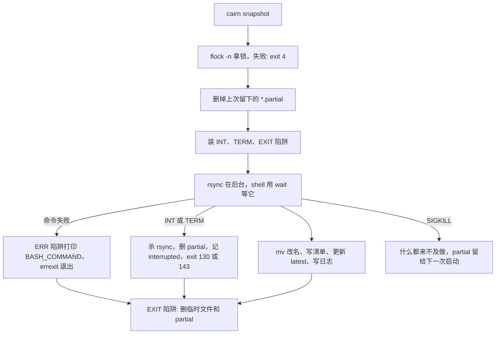

第 6 篇结尾留下了一个一直是 0 的数：`cairn report` 里的 `interrupted`。原因很朴素：对 `cairn snapshot` 按一次 Ctrl-C，rsync 还在前台跑，`.partial` 目录留在原地，日志里什么也不会记。这一篇把那个 0 变成 1。下面是 `ch07` 上的一次真实打断：我用 `CAIRN_BWLIMIT=2048` 把 rsync 限在 2 MiB/s，让一份 20 MiB 的快照要跑大约 10 秒，等 `.partial` 目录出现，发一个 SIGINT（`conf` 和 `repo` 是沙箱里的路径）：

```text
$ CAIRN_BWLIMIT=2048 CAIRN_NOW=20261031T090000Z cairn -c "${conf}" snapshot 2>err.txt &
$ ls "${repo}/snapshots"
20261031T090000Z.partial
$ kill -INT %1; wait %1; echo "exit $?"
exit 130
$ ls "${repo}/snapshots" | wc -l
0
$ tail -n 1 "${repo}/logs/cairn.log"
2026-11-01T01:13:39-0800 WARN snapshot name=20261031T090000Z status=interrupted
$ cairn -c "${conf}" report | sed -n 1,4p
snapshots    1
ok           0
failed       0
interrupted  1
```

> [!NOTE] 本篇检查点
> 这一篇结束时仓库（标签 `ch07`）有 112 个被跟踪的文件，比 `ch06` 多 14 个：新增 `lib/cairn/lock.sh`（33 行，最终版本）和 `lab/ch07/` 里的 13 个实验脚本（最终版本）；另有六个旧文件被修改：`bin/cairn`（328 行长到 367 行，最终版本）、`lib/cairn/snapshot.sh`（198 行长到 299 行，最终版本）、`lib/cairn/manifest.sh`（132 行减到 127 行，最终版本）、`lib/cairn/prune.sh`（135 行变 136 行，最终版本）、`lib/cairn/repo.sh`（131 行减到 129 行，最终版本）和 `README.md`（目录布局里的库列表多了 `lock`，以后还会加内容）。`make ch07` 通过：13 个实验全部符合预期（其中 `errexit_arith_fail.sh`、`lock_busy_fail.sh` 和 `stacktrace_fail.sh` 按约定以非 0 退出码结束，运行器认为这才是正确的），整套约 10 秒；`ch01` 到 `ch06` 的实验在这个标签上我也全部重跑过，78 个 `ok`，没有一个失败。
> 涉及的 Shell 特性：`set -o errexit` 与它的例外、`pipefail`、`shopt -s inherit_errexit`、`ERR` 陷阱与 `errtrace`、`BASH_COMMAND`、`FUNCNAME`/`BASH_SOURCE`/`BASH_LINENO`、`EXIT`/`INT`/`TERM` 陷阱、信号与 `128+n`、陷阱在前台子进程运行时被推迟、`&` 加 `wait`、`mktemp`、原子改名、`flock` 与文件描述符的继承、`SIGKILL` 不能被捕获，以及 [Google Shell 风格指南](https://google.github.io/styleguide/shellguide.html)里的[“检查返回值”](https://google.github.io/styleguide/shellguide.html#s8.1-checking-return-values)和[算术](https://google.github.io/styleguide/shellguide.html#s6.9-arithmetic)两条规则。
> 前置：[第 6 篇：文本处理：sed、awk 与一份备份日志](/posts/shell-by-cairn-06-text-processing/)。

这一篇的所有输出来自这台机器：Linux 6.18.59，Bash 5.3.15，rsync 3.4.4，util-linux 2.42.2 的 `flock`，GNU coreutils 9.11，开发 shell 里 `LANG=en_US.UTF-8`。这台机器的时区是 `-0800`，所以日志时间戳带着它，后面的数字都不受影响。

## 动手清单

你自己的 `~/cairn` 从第 6 篇的状态出发，这一篇要做这几件事，每件在哪一节出现都会指出来：

- 新建 `lib/cairn/lock.sh`。见“锁：flock 与一个会被继承的文件描述符”一节。
- 改 `bin/cairn`：顶部的 `set` 和 `shopt`、`on_err` 函数和 `ERR` 陷阱、`usage_error` 的调用点改成 `|| return`、usage 里的退出码表；`CAIRN_LIB` 的赋值拆成 `cairn_script=...` 和 `CAIRN_LIB=...` 两行，并在库列表里加一行 `source "${CAIRN_LIB}/lock.sh"`。见“set -e 能管什么”“ERR 陷阱”“信号与退出码”和“锁：flock 与一个会被继承的文件描述符”四节。
- 改 `lib/cairn/snapshot.sh`：持锁、清理陈旧的 `.partial`、后台运行的 rsync 加 `wait`、`INT`/`TERM`/`EXIT` 陷阱，`snapshot::discard` 里的 `find` 后面补一个 `|| :`。见“可以被打断的 snapshot::create”一节。
- 改 `lib/cairn/manifest.sh`、`lib/cairn/repo.sh` 里三处管道，改 `lib/cairn/prune.sh` 让 `prune` 也持锁。见“pipefail”和“锁：flock 与一个会被继承的文件描述符”两节。
- 新建 `lab/ch07/` 下的 13 个实验，在 `README.md` 的库列表里补上 `lock`。`make ch07` 全部跑一遍。

直接从参考仓库复制的话，写法和前几篇一样：

```bash
git -C ~/cairn-ref fetch --tags
cd ~/cairn || exit 1
mkdir -p lab/ch07
mapfile -t files < <(git -C ~/cairn-ref diff --name-only ch06 ch07)
for f in "${files[@]}"; do
  git -C ~/cairn-ref show ch07:"${f}" >"${f}"
done
```

这一篇的改动大多是在已有代码里加一行，复制比重敲方便，但请至少亲手敲一遍 `on_err` 和 `cairn::snapshot::interrupt` 这两个函数：错的地方往往只差一个引号，而且 trap 里的错误不会给你好看的报错。

## 全貌

四种事件，四条出口。命令失败走 `errexit`（顺路触发 `ERR`），信号走 `INT`/`TERM`，所有的正常和不正常结束都会经过 `EXIT`，只有 `SIGKILL` 哪个陷阱都进不来，只能靠下一次启动时收拾：



我先把 `errexit` 的规则和例外讲清楚（它是这一篇里“规则比例外短”的那一个），再讲陷阱、信号、锁，最后回到 `cairn::snapshot::create` 把它们接起来。

## set -e 能管什么

`bin/cairn` 顶部现在是这样：

```bash
set -o errexit -o nounset -o pipefail
# 命令替换里的失败也要让 errexit 生效; errtrace 让 ERR trap 进入函数和子 shell。
shopt -s inherit_errexit
set -o errtrace
```

`errexit`(`set -e`)的规则，[Bash 手册里 `set` 内建那一节](https://www.gnu.org/software/bash/manual/bash.html#The-Set-Builtin)是这样说的：一个管道、一个列表或一个复合命令返回非 0，shell 就退出；但如果失败的命令是 `if`/`elif`/`while`/`until` 的条件、`&&` 或 `||` 列表里不是最后一个的那个、管道里不是最后一段的那个，或者它的状态被 `!` 取反了，shell 不退出。以后我就叫这几种情况“例外”。这份名单是手册自己写的，不是我总结出来的。

第 1 篇我承诺过要把这些坑讲清楚，那里的原话是“第 7 篇我会把六个坑全列出来”。手册自己的名单只有五六条，我的六种形态和它不是一一对应，而是我在写脚本时真正踩到过的六种；`lab/ch07/errexit_exceptions.sh` 逐个跑一遍。每个小实验在自己的 `bash` 子进程里运行，在每一条可能被跳过的命令后面放一个 `echo`，所以输出就是“哪些行被执行到了”。先看脚本的框架和其中四个例子。注意 5a 里的 `local x="$(false)"` 是故意写坏的：shellcheck 会对它报 SC2155，而实验文件就是要演示这个坏写法，所以不改它：

```bash
# shellcheck shell=bash
# Shows: six places where `set -e` does not stop the script. Every case
# runs in its own `bash` child, prints a marker for each line it reaches
# and the child's exit status. BashFAQ 105 lists these exceptions:
# https://mywiki.wooledge.org/BashFAQ/105
run_case() {
  echo "--- $1 ---"
  cat >case.sh
  bash case.sh
  echo "exit status: $?"
}

run_case '1. if condition: false is tested, not fatal' <<'CASE'
set -e
if false; then echo 'then branch'; else echo 'else branch reached'; fi
echo 'line after if reached'
CASE

# ... 2. false && echo ...；3. ! true ...

run_case '4. function called in a condition: set -e is off inside it' <<'CASE'
set -e
f() {
  false
  echo 'f went on after false'
}
if f; then echo 'f succeeded'; fi
echo 'line after if f reached'
CASE

run_case '5a. local x=<failing substitution>: local masks the status' <<'CASE'
set -e
g() {
  local x="$(false)"
  echo "g went on, status of local: $?"
}
g
echo 'line after g reached'
CASE

# ... 5b. 声明和赋值分开；6a. 命令替换；6b. 加上 inherit_errexit ...
```

完整输出，26 行：

```text
$ cat out/ch07/errexit_exceptions.stdout
--- 1. if condition: false is tested, not fatal ---
else branch reached
line after if reached
exit status: 0
--- 2. non-final element of && ---
line after && reached
exit status: 0
--- 3. negated pipeline with ! ---
line after ! true reached
exit status: 0
--- 4. function called in a condition: set -e is off inside it ---
f went on after false
f succeeded
line after if f reached
exit status: 0
--- 5a. local x=<failing substitution>: local masks the status ---
g went on, status of local: 0
line after g reached
exit status: 0
--- 5b. declare first, assign later: the status counts ---
exit status: 1
--- 6a. command substitution, no inherit_errexit ---
inside $(...) went on
exit status: 0
--- 6b. the same with shopt -s inherit_errexit ---
exit status: 1
```

六种形态，每一种的机制：

- **条件(1)。** `false` 是 `if` 的测试，不是“失败的命令”，它的状态本来就是用来分支的。整个 `if` 的状态是被执行分支里最后一条命令的状态，这里是 `echo` 的 0。
- **`&&` 的左边(2)。** `false && echo ...` 里 `false` 失败了，`echo` 没有运行，整个列表的状态是 1，但 `errexit` 只看“不是最后一个的那个”，所以没动静。第 1 篇说过这个细节会在 `set -e` 里咬人，这就是那一口。
- **`!`(3)。** `! true` 的状态是 1，被 `!` 取反的状态不触发退出，所以输出里有最后那行 `line after ! true reached`。
- **条件里的函数(4)。** 这一条最阴险，手册原话是：如果一个复合命令或函数在 `-e` 被忽略的上下文里执行，那么里面的任何命令都不受 `-e` 影响。输出里 `f went on after false` 就是证据：`f` 里的 `false` 失败了，函数继续往下走，因为 `f` 是被当成 `if` 的条件调用的。同样的事发生在 `f || handle` 和 `if ! f` 里。
- **`local x="$(...)"`(5a)。** `local` 是一条命令，它自己成功了，返回 0，命令替换的状态被吞掉了。输出里那个 `status of local: 0` 就是这个 0。5b 把声明和赋值拆成两行，赋值语句的状态就是命令替换的状态，于是 `errexit` 起作用，退出码 1。Google 的[“使用局部变量”](https://google.github.io/styleguide/shellguide.html#use-local-variables)一节就是这条规则，理由写得和这里一样：`local` 不传递命令替换的退出码。
- **命令替换(6)。** 6a 没有 `inherit_errexit`：`$(...)` 里的子 shell 把 `-e` 清掉了，所以 `false` 之后 `echo` 照样执行，子 shell 的状态是最后一条命令的 0。6b 打开 `shopt -s inherit_errexit`，子 shell 继承 `-e`，`false` 立刻让它退出，外层的赋值语句拿到非 0，脚本退出码 1，`echo` 都没有机会打印。手册里 `inherit_errexit` 的描述是一句话：命令替换继承 `errexit` 的值，而不是在子 shell 环境里把它关掉；在 POSIX 模式下这个选项是自动打开的。Bash 的默认（非 POSIX 模式）是关掉，所以 Cairn 要自己 `shopt -s inherit_errexit`。

六种里，4 和 6a 是“这个上下文里 `-e` 被关掉了”，5a 是“失败的状态被另一条命令盖掉了”，1、2、3 是“失败本来就是被用来判断的”。shell 一开始是为交互设计的，这是同一个脾气：每一个例外都在保护一个“失败是正常结果”的用法，只是到了脚本里，这些保护变成了陷阱。

### 第七个例外

名单上还漏了一个我自己踩到的：进程替换。`readarray -t a < <(cmd)` 里 `cmd` 是另一个进程，它的状态不在 `readarray` 的状态里，`errexit` 当然看不见。第 4 篇练习 5 里 `cairn::prune::run` 吞掉 `select` 失败的那个洞，和这里是同一个原因，现在我可以直接证明，开着 `set -e` 它也不会报：

```text
$ bash -c 'set -e; readarray -t lines < <(false); echo "reached, ${#lines[@]} lines"'; echo "exit $?"
reached, 0 lines
exit 0
```

这个洞我没有修，`ch07` 里的 `cairn::prune::run` 还是那样（“没有修的洞”一节会把四处一起列出来）。这就是 [BashFAQ 105](https://mywiki.wooledge.org/BashFAQ/105) 开头那句话的意思：自动错误检测的前提是能判断出错误真的发生了，而 shell 里你关心的任务大多由外部程序完成，shell 无从知道。FAQ 的结论是“在实践里效果不好”。我读完的第一反应是，那我为什么还要开它。

### 那为什么还要开

因为 Google 的规则是一回事，开不开 `errexit` 是另一回事。指南里 `set -e` 总共出现两次，都在算术那一节的警告里；没有一条要求或禁止它。它要求的是[“检查返回值”](https://google.github.io/styleguide/shellguide.html#s8.1-checking-return-values)：“Always check return values and give informative return values.” 注意“informative”：`if ! mv ...; then echo "Unable to move ..." >&2; exit 1; fi`，错误信息和退出码都是你选的。`errexit` 给不出这两样，它只会在你忘了写的地方停下。

所以 Cairn 现在有两层。显式检查(`|| return`、`if ! cmd; then`)负责给出对的消息和对的退出码，`errexit` 在后面兜底，替我拦住忘记写检查的地方；兜底拦住的那一下由 `ERR` 陷阱说出是哪条命令。“ERR 陷阱”一节看这个兜底网怎么用，但先回两个旧账。

第 1 篇练习 3 的问题是：没有 `set -e` 的 `bin/cairn` 缺了库文件会怎样？`ch06` 会报六次 `No such file or directory`，然后仍然打印版本，退出码 0。`ch07` 里同一条命令（我用 `git archive` 把两个标签各解到一个目录里）：

```text
$ cd /tmp/cairn-ch06 && CAIRN_LIB=/nonexistent bin/cairn --version; echo "exit $?"
bin/cairn: line 23: /nonexistent/log.sh: No such file or directory
bin/cairn: line 25: /nonexistent/config.sh: No such file or directory
bin/cairn: line 27: /nonexistent/repo.sh: No such file or directory
bin/cairn: line 29: /nonexistent/snapshot.sh: No such file or directory
bin/cairn: line 31: /nonexistent/prune.sh: No such file or directory
bin/cairn: line 33: /nonexistent/manifest.sh: No such file or directory
cairn 0.1.0
exit 0
$ cd /tmp/cairn-ch07 && CAIRN_LIB=/nonexistent bin/cairn --version; echo "exit $?"
bin/cairn: line 27: /nonexistent/log.sh: No such file or directory
exit 1
```

第一条库缺失就停了，退出码 1。这是 `errexit` 最干净的一次胜利：`source` 一个不存在的文件，Bash 在默认模式下只当它是一条普通命令失败，而 `errexit` 正好管“普通命令失败”。（POSIX 模式下 `source` 找不到文件本身就是致命的：`bash --posix -c 'source /nonexistent; echo reached'` 打印一行 `No such file or directory`，没有 `reached`，退出码 1。我只是在这台机器上试过这一条，没有去查标准怎么规定。）

这一处还有一个小改动：`bin/cairn` 里 `CAIRN_LIB` 原来是一行 `CAIRN_LIB="${CAIRN_LIB:-$(dirname -- "$(readlink -f -- ...)")/../lib/cairn}"`，现在拆成 `cairn_script="$(readlink -f -- "${BASH_SOURCE[0]}")"` 和 `CAIRN_LIB=...` 两行。原因和 5a 是同一类：嵌套的命令替换里，`readlink` 失败了，外面的 `dirname` 仍然成功，整个赋值的状态是 `dirname` 的 0。我试了一下，`set -e; X="$(dirname -- "$(false)")/x"` 照常往下走，`X` 是 `./x`；而单独一行 `s="$(false)"` 会以 1 退出。拆开以后，`readlink` 的失败才有机会被 `errexit` 看见。顺带，库列表里 `source "${CAIRN_LIB}/lock.sh"` 是这一篇新加的一行。

另一个旧账在第 3 篇：`((n++))` 在 `n` 是 0 的时候值是 0，退出状态是 1，那一篇说它从第 7 篇开始会出事。`lab/ch07/errexit_arith_fail.sh` 把这件事缩成六行：

```bash
# shellcheck shell=bash
# Shows: `(( i++ ))` with i=0 evaluates to 0, and an arithmetic command
# whose value is 0 has exit status 1, so `set -e` stops the script right
# there. Use i=$((i + 1)) or (( ++i )) instead. Ends in _fail.sh: exit 1.
set -e
i=0
echo "i=${i}, before (( i++ ))"
((i++)) # BAD: post-increment yields the old value 0, status 1
echo "i=${i}, after (not printed)"
```

```text
$ cat out/ch07/errexit_arith_fail.stdout; cat out/ch07/errexit_arith_fail.status
i=0, before (( i++ ))
1
```

`i` 没有机会被打印第二次。这是 Google 指南[算术一节](https://google.github.io/styleguide/shellguide.html#s6.9-arithmetic)里点名的例子(`set -e; i=0; (( i++ ))`, “will cause the shell to exit”)。`cairn` 里剩下的几处自增是 `((++n))` 和 `((n += 1))`，值是自增之后的数，不会是 0。文件名以 `_fail.sh` 结尾，运行器要求它以非 0 退出，所以 `make ch07` 里它的那一行仍然是 `ok`。

### 退出码是怎么穿过去的

`errexit` 让 shell 退出时用的是失败命令的状态，不是固定的 1。这一点对 Cairn 很重要，因为退出码表是公共接口。`main` 里的 `usage_error ... || return` 把 2 作为 `main` 的返回值交出去，最后一行 `main "$@"` 失败，`errexit` 带着 2 退出：

```text
$ cairn bogus; echo "exit $?"
cairn: error: unknown command 'bogus'
cairn: error: run 'cairn --help' for usage
exit 2
$ cairn -c /nonexistent/x.conf list; echo "exit $?"
cairn: error: no config file at /nonexistent/x.conf (run 'cairn init REPO' first)
exit 3
```

这两条我是在 `/tmp/cairn-ch07` 里跑的，输出里没有 `command failed` 那一行：为什么没有，“ERR 陷阱”一节讲。顺便说一句，第 6 篇的写法是 `usage_error '...'` 然后换一行 `return`；`ch07` 里 10 处这样的地方都改成了 `usage_error '...' || return`。原因是：不改的话，`usage_error` 一返回 2，`errexit` 就在 `usage_error` 那一行把 shell 带走，后面的 `return` 永远执行不到。我在临时副本里把一处改回旧写法，并把 `return` 改成 `return 7`，退出码仍然是 2，不是 7。结果碰巧和以前一样，但控制流变了；而放在 `||` 列表里的命令是 `errexit` 的例外，`|| return` 等于告诉它“这个失败是我处理的”。

## pipefail

管道的状态默认是最后一段的状态，前面的失败都看不见。`pipefail` 把它改成“最右边那个非 0 的状态”。这些第 5 篇已经讲过，所以 `lab/ch07/pipefail.sh` 只补那一篇没有放在一起看的东西：`pipefail` 和 `errexit` 一起用时发生什么。

```bash
# shellcheck shell=bash
# Shows: a pipeline's status is the last command's; `set -o pipefail`
# makes it the last non-zero status. PIPESTATUS keeps every stage.
# `yes | head -n 1` becomes 141 (128 + SIGPIPE) under pipefail.
echo '--- default ---'
false | true
echo "false | true            -> $?"
false | cat >/dev/null
echo "false | cat             -> $? (PIPESTATUS: ${PIPESTATUS[*]})"

echo '--- set -o pipefail ---'
set -o pipefail
false | true
echo "false | true            -> $?"
(exit 3) | (exit 5) | true
echo "(exit 3)|(exit 5)|true  -> $? (PIPESTATUS: ${PIPESTATUS[*]})"
yes | head -n 1 >/dev/null
echo "yes | head -n 1         -> $? (141 = 128 + 13, SIGPIPE)"
set +o pipefail
yes | head -n 1 >/dev/null
echo "same without pipefail   -> $?"

echo '--- pipefail plus set -e (in a subshell) ---'
(
  set -o pipefail -o errexit
  echo before
  false | true
  echo 'not printed: the pipeline failed'
)
echo "subshell status: $?"
```

```text
$ cat out/ch07/pipefail.stdout
--- default ---
false | true            -> 0
false | cat             -> 0 (PIPESTATUS: 1 0)
--- set -o pipefail ---
false | true            -> 1
(exit 3)|(exit 5)|true  -> 5 (PIPESTATUS: 3 5 0)
yes | head -n 1         -> 141 (141 = 128 + 13, SIGPIPE)
same without pipefail   -> 0
--- pipefail plus set -e (in a subshell) ---
before
subshell status: 1
```

三件事。`(exit 3) | (exit 5) | true` 的状态是 5 而不是 3：“最右边的非 0”，不是“第一个”也不是“最大的”，`PIPESTATUS` 里是 `3 5 0`，要哪一段自己取。`yes | head -n 1` 在 `pipefail` 下变成 141：`head` 读完一行就退出，`yes` 下一次写入时收到 SIGPIPE 死掉，状态 128 + 13；没有 `pipefail` 的时候这个 141 被最后一段的 0 盖掉了，所以这条管道“成功”。最后一段是和 `errexit` 的组合：`false | true` 在 `pipefail` 下状态 1，`errexit` 当场退出，子 shell 的退出码是 1，那句 `not printed` 确实没有打印。

**开了 `pipefail` 之后，`PIPESTATUS` 在 `errexit` 下经常来不及用。** 第 5 篇的 `cairn::manifest::write` 在管道后面立刻读 `PIPESTATUS`，再自己决定要不要清理临时文件。现在管道一失败，`errexit` 在 `PIPESTATUS` 那一行之前就把 shell 带走了：

```text
$ bash -c 'set -o errexit -o pipefail; false | true; echo "PIPESTATUS: ${PIPESTATUS[*]}"'; echo "exit $?"
exit 1
$ bash -c 'set -o errexit -o pipefail; if ! false | true; then echo caught; fi; echo after'
caught
after
```

第一条连 `PIPESTATUS:` 那行都没有打印。第二条把管道放进 `if !` 的条件里：条件是 `errexit` 的例外，管道失败不会杀掉 shell，而 `pipefail` 保证条件拿到的是整条管道的状态，`then` 里可以先清理再返回。`ch07` 对三处管道做了这个改动（`git diff ch06 ch07 -- lib/cairn/manifest.sh` 的一部分）：

```text
-  (
-    # 子 shell 里的管道没有 PIPESTATUS 可传出来, 用 pipefail 压成一个状态。
-    set -o pipefail
+  # pipefail 是全局开着的; 放进 if 条件, 失败时才能先清理再返回。
+  if ! (
     cd -- "${dir}" || exit 1
     find . -type f -print0 \
       | LC_ALL=C sort -z \
       | xargs -0 -r -P "${jobs}" -n 64 sha256sum
   ) \
-    | LC_ALL=C sort -k 2 >"${tmp}"
-  local -a status=("${PIPESTATUS[@]}")
-  if ((status[0] != 0 || status[1] != 0)); then
+    | LC_ALL=C sort -k 2 >"${tmp}"; then
     rm -f -- "${tmp}"
     return 1
   fi
```

`cairn::manifest::diff` 和 `cairn::repo::sizes` 的改法完全一样。注意子 shell 里那句 `cd -- "${dir}" || exit 1` 还留着：它在 `if` 条件里面，`errexit` 在整个条件里都是关着的，里面的 `cd` 失败了不会自己停，所以显式检查还是需要的。这是“set -e 能管什么”一节里“条件里的函数”那条规则的同一个翻版。

这和 Google 的规则冲突吗？指南说 `PIPESTATUS` 可以用来检查整条管道的成败，“If it’s only necessary to check success or failure of the whole pipe, then the following is acceptable”（[检查返回值](https://google.github.io/styleguide/shellguide.html#s8.1-checking-return-values)一节），并没有说它是唯一办法。`pipefail` 加 `if !` 做的是同一件事，只是更短；需要知道“是哪一段失败了”的时候，还是要自己取 `PIPESTATUS`，但那个时候你也得先让管道不触发 `errexit`。

开了 `pipefail` 的代价是 141：任何读端提前退出的管道都会失败。我在 `bin/cairn` 和 `lib/cairn/*.sh` 里找了找这种管道：

```text
$ grep -n '| *head\|grep -q' bin/cairn lib/cairn/*.sh; echo "grep exit $?"
grep exit 1
```

没有 `| head` 也没有 `| grep -q`，所以 `pipefail` 目前不会把 141 带进 Cairn。这是个“现在没有”的论断，不是保证。

## ERR 陷阱

`errexit` 只会静静地退出。出了错我想知道是哪一条命令，这就是 `ERR` 陷阱的工作：手册说，每当一个管道、列表或复合命令返回非 0 时执行，并且“These are the same conditions obeyed by the errexit (-e) option”，也就是“set -e 能管什么”一节里的所有例外在这里同样适用。`if` 条件里的失败不会触发它，`|| return` 处理过的失败也不会，这正是我要的：只报告没有人处理的失败。

默认情况下，`ERR` 陷阱不会进入函数、命令替换和子 shell。`set -o errtrace`(`-E`)改变这一点。我用两个一行的实验说明差别，唯一的区别是第二条多了 `set -o errtrace`：

```text
$ bash -c 'trap "echo ERR trap: \$BASH_COMMAND" ERR; f() { false; echo "f went on"; }; f; echo done'
f went on
done
$ bash -c 'set -o errtrace; trap "echo ERR trap: \$BASH_COMMAND" ERR; f() { false; echo "f went on"; }; f; echo done'
ERR trap: false
f went on
done
```

没有 `errtrace` 的时候，函数里的 `false` 悄悄失败，陷阱没有被触发（`f` 的最后一条命令是 `echo`，所以 `f` 本身返回 0，顶层没有失败可报）。有了它，陷阱在 `f` 里触发，打印出 `BASH_COMMAND`：手册说它是“当前正在执行或即将执行的命令”，在陷阱里是触发陷阱那一刻正在执行的命令，所以这里是 `false`。Cairn 的所有逻辑都在函数里，没有 `errtrace` 的 `ERR` 陷阱对它毫无用处，因此 `bin/cairn` 顶部有一行 `set -o errtrace`。

下面是 `bin/cairn` 里的处理函数（第 252 到 282 行，一字不差）：

```bash
#######################################
# ERR trap handler: report a command that failed unexpectedly.
#
# Failing function calls and "return" are not reported: either a command
# inside the function failed (and the trap already ran there), or the
# function ended with a deliberate "return N", which main turns into the
# exit status. With -v one line per call frame follows, innermost first.
# Globals:
#   CAIRN_VERBOSE, FUNCNAME, BASH_SOURCE, BASH_LINENO
# Arguments:
#   Exit status of the failed command, the command text.
# Outputs:
#   Writes the message and the frames to stderr.
#######################################
on_err() {
  local status="$1"
  local command="$2"
  if [[ "${command%% *}" == return ]] \
    || declare -F -- "${command%% *}" >/dev/null; then
    return 0
  fi
  cairn::log::err "command failed (exit ${status}): ${command}"
  if [[ "${CAIRN_VERBOSE}" != 1 ]]; then
    return 0
  fi
  local i
  for ((i = 1; i < ${#FUNCNAME[@]}; i++)); do
    printf '  at %s (%s:%s)\n' \
      "${FUNCNAME[i]}" "${BASH_SOURCE[i]}" "${BASH_LINENO[i - 1]}" >&2
  done
}
```

文件的最后两行是 `trap 'on_err "$?" "${BASH_COMMAND}"' ERR` 和 `main "$@"`。陷阱的命令用单引号，这样 `$?` 和 `${BASH_COMMAND}` 在陷阱触发时才展开，而不是在 `trap` 这一行；而 `"$?"` 要当作第一个参数传进去，是因为 `on_err` 里一执行别的命令，`$?` 就被覆盖了。`trap` 放在 `main "$@"` 前面一行，而不是文件顶部；我猜是因为库文件还没有 `source` 进来之前，`cairn::log::err` 不存在，陷阱触发了也只能说 `command not found`。

### 为什么要过滤 return

开头那一段 `if` 是这个函数里我最想看清楚的部分。把它删掉，对 `cairn bogus` 会发生什么：我在 `/tmp` 里的一个副本里删掉了这四行，其余原样：

```text
$ cairn bogus; echo "exit $?"
cairn: error: unknown command 'bogus'
cairn: error: run 'cairn --help' for usage
cairn: error: command failed (exit 2): return
exit 2
```

`cairn bogus` 的“失败”是故意的：`usage_error` 返回 2，`|| return` 把 2 交给 `main` 的调用者，顶层的 `main "$@"` 因此失败了。这是我们设计出来的退出码，不是意外，但 `ERR` 陷阱分不清。更糟的是它打印的命令是 `return`，不是 `main`。`BASH_COMMAND` 在函数返回之后仍然是函数里最后执行的那条命令。我用一个小例子确认过：

```text
$ bash -c 'set -o errtrace; trap "echo ERR: \$BASH_COMMAND" ERR; f() { false; }; g() { f; }; g; echo after'
ERR: false
ERR: false
ERR: false
after
$ bash -c 'set -o errtrace; trap "echo ERR: \$BASH_COMMAND" ERR; f() { return 3; }; g() { f; }; g; echo after'
ERR: return 3
ERR: return 3
after
```

一次真正的失败，`errtrace` 下陷阱触发 3 次：一次在 `f` 里的 `false`，一次在 `f` 返回给 `g` 的时候，一次在 `g` 返回给顶层的时候，每一次打印的都是同一条 `false`。`return 3` 是 2 次，`BASH_COMMAND` 一直是 `return 3`。所以：不过滤 `return`，每一个有意的退出码都会多一条“command failed”。`on_err` 的第一个条件把这两种情况都挡掉：开头是 `return` 的当作有意的，不报告。

那第二个条件，`declare -F -- "${command%% *}"`，是挡函数名的：如果 `BASH_COMMAND` 是一个函数名，那是函数调用本身返回了非 0。老实说，我没有找到需要它的路径。我把第二个条件删掉，只留 `return` 的检查，在 `cairn` 的 15 条失败路径上各跑了一遍：未知命令、未知选项、`-c` 缺参数、配置缺失、`list` 和 `snapshot` 多余的参数、`verify` 和 `diff` 找不到快照、`init` 一个非空目录、快照已存在、`CAIRN_NOW` 格式错误、rsync 失败，以及锁被占用时的 `snapshot`、`prune` 和 `snapshot -n`，退出码 1、2、3、4 都有，一条多余的 `command failed` 都没有出现。所以我猜第二个条件是多余的，大概是为了防住以后新增的路径；这是我的猜测，不是我测出来的结论。

### 看一次真实的栈

`lab/ch07/stacktrace_fail.sh` 造一个真实的失败：快照本身完成了，但日志文件是只读的，最后一步 `cairn::log::file` 写不进去。那一行没有 `||` 检查，所以是 `errexit` 兜底：

```bash
# shellcheck shell=bash
# Shows: the ERR trap of bin/cairn. The log file is made read-only, so
# `cairn::log::file` fails after the snapshot itself is complete. Without
# -v cairn prints one line, with -v one `at <func> (<file>:<line>)` line
# per frame. The failing command ends cairn through errexit with its
# own status (1), so this lab ends in _fail.sh.
src="${LAB_TMP}/src"
repo="${LAB_TMP}/repo"
conf="${LAB_TMP}/cairn.conf"
mkdir "${src}" || exit 2
echo hello >"${src}/a.txt"
cairn -c "${conf}" init "${repo}" 2>/dev/null || exit 2
printf 'source = %s\n' "${src}" >>"${conf}"
: >"${repo}/logs/cairn.log"
chmod a-w "${repo}/logs/cairn.log"

# 路径每次不同; 换成占位符, 输出才可比较。
show() {
  sed -e "s|${CAIRN_ROOT}|<cairn>|g" -e "s|${LAB_TMP}|<tmp>|g"
}

echo '--- without -v ---'
CAIRN_NOW=20261031T090000Z cairn -q -c "${conf}" snapshot 2>&1 | show
echo "exit status: ${PIPESTATUS[0]}"

echo '--- with -v ---'
CAIRN_NOW=20261031T100000Z cairn -q -v -c "${conf}" snapshot 2>&1 | show
status=${PIPESTATUS[0]}
echo "exit status: ${status}"
exit "${status}"
```

这个实验自己的管道没有 `pipefail`，所以它能读 `PIPESTATUS[0]` 拿到 `cairn` 的状态；`bin/cairn` 的 `errexit` 影响不了运行它的脚本。输出：

```text
$ cat out/ch07/stacktrace_fail.stdout
--- without -v ---
<cairn>/bin/../lib/cairn/log.sh: line 82: <tmp>/repo/logs/cairn.log: Permission denied
cairn: error: command failed (exit 1): printf '%(%Y-%m-%dT%H:%M:%S%z)T %s %s %s\n' -1 "${level}" "${event}" "$*" >> "${CAIRN_REPO}/logs/cairn.log"
exit status: 1
--- with -v ---
<cairn>/bin/../lib/cairn/log.sh: line 82: <tmp>/repo/logs/cairn.log: Permission denied
cairn: error: command failed (exit 1): printf '%(%Y-%m-%dT%H:%M:%S%z)T %s %s %s\n' -1 "${level}" "${event}" "$*" >> "${CAIRN_REPO}/logs/cairn.log"
  at cairn::log::file (<cairn>/bin/../lib/cairn/log.sh:82)
  at cairn::snapshot::create (<cairn>/bin/../lib/cairn/snapshot.sh:265)
  at cmd_snapshot (<cairn>/bin/cairn:137)
  at main (<cairn>/bin/cairn:356)
  at main (<cairn>/bin/cairn:367)
exit status: 1
```

输出要一行一行读。第一行不是 Cairn 写的，是 Bash 自己对失败的重定向打印的（文件名、行号、`Permission denied`）。第二行才是 `on_err`：失败的命令是 `printf ... >> ...` 那一整条，状态 1，退出码也是 1，因为 `errexit` 用失败命令的状态退出。接着是栈，每一行是 `at <函数> (<文件>:<行号>)`，从里到外：写日志的 `cairn::log::file`，调它的 `snapshot::create`（`snapshot.sh` 第 265 行，也就是 `cairn::log::file INFO snapshot ...` 那一行），再外一层 `cmd_snapshot`，然后是 `main`。

还有一点：`main` 出现了两次，这不是 bug。手册说 `FUNCNAME` 数组的最后一个元素永远是字符串 `"main"`，代表顶层脚本本身；而 Cairn 恰好有一个自己的函数也叫 `main`。上面那条 `at main (<cairn>/bin/cairn:356)` 是函数 `main` 里调用 `cmd_snapshot` 的那一行，下面那条 `at main (<cairn>/bin/cairn:367)` 是顶层调用 `main "$@"` 的那一行。我写了一个三行的脚本验证：

```text
$ cat fn.sh
f() { echo "${FUNCNAME[*]}"; echo "${BASH_SOURCE[*]}"; echo "${BASH_LINENO[*]}"; }
g() { f; }
g
$ bash fn.sh
f g main
fn.sh fn.sh fn.sh
2 3 0
```

`FUNCNAME` 是 `f g main`，`BASH_LINENO` 是 `2 3 0`：`f` 在第 2 行被 `g` 调用，`g` 在第 3 行被顶层调用，最后那个 0 属于伪帧 `main`。`on_err` 里 `BASH_LINENO[i - 1]` 的下标偏一位就是这个原因：手册说 `${FUNCNAME[$i]}` 是在 `${BASH_SOURCE[$i+1]}` 的 `${BASH_LINENO[$i]}` 行被调用的，我要的是“`FUNCNAME[i]` 正在执行的那一行”，也就是它调用下一层的那一行，所以是 `BASH_LINENO[i - 1]`。（循环从 `i = 1` 开始，因为 `FUNCNAME[0]` 是 `on_err` 自己。）

这一次失败发生在快照已经完整完成之后，所以 `ERR` 陷阱只是报告，不会修复什么：快照目录在，`latest` 已经指过去了，只是日志里少了一行。`ERR` 陷阱说“哪里出了错”，修复是别的东西的事。

我另外验证了一下这个说法：把日志文件弄成只读，让快照在最后一步失败，看仓库里剩下什么：

```text
$ chmod a-w "${repo}/logs/cairn.log"
$ CAIRN_NOW=20261031T120000Z cairn -q -c "${conf}" snapshot 2>/dev/null; ls "${repo}/snapshots"; readlink "${repo}/latest"; ls "${repo}/manifests"
20261031T090000Z
20261031T120000Z
snapshots/20261031T120000Z
20261031T090000Z.sha256
20261031T120000Z.sha256
```

新快照完整，清单在，`latest` 已经指向它，只是日志少了一行。要补救什么，得靠别的机制；清理要靠 `EXIT` 陷阱。

## EXIT 陷阱：清理放在一个地方

清理代码最容易写错的地方是出口太多：正常结束、`return 1`、`errexit`、信号，每个出口都要记得删临时文件。`EXIT` 陷阱把这些出口收成一个：shell 无论怎样退出，都会先运行它。`lab/ch07/trap_exit.sh` 逐个出口验证，每个出口在自己的 `bash` 子进程里：

```bash
# shellcheck shell=bash
# Shows: an EXIT trap runs however the shell ends: at the end of the
# script, after `exit 3`, after a failing command under `set -e`, and
# when SIGINT kills it. Inside the trap `$?` is the status the shell is
# about to exit with, and the trap does not change it; after a fatal
# signal bash shows `$?` as 0 there, the 130 only reaches the parent.
run_case() {
  echo "--- $1 ---"
  cat >case.sh
  bash case.sh
  echo "exit status: $?"
}

run_case 'normal end' <<'CASE'
trap 'echo "EXIT trap ran, status $?"' EXIT
echo 'script body'
CASE

# ... exit 3；set -e 下 ls 一个不存在的路径 ...

run_case 'SIGINT (kill -INT $$)' <<'CASE'
trap 'echo "EXIT trap ran, status $?"' EXIT
echo 'script body'
kill -INT $$
echo 'not printed'
CASE

run_case 'SIGINT caught by its own trap, then exit 130' <<'CASE'
trap 'echo "INT trap ran"; exit 130' INT
trap 'echo "EXIT trap ran, status $?"' EXIT
echo 'script body'
kill -INT $$
echo 'not printed'
CASE
```

```text
$ cat out/ch07/trap_exit.stdout
--- normal end ---
script body
EXIT trap ran, status 0
exit status: 0
--- exit 3 ---
script body
EXIT trap ran, status 3
exit status: 3
--- error under set -e ---
script body
EXIT trap ran, status 2
exit status: 2
--- SIGINT (kill -INT $$) ---
script body
EXIT trap ran, status 0
exit status: 130
--- SIGINT caught by its own trap, then exit 130 ---
script body
INT trap ran
EXIT trap ran, status 130
exit status: 130
```

五个出口，五次 `EXIT trap ran`。陷阱里的 `$?` 是 shell 马上要用的退出状态：`exit 3` 是 3；`errexit` 下 `ls` 失败是 `ls` 自己的 2，不是 1。陷阱本身不改退出状态，`exit status:` 那一行和陷阱里看到的一致。

第四个出口有一处我没有完全搞懂：被 SIGINT 杀死的脚本，父进程看到 130，但陷阱里的 `$?` 是 0。我猜是因为 bash 在这条路径上没有把“被信号杀死”换算成 128+n 再交给陷阱，`$?` 还停在上一条命令，也就是 `kill -INT $$` 自己返回的 0；这只是对输出的一种解释，我没有去读 bash 的源码。实际含义很清楚：EXIT 陷阱里不要用 `$?` 判断“是不是正常结束”，用你自己的变量。第五个出口给了一条可靠的路：自己捕获 INT，在里面 `exit 130`，`EXIT` 陷阱里的 `$?` 就是 130。Cairn 走的就是第五条路，细节在“可以被打断的 snapshot::create”一节。

`snapshot::create` 的 `EXIT` 陷阱是 `cairn::snapshot::cleanup`，它清理两样东西：

```bash
#######################################
# EXIT trap of create: remove what a failed or interrupted run left.
# Globals:
#   CAIRN_SNAP_PARTIAL, CAIRN_SNAP_STATS
#######################################
cairn::snapshot::cleanup() {
  if [[ -n "${CAIRN_SNAP_STATS}" ]]; then
    rm -f -- "${CAIRN_SNAP_STATS}"
    CAIRN_SNAP_STATS=''
  fi
  if [[ -n "${CAIRN_SNAP_PARTIAL}" ]]; then
    cairn::snapshot::discard "${CAIRN_SNAP_PARTIAL}"
    CAIRN_SNAP_PARTIAL=''
  fi
}
```

`snapshot::discard` 在这里第一次出现：先用 `find` 给目录补上 `u+w`，再 `rm -rf`，这样只读的目录也删得掉。`ch07` 在 `find ... -exec chmod u+w -- {} +` 后面加了 `|| :`，原因是 `errexit`：目录不存在的时候 `find` 返回 1，那正是“没有东西可删”，不是错误，没有 `|| :` 的话，`errexit` 会让整个函数在 `rm -rf` 之前就退出。

要删什么是靠两个全局变量记着的：变量非空，表示“这个东西存在而且归我”；删完把它清空，这样陷阱运行两次（信号处理函数里先调一次，退出时 `EXIT` 又调一次）也不会重复删，更不会删一个已经被改名的目录：`snapshot::create` 在 `mv` 成功之后把 `CAIRN_SNAP_PARTIAL` 清空，清理从此不再碰这个目录，它有了正式的名字，但还没有清单。这两步之间有一个很窄的窗口，信号落在里面会出事，“没有修的洞”一节会复现它。这是 `trap` 里最重要的一条经验：陷阱会在你没有预料到的时刻运行，所以它里面的每一个动作都必须幂等。

### mktemp 和原子改名

临时文件的来源是 `mktemp`。`snapshot::create` 用 `stats_file="$(mktemp)"` 存 rsync 的 `--stats` 报告，`lab/ch07/mktemp_cleanup.sh` 说明它给了什么，以及没有陷阱时失败会留下什么：

```bash
# shellcheck shell=bash
# Shows: the temp-file pattern cairn uses. `mktemp` makes a private
# (mode 600) file with an unpredictable name; an EXIT trap removes it on
# every way out; the result is moved into place with `mv` on the same
# filesystem, a rename that is atomic: readers see the old or the new
# content, never half of it.
export TMPDIR="${LAB_TMP}/tmp"
mkdir -p "${TMPDIR}"

echo '--- mktemp: private, unpredictable name ---'
f="$(mktemp)"
stat -c 'mode %a, owner-only: %A' "${f}"
rm -f -- "${f}"

echo '--- without a trap the file stays when the script fails ---'
cat >no_trap.sh <<'SCRIPT'
set -e
f="$(mktemp --tmpdir cairn-leak.XXXXXX)"
echo "${f}" >leaked
false
SCRIPT
bash no_trap.sh
status=$?
echo "script status ${status};" \
  "left behind: $(find "${TMPDIR}" -type f | wc -l) file"
rm -f -- "$(cat leaked)" leaked no_trap.sh

# ... 同一个脚本加上 trap 'rm -rf -- "${tmp}"' EXIT，失败后目录已经不存在 ...

echo '--- atomic replace: write a temp file, then mv over the target ---'
echo old >target
before="$(stat -c %i target)"
tmp="$(mktemp "${PWD}/target.XXXXXX")"
echo new >"${tmp}"
tmp_inode="$(stat -c %i "${tmp}")"
mv -T -- "${tmp}" target
after="$(stat -c %i target)"
echo "content now: $(cat target)"
echo "inode before ${before}, temp file ${tmp_inode}, after ${after}"
if [[ "${after}" == "${tmp_inode}" ]]; then
  echo 'the target is the renamed temp file'
fi
```

```text
$ cat out/ch07/mktemp_cleanup.stdout
--- mktemp: private, unpredictable name ---
mode 600, owner-only: -rw-------
--- without a trap the file stays when the script fails ---
script status 1; left behind: 1 file
--- with an EXIT trap it is removed, also after an error ---
script status 1; directory exists afterwards: no
--- atomic replace: write a temp file, then mv over the target ---
content now: new
inode before 44963003, temp file 44963006, after 44963006
the target is the renamed temp file
```

`mktemp` 创建的文件模式是 600，名字不可预测，别的用户既读不到也抢不到。没有陷阱的脚本在 `errexit` 下失败，临时文件原封不动留在那里；有 `EXIT` 陷阱，同样的失败之后目录已经不在了。最后一段是原子性：`mv -T` 之后目标的 inode 就是临时文件的 inode(44963006)，内容整体换了，没有“写了一半”的时刻。inode 号每次运行不同，那个相等的关系不会变。

“原子”有一个前提：`mv` 必须是同一个文件系统内的改名。我拿 `/dev/shm` 和 `/tmp` 做了一个跨文件系统的对照，两者在我这台机器上是不同的挂载点：

```text
$ strace -e trace=rename,renameat,renameat2,unlink,unlinkat mv -T /dev/shm/x /tmp/y
renameat2(AT_FDCWD, "/dev/shm/x", AT_FDCWD, "/tmp/y", RENAME_NOREPLACE) = -1 EXDEV (Invalid cross-device link)
unlinkat(AT_FDCWD, "/tmp/y", 0)         = -1 ENOENT (No such file or directory)
unlinkat(AT_FDCWD, "/dev/shm/x", 0)     = 0
+++ exited with 0 +++
```

内核拒绝了跨设备的 `rename`(`EXDEV`)，`mv` 退回去“复制，再删除源文件”：这个流程中间有一个半个文件的时刻，也不是原子的（我只留了和改名、删除相关的系统调用，复制本身的 `read`/`write` 被我过滤掉了）。所以 Cairn 的清单临时文件是 `${out}.tmp`，放在目标的同一个目录里，`latest` 的临时链接是 `${repo}/latest.tmp`，也在目标旁边；快照目录是 `<name>.partial` 改名成 `<name>`，同在 `snapshots/` 下。而 `mktemp` 默认放在 `/tmp` 的那个 `stats_file` 从来不会被 `mv`，只被读完就删，所以它放哪儿都行。

## 信号与退出码

信号是内核发给进程的一个小整数。我用 `lab/ch07/signals_exit_codes.sh` 把名字、编号和退出码三件事放在一起：

```bash
# shellcheck shell=bash
# Shows: signal numbers with `kill -l`, and the shell convention that a
# process killed by signal n has exit status 128 + n: TERM (15) gives
# 143, KILL (9) gives 137, INT (2) gives 130.
echo '--- kill -l ---'
kill -l
echo '--- number <-> name ---'
echo "kill -l 15  -> $(kill -l 15)"
echo "kill -l 143 -> $(kill -l 143)  (a status above 128 is accepted)"
echo "kill -l INT -> $(kill -l INT)"

echo '--- exit status of a child killed by a signal ---'
for sig in TERM KILL INT HUP; do
  sleep 30 &
  pid=$!
  kill -s "${sig}" "${pid}"
  wait "${pid}"
  status=$?
  echo "kill -${sig}: status ${status} = 128 + $((status - 128))" \
    "($(kill -l "${status}"))"
done
```

```text
$ cat out/ch07/signals_exit_codes.stdout
--- kill -l ---
 1) SIGHUP	 2) SIGINT	 3) SIGQUIT	 4) SIGILL	 5) SIGTRAP
 6) SIGABRT	 7) SIGBUS	 8) SIGFPE	 9) SIGKILL	10) SIGUSR1
11) SIGSEGV	12) SIGUSR2	13) SIGPIPE	14) SIGALRM	15) SIGTERM
16) SIGSTKFLT	17) SIGCHLD	18) SIGCONT	19) SIGSTOP	20) SIGTSTP
21) SIGTTIN	22) SIGTTOU	23) SIGURG	24) SIGXCPU	25) SIGXFSZ
26) SIGVTALRM	27) SIGPROF	28) SIGWINCH	29) SIGIO	30) SIGPWR
31) SIGSYS	34) SIGRTMIN	35) SIGRTMIN+1	36) SIGRTMIN+2	37) SIGRTMIN+3
38) SIGRTMIN+4	39) SIGRTMIN+5	40) SIGRTMIN+6	41) SIGRTMIN+7	42) SIGRTMIN+8
43) SIGRTMIN+9	44) SIGRTMIN+10	45) SIGRTMIN+11	46) SIGRTMIN+12	47) SIGRTMIN+13
48) SIGRTMIN+14	49) SIGRTMIN+15	50) SIGRTMAX-14	51) SIGRTMAX-13	52) SIGRTMAX-12
53) SIGRTMAX-11	54) SIGRTMAX-10	55) SIGRTMAX-9	56) SIGRTMAX-8	57) SIGRTMAX-7
58) SIGRTMAX-6	59) SIGRTMAX-5	60) SIGRTMAX-4	61) SIGRTMAX-3	62) SIGRTMAX-2
63) SIGRTMAX-1	64) SIGRTMAX	
--- number <-> name ---
kill -l 15  -> TERM
kill -l 143 -> TERM  (a status above 128 is accepted)
kill -l INT -> 2
--- exit status of a child killed by a signal ---
kill -TERM: status 143 = 128 + 15 (TERM)
kill -KILL: status 137 = 128 + 9 (KILL)
kill -INT: status 130 = 128 + 2 (INT)
kill -HUP: status 129 = 128 + 1 (HUP)
```

`kill -l` 是 Bash 的内建（`type kill` 说 `kill is a shell builtin`），它列出的是这台机器上 Linux 实际定义的信号，编号 32 和 33 在表里是空的。常用的只有几个：1 HUP，2 INT，3 QUIT，9 KILL，13 PIPE，15 TERM。[`signal(7)`](https://man7.org/linux/man-pages/man7/signal.7.html) 的描述列了每个信号的默认动作；第 1 篇的退出码表里 `128+n` 一行，现在有了三个实际的数：130、143、137，外加多出来的 129(HUP)。

`kill -l 143` 把大于 128 的状态也当作“信号编号加 128”来翻译，所以 `kill -l "${status}"` 可以直接把 `$?` 变成信号名，脚本里不用自己减 128。脚本跑出来的 stderr 里有两行不是我写的：

```text
$ cat out/ch07/signals_exit_codes.stderr
/home/bfmhno3/Projects/cairn/lab/ch07/signals_exit_codes.sh: line 17: 1596593 Killed                     sleep 30
/home/bfmhno3/Projects/cairn/lab/ch07/signals_exit_codes.sh: line 17: 1596597 Hangup                     sleep 30
```

那是 Bash 自己在 `wait` 回收被信号杀死的子进程时打印的通知，不是 `sleep` 写的。它只为 KILL 和 HUP 打印，TERM 和 INT 没有（第 1 篇里 `kill -KILL` 那条也有同样的 `Killed` 行）。我只记录了现象，没有去读它的规则。如果你的脚本需要一个干净的 stderr，可以把 `wait` 放进花括号再重定向，状态照样拿得到：

```text
$ sleep 30 & pid=$!; kill -KILL "${pid}"; { wait "${pid}"; } 2>/dev/null; echo "status $?"
status 137
```

Cairn 的退出码表是公共接口，`usage()` 里现在印着它：

```text
$ cairn --help | sed -n '/^Exit codes/,/^$/p'
Exit codes:
  0    success
  1    runtime failure
  2    usage error
  3    config or repository error
  4    another cairn holds the repository lock
  130  interrupted (SIGINT)
  143  terminated (SIGTERM)

```

这些码我每一个都观察到了，来源如下，而不是读代码读出来的：

| 退出码 | 我看到它的地方 |
| --- | --- |
| 1 | `stacktrace_fail.sh`：日志写失败，`errexit` 用失败命令的状态 1 退出 |
| 2 | `cairn bogus`（“退出码是怎么穿过去的”一节） |
| 3 | `cairn -c /nonexistent/x.conf list`（同一节） |
| 4 | `lock_busy_fail.sh`：第二个 `cairn snapshot` |
| 130 | `interrupt_snapshot.sh` 和本文开头的那一块 |
| 143 | `lock_busy_fail.sh` 里被 `kill -TERM` 的第一个 `cairn` |
| 137 | `stale_partial.sh`：`SIGKILL` 杀死的 `cairn`，这个 137 是父 shell 报的，表里没有它 |

137 不在 usage 的表里，因为它不是 Cairn 的出口：`SIGKILL` 不给进程任何运行机会，退出码是 shell 替它编的。表里的 130 和 143 则相反，是 Cairn 自己调 `exit 130`、`exit 143` 的结果。

## 前台的 sleep 5：为什么 trap 晚到

信号来了，陷阱不一定马上跑。第 6 篇结尾我猜过“前台的 `sleep 5` 会让 `trap` 晚上整整 5 秒”，现在量一下。`lab/ch07/trap_deferred.sh` 起两个脚本，一个在前台 `sleep 5`，另一个把 `sleep 5` 放在后台再 `wait`，等它们都准备好，1 秒后各发一个 `kill -INT`，记录陷阱运行时间和发信号时间的差：

```bash
# shellcheck shell=bash
# Shows: bash runs a trap only between commands. While a foreground
# child (`sleep 5`) runs, a SIGINT sent to the script waits until the
# child ends. With `sleep 5 & wait`, the wait builtin returns at once and
# the trap runs immediately. The lab prints both latencies in ms.
# `set -m` gives background jobs the default INT disposition; without it
# a non-interactive shell starts them with SIGINT ignored, and a trap on
# an ignored signal never fires.
set -m

now_us() {
  printf '%s\n' "${EPOCHREALTIME/./}"
}

cat >child_fg.sh <<'CHILD'
trap 'printf "%s\n" "${EPOCHREALTIME/./}" >trap_time; exit 130' INT
: >ready
sleep 5
CHILD

cat >child_wait.sh <<'CHILD'
trap 'printf "%s\n" "${EPOCHREALTIME/./}" >trap_time; kill "${sleeper}"
  exit 130' INT
sleep 5 &
sleeper=$!
: >ready
wait "${sleeper}"
CHILD

# ... measure SCRIPT NAME: 启动脚本，等 ready 文件出现，sleep 1，kill -INT，
# wait 它，打印陷阱运行时间和发信号时间之差（毫秒）...

measure child_fg.sh 'foreground sleep 5'
measure child_wait.sh 'sleep 5 & wait   '
```

```text
$ cat out/ch07/trap_deferred.stdout
foreground sleep 5: exit status 130, trap ran 3949 ms after kill -INT
sleep 5 & wait   : exit status 130, trap ran 0 ms after kill -INT
```

3949 ms 对 0 ms。第一个脚本在 `sleep 5` 还剩下大约 3.95 秒的时候收到信号，陷阱一直等到 `sleep` 自然结束才运行；第二个脚本的 `wait` 立刻被信号打断，陷阱在同一毫秒里运行了。我猜的是“整整 5 秒”，实际是 5000 − 3949 = 1051 ms 之后信号才到：那个 1 秒的等待，加上实验自己 `sleep 0.05` 轮询 ready 文件的间隔（大概多出 50 ms），已经把 `sleep 5` 用掉了一小段，陷阱要等的只是剩下的时间。我跑过两遍 `make ch07`，另一遍是 3950 ms，所以这个数字的抖动在毫秒量级。

手册在[“Signals”一节](https://www.gnu.org/software/bash/manual/bash.html#Signals)里直接说了这条规则：如果 Bash 在等一个命令结束的时候收到一个设了陷阱的信号，它要等命令结束才执行陷阱(“it will not execute the trap until the command completes”)；如果它是在用 `wait` 内建等一个异步命令，`wait` 会立刻返回一个大于 128 的状态，紧接着执行陷阱。我猜背后的原因是 shell 里的信号处理函数只负责“记一笔”，真正的陷阱命令在两条命令之间才被取出来运行，所以前台命令不结束，shell 就没有“两条命令之间”。这是我对机制的猜测，手册只写了行为。

有一个很容易误解的地方：这个延迟只对“只发给脚本自己的信号”成立。在终端里按 Ctrl-C，信号发给整个前台进程组，`sleep` 也会收到并立刻死掉，Bash 看到前台命令因为 SIGINT 死了，马上执行陷阱，没有延迟。我写了一个小脚本 `ctrl_c.sh` 验证，它不在仓库里：同一个前台 `sleep 5` 的子脚本，分三种方式发信号，第三种不开 `set -m`：

```bash
#!/usr/bin/env bash
# ctrl_c.sh: where does SIGINT go? Not part of the repository.

cat >child_fg.sh <<'CHILD'
trap 'echo "trap ran"; exit 130' INT
: >ready
sleep 5
echo 'sleep finished normally'
CHILD

# try LABEL pid|group on|off: run child_fg.sh, send SIGINT after 1 s.
try() {
  rm -f ready
  if [[ "$3" == on ]]; then
    set -m
  else
    set +m
  fi
  bash child_fg.sh &
  local pid=$!
  until [[ -e ready ]]; do
    sleep 0.05
  done
  sleep 1
  local sent="${EPOCHREALTIME/./}"
  if [[ "$2" == group ]]; then
    kill -INT -- "-${pid}"
  else
    kill -INT "${pid}"
  fi
  wait "${pid}"
  local status=$?
  local now="${EPOCHREALTIME/./}"
  echo "$1: exit status ${status} after $(((now - sent) / 1000)) ms"
}

try 'job control on,  kill -INT PID   ' pid on
try 'job control on,  kill -INT -PGID ' group on
try 'job control off, kill -INT PID   ' pid off
```

```text
$ bash ctrl_c.sh
trap ran
job control on,  kill -INT PID   : exit status 130 after 3949 ms
trap ran
job control on,  kill -INT -PGID : exit status 130 after 0 ms
sleep finished normally
job control off, kill -INT PID   : exit status 0 after 3950 ms
```

第二条是 Ctrl-C 的情形，0 ms（这一遍量到 0，上一遍是 1）。第三条是 `set -m` 为什么出现在实验开头：非交互式的 Bash 在没有作业控制时，后台命令的 SIGINT 和 SIGQUIT 是被忽略的（手册：“asynchronous commands ignore SIGINT and SIGQUIT”），而进入时就被忽略的信号，非交互 shell 没法再给它设陷阱(“signals ignored upon entry to a non-interactive shell cannot be trapped”)。所以 `bash child_fg.sh &` 起来的脚本，`trap ... INT` 那一行等于没写，`kill -INT` 白发，`sleep` 睡满 5 秒，脚本以 0 正常结束，陷阱根本没有运行。`set -m` 打开作业控制，后台作业各自有进程组、保持默认的信号处置，这才是接近交互使用的样子。这也是 `interrupt_snapshot.sh` 和 `stale_partial.sh` 开头都有 `set -m` 的原因。

所以结论是：Ctrl-C 一般没事，真正会撞上延迟的是 `kill PID`、别的脚本发来的信号，以及任何只给脚本自己发信号、不给它的子进程发的场合。`cairn snapshot` 的前台子进程是 rsync，一份大快照要跑很久，这个延迟不是理论问题。解法就是实验里的第二个脚本：让 rsync 到后台去，shell 自己用 `wait` 等。

## 可以被打断的 snapshot::create

现在把前面的零件装起来。`cairn::snapshot::create` 的开头和信号相关的部分（节选，省略的部分是第 5 篇已经讲过的 `rsync_args` 拼装）：

```bash
cairn::snapshot::create() {
  cairn::repo::check "${CAIRN_REPO}" || return
  local repo
  repo="$(realpath -- "${CAIRN_REPO}")" || return 1
  cairn::lock::acquire "${repo}" || return
  if [[ "${CAIRN_DRY_RUN}" != 1 ]]; then
    cairn::snapshot::remove_stale "${repo}"
  fi
  # ... name、final、partial、rsync_args ...

  # 先装好 trap, 再创建临时文件和 partial 目录: 之后任何一种退出都会清理。
  CAIRN_SNAP_NAME="${name}"
  trap 'cairn::snapshot::interrupt 130' INT
  trap 'cairn::snapshot::interrupt 143' TERM
  trap cairn::snapshot::cleanup EXIT
  if [[ "${CAIRN_DRY_RUN}" != 1 ]]; then
    CAIRN_SNAP_PARTIAL="${partial}"
  fi
  # rsync 的 --stats 报告写进临时文件, 屏幕上只留它的警告和错误。
  local stats_file
  stats_file="$(mktemp)" || return 1
  CAIRN_SNAP_STATS="${stats_file}"
  local start="${SECONDS}"
  # 放到后台再 wait: 前台子进程运行时 trap 要等它结束, wait 则立即响应。
  rsync "${rsync_args[@]}" >"${stats_file}" &
  CAIRN_SNAP_CHILD=$!
  local rc=0
  wait "${CAIRN_SNAP_CHILD}" || rc=$?
  CAIRN_SNAP_CHILD=''
  # ...
}
```

顺序是有讲究的。先拿锁、清陈旧的 `.partial`（有锁才敢清，见“SIGKILL 与陈旧的 partial”一节），然后才装陷阱，陷阱装好以后才创建 `CAIRN_SNAP_PARTIAL` 和临时文件：这样任何一个出口，陷阱要清理的东西要么还不存在（变量为空，什么也不删），要么已经登记在案。`rsync ... &` 之后立刻把 `$!` 记进 `CAIRN_SNAP_CHILD`，让信号处理函数知道要杀谁。`wait "${CAIRN_SNAP_CHILD}" || rc=$?` 这一行同时是三件事：等 rsync、拿它的状态、不让 `errexit` 因为 rsync 失败而在这里退出（`||` 列表是例外），状态留给后面按 24、其他非 0 分别处理。

信号处理函数 `cairn::snapshot::interrupt` 在 INT 或 TERM 到来时运行：

```bash
cairn::snapshot::interrupt() {
  local code="$1"
  trap '' INT TERM
  if [[ -n "${CAIRN_SNAP_CHILD}" ]]; then
    kill -TERM "${CAIRN_SNAP_CHILD}" 2>/dev/null || :
    wait "${CAIRN_SNAP_CHILD}" 2>/dev/null || :
    CAIRN_SNAP_CHILD=''
  fi
  if [[ -n "${CAIRN_SNAP_PARTIAL}" ]]; then
    cairn::log::warn "interrupted, removing ${CAIRN_SNAP_NAME}.partial"
    cairn::log::file WARN snapshot "name=${CAIRN_SNAP_NAME}" \
      status=interrupted
  fi
  cairn::snapshot::cleanup
  exit "${code}"
}
```

逐行看。`trap '' INT TERM`：把这两个信号设成“忽略”，这样清理到一半时再来一个 Ctrl-C 不会把清理自己打断。然后杀子进程：`kill -TERM` 发给 rsync，`wait` 等它真的死了再继续，这一步不能省，否则我们删目录的时候 rsync 还在往里写。两个命令后面都是 `|| :`：子进程可能已经自己结束了，`kill` 和 `wait` 会失败，那是正常的，`errexit` 不该为此退出（`:` 是什么也不做、返回 0 的内建）。接着，只有 `CAIRN_SNAP_PARTIAL` 非空才写日志：dry run 不创建 partial，所以不会写一条假的 `interrupted`。最后调 `cleanup`，然后 `exit "${code}"`，`exit` 会触发 `EXIT` 陷阱，`cleanup` 第二次运行，因为变量已经清空，什么也不再做。

日志级别是 `WARN`，而不是 `ERROR`；我猜这样选是因为被用户打断不算 Cairn 的错。它在日志里一眼可见：开头那一块输出里的 `WARN snapshot name=20261031T090000Z status=interrupted`。（`log.sh` 里 `cairn::log::file` 的文档注释还写着“Level (INFO, ERROR)”，没有跟上 `WARN`，这是一处不影响运行的文档遗漏。）

`lab/ch07/interrupt_snapshot.sh` 是开头那一块的脚本版，加上自动检查：

```bash
# shellcheck shell=bash
# Shows: SIGINT during `cairn snapshot`. A slow snapshot (CAIRN_BWLIMIT
# =2048 KiB/s, 20 MiB tree) gets `kill -INT` 1 s after its .partial
# directory appeared. The INT trap stops rsync, removes the partial and
# logs status=interrupted; cairn exits 130. Checks the status, that no
# *.partial is left and the last log line; exits 1 if any check fails.
# `set -m` keeps SIGINT from being ignored in the background job.
set -m
# ... 造 20 个 1 MiB 的文件、cairn init、写配置 ...

CAIRN_BWLIMIT=2048 CAIRN_NOW=20261031T090000Z \
  cairn -c "${conf}" snapshot >out.txt 2>err.txt &
pid=$!
until compgen -G "${repo}/snapshots/*.partial" >/dev/null; do
  sleep 0.05
done
echo 'partial directory exists: the snapshot is running'
sleep 1
kill -INT "${pid}"
wait "${pid}"
status=$?
echo "cairn exit status: ${status}"
echo '--- cairn stderr ---'
cat err.txt

# ... 检查三项：status 是 130，没有 .partial，最后一行日志含 status=interrupted ...
```

```text
$ cat out/ch07/interrupt_snapshot.stdout
partial directory exists: the snapshot is running
cairn exit status: 130
--- cairn stderr ---
rsync error: received SIGINT, SIGTERM, or SIGHUP (code 20) at rsync.c(716) [sender=3.4.4]
rsync error: received SIGUSR1 (code 19) at main.c(1622) [generator=3.4.4]
cairn: warning: interrupted, removing 20261031T090000Z.partial
ok: exit status 130
ok: no .partial directory left
last log line: 2026-11-01T01:10:47-0800 WARN snapshot name=20261031T090000Z status=interrupted
ok: last log line has status=interrupted
```

stderr 里的前两行是 rsync 自己写的，不是 Cairn：rsync 的发送进程和生成进程各报告了一次自己被终止，格式里的 `[sender=3.4.4]` 和 `[generator=3.4.4]` 就是角色名；第二行的 `SIGUSR1` 我没有去查它在 rsync 里的用途。Cairn 没有压掉这两行，我觉得“rsync 被终止了”这句话是真的，用户看到它比什么也没看到好；第三行才是 Cairn 的话。`kill -INT` 是发给 `cairn` 那个 `bash` 自己的（`kill -INT "${pid}"`，没有 `-`），不是进程组，所以让 rsync 死的是处理函数里的那一次 `kill -TERM`，不是终端。

## 锁：flock 与一个会被继承的文件描述符

两个 `cairn snapshot` 同时往一个仓库写会怎样，我不想试。`lib/cairn/lock.sh` 整个文件（一字不差）是：

```bash
# shellcheck shell=bash
# Repository lock for cairn. Library: sourced by bin/cairn, not executed.
#
# Chapter 7: one cairn at a time may change a repository.

# 持有锁的文件描述符; acquire 设置, 进程退出时由内核关闭。
CAIRN_LOCK_FD=''

#######################################
# Take the exclusive lock of a repository, or fail at once.
#
# The lock belongs to the open file description behind CAIRN_LOCK_FD. It
# is never released explicitly: it ends when the last process holding
# that descriptor exits, whatever the reason (even SIGKILL). Child
# processes inherit the descriptor, so they keep the lock alive too.
# Globals:
#   CAIRN_LOCK_FD
# Arguments:
#   Repository directory.
# Outputs:
#   Creates <repo>/.lock; writes the error message to stderr.
# Returns:
#   0 if the lock is held, 1 if the lock file cannot be opened, 4 if
#   another cairn holds the lock.
#######################################
cairn::lock::acquire() {
  local repo="$1"
  exec {CAIRN_LOCK_FD}>"${repo}/.lock" || return 1
  if ! flock -n "${CAIRN_LOCK_FD}"; then
    cairn::log::err "another cairn is running on ${repo}"
    return 4
  fi
}
```

四行有效代码。`exec {CAIRN_LOCK_FD}>"${repo}/.lock"` 是第 5 篇讲过的 `{var}>`：打开 `.lock` 文件，让 Bash 挑一个空闲的描述符编号放进变量，并且不关闭，`exec` 在这里的意思是“这个重定向对当前 shell 永久生效”。`flock -n "${CAIRN_LOCK_FD}"` 对这个描述符加独占锁，`-n`(`--nonblock`)是拿不到就立刻失败，而不是等；[`flock(1)`](https://man7.org/linux/man-pages/man1/flock.1.html#OPTIONS) 说失败时的退出状态默认是 1，我们没有改它，只是把它翻译成 Cairn 自己的 4。

**锁挂在打开的文件描述(open file description)上，不挂在进程上。** [`flock(2)`](https://man7.org/linux/man-pages/man2/flock.2.html) 的原话是：锁和一个打开文件描述相关联，所以复制出来的描述符（`fork` 或 `dup`）指向同一把锁，锁在显式解锁时、或者所有这样的描述符都关闭时才释放。我用一个类比来记它：寄存柜的手环。柜子只有一个，手环可以配很多个；谁手上还戴着任何一只手环，这个柜子就算有人占着，最后一只手环交回去，柜子才空出来。`lab/ch07/flock_demo.sh` 把这件事拆开演示：

```bash
# shellcheck shell=bash
# Shows: flock(1) locks an open file description. Two descriptors opened
# separately on one file conflict, even inside one process. The lock ends
# when the last descriptor that refers to it is closed, and a child that
# inherited the descriptor keeps the lock alive.
exec {fd1}>lockfile
exec {fd2}>lockfile

flock -n "${fd1}"
echo "first  flock -n: status $? (got the lock)"
flock -n "${fd2}"
echo "second flock -n: status $? (busy)"

echo '--- close the holder: the lock is free ---'
exec {fd1}>&-
flock -n "${fd2}"
echo "second flock -n: status $? (got the lock)"
flock -u "${fd2}"

echo '--- a child inherits the descriptor and keeps the lock ---'
exec {fd1}>lockfile
flock -n "${fd1}"
sleep 30 &
child=$!
exec {fd1}>&-
echo 'parent closed its descriptor, but the background sleep still has it'
flock -n "${fd2}"
echo "flock -n while the child lives: status $? (busy)"
kill "${child}"
wait "${child}"
flock -n "${fd2}"
echo "flock -n after the child died:  status $? (got the lock)"

# ... 命令形式：flock -n FILE COMMAND ...
```

```text
$ cat out/ch07/flock_demo.stdout
first  flock -n: status 0 (got the lock)
second flock -n: status 1 (busy)
--- close the holder: the lock is free ---
second flock -n: status 0 (got the lock)
--- a child inherits the descriptor and keeps the lock ---
parent closed its descriptor, but the background sleep still has it
flock -n while the child lives: status 1 (busy)
flock -n after the child died:  status 0 (got the lock)
--- the command form: flock -n FILE COMMAND ---
flock -n lockfile true while locked: status 1
```

第一段：同一个进程里对同一个文件分别 `open` 两次，得到两个描述符，它们是两个独立的打开文件描述，`flock` 把它们当作两个持有者，所以第二个失败（状态 1，忙）。第二段：关掉持有者，锁就空了。第三段是最重要的：父进程关掉自己的描述符，但后台的 `sleep 30` 在 `fork` 时继承了一份，所以锁还在，`sleep` 被杀掉之后锁才空。最后一行是命令形式 `flock -n FILE COMMAND`：它自己打开文件、加锁、运行命令、再放开，这里文件已经被锁着，所以失败。

这套语义带来三个后果，都是我在 Cairn 里实际要用到的：

- **不需要解锁，也不需要清理陷阱。** `lock.sh` 里没有 `flock -u`，也没有 `EXIT` 陷阱来释放它。进程怎么死都会关闭它的所有描述符，内核替我们放锁，包括 `SIGKILL`。用 pid 文件或者 `mkdir` 做的锁没有这个性质：它们在进程被 `kill -9` 之后会留在磁盘上，你得靠别的办法判断它是不是“陈旧的”。
- **锁文件可以一直留着。** `.lock` 是一个普通的空文件，从不删除；锁不是文件的存在，是对它加的锁。
- **子进程会继承，这是福也是祸。** 福：rsync 只要还活着，仓库就还是忙的。祸：见“会被继承的锁：一个孤儿 rsync”一节。

`lab/ch07/lock_busy_fail.sh` 用 Cairn 自己验证第一点。第一个 `cairn snapshot` 在后台慢慢跑(`CAIRN_BWLIMIT=2048`, 20 MiB)，等它的 `.partial` 出现（它一定已经拿到了锁），再开第二个：

```bash
# shellcheck shell=bash
# Shows: the repository lock. A slow `cairn snapshot` (CAIRN_BWLIMIT=2048
# KiB/s on a 20 MiB tree) holds the lock; a second `cairn snapshot` on
# the same repository fails at once with exit status 4 and the message
# from the contract. The lab ends with that status 4, so it is a _fail
# lab; it exits 1 instead if the message differs.
# ... 造 20 个 1 MiB 的文件、cairn init、写配置 ...

echo '--- first snapshot, slow, in the background ---'
CAIRN_BWLIMIT=2048 CAIRN_NOW=20261031T090000Z \
  cairn -q -c "${conf}" snapshot >first.out 2>first.err &
first=$!
# 标记: rsync 开始写 partial 目录时, 第一个 cairn 一定已经拿到锁。
until compgen -G "${repo}/snapshots/*.partial" >/dev/null; do
  sleep 0.05
done
echo 'the first snapshot is running (its .partial directory exists)'

echo '--- second snapshot on the same repository ---'
CAIRN_NOW=20261031T100000Z cairn -c "${conf}" snapshot 2>second.err
status=$?
sed "s|${LAB_TMP}|<tmp>|" second.err
echo "second cairn exit status: ${status}"

echo '--- stop the first one ---'
kill -TERM "${first}"
wait "${first}"
echo "first cairn exit status: $?"
# ... 比较 second.err 和约定的消息，然后 exit "${status}" ...
```

```text
$ cat out/ch07/lock_busy_fail.stdout
--- first snapshot, slow, in the background ---
the first snapshot is running (its .partial directory exists)
--- second snapshot on the same repository ---
cairn: error: another cairn is running on <tmp>/repo
second cairn exit status: 4
--- stop the first one ---
first cairn exit status: 143
```

第二个 `cairn` 立刻以 4 退出，消息就是退出码表里写的那一句；第一个被 `kill -TERM` 之后以 143 退出，这是 143 的来源，也是第一个 `kill` 到 `trap` 到 `exit 143` 的完整链条。

`prune` 和 `snapshot -n`(dry run)同样拿锁。我在沙箱里用 `flock` 把仓库占着，跑了一遍：

```text
$ flock "${repo}/.lock" sleep 3 &
$ cairn -c "${conf}" prune; echo "prune locked $?"
cairn: error: another cairn is running on /tmp/cairn-demo/repo
prune locked 4
$ cairn -n -c "${conf}" snapshot; echo "exit $?"
cairn: error: another cairn is running on /tmp/cairn-demo/repo
exit 4
```

dry run 为什么也要拿锁，我没有一个确定的答案：它不写仓库，但是它读 `latest` 来拼 `--link-dest`，我猜是不想在别人正在改 `latest` 的时候读到一个悬空的目录。我能证明的是另一半：dry run 拿锁，但不清理陈旧的 `.partial`。我手工造了一个 `20261031T080000Z.partial`，先 `-n` 再真跑：

```text
$ mkdir "${repo}/snapshots/20261031T080000Z.partial"
$ CAIRN_NOW=20261031T100000Z cairn -n -c "${conf}" snapshot; echo "exit $?"
would create 20261031T100000Z
exit 0
$ ls "${repo}/snapshots"
20261031T080000Z.partial
20261031T090000Z
$ CAIRN_NOW=20261031T100000Z cairn -c "${conf}" snapshot; echo "exit $?"
cairn: warning: removing stale 20261031T080000Z.partial
cairn: snapshot 20261031T100000Z: 20 files, 0 bytes transferred in 0 s
20261031T100000Z
exit 0
```

`-n` 的承诺是“什么也不改”，删除陈旧目录是改，所以它不删；真跑的时候才删，并且打印警告。

### 会被继承的锁：一个孤儿 rsync

继承的祸在于：如果 `cairn` 被 `SIGKILL` 杀死，而它的 rsync 子进程没有死，锁就还在 rsync 手里。我用不带 `set -m` 的普通后台作业模拟，只杀 `cairn` 的那个 `bash`：

```text
$ CAIRN_BWLIMIT=2048 CAIRN_NOW=20261031T090000Z cairn -q -c "${conf}" snapshot >/dev/null 2>&1 &
$ kill -KILL "${pid}"; { wait "${pid}"; } 2>/dev/null; echo "cairn status $?"
cairn status 137
$ pgrep -c -x rsync
3
$ flock -n "${repo}/.lock" true; echo "flock -n .lock true: $?"
flock -n .lock true: 1
$ CAIRN_NOW=20261031T100000Z cairn -c "${conf}" snapshot; echo "second cairn exit $?"
cairn: error: another cairn is running on /tmp/cairn-demo/repo
second cairn exit 4
```

`cairn` 死了，但有 3 个 rsync 进程还活着（我猜是发送者、接收者和生成者；这台机器上没有别的 rsync 在跑），它们手上都有锁的描述符，仓库就还是“忙”的，第二个 `cairn` 以 4 退出，尽管此刻已经没有任何 `cairn` 在运行。等那个孤儿 rsync 自己做完（我量过，锁在大约 10 秒之后放开，和 20 MiB 除以 2 MiB/s 对得上），下一个 `cairn` 看到一个完整但没有改名的 `.partial`，把它当作陈旧的删掉。这个行为是我故意没有去改的，原因在练习 4 里，我也把相反的选择试了一遍。

## SIGKILL 与陈旧的 partial

`SIGKILL` 和 `SIGSTOP` 不能被捕获、阻塞或忽略（`signal(7)` 里有这一句）。所以被 `kill -9` 杀死的 `cairn` 来不及清理任何东西：`INT`、`TERM`、`EXIT` 陷阱一个都不会运行。能做的只有一件事：让下一次启动收拾残局。`snapshot::create` 开头那个 `remove_stale` 就是干这个的：

```bash
cairn::snapshot::remove_stale() {
  local path
  for path in "$1"/snapshots/*.partial; do
    if [[ ! -d "${path}" ]]; then
      continue
    fi
    cairn::log::warn "removing stale ${path##*/}"
    cairn::snapshot::discard "${path}"
  done
}
```

两个细节。`if [[ ! -d "${path}" ]]; then continue` 是为了没有匹配时的情形：没有 `*.partial` 的时候，通配符保持原样（Bash 的默认），循环会拿到那个字面的 `.../snapshots/*.partial` 字符串，目录检查把它挡掉。更重要的是，**只有持锁的时候才可以清**：`remove_stale` 在 `cairn::lock::acquire` 之后调用，所以此刻没有任何正在运行的 `cairn` 会往某个 `.partial` 里写；否则它会把另一个 `cairn` 正在写的目录删掉。有了锁，这个判断不需要看进程号、不需要猜时间，凡是 `.partial` 就是残留。

`lab/ch07/stale_partial.sh` 演示完整的一轮：

```bash
# shellcheck shell=bash
# Shows: SIGKILL cannot be trapped, so a killed `cairn snapshot` leaves
# its .partial directory behind (no trap ran). The next `cairn snapshot`
# takes the lock, prints `removing stale ...partial` and removes it.
# `set -m` puts the background job in its own process group, so one
# `kill -KILL` on the group stops cairn and its rsync together. Exits 1
# if the partial survives the second run.
set -m
# ... 造 20 个 1 MiB 的文件、cairn init、写配置 ...

CAIRN_BWLIMIT=2048 CAIRN_NOW=20261031T090000Z \
  cairn -q -c "${conf}" snapshot >/dev/null 2>&1 &
pid=$!
until compgen -G "${repo}/snapshots/*.partial" >/dev/null; do
  sleep 0.05
done
kill -KILL -- "-${pid}"
wait "${pid}" 2>/dev/null
echo "first cairn exit status: $? (128 + 9)"
# 内核在进程死亡后才关闭它们的文件描述符, 等锁真正放开。
until flock -n "${repo}/.lock" true; do
  sleep 0.05
done
echo '--- left behind by the killed run ---'
ls "${repo}/snapshots"

echo '--- the next snapshot ---'
CAIRN_NOW=20261031T100000Z cairn -c "${conf}" snapshot
echo '--- snapshots now ---'
ls "${repo}/snapshots"
# ... 如果还有 .partial，exit 1 ...
```

```text
$ cat out/ch07/stale_partial.stdout out/ch07/stale_partial.stderr
first cairn exit status: 137 (128 + 9)
--- left behind by the killed run ---
20261031T090000Z.partial
--- the next snapshot ---
20261031T100000Z
--- snapshots now ---
20261031T100000Z
cairn: warning: removing stale 20261031T090000Z.partial
cairn: snapshot 20261031T100000Z: 20 files, 20971520 bytes transferred in 0 s
```

`set -m` 在这里还有第二个用处：后台作业有自己的进程组，`kill -KILL -- "-${pid}"` 一次把 `cairn` 和它的 rsync 都杀掉（对照“会被继承的锁：一个孤儿 rsync”一节，只杀 `cairn` 的话会留下孤儿）。杀死之后，实验用 `until flock -n ... true` 等锁真正放开：脚本里的注释说，内核在进程死后才关闭它的描述符，这中间有一小段时间；我没有去掉这一等试试，按注释的意思，没有它下一个 `cairn` 可能会得到退出码 4。然后输出说的就是整个故事：`.partial` 被留下，下一次 `snapshot` 打印警告并删掉它，只剩一份完整的快照。

## 没有修的洞

这一章动了很多地方，但有四处我没有碰：前两处在前面的篇章里披露过，后两处是这一章才看清楚的。现在 `errexit` 和陷阱也帮不上它们的忙。

**`cairn::prune::run` 吞掉 `select` 的失败。** 第 4 篇练习 5：`readarray -t decisions < <(cairn::prune::select ...)`，进程替换里的失败不进入 `readarray` 的状态。上面“第七个例外”一节证明了 `errexit` 也看不见它。`ch07` 只给 `prune::run` 加了一行拿锁，这个洞原样保留。

**`cairn::prune::remove` 里的 `chmod -R u+w`。** 第 5 篇练习 4：硬链接让两份快照共享同一个 inode，递归地改权限会改到被保留的那份。`ch07` 没有改它。

**`cairn::manifest::write` 失败会留下一份没有清单的快照。** 这一处是 `ch07` 才看清楚的：快照目录先改名成正式名字，再写清单；清单写失败，目录已经是正式的了。我把仓库里的 `manifests/` 目录设成只读来复现：

```text
$ chmod a-w "${repo}/manifests"
$ CAIRN_NOW=20261031T100000Z cairn -c "${conf}" snapshot; echo "exit $?"
/tmp/cairn-ch07/bin/../lib/cairn/manifest.sh: line 34: /tmp/cairn-demo/repo/manifests/20261031T100000Z.sha256.tmp: Permission denied
xargs: sha256sum: terminated by signal 13
cairn: error: cannot write the manifest of 20261031T100000Z
exit 1
$ ls "${repo}/snapshots" "${repo}/manifests"; readlink "${repo}/latest"
/tmp/cairn-demo/repo/manifests:
20261031T090000Z.sha256

/tmp/cairn-demo/repo/snapshots:
20261031T090000Z
20261031T100000Z
snapshots/20261031T090000Z
$ tail -n 1 "${repo}/logs/cairn.log" | cut -d" " -f2-
ERROR snapshot name=20261031T100000Z status=failed
$ cairn -c "${conf}" list
NAME               FILES     SIZE
20261031T090000Z         20      21M
20261031T100000Z          -      16K
$ cairn -c "${conf}" verify 20261031T100000Z; echo "exit $?"
cairn: error: no manifest for 20261031T100000Z
exit 1
```

退出码 1，日志里记了 `status=failed`，`latest` 没有动，所以最新的“可用”快照没有被污染；但 `snapshots/` 下多了一个没有清单的目录，`list` 的 `FILES` 列显示 `-`，`verify` 说没有清单。`xargs: sha256sum: terminated by signal 13` 那一行是 `pipefail` 世界里的小插曲：`sort` 的输出文件打不开，`sort` 根本没有启动，管道另一端的写入就收到了 SIGPIPE。我没有修这个洞。修法有几种（失败时把快照目录改回 `.partial` 让下一次启动删掉；或者先写清单再改名），每一种都要同时改 `create` 的顺序和它的失败分支，这不是这一篇的主题。

**信号落在改名之后：同一个状态，而且日志说了谎。** 这一处我是回头核对上面“`mv` 成功之后清空 `CAIRN_SNAP_PARTIAL`”这句话时发现的。`mv -T` 成功和下一行 `CAIRN_SNAP_PARTIAL=''` 之间有一个窗口：前台的 `mv` 还在跑的时候，信号只是被记下来，陷阱要等 `mv` 返回才运行，所以陷阱运行时 `CAIRN_SNAP_PARTIAL` 仍然非空，而目录已经叫正式的名字了。真等这个窗口等不到，所以我用确定性的办法复现：在 `PATH` 最前面放一个 `mv` 包装，真的 `mv` 成功之后给它的父进程（也就是 `cairn`）发一个 `TERM`，只对目标带 `.partial` 的那次调用生效。这是在模拟那个窗口，不是真的撞上它：

```text
$ CAIRN_NOW=20261031T090000Z cairn -c "${conf}" snapshot; echo "exit $?"
cairn: warning: interrupted, removing 20261031T090000Z.partial
exit 143
$ ls "${repo}/snapshots" "${repo}/manifests"; readlink "${repo}/latest" || echo "latest: none"
/tmp/hole/repo/manifests:

/tmp/hole/repo/snapshots:
20261031T090000Z
latest: none
$ tail -n 1 "${repo}/logs/cairn.log" | cut -d" " -f2-
WARN snapshot name=20261031T090000Z status=interrupted
$ cairn -c "${conf}" list
NAME               FILES     SIZE
20261031T090000Z          -     3.1M
$ cairn -c "${conf}" verify 20261031T090000Z; echo "exit $?"
cairn: error: no manifest for 20261031T090000Z
exit 1
$ CAIRN_NOW=20261031T090000Z cairn -c "${conf}" snapshot; echo "exit $?"
cairn: error: snapshot 20261031T090000Z already exists
exit 1
```

退出码 143 和日志都说“被打断，删掉了 partial”，实际上 `.partial` 早就不存在了，被删的是一个根本不存在的路径，`snapshots/20261031T090000Z` 作为一份没有清单的“正式”快照留了下来。用同一个 `CAIRN_NOW` 重跑还会因为“已经存在”失败，得手工删掉那个目录。第二种情形不用模拟：信号落在 `manifest::write` 里。我把 `PATH` 里的 `sha256sum` 换成先睡 1 秒的包装，等 `snapshots/<name>` 一出现就 `kill -INT`：

```text
$ CAIRN_NOW=20261031T100000Z cairn -c "${conf}" snapshot >out.txt 2>err.txt &
$ until [[ -d "${repo}/snapshots/20261031T100000Z" ]]; do sleep 0.01; done; kill -INT "${pid}"; wait "${pid}"; echo "exit $?"
exit 130
$ cat err.txt; ls "${repo}/snapshots" "${repo}/manifests"
/tmp/hole/repo/manifests:
20261031T100000Z.sha256.tmp

/tmp/hole/repo/snapshots:
20261031T100000Z
$ cairn -c "${conf}" verify 20261031T100000Z; echo "exit $?"
cairn: error: no manifest for 20261031T100000Z
exit 1
```

这一次 `CAIRN_SNAP_PARTIAL` 已经是空的，处理函数什么也不记：`err.txt` 是空的，日志里没有 `interrupted`，退出码 130，`manifests/` 里多一个 `.sha256.tmp`，快照目录同样是没有清单的。两种情形的根源一样：快照在“已经改名、还没有清单”的状态下对外可见了，而 `INT`/`TERM` 陷阱对这个状态一无所知。修法有三个，都要动 `create`，我没有实现它们，留给你当练习：先在 `.partial` 里把清单算好、最后一步才改名（清单里的路径要相对 `.partial` 算）；在 `mv` 到 `manifest::write` 结束之间用 `trap '' INT TERM` 挡住信号，写完再装回来；或者让处理函数在 `snapshots/<name>` 存在而 `manifests/<name>.sha256` 不存在时，把这个目录也删掉。

## 检查点

先把参考仓库更新到带 `ch07` 标签的状态：

```bash
git -C ~/cairn-ref fetch --tags
```

在 `~/cairn` 下：

```bash
make ch07
make -s lint
```

`make ch07` 应当打印这 14 行（有没有设 `CI` 都一样，这一章没有只在宿主机上跑的实验），整套大约 10 秒，其中 `trap_deferred.sh` 一个就占 6 秒左右（我单独量过，6083 ms，它要等那个前台 `sleep 5` 自己睡完）：

```text
bash scripts/chapter.sh ch07
ok   lab/ch07/errexit_arith_fail.sh
ok   lab/ch07/errexit_exceptions.sh
ok   lab/ch07/ex_retry.sh
ok   lab/ch07/flock_demo.sh
ok   lab/ch07/interrupt_snapshot.sh
ok   lab/ch07/lock_busy_fail.sh
ok   lab/ch07/mktemp_cleanup.sh
ok   lab/ch07/pipefail.sh
ok   lab/ch07/signals_exit_codes.sh
ok   lab/ch07/stacktrace_fail.sh
ok   lab/ch07/stale_partial.sh
ok   lab/ch07/trap_deferred.sh
ok   lab/ch07/trap_exit.sh
```

三个 `_fail` 实验的 `ok` 看起来违反直觉：`errexit_arith_fail.sh`（退出码 1）、`lock_busy_fail.sh`(4)和 `stacktrace_fail.sh`(1)都以非 0 结束，运行器要求 `_fail.sh` 必须非 0，所以它们是 `ok`。

`make -s lint` 什么都不输出（ShellCheck 0.11.0 和 `shfmt -i 2 -bn -ci -d` 都安静）：

```text
$ make -s lint; printf 'lint exit %d\n' "$?"
lint exit 0
```

`bin/cairn` 现在整个文件打开了 `errexit`，前面章节的实验都会经过它，所以我把 `ch01` 到 `ch06` 也在 `ch07` 标签上重跑了一遍（`CI=` 置空，宿主机上才能跑的实验也跑了）：每个 `make` 都以 0 结束，`ok` 的个数分别是 11、12、13、15、15、12，一共 78 个，没有别的行。

**必须和标签一致的文件**（仓库保留的就是这一版，每个都用 `diff` 对照）：`bin/cairn`、`lib/cairn/lock.sh`、`lib/cairn/snapshot.sh`、`lib/cairn/manifest.sh`、`lib/cairn/prune.sh`、`lib/cairn/repo.sh` 和 `lab/ch07/` 里的 13 个脚本。

```text
$ for f in bin/cairn lib/cairn/{lock,snapshot,manifest,prune,repo}.sh \
  lab/ch07/*.sh; do
  if diff <(git -C ~/cairn-ref show ch07:"${f}") "${f}" >/dev/null; then
    printf 'same %s\n' "${f}"
  else
    printf 'DIFF %s\n' "${f}"
  fi
done | cut -d' ' -f1 | sort | uniq -c
     19 same
```

应当打印 `19 same`（我对着标签跑过，没有一行是 `DIFF`）。`diff` 不比较权限位，标签里有可执行位的文件还是那四个，新增的库和实验脚本都不可执行：

```text
$ git -C ~/cairn-ref ls-tree -r ch07 | grep ^100755 | cut -f2
bin/cairn
lab/ch01/shebang_exec.sh
scripts/chapter.sh
scripts/make_tree.sh
```

仓库现在有 112 个被跟踪的文件，和上一个标签相比 14 个新增、6 个修改：

```text
$ git -C ~/cairn-ref ls-files | wc -l
112
$ git -C ~/cairn-ref diff --name-status ch06 ch07 | cut -c1 | sort | uniq -c
     14 A
      6 M
```

**中间版本（后面的章节会继续改）：**

- [`README.md`](https://github.com/bfmhno3/cairn/blob/ch07/README.md)：库列表已经包含 `lock`；以后的篇章还会加内容（第 9 篇加一节讲怎么启用补全）。

### 文件清单

这一篇新增或修改的 20 个文件 (`git diff --name-only ch06 ch07`) 都在这里，其中 14 个是新增，链接指向标签 `ch07` 上的那一份。实验需要沙箱目录和 `CAIRN_ROOT`，所以命令都是 `make ch07`。结果列是我在 Bash 5.3.15 下实际跑出来的；计时、inode 号和时间戳每次会不同。

| 文件 | 命令 | 结果 |
| --- | --- | --- |
| [`README.md`](https://github.com/bfmhno3/cairn/blob/ch07/README.md) | `-` | 目录布局里 `lib/cairn/*.sh` 那一行的库列表多了 `lock` |
| [`bin/cairn`](https://github.com/bfmhno3/cairn/blob/ch07/bin/cairn) | `cairn --help`、`cairn bogus` | `--help` 里多了一节 `Exit codes:`（7 个退出码）；`cairn bogus` 退出码 2；`CAIRN_LIB=/nonexistent cairn --version` 退出码 1（`ch06` 是 0） |
| [`lab/ch07/errexit_arith_fail.sh`](https://github.com/bfmhno3/cairn/blob/ch07/lab/ch07/errexit_arith_fail.sh) | `make ch07` | 退出码 1(`_fail`)；输出只有 `i=0, before (( i++ ))` |
| [`lab/ch07/errexit_exceptions.sh`](https://github.com/bfmhno3/cairn/blob/ch07/lab/ch07/errexit_exceptions.sh) | `make ch07` | 退出码 0；1、2、3、4、5a、6a 的子进程退出码 0，5b 和 6b 退出码 1 |
| [`lab/ch07/ex_retry.sh`](https://github.com/bfmhno3/cairn/blob/ch07/lab/ch07/ex_retry.sh) | `make ch07` | 退出码 0；`flaky` 第 3 次成功，`retry 4 bash -c 'exit 7'` 返回 7，间隔 0.100、0.200、0.400 s，练习 1 |
| [`lab/ch07/flock_demo.sh`](https://github.com/bfmhno3/cairn/blob/ch07/lab/ch07/flock_demo.sh) | `make ch07` | 退出码 0；第二个 `flock -n` 状态 1，关掉持有者后 0，孩子活着时 1、死后 0 |
| [`lab/ch07/interrupt_snapshot.sh`](https://github.com/bfmhno3/cairn/blob/ch07/lab/ch07/interrupt_snapshot.sh) | `make ch07` | 退出码 0；`cairn` 退出码 130，没有 `.partial`，最后一行日志含 `status=interrupted` |
| [`lab/ch07/lock_busy_fail.sh`](https://github.com/bfmhno3/cairn/blob/ch07/lab/ch07/lock_busy_fail.sh) | `make ch07` | 退出码 4(`_fail`)；第二个 `cairn` 4，被 `kill -TERM` 的第一个 143 |
| [`lab/ch07/mktemp_cleanup.sh`](https://github.com/bfmhno3/cairn/blob/ch07/lab/ch07/mktemp_cleanup.sh) | `make ch07` | 退出码 0；`mode 600`，没有陷阱留下 1 个文件，有陷阱后目录不存在，改名后 inode 等于临时文件的 inode |
| [`lab/ch07/pipefail.sh`](https://github.com/bfmhno3/cairn/blob/ch07/lab/ch07/pipefail.sh) | `make ch07` | 退出码 0；`(exit 3)\|(exit 5)\|true` 得到 5（`PIPESTATUS` 是 `3 5 0`），`yes \| head -n 1` 得到 141 |
| [`lab/ch07/signals_exit_codes.sh`](https://github.com/bfmhno3/cairn/blob/ch07/lab/ch07/signals_exit_codes.sh) | `make ch07` | 退出码 0；TERM 143、KILL 137、INT 130、HUP 129，stderr 里有 bash 自己打印的 `Killed` 和 `Hangup` |
| [`lab/ch07/stacktrace_fail.sh`](https://github.com/bfmhno3/cairn/blob/ch07/lab/ch07/stacktrace_fail.sh) | `make ch07` | 退出码 1(`_fail`)；`-v` 时 5 行 `at ...`，其中 `main` 出现两次 |
| [`lab/ch07/stale_partial.sh`](https://github.com/bfmhno3/cairn/blob/ch07/lab/ch07/stale_partial.sh) | `make ch07` | 退出码 0；被杀的 `cairn` 是 137，留下 `.partial`，下一次 `snapshot` 打印 `removing stale ...partial` 并删掉它 |
| [`lab/ch07/trap_deferred.sh`](https://github.com/bfmhno3/cairn/blob/ch07/lab/ch07/trap_deferred.sh) | `make ch07` | 退出码 0；前台 `sleep 5` 3949 ms，`sleep 5 & wait` 0 ms（计时，每次不同，不做断言） |
| [`lab/ch07/trap_exit.sh`](https://github.com/bfmhno3/cairn/blob/ch07/lab/ch07/trap_exit.sh) | `make ch07` | 退出码 0；五个出口各打印一次 `EXIT trap ran`，SIGINT 杀死时的 `$?` 是 0 |
| [`lib/cairn/lock.sh`](https://github.com/bfmhno3/cairn/blob/ch07/lib/cairn/lock.sh) | `-` | 被 `bin/cairn` 引用；锁被占用时 `cairn: error: another cairn is running on <repo>`，退出码 4 |
| [`lib/cairn/manifest.sh`](https://github.com/bfmhno3/cairn/blob/ch07/lib/cairn/manifest.sh) | `cairn snapshot`、`cairn diff OLD NEW` | 被 `bin/cairn` 引用；`write` 和 `diff` 里的两条管道改成 `if !`；清单写失败时 `cairn: error: cannot write the manifest of <name>`，退出码 1 |
| [`lib/cairn/prune.sh`](https://github.com/bfmhno3/cairn/blob/ch07/lib/cairn/prune.sh) | `cairn prune` | 被 `bin/cairn` 引用；锁被占用时退出码 4 |
| [`lib/cairn/repo.sh`](https://github.com/bfmhno3/cairn/blob/ch07/lib/cairn/repo.sh) | `cairn list` | 被 `bin/cairn` 引用；`SIZE` 列的管道改成 `if !`，输出和第 6 篇一样 |
| [`lib/cairn/snapshot.sh`](https://github.com/bfmhno3/cairn/blob/ch07/lib/cairn/snapshot.sh) | `cairn snapshot` | 被 `bin/cairn` 引用；`SIGINT` 退出码 130，`SIGTERM` 143，没有 `.partial` 留下 |

## 练习

**1.** 写一个函数 `retry N cmd...`：最多运行命令 N 次，每次失败后睡一会儿，间隔每次翻倍(0.1 s, 0.2 s, 0.4 s...)；第一次成功就返回 0，N 次都失败就返回最后一次的状态。它要能在开着 `set -o errexit` 的脚本里正常工作。

<details>
<summary>参考答案</summary>

我的答案是 [`lab/ch07/ex_retry.sh`](https://github.com/bfmhno3/cairn/blob/ch07/lab/ch07/ex_retry.sh)：

```bash
retry() {
  local max="$1"
  shift
  local delay_ms=100
  local try=1
  local status secs
  while true; do
    "$@" && return 0
    status=$?
    if ((try >= max)); then
      echo "giving up after ${try} attempts (status ${status})" >&2
      return "${status}"
    fi
    printf -v secs '%d.%03d' "$((delay_ms / 1000))" "$((delay_ms % 1000))"
    echo "attempt ${try} failed (status ${status}); sleeping ${secs} s" >&2
    sleep "${secs}"
    delay_ms=$((delay_ms * 2))
    try=$((try + 1))
  done
}
```

关键是第一行：`"$@" && return 0`。命令放在 `&&` 的左边，是 `errexit` 的例外，失败了不会让 shell 退出，`status=$?` 拿到的是命令自己的状态。延迟用整数毫秒算，翻倍用 `$((...))`，最后用 `printf -v` 拼成 `sleep` 接受的 `0.100` 这样的小数，避免调用 `bc`。实验的输出：

```text
$ cat out/ch07/ex_retry.stdout out/ch07/ex_retry.stderr
--- succeeds on the third call ---
flaky: call 1
flaky: call 2
flaky: call 3
retry status: 0
--- never succeeds: 4 attempts, last status is returned ---
retry status: 7
--- first try works: no sleeping ---
retry status: 0
attempt 1 failed (status 1); sleeping 0.100 s
attempt 2 failed (status 1); sleeping 0.200 s
attempt 1 failed (status 7); sleeping 0.100 s
attempt 2 failed (status 7); sleeping 0.200 s
attempt 3 failed (status 7); sleeping 0.400 s
giving up after 4 attempts (status 7)
```

四次尝试之间睡了三次，间隔是 0.1、0.2、0.4 s，没有第四次之后的睡眠；脚本打印的是间隔，不是量出来的。它在 `errexit` 下是否真的能用，我把函数和 `flaky` 抄进一个 `set -o errexit` 的脚本里试了：

```text
$ cat t2.sh
set -o errexit
source defs.sh
retry 5 flaky
echo "after retry: reached under set -e"
retry 2 bash -c 'exit 7' || echo "handled, status $?"
$ bash t2.sh; echo "exit $?"
flaky: call 1
attempt 1 failed (status 1); sleeping 0.100 s
flaky: call 2
attempt 2 failed (status 1); sleeping 0.200 s
flaky: call 3
after retry: reached under set -e
attempt 1 failed (status 7); sleeping 0.100 s
giving up after 2 attempts (status 7)
handled, status 7
exit 0
```

（`defs.sh` 是 `ex_retry.sh` 的第 6 到 35 行，也就是 `retry` 和 `flaky` 两个函数。）前两次失败的 `flaky` 没有让脚本退出；`retry` 最后返回 7 的时候，调用者必须自己处理，这里是 `|| echo ...`，没有它 `errexit` 就会在那一行退出。这是 `retry` 的约定：它把最后一个状态交还给调用者，不替它决定怎么办。

</details>

**2.** 下面四条命令各打印什么，退出码是多少？先自己想，再跑。

```bash
bash -c 'set -e; f() { false; echo A; }; f || echo B; echo C'
bash -c 'set -e; echo a | false | echo b; echo c'
bash -c 'set -e; f() { [[ -n "" ]] && echo yes; }; f; echo done'
bash -c 'set -e; set -o pipefail; echo a | false | echo b; echo c'
```

<details>
<summary>参考答案</summary>

```text
$ bash -c 'set -e; f() { false; echo A; }; f || echo B; echo C'
A
C
exit 0
$ bash -c 'set -e; echo a | false | echo b; echo c'
b
c
exit 0
$ bash -c 'set -e; f() { [[ -n "" ]] && echo yes; }; f; echo done'
exit 1
$ bash -c 'set -e; set -o pipefail; echo a | false | echo b; echo c'
b
exit 1
```

第一条：`f` 是 `||` 的左边，`f` 里面 `-e` 是关着的，`false` 之后 `echo A` 照样执行，`f` 返回 0，`echo B` 不执行，最后 `echo C`。这是“条件里的函数”。第二条：`false` 在管道的中间，没有 `pipefail` 的时候管道状态是最后一段 `echo b` 的 0，所以 `b` 和 `c` 都打印。第四条是同一条加上 `pipefail`：状态变成 1，`b` 打印之后 `errexit` 退出，`c` 没有。

第三条最容易想错。`[[ -n "" ]] && echo yes`：`&&` 的左边失败，右边不执行，这个列表本身不触发 `errexit`（它是“不是最后一个”的例外）；但这个列表是 `f` 的最后一条命令，所以 `f` 的返回值就是它的状态 1。顶层的 `f` 是一个普通的简单命令，不在任何例外里，它返回 1，`errexit` 在那里退出，`echo done` 没有机会。“例外”只保护那一条命令，不保护以它为结尾的函数。修法是在函数里写 `if [[ -n "${x}" ]]; then echo yes; fi`，或者加一句 `return 0`，或者把测试放进调用者的 `if` 里。

</details>

**3.** `cairn::snapshot::create` 只处理 INT 和 TERM。给它加上 HUP（终端被关掉时 shell 收到的信号，退出码 129）。先写一个脚本，对一份慢快照发 `kill -HUP`，看 `ch07` 的 `cairn` 留下了什么；再改，再看。

<details>
<summary>参考答案</summary>

脚本是 `hup_check.sh`，不在仓库里。它起一份慢快照，等 `.partial` 出现，发 `kill -HUP`，一秒后报告留下的东西，参数是要测的 `cairn` 目录（我把 `ch07` 的树解到了 `/tmp/cairn-ch07`）：

```bash
#!/usr/bin/env bash
#
# Send SIGHUP to a slow "cairn snapshot" and see what is left.
# Usage: hup_check.sh CAIRN_DIR

export PATH="$1/bin:${PATH}"
work="$(mktemp -d)" || exit 1
trap 'rm -rf -- "${work}"' EXIT
mkdir "${work}/src"
for ((n = 1; n <= 20; n++)); do
  head -c 1048576 /dev/zero >"${work}/src/file_${n}.dat"
done
conf="${work}/cairn.conf"
repo="${work}/repo"
cairn -q -c "${conf}" init "${repo}"
printf 'source = %s/src\n' "${work}" >>"${conf}"

CAIRN_BWLIMIT=2048 CAIRN_NOW=20261031T100000Z \
  cairn -q -c "${conf}" snapshot >/dev/null 2>&1 &
pid=$!
until compgen -G "${repo}/snapshots/*.partial" >/dev/null; do
  sleep 0.05
done
kill -HUP "${pid}"
{ wait "${pid}"; } 2>/dev/null
echo "cairn exit status: $?"
sleep 1
echo "partials left: $(compgen -G "${repo}/snapshots/*.partial" | wc -l)"
echo "last log line: $(tail -n 1 "${repo}/logs/cairn.log" 2>/dev/null)"
echo "rsync processes alive: $(pgrep -c -f "rsync.*${work}")"
if flock -n "${repo}/.lock" true; then
  echo 'lock: free'
else
  echo 'lock: held'
fi
pkill -f "rsync.*${work}"
sleep 0.5
```

先对没有改动的 `ch07`：

```text
$ bash hup_check.sh /tmp/cairn-ch07
cairn exit status: 129
partials left: 0
last log line: 
rsync processes alive: 3
lock: held
```

出乎我的意料（只给脚本的 PID 发 HUP 时）：`.partial` 没有留下。HUP 没有陷阱，默认动作是杀死 shell，退出码 129；但“EXIT 陷阱：清理放在一个地方”一节说过，被信号杀死的 shell 仍然会运行 `EXIT` 陷阱（SIGINT 的那一行实验就是证据），`cleanup` 在那里删掉了 partial。我没有预料到的是它没做到的事：日志里没有 `status=interrupted`（最后一行是空的），而且 3 个 rsync 还活着，仓库的锁还被它们握着。接着加 HUP，改动只有两处，用 `diff -u` 看：

```text
--- /tmp/cairn-ch07/lib/cairn/snapshot.sh
+++ /tmp/cairn-ch07-hup/lib/cairn/snapshot.sh
@@ -95,7 +95,7 @@
 #######################################
 cairn::snapshot::interrupt() {
   local code="$1"
-  trap '' INT TERM
+  trap '' INT TERM HUP
   if [[ -n "${CAIRN_SNAP_CHILD}" ]]; then
     kill -TERM "${CAIRN_SNAP_CHILD}" 2>/dev/null || :
     wait "${CAIRN_SNAP_CHILD}" 2>/dev/null || :
@@ -203,6 +203,7 @@
   CAIRN_SNAP_NAME="${name}"
   trap 'cairn::snapshot::interrupt 130' INT
   trap 'cairn::snapshot::interrupt 143' TERM
+  trap 'cairn::snapshot::interrupt 129' HUP
   trap cairn::snapshot::cleanup EXIT
   if [[ "${CAIRN_DRY_RUN}" != 1 ]]; then
     CAIRN_SNAP_PARTIAL="${partial}"
```

```text
$ bash hup_check.sh /tmp/cairn-ch07-hup
cairn exit status: 129
partials left: 0
last log line: 2026-11-01T01:24:33-0800 WARN snapshot name=20261031T100000Z status=interrupted
rsync processes alive: 0
lock: free
```

退出码一样是 129，但这一次 rsync 被杀、日志有了 `interrupted`、锁放开了。第一处改动容易漏：处理函数开头的 `trap '' INT TERM` 也要带上 HUP，否则清理到一半再来一个 HUP，我猜它会重新进入处理函数，把清理重做一遍；这一点我没有试。这一版我没有放进仓库：`ch07` 标签保持原样，练习 3 只是练习。

</details>

**4.** `cairn::lock::acquire` 打开的锁描述符会被 rsync 继承，所以 `cairn` 被 `kill -KILL` 杀死之后，孤儿 rsync 还握着锁。先用 `flock` 和 `sleep` 把这件事缩到最小，再想办法让 rsync 不继承它，在 Cairn 里试一下，说说你要不要这样改。

<details>
<summary>参考答案</summary>

最小的复现是下面这个脚本（也不在仓库里）。第一段：子进程继承描述符；第二段：用 `{lock_fd}>&-` 在启动子进程时把它关掉，注意这个重定向只作用于那一条命令：

```bash
#!/usr/bin/env bash
#
# Does a background child keep an flock alive? Not part of the repository.

exec {lock_fd}>lockfile
flock -n "${lock_fd}"
sleep 30 &
child=$!
exec {lock_fd}>&-
flock -n lockfile true
echo "child kept the descriptor:      flock -n -> $?"
kill "${child}"
{ wait "${child}"; } 2>/dev/null

exec {lock_fd}>lockfile
flock -n "${lock_fd}"
sleep 30 {lock_fd}>&- &
child=$!
exec {lock_fd}>&-
flock -n lockfile true
echo "child closed the descriptor:    flock -n -> $?"
kill "${child}"
{ wait "${child}"; } 2>/dev/null
```

```text
$ bash inherit_fd.sh
child kept the descriptor:      flock -n -> 1
child closed the descriptor:    flock -n -> 0
```

第一次状态 1：父进程已经关了自己的描述符，但孩子还有一份，锁还在。第二次状态 0：孩子启动时就把它关了，父进程一关，锁就空了。（`flock(1)` 的命令形式有一个 `-o`/`--close` 选项做同样的事：在运行命令之前关掉描述符，手册写的理由是命令如果派生出子进程，这个子进程不该握着锁。我没有用它，因为 Cairn 的锁是 `exec` 打开的描述符，不是命令形式。）

在 Cairn 里，改动是 `snapshot.sh` 里启动 rsync 的那一行，加上 `{CAIRN_LOCK_FD}>&-`：

```text
--- /tmp/cairn-ch07/lib/cairn/snapshot.sh
+++ /tmp/cairn-ch07-closefd/lib/cairn/snapshot.sh
@@ -213,7 +213,7 @@
   CAIRN_SNAP_STATS="${stats_file}"
   local start="${SECONDS}"
   # 放到后台再 wait: 前台子进程运行时 trap 要等它结束, wait 则立即响应。
-  rsync "${rsync_args[@]}" >"${stats_file}" &
+  rsync "${rsync_args[@]}" >"${stats_file}" {CAIRN_LOCK_FD}>&- &
   CAIRN_SNAP_CHILD=$!
   local rc=0
   wait "${CAIRN_SNAP_CHILD}" || rc=$?
```

用同样的方法杀 `cairn`，看后果：

```text
$ CAIRN_BWLIMIT=2048 CAIRN_NOW=20261031T090000Z cairn -q -c "${conf}" snapshot >/dev/null 2>&1 &
$ kill -KILL "${pid}"; { wait "${pid}"; } 2>/dev/null; echo "cairn status $?"
cairn status 137
$ pgrep -c -x rsync
3
$ flock -n "${repo}/.lock" true; echo "flock -n .lock true: $?"
flock -n .lock true: 0
$ CAIRN_NOW=20261031T100000Z cairn -c "${conf}" snapshot; echo "second cairn exit $?"
cairn: warning: removing stale 20261031T090000Z.partial
cairn: snapshot 20261031T100000Z: 20 files, 20971520 bytes transferred in 0 s
20261031T100000Z
second cairn exit 0
$ pgrep -c -x rsync
3
```

锁确实空了，但仓库不再安全：3 个孤儿 rsync 还活着（上面两次 `pgrep` 都是 3），第二个 `cairn` 拿到锁，把那个 rsync 正在写的 `.partial` 当作陈旧的删掉，然后开始自己的快照。两个互不知情的写者在同一个仓库里工作，而这正是锁要防止的。所以我保留了 `ch07` 的做法：让 rsync 继承锁，孤儿 rsync 活多久，仓库就忙多久（大约 10 秒），代价是在这 10 秒里 `cairn` 会以 4 退出。这是一个取舍，不是一个正确答案：如果你更怕“僵住的锁”，另一种选择是关掉描述符，再想办法让 rsync 在 `cairn` 死后自己退出；我没有找到 shell 里的现成办法，也就没有试。

</details>

## 下一篇

下一篇是第 8 篇，[测试与工程化：bats、ShellCheck、shfmt 与定时运行](/posts/shell-by-cairn-08-testing-and-tooling/)。要做的是给每一个退出码和每一条错误消息写测试，包括锁和信号；我猜最难的不是 bats 的语法，而是怎样不用 `sleep 1` 去等一个后台进程，还不让测试时灵时不灵。
