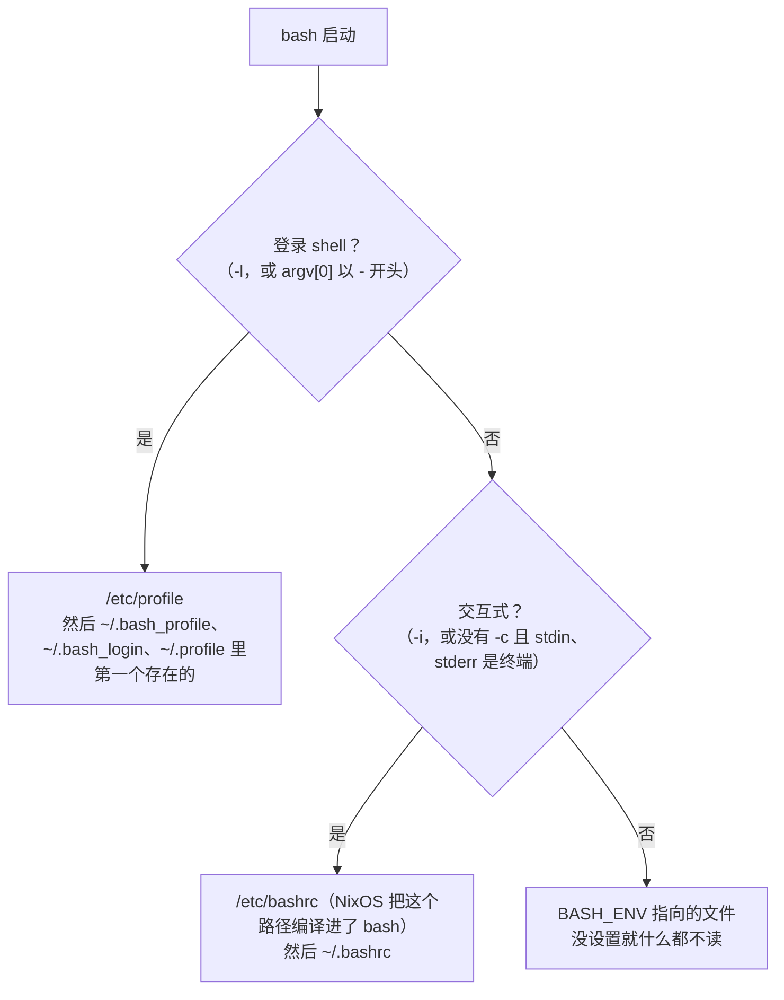

到第 8 篇为止，Cairn 的每个行为都有测试盯着，可它还有一个很土的毛病：`cairn verify 20261031T090000Z` 里那个 16 个字符的快照名，只能靠复制粘贴。补全就是为这个准备的，而补全是交互式 bash 独有的东西，脚本里没有 TAB 键。下面这段是真实的终端会话（我在一个伪终端里开了 `bash -i`，再按键）：先问 bash 有没有给 `cairn` 登记补全规则，然后 `source` 补全文件，最后敲 `cairn ver` 加一个 TAB，最后一行的 `verify` 是 TAB 补出来的：

```text
$ complete -p cairn
bash: complete: cairn: no completion specification
$ source "${CAIRN_ROOT}/completions/cairn.bash"
$ complete -p cairn
complete -F _cairn cairn
$ cairn verify
```

> [!NOTE] 本篇检查点
> 这一篇结束时仓库（标签 `ch09`）有 146 个被跟踪的文件，比 `ch08` 多 12 个：新增 `completions/cairn.bash`（141 行，最终版本）、`tests/completion.bats`（221 行，最终版本）和 `lab/ch09/` 里的 10 个实验脚本（最终版本）；另有两个旧文件被修改：`README.md`（63 行变 84 行，多了 “Shell completion” 一节，以后还会加内容）和 `flake.nix`（62 行变 64 行，开发 shell 里多了 bash-completion，以后可能还会改）。`make ch09` 通过：10 个实验全部 `ok`（`startup_cost_host.sh` 只在宿主机上跑，`CI=true` 时 `skip`）；`make test` 跑 115 个测试全部通过，比 `ch08` 多 22 个；`make ci` 在这台机器上整套 3 分 51 秒。
> 涉及的工具和特性：登录 shell 与交互式 shell 的启动文件、`BASH_ENV`、`$-` 与 `shopt -q login_shell`、别名与 `expand_aliases`、`PS0`/`PS1`/`PS4`、`${v@P}` 与 `PROMPT_COMMAND`、`HISTFILE`/`HISTCONTROL`/`HISTTIMEFORMAT`/`history -s`、readline 与 `~/.inputrc`、`bind`、作业控制与进程组 (`set -m`, `jobs -l`, `disown`)、可编程补全 (`complete`, `compgen`, `compopt`, `COMP_WORDS`, `COMP_CWORD`, `COMPREPLY`)、bash-completion 的按需加载目录，以及 [Google Shell 风格指南](https://google.github.io/styleguide/shellguide.html)里的[别名](https://google.github.io/styleguide/shellguide.html#s6.10-aliases)、[函数名](https://google.github.io/styleguide/shellguide.html#s7.1-function-names)和[文件扩展名](https://google.github.io/styleguide/shellguide.html#s2.1-file-extensions)三条规则。
> 前置：[第 8 篇：测试与工程化：bats、ShellCheck、shfmt 与定时运行](/posts/shell-by-cairn-08-testing-and-tooling/)。

这一篇的所有输出来自这台机器：NixOS 26.05，Linux 6.18.59，Bash 5.3.15（开发 shell 里的 `bashInteractive`，带 readline），bash-completion 2.18.0（开发 shell 里的那份；系统 `/etc/bashrc` 引用的是 2.17.0），Bats 1.14.0，ShellCheck 0.11.0，shfmt 3.13.1，hyperfine 1.20.0，rsync 3.4.4，procps-ng 4.0.6，util-linux 2.42.2（`setsid` 来自它），Python 3.13.17（只用来写一个伪终端小工具）。硬件是 AMD Ryzen 7 PRO 6850U，`nproc` 是 16，30 GiB 内存。仓库在我这里放在 `~/Projects/cairn`，你的会是 `~/cairn`；下面的输出里 `${CAIRN_ROOT}` 就是这个目录。

## 动手清单

你自己的 `~/cairn` 从第 8 篇的状态出发，这一篇要做这几件事，每件在哪一节出现都会指出来：

- 新建 `completions/cairn.bash` 和 `tests/completion.bats`。见 “补全：complete、compgen 与 COMPREPLY” 和 “bash-completion 与按需加载” 两节。
- 改 `README.md`（加 “Shell completion” 一节）和 `flake.nix`（开发 shell 里加 `bash-completion`，导出 `CAIRN_BASH_COMPLETION`）。见 “检查点” 一节。
- 新建 `lab/ch09/` 下的 10 个实验脚本，`make ch09` 全部跑一遍。其中七个在 “启动文件：谁读哪一个” 到 “作业控制与进程组” 各节里；`completion_demo.sh` 在 “不用终端的演示” 一节，`startup_cost_host.sh` 在 “bash-completion 与按需加载” 一节，`ex_prompt_last_snapshot.sh` 是练习 1 的答案。

直接从参考仓库复制的话，写法和前几篇一样（新增的目录要先建出来）：

```bash
git -C ~/cairn-ref fetch --tags
cd ~/cairn || exit 1
mkdir -p completions lab/ch09
mapfile -t files < <(git -C ~/cairn-ref diff --name-only ch08 ch09)
for f in "${files[@]}"; do
  git -C ~/cairn-ref show ch09:"${f}" >"${f}"
done
```

我在一个干净的 `~/cairn`（只含 `ch08` 的内容）里跑过这段，退出码 0，之后 `git -C ~/cairn-ref diff --name-only ch08 ch09` 列出的 14 个文件都在了。补全脚本也建议你自己敲一遍，再对着标签 `diff`：它只有 141 行，但每一行都有一个 “为什么不能这样写” 的故事。

## 全貌

交互式 bash 是三件事叠在一起：启动时读哪些文件，读完之后在屏幕上画什么（提示符、历史、readline 的按键表），以及你按键的时候它替你做什么（作业控制、补全）。Cairn 对这三件事一件也没有依赖，脚本里没有人在乎提示符；但它是被人敲出来的，所以这一篇的代码只有一个补全文件，其余全是实验。

先看第一件事。bash 怎样决定读哪些文件，取决于两个问题：它是不是登录 shell，是不是交互式的：



这张图是手册 “Bash Startup Files” 一节的缩写，我下面会用一个实验把每个箭头跑一遍，再看这台 NixOS 机器的 `/etc` 在中间插了什么。然后是 `$-`、别名、提示符、历史、readline、作业控制，最后回到补全：先拆开 bash 在 TAB 上做了什么，再读 `completions/cairn.bash`，用 bats 测它，用伪终端真按一次 TAB，量每次 TAB 花多少毫秒，最后看 bash-completion 的按需加载和它在启动时的价钱。


## 启动文件：谁读哪一个

`.bash_profile`、`.bashrc`、`.profile` 哪个会被读，我先不信记忆，让 bash 自己说：`lab/ch09/startup_files.sh` 就是干这个的。它在 `${LAB_TMP}/home` 里建一个假的 `HOME`，里面的 `.bash_profile`、`.bashrc`、`.profile`、`.bash_logout` 各自只打印一行 `read <自己的名字>`，然后用七种方式启动 bash，把每一次读到的文件按顺序列成一张表。核心是两个函数加一串调用（节选）：

```bash
write_files() {
  local name
  for name in .bash_profile .bashrc .profile .bash_logout; do
    printf 'echo "read %s"\n' "${name}" >"${home}/${name}"
  done
}
# ...
run_mode() {
  local label="$1"
  shift
  local -a vars=()
  while [[ "$1" == *=* ]]; do
    vars+=("$1")
    shift
  done
  local out
  # BASH_ENV 和 ENV 取自调用者的环境，先去掉，免得污染结果。
  # grep 只留下文件打印的行：NixOS 的退出脚本还会输出终端标题序列。
  out="$(env -u BASH_ENV -u ENV HOME="${home}" "${vars[@]}" \
    setsid --wait "$@" 2>>"${errors}" </dev/null | grep -a '^read ')"
  printf '%-48s %s\n' "${label}" "${out//$'\n'/, }"
}

write_files
: >"${errors}"
printf '%-48s %s\n' 'command' 'files read, in order'
run_mode 'bash -l -c :' bash -l -c :
run_mode 'bash -i -c :' bash -i -c :
run_mode 'bash -c :' bash -c :
run_mode "BASH_ENV=\$HOME/.bashrc bash -c :" \
  BASH_ENV="${home}/.bashrc" bash -c :
run_mode 'bash --noprofile --norc -i -c :' \
  bash --noprofile --norc -i -c :
```

`setsid --wait` 让被测的 bash 在一个新的会话里运行，没有控制终端；`</dev/null` 把标准输入也断开。这样不管我是在终端里、在 `make` 里还是在 CI 里跑这个实验，结果都一样。代价是 `bash -i` 起不来作业控制，会往 stderr 写警告，实验把警告收进一个文件，最后统计，而不是当作失败。这是这一节的实验的真实输出（22 行，前 8 行是矩阵）：

```text
$ cat out/ch09/startup_files.stdout
command                                          files read, in order
bash -l -c :                                     read .bash_profile
bash -i -c :                                     read .bashrc
bash -c :                                        
BASH_ENV=$HOME/.bashrc bash -c :                 read .bashrc
bash --noprofile --norc -i -c :                  
bash -l -i -c :                                  read .bash_profile
bash -l -c exit                                  read .bash_profile, read .bash_logout
--- login shell without .bash_profile: .profile is the fallback ---
bash -l -c :                                     read .profile
--- .bash_profile that sources .bashrc (the usual idiom) ---
bash -l -c :                                     read .bash_profile, read .bashrc
bash -l -i -c :                                  read .bash_profile, read .bashrc
bash -i -c :                                     read .bashrc
--- the real trace of bash -l -x -c : (file names masked) ---
+ . /etc/bashrc
+ echo 'read .bash_profile'
+ source $HOME/.bashrc
++ echo 'read .bashrc'
--- stderr of all runs above (job control, captured) ---
      5 bash: cannot set terminal process group (-1): Inappropriate ioctl for device
      5 bash: no job control in this shell
```

逐行读：

- `bash -l -c :` 只读了 `.bash_profile`。`-l` 让一个非交互式的 `-c` 命令也按登录 shell 处理。
- `bash -i -c :` 只读了 `.bashrc`。交互式但不是登录：不碰 `.bash_profile`。
- `bash -c :` 什么都没读。这是脚本和 `make` 配方的常态，也是为什么你写在 `.bashrc` 里的别名和函数在脚本里不存在。
- `BASH_ENV=$HOME/.bashrc bash -c :` 读了 `.bashrc`。非交互式 bash 唯一的启动文件入口就是 `BASH_ENV`：手册的说法是 bash 会这样执行 `if [ -n "$BASH_ENV" ]; then . "$BASH_ENV"; fi`。
- `bash --noprofile --norc -i -c :` 什么都没读。这两个选项就是为了把启动文件整个关掉，上一行里它们一起出现。
- `bash -l -i -c :` 只读了 `.bash_profile`，没有读 `.bashrc`。登录优先，交互式不再追加。
- `bash -l -c exit` 读了 `.bash_profile` 和 `.bash_logout`；而前面的 `bash -l -c :` 没读 `.bash_logout`。

最后一条值得多想一秒。手册的原话是：交互式登录 shell 退出时，或者非交互式登录 shell 执行了 `exit` 内建时，bash 才读 `~/.bash_logout`。`-c :` 是命令字符串自己跑完，没有人调用 `exit`，所以不读。这是我读手册时最容易略过的一句，也是我会觉得 “退出脚本不工作” 的原因之一。

stderr 那一段是 `5 bash: cannot set terminal process group (-1): Inappropriate ioctl for device` 和 `5 bash: no job control in this shell`：每次 `-i` 各一对，共 5 次（`-i`、`--noprofile --norc -i`、`-l -i` 在第一轮各一次，第三轮的 `-l -i` 和 `-i` 又各一次）。它们说的是同一件事：我用 `setsid` 拿掉了控制终端，bash 没法接管终端的进程组。后面 “作业控制与进程组” 一节会回到它。

### .bash_profile 里 source .bashrc

实验的第二段把 `.bash_profile` 删掉，登录 shell 就退到 `.profile`：

```text
--- login shell without .bash_profile: .profile is the fallback ---
bash -l -c :                                     read .profile
```

手册的顺序是 `~/.bash_profile`、`~/.bash_login`、`~/.profile`，读第一个存在而且可读的，其余不读。我只验证了 `.bash_profile` 和 `.profile` 这两个，中间的 `.bash_login` 我信手册。这也解释了一个很常见的坑：你在 `.profile` 里写了 `PATH`，后来某天创建了一个空的 `.bash_profile`，`.profile` 就悄悄不再被 bash 登录 shell 读了。

第三段是业界通用的写法：让 `.bash_profile` 去 `source ~/.bashrc`，登录 shell 和普通交互式 shell 的行为就一致了。实验里写的 `.bash_profile` 是这样的：

```bash
echo "read .bash_profile"
if [[ -f ~/.bashrc ]]; then
  source ~/.bashrc
fi
```

再跑同样的三行，结果和上面的矩阵比较：

```text
--- .bash_profile that sources .bashrc (the usual idiom) ---
bash -l -c :                                     read .bash_profile, read .bashrc
bash -l -i -c :                                  read .bash_profile, read .bashrc
bash -i -c :                                     read .bashrc
```

三种启动方式现在都读到了 `.bashrc`。最后一块证据是 `bash -l -x` 的真实跟踪，实验把路径里的 `HOME` 换成了 `$HOME`，只留下载入启动文件的几行：

```text
--- the real trace of bash -l -x -c : (file names masked) ---
+ . /etc/bashrc
+ echo 'read .bash_profile'
+ source $HOME/.bashrc
++ echo 'read .bashrc'
```

第一行不是我的文件，是 `/etc/profile` 里调用的 `. /etc/bashrc`，bash 读 `/etc/profile` 本身时不会打印那一行，所以看到的是它里面执行的命令。`++` 比 `+` 多一个加号，是因为 `echo 'read .bashrc'` 在一层 `source` 里面，bash 的 xtrace 每多一层嵌套就多一个 `PS4` 的第一个字符。[第 8 篇](/posts/shell-by-cairn-08-testing-and-tooling/)的 “bash -n、bash -x 与 PS4” 一节讲的就是这个前缀。

为什么要分成两个文件？因为环境变量和别名的命运不同。环境变量通过 `export` 进入环境，子进程继承，所以 `PATH` 这类东西只需要在登录时设一次；别名、函数、`PS1` 不会被继承，每个新的交互式 shell 必须重新建立一遍。我想在一个真的终端里看到这一点，这需要一个能在伪终端里替我按键的小工具。这一篇所有 “终端里的画面” 都是它打印的，我先把它贴出来：`pty_keys.py`，它不在仓库里。

它用 `pty.fork` 开一个伪终端，里面跑 `bash --norc --noprofile -i`，把命令行参数一个一个当作按键写进去，每写一个等 0.6 秒，最后把屏幕内容打印出来；`render` 把回车、退格和换行按终端的方式重放一遍，丢掉别的转义序列，所以 `^C` 这类东西会原样留在画面里。bash 是用 `--norc` 起的，提示符本来是 `bash-5.3$`，所以运行它之前我导出 `TERM=dumb`、`PS1='$ '` 和 `INPUTRC=/dev/null`，再把 `HOME` 指到一个临时目录，下面画面里的 `$ ` 就是这么来的。完整的 68 行（Python 3.13.17，`ruff format --line-length 79` 和 `ruff check` 都没有意见）：

```python
#!/usr/bin/env python3
"""Type keys into an interactive bash on a pty and print the screen.

Usage: pty_keys.py KEYS...  (each argument is sent, then output is awaited)
"""

import fcntl
import os
import pty
import re
import select
import struct
import sys
import termios
import time

SETTLE = 0.6  # seconds to wait after each argument


def drain(fd: int, seconds: float) -> bytes:
    """Read everything the pty prints during the given time."""
    out = b""
    end = time.monotonic() + seconds
    while time.monotonic() < end:
        ready, _, _ = select.select([fd], [], [], 0.05)
        if ready:
            out += os.read(fd, 65536)
    return out


def render(text: str) -> str:
    """Replay carriage returns and backspaces; drop other escapes."""
    text = re.sub(r"\x1b\[[0-9;?]*[A-Za-z]|\x07", "", text)
    lines: list[list[str]] = [[]]
    col = 0
    for ch in text:
        if ch == "\r":
            col = 0
        elif ch == "\n":
            lines.append([])
            col = 0
        elif ch == "\b":
            col = max(col - 1, 0)
        elif ch >= " ":
            row = lines[-1]
            row.extend(" " * (col - len(row)))
            row[col : col + 1] = ch
            col += 1
    return "\n".join("".join(row).rstrip() for row in lines)


def main() -> None:
    """Start bash -i, send every argument, print what the screen shows."""
    pid, fd = pty.fork()
    if pid == 0:
        os.execvp("bash", ["bash", "--norc", "--noprofile", "-i"])
    fcntl.ioctl(fd, termios.TIOCSWINSZ, struct.pack("HHHH", 24, 100, 0, 0))
    out = drain(fd, SETTLE)
    for keys in sys.argv[1:]:
        os.write(fd, keys.encode())
        out += drain(fd, SETTLE)
    print(render(out.decode(errors="replace")))
    os.close(fd)  # hang up the terminal: bash exits
    os.waitpid(pid, 0)


if __name__ == "__main__":
    main()
```

每个参数是一段按键，`$'...'` 是 bash 的 ANSI-C 引用，`\r` 是回车，`\t` 是 TAB，`\x03` 是 Ctrl-C。下面按两行命令，别名的确不会被子进程看到，环境变量会：

```bash
pty_keys.py $'alias hi=\'echo hi\'; export FOO=1\r' \
  $'bash --norc -c \'type hi; echo "FOO=${FOO}"\'\r'
```

```text
$ alias hi='echo hi'; export FOO=1
$ bash --norc -c 'type hi; echo "FOO=${FOO}"'
bash: line 1: type: hi: not found
FOO=1
$
```

屏幕上以 `$ ` 开头的两行是我按的键，其余两行是子 bash 的输出。

我不知道你的终端模拟器开的是登录 shell 还是非登录 shell，我在自己的机器上没有逐个核对。大多数桌面终端我记得默认开非登录的交互式 shell，这时 `.bash_profile` 根本不会被读；在 tty、ssh 登录和 macOS 的 Terminal 里则相反。判断办法有两个，一个是 `shopt -q login_shell`，一个是看 `$0`：登录 shell 的 `argv[0]` 以 `-` 开头。

```text
$ t='shopt -q login_shell && echo login || echo not login'
$ bash -c "exec -a -bash bash -c '${t}'"
login
$ bash -c "${t}"
not login
```

第二行里 `exec -a -bash` 把子进程的 `argv[0]` 改成了 `-bash`，它就成了登录 shell，这是手册对登录 shell 的定义（`argv[0]` 第一个字符是 `-`，或者带了 `--login`）。

手册还有一条我没法在这台机器上验证的规则：被 `rshd`、`sshd` 这类远程 shell 守护进程启动的 bash 也会读 `~/.bashrc`，即使它不是交互式的。这台机器没有跑 `sshd`，所以我没试，只当作手册说的。

### BASH_ENV 和 kcov

`BASH_ENV` 听起来像个冷门变量，但第 8 篇已经见过它的使用者。kcov 在 `make coverage` 里给每个被测脚本注入跟踪代码，靠的就是它：

```text
$ cat be.sh
#!/usr/bin/env bash
echo "BASH_ENV=${BASH_ENV-unset}"
$ kcov --bash-parser="$(command -v bash)" kout be.sh 2>/dev/null
BASH_ENV=kout/bash-helper.sh
```

kcov 把 `BASH_ENV` 指向它的 `bash-helper.sh`，每个 bash 脚本启动时先读它。第 8 篇里 `bash-helper-debug-trap.sh` 最后一行是 `unset BASH_ENV`，我猜是为了不让它再传给被测脚本的子进程，这下这个变量在那里的来历有了出处。


## NixOS 在 /etc 里放了什么

上面那条 `bash -l -x` 的第一行是 `. /etc/bashrc`，而手册里那张图没有 `/etc/bashrc` 这个文件。bash 可以在编译时写死一个 “系统范围的 rc 文件” 路径，NixOS 写的是 `/etc/bashrc`。证据在二进制里（我用的是开发 shell 里的 bash）：

```text
$ strings -a "$(readlink -f "$(command -v bash)")" \
    | grep -E "^/etc/(bash|profile)" | sort -u
/etc/bash_logout
/etc/bashrc
/etc/profile
```

三个路径都在字符串表里：`/etc/profile` 是手册里写的，`/etc/bash_logout` 和 `/etc/bashrc` 是编译进去的。光有字符串不代表 bash 真读了它，所以我写了一个一次性的草稿脚本 `etc_files.sh`（它不在仓库里）：用 `bash -x` 跑六种启动方式，`PS4` 里带上源文件名，看跟踪里有没有来自 `/etc/profile` 或 `/etc/bashrc` 的行。核心是这两个函数，再加上列出六种方式的 `main`：

```bash
#######################################
# Print yes or no: did the trace contain lines from the given file?
# Arguments:
#   Trace text, file name.
#######################################
ran() {
  if grep -qaE "^\++ $2:[0-9]+:" <<<"$1"; then
    echo yes
  else
    echo no
  fi
}

#######################################
# Run bash with the given options and print one row of the table.
# Globals:
#   home
# Arguments:
#   Options for bash.
#######################################
row() {
  local trace
  # PS4 must reach the child shell unexpanded.
  # shellcheck disable=SC2016
  trace="$(env -u BASH_ENV HOME="${home}" \
    PS4='+ ${BASH_SOURCE[0]:-bash}:${LINENO}: ' \
    setsid --wait bash "$@" -x -c : 2>&1 </dev/null)"
  printf '%-26s %-13s %s\n' "bash $* -c :" \
    "$(ran "${trace}" /etc/profile)" "$(ran "${trace}" /etc/bashrc)"
}

#######################################
# Print the table for six ways of starting bash.
# Globals:
#   home
#######################################
main() {
  home="$(mktemp -d)" || return 1
  printf '%-26s %-13s %s\n' command /etc/profile /etc/bashrc
  row -i
  row --norc -i
  row --noprofile -i
  row -l
  row -l --noprofile
  row -l -i
  rmdir "${home}"
}
```

真实输出：

```text
$ bash etc_files.sh
command                    /etc/profile  /etc/bashrc
bash -i -c :               no            yes
bash --norc -i -c :        no            no
bash --noprofile -i -c :   no            yes
bash -l -c :               yes           yes
bash -l --noprofile -c :   no            no
bash -l -i -c :            yes           yes
```

读法：`-i` 读 `/etc/bashrc`，不读 `/etc/profile`；`--norc` 把 `/etc/bashrc` 一起关掉了，所以 `--norc` 关的不只是 `~/.bashrc`；`--noprofile` 对交互式非登录 shell 没有影响；登录 shell 读 `/etc/profile`，而 `/etc/profile` 又把 `/etc/bashrc` 读进来，所以 `-l -c :` 两个都是 `yes`，`--noprofile` 把两个一起关掉。最后一条 `-l -i`，两个也都读到了。

这两个文件是什么样的？它们的第一行都是 “DO NOT EDIT -- this file has been generated automatically”，由 NixOS 的模块生成，生成它的具体是哪个选项我没有去翻 nixpkgs，下面只引这台机器上读到的内容。`/etc/profile` 一共 26 行，要紧的几行是：

```bash
# Only execute this file once per shell.
if [ -n "$__ETC_PROFILE_SOURCED" ]; then return; fi
__ETC_PROFILE_SOURCED=1

# Prevent this file from being sourced by interactive non-login child shells.
export __ETC_PROFILE_DONE=1

if [ -z "$__NIXOS_SET_ENVIRONMENT_DONE" ]; then
    . /nix/store/x1nrjhmkkb3w5qzk2agiycxxl3arzn9r-set-environment
fi
# ...
if [ -n "${BASH_VERSION:-}" ]; then
    . /etc/bashrc
fi
```

第 5 到 6 行是 “只执行一次” 的保护；第 9 行导出一个标记 `__ETC_PROFILE_DONE`，注释说它是为了让交互式的非登录子 shell 不要再读一遍这个文件；第 11 到 13 行载入 NixOS 的环境变量（`PATH` 等）；最后三行说：如果当前是 bash，就把 `/etc/bashrc` 也读进来。也就是说，手册建议每个人自己写的那句 “`.bash_profile` 里 source `.bashrc`”，NixOS 在系统一层已经替你写好了。

你的环境里如果已经有这两个标记，它们会往下传给所有子 shell。我的这一个终端里就有：

```text
$ env | grep -E '^__(ETC|NIXOS)'
__ETC_PROFILE_DONE=1
__NIXOS_SET_ENVIRONMENT_DONE=1
```

`/etc/bashrc` 一共 66 行，前面是保护和标记的检查，真正的内容在 `[ -n "$PS1" ]` 这个判断里面，也就是说只在交互式 shell 里生效：

```bash
if [ -n "$__ETC_BASHRC_SOURCED" ] || [ -n "$NOSYSBASHRC" ]; then return; fi
__ETC_BASHRC_SOURCED=1

# If the profile was not loaded in a parent process, source
# it.  But otherwise don't do it because we don't want to
# clobber overridden values of $PATH, etc.
if [ -z "$__ETC_PROFILE_DONE" ]; then
    . /etc/profile
fi

# We are not always an interactive shell.
if [ -n "$PS1" ]; then
    # Disable hashing (i.e. caching) of command lookups.
set +h
# ...
    PS1="\n\[\033[$PROMPT_COLOR\][\[\e]0;\u@\h: \w\a\]\u@\h:\w]\\$\[\033[0m\] "
  fi
  if test "$TERM" = "xterm"; then
    PS1="\[\033]2;\h:\u:\w\007\]$PS1"
  fi
# ...
eval "$(/nix/store/kwc34h21my8mf7xbqm9gxs1xfx07xb4i-coreutils-9.11/bin/dircolors -b )"
# ...
if shopt -q progcomp &>/dev/null; then
  . "/nix/store/1cnx874222bwskar75diqlv1d74pzhdl-bash-completion-2.17.0/etc/profile.d/bash_completion.sh"
# ...
alias -- l='ls -alh'
alias -- ll='ls -l'
alias -- ls='ls --color=tty'
```

这一段几乎是这一篇要讲的所有东西的预告：第 4 行的 `NOSYSBASHRC` 是一个开关（我后面量启动时间时用它把系统文件关掉）；第 15 行用 `[ -n "$PS1" ]` 判断是不是交互式，手册承认这种写法；第 27 行是 PS1，里面的 `\[...\]` 和 `\e]0;...\a` 是下面 “提示符” 一节的内容；第 34 行给 `ls` 准备颜色；第 42 到 43 行是 bash-completion 2.17.0，“bash-completion 与按需加载” 一节会量它花多少毫秒；第 55 到 57 行是三条别名，“别名” 一节会证明它们在脚本里不存在。`/etc/bashrc` 最后还会读 `/etc/bashrc.local`，`/etc/profile` 会读 `/etc/profile.local`，它们在这台机器上都不存在。

还有两个小文件。`/etc/bash_logout` 只有一句有用的话：`printf '\e]0;\a'`，把终端标题清空，这就是 `startup_files.sh` 里 `grep -a '^read '` 要过滤输出的原因：退出脚本打印的不只是我的 `read .bash_logout`。`/etc/inputrc` 是 37 行，第一行写着 “inputrc borrowed from CentOS (RHEL)”，第三行是 `set bell-style none`；它属于 “readline 与 ~/.inputrc” 一节。

### 开发 shell 里的 bash 和 nixpkgs 的 bash

还有一个只在 NixOS 上才会踩的坑，我在写这一篇的第一版伪终端工具时撞上了。`bash` 在 nixpkgs 里有两个包：`bash` 不带 readline，`bashInteractive` 带。前者没有 `complete`、没有 `bind`，连 `shopt progcomp` 都不认：

```text
$ "${plain}" --norc -i -c \
    'complete -p cairn; bind -p | wc -l; shopt progcomp' 2>&1 </dev/null \
    | grep -v -e "job control" -e "process group"
bash: complete: command not found
bash: bind: command not found
0
bash: shopt: progcomp: invalid shell option name
```

（`${plain}` 是 nixpkgs 的 `bash` 的路径 `/nix/store/byi2zpy2bgcf3dr6y0l8m50rmjj8z7q1-bash-5.3p15/bin/bash`。）

我当时的 `PATH` 里排在前面的正是这个 bash（它就是我这个会话里 `command -v bash` 的结果），所以所有 `complete` 都报 “command not found”。这也是 `flake.nix` 一开始就写 `bashInteractive` 的原因（第 20 行），而 `ch09` 加进来的 `bash-completion` 紧挨在它后面（第 21 行）。

### 我自己的 HOME

我的 `~/.bash_profile`、`~/.bashrc`、`~/.profile` 都是 home-manager 生成的符号链接，指进 `/nix/store`；我的日常 shell 是 zsh，`$SHELL` 就是它：

```text
$ echo "${SHELL}"
/run/current-system/sw/bin/zsh
$ readlink ~/.bashrc
/nix/store/c8xyk2dpfirjyg2cqi8wawgyp388kly4-home-manager-files/.bashrc
```

所以这一篇所有关于启动文件的实验都用假 `HOME`，不碰我真正的配置。话说在前面：这一篇讲的都是 bash 自己的机制，换成 zsh 之后规则不同，我没有拿 zsh 验证过其中任何一条。


## 我是交互式的吗：`$-`

`.bashrc` 里常见一句 “不是交互式就退出”。它的判断依据是特殊参数 `$-`：它里面是当前 shell 打开的所有单字母选项，交互式 shell 里有一个 `i`。`lab/ch09/dollar_dash.sh` 把同一段探针丢给七种启动方式，探针打印 `$-`，再打印 `shopt -q login_shell` 的结果（节选）：

```bash
# 探针要在子 shell 里才展开，所以用单引号。
# shellcheck disable=SC2016
probe='printf "%-10s login=%s\n" "$-" \
  "$(shopt -q login_shell && echo yes || echo no)"'
printf '%s\n' "${probe}" >"${LAB_TMP}/probe.sh"
# ...
show() {
  local label="$1"
  shift
  printf '%-36s ' "${label}"
  env -u BASH_ENV HOME="${home}" setsid --wait bash "$@" 2>/dev/null \
    </dev/null
}

show 'bash -c PROBE' -c "${probe}"
show 'bash -l -c PROBE' --noprofile -l -c "${probe}"
show 'bash -i -c PROBE' --norc -i -c "${probe}"
show 'bash -e -u -c PROBE' -e -u -c "${probe}"
show 'bash probe.sh' "${LAB_TMP}/probe.sh"
printf '%-36s ' 'bash -s < probe.sh'
env HOME="${home}" bash -s <"${LAB_TMP}/probe.sh"
printf '%-36s ' 'bash -i < probe.sh'
env HOME="${home}" setsid --wait bash --norc -i <"${LAB_TMP}/probe.sh" \
  2>/dev/null
```

`probe` 用单引号，是因为 `$-` 要到子 shell 里才展开；ShellCheck 看到单引号里的 `$` 会提醒你，所以上面有一行 `# shellcheck disable=SC2016`。`show` 和最后一个 `bash -i` 都在 `setsid --wait` 下运行，交互式的几行加了 `--norc`，免得 rc 文件改了选项，污染结果。真实输出：

```text
$ cat out/ch09/dollar_dash.stdout
bash -c PROBE                        hBc        login=no
bash -l -c PROBE                     hBc        login=yes
bash -i -c PROBE                     hiBHc      login=no
bash -e -u -c PROBE                  ehuBc      login=no
bash probe.sh                        hB         login=no
bash -s < probe.sh                   hBs        login=no
bash -i < probe.sh                   hiBHs      login=no
--- the usual test: is this shell interactive? ---
bash -c: not interactive
bash -i -c: interactive
```

字母的含义写在实验脚本的头注释里，我按这个输出来读：

| 字母 | 选项 | 在输出里的证据 |
| --- | --- | --- |
| `h` | hashall：记住命令在 `PATH` 里的位置 | 每一行都有；第 1 篇的 `hash` 就是它的缓存 |
| `B` | braceexpand：`{a,b}` 展开 | 每一行都有 |
| `H` | histexpand：`!!` 这类历史展开 | 只有交互式的两行 (`hiBHc`, `hiBHs`) |
| `i` | interactive | `bash -i -c` 和 `bash -i < probe.sh` |
| `c` | 命令来自 `-c` 字符串 | 所有 `-c` 的行 |
| `s` | 命令来自标准输入 | `bash -s <`、`bash -i <` 两行 |
| `e`、`u` | `errexit`、`nounset` | `bash -e -u -c` 的 `ehuBc`，第 7 篇的 `set -e` 在这里现了原形 |

两个细节。第一，登录与否不在 `$-` 里：`bash -l -c` 的 `$-` 和 `bash -c` 一样是 `hBc`，差别只在 `shopt -q login_shell` 那一列的 `yes`。第二，`m` 这个字母（monitor，作业控制）一个也没有：实验把每个交互式探针都放在 `setsid --wait` 下运行，子 shell 没有控制终端，开不了作业控制。所以不管实验是在终端里、在 `make` 里还是在 CI 里跑，`$-` 都是上面这些。

另外单独看一眼没有 `setsid` 的情形。这不是实验的输出，是我在伪终端里按键得到的：一个有控制终端的 `bash -i`，先敲 `echo $-`，再敲一条 `bash --norc -i -c 'echo $-'`：

```bash
pty_keys.py $'echo $-\r' $'bash --norc -i -c \'echo $-\'\r'
```

```text
$ echo $-
himBHs
$ bash --norc -i -c 'echo $-'
himBHc
$
```

`himBHs`：`h`、`i`、`m`、`B`、`H`、`s`，交互式 shell 一个都不少，`s` 是因为它读的是终端，不是 `-c` 字符串。第二行 `himBHc` 和实验里的 `hiBHc` 只差一个 `m`：有控制终端，bash 就打开了作业控制。`m` 的故事留到 “作业控制与进程组” 一节。

NixOS 的 `/etc/bashrc` 还会改它。第 17 行的 `set +h` 把 `h` 拿掉了，所以在这台机器上同样是交互式的 `-c`，带不带 `--norc` 差一个字母：

```text
$ env HOME="${fake_home}" setsid --wait bash -i -c 'echo $-' \
    2>/dev/null </dev/null
iBHc
$ env HOME="${fake_home}" setsid --wait bash --norc -i -c 'echo $-' \
    2>/dev/null </dev/null
hiBHc
```

实验的最后两行是标准用法，也是手册里写的那种：

```text
--- the usual test: is this shell interactive? ---
bash -c: not interactive
bash -i -c: interactive
```

手册给了两种判断：`case "$-" in *i*)`，或者看 `PS1` 有没有设置（非交互式 shell 里它是 unset 的）。NixOS 的 `/etc/bashrc` 用的是第二种，`[ -n "$PS1" ]`。我本来猜第二种会被环境里导出的 `PS1` 骗过去，试了一下，不会：非交互式 bash 启动时就把继承来的 `PS1` 丢掉了。

```text
$ env PS1='$ ' bash -c 'echo "PS1=[${PS1-unset}]"
> [[ $- == *i* ]] && echo interactive || echo not interactive'
PS1=[unset]
not interactive
```

两种写法在这一点上等价，我没有找到偏好一种的理由。

还有一个常被混淆的问题：“这个脚本的输出是不是在终端里” 和 “这个 shell 是不是交互式” 是两件事。前者用 `[[ -t 1 ]]` 问文件描述符 1，后者用 `$-`。同一条命令，直接跑和接管道，结果不一样：

```bash
pty_keys.py $'bash -c \'[[ -t 1 ]] && echo tty || echo no\'\r' \
  $'bash -c \'[[ -t 1 ]] && echo tty || echo no\' | cat\r'
```

```text
$ bash -c '[[ -t 1 ]] && echo tty || echo no'
tty
$ bash -c '[[ -t 1 ]] && echo tty || echo no' | cat
no
$
```

Cairn 的 `bin/` 和 `lib/` 里没有一行读 `$-`，也没有一行用 `-t`（我用 `grep` 查过）。

## 别名：交互式的便利，脚本里的陷阱

`lab/ch09/aliases_in_scripts.sh` 用同一个别名 `say` 写了四个小脚本，每个都用 `bash` 运行，并打印退出码。核心是 `run_script` 和四个脚本体（节选）：

```bash
run_script() {
  local label="$1"
  local name="$2"
  cat >"${name}"
  echo "--- ${label} ---"
  bash "${name}" 2>&1
  echo "exit status: $?"
}

run_script 'alias without expand_aliases' s1.sh <<'SCRIPT'
alias say='echo hello'
say
SCRIPT

run_script 'expand_aliases, alias defined on an earlier line' s2.sh <<'SCRIPT'
shopt -s expand_aliases
alias say='echo hello'
say
SCRIPT

# 同一行：bash 先读完整行再执行，执行 alias 时这一行已经解析过了。
run_script 'expand_aliases, alias defined and used on one line' s3.sh <<'SCRIPT'
shopt -s expand_aliases
alias say='echo hello'; say
SCRIPT

run_script 'the same thing as a function' s4.sh <<'SCRIPT'
say() { echo hello; }; say
SCRIPT
```

真实输出：

```text
$ cat out/ch09/aliases_in_scripts.stdout
--- alias without expand_aliases ---
s1.sh: line 2: say: command not found
exit status: 127
--- expand_aliases, alias defined on an earlier line ---
hello
exit status: 0
--- expand_aliases, alias defined and used on one line ---
s3.sh: line 2: say: command not found
exit status: 127
--- the same thing as a function ---
hello
exit status: 0
```

四个结果各对应一条规则：

- 非交互式的 bash 不展开别名。`alias say=...` 这一行执行了，但第 2 行的 `say` 只是一个不存在的命令：`command not found`，退出码 127（第 1 篇的退出码表里 127 就是它）。
- `shopt -s expand_aliases` 打开之后，定义在前一行的别名可以用了。
- 定义和使用写在同一行就不行。手册的说法是：bash 至少读完一整行（或者一个复合命令）才执行，别名是在命令被读入的时候展开，不是被执行的时候；所以同一行里刚定义的别名，在这一行被读入时还不存在。
- 函数没有这些问题，写在一行里照样能用。

[Google Shell 风格指南](https://google.github.io/styleguide/shellguide.html#s6.10-aliases)的态度很干脆：别名常见于 `.bashrc`，但脚本里应该避免，因为它们需要小心地引用和转义，错了又不容易发现；函数是它的超集，应该总是优先用函数。指南给的例子是 `alias random_name="echo some_prefix_${RANDOM}"`，`${RANDOM}` 在别名定义的时候展开一次，之后每次调用都是同一个值。Cairn 的 7 个 shell 库文件和 `bin/cairn` 里一个别名也没有（`grep` 过），这条规则我没有用上，但它帮我解释了一件事：为什么交互式 shell 里的 `ls` 带颜色，脚本里的 `ls` 不带，下面会看到 NixOS 的那条别名。

NixOS 在 `/etc/bashrc` 的第 55 到 57 行定义了 `l`、`ll` 和 `ls --color=tty`。非交互式的 bash 看不到它们，交互式的看得到：

```text
$ env HOME="${fake_home}" bash -c 'alias | wc -l'
0
$ env HOME="${fake_home}" setsid --wait bash -i -c alias 2>/dev/null </dev/null
alias l='ls -alh'
alias ll='ls -l'
alias ls='ls --color=tty'
```

这是一件好事：脚本里的 `ls` 永远是那个 `ls`，不会因为谁的 `.bashrc` 里写了 `alias ls='ls -F'` 而改变输出。


## 提示符：PS1、PS0、PS4 与 PROMPT_COMMAND

提示符没有什么神秘的地方：bash 在读下一条命令之前，把一个变量的值当作模板展开一次，然后打印出来。第 3 篇的参数展开表里有一行 `${v@P}`，说好 “第 9 篇再用”，现在用：它对一个变量做提示符展开，所以我不用终端就能看 `PS1` 会变成什么。`lab/ch09/prompt_expand.sh` 分三段，先是 `${PS1@P}`，然后让一个交互式 bash 从管道里读命令，打印 `PS1`、`PS0` 和 `PROMPT_COMMAND` 在它们该出现的位置，最后是 `PS4`（节选）：

```bash
echo "--- PS1 and \${PS1@P} ---"
PS1='\u@\h:\w\$ '
echo "PS1 is: ${PS1}"
mask "${PS1@P}"
PS1='\w \$ '
echo "PS1 is: ${PS1}"
echo "${PS1@P}"
PS1='jobs=\j \$ '
echo "PS1 is: ${PS1}"
echo "${PS1@P}"

echo '--- PS0, PS1 and PROMPT_COMMAND in an interactive bash ---'
# 提示符写在 stderr，所以合并两个输出；去掉没有终端时的作业控制警告。
{
  cat <<'COMMANDS'
PS1='ps1> '
PS0='[ps0] '
PROMPT_COMMAND='echo "[prompt_command]"'
echo first
echo second
COMMANDS
} | setsid --wait bash --norc -i 2>&1 \
  | grep -v -e '^bash: cannot set terminal' -e '^bash: no job control'
# ...
echo '--- PS4 with set -x ---'
PS4='+ line ${LINENO}: ' bash -x -c 'a=1
b=$((a + 1))
echo "b is ${b}"' 2>&1
printf '%s\n' 'f() { echo in f; }' 'f' >trace_me.sh
PS4='+${BASH_SOURCE[0]##*/}:${LINENO}:${FUNCNAME[0]:-main}: ' \
  bash -x trace_me.sh 2>&1
```

`mask` 是实验里的一个小函数，把真实的用户名和主机名换成 `USER` 和 `HOST`，免得每次输出都不一样。真实输出（28 行）：

```text
$ cat out/ch09/prompt_expand.stdout
--- PS1 and ${PS1@P} ---
PS1 is: \u@\h:\w\$ 
USER@HOST:~/src$ 
PS1 is: \w \$ 
~/src $ 
PS1 is: jobs=\j \$ 
jobs=0 $ 
--- PS0, PS1 and PROMPT_COMMAND in an interactive bash ---
bash-5.3$ PS1='ps1> '
ps1> PS0='[ps0] '
ps1> PROMPT_COMMAND='echo "[prompt_command]"'
[ps0] [prompt_command]
ps1> echo first
[ps0] first
[prompt_command]
ps1> echo second
[ps0] second
[prompt_command]
ps1> exit

--- PS4 with set -x ---
+ line 1: a=1
+ line 2: b=2
+ line 3: echo 'b is 2'
b is 2
+trace_me.sh:2:main: f
+trace_me.sh:1:f: echo in f
in f
```

第一段是模板展开。`\u@\h:\w\$ ` 变成 `USER@HOST:~/src$ `：`\u` 是用户名，`\h` 是主机名，`\w` 是当前目录，而且 `$HOME` 缩写成 `~`，`\$` 在普通用户下是 `$`（root 下是 `#`）。`\j` 是 shell 当前管理的作业数，这里是 0。完整的转义列表在手册的 [“Controlling the Prompt”](https://www.gnu.org/software/bash/manual/bash.html#Controlling-the-Prompt) 一节。

第二段看三个钩子的时机。第一行 `bash-5.3$` 是 bash 不带任何配置时的默认 `PS1`，它是 `\s-\v\$ `：`\s` 是 shell 的名字，`\v` 是版本，这一点我是在 `/etc/bashrc` 的跟踪里看到的 (`[ -n '\s-\v\$ ' ]`)。这个 bash 在 `setsid --wait` 下运行，没有控制终端，所以输出和实验在哪里启动无关。后面每个提示符之后的命令文字是回显：输入来自管道，终端没有替我显示。把输出对着输入逐行读：

- 敲完 `PS1='ps1> '` 并回车，下一个提示符就是 `ps1> `。
- 敲完 `PS0='[ps0] '` 之后，`PS0` 就生效了。它的位置是 “读完整条命令之后、执行之前”：下一行 `PROMPT_COMMAND=...` 回车的时候，终端打印了 `[ps0] `，然后才执行赋值。
- 紧接着 `[prompt_command]` 紧挨着 `[ps0] ` 出现在同一行，是因为赋值本身没有输出，而 `PROMPT_COMMAND` 在 “下一个 `PS1` 之前” 运行。所以那一行 `[ps0] [prompt_command]` 同时看见了两个钩子。
- `echo first` 之后是 `[ps0] first`、`[prompt_command]`，顺序是 `PS0`、命令的输出、`PROMPT_COMMAND`、新的 `PS1`。`PS0` 是一个很好的位置，用来记命令开始的时间；`PROMPT_COMMAND` 是记命令结束、或者往终端写标题的地方。

`PROMPT_COMMAND` 在 5.3.15 里可以是数组，每个元素依次运行，而且 `$?` 还是刚结束的那条命令的退出码。我用同样的伪终端工具验证了一遍（`pty_keys.py` 在前面 “.bash_profile 里 source .bashrc” 一节贴过）：

```bash
pty_keys.py $'PROMPT_COMMAND=("echo [pc1 status=\\$?]" "echo [pc2]")\r' \
  $'false\r' $'true\r'
```

```text
$ PROMPT_COMMAND=("echo [pc1 status=\$?]" "echo [pc2]")
[pc1 status=0]
[pc2]
$ false
[pc1 status=1]
[pc2]
$ true
[pc1 status=0]
[pc2]
$
```

`false` 之后 `$?` 是 1，`true` 之后是 0，两个元素各运行了一次。你要在提示符里显示上一条命令的退出码，这是最小的写法；`PS1` 里写 `$(...)` 也行，下面第一道练习就会用到它，代价是每次提示符都要起一个子进程。

### 提示符里的不可见字符

NixOS 的 `/etc/bashrc` 第 27 行是一个很好的例子：

```bash
    PS1="\n\[\033[$PROMPT_COLOR\][\[\e]0;\u@\h: \w\a\]\u@\h:\w]\\$\[\033[0m\] "
```

`\[\033[$PROMPT_COLOR\]` 和 `\[\e]0;\u@\h: \w\a\]` 是两段不可见的终端控制序列：前一段设置颜色，后一段把终端窗口的标题改成 `用户@主机: 目录`。手册对 `\[` 和 `\]` 的解释是 “开始和结束一段不可打印的字符”，它们要成对出现，因为 readline 需要知道提示符在屏幕上占几列，才能正确计算光标位置和换行。少了括号会怎样？手册没有展开，我也没有在伪终端里复现，我猜症状是长命令折行时光标位置错乱。你要是自己写提示符，加上它们。

### PS4 的另一半

第 8 篇的 [“bash -n、bash -x 与 PS4”](/posts/shell-by-cairn-08-testing-and-tooling/) 一节已经讲过 `PS4` 和 `BASH_XTRACEFD`，这里的实验只补一个用途：`set -x` 的每一行前缀就是 `PS4` 展开的结果。默认的 `+ ` 只告诉你 “这是一条被执行的命令”；换成 `+ line ${LINENO}: ` 多了行号；换成 `+${BASH_SOURCE[0]##*/}:${LINENO}:${FUNCNAME[0]:-main}: ` 就知道它在哪个文件、哪一行、哪个函数里（顶层没有函数，`${FUNCNAME[0]:-main}` 给了一个 `main`）。上面输出里 `+trace_me.sh:1:f: echo in f` 就是这样来的。`PS4` 在 `set -x` 的时候每一行都会重新展开，所以这里能用 `${LINENO}`。


## 历史：HISTFILE、HISTCONTROL 与 histappend

历史是两个东西：内存里的一个列表，和磁盘上的一个文件。控制它们的变量不多：`HISTFILE`（文件，默认 `~/.bash_history`）、`HISTSIZE`（内存里最多留多少条）、`HISTFILESIZE`（文件最多多少行）、`HISTCONTROL` 和 `HISTIGNORE`（哪些命令不记）、`HISTTIMEFORMAT`（要不要记时间），再加一个 shell 选项 `histappend`。不带任何配置的交互式 bash 里，默认值是这样的（伪终端里的真实屏幕，`HOME` 是我的实验目录）：

```bash
pty_keys.py $'echo "HISTSIZE=${HISTSIZE} HISTFILESIZE=${HISTFILESIZE}"\r' \
  $'echo "HISTFILE=${HISTFILE}"\r' $'shopt histappend\r'
```

```text
$ echo "HISTSIZE=${HISTSIZE} HISTFILESIZE=${HISTFILESIZE}"
HISTSIZE=500 HISTFILESIZE=500
$ echo "HISTFILE=${HISTFILE}"
HISTFILE=/tmp/demo-home/.bash_history
$ shopt histappend
histappend          off
$
```

`HISTSIZE` 和 `HISTFILESIZE` 都是 500，`histappend` 是 `off`。`lab/ch09/history_demo.sh` 分三段，都不依赖真终端。第一段在 `bash -c` 里用 `history -s` 往历史里塞命令，看 `HISTCONTROL=ignoreboth` 过滤谁；第二段让一个交互式 bash（在 `setsid --wait` 下运行，没有控制终端）从管道读命令，退出时检查它写出的 `HISTFILE`；第三段是 `HISTTIMEFORMAT`（节选）：

```bash
bash --norc -c 'set -o history
HISTCONTROL=ignoreboth
history -s "echo one"
history -s "echo one"
history -s " echo hidden by a leading space"
history -s "echo two"
history'
# ...
} | HISTFILE="${histfile}" PS1='$ ' setsid --wait bash --norc -i 2>&1 \
  | grep -v -e '^bash: cannot set terminal' -e '^bash: no job control'
# ...
printf '#%s\n%s\n' 1793437200 'ls -l' 1793440800 'cd /tmp' >"${histfile}"
# ...
HISTFILE="${histfile}" TZ=UTC bash --norc -c 'set -o history
history -c; HISTTIMEFORMAT="%F %T "; history -r; history'
```

真实输出（38 行）：

```text
$ cat out/ch09/history_demo.stdout
--- 1: history -s and HISTCONTROL=ignoreboth ---
    1  HISTCONTROL=ignoreboth
    2  echo one
    3  echo two
    4  history
--- 2: HISTFILE written by an interactive shell ---
$ HISTCONTROL=ignoreboth
$ echo one
one
$ echo one
one
$  echo hidden by a leading space
hidden by a leading space
$ echo two
two
$ history
    1  HISTCONTROL=ignoreboth
    2  echo one
    3  echo two
    4  history
$ exit
--- the file after exit ---
HISTCONTROL=ignoreboth
echo one
echo two
history
--- 3: HISTTIMEFORMAT on a file with timestamps ---
file content:
#1793437200
ls -l
#1793440800
cd /tmp
history with HISTTIMEFORMAT=%F %T (TZ=UTC):
    1  2026-10-31 09:00:00 ls -l
    2  2026-10-31 10:00:00 cd /tmp
history without HISTTIMEFORMAT:
    1  ls -l
    2  cd /tmp
```

第一段：`ignoreboth` 是 `ignorespace` 加 `ignoredups` 的简写，前者不记以空格开头的命令，后者不记和上一条相同的命令。结果是 4 条：`HISTCONTROL=ignoreboth` 本身（它是在设置生效之前被读入的，所以留下了），第一个 `echo one`（第二个是重复，被丢了），`echo two`（以空格开头的那条没有记），最后的 `history`。脚本注释里还有一句：`history -s` 会先把当前这一行从历史里删掉再添加参数，我没有单独去验证这一句。

第二段是同样的命令，这次是一个真的交互式 shell 读的，它在退出时把内存里的 4 条写进了文件：磁盘上的内容和 `history` 打印的完全一致，`echo one` 只有一行，带前导空格的那一行不在。一个细节：最后的 `$ exit` 是 bash 读到管道的 EOF 时自己打印的，它不是我敲的，也没有进文件。

第三段看时间戳。手册说 `HISTTIMEFORMAT` 一旦设置，bash 写历史文件时会在每条命令前加一行 `#<秒数>`；这个实验不依赖这一点，直接手写了这样的文件再读回来：`history` 按格式打印时间，`1793437200` 在 `TZ=UTC` 下是 `2026-10-31 09:00:00`，和 `date` 的换算一致：

```text
$ date -u -d @1793437200 '+%F %T'
2026-10-31 09:00:00
$ date -u -d @1793440800 '+%F %T'
2026-10-31 10:00:00
```

没有设置 `HISTTIMEFORMAT` 时 `history` 不显示时间，只有序号和命令（输出的最后两行）。

### 到底是追加还是覆盖

手册对 `histappend` 的描述是：设置了就追加，否则覆盖历史文件。手册的这句话我原本是照单全收的，所以做了个实验：两个交互式 bash 共用一个 `HISTFILE`，都不设 `histappend`；A 先开、后退出，B 后开、先退出。如果 “覆盖” 是真的，最后退出的 A 会把 B 写的盖掉，文件里只剩 A 的命令。脚本 `hist_two_shells.sh` 不在仓库里（节选）：

```bash
session() {
  printf '%s\n' "$@" \
    | env HOME="${FAKE_HOME}" setsid --wait bash --norc -i >/dev/null 2>&1
}

session 'echo from_A_1' 'sleep 1.5' 'echo from_A_2' &
sleep 0.3
session 'echo from_B_1' 'echo from_B_2'
wait
cat "${FAKE_HOME}/.bash_history"
rm -r "${FAKE_HOME}"
```

```text
$ bash hist_two_shells.sh
echo from_B_1
echo from_B_2
echo from_A_1
sleep 1.5
echo from_A_2
```

B 的两条和 A 的三条都在，B 在前、A 在后：A 退出时是追加，不是覆盖。

我去看了 bash 源码里的 `maybe_save_shell_history`（取自 [bash-5.3 分支上的 `bashhist.c`](https://git.savannah.gnu.org/cgit/bash.git/plain/bashhist.c?h=bash-5.3)，我取回来的那一份，不一定逐字节等于 5.3.15）：

```c
	  /* Now actually append the lines if the history hasn't been
	     stifled.  If the history has been stifled, rewrite the
	     history file. */
	  using_history ();
	  if (history_lines_this_session <= where_history () || force_append_history)
	    {
	      result = append_history (history_lines_this_session, hf);
```

注释说得很清楚：“只要历史没有被 stifle，就追加；如果被 stifle 过，就重写整个文件”。我猜 `history_lines_this_session <= where_history ()` 在平常的会话里总是成立，所以平常就是追加，不管有没有 `histappend`；`histappend` 只是 `|| force_append_history` 那一半，用来在不平常的情况下也强制追加。什么是不平常的情况？历史列表被截短了，比如 `HISTSIZE` 设得比文件里已有的行数小。我把这个情形做成一个草稿脚本 `hist_stifle.sh`（它不在仓库里）：

```bash
FAKE_HOME="$(mktemp -d)" || exit 1
readonly FAKE_HOME

try() {
  local label="$1"
  shift
  printf 'old1\nold2\nold3\n' >"${FAKE_HOME}/.bash_history"
  printf '%s\n' "$@" \
    | env HOME="${FAKE_HOME}" setsid --wait bash --norc -i >/dev/null 2>&1
  printf '%-22s -> %s\n' "${label}" \
    "$(paste -sd, "${FAKE_HOME}/.bash_history")"
}

try 'default' 'echo new1' 'echo new2'
try 'HISTSIZE=2' 'HISTSIZE=2' 'echo new1' 'echo new2'
try 'HISTSIZE=2, histappend' 'HISTSIZE=2' 'shopt -s histappend' \
  'echo new1' 'echo new2'
rm -r "${FAKE_HOME}"
```

```text
$ bash hist_stifle.sh
default                -> old1,old2,old3,echo new1,echo new2
HISTSIZE=2             -> echo new1,echo new2
HISTSIZE=2, histappend -> old1,old2,old3,echo new1,echo new2
```

`HISTSIZE=2` 的那一行，旧的三行没有了，只剩下新的两行：历史列表被截到 2 条，文件被整个重写。加上 `shopt -s histappend` 之后旧的三行全在。所以 “不设 `histappend` 会覆盖” 的准确说法是：历史被截短的时候才会。这也解释了为什么大家会有 “有时候丢历史” 的印象，却又很难稳定复现。我只在 5.3.15 上试过，别的版本的行为我不知道。

### HISTIGNORE 和别的

`HISTIGNORE` 是另一种过滤方式：它是一个冒号分隔的模式列表，整行命令匹配其中任何一个就不记。它和 `HISTCONTROL` 可以同时用。比如 “不记 `ls`、`cd` 和 `history`” 要写成 `HISTIGNORE='ls:ls *:cd:cd *:history*'`，第二个练习会用到。`history -a` 把这个会话新增的行追加到文件，`history -n` 把别的会话新追加的行读进来，`history -r` 读，`history -w` 写，这些是手册 [“Bash History Builtins”](https://www.gnu.org/software/bash/manual/bash.html#Bash-History-Builtins) 一节的内容，把它们放进 `PROMPT_COMMAND` 常被用来让多个会话同步，这一点我没有在这一篇验证。


## readline 与 ~/.inputrc

你在提示符后面按 Ctrl-A 回到行首、Ctrl-R 搜索历史、方向键回忆上一条命令，这些都不是 bash 的代码，是它链接的 GNU readline 库：我的理解是 bash 把每个按键交给 readline，回车之后才拿回整行字符串。所以编辑行的行为（键位、响铃、补全时怎么显示候选）归 readline 管，配置文件也不是 `.bashrc`，是 `~/.inputrc`。`lab/ch09/readline_bind.sh` 用 `bind` 内建把键位表读出来数一数（节选）：

```bash
bind_in_bash() {
  env -u INPUTRC HOME="${home}" setsid --wait bash --norc -i -c "$1" \
    2>/dev/null
}

echo '--- how many lines does bind -p print? ---'
echo "bash -i -c 'bind -p' 2>/dev/null | wc -l"
bind_in_bash 'bind -p' | wc -l
echo 'of which bound to a function (not starting with #):'
bind_in_bash 'bind -p' | grep -vc '^#'
echo 'of which commented out (function without a key):'
bind_in_bash 'bind -p' | grep -c '^#'
# ...
echo '--- the same lines with ~/.inputrc ---'
cat >"${home}/.inputrc" <<'INPUTRC'
# 上箭头改成按已输入的前缀搜索历史；关掉响铃。
"\e[A": history-search-backward
set bell-style none
INPUTRC
cat "${home}/.inputrc"
bind_in_bash 'bind -p' | grep -E '^"\\e\[A":'
bind_in_bash 'bind -v' | grep bell-style
echo 'lines of bind -p with that ~/.inputrc:'
bind_in_bash 'bind -p' | wc -l
```

`HOME` 是假的，所以 `~/.inputrc` 是实验自己写的那一份；`env -u INPUTRC` 去掉调用者的 `INPUTRC`，不然它会盖过 `~/.inputrc`。每个 `bash -i` 都在 `setsid --wait` 下运行，没有控制终端，结果和实验在哪里启动无关。真实输出（25 行）：

```text
$ cat out/ch09/readline_bind.stdout
--- how many lines does bind -p print? ---
bash -i -c 'bind -p' 2>/dev/null | wc -l
498
of which bound to a function (not starting with #):
405
of which commented out (function without a key):
93
--- a few bindings (emacs mode, the default) ---
"\e\C-?": backward-kill-word
"\C-a": beginning-of-line
"\C-e": end-of-line
"\e[A": previous-history
"\C-r": reverse-search-history
"\C-w": unix-word-rubout
--- which keys call a function (bind -q) ---
reverse-search-history can be invoked via "\C-r".
clear-screen can be invoked via "\C-l".
--- the same lines with ~/.inputrc ---
# 上箭头改成按已输入的前缀搜索历史; 关掉响铃。
"\e[A": history-search-backward
set bell-style none
"\e[A": history-search-backward
set bell-style none
lines of bind -p with that ~/.inputrc:
488
```

数字先放在这里：这台机器上，不带任何用户配置的交互式 bash，`bind -p` 打印 498 行，其中 405 行是 “某个按键序列绑到了某个函数”，93 行是以 `#` 开头的 “这个函数没有绑定任何键”（格式是 `# 函数名 (not bound)`）。405 个绑定，我日常大概只用其中十几个（估计，没数过）；`Ctrl-A`、`Ctrl-E`、`Ctrl-R`、`Ctrl-W`、上箭头这几个，输出里都在，和我手指的记忆一致：`\C-a` 是 `beginning-of-line`，`\C-r` 是 `reverse-search-history`，`\C-w` 是 `unix-word-rubout`，`\e[A`（上箭头）是 `previous-history`。`bind -q 函数名` 反过来问，哪些键调用它。

498 这个数字是从哪来的？readline 读的配置文件有顺序：`$INPUTRC` 如果设置了就读它，否则读 `~/.inputrc`，再不然读 `/etc/inputrc`。实验最后一个数字 (488) 是写了一个两行的 `~/.inputrc` 之后的结果，比 498 少了 10，原因就是 `~/.inputrc` 把系统的 `/etc/inputrc` 替换掉了，不是追加。我把三种配置各量了一遍，再 `diff` 它们的 `bind -p`，看每一行从哪来（`bind_diff.sh` 是草稿，不在仓库里，输出里的 `-u INPUTRC` 是 `env` 的 “把这个变量从环境里去掉”）：

```bash
bind_p() {
  env "$@" setsid --wait bash --norc -i -c 'bind -p' 2>/dev/null </dev/null
}

mkdir "${HOME_DIR}/none" "${HOME_DIR}/user"
printf '%s\n' '"\e[A": history-search-backward' 'set bell-style none' \
  >"${HOME_DIR}/user/.inputrc"

echo '--- ~/.inputrc against the library defaults ---'
diff <(bind_p INPUTRC=/dev/null) \
  <(bind_p -u INPUTRC HOME="${HOME_DIR}/user")
echo '--- /etc/inputrc against the library defaults: lines only in it ---'
diff <(bind_p INPUTRC=/dev/null) \
  <(bind_p -u INPUTRC HOME="${HOME_DIR}/none") | grep -c '^>'
rm -r "${HOME_DIR}"
```

```text
$ bash bind_diff.sh
--- ~/.inputrc against the library defaults ---
141c141
< # history-search-backward (not bound)
---
> "\e[A": history-search-backward
177d176
< "\e[A": previous-history
--- /etc/inputrc against the library defaults: lines only in it ---
9
```

再跑几条命令：前三条是计数，后两条是非交互式的 `bash -c "bind -p"`（见下一小节）：

```text
$ INPUTRC=/dev/null setsid --wait bash --norc -i -c "bind -p" \
    2>/dev/null </dev/null | wc -l
489
$ INPUTRC=/etc/inputrc setsid --wait bash --norc -i -c "bind -p" \
    2>/dev/null </dev/null | wc -l
498
$ bash --norc -i -c "bind -l" 2>/dev/null </dev/null | wc -l
176
$ bash -c "bind -p" 2>&1 >/dev/null | head -n 1
bash: line 1: bind: warning: line editing not enabled
$ bash -c "bind -p" 2>/dev/null | wc -l
498
```

读法：

- `INPUTRC=/dev/null`：库的默认值，489 行。
- 默认（没有 `~/.inputrc`）：`/etc/inputrc` 生效，498 行，比默认多的 9 行是 Home、End（两种序列）、Delete、Insert、PageUp、PageDown 和 Ctrl 加左右方向键的键序列（`diff` 输出里那 9 行 `>` 就是它们）。
- 两行的 `~/.inputrc`：488 行。比库的默认值少 1，因为 `"\e[A": history-search-backward` 做了两件事：把 `# history-search-backward (not bound)` 那一行变成了一条真的绑定，同时把 `"\e[A": previous-history` 那一行拿掉了。一加一减，净减 1；而 `/etc/inputrc` 里的 9 条键位这时并不在，因为 `~/.inputrc` 替换了它。

`/etc/inputrc` 就是前面提过的那个文件，37 行，开头是 “inputrc borrowed from CentOS (RHEL)”。它的语法就是 `~/.inputrc` 的语法，所以把它当范本很合适：

```text
set bell-style none

set meta-flag on
set input-meta on
set convert-meta off
set output-meta on
set colored-stats on

#set mark-symlinked-directories on

$if mode=emacs

# for linux console and RH/Debian xterm
"\e[1~": beginning-of-line
```

第 3 行 `set bell-style none` 是配置变量，等价于 `bind 'set bell-style none'`；`$if mode=emacs` 到 `$endif` 是条件块；`"\e[1~": beginning-of-line` 是键位绑定。这里最后一行是键位绑定，格式是 `"键序列": 函数名`，键序列里 `\e` 是 Esc，`\C-` 是 Ctrl。`bind -v` 把所有变量打印出来，`bind -l` 列出全部 176 个函数名。

### 非交互式的 bash 里也有键位表

非交互式的 `bash -c 'bind -p'` 照样打印键位表，另外在 stderr 写一句 `bind: warning: line editing not enabled`。上面最后两条命令就是证据：第一条把 stdout 丢掉，只看到那句警告；第二条把 stderr 丢掉，stdout 有全部 498 行。键位表在非交互式 shell 里照样存在，只是没有人会按键。实验里的 `bind` 都在 `bash -i` 里跑，所以没有这句警告。


## 作业控制与进程组

第 7 篇已经用过两样东西：实验开头的 `set -m`，和用 `kill -INT -- -PGID` 模拟 Ctrl-C。当时只需要它们生效，这一节讲它们为什么生效。bash 的作业 (job) 是它为一条命令或管道起的那组进程；打开作业控制（monitor 模式，`$-` 里的 `m`）之后，每个作业放进自己的进程组，shell 再告诉终端 “现在谁是前台”。键盘产生的信号（Ctrl-C 的 SIGINT，Ctrl-Z 的 SIGTSTP）送到的是整个前台进程组，不是某一个进程。手册对这一点说得很直接：和终端的进程组 ID 相同的进程是前台进程，其余是后台进程，后者对键盘产生的信号免疫。

`lab/ch09/job_control.sh` 用一个后台的 `sleep 30` 把这几件事分别摆出来：`set -m` 打开，看进程组；`set +m` 关掉，再看一遍；`disown` 把作业从表里拿掉。脚本把真实的 PID 换成名字（`SHELL` 是脚本自己的 bash，`JOB` 是后台的 `sleep`，`GROUP` 是脚本所在的进程组），所以输出每次都一样。主体（节选）：

```bash
echo '--- set -m: the job gets its own process group ---'
set -m
sleep 30 &
job=$!
wait_until_asleep "${job}"
echo 'jobs -l:'
jobs -l | mask_pids "${job}"
echo 'ps -o pid,pgid,stat,cmd:'
show_ps "${job}"
kill %1
wait "${job}"
echo "kill %1, then wait: status $?"
echo "jobs after that: $(jobs | wc -l) line(s)"

echo "--- set +m: the job stays in the shell's group ---"
set +m
sleep 30 &
job=$!
wait_until_asleep "${job}"
show_ps "${job}"
kill "${job}"
wait "${job}"

echo '--- disown: still running, no longer in the job table ---'
set -m
sleep 30 &
job=$!
disown
echo "jobs: $(jobs | wc -l) line(s)"
if kill -0 "${job}" 2>/dev/null; then
  echo 'the process is still alive'
fi
kill "${job}"
wait "${job}"
echo 'killed with kill PID'
```

真实输出：

```text
$ cat out/ch09/job_control.stdout
--- set -m: the job gets its own process group ---
jobs -l:
[1]+ JOB Running                    sleep 30 &
ps -o pid,pgid,stat,cmd:
    PID    PGID STAT CMD
SHELL GROUP S bash job_control.sh
JOB JOB S sleep 30
kill %1, then wait: status 143
jobs after that: 0 line(s)
--- set +m: the job stays in the shell's group ---
    PID    PGID STAT CMD
SHELL GROUP S bash job_control.sh
JOB GROUP S sleep 30
--- disown: still running, no longer in the job table ---
jobs: 0 line(s)
the process is still alive
killed with kill PID
```

- `jobs -l` 的一行 `[1]+ JOB Running sleep 30 &`：`[1]` 是作业号，`+` 表示它是 “当前作业”（`%+` 或 `%%` 指它），`-l` 让输出多了 PID；`Running` 是状态。
- `ps` 的两行是这一节最重要的一段：脚本自己是 `SHELL GROUP`（PID 一个，PGID 是它所在的进程组），而 `sleep` 是 `JOB JOB`，它的 PGID 等于它自己的 PID。`set -m` 之后每个作业是自己进程组的组长，组 ID 就是组长的 PID。
- `kill %1` 用作业号而不是 PID 发 SIGTERM，`wait` 返回 143，也就是 128 加 15，和第 7 篇的退出码表一致；作业死了，`jobs` 就空了。
- `set +m` 之后，同样的 `sleep 30 &` 变成 `JOB GROUP`：它没有自己的组，留在脚本的组里。这是所有脚本的默认状态，因为非交互式的 bash 默认不开作业控制。这个实验在 `scripts/chapter.sh` 里跑，GNU `timeout` 会把被测脚本放进自己的进程组，所以 `GROUP` 是 `timeout(1)` 的进程组，不是终端的前台进程组。如果直接在终端里跑 `bash job_control.sh`，脚本和 `set +m` 之后的后台 `sleep` 在同一个前台进程组里，按 Ctrl-C，信号会送给它们两个，第 7 篇 “前台的 sleep 5：为什么 trap 晚到” 一节里它们是一起死的。
- `disown` 把最近的作业从作业表里删掉，`jobs` 变成 0 行，但进程还活着（`kill -0` 成功），之后只能用 PID 去杀它。

### 在真的终端里看一次

脚本里没有终端，所以 `TPGID`（终端的前台进程组）看不到。用前面贴过的 `pty_keys.py`：它在伪终端里跑 `bash -i`，我在里面启动 `cairn snapshot`，用 `CAIRN_BWLIMIT=40`（第 5 篇引入的，让 rsync 限速到 40 KiB/s）把一份 600 KB 的随机文件拖慢到足够按键，然后按 Ctrl-Z (`\x1a`) 把它停住，看 `jobs -l` 和 `ps`，再 `bg`，再看一次 `ps`：

```bash
pty_keys.py $'cairn snapshot\r' $'\x1a' $'jobs -l\r' \
  $'ps -o pid,pgid,tpgid,stat,cmd -t "$(tty)"\r' $'bg\r' \
  $'ps -o pid,pgid,tpgid,stat,cmd -t "$(tty)"\r'
```

```text
$ cairn snapshot
^Z
[1]+  Stopped                    cairn snapshot
$ jobs -l
[1]+ 3714808 Stopped                    cairn snapshot
$ ps -o pid,pgid,tpgid,stat,cmd -t "$(tty)"
    PID    PGID   TPGID STAT CMD
3714807 3714807 3714824 Ss   bash --norc --noprofile -i
3714808 3714808 3714824 T    bash /home/bfmhno3/Projects/cairn/bin/cairn snapshot
3714820 3714808 3714824 T    rsync --archive --relative --delete --numeric-ids --stats --bwlimit=40
3714821 3714808 3714824 T    rsync --archive --relative --delete --numeric-ids --stats --bwlimit=40
3714822 3714808 3714824 T    rsync --archive --relative --delete --numeric-ids --stats --bwlimit=40
3714824 3714824 3714824 R+   ps -o pid,pgid,tpgid,stat,cmd -t /dev/pts/0
$ bg
[1]+ cairn snapshot &
$ ps -o pid,pgid,tpgid,stat,cmd -t "$(tty)"
    PID    PGID   TPGID STAT CMD
3714807 3714807 3714827 Ss   bash --norc --noprofile -i
3714808 3714808 3714827 S    bash /home/bfmhno3/Projects/cairn/bin/cairn snapshot
3714820 3714808 3714827 S    rsync --archive --relative --delete --numeric-ids --stats --bwlimit=40
3714821 3714808 3714827 S    rsync --archive --relative --delete --numeric-ids --stats --bwlimit=40
3714822 3714808 3714827 S    rsync --archive --relative --delete --numeric-ids --stats --bwlimit=40
3714827 3714827 3714827 R+   ps -o pid,pgid,tpgid,stat,cmd -t /dev/pts/0
$
```

`ps` 里的 PID 每次都不同，别的不变。读法：

- 第一次 `ps`：`bash`（shell 自己，`Ss`，会话组长）一个，`cairn` 脚本一个，`rsync` 三个，再加上 `ps` 自己（最后一行，`R+`），一共六行。`cairn` 脚本和三个 `rsync` 都是 `T` (stopped)。除了 shell 和 `ps`，这四个进程的 PGID 都是 `3714808`，也就是 `cairn` 脚本的 PID：脚本是这个作业的组长，rsync 是它的子孙，在同一个组里。Ctrl-Z 是一次按键，一个信号送给整个组，所以四个一起停。
- `TPGID` 是终端当前的前台进程组。前后两次 `ps`，它是最后一行 `ps` 自己的组（`R+`，前台进程）：交互式 shell 在命令结束或停止之后，把终端拿回来，再为下一条命令 (`ps`) 创建一个新的前台进程组。
- `bg` 让作业接着跑：`[1]+ cairn snapshot &`，第二次 `ps` 里它们的状态变成 `S`，没有 `+`，也就不是前台。四个进程和 `bg` 之前一样一起恢复。

Ctrl-Z 和 `bg` 对 `cairn snapshot` 不需要任何代码，bash 和内核替它做了。

### 关掉终端会怎样

关终端和只给脚本的 PID 发一个 HUP 是两件事，这一节用真的终端做一遍。`pty_hangup.py` 开一个伪终端，里面跑 `bash -i`，让它启动 `cairn snapshot`，两秒后直接关掉伪终端，再看还剩什么。它也不在仓库里，完整如下（和 `pty_keys.py` 一样，`ruff format --line-length 79` 和 `ruff check` 都没有意见）：

```python
#!/usr/bin/env python3
"""Run cairn snapshot in bash -i on a pty, then close the terminal."""

import os
import pty
import subprocess
import time


def running() -> list[str]:
    """Return the ps lines of the cairn script and its rsync processes."""
    ps = subprocess.run(
        ["ps", "-eo", "pid,pgid,stat,args"],
        capture_output=True,
        text=True,
        check=True,
    )
    return [
        line[:78]
        for line in ps.stdout.splitlines()
        if "bin/cairn snapshot" in line or "rsync --archive" in line
    ]


def main() -> None:
    """Start a snapshot, close the terminal, show what is left."""
    pid, fd = pty.fork()
    if pid == 0:
        os.execvp("bash", ["bash", "--norc", "--noprofile", "-i"])
    time.sleep(0.5)
    os.write(fd, b"cairn snapshot\r")
    time.sleep(2)
    print("terminal open:")
    print("\n".join(running()))
    os.close(fd)
    os.waitpid(pid, 0)
    time.sleep(2)
    print("2 s after closing the terminal:")
    print("\n".join(running()) or "(nothing)")


if __name__ == "__main__":
    main()
```

```text
$ CAIRN_BWLIMIT=40 pty_hangup.py
terminal open:
3716226 3716226 S+   bash /home/bfmhno3/Projects/cairn/bin/cairn snapshot
3716238 3716226 S+   rsync --archive --relative --delete --numeric-ids --stats
3716239 3716226 S+   rsync --archive --relative --delete --numeric-ids --stats
3716240 3716226 S+   rsync --archive --relative --delete --numeric-ids --stats
2 s after closing the terminal:
(nothing)
$ ls repo/snapshots
20261101T161550Z.partial
$ flock -n repo/.lock true && echo lock is free
lock is free
$ cairn snapshot
cairn: warning: removing stale 20261101T161550Z.partial
cairn: snapshot 20261101T161554Z: 1 files, 600000 bytes transferred in 0 s
20261101T161554Z
$ ls repo/snapshots
20261101T161554Z
$ cat repo/logs/cairn.log
2026-11-01T08:15:54-0800 INFO snapshot name=20261101T161554Z status=ok files=1 bytes=600000 seconds=0
```

关掉终端之后，两秒钟里脚本和三个 rsync 全消失了，锁也释放了：`flock -n` 立刻拿到。原因是手册 [“Signals”](https://www.gnu.org/software/bash/manual/bash.html#Signals) 一节说的：shell 收到 SIGHUP 会退出，退出之前，交互式 shell 把 SIGHUP 重发给所有作业（运行中的或停止的），必要时先发 SIGCONT 把停止的唤醒；作业是进程组，整个组都收到了（内核对前台进程组的挂断和 bash 退出前的重发，我没有分开验证，结果是整组都死了）。`cairn` 脚本没有 HUP 陷阱，默认动作是死，rsync 自己处理 SIGHUP 也是退出。

代价在别处：`ls repo/snapshots` 看到了 `...Z.partial`，`cairn.log` 里一行关于这一次的记录都没有，也就是没有 `status=interrupted`。下一次 `cairn snapshot` 才靠第 7 篇 “SIGKILL 与陈旧的 partial” 一节的清理把它收拾掉，并打印那条 `removing stale` 警告。这有点出人意料：`cairn` 的 `EXIT` 陷阱本来会删掉 `.partial`，第 7 篇练习 3 里只给脚本一个 HUP 时它就删了，这一次没有。我的猜测是 `bash -i` 重发的那个 HUP 在清理到一半时又把脚本杀了一次，这个猜测我没有验证。所以更准确的说法是：关终端不会留下握着锁的 rsync，但会留下一个 `.partial` 和一份缺失的日志。

“rsync 还活着，锁被持有” 的那种情形在只给脚本一个 SIGHUP 的时候才出现。同一个仓库上，我对着脚本的 PID（不是进程组）发 `kill -HUP`，用的是一个一次性的草稿脚本 `hup_pid_only.sh`，它不在仓库里。核心就是这几行（`CAIRN_CONFIG` 指向那个仓库的配置，`cairn` 在 `PATH` 里）：

```bash
CAIRN_BWLIMIT=40 cairn snapshot &
pid=$!
sleep 2
kill -HUP "${pid}"
wait "${pid}"
echo "cairn exit status: $?"
sleep 1
echo "rsync processes left: $(pgrep -c -x rsync)"
if flock -n repo/.lock true; then
  echo 'lock is free'
else
  echo 'lock is held'
fi
pkill -x rsync
```

```text
$ bash hup_pid_only.sh
hup_pid_only.sh: line 11: 74323 Hangup                     CAIRN_BWLIMIT=40 cairn snapshot
cairn exit status: 129
rsync processes left: 3
lock is held
rsync error: received SIGINT, SIGTERM, or SIGHUP (code 20) at rsync.c(716) [sender=3.4.4]
rsync error: received SIGINT, SIGTERM, or SIGHUP (code 20) at io.c(519) [generator=3.4.4]
```

脚本以 129 退出，三个 rsync 还在，锁还被它们握着，和第 7、8 篇说的一致：那两篇说的是只给脚本的 PID 发 HUP 的情形。关终端时的区别在于信号发给了整个进程组，不是一个进程。我没有改 `cairn`，HUP 陷阱仍然是缺的。


## 补全：complete、compgen 与 COMPREPLY

这一篇唯一的项目代码是 `completions/cairn.bash`。它让下面这些事发生：`cairn ver` 加 TAB 补成 `verify`，`-c` 后面补配置文件，`init` 后面补目录，`verify` 和 `diff` 后面补快照名，快照名是实时从 `cairn list` 读出来的。我先把 bash 在你按下 TAB 时做的事拆开讲，再读文件。

### 按下 TAB 时 bash 交给函数什么

`complete -F _cairn cairn` 这一行在 bash 里登记一条规则：“命令名是 `cairn` 的命令行，按 TAB 时调用函数 `_cairn`”。bash 在调用之前先填好几个变量，函数从里面读现场，再往一个数组变量 `COMPREPLY` 里放候选。手册的说法是：函数被调用时，`$1` 是命令名，`$2` 是正在补全的那个词，`$3` 是它前面的词；另外还会设置 `COMP_LINE`（整行文字）、`COMP_POINT`（光标在行里的位置）、`COMP_WORDS`（切好的词的数组）和 `COMP_CWORD`（光标所在的词在 `COMP_WORDS` 里的下标）。

我用一个真的终端看它们长什么样。伪终端里定义一个 `_dump` 函数，把这四个变量写到文件 `d`，登记给 `cairn`，敲一行带 `=` 的命令后按 TAB，再按 Ctrl-C 放弃这一行 (`^C`)，最后 `cat d`（`pty_keys.py` 在 “.bash_profile 里 source .bashrc” 一节里贴过）：

```bash
pty_keys.py $'_dump() { declare -p COMP_{LINE,POINT,WORDS,CWORD} >d; }\r' \
  $'complete -F _dump cairn\r' $'cairn -c my.conf --config=etc/o\t' \
  $'\x03' $'cat d\r' $'printf "%q\\n" "${COMP_WORDBREAKS}"\r'
```

```text
$ _dump() { declare -p COMP_{LINE,POINT,WORDS,CWORD} >d; }
$ complete -F _dump cairn
$ cairn -c my.conf --config=etc/o^C
$ cat d
declare -- COMP_LINE="cairn -c my.conf --config=etc/o"
declare -- COMP_POINT="31"
declare -a COMP_WORDS=([0]="cairn" [1]="-c" [2]="my.conf" [3]="--config" [4]="=" [5]="etc/o")
declare -- COMP_CWORD="5"
$ printf "%q\n" "${COMP_WORDBREAKS}"
$' \t\n"\'@><=;|&(:'
$
```

三件事要看清楚。`COMP_LINE` 是整行字符串，`COMP_POINT=31` 是光标位置（这一行恰好 31 个字符，光标在最后）。`COMP_WORDS` 把 `--config=etc/o` 切成了三个词：`--config`、`=`、`etc/o`，因为 `=` 在 `COMP_WORDBREAKS` 里（最后一行 `printf '%q'` 打出来的就是它：空格、制表符、换行、双引号、单引号、`@`、`>`、`<`、`=`、`;`、`|`、`&`、`(`、`:`）。所以 `cairn --config=etc/o` 补全要处理的是 “前一个词是 `=`，再前一个是 `--config`” 这样的形状，这是 `_cairn` 里那段看着奇怪的 `--config=` 代码的来源。最后，`COMP_CWORD=5` 指向 `etc/o`，也就是光标所在的词，下标从 0 开始，`cairn` 是第 0 个。

函数只管把候选放进 `COMPREPLY`，怎么显示、要不要补公共前缀、要不要在后面加空格，是 readline 的事。产生候选，bash 提供了内建命令 `compgen`：给它一类来源和一个前缀，它把匹配的候选打印出来。第 7 篇已经用过它的 `-G`（展开通配符，查 `.partial` 在不在），补全用到的是另外三个：`-W 列表` 从一个以空白分隔的词表里挑，`-f` 列出文件名，`-d` 列出目录名。

```text
compgen -W 'help init list' -- i: init
compgen -d -- e: etc
```

这是 `lab/ch09/completion_demo.sh` 输出的最后几行，下面 “不用终端的演示” 一节会看到它的全貌。`--` 不能省：前缀如果以 `-` 开头（比如 `--v`），不加 `--` 的话 `compgen` 会报 `invalid option`。

### completions/cairn.bash

整个文件 141 行，开头是一段头注释，说明三种启用方式，然后是两个辅助函数、`_cairn` 和最后一行 `complete`。Google 指南要求[库文件以 `.sh` 结尾](https://google.github.io/styleguide/shellguide.html#s2.1-file-extensions)，这个文件叫 `cairn.bash`，不遵守这一条，原因是文件名不是我定的：bash-completion 按需加载补全时找的是 `<命令名>.bash` 或者 `<命令名>`（“bash-completion 与按需加载” 一节读它的源码）。第 8 篇的 `tests/test_helper.bash` 也是这样，名字由 bats 的 `load` 约定。文件第一行是 `# shellcheck shell=bash`，因为它没有 shebang：库文件不该有，ShellCheck 就需要这条指令才知道它是 bash。

先看取快照名的辅助函数：

```bash
#######################################
# Print the snapshot names of the repository, oldest first.
# Arguments:
#   Optional config file, passed to cairn as -c.
# Outputs:
#   One name per line; nothing when `cairn list` fails.
#######################################
_cairn_snapshot_names() {
  local -a cmd=(cairn)
  if [[ -n "${1:-}" ]]; then
    cmd+=(-c "$1")
  fi
  cmd+=(list)
  local -a lines
  readarray -t lines < <("${cmd[@]}" 2>/dev/null)
  local i
  # 第 0 行是表头 (NAME FILES SIZE)，跳过；每行第一列是快照名。
  # 名字按空白切下第一列：名字里带空格的快照不会整个补全出来，
  # 但补全也不会因此出错。
  for ((i = 1; i < ${#lines[@]}; i++)); do
    printf '%s\n' "${lines[i]%% *}"
  done
}
```

`cairn list` 的第一行是表头 (`NAME FILES SIZE`)，后面每行第一列是快照名，所以循环从下标 1 开始，`${lines[i]%% *}` 把第一个空格之后的所有东西去掉。`readarray -t lines < <(...)` 是 Google 指南[“Pipes to While”](https://google.github.io/styleguide/shellguide.html#s6.8-pipes-to-while)一节推荐的写法：进程替换，不是 `... | while read`，所以 `lines` 留在当前 shell 里。`2>/dev/null` 是补全的规矩：补全函数里的命令如果往 stderr 写东西，它直接落在你正在编辑的那一行上。我故意让一个补全函数去读不存在的配置文件，看会怎样：

```bash
pty_keys.py \
  $'_noisy() { cairn -c /nonexistent list; COMPREPLY=(abc); }\r' \
  $'complete -F _noisy foo\r' $'foo a\t'
```

```text
$ _noisy() { cairn -c /nonexistent list; COMPREPLY=(abc); }
$ complete -F _noisy foo
$ foo acairn: error: no config file at /nonexistent (run 'cairn init REPO' first)
bc
```

错误消息被插进了 `foo a` 和 `bc` 之间（`abc` 是函数给出的候选，补成 `foo abc`），编辑的那一行就是一团。如果 `cairn list` 失败（没有配置文件，仓库坏了），这个函数什么都不输出，上面就补不出名字，而不是报错。`local -a cmd=(cairn)` 用数组拼命令行，之后 `"${cmd[@]}"` 展开；有 `-c` 的时候把 `-c FILE` 也加进去，这样 `cairn -c my.conf verify <TAB>` 读的是 `my.conf` 指向的仓库，不是默认的那个。

名字取到了，下一步是按前缀筛。最直接的写法是 `compgen -W "${names[*]}" -- "${cur}"`，但 `compgen -W` 会把词表当作 shell 文本再展开一遍。快照名来自 `cairn list` 的输出，是数据，不该被当成代码；名字里要是有 `$(...)`，按一次 TAB 就会执行它：

```text
$ compgen -W 'x $(echo EXECUTED >&2) y' -- ''
EXECUTED
x
y
```

所以仓库里的版本用一个循环做前缀比较，名字只被当作字符串，从不展开：

```bash
#######################################
# Fill COMPREPLY with the snapshot names that start with a prefix.
# The names come from the repository, so they are data: they are compared
# in a loop, never expanded (compgen -W would expand a name such as
# $(cmd) when TAB is pressed).
# Globals:
#   COMPREPLY
# Arguments:
#   The prefix, then the names.
#######################################
_cairn_reply_names() {
  local prefix="$1" name
  shift
  COMPREPLY=()
  for name in "$@"; do
    if [[ "${name}" == "${prefix}"* ]]; then
      COMPREPLY+=("${name}")
    fi
  done
}
```

`tests/completion.bats` 里有一条测试专门盯这一点，下面会看到。

接着是 `_cairn`，前半段处理 “前一个词是 `-c` 或 `--config`” 的情况：

```bash
_cairn() {
  local -r options='-c --config -n --dry-run -v --verbose -q --quiet
    -h --help --version'
  local -r commands='help init snapshot list verify diff prune report'
  local cur="${COMP_WORDS[COMP_CWORD]}"
  local prev="${COMP_WORDS[COMP_CWORD - 1]:-}"
  COMPREPLY=()

  # --config=FILE: '=' is a word break, so it is a word of its own.
  local want_file=0
  if [[ "${cur}" == = && "${prev}" == --config ]]; then
    cur=''
    want_file=1
  elif [[ "${prev}" == = && "${COMP_WORDS[COMP_CWORD - 2]:-}" == --config ]] \
    || [[ "${prev}" == -c || "${prev}" == --config ]]; then
    want_file=1
  fi
  if ((want_file == 1)); then
    compopt -o filenames 2>/dev/null || :
    readarray -t COMPREPLY < <(compgen -f -- "${cur}")
    return 0
  fi
```

`cur` 是光标所在的词，`prev` 是它前面的词；`${COMP_WORDS[COMP_CWORD - 1]:-}` 里的 `:-` 只是给 `set -u` 准备的默认值：补全时 `COMP_CWORD` 实际上总是 >= 1（第 0 个词是命令名本身），所以这个下标一定存在。（我还试了下标 -1：bash 5.3 里 `a=(x y z); echo "${a[-1]:-}"` 打印的是最后一个元素 `z`，不是空。）条件里三种形状：

- `cur` 恰好是 `=` 而 `prev` 是 `--config`：光标紧跟在 `=` 后面，刚敲完 `cairn --config=`，词是空的，要补文件；
- `prev` 是 `=`、再前面是 `--config`：`--config=etc/o` 敲到一半；
- `prev` 是 `-c` 或 `--config`：`-c etc/o`。

三种都走 `compgen -f -- "${cur}"`，结果经 `readarray -t COMPREPLY < <(...)` 放进 `COMPREPLY`。不用 `COMPREPLY=($(compgen -f ...))` 是有原因的：后者对命令替换的结果做分词和通配符展开，文件名里带空格就会被拆开（ShellCheck 的 [SC2207](https://www.shellcheck.net/wiki/SC2207) 说的就是这个）。我拿两个带空格的文件试了：

```text
$ cd "${dir}" && ls
my file.conf
my other.conf
$ COMPREPLY=($(compgen -f -- "my f")); echo "${#COMPREPLY[@]}"
2
$ readarray -t COMPREPLY < <(compgen -f -- "my f"); echo "${#COMPREPLY[@]}"
1
```

同一个文件名，不加引号的写法得到两个候选（`my` 和 `file.conf`），`readarray` 得到一个。这几条命令是我在一个放了两个带空格文件的目录里直接敲的，没有放进仓库。

`compopt -o filenames 2>/dev/null || :` 这一行的作用是告诉 readline：这些候选是文件名，请按文件名的规矩处理，手册的说法是 “比如给目录加斜杠，给特殊字符加引号，不要在末尾加空格”。差别可以看得到：同一个终端里，同一个按键 `cairn -c my\ f` 加 TAB，有 `compopt` 的版本补成 `my\ file.conf`（空格被转义了），把 `compopt` 那几行去掉的版本补成 `my file.conf`，整个词被 shell 拆成两个词，命令是错的：

```bash
echo '--- with compopt -o filenames'
pty_keys.py $'source "${CAIRN_ROOT}/completions/cairn.bash"\r' \
  $'cairn -c my\\ f\t'
echo '--- the same file without the compopt lines'
pty_keys.py $'source nocompopt.bash\r' $'cairn -c my\\ f\t'
```

```text
--- with compopt -o filenames
$ source "${CAIRN_ROOT}/completions/cairn.bash"
$ cairn -c my\ file.conf
--- the same file without the compopt lines
$ source nocompopt.bash
$ cairn -c my file.conf
```

尾部的 `2>/dev/null || :` 也有原因。`compopt` 只能在补全函数运行的时候调用，别的时候它是错误的：

```text
$ bash --norc -c 'compopt -o filenames; echo "status=$?"'
bash: line 1: compopt: not currently executing completion function
status=1
```

`tests/completion.bats` 是直接调用 `_cairn` 的，没有真的补全，所以 `compopt` 会失败，要吞掉错误消息并且用 `|| :` 保证状态是 0。这是为了让函数能被测试，付出的代价是一个看起来很可疑的写法，所以才需要这一段话。

第二段是找出命令词和它后面已经有几个参数：

```bash
  # 找命令词和它之后的参数个数; -c/--config 的值要跳过, 并记下配置文件。
  local config='' command='' word
  local -i nargs=0 i
  for ((i = 1; i < COMP_CWORD; i++)); do
    word="${COMP_WORDS[i]}"
    if [[ -n "${command}" ]]; then
      nargs=$((nargs + 1))
      continue
    fi
    case "${word}" in
      -c | --config)
        i=$((i + 1))
        if [[ "${COMP_WORDS[i]:-}" == = ]]; then
          i=$((i + 1))
        fi
        config="${COMP_WORDS[i]:-}"
        ;;
      -*) ;;
      *) command="${word}" ;;
    esac
  done

  if [[ -z "${command}" ]]; then
    readarray -t COMPREPLY < <(compgen -W "${options} ${commands}" -- "${cur}")
    return 0
  fi
```

循环从 `i=1` 到光标前一个词。如果命令词 `command` 已经找到，后面的每个词都算作 “命令的参数”，`nargs` 加 1。没找到的时候，用 `case` 判断：`-c`/`--config` 是带值的选项，要多跳一个词（`--config = FILE` 的情形再多跳一个 `=`），并记下配置文件；其他以 `-` 开头的是不带值的选项，跳过；第一个不以 `-` 开头的词就是命令。算术都写成 `i=$((i + 1))` 和 `nargs=$((nargs + 1))`，不写 `((i++))`：后者在 `i` 是 0 的时候返回非 0 的退出状态，这条规则第 4 篇已经出现过。`--`（选项结束）会被 `-*) ;;` 当作不带值的选项跳过，所以 `cairn -- verify <TAB>` 照样补得出名字，`tests/completion.bats` 里有一条测试盯着它。

如果命令词还没有出现，补的就是选项和命令名本身：

```bash
pty_keys.py $'source "${CAIRN_ROOT}/completions/cairn.bash"\r' \
  $'cairn \t' $'\t'
```

```text
$ source "${CAIRN_ROOT}/completions/cairn.bash"
$ cairn
-c         --dry-run  help       -n         --quiet    -v         --version
--config   -h         init       prune      report     --verbose
diff       --help     list       -q         snapshot   verify
$ cairn
```

这是 `options` 和 `commands` 两个字符串拼起来的：11 个选项词加 8 个命令，一共 19 个候选（上面三行共 7 + 6 + 6 = 19 个；顺序是 readline 排的，不是 `commands` 里的顺序。）

最后一段按命令分派：

```bash
  local -a names
  case "${command}" in
    init)
      if ((nargs < 1)); then
        compopt -o filenames 2>/dev/null || :
        readarray -t COMPREPLY < <(compgen -d -- "${cur}")
      fi
      ;;
    verify)
      if ((nargs < 1)); then
        readarray -t names < <(_cairn_snapshot_names "${config}")
        _cairn_reply_names "${cur}" "${names[@]}"
      fi
      ;;
  # ...
    *) ;;
  esac
  return 0
}

complete -F _cairn cairn
```

`init` 只补一个目录 (`nargs < 1`)，用 `compgen -d`，同样要 `compopt -o filenames`；`verify` 补一个快照名，`diff` 补两个，名字来自 `_cairn_snapshot_names`，每次 TAB 都要执行一次 `cairn list`；`*) ;;` 是 “别的命令不补”，`snapshot`、`list`、`prune`、`report`、`help` 都落在这里。名字交给 `_cairn_reply_names` 筛，它用循环做前缀比较，名字从不被展开，所以名字里带 `$(...)` 也不会执行任何东西。名字里带空格的快照会在 `_cairn_snapshot_names` 里被切到第一个空格为止，补出来的名字是不完整的，但 `cairn` 自己生成的名字是时间戳，没有空格，所以我没有为它多写代码。最后一行 `complete -F _cairn cairn` 才是登记。

两处函数写法上的选择，Google 指南各有一条。函数叫 `_cairn` 而不是 `cairn::completion::main`：[指南](https://google.github.io/styleguide/shellguide.html#s7.1-function-names)说库函数可以用 `::` 做命名空间，但 “在交互式 shell 里做自动补全时，冒号分隔的名字表现不好，所以这种场合不要用”。我试了一下，确实如此，带冒号的函数名补不出来，下划线的可以：

```bash
echo '--- colons'
pty_keys.py $'cairn::log::err() { :; }\r' $'cairn::log::e\t'
echo '--- underscores'
pty_keys.py $'cairn_log_err() { :; }\r' $'cairn_log_e\t'
```

```text
--- colons
$ cairn::log::err() { :; }
$ cairn::log::e
--- underscores
$ cairn_log_err() { :; }
$ cairn_log_err
```

（`cairn::log::e` 加 TAB 没有任何反应，`cairn_log_e` 补成了完整的 `cairn_log_err`。原因我猜是前面看到的 `COMP_WORDBREAKS` 里有 `:`，readline 把 `cairn::log::e` 从最后一个冒号切开，只拿 `e` 去找命令；这个原因我没有单独验证，现象是实测的。）开头的下划线是 bash-completion 自己函数的惯例，它的 `bash_completion` 文件里的 `_comp_load`、`_comp_complete_load` 都是（下一节会读到）；`_cairn_snapshot_names`、`_cairn_reply_names` 和 `_cairn` 照这个惯例。另一条是[函数注释](https://google.github.io/styleguide/shellguide.html#s4.2-function-comments)：每个函数都要有头注释，写明它读写的全局变量、参数和输出。三个函数都有，各自只写用得上的几项：`Globals:`、`Arguments:`、`Outputs:`。


### 不用终端的演示

`lab/ch09/completion_demo.sh` 建一个有三个快照的演示仓库，`source` 补全文件，然后手工填 `COMP_WORDS` 和 `COMP_CWORD` 再调用 `_cairn`：这正是按 TAB 时 bash 替你做的事，只是没有终端。核心是 `tab` 函数和开头的三条 `tab` 调用（节选）：

```bash
failed=0

#######################################
# Complete a command line as if TAB were pressed on its last word.
# Arguments:
#   Expected result (space separated, sorted), then the words of the
#   command line; the last word is the one being completed.
# Globals:
#   failed
#######################################
tab() {
  local expected="$1"
  shift
  COMP_WORDS=("$@")
  COMP_CWORD=$(($# - 1))
  _cairn
  local got
  # compgen -f 按目录顺序列出，排序后输出才稳定。
  got="$(printf '%s\n' "${COMPREPLY[@]}" | LC_ALL=C sort | paste -sd ' ')"
  printf '%-34s -> %s\n' "$*<TAB>" "${got}"
  if [[ "${got}" != "${expected}" ]]; then
    printf '  expected: %s\n' "${expected}"
    failed=1
  fi
}

tab 'verify' cairn ver
tab 'etc/cairn.conf etc/other.conf' cairn -c etc/
tab '20261029T090000Z 20261030T090000Z 20261031T090000Z' cairn verify ''
# ...
```

真实输出（17 行）：

```text
$ cat out/ch09/completion_demo.stdout
complete -p cairn: complete -F _cairn cairn
cairn ver<TAB>                     -> verify
cairn -c etc/<TAB>                 -> etc/cairn.conf etc/other.conf
cairn verify <TAB>                 -> 20261029T090000Z 20261030T090000Z 20261031T090000Z
--- more cases ---
cairn --config = etc/o<TAB>        -> etc/other.conf
cairn init et<TAB>                 -> etc
cairn diff 20261029T090000Z 20261031<TAB> -> 20261031T090000Z
cairn diff 20261029T090000Z 20261030T090000Z <TAB> -> 
cairn --v<TAB>                     -> --verbose --version
cairn list <TAB>                   -> 
--- the builtins underneath ---
compgen -W 'help init list' -- i: init
compgen -d -- e: etc
cairn list header and rows, as the completion reads them:
NAME               FILES     SIZE$
20261029T090000Z          8      68K$
```

`compgen -f` 按目录顺序列文件，所以 `tab` 先排序再比较，不然这个实验在别的文件系统上会时灵时不灵。最后两行是 `cairn list` 的表头和第一行，也就是 `_cairn_snapshot_names` 读到的东西：表头跳过，第二行的第一列是快照名。`tab` 对每一个用例都比较结果和预期，一共 9 个：开头三个，`more cases` 下面六个。哪一个不符合预期，`failed` 就置 1，实验以 1 退出，`make ch09` 就会报错。

### tests/completion.bats

补全函数有一个很适合测试的性质：它只读 `COMP_WORDS`、`COMP_CWORD`，只写 `COMPREPLY`，所以不需要终端。`tests/completion.bats` 有 22 个测试，骨架是三个辅助函数。`complete_words` 模拟 “光标在最后一个词上按 TAB”，`stub_cairn` 定义一个同名函数顶替 `cairn`（函数比 `PATH` 里的外部命令优先，第 1 篇讲过解析顺序），它把参数记进文件、打印表头和三行快照，`sorted_reply` 把 `COMPREPLY` 排序后并成一行（`compgen -f` 按目录顺序列文件，测试不能依赖这个顺序）：

```bash
complete_words() {
  COMP_WORDS=("$@")
  COMP_CWORD=$(($# - 1))
  _cairn
}
# ...
stub_cairn() {
  cairn() {
    printf '%s\n' "$*" >"${BATS_TEST_TMPDIR}/stub_args"
    if [[ -n "${STUB_FAIL:-}" ]]; then
      return 1
    fi
    printf 'NAME               FILES     SIZE\n'
    printf '%-18s %8s %8s\n' 20261029T090000Z 13 1.2K \
      20261030T090000Z 14 3.0K 20261031T090000Z 14 0
  }
}

sorted_reply() {
  printf '%s\n' "${COMPREPLY[@]}" | LC_ALL=C sort | paste -sd ' '
}
```

几个测试（节选）：

```bash
@test "first word: a prefix completes to the matching command" {
  complete_words cairn ver
  assert_equal "${COMPREPLY[*]}" verify
}
# ...
@test "after -c: files" {
  touch cairn.conf other.conf notes.txt
  complete_words cairn -c ca
  assert_equal "${COMPREPLY[*]}" cairn.conf
  complete_words cairn --config ''
  assert_equal "$(sorted_reply)" 'cairn.conf notes.txt other.conf'
}
# ...
@test "after verify: snapshot names from cairn list, header skipped" {
  stub_cairn
  complete_words cairn verify ''
  assert_equal "${COMPREPLY[*]}" \
    '20261029T090000Z 20261030T090000Z 20261031T090000Z'
  complete_words cairn verify 20261030
  assert_equal "${COMPREPLY[*]}" 20261030T090000Z
}
```

`first word: empty offers every command and option` 那条断言候选数是 19（11 个选项加 8 个命令），第一个是 `-c`，最后一个是 `report`；`-c FILE before the command is passed on to cairn list` 靠 `stub_args` 文件检查传给 `cairn` 的参数是 `-c my.conf list`，也就是配置文件确实被转发了。真实运行：

```text
$ bats --tap tests/completion.bats
1..22
ok 1 the file registers _cairn for cairn
ok 2 first word: a prefix completes to the matching command
ok 3 first word: empty offers every command and option
ok 4 first word: a dash offers only options
ok 5 the command word may follow options
ok 6 no match leaves COMPREPLY empty
ok 7 after -c: files
ok 8 after --config=: files, with and without a typed prefix
ok 9 after init: directories only
ok 10 after init REPO: nothing more
ok 11 after verify: snapshot names from cairn list, header skipped
ok 12 after diff: two names, then nothing
ok 13 -c FILE before the command is passed on to cairn list
ok 14 no -c: cairn list is called without extra arguments
ok 15 the last -c wins when it is given twice
ok 16 -- ends the options: the next word is the command
ok 17 snapshot names are data: nothing in them is expanded or run
ok 18 cairn not on PATH: no completions, no output, status 0
ok 19 cairn list failing leaves COMPREPLY empty
ok 20 commands without arguments complete nothing
ok 21 verify against the real cairn list on a test repository
ok 22 an empty repository has no names to offer
```

22 个全绿。第 14 到 18 条是补全脚本加固时补的：没有 `-c` 时 `cairn list` 不带多余参数，`-c` 给两次以最后一个为准，`--` 之后的词是命令，快照名里的 `$(...)` 和反引号不会被展开也不会被执行（测试里的名字是 `$(touch SENTINEL)` 这样的命令，跑完 `SENTINEL` 这个文件不存在），`cairn` 不在 `PATH` 里时什么也不补、不输出、状态是 0。这套测试测不到的是 readline 那一半：`compopt -o filenames` 有没有生效、第二次 TAB 是否列出候选，这些要真的按键才知道，所以下一小节。

### 真按一次 TAB

开头那个例子再展开一遍。`cairn ver` 加 TAB：

```bash
pty_keys.py $'complete -p cairn\r' \
  $'source "${CAIRN_ROOT}/completions/cairn.bash"\r' \
  $'complete -p cairn\r' $'cairn ver\t'
```

```text
$ complete -p cairn
bash: complete: cairn: no completion specification
$ source "${CAIRN_ROOT}/completions/cairn.bash"
$ complete -p cairn
complete -F _cairn cairn
$ cairn verify
```

`cairn verify ` 后面补快照名。这一行要按三次 TAB：第一次 readline 把候选的公共前缀 `202610` 补上（三个名字都以它开头），第二次没有新东西可补，只响铃，第三次才列出候选。这是我按键观察到的行为，没有去查 readline 的规则：

```bash
pty_keys.py $'source "${CAIRN_ROOT}/completions/cairn.bash"\r' \
  $'cairn verify \t' $'\t' $'\t'
```

```text
$ source "${CAIRN_ROOT}/completions/cairn.bash"
$ cairn verify 202610
20261029T090000Z  20261030T090000Z  20261031T090000Z
$ cairn verify 202610
```

配置文件和目录：

```bash
pty_keys.py $'source "${CAIRN_ROOT}/completions/cairn.bash"\r' \
  $'cairn -c cair\t'
```

```text
$ source "${CAIRN_ROOT}/completions/cairn.bash"
$ cairn -c cairn.conf
```

```bash
pty_keys.py $'source "${CAIRN_ROOT}/completions/cairn.bash"\r' \
  $'cairn init s\t'
```

```text
$ source "${CAIRN_ROOT}/completions/cairn.bash"
$ cairn init src/
```

`cairn init s` 补成了 `src/`：目录名后面的斜杠是 `compopt -o filenames` 的功劳。

### 每次 TAB 的价钱

快照名是每次 TAB 现读的，也就是每次 TAB 起一个 `cairn list`。我量了仓库里有 3 个和 30 个快照时它花多长时间，顺便量了 `source completions/cairn.bash` 这件事本身。这些数字来自一个一次性的草稿脚本 `tab_cost.sh`，它不在仓库里：先用 `scripts/make_tree.sh` 造一份源数据，`cairn init` 建仓库，用 `CAIRN_NOW` 指定快照名，一天一个地做出 3 个、再补到 30 个快照（`snapshots` 函数），每一步用 hyperfine 取中位数（`median_ms` 函数）。下面是它的主体，运行前 `cairn` 要在 `PATH` 里：

```bash
median_ms() {
  hyperfine -N --warmup 3 --runs 30 --export-json "${WORK}/h.json" "$1" \
    >/dev/null 2>&1 || return 1
  jq -r '.results[0].median * 1000 | . * 100 | round / 100' "${WORK}/h.json"
}

snapshots() {
  local day
  for day in $(seq "$1" "$2"); do
    CAIRN_NOW="$(printf '202611%02dT090000Z' "${day}")" \
      cairn -q snapshot >/dev/null || return 1
  done
}

main() {
  cd "${WORK}" || return 1
  bash "${CAIRN_ROOT}/scripts/make_tree.sh" src >/dev/null
  export CAIRN_CONFIG="${WORK}/cairn.conf"
  cairn -q init repo
  printf 'source = %s\n' "${WORK}/src" >>cairn.conf
  snapshots 1 3
  echo "cairn list, 3 snapshots:  $(median_ms 'cairn list') ms"
  snapshots 4 30
  echo "cairn list, 30 snapshots: $(median_ms 'cairn list') ms"
  echo "bash --norc -c :  $(median_ms 'bash --norc -c :') ms"
  echo "... and sourcing cairn.bash: $(
    median_ms "bash --norc -c 'source ${CAIRN_ROOT}/completions/cairn.bash'"
  ) ms"
  rm -rf "${WORK}"
}
```

```text
$ export CAIRN_ROOT=~/cairn PATH=~/cairn/bin:"${PATH}"
$ bash tab_cost.sh
cairn list, 3 snapshots:  28.13 ms
cairn list, 30 snapshots: 109 ms
bash --norc -c :  2.77 ms
... and sourcing cairn.bash: 2.97 ms
```

快照多了 10 倍，`cairn list` 变成原来的 3.9 倍（109 除以 28.13）；`list` 要数每个清单的行数、跑一次 `du`，所以它随快照数增长。28 ms 我感觉不到，109 ms 我大概能感觉到一点（这是感觉，没有测）。如果仓库里有几百个快照，这里值得换成缓存，或者直接 `ls "${repo}/snapshots"`，不过那样就绕过了 `-c` 选项的语义。另一头：bash 加载这个文件本身只多花 2.97 − 2.77 = 0.20 ms。再跑 3 遍，3 个快照是 27.66 到 28.67 ms，30 个快照是 108.03 到 115.38 ms，加载补全文件多花 0.20 到 0.38 ms，放进 `.bashrc` 里没有代价。

### 一个没修的洞：~

`cairn -c ~/cairn.conf verify` 加 TAB 补不出快照名。`COMP_WORDS` 里放的是你敲的原样，`~/cairn.conf` 的波浪号还没被 shell 展开，补全函数把它原封不动传给 `cairn -c`，`cairn` 当然找不到这个文件 (`cairn: error: no config file at ~/cairn.conf (run 'cairn init REPO' first)`)。绝对路径没问题，波浪号不行。我不改仓库，第 4 道练习会修它。下面是修之前（上）和修之后（下）的终端画面：

```bash
pty_keys.py $'source "${CAIRN_ROOT}/completions/cairn.bash"\r' \
  $'cairn -c ~/cairn.conf verify 2026102\t'
pty_keys.py $'source "${CAIRN_ROOT}/completions/cairn.bash"\r' \
  $'source fix_tilde.bash\r' $'cairn -c ~/cairn.conf verify 2026102\t'
```

```text
$ source "${CAIRN_ROOT}/completions/cairn.bash"
$ cairn -c ~/cairn.conf verify 2026102
$ source "${CAIRN_ROOT}/completions/cairn.bash"
$ source fix_tilde.bash
$ cairn -c ~/cairn.conf verify 20261029T090000Z
```

## bash-completion 与按需加载

`source` 一个补全文件有个问题：每个新 shell 启动都要付一次钱。bash-completion 的做法反过来，我用一个类比说：像图书馆不把所有书摆上你的桌子，只在桌上放一张条子，写着 “没有这本书的话，去书库找”；你开口要哪本，才有人去取。条子就是 `complete -D`（给没有登记过的命令用的默认规则），书库就是一串目录里的 `<命令名>.bash` 文件。这个类比到此为止，下面都是真实的命令。

它的加载器是 `_comp_complete_load`，它调用 `_comp_load`，找文件的循环在 `_comp_load` 里。下面是 2.18.0 里 `_comp_load` 找文件的顺序（节选，`$cmdname` 是命令名）：

```bash
    if [[ ${BASH_COMPLETION_USER_DIR-} ]]; then
        _comp_split -F : dirs "$BASH_COMPLETION_USER_DIR"
    else
        dirs=("${XDG_DATA_HOME:-$HOME/.local/share}/bash-completion")
    fi
    for dir in "${dirs[@]}"; do
        _comp_load__visit_file "$dir/completions/$cmdname.bash" && return 0
        _comp_load__visit_file "$dir/completions/$cmdname" && return 0
    done
# ...
    _comp_split -F : dirs "${XDG_DATA_DIRS:-/usr/local/share:/usr/share}"
    for dir in "${dirs[@]}"; do
        _comp_load__visit_file \
            "$dir/bash-completion/completions/$cmdname.bash" && return 0
        _comp_load__visit_file \
            "$dir/bash-completion/completions/$cmdname" && return 0
```

第一个目录是用户的 `${XDG_DATA_HOME:-$HOME/.local/share}/bash-completion/completions/`，先找 `cairn.bash`，再找 `cairn`；后面还会看 bash-completion 自己的目录、`PATH` 里 `bin` 同级的 `share/bash-completion/completions`，以及 `$XDG_DATA_DIRS` 里每个目录下的 `bash-completion/completions/`。NixOS 的 `/etc/bashrc` 第 36 到 41 行的注释也这么说：“Bash 在所有 `$XDG_DATA_DIRS/bash-completion/completions/` 里按需加载补全，所以不需要在这里 source。” README 里的第三种启用方式就是在用户目录建一个指向 `completions/cairn.bash` 的符号链接。真的按一次 TAB（我用 `XDG_DATA_HOME` 指到临时目录，免得动我的 `~/.local/share`）：

```bash
pty_keys.py $'source "${CAIRN_BASH_COMPLETION}"\r' \
  $'complete -p cairn\r' $'complete -p -D\r' $'cairn ver\t' $'\x03' \
  $'complete -p cairn\r'
```

```text
$ source "${CAIRN_BASH_COMPLETION}"
$ complete -p cairn
bash: complete: cairn: no completion specification
$ complete -p -D
complete -F _comp_complete_load -D
$ cairn verify ^C
$ complete -p cairn
complete -F _cairn cairn
$
```

加载 `bash_completion` 之后，`cairn` 没有规则；默认规则是 `_comp_complete_load`；按一次 TAB 之后，`cairn` 有规则了，是 `_cairn`。符号链接只在你第一次对 `cairn` 按 TAB 时才被读。

那启动时到底付了什么？`lab/ch09/startup_cost_host.sh` 用 hyperfine 量 `bash -i -c exit`：假 `HOME` 里的 `.bashrc` 是空的，或者只有一行 `source bash_completion`；`NOSYSBASHRC=1` 把 NixOS 的 `/etc/bashrc` 关掉（它自己会再 source 一份 bash-completion），第三行是系统默认配置作对照（节选）：

```bash
#######################################
# Print the median run time of a command line in ms, from hyperfine.
# Arguments:
#   The command, one string.
#######################################
median_ms() {
  local json="${LAB_TMP}/hyperfine.json"
  hyperfine -N --warmup 3 --runs 20 --export-json "${json}" "$1" \
    >/dev/null 2>&1 || return 1
  jq -r '.results[0].median * 1000 | . * 100 | round / 100' "${json}"
}

without="$(median_ms "env HOME=${home} NOSYSBASHRC=1 bash -i -c exit")" \
  || exit 1
cp "${LAB_TMP}/bashrc_completion" "${home}/.bashrc"
with="$(median_ms "env HOME=${home} NOSYSBASHRC=1 bash -i -c exit")" \
  || exit 1
```

真实输出：

```text
$ cat out/ch09/startup_cost_host.stdout
bash_completion: /nix/store/ddx31zimy1garpjwvwy800l5kxf0jms9-bash-completion-2.18.0/share/bash-completion/bash_completion
bash: GNU bash, version 5.3.15(1)-release (x86_64-pc-linux-gnu)
empty .bashrc (NOSYSBASHRC=1)                        3.89 ms
.bashrc sources bash_completion                     13.57 ms
system default (/etc/bashrc, fake HOME)             25.74 ms
ratio with/without: 3.5x
```

空的 `.bashrc` 是 3.89 ms，source `bash_completion` 之后是 13.57 ms，多了 9.68 ms，是原来的 3.5 倍（13.57 除以 3.89 是 3.49，实验用 `printf '%.1f'` 把比值四舍五入成一位小数，毫秒数也只留两位）。这个实验我连跑了 6 遍，上面是最后一遍：空 `.bashrc` 在 3.72 到 3.97 ms 之间，加载补全在 13.39 到 13.8 ms 之间，比值 3.4 到 3.7 倍，系统默认在 25.65 到 26.18 ms 之间。系统默认比只 source 补全再多 12 ms 左右，那是 `/etc/bashrc` 里别的东西（颜色、别名、`NIX_PROFILES` 循环、2.17.0 的那份补全），我没有再拆。注意系统那行用的是 2.17.0，另两行是 2.18.0，不是同一份。

这笔 10 ms 买到的是什么？按需加载。如果我换成 “启动时 source 全部补全文件”，在开发 shell 的 `$XDG_DATA_DIRS` 里有 511 个文件。比较两种做法的是一个一次性的草稿脚本 `eager_cost.sh`，它不在仓库里。它先数出这些文件，再用 hyperfine 量两种 `.bashrc`：一种只有一行 `source bash_completion` (lazy)，一种在后面再 source 全部补全文件 (eager)。关键的命令是这几条：

```bash
IFS=: read -r -a dirs <<<"${XDG_DATA_DIRS}"
shopt -s nullglob
for d in "${dirs[@]}"; do
  files+=("${d}"/bash-completion/completions/*)
done
echo "completion files in XDG_DATA_DIRS: ${#files[@]}"
printf 'source %q\n' "${CAIRN_BASH_COMPLETION}" >"${tmp}/.bashrc"
hyperfine -N --warmup 3 --runs 20 \
  "env HOME=${tmp} NOSYSBASHRC=1 bash -i -c exit"
printf 'source %q 2>/dev/null\n' "${files[@]}" >>"${tmp}/.bashrc"
hyperfine -N --warmup 3 --runs 20 \
  "env HOME=${tmp} NOSYSBASHRC=1 bash -i -c exit"
```

```text
completion files in XDG_DATA_DIRS: 511
lazy:  13.18 ms
eager: 200.19 ms
```

按需加载 13.18 ms，全部 source 200.19 ms，是前者的 15.2 倍（200.19 除以 13.18）。这个脚本我也连跑了 6 遍，上面是最后一遍：lazy 在 13.05 到 14.72 ms 之间，eager 在 197.17 到 200.8 ms 之间，倍数 13.4 到 15.3。这就是为什么 `completions/` 目录要存在：你装了 511 个补全，每次开终端只付 bash-completion 核心的 10 ms。`cairn.bash` 本身只多花 0.2 到 0.4 ms，放在 `.bashrc` 里 source 完全可以，放在按需目录里也行；README 把两种都写了。


## 检查点

先把参考仓库更新到带 `ch09` 标签的状态：

```bash
git -C ~/cairn-ref fetch --tags
```

在 `~/cairn` 下：

```bash
CI= make ch09
make test
make -s lint
```

`CI= make ch09` 把环境里的 `CI` 清空，这样宿主机专用的 `startup_cost_host.sh` 也会跑；`CI=true`（GitHub 的 runner）时它那一行是 `skip lab/ch09/startup_cost_host.sh (host only)`，其余不变。应当打印这 11 行，整套大约 3 秒：

```text
bash scripts/chapter.sh ch09
ok   lab/ch09/aliases_in_scripts.sh
ok   lab/ch09/completion_demo.sh
ok   lab/ch09/dollar_dash.sh
ok   lab/ch09/ex_prompt_last_snapshot.sh
ok   lab/ch09/history_demo.sh
ok   lab/ch09/job_control.sh
ok   lab/ch09/prompt_expand.sh
ok   lab/ch09/readline_bind.sh
ok   lab/ch09/startup_cost_host.sh
ok   lab/ch09/startup_files.sh
```

（开头那一行加上 10 个实验，一共 11 行；10 个实验的退出码都是 0，没有 `_fail` 实验。）`make test` 应当打印 `1..115`，然后 115 行 `ok`，没有 `not ok`，比 `ch08` 多的 22 个都在 `tests/completion.bats` 里。`make -s lint` 什么都不输出，退出码 0。我在这台机器上跑 `make ci`（`lint`、所有章节、`test`，`CI=true`，所以三个宿主机实验 `skip`）共 3 分 51 秒，105 个实验 `ok`、3 个 `skip`，115 个测试 `ok`。

**必须和标签一致的文件**（仓库保留的就是这一版，每个都用 `diff` 对照）：`completions/cairn.bash`、`tests/completion.bats` 和 `lab/ch09/` 下的 10 个脚本，一共 12 个。

```text
$ for f in completions/cairn.bash tests/completion.bats lab/ch09/*.sh; do
  if diff <(git -C ~/cairn-ref show ch09:"${f}") "${f}" >/dev/null; then
    printf 'same %s\n' "${f}"
  else
    printf 'DIFF %s\n' "${f}"
  fi
done | cut -d' ' -f1 | sort | uniq -c
     12 same
```

应当打印 `12 same`（我在一个只含 `ch08` 内容、再按 “动手清单” 的命令复制过来的 `~/cairn` 里跑的，没有一行是 `DIFF`）。`diff` 不比较权限位，标签里有可执行位的文件还是上一篇那四个：`bin/cairn`、`lab/ch01/shebang_exec.sh`、`scripts/chapter.sh`、`scripts/make_tree.sh`，新增的文件都不可执行（实验脚本由 `scripts/chapter.sh` 用 `bash` 调用）。仓库现在有 146 个被跟踪的文件，和上一个标签相比 12 个新增、2 个修改：

```text
$ git -C ~/cairn-ref ls-files | wc -l
146
$ git -C ~/cairn-ref diff --name-status ch08 ch09 | cut -c1 | sort | uniq -c
     12 A
      2 M
```

**中间版本（后面的章节会继续改）：**

- [`README.md`](https://github.com/bfmhno3/cairn/blob/ch09/README.md)：多了 “Shell completion” 一节（三种启用方式）和目录布局里的 `completions/` 一行；以后的篇章还会加内容。
- [`flake.nix`](https://github.com/bfmhno3/cairn/blob/ch09/flake.nix)：开发 shell 多了 `bash-completion` 和导出的 `CAIRN_BASH_COMPLETION`（两行）；以后可能还会改。

### 文件清单

这一篇新增或修改的 14 个文件 (`git diff --name-only ch08 ch09`) 都在这里，其中 12 个是新增，链接指向标签 `ch09` 上的那一份。实验需要沙箱目录和 `CAIRN_ROOT`，所以命令都是 `make ch09`。结果列是我在 Bash 5.3.15 下实际跑出来的；计时每次会不同。

| 文件 | 命令 | 结果 |
| --- | --- | --- |
| [`README.md`](https://github.com/bfmhno3/cairn/blob/ch09/README.md) | `-` | 84 行，多了 “Shell completion” 一节 |
| [`completions/cairn.bash`](https://github.com/bfmhno3/cairn/blob/ch09/completions/cairn.bash) | `source completions/cairn.bash` | 141 行；之后 `complete -p cairn` 打印 `complete -F _cairn cairn` |
| [`flake.nix`](https://github.com/bfmhno3/cairn/blob/ch09/flake.nix) | `-` | 64 行；开发 shell 多了 `bash-completion` |
| [`lab/ch09/aliases_in_scripts.sh`](https://github.com/bfmhno3/cairn/blob/ch09/lab/ch09/aliases_in_scripts.sh) | `make ch09` | 退出码 0；四个脚本里两个 `command not found` (127)，两个 `hello` |
| [`lab/ch09/completion_demo.sh`](https://github.com/bfmhno3/cairn/blob/ch09/lab/ch09/completion_demo.sh) | `make ch09` | 退出码 0；9 个 TAB 用例，`cairn ver<TAB> -> verify` |
| [`lab/ch09/dollar_dash.sh`](https://github.com/bfmhno3/cairn/blob/ch09/lab/ch09/dollar_dash.sh) | `make ch09` | 退出码 0；`bash -c` 是 `hBc`，`bash -i -c` 是 `hiBHc` |
| [`lab/ch09/ex_prompt_last_snapshot.sh`](https://github.com/bfmhno3/cairn/blob/ch09/lab/ch09/ex_prompt_last_snapshot.sh) | `make ch09` | 退出码 0；练习 1，`[cairn 2h]` |
| [`lab/ch09/history_demo.sh`](https://github.com/bfmhno3/cairn/blob/ch09/lab/ch09/history_demo.sh) | `make ch09` | 退出码 0；输出 38 行，历史文件 4 行 |
| [`lab/ch09/job_control.sh`](https://github.com/bfmhno3/cairn/blob/ch09/lab/ch09/job_control.sh) | `make ch09` | 退出码 0；`set -m` 时 `JOB JOB`，`set +m` 时 `JOB GROUP`，`kill %1` 后状态 143 |
| [`lab/ch09/prompt_expand.sh`](https://github.com/bfmhno3/cairn/blob/ch09/lab/ch09/prompt_expand.sh) | `make ch09` | 退出码 0；输出 28 行 |
| [`lab/ch09/readline_bind.sh`](https://github.com/bfmhno3/cairn/blob/ch09/lab/ch09/readline_bind.sh) | `make ch09` | 退出码 0；`bind -p` 498 行（405 加 93），有 `~/.inputrc` 时 488 行 |
| [`lab/ch09/startup_cost_host.sh`](https://github.com/bfmhno3/cairn/blob/ch09/lab/ch09/startup_cost_host.sh) | `CI= make ch09` | 退出码 0（只在宿主机上跑，`CI=true` 时 `skip`）；3.89 ms、13.57 ms，比值 3.5x |
| [`lab/ch09/startup_files.sh`](https://github.com/bfmhno3/cairn/blob/ch09/lab/ch09/startup_files.sh) | `make ch09` | 退出码 0；输出 22 行，stderr 5 对作业控制警告 |
| [`tests/completion.bats`](https://github.com/bfmhno3/cairn/blob/ch09/tests/completion.bats) | `bats tests/completion.bats` | 22 个 `ok` |

## 练习

**1.** 写一个 `PS1`，在提示符里显示最新快照的年龄：`[cairn 2h]`，仓库里没有快照时显示 `[cairn -]`。

<details>
<summary>参考答案</summary>

我的答案是 [`lab/ch09/ex_prompt_last_snapshot.sh`](https://github.com/bfmhno3/cairn/blob/ch09/lab/ch09/ex_prompt_last_snapshot.sh)。核心是一个函数和一个用单引号写的 `PS1`（单引号是为了让 `$(...)` 留到每次显示提示符时才运行）：

```bash
cairn_prompt() {
  local name
  if ! name="$(cairn::repo::latest "$1")"; then
    printf '[cairn -]'
    return 0
  fi
  # 20261031T090000Z -> 2026-10-31 09:00:00
  local stamp="${name:0:4}-${name:4:2}-${name:6:2}"
  stamp+=" ${name:9:2}:${name:11:2}:${name:13:2}"
  local born now age
  born="$(date -u -d "${stamp}" +%s)" || return 0
  now="${PROMPT_NOW:-${EPOCHSECONDS}}"
  age=$((now - born))
  if ((age < 60)); then
    printf '[cairn %ds]' "${age}"
  elif ((age < 3600)); then
    printf '[cairn %dm]' $((age / 60))
  elif ((age < 86400)); then
    printf '[cairn %dh]' $((age / 3600))
  else
    printf '[cairn %dd]' $((age / 86400))
  fi
}

# 单引号：$(...) 要在每次显示提示符时才运行。
PS1='$(cairn_prompt "${repo}") \$ '
echo "PS1 is: ${PS1}"
echo "empty repository:      ${PS1@P}"
printf 'source = %s\n' "${LAB_TMP}" >>"${LAB_TMP}/cairn.conf"
CAIRN_NOW=20261031T090000Z cairn -q -c "${LAB_TMP}/cairn.conf" snapshot \
  >/dev/null || exit 1
for offset in 30 2700 9900 266400; do
  PROMPT_NOW=$(($(date -u -d '2026-10-31 09:00:00' +%s) + offset))
  echo "snapshot is ${offset}s old: ${PS1@P}"
done
```

真实输出：

```text
$ cat out/ch09/ex_prompt_last_snapshot.stdout
PS1 is: $(cairn_prompt "${repo}") \$ 
empty repository:      [cairn -] $ 
snapshot is 30s old: [cairn 30s] $ 
snapshot is 2700s old: [cairn 45m] $ 
snapshot is 9900s old: [cairn 2h] $ 
snapshot is 266400s old: [cairn 3d] $ 
```

`PROMPT_NOW` 替代时钟，让输出稳定；真正用的时候它是空的，走 `EPOCHSECONDS`。代价是每个提示符一次 `date` 子进程，加上 `cairn::repo::latest` 对仓库的读；`${PS1@P}` 把这个展开拿到脚本里演示，在真终端里同样会发生。

</details>

**2.** 让 `ls`、`cd` 和 `history` 不进历史。

<details>
<summary>参考答案</summary>

`HISTIGNORE` 是冒号分隔的模式列表，整行匹配其中任何一个就不记；带参数的形式要再写一个 `ls *`。我在一个新建的临时 `HOME` 里，给一个交互式 bash 的标准输入喂了五行：先设 `HISTIGNORE`，再是 `ls /tmp`、`cd /tmp`、`echo kept` 和 `history`，退出后看历史文件（`setsid --wait` 的作用和前面一样）：

```bash
HOME="$(mktemp -d)"
export HOME
printf '%s\n' "HISTIGNORE='ls:ls *:cd:cd *:history*'" 'ls /tmp' \
  'cd /tmp' 'echo kept' 'history' \
  | setsid --wait bash --norc -i >/dev/null 2>&1
cat "${HOME}/.bash_history"
```

```text
HISTIGNORE='ls:ls *:cd:cd *:history*'
echo kept
```

只有 `HISTIGNORE=...` 这一行本身（它是在生效之前被读入的）和 `echo kept` 留下了，`ls /tmp`、`cd /tmp` 和 `history` 都被挡掉了。

</details>

**3.** 在 `~/.inputrc` 里让上、下方向键按已经输入的前缀搜索历史：敲 `ec` 再按上箭头，应该直接出现 `echo ...` 而不是上一条命令。

<details>
<summary>参考答案</summary>

两行绑定：

```text
"\e[A": history-search-backward
"\e[B": history-search-forward
```

我把历史文件设成两行 (`echo alpha`, `ls /tmp`)，在伪终端里敲 `ec` 后按上箭头 (`\x1b[A`)，先没有 `~/.inputrc`，再有。`pty_keys.py` 启动的 bash 会读 `~/.inputrc`，所以这里去掉了环境里的 `INPUTRC`：

```bash
export TERM=dumb PS1='$ '
unset INPUTRC
HOME="$(mktemp -d)"
export HOME
printf '%s\n' 'echo alpha' 'ls /tmp' >"${HOME}/.bash_history"
echo '--- without ~/.inputrc'
pty_keys.py $'ec\x1b[A'
printf '%s\n' '"\e[A": history-search-backward' \
  '"\e[B": history-search-forward' >"${HOME}/.inputrc"
echo '--- with ~/.inputrc'
pty_keys.py $'ec\x1b[A'
```

```text
--- without ~/.inputrc
$ ls /tmp
--- with ~/.inputrc
$ echo alpha
```

没有配置时上箭头是 `previous-history`，给出上一条 `ls /tmp`；有配置时是 `history-search-backward`，跳过不以 `ec` 开头的 `ls /tmp`，给出 `echo alpha`。

</details>

**4.** 修 “`~` 补不出快照名” 的洞。

<details>
<summary>参考答案</summary>

在 `_cairn_snapshot_names` 里把开头的 `~/` 展开成 `${HOME}/`（我没有改仓库，答案在一个单独的文件里，先 `source` 原文件再 `source` 它；它通过 `shellcheck` 和 `shfmt -i 2 -bn -ci -d`）：

```bash
  local config="${1:-}"
  if [[ "${config}" == \~/* ]]; then
    config="${HOME}/${config#\~/}"
  fi
  local -a cmd=(cairn)
  if [[ -n "${config}" ]]; then
    cmd+=(-c "${config}")
  fi
  cmd+=(list)
```

波浪号要写成 `\~/*` 而不是 `'~/'*`：后者在这个版本的 ShellCheck 里报 [SC2088](https://www.shellcheck.net/wiki/SC2088)（引号里的波浪号不展开），而这里恰恰是要匹配字面的 `~`。效果就是 “一个没修的洞：~” 一节里下半个终端画面：修之后 `cairn -c ~/cairn.conf verify 2026102` 补出了完整的 `20261029T090000Z`。

</details>

**5.** 在不碰真实 `~/.local/share` 的前提下，验证按需加载：第一次 TAB 之前 `cairn` 没有补全规则，之后有。

<details>
<summary>参考答案</summary>

答案就是 “bash-completion 与按需加载” 一节里的那个实验：把 `XDG_DATA_HOME` 指到一个临时目录，在 `$XDG_DATA_HOME/bash-completion/completions/` 下放一个指向 `completions/cairn.bash` 的符号链接 `cairn`，`source` bash-completion，`complete -p cairn` 先报 `no completion specification`，按一次 TAB 之后打印 `complete -F _cairn cairn`。

</details>

## 下一篇

下一篇是第 10 篇，POSIX sh：当你没有 bash 的时候。这一篇做出来的所有东西，补全、`PS0`、`bind`、作业控制的细节，都是 bash 的；而明天某台 Cairn 要装上去的机器，`/bin/sh` 也许根本不是 bash。我猜最麻烦的不是哪个 `[[` 要换成 `[`，而是你一直以为 “shell 脚本” 就是 bash 脚本。
